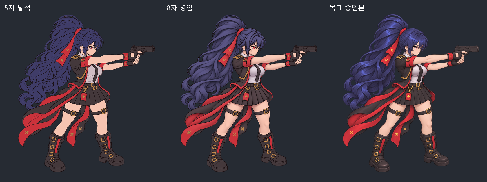

# LAST RAIL

Unity 기반 열차 전투 게임 개발 프로젝트입니다. 게임 클라이언트, 서버, 관리자 도구, 홈페이지와 캐릭터 제작 도구의 구현을 함께 정리한 취업 포트폴리오입니다.

## 살펴볼 코드

| 영역 | 경로 | 내용 |
|---|---|---|
| 게임 | [unity-project](unity-project) | Unity 클라이언트, UI, 전투 및 Addressables 리소스 연결 |
| 서버 | [server](server) | 게임·관리자 API 및 서버 상태 처리 |
| 관리자 | [admin](admin) | 운영 웹 화면과 백엔드 |
| 홈페이지 | [homepage](homepage) | 프로젝트 웹 화면 |
| 제작 도구 | [FrameStudio](Tools/FrameStudio) | 단계별 승인, 선화·밑색·명암·광택·질감 분리 및 검수 |
| 설계 | [docs](docs) | 기획·계약과 개발 기록 |

## 캐릭터 제작 과정

첫 자세 → 주요 자세 → 나머지 프레임 각각에서 미채색·밑색·명암·광택·질감의 15단계 승인 흐름을 적용합니다. 명암을 새로 생성할 때 기존 승인 원본과 보호 범위를 유지하고, 최종 합성에서 색 변경이 실제 유지되는지 확인합니다. 위 이미지는 개발 중인 8차 명암 후보이며 최종 승인본이 아닙니다. 원본 외곽 잔점 등 남은 문제를 포함합니다.

## 제출 스냅샷과 실행 범위

2026-11-16 기준 로컬 개발 소스를 반영했습니다. 게임·서버·관리자·홈페이지 전체를 포함하지만 **전체 통합 검수 완료 또는 완성 게임 배포본은 아닙니다.** 새 PC에서 전체 빌드를 재검증하지 않았습니다. 개별 구성의 README와 프로젝트 설정을 확인해 주세요.

서버 인증·배포 설정과 원격 Addressables 콘텐츠는 별도로 필요합니다. 일부 개발 도구/테스트가 참조하는 로컬 QA 원본·영상은 포함되지 않습니다. 제작 도구의 최근 보호·승인 관련 테스트 68건과 실제 이미지 픽셀 검사를 수행했으며, 이 결과는 전체 게임 테스트 통과를 의미하지 않습니다.

빌드·캐시·로그·비밀 설정·과거 백업·실패 후보 원본은 제출 범위에서 제외합니다. 기존 GitHub에 있는 개발 이력은 유지하며, 이 저장소는 개발 원본을 자동 동기화하지 않습니다.

## 권리

포트폴리오 열람을 위한 공개입니다. 별도 라이선스가 명시되지 않은 코드·이미지·음원에 재배포 또는 상업적 사용 권한을 부여하지 않습니다. 포함된 외부 라이브러리의 권리는 각 라이선스를 따릅니다.
