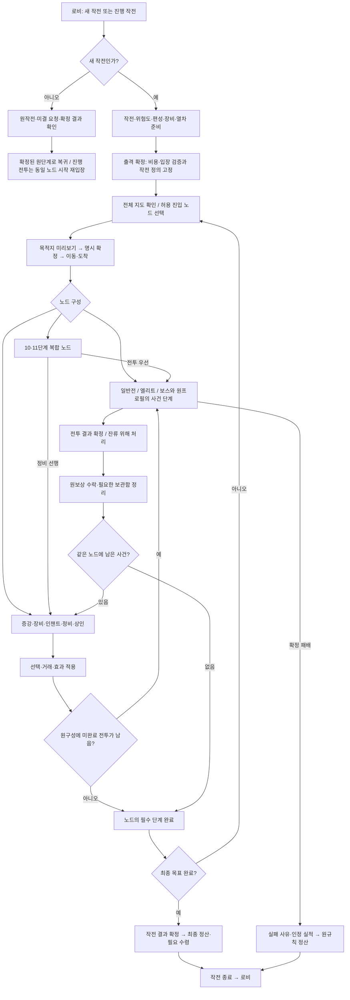

> **2026-10-02 현행 전투 변경:** A안 신규 적용 폐기, B안 채택. [44 현행 전환 결정](44_COMBAT_DETAIL_CONTRACTS.md#combat-b-mainline-approved-20261002)이 과거 A 유지/B 임시 및 객차 장착 포탑 전제보다 우선한다. 특정 노드 내부전은 별도 유지. 미승인 세부·기존 snapshot·역사자료는 구분하며 일괄 삭제/수치 치환하지 않는다.
# LAST RAIL | 전투 콘솔·주행·작전 저장

> **D1 사용자 승인 — 2026-09-22:** 직전 D1 추천안에 대한 사용자 “ㄱㄱ”로 navigation-resume-policy-v02의 미리보기+확정1회·추가 팝업 없음,저장 후 목적지/선로 재선택 없음,닫기 시 미결 대기 유지,영속 기록/재진입 전제 결과 확인 지연 중 로비 복귀,읽기 확인 후 명시 계속하기를 채택한다. 해당 UX 승인 대기 표기는 승인 전 이력이다. 기존 선로 옆 경고 삭제·시간/hold 규칙 유지. 실제 물리/복구/API/시안 검증은 별도다.

범위: 확인된 전투 조작·표시, rail 상태, 외부 포격, 시작/종료 요청 복구, 승인된 스킬 컷신 3단계(DAILY/ON/OFF)와 전투 정지·복귀 계약. 증강은 [05](05_AUGMENTS.md), 보상은 [06](06_REWARDS_ROULETTE.md), 검증은 [문서 안내](00_INDEX.md#qa)에만 정의한다.

## 1. 콘솔과 책임

**[U1 확정] 오른쪽 실제 지원 버튼 3개를 사용한다.** 이전 assistant 초안의 열차 명령 2개 기준은 폐기한다. 세 버튼의 이름·효과를 임의로 채우거나 궁극기와 합산해 해석하지 않는다.

ApprovedCombatView는 표시, rail journey state는 throttle·distance·junction preview/confirm·선택 시간 변환, BasicCombatSimulation은 전투 시간/효과와 영속 변경을 맡는다. 레버·미리보기·맵·확정·스로틀 입력을 실제 상태에 연결한다.

720×1280 root를 safe area에 비율 유지해 맞춘다. 우측 고정 18px AUTO, 실제 HP/charge/support cooldown·Ready/Down, 한국어 이름과 Kyle positive-result cue를 유지한다. 가로 분기·세로 throttle과 3개 지원 버튼은 원 Button callback/index/status를 보존한다. 카드/능력 ID와 상태 연결을 유지하며, 독립 그림의 tint/overlay를 상태에 맞춘다. 합성 승인 이미지를 실제 UI 위에 덮는 방식은 쓰지 않는다. [R22](00_INDEX.md#r22)

## 2. 분기·시간·저장

| 항목 | 규칙 |
|---|---|
| 선택 중 시간 | 설정 가능한 기본값 `0.01` |
| 선택 후 복귀 | 설정 가능한 기본 `0.6초` |
| 선택 제한 | timeout 없음 |
| 미확정 분기 | travel은 경계를 넘지 않고 확정까지 대기한다. 이동 대기는 전투 전체 일시정지와 동일하지 않다. |
| 미리보기 | commit 아님. 명시 confirm을 정확히 한 번 처리한다. |
| pause/background | 전투와 시간 복귀를 정지한다. UI는 unscaled time을 사용한다. |
| 반영 순서 | driver의 `clone → save → publish`. 저장 실패 시 선택/거리 변경을 표시 상태에 반영하지 않는다. |

config identity를 검증한 immutable 설정과 직렬화 상태를 사용한다. 설정된 throttle/top speed, 정수 elapsed·소수 carry, partition-invariant 복귀, 거리 적분과 pending/recovering 복원을 다룬다. 손상/위조 상태를 거부하고 큰 catch-up을 만들지 않는다. **증강 선택의 별도 정지 규칙은 [05 §4](05_AUGMENTS.md#pause)만 따른다.** [R22](00_INDEX.md#r22)

## 3. 편성·외부 전장·포격

기관차/객차를 실제 선택 metadata의 slot/id/type 순서로 독립 표시하고 지형 통과를 실제 거리에 연결한다. 후방 왼쪽 추격, 중경 풍경, track/map 분기와 선택 경로를 표현한다. 검증에 나온 객차 수를 게임의 최대 편성 수로 바꾸지 않는다.

`rail-artillery-v1` 정의로 damage/focus/exit 및 save/replay를 연결한다. 선택적인 독립 wave encounter 처리 순서는 원문 기준 **damage/exit → launch → in-flight impact**다. **passed는 killed가 아니며 처치 보상이 없다.** 기존 enemy를 이름만 바꿔 포격 개체로 재사용하지 않는다.

새 rail configuration/offers/artillery/replay validator는 버전이 있는 Server prepare wrapper로 공급하며 기존 CE03 wire는 유지한다. offers 없는 legacy profile은 해당 조작을 사용할 수 없다고 표시한다. run-local control을 영구 보상으로 만들지 않는다. 선택적 `railPresentation`도 별도 버전과 wrapper hash/schema/graph/asset identity 검증을 거치며 gameplay bytes를 임의 교체하지 않는다. [R22](00_INDEX.md#r22)

## 4. 시작·종료 요청 저널

PendingRunOperation은 kind(Start/Finish)·account·target·key·**정확한 BodyJson**·작성 build/time·최초 영속 AcceptedResponseJson을 보존한다. endpoint path는 검증된 kind/id에서 도출하고 토큰·Authorization·임의 URL은 저장하지 않는다. 별도 암호화 run 파일을 사용한다.

`원요청 구성 → 저장 → POST → 확정 응답 원자 저장 → 영속 완료 보고 → 명시 durable sink 인계 → 확정 기록 제거`

재시도 때 finish 결과를 현재 runtime 상태로 다시 만들거나 완료 시간을 다시 찍지 않는다. 동일 요청의 body/build/key도 바꾸지 않는다. 계정 준비 후 현재 계정 metadata만 복원하며 자동 POST는 하지 않는다. 재시도는 명시적이다.

동시 client는 저널에서 최초 저장 응답을 다시 읽는다. 확정된 기록을 pending POST로 재전송하지 않으며 확인 저장·인계·삭제 실패는 기록을 남긴다. 타계정 송신을 금지하고 손상/키 유실은 명시 실패다. 용량 초과는 원기록을 보존하면서 신규 작업을 거부한다. [R13](00_INDEX.md#r13) [R14](00_INDEX.md#r14)

| 구현 용량 | 값 |
|---|---|
| 대기 기록별 응답 예약 | 65536 **encoded response characters** |
| 저널 | 3 MiB |
| run 전용 파일 한도 | 16 MiB |

이는 저장 구현 수치이며 런 개수·게임 밸런스가 아니다. 문의의 metadata-only/64개 규칙은 [03](03_SUPPORT_DIAGNOSTICS.md)에 한정한다. [R14](00_INDEX.md#r14)

## 5. 빌드 스냅샷과 요청 형식

서버는 **최초 접수 시점**의 앱 빌드를 기록한다. 현재 설치 admission header와 원요청 작성 metadata를 분리한다.

| 사례 | 서버 결과 |
|---|---|
| B에서 접수·응답 유실 후 C에서 동일 요청 재시도 | B의 원접수 결과 반환 |
| B에서 구성만 하고 미전송 후 C에서 처음 전송 | 최초 접수 C 기록 |

두 경우 모두 현재 설치 헤더는 C이고 저장 BodyJson은 바꾸지 않는다. 원래 빌드를 주장하는 새 필드나 구버전 admission 가장 계약은 없다. 이 빌드는 콘텐츠·Balance Config·증강 카탈로그 버전과 다른 정보다.

실제 local HTTP에서 `raidResult:null`과 최상위 start package 참조가 거부되어 **새로 구성하는 요청에서** 생략했다. 이미 저장된 바이트를 묵시적으로 수정/마이그레이션하지 않는다. 레이드 기능 전체 삭제를 뜻하지 않는다. [R13](00_INDEX.md#r13) [R14](00_INDEX.md#r14)

## 6. 구형 저장 작전의 복구 불가 예외

**[U1 확정] 앞서 문제된 구형 저장 요청의 복구 불가 비호환이 확인되면 해당 저장 작전을 폐기하고 로비로 돌아간다.** 정책 결정이며 코드 적용 완료를 뜻하지 않는다.

`비호환·복구 불가 확인 → 해당 작전 재개/재전송 중단 → 저장 작전 폐기 → 로비 복귀`

이하 범위 설명은 이전 통합본의 안전 경계를 유지한다. 일시 통신 실패·응답 유실을 전부 폐기 사유로 확대하지 않고, 타계정/정상 작전/인증 기록을 일괄 삭제하지 않는다. 확정 서버 결과·보상·원장은 작전 재개 데이터와 구분한다. 로컬 폐기를 서버 취소·연료 환불·보상 회수라고 표시하지 않는다.

입장 비용의 원인별 처리 정책은 [§12.4](#run-expiry)에서 확정한다. 실제 오류 코드, 서버 진행 중 작전 종결 명령, 원차감 거래·재개 데이터와 미확정/확정 응답의 분리는 기존 계약을 확인해 연결할 구현 항목이다. 미첨부 endpoint/enum이 이미 구현된 것으로 가정하지 않는다. [U1](00_INDEX.md#u1) [R13](00_INDEX.md#r13) [R14](00_INDEX.md#r14)

## 7. 이 범위로 확인되지 않는 전투 규칙

전달 당시 제한된 원문만 확보했으나 현재 로컬에는 공격/방어/치명타·요원 능력·출격 wire·개별 궁극기·침입/블록·객차 피해·Down 복귀·보스/Final Operation 관련 상세가 존재한다. [상세 원문 등록부](39_SOURCE_REGISTER.md)에서 찾으며, 원문 부재와 현행 통합/구현 미검증을 구분한다. 각각의 승인·시험안·후속 대체 범위를 확인하고 이전 assistant 초안의 미검증 수치를 운영값으로 재사용하지 않는다. 2칸15웨이브 승리나 rail 복원 검증은 모든 작전 구조 또는 적/체력/투사체/RNG의 완전한 기기 크래시 복원 증거가 아니다. [R22](00_INDEX.md#r22) [R14](00_INDEX.md#r14)

## 8. 후속 전투 결정과 공통 데이터 연결

[U2] 포탑은 기본 공격·액티브·패시브를 가진 열차 부속품이며 독립 궁극기는 두지 않는다. 지휘관 스킬의 직접 강화 원천/계산은 [09 §8](09_COMMANDER_PROGRESSION.md)에서 정의한다. 오른쪽 실제 지원3개를 다른 수의 명령 슬롯으로 되돌리지 않는다. 포탑 자체 내구도와 전투 객실 종속 판정은 [§11](#turret-lifecycle)을 따른다. 마나/에너지와 쿨타임은 스킬별로 정의하고 현재 포탑 액티브는 쿨타임형 기준을 사용한다. [§11.1](#turret-skill-resources)을 따른다.

장비 성급 상승에는 결과 카테고리·단일 세트 태그·기본 능력치·고유효과·유지/소멸 인챈트와 장착 세트 활성화 변화를 미리 표시한다. 성급 상승 결과의 카테고리·태그·능력치 미리보기는 확정이다. J03에 따라 새 랜덤 고유효과는 미리보기에서 무작위라고 표시하고, 합성/승급 확정 후 저장된 실제 결과를 보여준다. 기존 확정 고유효과의 합산은 미리 보여준다. [13 §8](13_EQUIPMENT_ENCHANTMENTS.md#preview)을 따른다. 장비16종·인챈트16종의 전문은 13에만 둔다.

[U3] 작전의 밸런스 선택·버전 고정·배포 경합은 [08 §7](08_BALANCE_RELEASE.md), 지휘관 내실 스냅샷은 [09 §9](09_COMMANDER_PROGRESSION.md)를 따른다. 새 계약은 기존 원요청 저널을 임의 변형하는 허가가 아니다.

[U5] 규칙 변경형 상위 특성6종은 [09 §7](09_COMMANDER_PROGRESSION.md#capstone-rules)이 소유한다. 전투는 연계/공용방벽/표식/추격 상태, 노드 owner는 올인/고가치표적의 승인된 계획·목표·정산을 연결한다. 원문에 보고된 기존 전투 구현 완료 범위에 이 신규 기믹을 포함하지 않는다.

## 9. U9 점검과 진행 작전

[12 §4](12_SERVICE_MAINTENANCE.md#recovery)의 권장 기본은 사전 신규 출격 차단 후 기존 승인 작전 종료를 허용하고, 본점검에는 복구 가능한 상태를 보존하는 흐름이다. 상세 시간·기기 체크포인트·서버 지원은 구현 검증 전제다.

점검을 §6의 복구 불가 구형 작전 폐기 사유로 사용하지 않는다. 정상 체크포인트·시작/종료 원본문·키·고정 balanceVersion을 보존한다. 저장을 확인하기 전에 전투 씬을 파괴하거나 '저장 완료'라고 표시하지 않으며, 저장 실패는 실제 상태와 재시도를 안내한다. 점검 해제 후 원래 작전/미확정 결과를 기존 계약으로 확인한다. 전투 전체 크래시 복구가 이미 구현됐다는 선언이 아니다.

## 10. 최신 장비·맵 통합 접점

장비는 요원·포탑 각각3슬롯, 최고6성이며 작전 종료 시 소멸한다. 기본/고유/세트/인챈트의 실제 규칙과 제안 수치는 [13](13_EQUIPMENT_ENCHANTMENTS.md)가 소유한다. 합성으로 기본·고유 성능을 성장시키되 세트 활성은 현재 장착 개수로 다시 계산하므로, **편성 전체의 성능이 항상 상승한다고 표기하지 않는다.**

맵은 부모가 하위 노드를 공유할 수 있는 분기 구조다. 노드·이벤트·전투 내부 웨이브의 관계는 [14](14_MAP_EVENTS_DROPS.md)에서 정의/판단한다. 과거15웨이브 검증을 현재 맵15노드나 증강5회 보장으로 변환하지 않는다.

포탑 자체 내구도와 객실 파괴 시 전투불능은 J01로 확정되었다. 액티브 자원은 스킬별로 정의하도록 확정했고, 개별 비용/시간은 실제 스킬 정의와 연결한다. 지휘관 지원3개는 실효과 ID를 확인하여 내실·상위 특성과 연결하며, 이전 assistant의 명령2개 또는 포탑 궁극기 구성을 복원하지 않는다.

## 11. 포탑 생존과 전투 객실 종속 — J01 확정

포탑은 **독립 HP·방어·피해/회복 대상**을 가진 열차 부속품이며 소속 전투 객실 칸에 결속한다. 기본 공격·액티브·패시브를 사용하고 궁극기는 없다.

`포탑 생존 = 자체 HP > 0 AND 소속 전투 객실 생존 AND 별도 전투불능 상태가 아님`

포탑 자신의 HP가0이면 파괴되고, 소속 전투 객실이 파괴되면 자신의 HP가 남아 있어도 함께 전투불능으로 판정한다. 구현상 HP를 강제로0으로 덮어쓸 필요는 없으며 원인(자체 파괴/객실 파괴)을 기록한다. 잔여HP가 있다고 공격·액티브·생존 조건부 패시브를 계속 실행하지 않는다. 패시브는 일반 생존 효과를 중단하되 명시적으로 정의된 사망 반응이 있으면 별도 규칙으로 처리한다.

HP/방어/회복/보호막 장비·인챈트는 **포탑 자신**에게 적용한다. 포탑 보호막이 남았다는 이유로 파괴된 객실 위에서 작동하지 않으며, 포탑 장비가 객실이나 지휘관 능력치를 자동 강화하지 않는다. 파괴된 포탑의 장비는 즉시 삭제하거나 추가 드랍으로 바꾸지 않고 작전 장비 소유 상태를 유지한다.

보완 제안: 발사 완료한 투사체는 기존 판정대로 처리하고, 아직 발사하지 않은 공격/액티브는 취소한다. 객실 수리는 포탑 자동 부활을 뜻하지 않으며 별도 복구 규칙에서 결정한다. 포탑 잔여HP·생존 원인·소속객실ID는 체크포인트에 함께 저장한다. 피해 중복 전파/사망 보상/복구 발동은 한번만 처리한다. 이 보완 처리의 실제 구현과 기존 객체 수명은 확인이 필요하다.

### 11.1 포탑 액티브의 자원 — 스킬별 정의 확정

포탑 전체를 마나형/쿨타임형 중 하나로 고정하지 않는다. **각 스킬이 쿨타임과 자원 소모를 따로 정의**한다. 사용자는 현재 구성은 쿨타임형이고 이후 마나·에너지 소모 스킬이 존재할 수 있다고 정했다. 이는 현재 소스를 전부 조사했다는 증거가 아니며 기존 비용과 쿨타임을 임의로 새 값으로 대체하지 않는다.

| 필드(설계명) | 역할/검증 |
|---|---|
| cooldownMs | 실제 스킬의 재사용 대기시간. 0이면 쿨타임 조건 없음 |
| resourceType | NONE / MANA / ENERGY |
| resourcePoolId | NONE이면 없음. 그 외에는 포탑 자신의 명시된 자원풀 |
| resourceCost | NONE이면0, 소모형이면 양수. 실제 스킬값 사용 |
| resourceDefinition | 최대량·정상 회복·초기량은 그 자원 정의에 둠 |
| activationConditions | 소속 객실/포탑 생존, 유효 대상, 정의된 쿨타임 완료, 필요한 자원 충족 |

현재 스킬은 `resourceType=NONE, resourceCost=0, 기존 cooldownMs 유지`로 연결한다. 미래에는 마나만, 에너지만, 쿨타임+마나, 쿨타임+에너지 조합이 가능하다. 마나·에너지 소모를 궁극기 충전으로 해석하지 않는다. 자원형 스킬에도 시전 동작·타깃·발동 간격 규칙은 필요하며0쿨타임을 무제한 재귀 호출로 구현하지 않는다.

소모와 쿨타임 개시는 정상 발동 확정 경계에서1회 처리한다. 확정 전 조건 실패에는 소모하지 않고, 확정 후 피격·중단의 환급 여부는 해당 스킬 정의를 따른다. 지휘관/열차 공용 자원과 자동 공유하지 않는다.

장비 쿨감은 `cooldownMs>0`인 스킬만, 마나회복/축전/마나 환급은 실제 MANA 풀/소모에만 적용한다. ENERGY를 MANA로 자동 치환하지 않는다. 에너지에도 특정 회복 효과를 적용하려면 별도 승인된 데이터 매핑과 설명이 필요하다. UI는 그 스킬에 실제 존재하는 쿨타임·비용·자원만 표시한다. 장비를 장착했다는 이유로 빈 마나바나 포탑 궁극기바를 만들지 않는다.

객실 파괴 시 잔여HP/마나/에너지와 무관하게 발동 불가다. 자원/쿨타임/발동 중 상태는 같은 체크포인트에 보존하고 재접속으로 회복·초기화하지 않는다. 객실 복구 뒤 포탑 재건 규칙은 여전히 별도 확정이 필요하다.

## 12. 오래된 저장 작전의 만료·정리 — J11 확정

**2026-09-21 사용자 “미확정사항 추천대로 확정시켜”에 따라 기본 재개 수명 72시간, 게임 중단 보정, 복구 후 최소 24시간 재개 기회, 원인별 입장 비용 처리를 확정한다.** 이 절이 해당 정책의 단일 원문이다. 조사용 데이터는 작전 재개 수명과 분리하고 [15 조사 로그 보존](15_LOG_RETENTION.md#retention-matrix)의 승인된 장기보존 정책을 따른다. 정책 승인은 실제 서버·Unity·Admin 구현이나 운영 적용 완료를 뜻하지 않는다. 기존 run/receipt wire에 필드나 명령이 이미 존재한다고 가정하지 않는다.

### 12.1 수명과 표시

| 항목 | 확정값/정책 |
|---|---|
| 재개 가능한 기본 기간 | 서버의 최초 작전 시작 승인부터72시간 |
| 안내 | 출격 확인·저장 작전 카드에 서버 기준 만료 시각. 잔여24시간 이하 강조 |
| 재접속·조회·저장 | 기본 기한을 계속 늘리지 않음. 클라이언트 시각 변경으로 연장 불가 |
| 노드/웨이브 진행 | 제한시간이 아니라 저장 작전 수명. SimulationClock·배속과 무관 |
| 만료 경계 | 서버 기준 `now >= resumeExpiresAt`이면 신규 진행 명령 불가 |
| 만료 뒤 | 해당 작전은 EXPIRED(설계명)로 종결, 신규 출격 막는 활성 슬롯 해제 |
| 서버 체크포인트·조사증거 | 재개 자격과 분리. 보관 기간/계층/hold는 [15](15_LOG_RETENTION.md#retention-matrix)에서만 정의 |
| 거래·보상·감사 최소 기록 | [15](15_LOG_RETENTION.md)에서 유형별 보관. 작전 만료의 연쇄 삭제 대상 아님 |

작전은 원래72시간을 기준으로 수명을 시작하고 승인된 서비스 중단만 추가 보류한다. 활성 점검 동안에는 영향을 받은 작전의 만료를 진행시키지 않는다. 이미 정상 만료된 작전을 이후 점검으로 부활시키지는 않는다.

### 12.2 점검·장애 보정

기존 작전을 실제로 진행/재개하지 못한 **서버가 확인한 게임 점검·장애 구간**만 시간에서 제외한다. DRAINING 중 정상적으로 작전을 계속할 수 있었던 시간, 사용자 자신의 네트워크 문제·로그아웃, 웹만의 점검은 자동 연장 사유가 아니다. 겹치는 중단 구간은 합집합으로 한번만 계산한다.

복구 시점의 확정 계산:
`새 재개기한 = max(기존 재개기한 + 새로 인정한 중단시간, 게임 정상복구시각 + 24시간)`

영향받은 미종결 작전에만 적용한다. 동일 incident를 다시 처리해도 중단시간/유예를 중복 더하지 않도록 incidentId와 적용 이력을 저장한다. 이는 작전 수명 보정이지 광고 SSV·상품·보상 claim의 원기한 변경이 아니다. 별도 기한을 변경하려면 그 거래 계약의 승인 절차가 필요하다.

### 12.3 종결·정리 순서

1. 로그인/복원/노드 진행 시 서버가 작전과 원 START/FINISH·보상 영수증을 확인한다. 일괄 만료 작업도 동일 조건부 종결 경계를 사용한다.
2. 이미 종료 승인된 작전은 완료/실패의 원결과로 처리한다. 로컬 응답이 없다는 이유로 EXPIRED로 덮지 않는다.
3. 계속 활성 상태이고 유효기한을 넘었다면 현재 revision·상태·선행 승인 결과를 검사하여 EXPIRED로 한번만 종결한다. FINISH·보상·만료 경쟁은 같은 서버 직렬화/원자 경계에서 하나의 결과로 확정한다.
4. 만료 이후에는 새로운 진행/승리 승인을 만들지 않는다. 클라이언트가 과거 완료시각을 적었다는 사실만으로 만료 이전 완료를 인정하지 않는다. 서버에 확정된 선행 거래가 있으면 그 결과를 보존한다.
5. 클라이언트는 서버 종결 영수증을 안전하게 저장/인계한 후 해당 작전의 **재개용 상태·런 장비·전술 재화**만 정리하고 로비로 돌아간다. 정리 실패는 원결과를 유지한 채 재시도한다.
6. 서버 미접속/UNKNOWN/단순404만으로 만료·실패를 확정하지 않는다. 로컬은 '보관 기한 확인 필요'로 해당 재개만 보류하고 원요청·인증·다른 계정 상태를 삭제하지 않는다.

클라이언트의 시작/종료 원본문·키를 만료 처리용으로 다시 쓰지 않는다. 서버 종결 후에도 미확정/확정 지급 기록을 별도 정산 소유자에게 인계하기 전 삭제하지 않는다. 관리자 화면은 자동 만료 목록·원인·마지막 승인 노드·비용/지급·복구 결과를 조회하게 한다. 일반 만료는 서버 자동 처리하고 운영 예외는 기존 Admin에서 감사와 함께 처리한다.

### 12.4 비용과 보상 — 확정

| 원인/상태 | 확정한 입장비용·보상 처리 |
|---|---|
| 정상72시간 경과·사용자 방치·명시 포기 | 실제 입장비 자동 환급 없음, 미완료 노드/작전 클리어 보상 없음 |
| 시작이 서버에서 거절되어 미차감 | 환급 거래도 만들지 않음 |
| 서버가 확인한 서비스 사유로 복구 불가능한 강제종결 | 실제 차감된 입장비만 원거래 기준1회 반환. 승리/미완료 보상 지급 안 함 |
| 앱 구버전·클라저장손상·자진삭제만 주장 | 자동 환급 없음. 유효한 업데이트/재복구 또는 Admin 검토 |
| 서버에 이미 지급 확정된 영구 보상·XP | 보존. 만료로 회수/중복 지급하지 않음 |
| 서버에 이미 승인된 작전 종료와 미수령 보상 | 작전 만료 대상에서 제외, 원 보상 기한·계약으로 복구 |
| 런 전용 장비·전술 재화 | 작전 종결로 소멸. 영구 보상으로 자동 환전하지 않음 |

기술 사유 환급은 `종결원인 + 원차감거래 + runId`에 결속하고 중복 방지 원장으로 처리한다. 무료입장에는 새 재화를 지급하지 않으며 무료충전·광고 시청 횟수를 되감지 않는다. 기존 연료 overflow 정책은 유지하고 구매/SSV 기록은 회수·삭제하지 않는다.

### 12.5 삭제 대상 경계

재개 데이터 정리는 물리적 거래삭제가 아니다. 요약 종결기록·고정 버전 식별·정산/중복 방지 영수증·보상 원장·불변 BalanceVersion은 그대로 별도 보존한다. 서버 체크포인트 정리 작업은 보류된 조사/미완료 정산이 있으면 유예한다. 재방문 시 TTL을 다시 시작하거나 ID 재사용을 허용하지 않는다. 조사 보관기간은 [15](15_LOG_RETENTION.md)의 사용자 승인 정책을 따른다. 실제 개인정보 범위·기산점 검토와 저장소 구현은 별도다. 72시간은 재개 자격일 뿐 조사증거나 계정·결제 데이터의 삭제기한이 아니다. 조사 보관으로 만료된 작전의 재개 권한이 부활하지 않는다.

## 13. 최신 원화·전투 모델 아트 연결

오퍼레이터 원화는 [16 아트 가이드](16_ART_STYLE_GUIDE.md)의 두 번째 릴스 캐릭터 품질 목표를 적용하고, 전투 모델은 같은 정체성의 SD 축약판으로 제작한다. 이번 가이드는 이 문서의 지원3개·상태 표시·조작·저장 규칙을 바꾸지 않는다. 일러스트의 고정 조명·고밀도 디테일을 작은 전투 화면에 그대로 옮기거나, 원화에 HP/쿨타임 상태를 고정해 그리지 않는다. 실제 신규 자산 제작·매핑은 별도 검증 대상이다.

공통 제작 세부는 [17 오퍼레이터](17_OPERATOR_COMMON_STYLE.md), [18 배경/컷신](18_BACKGROUND_CUTSCENE_STYLE.md), [19 SD 변환](19_SD_COMBAT_MODEL_TRANSLATION.md)을 참조한다. 이는 실제 상태를 표현할 자산 설계다. 스킬 연출 설정에 따른 명시적 정지·복귀는 아래 §14를 적용하며, 컷신 프레임·원화 크기·재생 길이로 스킬 판정이나 시전시간을 다시 정의하지 않는다.

## 14. 궁극기·지휘관 스킬 컷신 3단계 — 사용자 확정

**2026-09-21 최신 정정 “Off는 이전 제안처럼 요약연출로” 적용:** 설정은 **하루 한 번 / 항상 표시(ON) / 요약 연출(OFF)** 세 가지다. ON과 DAILY의 첫 재생은 표준 전체화면 컷신, OFF와 DAILY의 재시청 대상은 기존 요약 연출을 사용한다. 실제 전체화면 재생 중에는 전투 유효 배속 0을 적용하고, 부분 컷인·명령 표시만으로는 전투를 정지시키지 않는다.

**OFF를 연출 완전 삭제로 해석했던 직전 설명은 폐기한다.** 요원 궁극기는 짧은 부분 캐릭터 컷인, 일반 지휘관 스킬은 짧은 명령 표시와 전장 반응을 사용한다. 별도 허용된 초토화급은 이전 제안의 짧은 전용 요약 컷신을 유지하며, 이것을 전체화면으로 재생할 때에만 전투 정지 규칙을 적용한다. 실제 SD 동작·장치 반응·투사체·피해/회복 FX·위험 예고·상태 UI와 스킬의 원래 시전·조준·대기 규칙은 유지한다. 요약 연출이 즉시 명중이나 시전시간 생략을 의미하지 않는다.

이 절은 설정 의미·전투 시간·입력·발동/복귀의 단일 계약이다. 구도·분리 원화·컷 구성은 [18 §8](18_BACKGROUND_CUTSCENE_STYLE.md#cinematic-scope)에 둔다. 세 가지 선택지와 ON/OFF 의미는 확정이다. **DAILY의 구체적인 집계 단위·하루 기준·저장 방식 및 초기 기본값은 §14.6의 권장안**으로 구분하고, 사용자 발언에 없던 세부를 이미 승인된 것으로 표시하지 않는다.

### 14.1 설정과 대상

| 사용자 표시 | 저장 식별자 제안 | 실제 동작 | 컷신이 추가하는 전투 정지 |
|---|---|---|---|
| 하루 한 번 | `DAILY` | 해당 날짜의 미시청 대상은 표준 전체화면, 이미 시청한 대상은 OFF와 동일한 요약 연출. 구체 집계는 §14.6 권장안 | 실제 전체화면 재생 중에만 유효 배속 0 |
| 항상 표시 (ON) | `ALWAYS` | 동일 스킬의 반복 사용도 매번 전체화면 컷신 | 실제 전체화면 재생 중 유효 배속 0 |
| 요약 연출 (OFF) | `OFF` | 짧은 부분 컷인·명령/전장 연출. 별도 허용된 초토화급은 짧은 전용 요약 컷신 | 일반 부분 연출은 없음. 초토화 요약이 전체화면이면 재생 중 0 |

| 대상 | DAILY에서 재생 대상일 때 / ALWAYS | OFF / DAILY에서 이미 시청한 경우 |
|---|---|---|
| 실제 지정·허용된 요원의 궁극기 | 요원 중심 표준 전체화면 컷신 | 짧은 부분 캐릭터 컷인 + 실제 SD 궁극기 동작·효과 |
| 실제 지휘관 스킬 | 열차/장치/명령 중심 표준 전체화면 컷신 | 짧은 명령 표시 + 실제 열차·객차·표적의 상태·FX |
| 별도 허용된 초토화급 대형 행동 | 대형 표준 전체화면 컷신 | 짧은 전용 요약 컷신 + 실제 발사·탄도·명중. 전체화면 사용 시 전투 정지 |
| 요원·포탑 기본 공격, 자동 액티브, 패시브 | 기존 전장 동작·FX. 새 컷신 대상 아님 | 동일 |
| 내실·증강에 의해 파생한 보조 포격/방벽 | 원래 스킬 장면 또는 전장 FX에 연결. 독립 컷신 재귀 없음 | 실제 추가 효과만 |

이 설정은 **전투 스킬 컷신**에 적용한다. 이야기 CG·스토리 영상·보상 룰렛·광고 제공 정책의 재생 설정까지 바꾸지 않는다. 포탑 궁극기는 없으며 오른쪽 지원 버튼 3개와 요원 궁극기의 기존 사용 자격을 변경하지 않는다. 불리언이 아닌 구분 가능한 모드로 저장하며, 기존 bool 설정이 실제 존재한다면 `true → ALWAYS`, `false → OFF`로 명시 변환하는 안을 사용한다. 아직 구현되지 않은 설정 저장소나 API가 있다고 주장하지 않는다.

### 14.2 전투 배속 0과 연출 시간의 분리

**실제 전체화면 컷신에만 중앙 SimulationClock/TimeManager의 컷신 전용 hold를 추가해 유효 전투 배속을 0으로 만든다.** 표준 전체화면뿐 아니라 별도 허용된 초토화 요약 전체화면에도 동일하게 적용한다. 요원 부분 컷인·일반 지휘관 명령 표시에는 컷신 hold를 만들지 않는다. 사용자가 선택한 1배/2배 등의 설정을 영구히 0으로 덮어쓰지 않으며 `Time.timeScale`을 게임플레이 제어 경로로 새로 사용하지 않는다.

정지 범위는 아군·적의 이동/공격/AI, 포탑, 실제 투사체, 열차 주행/거리, 체력 변화, 마나/에너지 회복, 스킬 쿨타임, 지속효과·상태이상 시간, 지휘 스킬 연계 시간, 웨이브/노드 게임플레이 진행, 분기 선택 후 시간 복귀를 포함한다. 컷신 아래의 SD 전투 모션과 게임플레이 FX도 실제 상태와 함께 정지한다. 아군 효과만 계속 처리하거나 적만 멈추는 방식은 금지한다.

컷신용 분리 원화·영상·장식 FX·UI·음향은 **전투 시계와 분리된 presentation clock**으로 재생한다. 컷신 속 장치/인물이 움직여도 정지한 실제 개체의 Transform·HP·자원·공격 상태를 바꾸지 않는다. 앱이 백그라운드로 가거나 별도 메뉴 정지 상태가 되면 연출 시간도 해당 정책에 따라 정지한다. 게임 배속 2배를 컷신 재생속도 2배로 자동 적용하지 않는다.

서버 실시간과 네트워크 처리는 이 전투 정지의 대상이 아니다. **작전 72시간 재개 기한, 광고/상품/보상 승인 기한, 인증 만료, 서버 점검 상태는 컷신 때문에 연장되지 않는다.** 서버가 실제 만료·점검·계정 무효화를 확인하면 해당 정책이 우선하며 연출이 이를 숨기거나 우회하지 않는다.

### 14.3 발동과 종료·스킵

1. 원래 스킬 owner가 대상·사용 자격·생존·쿨타임·자원을 검사한다. 거절된 행동에는 성공한 스킬처럼 표준 컷신이나 요약 연출을 시작하지 않는다.
2. 기존 사건 식별자와 발동 결과를 한 번만 확정하고 해당 순간의 컷신 모드를 캡처한다. DAILY는 표시 차례에 동일 대상의 일일 시청 상태를 다시 확인해 표준 전체화면과 요약 연출 중 이번 표시를 정한다. 연출이 비용·게이지·스킬 효과를 별도로 확정하지 않는다.
3. 실제 전체화면을 표시할 행동만 승인된 안전 tick 경계에서 컷신 hold를 얻고 다음 전투 tick을 막은 뒤 재생한다. 부분 컷인·명령 표시만 사용하는 OFF/DAILY 요약에는 이 hold를 만들지 않는다. 초토화급 요약이 전체화면인 경우는 같은 hold 계약을 적용한다. 이미 같은 tick에서 확정된 사건은 되돌리지 않으며 새 시전시간이나 즉시 명중을 만들어내지 않는다.
4. 완료/사용자 스킵/자산 오류는 해당 표시 작업을 한 번 종료한다. 카메라·HUD·입력을 복원하고 **해당 컷신이 획득한 hold만** 반환한다.
5. 다른 정지 사유가 없을 때 기존에 선택한 배속과 분기 시간 변환을 이어서 사용한다. 컷신 동안의 실시간을 전투 delta에 누적해 몰아서 처리하지 않는다.

실제 공격·효과는 원래 스킬 사건의 시뮬레이션 순서와 시전 규칙대로 진행한다. 즉시 확정하는 효과와 지연 발동 효과를 컷신 때문에 같은 것으로 바꾸지 않는다. **컷신 종료·발사 장면·AnimationEvent에서 독립 피해/치유/자원/보상 지급을 만들지 않는다.** 스킵은 시전 취소·비용 반환·무료 재발동·실제 시전 대기 생략이 아니다.

동일한 시뮬레이션 tick의 입력과 초기 상태라면 DAILY/ALWAYS/OFF/스킵 여부 때문에 전투 결과가 달라져서는 안 된다. 현실에서 걸린 플레이 시간은 전체화면 감상 시간만큼 달라질 수 있고 서버 시계는 계속 진행한다.

### 14.4 입력·중첩 정지·복원

전체화면 동안 게임플레이 조작을 차단하고, 스킵·설정·필요한 안전 메뉴만 허용한다. 반대로 부분 요약 연출은 핵심 위험 예고·지원 버튼 3개·분기/스로틀 입력을 가리지 않으며, 장식 프레임은 뒤쪽 버튼을 오작동시키는 클릭 영역을 갖지 않는다. 여러 요약 연출이 겹칠 때는 장식 표시를 축소/통합하고 실제 전투 사건을 연출 대기열 때문에 지연하지 않는다. 컷신 표면 뒤의 지원 버튼/배속/분기 버튼에 입력이 전달되면 안 된다. 차단 중 누른 공격·스킬 입력을 나중에 몰아서 자동 실행하지 않는다.

같은 tick에 이미 승인된 연출 대상 행동이 여러 개면 기존 사건 순서에서 실제 표시 대상만 직렬 재생하고, 연속 전체화면 사이에 전투가 한 tick 진행되는 틈을 만들지 않는다. DAILY는 대기열에 넣었다는 이유만으로 시청 완료 처리하지 않으며, 같은 대상의 두 번째 표준 전체화면 여부는 첫 표준 재생 시작 결과를 반영한다. OFF/DAILY 요약 표시 자체는 표준 전체화면 시청 기록을 소비하지 않는다. 순서는 연출 owner가 아니라 실제 사건의 승인 순서다. 아직 승인되지 않은 명령을 컷신 큐가 대신 승인하거나 자원을 예약하지 않는다. 보조 포격/연계 효과는 새 전체화면 대상에서 제외한다.

메뉴·증강 선택·점검·백그라운드 hold와 컷신 hold를 별도로 관리한다. 컷신 종료가 남아 있는 다른 정지를 풀거나 앱 복귀 시 중복 release를 발생시키면 안 된다. 설정 변경은 다음 승인 행동부터 적용하고, 현재 컷신을 끝내려면 스킵을 사용한다.

화면 자산 누락·디코드/연출 실패 시 전체화면만 안전 종료하고 최소 전장 FX로 대체한다. 원스킬은 원래 규칙대로 한 번 처리하고, 다른 정지가 없다면 전투를 재개한다. 표시 자산 오류만으로 작전을 삭제하거나 스킬 비용을 다시 부과하지 않는다. 이 복구는 실제 오류 대비이며 ON 자산 제작 범위를 임의 축소하는 정책이 아니다.

재시작 복원은 저장된 원스킬 사건과 기존 복구 계약을 따른다. 기기가 종료되기 전 재생 중이었다고 스킬을 다시 사용하지 않는다. 복원된 장식 컷신은 재시전 없이 종료/생략 처리하고 안전하게 HUD로 돌아가며, 진행 중 사건의 효과는 원래 상태에 따라 이어간다. 실제 체크포인트 지원 없이 복원 완료를 주장하지 않는다.

### 14.5 구현 후 검증할 기준

| 시험 | 기대 결과 |
|---|---|
| ALWAYS: 요원 궁극기·지휘관 스킬 | 반복 사용도 매번 전체화면. 재생 중 전투·거리·게임플레이 타이머 변화 0, 컷신 프레임은 진행 |
| OFF: 요원 궁극기/일반 지휘관 스킬 | 짧은 부분 컷인/명령·전장 요약. 컷신 hold 없음, 실제 효과·경고·시전 규칙 유지 |
| OFF: 별도 허용된 초토화급 | 짧은 전용 요약 컷신. 전체화면이면 재생 중 전투0, 종료 후 소유 hold만 해제 |
| DAILY: 첫 재생과 반복 | 승인된 집계 범위의 첫 재생만 표준 전체화면, 이후 OFF와 동일한 요약 연출 |
| DAILY: 서로 다른 스킬 | 스킬별 집계안 채택 시 한 스킬 시청이 다른 스킬의 첫 재생을 소모하지 않음 |
| DAILY: 재접속/노드/작전 변경 | 같은 날짜의 기록 유지. 다음 날짜는 실제 새 발동에서만 재생 |
| DAILY: 시청 실패/스킵 | 첫 가시 프레임 이전 자산 실패는 미시청, 실제 시작 후 명시 스킵은 시청 취급하는 권장안 검증 |
| DAILY: 큐·날짜 경계·모드 전환 | 큐 중복 차단, 재생 시작 날짜에만 기록, 모드 전환으로 기록 초기화 없음 |
| 2배속에서 전체화면 시작/종료 | 재생 중 유효 배속 0, 종료 후 기존 선택 2배속 복귀 |
| 스킵·반복 종료 callback | 피해·비용·보상·hold 반환 중복 없음 |
| 메뉴/증강/점검 hold 중첩 | 컷신만 끝나도 다른 정지 유지 |
| 앱 백그라운드·복원 | 전투/연출의 밀린 시간 몰아 처리 없음, 재시전 없음 |
| 다중 승인·파생 효과 | 실제 사건 순서 유지, 파생 포격의 전체화면 재귀 없음 |
| 자산 실패·기록 동기화 실패 | 영구 정지·이중 비용·뒤 버튼 오동작·추가 서버 권한 생성 없음 |
| 게임/현실 시간 | 컷신이 72시간 재개 기한·서버 거래 기한을 연장하지 않음 |

이 표는 수행해야 할 시험 요구사항이다. DAILY의 세부는 아래 권장안 승인 후 계약에 맞춰 검증한다. 이번 문서 편집으로 Unity/실기기/성능/복원 시험이 통과했다고 기록하지 않는다.

### 14.6 하루 한 번의 세부 기준 — 권장안, 추가 승인 필요

**권장 집계 단위는 ‘스킬별 하루 첫 1회’**다. 계정 전체의 컷신 중 아무거나 하나만 하루에 보거나, 모든 지휘관 스킬을 한 회로 묶지 않는다. 예를 들어 Reina 궁극기를 보았어도 다른 요원 궁극기·서로 다른 지휘관 스킬은 각각 그날 첫 사용에 보여주는 안이다. 실제 사용 가능한 요원·스킬만 해당하며, 여러 궁극기를 동시에 수동 사용할 권한을 추가하지 않는다.

| 항목 | 권장 처리 |
|---|---|
| 초기 기본값 | `DAILY` 추천. 아직 사용자 확정값이 아님 |
| 날짜 경계 | 기존 서버의 게임 일자/일일 초기화 기준을 재사용. 기기 자정·마지막 시청+24시간과 혼용하지 않음. 현재 문서에 정확한 초기화 시각은 없으므로 새 시각을 임의 확정하지 않음 |
| 기록 키 | 환경 + 계정 + 안정적인 스킬/컷신 그룹 ID + gameDayKey. actionId·runId·장비 성급·일반 자산 해시는 하루 1회 구분 키로 쓰지 않음 |
| 시청 시점 | 표준 전체화면의 첫 가시 프레임이 실제 표시됐을 때 해당 날짜에 표시 시작을 기록. 단순 버튼 입력·스킬 거절·대기열 등록·프리로드·요약 연출은 표준 시청이 아님 |
| 사용자 스킵 | 실제 표시 시작 후 명시적 스킵은 그날 표시한 것으로 처리. 반복 스킵을 요구하지 않음 |
| 표시 실패 | 첫 프레임 전 로드 실패는 기록하지 않음. 같은 세션의 실패 자산은 재시도 폭주를 막고 실제 FX로 진행. 이미 보인 뒤 오류·종료는 저장된 시작 기록 유지 |
| ALWAYS와의 관계 | ALWAYS에서 실제 본 표준 전체화면도 해당 날짜의 시청 기록에 반영. 이후 DAILY로 바꿔도 표준 전체화면은 다시 나오지 않고 요약하는 안 |
| OFF와의 관계 | 요약 연출은 표준 전체화면 시청 기록을 만들지 않음. 초토화 요약이 짧은 전체화면이어도 동일. OFF↔DAILY 전환은 기존 기록을 삭제하지 않음 |
| 날짜가 재생 도중 바뀜 | 재생 시작 일자에 기록. 컷신 종료 뒤 다음 날짜의 정상 발동부터 새 판정. 자정만으로 영상 자동 재생 금지 |
| 노드/작전·로그인 변경 | 같은 계정의 같은 일자·대상 기록을 유지. 계정 변경 시 다른 계정의 기록을 승계하지 않음 |
| 자산·수치 패치 | 일반 패치·재다운로드만으로 하루 기록을 초기화하지 않음. 새 컷신 그룹을 만드는 경우 별도 기획 승인 |
| 기기 간 동기화 | 계정 단위 공유를 목표로 하되 실제 설정/기록 API 확인 후 연결. 로컬 저장만 구현한 단계는 기기 간 1회를 보장한다고 표기하지 않음 |

일일 기록은 **표시 편의 데이터**이며 보상·스킬 사용 권한이 아니다. 계정별 로컬 기록과 최근 확인된 서버 일자로 판정하고, 서버 동기화는 기존 계정 설정 경계에 연결하는 안이다. 매 스킬 사용마다 시청 승인 API를 기다리게 하지 않는다. 날짜·기록을 신뢰할 수 없는 동안에는 표준 전체화면 대신 준비된 요약 연출을 사용하고 실제 스킬을 정상 진행하며, 요약 자산도 없으면 최소 전장 FX로 대체한다. 정합성 회복 뒤 다음 발동부터 판정한다. 이때 시청했다고 가짜 기록하지 않는다.

큐에서는 현재 실제 표시 중인 동일 일자·스킬에 대해 임시 중복 방지를 적용한다. 표시 전 취소·실패한 큐 작업은 예약을 해제하고, 기록·설정 오류가 게임플레이 hold를 장시간 유지하지 않게 한다. 재시작 후 전체화면을 복원 재생하지 않고 원전투 사건을 복구하는 기존 계약을 유지한다.

초기값, 정확한 하루 시각, 스킬별 집계, 동기화·시작/스킵 처리안은 구현 전에 확정한다. 세 모드 자체를 다시 2단계로 축소하거나 OFF를 연출 완전 삭제로 되돌리지 않는다. DAILY의 표준 전체화면을 생략하는 상황은 OFF와 같은 요약 연출로 연결한다.
## 기존 상세 계약·검증 원문 위치

아래 전문은 생략된 필드·오류·직렬화·복구 경계를 확인하는 원문이다. 최신 사용자 정정과 충돌하는 구형 정책을 복원하지 않으며, 과거 테스트를 이번 검증으로 재사용하지 않는다.

- [R13 2026-09-06-durable-run-operations.md](44_COMBAT_DETAIL_CONTRACTS.md#source-e894b886198cfc95)
- [R14 2026-09-06-durable-run-verification.md](../../../QA/DocumentIntegration-20260921/md-cleanup/semantic/archive.html#doc-6b081df063799c37f55d)
- [R22 2026-09-13-combat-second-final.md](../../../QA/DocumentIntegration-20260921/md-cleanup/semantic/archive.html#doc-3d6004241c9dfe4ca38e)

## 누적 원문 대조 보충

[전투·증강·경로 보완 계약](34_COMBAT_POLICY_COMPANION.md)에서 기존 상세 정책, 대체된 규칙과 미해결 경계를 함께 확인한다. 요약 밖 API·이력 원문은 보존한다.

## 작전 일지 목록·상세 화면 기획 v01 — 2026-09-21

사용자 요청: 클라이언트에서 과거 작전을 모아 확인하는 기능을 기획하고 Direction 시안 제작 지시문을 제공한다. 목적은 언제 어떤 작전을 어떤 편성으로 진행했고 어떤 결과/보상을 받았는지 확인하는 것이다. **기획·검토용 시안 제작 범위**이며 아래 세부 UI는 제안, 런타임/API 구현·출시 승인은 아니다. Plan_6 기획/통합, Server 본인 기록 조회·정산 원본, Unity 목록/상세와 기존 결과 연결, Direction 시안·독립 자산을 소유한다.

### 기존 기능과 추천 구조

현재 Unity의 LobbyRunLifecycle/LobbyResultPresentation에는 특정 run의 결과·보상 상태 조회, RunResultHistoryDisplayState에는 원 출발 편성 표시가 있다. StoryArchiveView는 스토리 기록 열람이다. 이번 확인에서 과거 run을 페이지 단위로 모으는 통합 화면은 확인하지 못했다. 이 기능들을 재사용하고 스토리 기록을 작전 실행 이력으로 대체하지 않는다.

추천: 로비의 기존 메뉴 계층에 **작전 일지** 진입점을 두고 별도 전체 화면 목록→상세를 사용한다. 결과 화면에는 기존 돌아가기 흐름을 유지한다. 메뉴의 정확한 자리/버튼 수는 실제 로비와 비교 후 확정한다. 대안으로 스토리 보관소 탭 통합은 실제 전투 이력과 서사 해금을 혼동하기 쉽고, 결과 팝업만 확장하면 여러 작전 탐색 공간이 부족해 첫 시안에서는 분리 화면을 사용한다.

### 목록 화면

- 최신 순으로 완료/실패/포기 등 **종결이 서버에서 확인된 작전**을 표시한다. 진행 중 작전은 목록 위 별도 안내 영역에서 기존 이어하기로 연결하는 후보이며, 미종결을 패배로 넣지 않는다. 격리·종료 확인 중 상태는 이해 가능한 확인 안내로 표시한다.
- 행 구성: 종료 일시, 작전명/종류, 확인된 위험도, 승리/패배/포기 결과, 보상 상태, 상세 열기. 일시는 서버 정산 시각이며 전투 소요시간과 다르다. 미확인 시각/종류는 빈 근거를 만들어 채우지 않는다. 날짜 구분과 같은 시각의 안정적 정렬은 서버 조회 계약으로 고정한다.
- 필터 후보는 전체/스토리/일반 등 서버가 구분한 종류와 전체/승리/패배/포기 결과다. 지원하지 않는 분류를 실제 버튼으로 활성화하지 않는다. 첫 범위에 자유 검색·통계·순위·공유·내보내기는 넣지 않는다.
- 페이지 크기·보관기간은 현재 데이터/조회 정책 확인 전 숫자를 만들지 않는다. 첫 화면과 추가 불러오기를 분리하고 추가 조회 실패 시 기존 행·스크롤·필터를 유지한다. 새 결과 갱신이 스크롤을 강제로 맨 위로 옮기지 않게 한다.

### 상세 화면

| 영역 | 표시 내용 | 근거/제약 |
|---|---|---|
| 결과 요약 | 작전명·종류·위험도·결과·종료 일시 | 원 run의 서버 결과. 현재 출격 선택을 가져오지 않음 |
| 출발 편성 | 원 START에 기록된 요원과 배치. 열차/객차는 해당 snapshot이 있을 때 추가 | 기존 RunResultHistoryDisplayState 재사용 검토. 현재 보유 편성으로 대체하거나 실제 전투 참여/생존 이력이라고 부르지 않음 |
| 진행 정보 | 완료 웨이브·실전투시간 등 검증된 값이 있을 때 표시 | 현재 미연결 필드는 ‘기록 미제공’. 계획 웨이브를 완료 수로, 시작/종료 wall time 차를 실전투시간으로 계산하지 않음 |
| 보상 | 서버가 확인한 종류·수량·수령 상태. 최초 스토리 보상 구분은 원 정산 근거가 있을 때만 | 예상/지급 완료/미수령/미확인 구분. 문자열 파싱으로 ID 추정 금지. 미확인=0개 아님 |
| 스토리 클리어 | 해당 스토리 작전 승리와 서버 클리어 영수증에 따른 완료 여부 | 중간 사건 해결·기록 열람으로 클리어/해금하지 않음. [32 승리 정산](32_NARRATIVE_REFERENCE.md#story-first-reward-v01) 적용 |
| 행동 | 목록으로, 기록 새로고침, 기존 보상 결과 확인 | 읽기 화면 진입은 지급/재출격 명령을 실행하지 않음. 수령 가능할 때 기존 결과/수령 Controller로 연결. 원요청 미확인은 기존 복구 경로 사용 |

재도전 원클릭·전투 리플레이·당시 전투 영상·캐릭터별 피해량/생존 시간은 이번 범위 밖이다. 같은 화면을 보여주는 연출용 가상 값은 ‘시안용 예시’로 명시하고 실사용 기록으로 저장하지 않는다. 지급 완료는 서버 원장/영수증으로 판단하며 최초 클리어 표 하나로 대신하지 않는다.

### 상태 및 이동 계약

| 상태 | 화면/입력 |
|---|---|
| 최초 로딩 | 헤더·돌아가기 유지, 목록 로딩. 가짜 승패/보상 행을 실제 기록처럼 표시하지 않음 |
| 기록 없음 | 아직 완료한 작전이 없다는 안내. 기존 로비로 돌아가기 제공 |
| 필터 결과 없음 | 기록 없음과 구분하고 필터 초기화 제공 |
| 목록 성공/추가 조회 | 선택한 행의 run을 열고 목록 복귀 시 필터/스크롤 복원. 중복 run 행을 쌓지 않음 |
| 목록 오류 | 재시도 제공, 기존 데이터가 있으면 남기고 갱신 실패 안내 |
| 상세 로딩/오류/접근 불가 | 선택한 run 식별 유지. 다른 run의 이전 상세를 노출하지 않음. 서버가 본인 기록을 검증하고 없는 기록/접근 불가는 안전한 안내 |
| 보상 미확인/결과 복구 중 | 원결과 확인 동선. 새 지급 요청이나 새 작전으로 대체하지 않음 |
| 보상 미수령/지급 완료/수령 불가 | 실제 상태별 버튼/문구. 목록 조회만으로 상태 변경 없음 |
| 세션 만료/계정 전환 | 본인 기록 캐시·선택·지연 응답을 무효화하고 기존 인증 흐름 연결 |

Model은 조회 결과/선택 상태를 캡슐화하고 Controller는 조회·페이지·필터·상세·복구 입력을 조정한다. View는 콜백/이벤트로 입력 의도만 전달한다. 기존 결과/수령 기능을 하위 화면에 복제하지 않는다. 화면 종료 시 자신이 소유한 조회/구독만 해제하고, 이미 제출한 정산 명령은 원 Controller/저널의 수명으로 복구한다.

### Server 선행과 수용 기준

본인 run 목록의 cursor/안정 정렬·종결 분류·필터·보관범위·시각·원 START snapshot 가용성·상세/보상 상태·버전·오류 계약이 필요하다. 기존 특정 run 조회를 재사용하되 목록 API가 있다고 추정하지 않는다. 목록/상세가 서로 다른 시점이면 상세 권위 상태로 갱신하고 캐시 freshness를 정의한다. 운영/개인정보 기록 전체나 Admin 전용 조사 필드를 사용자 화면에 노출하지 않는다.

검증: 본인 범위, 같은 시각/페이지 경계 중복·누락, 필터/스크롤 복귀, 추가 조회 실패 유지, 옛 기록 필드 누락, 긴 작전명·보상 수량, 계정 전환 후 늦은 응답 차단, 과거 편성 표시, 미확인 지급의 중복 요청 방지, 스토리 승리 조건 일치. 실행·실기기·네트워크 검증은 아직 수행하지 않았다.

### Direction 시안 제작 요청 범위

기존 LASTRAIL 최신 승인 로비·기록 보관소·결과22 및16/17 화풍/독립 자산 규칙을 확인하고 같은 시각 체계로 연결한다. 새 홈페이지·새 전체 디자인 체계는 만들지 않는다. 목록/상세 기본안1종을 먼저 만들고 실제 입력 크기·긴 이름·스크롤을 비교한다.

필수 시안: 정상 목록(승리/패배/포기와 보상 상태 혼합), 출발 편성/보상 상세, 기록 없음/필터 결과 없음, 로딩/오류, 과거 상세 일부 미제공, 보상 미확인/미수령/지급 완료, 긴 화면·작은 화면. 같은 화면의 상태 전환으로 구성 가능하며 각 상태별 새 원화를 요구하지 않는다. 360/720 너비 및 기존 프로젝트 실제 표시 크기 기준으로 글자·터치·가림·스크롤을 검사한다.

프레임·내부 판·배경·아이콘·초상화·상태 표식·문구/날짜/수치·스크롤·버튼은 독립 제어한다. 기존 승인 자산은 정확한 원본 경로/용도 기록 후 재사용하고 임시 자산은 표시한다. 화면 한 장에 동적 문구/수치를 굽지 않는다. 결과는 reference-only/검토용이며 화면 승인·서버 연결로 표시하지 않는다.

산출물은 D:/Project/LASTRAIL/QA/DirectionImpact-20260921/ 아래 역할이 분명한 operation-history 후보 파일로 두고 기존 파일을 덮어쓰지 않는다. 기존 REVIEW.md와 공용 대기 항목에 시안 경로·사용 자산·검수/잔여만 기록한다. 파일 공유 편집은 배타 잠금/최신 재읽기 규칙을 따른다. 기획00/04/32나 Unity/Server 코드는 수정하지 않는다. 사용자 요청은 시안 지시문 제공이며 이번 Plan 턴에서 타 작업에 자동 전송하지 않는다.

## 첫 출격 준비·지원 선택 안내 보완 v01 — 2026-09-21 / 기획 후보

목적: 첫 출격 사용자가 준비가 막힌 이유와 다음 행동을 알 수 있게 한다. 사용자 후속 기획 요청에 따른 Plan_6 초안이며 신규 튜토리얼 보상·자동 편성·기본 지급·강제 연출·런타임 구현 승인은 아니다. 실제 지원의 로컬/운영 차이는 [09 지원 선택/출격 조사](09_COMMANDER_PROGRESSION.md#support-three-admission-evidence)를 따른다.

### 기존 흐름 재사용

Unity의 Assets/_LASTRAIL/Scripts/Presentation/MissionShell/LobbyDeparture.cs는 출격 요청 결과 확인/기존 run 복구를 우선하고, 출발 준비에 편성·열차·지원 선택·비용 확인·출격·가이드 콜백을 연결한다. LobbyDepartureGuide.cs는 원 계정/열차/궁극기 상태와 견적 유효성을 확인하고 로컬 지원 선택을 읽는다. 가이드 조회 실패는 미확인으로 남기는 기존 경계를 유지한다. 이 근거는 정적 읽기이며 실제 앱 입력 검증이 아니다.

추천은 **기존 준비 화면의 상태/안내 보완**이다. 별도 단계형 튜토리얼은 화면 이동·닫기 복구를 늘리고, 부족한 항목 자동 선택은 사용자 저장 의도를 바꾸므로 첫 범위에서 제외한다. 최초에만 강제로 안내하는 플래그도 만들지 않고 준비 상태에 맞춘 상시 도움말을 사용한다.

### 준비 화면에서 보여줄 상태

| 상태 | 안내 예시 | 사용자 행동/판정 |
|---|---|---|
| 계정/준비 정보 조회 중 | 출격 준비 정보를 확인하고 있습니다 | 기존 돌아가기 유지, 준비 완료로 오인시키지 않음 |
| 지원 선택이 실제로 비어 있음 | 전투에 사용할 지원 3개를 선택해 주세요 | 기존 지원 선택 화면으로 이동. 조회 실패를 빈 선택으로 취급하지 않음 |
| 지원 조회 실패/연결 없음 | 지원 선택을 확인하지 못했습니다 | 다시 확인. 로컬 전용 client 부재를 사용자 미선택으로 표시하지 않음 |
| 일부 슬롯만 편집 중 | 지원을 3개 선택한 뒤 저장해 주세요 | 중복 없이3개·순서 조정. 편집값을 저장된 선택처럼 출격 준비에 반영하지 않음 |
| 선택은 있으나 실행 효과 미지원 | 현재 출격에서 사용할 수 없는 지원이 포함되어 있습니다 | 이유가 확인된 항목 표시·변경 동선. 카탈로그 존재만으로 실행 가능 표시 금지 |
| 지원 저장 중/응답 미확인 | 지원 선택 저장 결과를 확인하고 있습니다 | 기존 원요청 복구. 새 저장을 반복하거나 저장 성공을 추정하지 않음 |
| 지원 저장 완료 | 저장한 순서대로 전투 지원이 배치됩니다 | 준비 화면 복귀 후 최신 저장값/revision 확인. 저장만으로 출격하지 않음 |
| 편성/열차 미확인·조건 부족 | 해당 항목의 실제 부족 조건 표시 | 기존 편성/열차 화면으로 연결. 미배치/잠김/미확인을 구분하고 허용 슬롯 수를 임의로 늘리지 않음 |
| 비용 견적 만료/선택 변경 | 준비 내용이 변경되었습니다. 비용을 다시 확인해 주세요 | 기존 견적 무효화와 재조회. 이전 비용으로 자동 출격하지 않음 |
| 출격 요청 결과 미확인 | 출발 처리 결과를 확인해 주세요 | 기존 원 START 조회·복구. 신규 출격 버튼으로 원요청을 대체하지 않음 |
| 이미 진행 중인 작전 | 진행 중인 작전을 확인해 주세요 | 기존 이어하기/결과 확인으로 연결. 자동 포기나 중복 출격 없음 |

여러 부족 조건은 각 영역에 표시하고, 상단에는 먼저 해결할 항목 하나를 안내하는 안이다. 인증/원 START 미확인·기존 run 확인을 먼저, 그다음 편성/열차/지원, 마지막 최신 비용·출격 가능 조건을 확인한다. 화면이 조건을 권위 판정하지 않으며 실제 Server 거절 사유와 현재 상태를 사용한다. 출격 불가 버튼에는 이유/해결 동선을 함께 제공한다.

### 돌아오기·변경·해제

- 준비→지원 선택→저장→준비 복귀 시 기존 선택 작전/위험도와 화면 맥락을 유지하되 비용은 필요에 따라 재확인한다. 취소는 편집 초안만 버리고 기존 저장 선택을 보존한다. 최초 조회의 revision0/빈 슬롯은 확인한 로컬 경로에만 해당한다.
- 지원 버튼 순서는 저장한 슬롯 순서다. 시안에서 사격/방어막/수리 순서 예시를 쓰더라도 실제 고정 순서나 기본 자동 지급이라고 표시하지 않는다. 현재 로컬 실행3종과 추가7종의 준비 중 표시는 운영 기능 보장과 구분한다.
- 조회 응답이 늦게 도착했을 때 계정/화면/선택 세대가 바뀌었으면 적용하지 않는다. 닫기는 자신의 조회/구독만 해제하며 이미 제출한 저장/START 명령을 없애지 않는다. 재시도는 기존 Controller/저널의 같은 실행 경로를 사용한다.
- 설명 가이드는 비용·지원 이름 등 확인된 데이터만 표시하고 준비 상태가 바뀌면 갱신 또는 종료한다. 튜토리얼을 봤다는 이유로 지원이 저장되거나 비용이 소모되지 않는다. 매 출격 강제 안내·추가 보상을 만들지 않는다.

### 첫 범위·담당·수용

Plan은 상태/문구/이동 의도를, Server는 실제 지원 접근성·저장/출격 버전·권한/비용을, Unity는 기존 콜백 연결·조회 수명·복귀 상태를 소유한다. Direction은 기존 출격 준비53/55와 최신 가이드의 승인 기준을 확인하고 필요 시 상태만 보완한다. 새 전체 화면 시안 요청이나 타 작업 자동 지시는 이번에 보내지 않는다.

인수 사례: 빈 선택 첫 진입, 조회 실패, 저장 전 취소, 순서 변경 저장/복귀, 미지원 효과, 다른 기기 변경, 견적 만료, 저장 응답 유실, START 응답 유실, 계정 전환, 안내 중 상태 변경. 입력1회→기존 처리1회, 미확인 상태 자동 저장0, 이전 계정 데이터 노출0, 요청 중복 출격0을 확인한다. 문구/기획 작성만 완료했으며 UI 실행·API 통합 검증은 아직이다.

선행은 기존 WAIT-001의 지원 운영 접근성/계약과 WAIT-003의 새 출격 계약을 참조한다. 이 보완안을 이유로 현재 정상 동작하는 준비/가이드 기능 전체를 미구현으로 되돌리지 않는다.

## 작전 종료·로비 복귀 상세기획 v0.1 — 2026-09-22 / 후보

Plan_6 담당, 할 일2번 보완. 목적은 승리/패배/포기/만료와 보상 지급 상태를 구분하고 종료 응답 유실·화면 이탈 후에도 원 결과로 복귀하게 하는 것이다. 기존 §4 요청 저널, §12 만료,06 기본/상품/광고 정산,32 스토리 승리 정책을 변경하지 않는다. 다음 화면·버튼·로비 복귀 조건은 상세 후보다. 수정04·33·WAIT-003/010, 소비 Server/Unity/Direction.

### 1. 추천 흐름과 대안

**종료 결과 확인 → 결과/지급 상태 표시 → 기존 수령·복구 또는 로비 복귀.** 로비로 돌아간 사실은 수령 포기·지급 완료가 아니다. 원 작전/종료 요청/보상 식별과 처리 상태가 안전하게 보존되고 기존 재진입 경로가 준비됐을 때, 보상 확인 지연만으로 결과 화면에 사용자를 계속 가두지 않는 안을 추천한다.

모든 지급 완료까지 복귀를 막는 대안은 단순하지만 점검/통신 장애 동안 이탈을 막는다. 무조건 로비로 이동해 기록을 버리는 대안은 원 요청 복구가 불가능하므로 사용하지 않는다. 안전한 보존/재진입이 없으면 정상 복귀 가능으로 표시하지 않고 원 기록을 지키며 저장/복구 문제를 안내한다. 앱 강제 종료를 막는다는 의미는 아니다.

### 2. 종료 사유별 화면

| 원 상태 | 표시 | 허용 동작·경계 |
|---|---|---|
| 승리 확정 | '작전 승리', 실제 목표/결과와 정산 상태 | 적격 기본 보상·기존 혜택 처리. 승리만으로 모든 지급 완료 표시 금지 |
| 패배 확정 | '작전 패배', 확인된 패배 근거 | 원 정책이 인정한 보상만 표시. 전체 보상0 또는 새 위로 보상을 임의 결정하지 않음 |
| 포기 요청 전 | 기존 포기 확인, 확인된 손실/미해결 항목 안내 | 취소는 현재 작전 복귀. 런 장비/보상 처리는 해당 원 정책·미결 범위 유지 |
| 포기 결과 확인 중 | '작전 종료 결과를 확인하고 있습니다' | 원 요청 복구. 화면 닫기/재시도로 다른 종료 사유 전송 금지 |
| 포기 확정 | '작전 포기', 원 정산 결과 | 승리/스토리 클리어로 바꾸지 않음. 이미 확정된 보상 임의 취소 없음 |
| 만료 확정 | '재개 기간이 만료되었습니다', 서버 확정 기한·처리 내역 | 신규 출격은 기존 준비로 연결. 입장 비용 반환은 §12 원인별 정책 적용 |
| 종료 미확정 | 확인 중/저장 또는 통신 오류 구분 | 클라이언트 결과만으로 계정 승리·활성 슬롯 해제·첫 보상 지급 확정 금지 |

만료는 서버의 원 상태로 판단한다. 로컬 시각이 지났다는 이유로 정상 FINISH/지급 승인 작전을 만료로 덮지 않는다. 미승리 패배·포기·만료에는 이번 스토리 클리어/첫 보상 없음. 진행 중 사건 해결만으로 계정 클리어를 표시하지 않는다.

### 3. 화면 영역과 보상 상태

상단은 종료 사유/작전 이름, 본문은 확인된 작전 결과와 출발 편성, 보상 영역은 실제 지급 상태, 하단은 현재 가능한 처리와 로비 복귀로 구성하는 안이다. 미제공 전투 시간·실제 참여 이력·웨이브 수를 추정해서 채우지 않는다. 최신 '작전 일지' 표시명과 기존 결과/수령 화면을 재사용하고 새 별도 결과 서비스를 만들지 않는다.

| 보상 상태 | 안내·입력 | 제한 |
|---|---|---|
| 조회 중/미확인 | '지급 상태 확인 중', 허용된 원 결과 조회 | 미수령 또는 지급 완료로 단정 금지 |
| 적격 미수령 | 원 기본 수령 또는 유효한 상품 혜택 선택 | 기존 기회·권한·기한 검증. 새 보상권 생성 없음 |
| 수령 처리 중 | 처리 안내, 중복 거래 차단 | 결과 불명은 원 거래로 복구 |
| 지급 완료 | 최종 reward lines와 수량·확정 상태 | 다시 열어도 재지급/전체 룰렛 연출 강제 없음 |
| 지급 대상 없음 | 확인된 원 사유 | 조회 오류를 대상 없음으로 숨기지 않음 |
| 기한/권한 등 거절 | 실제 이유와 가능한 원 복구 경로 | 임의 기한 연장·무료 대체 지급 금지 |

06/10 기준으로 기본 수령은 유지한다. 첫 데모에서 신규 광고 시청을 열지 않고, 유효 ACTIVE 광고 스킵 구매자의 기존 상품 사용승인·룰렛 경로는 보존한다. 상품 권한/기능 준비 조회 실패를 비보유자로 단정하지 않는다. 기본/상품/이미 승인된 광고 결과는 원 기회의 경합 계약을 따르며 각각 새 지급 경로를 만들지 않는다.

스토리 승리 시 클리어/진행과 첫 보상을 정산한다는 승인 정책을 유지한다. UI에는 원 계정 진행 상태와 실제 지급 영수증을 구분해 표시하고, 저장/응답 복구 중인 지급을 완료처럼 표시하지 않는다. 구 FINISH/claim의 최초 기록만으로 첫 보상 지급 완료를 주장하지 않는다. 구 계정 이행·원자 경계는32의 연결 대기다.

### 4. 버튼·복귀·재출격

- 기본 수령/상품 혜택: 기존 정산 Controller로 전달한다. 동일 원 기회에 중복 입력·서로 다른 신규 거래 경합을 UI에서 유발하지 않는다.
- 결과 확인/다시 시도: 원 종료 저널·보상 영수증을 조회/복구한다. 종료 재전송이 필요하면 §4대로 사용자가 명시 실행하고 원 body/build/key/time을 유지한다. 계정 준비나 화면 복원만으로 자동 POST하지 않는다.
- 로비로: 원 식별/요청·확정 응답이 필요한 저장/인계 경계를 충족했는지 확인 후 표시 화면만 전환한다. 요청 기록 삭제나 수령 포기 명령이 아니다. 미해결 상태는 기존 로비 복구 안내와 작전 일지/결과 화면에서 다시 접근할 수 있도록 연결한다.
- 같은 작전 다시 준비: 저장된 이전 START를 재전송하지 않고 기존 준비 화면에서 최신 적격성·편성·견적을 확인한다. 즉시 비용 소비/새 START 없음.
- 뒤로가기: 확인 모달이면 모달만 닫고, 최상위 결과에서는 로비로와 같은 조건을 적용한다. 포기 확인의 취소와 확정된 포기 결과의 닫기를 구분한다.

미수령 보상이 있다는 사실만으로 새 출격을 금지하는 정책은 추가하지 않는다. 종료 미확정 때문에 활성 작전이 남았거나 기존 admission이 막는 경우 그 실제 사유를 안내한다. 로비 복귀 화면이 활성 슬롯을 직접 해제하지 않는다.

### 5. 수명·복구와 담당 계약

종료 사실·보상 적격/정산·활성 슬롯은 Server가 소유한다. Unity의 기존 작전/보상 Controller와 저널은 요청/응답의 내구성 있는 인계를 관리하고, View는 표시·명령 의도만 전달한다. 화면 파괴 후 표시 갱신 차단·재바인딩 중복 방지·계정 교체 시 이전 응답 격리를 지킨다. 닫기 콜백에서 전역 요청 기록을 지우지 않는다.

필요한 의미는 계정/run identity, 종료 사유/확정 여부, 원 요청 결과, 보상 기회/상태/영수증, 재진입 참조와 admission 차단 사유다. 명령명·필드·에러·보존 기간은 기존 계약에 매핑하며 임의 wire를 만들지 않는다. 실제 저널 저장/확정 인계 실패 시 복귀 UX는 안전한 저장 경계와 함께 확정해야 한다.

점검 중 신규 출격 제한과 기존 원결과 정산 가능 여부를 분리한다. 저장소가 불가하면 원 요청을 보존하고 대기하며, 재추첨·새 지급키·기록 삭제로 우회하지 않는다. 작전 재개72시간과 보상/상품 claim 기한은 서로 다른 정책이다.

### 6. 검수 사례·통합 잔여

| 사례 | 기대 결과 |
|---|---|
| 승리 확정·보상 미수령 | 승리와 미수령을 함께 표시, 지급 완료 오인 없음 |
| 스토리 승리·정산 응답 유실 | 원 결과 복구, 첫 보상 중복 지급0 |
| 패배·포기·미승리 만료 | 이번 스토리 클리어/첫 보상0 |
| 종료 전송 후 앱 재시작 | 원 저널 복구, 자동 POST0, 명시 재시도 원 내용 유지 |
| 로비 복귀 후 결과 재열기 | 같은 원 상태·미해결 보상 복원, 재추첨0 |
| 보상 저장/인계 실패 | 기록 보존·복구 안내, 정상 완료 허위 표시0 |
| 수령 중 로비 복귀·연타 | 원 거래1회, 화면 수명과 거래 결과 분리 |
| 기본 수령 대 상품 혜택 경합 | 원 기회 계약대로1회 지급 |
| 광고 OFF·유효 상품 구매자 | 기존 상품 승인 경로 유지, 광고 시청/SSV 위조0 |
| 만료 조회와 이미 확정된 FINISH | 원 확정 종료/보상 보존, 만료 덮기0 |
| 다른 계정 로그인 | 이전 계정 결과 노출/송신0 |
| 다시 준비 | 최신 견적/준비 확인, 과거 START 재사용0 |

추천 결정은 안전한 원 기록·재진입 보장을 전제로 지급 확인 지연 중에도 로비 복귀를 허용하는 UX다. 구체 저장 실패 처리·로비 안내/일지 연결·최신 시안과의 호스트/모달 관계는 통합 검증 대상이다. WAIT-003은 종료/정산/출격 경계, WAIT-010은 작전 일지·결과 재진입 연결을 관리한다. Direction 최신 승인 문서의 실제 화면 연결과 대조 후 담당 보완·실기 검증이 필요하며, 이번 문서는 코드/API/실기 검수 완료가 아니다.

## 중단·재접속 단계별 상세기획 v0.1 — 2026-09-22 / 후보

Plan_6 담당, 할 일3번. 마지막 화면을 그대로 여는 대신 현재 계정의 원 작전·요청·확정 결과를 확인해 올바른 단계로 연결한다. §4 원 저널/명시 재시도, §6 확인된 비호환 폐기, §12 재개기한,12 점검 정책이 기준이다. 새로운 복구 서버나 완전한 전투 크래시 복원 보장은 추가하지 않는다. 상세 UX 작성 지시이며 기존 미결 후보들의 일괄 승인이 아니다.

### 1. 권고 흐름

**계정 확인 → 원 기록/서버 상태 조회 → 복귀 위치 안내 → 사용자가 계속하기 또는 원 요청 재시도.** 읽기 확인은 화면 진입 시 수행할 수 있지만 전투 재개·START/FINISH 재전송·새 수령 거래를 자동 실행하지 않는 안을 권고한다. 정지 상태 복원과 시뮬레이션 진행 재개를 구분한다.

이전 화면부터 먼저 열어 입력을 허용하는 대안은 이미 끝난 작전이나 다른 계정 상태를 조작할 위험이 있다. 모든 중단을 처음부터 다시 시작하는 대안은 원 거래·진행을 잃으므로 사용하지 않는다. 단순 백그라운드 복귀와 프로세스 종료 후 복구는 같은 데이터 보존 능력이라고 가정하지 않는다.

### 2. 원 상태별 복귀 위치

| 중단 지점 | 먼저 확인할 원본 | 확인 후 연결 후보 |
|---|---|---|
| 출격 준비, START 미생성 | 저장 편성/지원·현재 적격성 | 기존 준비 화면, 새 견적 필요 여부 확인. 임시 미저장 선택 자동 확정 없음 |
| START 기록 존재·결과 불명 | 원 START 저널/접수 결과 | '출격 결과 확인 필요'. 명시 재시도는 같은 요청, 새 START 금지 |
| START 승인·전투 아직 미진입 | 원 승인/작전과 지원 가능한 시작 상태 | 원 작전 시작 준비. 입장 비용 재소모 없음 |
| 실제 전투/이동 중 | 지원 체크포인트·원 데이터 버전/종결 여부 | 복원 가능한 위치 안내 후 계속하기. 벽시계 경과분으로 이동/공격/쿨다운을 임의 보정하지 않음 |
| 목적지 미리보기/선택 저장 중 | 원 graph/node/edge·선택 거래 | 미확정이면 선택 화면, 확정이면 원 목적지. 미리보기 강조로 확정 복원 금지 |
| 사건 진입 처리 중 | 원 사건 identity·진입 결과 | 같은 사건 준비/진행, 새 사건 생성 없음 |
| 증강·인챈트 선택/적용 중 | 원 카드/리롤/시술·적용 결과 | 원 선택 또는 적용 결과. 새 추첨/재시술 금지 |
| 보상 보류·정비 중 | 원 묶음/항목·장비·변경 거래 | 미해결 보상/정비 복귀, 최신 용량 확인. 미승인 일부 수령/포기 정책 유지 |
| FINISH 결과 불명 | 원 FINISH 저널·서버 종료 결과 | 종료 결과 확인/명시 재시도. 전투를 다시 실행해 FINISH 내용을 재작성하지 않음 |
| 종료 승인·보상 미확인 | 확정 종료/원 보상 기회·영수증 | 기존 결과/지급 상태 화면. 작전 재개하지 않음 |
| 서버 만료·포기·실패 종결 | 원 종결 영수증·별도 보상 기록 | 기존 결과·로비 복귀 정책, 활성 전투 부활 없음 |

인증/조회가 실패하면 어느 행에도 임의로 배정하지 않는다. UI에 남은 화면명보다 원 상태가 우선한다. 원 저널과 서버 상태가 충돌하면 기존 계약에 따라 결과를 확인하고, 임의 '최근 수정 시간' 비교로 하나를 폐기하지 않는다.

### 3. 복구 화면·입력

복귀 안내는 작전 이름, 확인된 단계, 저장/조회 상태, 서버가 제공하는 재개기한, 다음 행동을 보여준다. 저장 시각은 제공되는 실제 의미대로 표시하며 서버 접수 시각을 마지막 전투 체크포인트 시각으로 바꾸지 않는다. 미제공 항목은 생략/미제공 표시, 가짜 진행률·복구 예상시간은 만들지 않는다.

| 상태 | 표시/입력 | 경계 |
|---|---|---|
| 확인 중 | '작전 상태를 확인하고 있습니다' | 쓰기 입력 차단. 취소/화면 닫기는 조회 표시 수명만 종료 |
| 재개 가능 | '이어서 진행할 수 있습니다', 계속하기 | 현재 계정·버전·기한·필수 자산·hold를 재검사 후 기존 재개 경로 |
| 원 요청 확인 필요 | 결과 확인과 필요한 경우 명시 재시도 | 원 body/build/key 유지. 미적용 근거 없이 신규 키로 우회 금지 |
| 연결 실패 | '연결을 확인한 뒤 다시 시도하세요' | 네트워크 실패를 점검/만료/데이터 소실로 단정하지 않음 |
| 확인된 점검 | 실제 점검 안내·허용된 상태 재조회 | 예정 종료시각만으로 재개하지 않음.12 원 정책 유지 |
| 인증 필요 | 기존 로그인 경로 | 현재 계정 확정 전 이전 기록 송신/내용 표시 금지 |
| 복구 불가 확인 | 확인된 사유와 §6 기존 처리 안내 | 일시 오류를 비호환으로 확대하지 않음 |
| 저장 기록 손상/키 유실 | 명시 오류·기존 진단/지원 경로 | 자동 초기화·추정 복구·새 종료 결과 생성 금지 |

최상위 닫기/로비 이동은 원 기록을 보존하고 재진입 경로가 준비됐을 때 허용하는 후보이며 operation-end-lobby-detail-v01과 함께 결정한다. 뒤로가기를 작전 포기나 기록 삭제로 처리하지 않는다. 결과 확인 재조회와 명령 재전송을 같은 버튼의 숨은 동작으로 섞지 않는다.

### 4. 시간·자산·다른 기기

백그라운드 중 전투와 시간 복귀는 §2에 따라 정지한다. 복구 시 현재 적용 중인 점검·증강·정비 등의 정지 소유자를 보존하고 화면 복원이 이들을 일괄 해제하지 않는다. 프로세스 종료 뒤 전투 세부 상태가 원 체크포인트로 복구 가능한지는 별도 검증 대상이다.

재개 수명은 §12의 서버 기준72시간·승인 장애 보정/복구 후 최소24시간을 사용한다. 사용자 네트워크 단절·단순 로그아웃은 자동 연장 근거가 아니다. 보상/상품 기한과 합치지 않는다. 서버 미접속/UNKNOWN/단순404는 만료 확정 근거가 아니다.

원 작전 버전/자산 준비가 안 되면 누락 내용을 표시하고 지원되는 재조회/로딩을 제공한다. 최신 설정으로 저장 진행을 조용히 바꾸거나 구 작전 부품을 임의 치환하지 않는다. 구형 비호환·복구 불가가 확인됐을 때만 §6 범위의 재개 상태 폐기를 적용하고 별도 지급/원장 기록은 보존한다.

다른 기기에서 작전이 진행/종결됐다면 서버의 현재 상태와 명령 경합 계약을 따른다. 두 기기의 진행을 합산하지 않고 로컬 오래된 상태를 강제로 덮어쓰지 않는다. 동시 플레이 잠금/기기 인계 기능이나 신규 오류 코드는 이번에 도입하지 않으며 실제 지원 계약이 선행이다.

### 5. 소유권·수명

Server는 원 진행·종결·기한·명령 결과를, 기존 Unity 저널/체크포인트 소유자는 내구성 있는 로컬 기록을 관리한다. 복구 Controller는 조회 결과로 기존 화면/유스케이스에 연결하며 하나의 거대 복구 객체에 보상·전투 실행·정산을 복제하지 않는다.

View는 계속하기/조회/명시 재시도 의도만 전달한다. 계정·run·화면 세대가 바뀌면 늦은 응답 표시를 막고 소유 구독만 해제한다. 이미 전송한 거래를 화면 닫기로 취소했다고 간주하지 않는다. 재조회 실패와 명령 거절·결과 불명을 내부 계약에서 구분하고 비밀값 없이 진단 문맥을 남긴다.

복원 범위·저장 원자성·조회 일관성·명령 경합·지원 버전은 실제 Server/Unity 소스와 계약을 대조해야 한다. 이번 기획만으로 체크포인트가 적 HP/투사체/RNG까지 완전 복구한다고 주장하지 않는다.

### 6. 검수와 결정 대기

| 입력 사례 | 기대 결과 |
|---|---|
| 계정A 기록 보유 후 계정B 로그인 | A 내용 노출/송신0 |
| START 접수 후 응답 유실 | 원 결과 회수, 이중 출격/차감0 |
| FINISH 저장 후 앱 종료 | 원 기록 복원, 자동 POST0·명시 재시도 내용 불변 |
| 원 종료 승인 뒤 만료시각 경과 | 종료/보상 원결과 유지, 활성 만료로 덮기0 |
| 네트워크 오류·단순404 | 원 기록 보존, 만료/복구불가 단정0 |
| 점검 예상 종료시각 도달 | 실제 gate 확인 전 재개0 |
| 다른 기기에서 종결 | 오래된 로컬 진행 부활0 |
| 선택/시술/수령 응답 유실 | 원 거래 복구, 재추첨·중복 소비/지급0 |
| 화면 닫기·재열기 반복 | 중복 구독/이전 화면 응답 적용0 |
| 자산 준비 실패→재시도 | 원 버전 유지, 다른 사건/목적지 치환0 |
| 체크포인트 복원 지원 범위 부족 | 미지원 명시, 경과 시간 기반 가짜 상태 생성0 |
| 확인된 구형 비호환 폐기 | 해당 재개 데이터만 처리, 영수증/다른 계정 보존 |

새 추천은 읽기 확인 후 재개 위치 안내와 계속하기를 제공하고, 실제 쓰기/전투 진행은 명시 입력으로 시작하는 UX다. 정확한 재개 단위·전투 복원 범위·안전한 로비 복귀 조건은 미결이다. WAIT-003에서 기존 준비/전투/사건/종료 흐름과 점검·리소스 시안의 복귀 연결을 함께 검증한다. 문서 대조만 완료했으며 화면·코드·네트워크 단절/실기 검증은 수행하지 않았다.

## 작전 일지 상세 보완·승인 시안 연결 대조 v0.2 — 2026-09-22

Plan_6, 할 일5번. 기존 operation-history-v01의 데이터/권한/목록 계약을 유지하고 Direction 승인 시각 구성과 연결 명세의 누락을 보완한다. 시각 승인을 구현·API·보상 정책 승인으로 확대하지 않는다. 수정04·33·WAIT-010, 소비 Server/Unity/Direction. 최신 표시명은 작전 일지/이야기 일지다.

### 1. 이번에 읽은 원본과 범위

- [메뉴·목록·상세 v03 승인](../../../QA/DirectionImpact-20260921/REVIEW.md#menu-destinations-v03-final-20260922), [manifest](../../../QA/DirectionImpact-20260921/menu-destinations-v03/manifest.json): 기존 로비 위 메뉴, 작전 일지 목록/상세와 이야기 일지 전체 화면 구성.
- [경로/이야기 후속 승인](../../../QA/DirectionImpact-20260921/REVIEW.md#journal-followups-final-20260922), [manifest](../../../QA/DirectionImpact-20260921/journal-followups-v01/manifest.json): 경로 전체보기/행 펼침, 이야기 열람/잠금과 호스트 재사용.
- [상세 미제공·미확인·미수령 v02](../../../QA/DirectionImpact-20260921/operation-history-states-v02/manifest.json): 승인3종, 하나의 상세 View 내부 상태.
- [지급 상태 조회 v01](../../../QA/DirectionImpact-20260921/reward-status-lookup-v01/manifest.json): 승인2종, 확인 중/조회 실패의 인라인 보상 패널과 원 결과 복구.

위 문서/manifest의 계약을 읽은 정적 대조다. 이번에 PNG 육안 재검수·SHA 재검증·Unity/API 실행을 하지 않았으며 기존 시각 QA를 새 실행 증거로 사용하지 않는다. 공지/옵션 전체 연결안은 이번 대조 범위 밖이다.

### 2. 화면·호스트·복귀 연결

| 진입/입력 | 연결·표시 종류 | 복귀·상태 보존 |
|---|---|---|
| 로비 메뉴 → 작전 일지 | 기존 로비 메뉴 overlay에서 전체 화면 목록 | 메뉴 뒤 로비를 새 배경/호스트로 복제하지 않음 |
| 목록 행 | 선택한 원 run의 전체 화면 상세 | 목록으로: 필터·선택 run·스크롤 보존 |
| 상세 전체 경로 보기 | 경로 전체 화면1개, 처음에는 맨 위/접힘 | 상세로: 상세 스크롤 복원 |
| 상세의 특정 경로 행 | 같은 run의 경로 화면, 안정 node identity로 해당 행 펼침 | 뒤로는 원 상세. 전투/장비/사건별 별도 페이지 생성 없음 |
| 경로 내 다른 행 | 같은 화면에서 해당 행 펼침, 기존 펼침 닫기 | 같은 행 다시 누르면 접힘. 원 기록 변경 없음 |
| 보상 미확인 → 지급 상태 확인 | 같은 상세의 확인 중 패널 | 목록/뒤로 허용, 이전 화면 응답 적용 차단 |
| 적격 미수령 → 보상 수령 | 기존 정산 Controller, 같은 상세에서 결과 갱신 | 성공 후 상세 유지·수령 버튼 제거, 임의 로비 이동 없음 |
| 이야기 일지 → 기록 보기 | 해금 확인된 항목의 기존 이야기 열람 화면 | 이야기 목록의 선택·스크롤 복원 |
| 확인된 잠금 이야기 선택 | 기존 이야기 일지 위 모달+입력 차단막 | 닫기1회, 기존 호스트 유지·선택/스크롤 복원 |

마지막 두 행은 작전 일지에 새 스토리 버튼을 추가하는 제안이 아니라, 별도 이야기 일지와 혼동하지 않기 위한 경계 참조다. 모달의 뒤 화면은 참고 합성으로, 새 배경/두 번째 목록을 만들지 않는다. 모달이 떠 있는 동안 호스트 클릭·스크롤·포커스를 막고 닫을 때 소유한 차단막/구독만 해제한다.

### 3. 기록 범위·경로 표시

원 START 출발 편성과 실제 참여 기록은 구분한다. 편성/객차 수/경로/실전투시간을 서버가 제공하지 않으면 '기록 미제공'으로 표시하고 현재 편성이나 가짜 객차3개 그림으로 채우지 않는다. 기록 미제공은 확인된 작전 승리·지급 완료와 독립이다.

경로는 실제 기록된 노드와 순서를 표시한다. 예시01/02/03을 전체 방문 수나 현재 J04 총 노드 수로 확정하지 않는다. 일부 기록만 있는 경우 '이후 경로 기록 미제공' 등 실제 범위에 맞게 안내하며 모든 경로를 복원한 것처럼 연결선을 만들지 않는다. 경로 기록이 없으면 경로 진입을 숨기는 승인 시안 기준을 따른다. 조회 실패는 미제공 확정이 아니므로 원 오류/재조회 상태로 구분한다.

특정 행 진입 시 원 node가 조회 결과에서 확인되지 않으면 다른 행을 대신 펼치지 않는다. 같은 run의 경로 화면에서 해당 기록 확인 불가 안내와 상세 복귀를 제공하는 보완 후보로 둔다. 과거 사건 행을 열어도 사건 선택·전투 리플레이·수령 명령을 발생시키지 않는다.

### 4. 지급 상태 조회·수령 분리

| 원 상태/응답 | 상세 상태 | 실행 제한 |
|---|---|---|
| 미확인 | '지급 상태 확인' | 조회만, 새 지급 명령 없음 |
| 확인 중 | '확인 중…', 같은 조회/새로고침 차단 | 조회/재시도/새로고침은 공통 요청 guard 사용 |
| 조회 실패 | 미확인 유지, '다시 확인' | 지급0·미수령·완료로 추정 금지 |
| 조회 성공·여전히 불명 | 미확인 유지 | 조회 성공 자체를 지급 성공으로 표시하지 않음 |
| 적격 미수령 확인 | 원 내역과 기존 수령 동작 | 적격성·기회·원 거래 확인 후 기존 정산에 위임 |
| 지급 영수증 확인 | 지급 완료·최종 내역 | 수령 버튼 제거, 재조회/재열기 중복 지급 없음 |

첫 클리어/진행 영수증과 첫 보상 지급은 따로 확인한다. 시안의 승리·해금 예시는 실제 run의 증거가 아니며 중간 사건 열람으로 클리어를 확정하지 않는다. 기본/상품 혜택은06/10의 기존 원 기회 정책을 유지한다. 시안에 기본 수령 버튼이 있다는 사실만으로 유효 상품 혜택 경로를 제거하지 않는다.

수령 성공은 같은 상세를 갱신하고 목록으로 돌아갈 때 해당 행의 최신 상태도 반영한다. 원 조회가 더 오래된 응답이면 성공 상태를 되돌리지 않도록 freshness/revision 계약을 확인한다. 수령 결과 불명은 기존 원 거래 복구로 전환한다. 원 결과 확인과 신규 수령을 한 동작으로 합치지 않는다.

### 5. 목록·필터·계정·수명 보완

첫 조회 실패/성공한 빈 목록/필터 결과 없음/추가 조회 실패를 구분한다. 추가 실패 시 기존 행과 위치를 보존한다. 다음 페이지는 원 cursor·안정 정렬 계약을 쓰며 run 중복 행을 만들지 않는다. 새 결과 유입으로 목록 전체를 강제로 위로 스크롤하지 않는다. 상세에서 돌아온 기록이 더 이상 조회되지 않으면 다른 run으로 대체하지 않고 사유/갱신 안내를 제공한다.

로그아웃·계정 교체는 해당 캐시/선택·지연 응답을 무효화한다. 상세를 닫을 때 View의 조회/구독만 해제하고 제출한 정산은 원 소유자가 처리/복구한다. 경로 펼침/모달 닫기 등 하위 입력은 기존 Controller에 연결하며 화면마다 조회/보상 코드를 복제하지 않는다.

### 6. 이번 대조 결과와 통합 검수

| 차이/검사 대상 | 문서 처리 | 남은 검증 |
|---|---|---|
| 작전 기록 명칭 vs 승인 작전 일지 | 기존 제목/진입명 갱신, 역사 파일/ID 유지 | 실제 화면·접근성 명칭 |
| 초기 기획에 없는 경로 전체/행 펼침 구분 | 승인 시안의1화면/내부 상태와 원 node 진입 참조 추가 | 원 경로 API/행 식별·부분 기록·스크롤 |
| 상세 상태를 개별 화면으로 오인할 여지 | 하나의 상세 View·인라인 보상 패널 명시 | 독립 구성·중복 호스트0 |
| 조회/수령·첫 지급/클리어 혼동 | 시안 계약과 기획 정책 구분 일치 확인 | 원 영수증/경합·실제 지급1회 |
| 이야기 잠금의 호스트 복제 위험 | 기존 이야기 일지 유지·모달 수명 참조 | 뒤 입력 관통0·닫기1회·잔여 차단막0 |

이번 읽은 범위에서 위 핵심 데이터/지급 원칙의 명시적 정책 충돌은 발견하지 못했다. 일부 빠진 화면 구성/연결 참조를 보완한 것이며 전체 프론트/기획 무충돌 판정은 아니다. 관련 원본을 수정한 담당은 Plan이며 Direction 원본/승인 이미지/런타임은 수정하지 않았다.

실기 수용12사례: 목록→상세→목록 위치 복원, 같은 시각 페이지 중복/누락, 미제공 객차 그림 미표시, 부분 경로 표기, 전체보기 최초 접힘, 특정 node 펼침/같은 행 접힘, 경로→상세 위치 복원, 조회 중 뒤로 후 응답 격리, 조회 실패/불명 유지, 수령 성공 상세 유지·중복0, 계정 전환 격리, 이야기 잠금 호스트/입력 차단·닫기 복원. 승인 갤러리의360/720/1440 검사를 실제 기기 입력/독립 UI 검수로 대신하지 않는다.

WAIT-010에서 'Plan 문서 연결 참조 반영'은 위 범위만 반영 완료로 기록한다. API·Unity·독립 자산·실제 화면/수명·전체 승인 시안 대조는 계속 대기한다. 새 보완 UX(미존재 경로 대상·목록 항목 소실 처리)는 후보이며 시각 승인에 소급 포함하지 않는다.

## D1 선택 확정·결과 복귀·재접속 상세 v0.2 — 2026-09-22 / 승인 대기

Plan_6 소유.14의 route-confirm-time-v01과 본 문서 종료/재접속 상세를 묶어 남은 UX를 결정하는 단일 추천안이다. **새 D1 묶음은 승인 대기**다. 선로 확정 버튼 옆 ‘되돌릴 수 없음’ 문구 삭제, 기존0.01/0.6초·timeout 없음, D2~D7 승인 정책은 유지한다. 목적지와 동일 구간 안의 좌/우 선로를 다른 선택으로 다룬다.

### 1. 미리보기와 확정

목적지 카드 클릭은 정보 미리보기, ‘목적지 확정’은 원 선택 저장1회다. 선로 레버 조작은 좌/우 미리보기, ‘선로 확정’은 저장1회다. 드래그 종료·닫기·시간 경과·미입력으로 자동 선택하지 않는다. 후보 미선택/조회 불명/변경 요청 중에는 확정 불가다. 두 선택 화면을 동시에 활성화하지 않는다. D7 최종 스토리2선택 예외도 같은 목적지 확정 규칙을 쓴다.

확정 전에는 후보를 바꾸거나 미리보기를 닫을 수 있다. 최상위 선택창을 닫아도 이동 대기와 미결 선택은 유지되며 기존 진입 동선에서 같은 선택을 다시 연다. 닫기는 일반 경로 채택·이벤트 포기·작전 포기가 아니다. 확정 때 추가 확인 팝업은 없다. 버튼 옆 변경 불가 경고도 추가하지 않는다.

**첫 연결에서는 목적지와 선로 모두 저장 성공 이후 재선택하지 않는다.** 물리 잠금선 이전이어도 새 선로 확정을 허용하지 않는 단순한 계약을 추천한다. 잠금선은 실제 경로 고정의 물리 경계이며 재선택 가능 시간을 뜻하지 않는다. 잠금선 전 재선택 기능은 별도 정책/거래가 필요한 후속 범위다.

### 2. 저장 상태와 시간

| 상태 | 가능한 행동 | 경계 |
|---|---|---|
| 미리보기 | 후보 변경·닫기·유효 후보 확정 | 원 선택/난수 불변 |
| 저장 중 | 처리 상태 표시 | 선택 변경·중복 확정·이동 경계 통과 차단 |
| 저장 성공 | 원 확정 선택 표시 | 추가 hold 없을 때 기존 복귀 |
| 서버 미적용 확정 | 최신 후보 조회 후 다시 선택 | 이전 확인/미리보기 갱신 |
| 응답 유실·결과 불명 | 원 명령 결과 조회/기존 명시 재시도 | 실패로 단정하거나 새 키로 변경 금지 |
| 작전 종료/계정 변경 | 실제 종료/계정 흐름 | 이전 응답으로 이동 재개 금지 |

선택 시간0.01·복귀0.6초·무응답 timeout 없음은 기존04 설정을 따른다. 정비·증강·점검·백그라운드 등 완전 정지 사유가 있으면 그 정지가 우선이다. 선택을 저장했다는 이유로 다른 정지를 풀지 않는다. 정지 소유자가 모두 해제된 뒤 기존 시간 조정 경로 하나로 복귀하며 하위 화면마다 복귀 타이머를 복제하지 않는다.

미확정 상태에서는 이동 경계를 넘지 않는다. 이동 대기를 적 공격/쿨타임까지 완전 정지하는 규칙으로 확대하지 않는다. 실제 선택 대기 중 위험·잠금선 도달·열차 꼬리 합류/잔여 객체 수명은 Unity 물리/시간 계약으로 검증해야 한다. 검증 전 문서만으로 안전성이 확보됐다고 주장하지 않는다.

### 3. 결과 확인 지연 중 로비 복귀

**원 요청/결과를 영속 보존하고 재진입할 수 있으면 결과 확인 지연 중 로비 복귀를 허용**하는 안이다. 지급 완료까지 결과 화면에 계속 머물도록 강제하지 않는다. 복귀 허용 조건은 아래 모두다.

- 계정/run·원 FINISH/수령 요청 식별과 필요한 복구 정보가 기존 저널/서버 원장 계약에 맞게 영속 보존됨.
- 미확인 결과를 조회할 수 있고 기존 로비/작전 일지 또는 원 결과 복구 경로에서 해당 작전으로 재진입 가능함.
- 늦은 응답이 현재 화면/다른 계정을 갱신하지 않으며 원 거래 결과는 화면 수명과 별개로 관리됨.

조건이 충족되지 않으면 ‘복귀 정보 저장 중’ 또는 실제 저장 실패를 알리고 복귀를 아직 허용하지 않는다. 원 데이터 재저장/재확인을 제공하며 ‘저장 실패=작전 실패’로 처리하지 않는다. 복구 경로 미구현 상태에서는 이 UX를 완료로 인수하지 않는다.

로비 복귀는 보상 포기·지급 완료·활성 작전 슬롯 해제가 아니다. 종료 미확정이면 원 상태 확인 경로를 유지한다. 미수령 보상만으로 신규 출격 금지를 추가하지 않으며 실제 활성 작전/admission 조건으로 판단한다. 종료 결과의 광고/추가 보상 가능 상태도 원 계약대로 남기고 복귀만으로 소멸했다고 가정하지 않는다.

### 4. 재접속은 읽기 확인 후 계속하기

계정 확인 → 원 저널/서버 상태 읽기 → 복귀할 실제 단계 표시 → ‘계속하기’ 또는 원 요청 ‘다시 확인/재시도’ 순서다. 화면 진입 읽기 조회는 허용하지만 전투 재개·새 START/FINISH·수령 거래를 자동 실행하지 않는다. 원 저널의 명시 재시도 규칙을 따른다.

| 확인 결과 | 표시/행동 |
|---|---|
| 진행 중 전투·체크포인트 복원 가능 | 복원 위치 표시 후 계속하기, 입력 전 정지 유지 |
| 목적지/선로 미확정 | 원 선택 단계 계속하기, 자동 후보 채택 없음 |
| 장비/인챈트/증강 선택 대기 | 원 필수 선택으로 복귀,새 선택권 생성 없음 |
| 변경 요청 결과 미확인 | 원 결과 확인/기존 명시 재시도,계속하기로 덮지 않음 |
| 종료 확정 | 원 정산/작전 일지 결과로 연결,전투 재개 없음 |
| 점검/일시 지원 제한 | 원 제한 안내·조회,저장 작전 임의 폐기 없음 |
| 만료/비호환 확정 | 기존04의 확정 폐기/복귀 절차,조회 실패와 구분 |
| 저장/서버 조회 실패 | 다시 확인,작전 없음/실패/만료로 오인하지 않음 |

계속하기는 확인한 원 run/revision의 재개 가능성을 재검증한다. 누르는 동안 상태가 바뀌면 최신 단계를 표시하고 전투를 자동 실행하지 않는다. 읽기 확인·로컬 화면 복원과 시뮬레이션 시작을 분리한다. 전투의 어떤 시점까지 복구 가능한지는 실제 체크포인트 계약을 따르며 프레임 단위 완전 복원을 새로 약속하지 않는다.

### 5. 수용 기준과 담당

| 사례 | 기대 결과 |
|---|---|
| 후보 미선택 확정 | 실행 없음 |
| 드래그/닫기/장시간 미입력 | 자동 확정0,대기 유지 |
| 저장 성공 후 다른 선로 클릭 | 재선택0 |
| 저장 실패 확정 | 최신 상태로 다시 선택 |
| 확정 응답 유실 | 원 결과 복구,중복 명령0 |
| 점검+선택 저장 성공 | 점검 유지,독립 정지 해제 금지 |
| 종료 응답 불명·영속 기록 정상 | 로비 복귀 후 같은 원 결과 재진입 |
| 영속 기록 실패 | 실패 안내·재저장,안전 복귀를 가장하지 않음 |
| 종료 미확정 로비 | 활성 슬롯 자동 해제0 |
| 전투 복구 완료 | 계속하기 전 시뮬레이션 진행0 |
| 재개 클릭 전 서버 상태 변경 | 새 상태 확인,옛 전투 재개0 |
| 계정 교체/화면 파괴 후 응답 | 이전 화면 갱신/중복 구독0 |

Server는 선택/작전/결과 권위, Unity는 기존 명령·저널/복구·시간/화면 수명, Direction은 선택/잠금/복구/실패 상태 표현을 맡는다. 하위 View는 입력 의도와 표시만 제공하며 공통 명령·콜백/이벤트 Bind/Unbind를 재사용한다.

**D1 승인 묶음:** 미리보기+확정1회·추가 팝업 없음,저장 후 목적지/선로 재선택 없음,닫기 시 대기 유지,영속 기록/재진입 전제 결과 지연 중 로비 복귀,읽기 확인 후 명시 계속하기. 실제 물리 잠금/정지·저널 저장/서버 조회·기기 재시작·최신 시안/입력 검증은 WAIT-003/010 대기다. 위12사례는 수용 기준이며 실행 PASS가 아니다. D1 승인 전 코드/리소스를 자동 변경하지 않는다.

## D1 복구·결과 재진입 실제 소스 대조 v01 — 2026-09-22

Plan_6 제한 정적 조사. U=D:/Project/LASTRAIL/unity-project/Assets/_LASTRAIL/Scripts. 승인 D1을 실제 복구/화면 경계에 매핑한다. 코드/DB/HTTP/실행 테스트·실기기 저장 장애 재현은 하지 않았다.

| 근거 | 확인 사실 | 재사용/잔여 |
|---|---|---|
| U/Run/PendingRunOperation.cs | PendingRunKind는 Start/Finish/Claim,계정·대상·키·원본문·빌드·응답을 보유 | 새 노드 선택/장비 집합/시술 거래까지 지원한다고 간주 금지 |
| U/Run/DurableRunClient.cs RestoreAsync | 저널 읽기 후 현재 계정/generation 검사·게시,이 메서드에서 자동 POST 없음 | 읽기 복구와 명시 RetryAsync 분리 패턴 재사용 |
| 같은 파일 RetryAsync | 공급받은 객체 대신 저널의 원 기록을 확인,확정응답 재사용 또는 원 키/본문으로 POST | 신규 키 재시도/외부 미확인 객체를 확정으로 신뢰하지 않는 경계 유지 |
| U/Run/EncryptedRunOperationJournal.cs | 계정별 필터·동일 요청 검사·요청/응답 기록,최대32행/크기 제한·저장 실패 반환 | 무제한 새 기능 로그를 같은 저널에 밀어 넣지 않음. 용량/정리/장애 계약 확인 필요 |
| U/Auth/PlayerEntryRuntime.cs | EncryptedRunOperationJournal 및 DurableRunClient를 생성해 AccountScreens에 연결 | 실제 앱 구성에 연결된 기반 확인,Editor 전용 저널을 운영 근거로 삼지 않음 |
| U/Presentation/MissionShell/RunResultRecovery.cs | 원run/lifecycle/preview 검증·ownerGeneration 및 요청순번 확인,읽기/FINISH복구/수령 구분 | 늦은 응답/계정 격리 패턴 재사용. 새 노드 결과/거래는 추가 매핑 필요 |
| U/Presentation/MissionShell/LobbyRunLifecycle.cs ReturnFromRunLifecycle | 다이얼로그/페이지 닫기 후 공유 상태 갱신 | 해당 함수 안에서 D1 영속 저장/재진입 가능 검사 확인 못함. 상위 경로 포함 검증 필요 |
| U/Battle/CombatSceneDriver.cs Open/Change | 복원 또는 최초 저장,변경은 후보 상태 저장 성공 후 게시,실패 시 복구 필요 처리 | 체크포인트 기반 재사용. 모든 호출자의 명시 계속하기 게이트까지 증명하지 않음 |

CE03의 Editor claim 저널/복구 체크 코드가 존재하지만 실기기 강제종료·암호화 저장 고장·현재 새 그래프 복구의 실행 증거로 확대하지 않는다. CombatSceneDriver.Open에서 상태 복원이 되는 사실과 이후 caller가 언제 Step/전투 입력을 허용하는지는 별도다. 이번 조사에서는 ‘자동 재개 버그’를 재현하거나 ‘계속하기 전 정지’ 전체 보장을 검증하지 않았다.

### 인수 계약과 담당별 다음 작업

1. Unity 복구 조정: 승인 D1의 확인중/재개가능/거래결과미확인/종료/제한/복구실패 상태와 기존 Lifecycle/저널 결과를 매핑한다. 화면 진입은 읽기만,전투 Step 및 변경 명령은 명시 재개/재시도와 최신 상태 검사를 통과해야 한다. 체크포인트 없음과 최초 실행을 구분해 원 진행run을 새 전투로 조용히 초기화하지 않는다.
2. 저장 포트/Server: 요청 전 원 정보 보존과 확정응답 저장 실패를 구분한다. 저장 포화·읽기실패·확정응답 유실에도 원 서버 결과 조회가 가능한 식별자를 잃지 않는 계약을 제공한다. 최대32행 한계를 해결하려고 미확인 요청/영수증을 임의 삭제하지 않는다. 보존/정리 정책은 기존 원장·보존 규칙에 맞춘다.
3. 로비 복귀: 미확인 FINISH/claim이 있으면 영속 원 기록 및 해당run 재진입 경로를 검증한 경우만 복귀를 허용한다. 기존 Close가 정상인 경로와 새 D1 조건이 필요한 경로를 구분하고 모든 닫기를 무조건 막지 않는다. 실제 로비/작전 일지에서 같은run으로 재진입하는 입력/조회 근거까지 연결한다.
4. 신규 거래: 노드 선택/장비 집합/시술/지휘실 저장마다 권위 저장·원요청·멱등/조회·수명 소유자를 정한다. 별도 저널을 무조건 늘리거나 Start/Finish/Claim enum에 이름만 추가하지 않는다. 기존 패턴 재사용 여부는 거래 경계/버전/보존 요구로 판단한다.
5. Direction: 읽기 확인·계속하기·원 결과 확인·저장 실패·복귀 제한을 승인 공통 팝업/로딩과 기존 화면에서 표현한다. 과거 기록 상세에서 수령한 뒤 상세 유지와 전투 종료에서 로비 복귀는 진입 맥락별로 유지한다.

필수 인수 증거: 요청 저장 실패 시 전송/복귀 처리,서버 확정 후 로컬 응답저장 실패 복구,저널 포화/손상,실제 앱 종료 후 동일원요청 복구,계정 교체/늦은 응답 격리,계속하기 전 tick 변화0,재개 직전 만료/종결/점검 변경 재검증,로비→원run 미확인 결과 재진입,보상 중복0. 이는 향후 실행 기준이며 이번에 PASS로 확인한 것이 아니다.

이번 조사로 정책을 다시 결정하지 않는다. 기존 코드의 저장/복구 기반을 활용하되 전체 D1 완료로 승격하지 않는다. WAIT-003은 재개/종결·저장 경계,WAIT-010은 기록/원 결과 재진입,WAIT-004/011은 각 신규 거래 원결과 연결을 소유한다.

## DAILY 연출 일자·기록 상세 v02 — 2026-09-22 / 첫 시험 기준 승인

Plan_6. §14.6을 구체화한다. 세 모드/요약 유지/게임판정 독립은 기존 계약이며 아래 기본값/집계·일자·동기화 경계를 후속 사용자 ㄱㄱ로 첫 시험 기준 채택한다. §14.6과 아래 작성 당시 승인대기/제안 표기는 이 범위에서 대체. 설정/API/런타임 변경 없음.

- 초기값 DAILY,기존 저장한 ALWAYS/OFF/DAILY는 유지. 계정·안정 스킬/컷신그룹별 게임 일자 첫 표준 전체화면1회,이후 OFF와 같은 요약. 모든 스킬을 한 회로 묶지 않는다.
- 기존 서버 **04:00 Asia/Seoul=UTC19:00** 경계 재사용. 로컬 근거: Worktrees/11ec/LASTRAIL/attendance-pass-20260907/server/apps/game-api/src/activity-policy.ts의 dailyResetUtcMinutes=1140 및 attendanceDay=floor((now−1140×60000)/86400000). monthly-attendance-policy.ts의 serviceShift=5h도 같은 경계다. 배포/시청API 연결 완료 근거는 아니다.
- 키는 환경+계정+안정 skill/cutsceneGroup ID+권위 gameDayKey. 기기 자정/경과24시간/runId/actionId/일반 자산해시로 구분하지 않는다. 다른 승인 일자 버전이 있으면 서버 계약을 먼저 맞추고 클라이언트가 독립04시 규칙을 유지하지 않는다.
- 표준 영상 첫 가시 프레임에 표시 시작 기록. 버튼/거절/큐/프리로드/요약은 미시청. 시작 후 스킵·오류·종료는 기록 유지. 첫 프레임 전 실패는 미시청,같은 세션에서 같은 실패자산 재시도 폭주 방지. ALWAYS 실제 표준영상은 기록하고 OFF 요약은 기록하지 않는다.
- 03:59:59 시작해04시 넘어 종료하면 이전 일자에 기록,새 일자 실제 발동 때 재판정. 시계 경계만으로 자동 재생 없음. 모드/노드/재접속/일반 패치로 기록 초기화 금지. 계정 교체는 큐/기록/구독 분리.
- 동일 일자·스킬의 큐 중복은 표시 예약으로 막고 시작 전 취소면 해제. 표시 차례에 최신 기록 재확인. 다른 스킬은 원승인 사건순서로 표시하고 연출이 사용권한/소모를 승인하지 않는다.
- 기기 간은 로컬+동기화 기록 합집합,뒤늦은 미시청 응답으로 이미 본 기록을 되돌리지 않는다. 매 스킬마다 네트워크 잠금을 기다리지 않는다. **동기화 전에 두 기기가 동시에 처음 표시하면 각각1회 보일 수 있는 완화 일관성**을 허용하는 신규안이며 계정 전체 정확히1회 보장을 주장하지 않는다.
- 서버 일자/계정 상태 불신 또는 날짜 경계 불명확 시 요약으로 정상 진행,가짜 시청기록 없음. 기기 벽시계로 일자를 앞당기지 않는다. 정합성 복구 후 다음 발동부터 판정.
- 전체화면 hold는 승인 안전tick에서 획득하고 종료/스킵/오류/해제 때 연출 소유자가 자기 hold만 반환. 요약FX에 불필요한 hold 없음. 재시작 시 과거영상을 재생하지 않고 원전투 상태 복구.
- 수용시험: 03:59:59.999→04:00:00.000,영상 중 경계,서로 다른/동일 스킬 큐,시작 전 실패/후 스킵,모드변경,두 기기 동기화 지연,계정교체/재시작,동일tick 입력의 세 모드 전투 결과 동일. 실기/네트워크/hold 해제 시험 미실행.

## 포탑 영구 레벨 상세 연결 — 2026-09-22
사용자 승인 방향인 열차와독립성장·종류별공유레벨·성장원천중복금지의상세원본은 [35 포탑성장 v01](35_CURRENT_ECONOMY_ANNEX.md#turret-permanent-progression-v01). 2026-09-22 사용자 승인으로10레벨/계수/비용/구계정전환안까지첫시험기준확정. 실제이행/발행검증은별도. 본문J01 독립HP·객차생존/장비개체/스킬자원은유지하며센트리·다른객차장치를포탑으로일괄치환하지않는다. 현재계정/진행run의열차성장계수는이번문서작성으로삭제하지않았다.

## 포격객차당 포탑2기 — 2026-09-22 사용자 확정

사용자 ‘좋아 해당 부분으로 확정하고 변경에 의한 객차 시안 변경요청 큐에 넣어’로 직전 추천안을 확정한다.

| 항목 | 확정 기준 |
|---|---|
| 포격객차 탑재량 | 객차 한 대마다 고정2칸. 추가 슬롯 해금/확장 없음 |
| 조합 | 서로 다른 종류 및 같은 종류2기 모두 허용. 실제 보유/해금 적격성 필요 |
| 빈 슬롯 |0/1/2기 장착 상태 모두 허용. 빈칸에 자동 무료 포탑 지급 없음 |
| 장비 | 포탑1기당3슬롯,2기면 최대6개. 객차 공유6슬롯이 아니라 각 포탑3슬롯 |
| 성장/전투상태 | 종류별 영구레벨 공유. 두개체의HP·장비·스킬CD·파괴/복구는 독립 |
| 객차 파괴 | 소속 포탑2기 모두 가동 중단. 포탑 잔여HP는 기존 J01/복구정책 유지 |
| 발사/화력 | 장착된 포탑별 계산. 객차 자체 별도 기본포격을 더해 중복 공격하지 않음 |

같은종류2기 허용과 보유1개를무료복제하는것은다르다. 동일종류 중복에 필요한 실제 보유수량/인스턴스 계약은 별도 상세화해야 하며 이번에 임의로1개/2개라고 확정하지 않는다. 실제 포탑 종류/ID·기본지급·해금·설치/교체 명령도 지원계약 확인이 필요하다. 객차 편성 최대수/기존 Gun종류한도는 이 결정으로 늘리지 않는다.

기존 Lv6 포탑ATK52/HP840 등은 포탑 한 기의 시험값이다.2기로인한 전체DPS/생존·장비수급/소유비용을재검증하며 기존화력의정확2배를출시밸런스로승인하지않는다. Eve센트리/지휘지원/다른객차장치에2칸규칙을적용하지않는다. 신규지원버전에만적용하고진행run의원START배치/출력은유지한다.

화면/미술 영향: 승인된 포격객차 차체의 화풍·재질·기관차 연결부를 유지하며2개 독립 장착 위치를 표현한다. 차체와 각포탑의base/barrel/muzzle·HP/상태·선택영역은독립제어. 빈칸/1기/2기·동종/이종·각포탑파괴·객차파괴를표현한다. 새포탑종류/무기명은시안에서발명하지않고대조용표현은placeholder로명시한다. 포탑1/2는해당객차내슬롯식별자이며열차전체전역번호가아니다.

[Direction D-10](../../handoffs/WORK_QUEUE_DIRECTION.md)에서시안수정에즉시착수가능. 기존승인본은보존하고후보버전으로제작,기존미술전체를새승인으로간주하지않는다. 실제장착API/인스턴스·런타임지원은별도이며시안제작선행으로묶어대기하지않는다.

## 포탑 보유·중복 탑재·교체 상세 v02 — 2026-09-22 / 신규 제안

**2026-09-23 사용자 승인 다음 기획 ㄱㄱ로 v02 A안 확정.** 종류1회해금/개별수량없음/슬롯내동종반복·출발전무료교체/작전중종류교체금지·원소유/빈슬롯이행을포함. 아래 작성당시 승인대기/승인후 문구는이범위에서대체하며종류별해금콘텐츠는별도다. 포격객차당고정2칸/빈칸·동종·이종허용은확정. 이번은 미결이던 동일종류중복에필요한보유수량,설치/교체와영구보유·작전개체관계의상세안이다. 기존2기승인이나이번기획작성지시를새경제/획득정책승인으로확대하지않는다.

### 1. 권고 — 종류 해금형,개별 수량 수집 없음

A권고: 계정이포탑종류를한번해금/보유하면실제보유·편성한포격객차의각빈슬롯에같은종류를반복배치할수있다. 한종류로두칸을채우거나서로다른종류를한칸씩배치가능. 허용총수는실제장착한포격객차수×2이며객차소유·중량·편성최대규칙은그대로다. 추가포격객차가실제로적격일때만슬롯이생기며이문서가객차를지급하지않는다.

B비교: 개별포탑수량을보유하고2기배치에는실물2개를요구하는방식. 수집/제작수요를만들수있지만동일종류중복획득·가격·보관·이행정책이추가로필요하다. 종류별공유성장과별개로수량경제를만드는선택이다. 이번추천은A이며획득수량기능이이미있다고가정하지않는다.

근거: Server packages/db/migrations/0003_progression.sql:40의account_turrets는계정+turret_id PK와level/revision을갖고,apps/game-api/src/account-state.ts는turretId/level/revision을조회한다. 읽은원정의에는quantity/개별보유instance가없다. 이는A와맞는현재구조의근거이지A가이미승인/운영구현됐다는증거가아니다. 실제카탈로그에서turret_id가승인된종류와어떻게대응하는지는바인딩검증이필요하다.

같은종류두슬롯은두번째계정자산을발급하거나거래가능한포탑을복제하지않는다. 영구종류해금권1개와그종류에서만든작전개체2개를분리한다. 중복획득시새환급/조각/레벨보너스를만들지않고같은해금의재전송은멱등처리한다. 별도중복포탑판매/분해/합성메뉴는추가하지않는다.

### 2. 상태 소유와 장착 검증

| 상태 | 소유/수명 |
|---|---|
| 포탑종류보유·영구레벨 | 서버계정성장. 동일종류레벨공유,기존35의1~10레벨·비용/코어0유지 |
| 저장편성 | 서버편성. 실제객차instance+객차내슬롯1/2→포탑종류 또는빈칸 |
| 전투포탑 | 원run+실제객차instance+슬롯의안정개체. 각각HP/장비3칸/CD/상태/복구별도 |
| 화면선택 | 기존Controller가slot을선택/명령전달,View는표시. 선택만으로저장/무료장착없음 |

서버는소유/해금종류·지원카탈로그/모드,실제객차소유와편성,GUN종류·슬롯1/2,편성revision을검사한다. 세번째슬롯/다른객차/미보유종류/존재하지않는instance는거절. 같은종류반복은A승인시정상이며서로다른개체가같은장비instance를동시에장착하는것은계속거절한다. 포격객차이외의새탑재권한·위치확장은없다.

기존원시fixture의Gun공격장치는슬롯포탑으로연결하고추가세번째발사원으로남기지않는다.0기상태포격객차는자체HP/외형만남고장착포탑출력0. 전체출격적격성은다른필수조건을따르되새‘최소포탑1기’제약을이안에서추가하지않는다.

### 3. 장착·해제·교체는 출발 전에 무료

추천: 로비/출격준비의기존열차구성에서설치·해제·다른종류교체를무료로한다. 추가설치재료/시간·슬롯해금비용없음. 비용은기존종류해금/영구강화에만두며새종류해금가격/지급경로는아직별도설계다. 작업중인run에포탑을즉시바꾸는기능은제공하지않는다.

실행순서: 객차선택→슬롯선택→보유/지원종류목록→후보비교→기존적용명령으로확정. 같은종류재선택은no-op,슬롯변경미리보기는저장0. 잘못된참조를빈칸으로조용히저장하지않고이유를표시한다. 전체편성저장은객차/슬롯매핑을하나의revision으로확정해절반만교체하지않는다. 응답유실은원request조회/재시도하며START와경합하면어느편성revision으로출발했는지명시한다.

활성run/결과미확정에대한기존계정변경차단을유지하며이안만으로차단정책을완화하지않는다. 전투중/노드정비중포탑종류교체는불가. 단포탑에끼우는런장비3슬롯의기존안전구간장착/합성/이동은그대로이고‘포탑종류교체’와혼동하지않는다. 출발전종류교체에다른run의소멸장비를딸려옮기지않는다.

객차순서변경은안정객차instance에결속한두포탑을같이이동한다. 객차를편성에서빼면그출격의슬롯배정도제외하되종류보유/레벨을회수하지않는다. 동일종류객차가둘일때타입ID만으로같은포탑개체를공유하지않는다. 저장불가능한구카탈로그는명시지원대기로남긴다.

### 4. 전투·협동·구계정

동일종류Lv6두기: 각각ATK52/MaxHP840의기존시험값을받되한기의피해/장비/쿨타임은다른기기에전파하지않는다. 둘을합친HP1680의한개체로취급하지않고공통스플래시피격이면기존타깃규칙대로각개체를처리한다. 원승인패시브효과군/공유상한을따르며동종이라는이유로새스택예외를만들지않는다.

열차역할계정의종류해금/영구레벨·슬롯을START에고정한다. 일반협동1인전환시상대에게원포탑조작이열려도해금/레벨/자산귀속은원계정이다. 월드보스도원소유역할을따르며파트너같은종류레벨을합산하지않는다. 전투실행담당은모드별확정규칙을유지한다.

구account_turrets보유행을임의로삭제/수량2로증식하지않는다. A채택시실종류매핑이검증된행을1개해금권으로읽는다. 저장된실장착이없으면새두칸은빈상태로보여주고미리두기무료자동장착하지않는다. 구진행run은기존공격원/배치유지,신규지원run에서만새슬롯을사용한다. 기본포탑자동해금·획득미션/제작·가격·개별종류스킬은이번상세안범위밖이며소유원천이없는ID를가짜로채우지않는다.

### 5. 수용 사례·후속 범위

1. 종류A해금1개+실포격객차1대→A/A허용. A미보유면두슬롯모두거절. 세번째슬롯거절.
2. A/B각해금→A/B허용. 빈/빈·A/빈·빈/A허용,출격전체검증은원조건.
3. A두기중슬롯1만피격→슬롯2HP유지. 슬롯1장비를슬롯2에도동시에같은instance로사용불가.
4. 같은종류레벨상승은다음적격START의두기기초값에반영,진행run출력소급변경0.
5. 무료교체/해제→재화소모0·보유/영구레벨유지. 같은요청100회→원편성저장1회.
6. 저장응답유실/동시START/상대계정슬롯변조→원결과/일관된revision/권한거절.
7. 객차순서교체→원instance슬롯유지,동일종류두객차의슬롯1개체서로독립.
8.0기포격객차→장치중복발사0,2기→각원스탯/개체출력·별도세번째Gun발사0.
9. 일반협동호스트이관/1인전환→원종류/개체/소유/장비/레벨유지,월드역할중복적용0.
10. 구run/구보유원행유지,신규슬롯빈상태/미지원카탈로그구분. 종류해금권으로거래가능실물복제0.

승인대상:A종류해금형/실슬롯범위반복배치·개별수량없음,출발전무료설치/교체/해제와run중종류교체불가,원소유/빈슬롯이행방침이다. 포격객차2칸확정은재승인대상이아니다. 실제종류해금콘텐츠/원ID·포탑개별액티브/패시브·2기밸런스가다음기획이며새수치승인은분리한다.

승인후기존 S-02/S-06·U-02/U-05 장착/성장계약에실슬롯·종류권한을연결하고Direction D-10시안은확정2위치제작을계속하되이A안의보유문구는승인전확정하지않는다. 신규중복작업큐나실제계정이행은이번에실행하지않는다.

## 포탑 기본3종·해금·2기 조합 v03 — 2026-09-23 / 첫 시험 제안

**2026-09-23 사용자 좋아 다음 기획 ㄱㄱ로 v03 첫 시험 기준 승인.** 직사/속사/곡사3종의역할·기본스탯·자동액티브/패시브·해금시점/추가해금비용0을포함한다. 아래작성당시승인대기/승인후문구는이범위에서대체. 실제ID매핑·미술·계정이행/발행·실기밸런스는별도다. 종류한번해금→적격슬롯내반복배치·출발전무료교체 v02는2026-09-23 사용자승인. 아래3종은그정책의다음신규제안으로실제카탈로그ID나승인미술을발급한것이아니다. 직사포/속사포/곡사포는작업명이며기존계정turret_id를이름만보고매핑하지않는다.

### 1. 선택 이유·기본값

추천은처음부터역할이다른3종을제공하고후속종류는추후확장하는것이다. 단일기본포만있으면2칸의조합선택이없고,다수종류를한꺼번에추가하면스킬/효과/미술검증범위가커진다. 미리공개된작전지도는작전중남은경로선택에활용한다. **START후전체지도공개와출발전포탑교체는시점이다르므로,START지도를보고이미출발한편성을바꾸는기능은없다.** 출발전에는기존공개작전설명/적프로필만비교하고신규지도선공개·무료재추첨을추가하지않는다.

| 작업명 | 선택 이유 / 대가 | Lv1 ATK/HP/장갑/기본주기 |
|---|---|---|
| 직사포 | 장갑을가진단일외부위협/보스에안정적,다수처리느림 |40/600/8%/2000ms |
| 속사포 | 같은표적에지속사격,소형적빠른마무리 / 낮은개별타격·표적변경시준비상실 |12/500/5%/600ms |
| 곡사포 | 밀집적에주표적+주변피해 / 단일화력낮음·긴예열·공간계약필요 |54/520/5%/3000ms |

직사포40/600/8%/2000ms는기존Gun연동시험값을비교기준으로사용한후보매핑이며실ID승인은아니다. 다른2종은새후보수치다. 각종류기본값에35의Lv당ATK6%/HP8%를1회적용,장비3칸·종류레벨공유/개체별HP/CD·독립복구를유지한다. 포탑궁극기·별도스킬랭크/승급·마나풀은없고이번액티브는자동CD형이다.

### 2. 공통 행동/원천

외부적격표적만공격하며내부침입자를자동타격하지않는다. 명시boss-target지원이있는프로필은보스본체를1개로취급한다. 기본타깃은기존합법집중표적→안정ID,스킬별예외를아래에명시. 액티브첫Ready0,기본공격첫Ready는정상주기. 유효대상없으면수락/소모0,수락시원천·대상/명단·CD고정,대상소멸환급/재타깃0. 같은액션원장·행동점유로기본/액티브가이중실행되지않는다.

정상가동은원모드의열차/소속객차/자체HP조건을따른다. 미발사행동은가동불가시취소,발사완료탄은원사건대로해결. 액티브CD·대기중/재건중시간은기존모드논리시간정책을따르고UI닫기/호스트이관으로초기화하지않는다. 일반hold는정지,월드180초deadline우선. 피해원천은포탑이며요원기본충전4/요원직접표식Lumen·Eve센트리규칙을적용하지않는다. 장비/비장비outgoing/관통/방어/원천필터는44 최신공통식1회.

### 3. 직사포

- 기본:적1체ATK100%,예열250ms/회수150ms. 패시브‘관통포신’은자기원기본/액티브직접피해에방어관통10%p,기존합산상한60%내. 적에게팀공유방어감소를남기지않는다.
- 자동액티브‘집중포격’:CD14초,예열600ms/회수300ms,적1체ATK320%1타. 자기패시브관통만적용하며추가15%p를중복부여하지않는다. 표적이예열중사라지면탄예산재분배0.
- 역할:장갑효율과한표적타격안정성. 스플래시/경직/처형없음. 동일2기각자공격하며적의방어를20%p낮춘상태로만들지않는다.

### 4. 속사포

- 기본:적1체ATK100%,예열100ms/회수100ms. 연속같은표적에원기본공격3기회실제HP피해를주면네번째기회부터자기원기본공격비장비outgoing+10%,기존30%상한내.
- 패시브준비는다른기본표적·기본HP손실0·표적죽음·자체/소속객차가동불가·노드종료에리셋. 액티브는다음준비횟수를늘리지않고같은표적준비는유지. 버프를동종다른포탑과공유하지않는다.
- 자동액티브‘집중연사’:CD12초,예열300ms뒤+0/200/400/600/800/1000/1200/1400ms에8발,각ATK40%(원총320%),마지막발뒤회수300ms. 대상은수락때1체고정,죽으면남은발소멸. 파괴/가동중단뒤미발사탄취소,기발사탄은원정책. 공속으로액티브8발간격을줄이지않고패시브10%도액티브에더하지않는다.
- 역할:빠른기본타격과집중유지. 기본기회/파생효과는기존발동간격·예산을따라장비발동을무제한복제하지않는다.

### 5. 곡사포

- 기본:예열700ms/회수300ms. 수락시적격주표적1체와같은권위구역내적최대2체를고정(주표적외안정ID순). 주표적ATK100%,보조각40%,최대총180%. 단일표적이면100%만. 없는보조몫을주표적에몰아주지않는다. 주표적사망도보조의고정몫을증가시키지않는다.
- 자동액티브‘집속포격’:CD18초,예열900ms/회수400ms. 같은권위구역내최대3체명단에총ATK480%를K로나눠각1타. 수락명단K고정·사망/누락몫소멸·새적전염0.
- 패시브‘밀집관측’:각원공격명단에적2체이상이있으면그원직접피해비장비outgoing+10%,30%상한내. 수락때조건고정,주표적/보조각타격마다재귀계산하지않는다. 피해/보조예산이없는빈대상을조건으로세지않는다.
- 실제권위구역/멤버십·발사범위계약이없으면광역지원실패,그림폭이나전체전장을가짜반경으로사용하지않는다. 월드단일본체면기본100%/액티브480%,밀집패시브0. 보스그림부위를3적체로세지않는다.

### 6. 해금 제안

- 직사포:계정에최초로실제포격객차장착자격이성립할때종류해금권Lv1을1회부여하는안. 객차구입/소유/슬롯이없는데무료객차를추가지급하지않는다. 실제신규/기존계정자격과ID매핑을먼저검증하고해금돼도자동두기장착하지않는다.
- 속사포:기존1장‘첫신호’ opn_02_first_signal의서버확정첫클리어후종류해금1회. 곡사포:‘스크랩스타쇼’ opn_04_scrapstar_show의서버확정첫클리어후1회. 사건성공만으로해금하지않고해당작전최종승리까지확정된계정자격을사용한다.
- 종류해금에추가크레딧/특수코어·가챠/중복실물요구없음. 강화비용은기존35종류별독립투자. 기존첫클리어재화보상에포탑해금권을한번추가하는신규안이며재화수치를바꾸지는않는다.
- 기존유효보유종류를재잠그지않는다. 이미원클리어근거가있는계정은승인된이행버전으로누락권리만1회보완,스토리run/첫보상을다시발행하지않는다. 미확인ID/기록은검토상태,임의한종류로흡수하지않는다. 실제운영계정이행은이번작성에서실행하지않는다.

### 7.2기 조합과 비교

직사+속사=단일표적지속/장갑대응,직사+곡사=정예와밀집혼합,속사+곡사=다수압박/남은적정리. 직사2=장갑단일특화,속사2=연속사격특화,곡사2=밀집특화. 조합명만으로추가세트보너스/캐릭터시너지는없다. 각각장비3칸을따로맞추며종류선택에따른효과원천/상한은동일하다.

기본만의명목비교(액티브점유·방어·패시브·장비제외):직사20ATK/초,속사20,곡사단일18/3체32.4. 이는시간당실측DPS가아니다. Lv6직사2기기본명목52/초이나실행행동점유/타깃/방어에따라달라진다. 자동액티브가차지한시간까지기본과동시에가산해승률/출시DPS를보장하지않는다.

### 8. 수용·승인 범위

1. 동일종류2기레벨공유/HP-CD-장비독립·객차0둘다정지/개별복구,세번째Gun발사0.
2. 직사장갑20%적,관통10%p·원100·다른효과0→방어후90(일반최종내림),두포탑각각같은식.
3. 속사같은적3회HP유효뒤4회부터10%원기본증가,액티브8발로준비8회증가0. 표적죽음/가동불가리셋.
4. 속사액티브ATK100→8×40=320,중간대상사망잔탄0,파생추가충전0.
5. 곡사기본ATK100·3체→100/40/40,패시브만있으면110/44/44.1체100,액티브3체160씩/밀집패시브만176씩.죽은대상몫재분배0.
6. 월드곡사본체1개·밀집0·180초후0,모든포탑Lumen표식증폭0/요원충전0.
7. 신규해금이벤트재전송/구계정누락보완→종류권리1회,레벨리셋/무료객차/자동2기장착0.
8. 사건성공뒤작전패배/협동이탈자→신규첫클리어해금0,잔류자의원적격완주만판정。
9. 일반로컬/호스트·월드서버동일효과원천·소수/최종내림·저장복원·구run보존。
10.3종미술/ID·해금/카탈로그미지원은명시대기,시안만으로발행/개체생성하지않음。

승인대상:3종작업역할·기본스탯/공격/액티브/패시브·해금시점/추가비용0·2기비교기준. 기존종류ID/무기외형최종승인·실제카탈로그/전송·운영이행은별도다. 승인후기존Server/Unity포탑작업정의에이계약을연결하고Direction의2위치시안과각종류실자산제작범위를구분한다. 이번에는D-10/11을추가3종미술제작승인으로확대하지않는다.

## 다섯 요원 궁극기 표시 인수·실패 대체 상세 — 제안 / 2026-10-18
기존 §14 발동/hold/입력/종료 및 DAILY v02는 승인 정책이다. 이 절은 자산 준비 판정·소비 데이터·다섯 요원 결과 분기·수용 근거를 구체화하는 신규 연결 제안이다. 실제 클래스/API 존재를 주장하지 않는다. Plan 계약 초안, Unity 표시 소비, Server 원권한/저장, Direction 자산을 소유한다.

### 1. 시작 전에 준비 상태 결정
전체화면 자산·종료경로·복귀점이 사용 가능한 경우에만 전체화면을 시작하는 안이다. 표준자산을 불러오려고 전투를 멈춘 채 로딩창에서 기다리지 않는다. 표준 미준비→준비된 요약→최소 전장FX 순으로 대체. 요약마저 없더라도 원궁극기는 정상 처리한다. DAILY 표준 첫 가시프레임을 못 보였으면 가짜 시청 기록을 남기지 않는다.
이번 발동에서 요약으로 결정한 뒤 다운로드가 끝나도 중간에 전체화면으로 승격하거나 종료된 과거행동을 재생하지 않는다. 같은 실패자산을 매 프레임 재시도하지 않고 다음 정상발동의 준비검사에서 확인한다. 대체표시 때문에 비용을 다시 내거나 무료 재발동하지 않는다.
시작 후 디코딩/자산 실패는 기존 단일 종료경로로 복귀. 다음 tick을 막은 채 복구를 무기한 기다리지 않게 연출 소유자가 실패·취소·타임아웃을 처리할 경로를 갖춘다. 구체 watchdog 시간은 실제재생기 인수 후 결정하며 여기서 임의초를 발급하지 않는다.

### 2. 인수할 최소 데이터와 책임
| 공급 | 필요한 의미 | 소비 제한 |
|---|---|---|
| 원행동 owner | 안정 skill/actor ID, action 식별·세대, 수락/취소 상태, 원시각·사건 순서 | 표시가 새action/피해/비용 생성0 |
| 설정/일자 owner | 수락시 캡처한 모드, 안정컷신그룹, 권위일자·시청상태 | 표시차례 DAILY 재확인, 자산revision으로 시청초기화0 |
| Direction 자산 manifest | 표준/요약 reference와revision, 길이, 첫가시프레임/종료지점, 독립레이어·안전크롭 | 그림 파일명으로 skill ID 추정0 |
| 원효과/장치 owner | 실제 수혜자/기체 instance·generation, 생성/강화/치유/다운지원/영역 결과 | 미확정결과를 성공처럼 표시0 |
| 전장표시 owner | 카메라/HUD/입력 복귀 컨텍스트와 유효세대 | 옛화면/파괴된객체로복귀0 |
| 정지 owner | 소유권있는 hold 획득/반환 | 다른메뉴/점검hold 일괄해제0 |

필드 의미를 먼저 대조하고 실제 DTO/이벤트 명칭은 구현 담당이 기존계약에서 연결한다. 빠진 원천을 상수/가짜 영수증으로 채우지 않는다. 표시세션만 진행상태를 소유하며 View는 시작/스킵 의도를 콜백으로 전달하고 공통 종료처리를 재사용한다. Bind/Unbind·풀반환·장면교체 때 해당 구독/재생/비동기 요청만 취소한다.

### 3. 표시 상태와 중복 방지
대기→준비검사→표준재생 또는 요약재생→종료/복귀→해제. 시작전취소는 재생없이 해제, 시작후오류/스킵도 공통종료경로. 재생을 끝낸 action세대의 늦은 callback은 무시하되 원오류 문맥은 기록한다. 종료1회에 카메라/HUD/입력·자기hold 반환1회, 실제효과 재실행0.
복귀시점의 원scene/action 유효성을 확인한다. 씬이 이미 결과/점검 화면으로 바뀌었으면 옛 전장 카메라를 다시 열지 않는다. 진행중 다른hold가 있으면 복귀표시는 가능해도 전투를 재개하지 않는다.
요약표시 중 새궁극기가 와도 전투사건을 기다리게 하지 않는다. 장식 축소/통합은 §14 기존정책을 따르고 개별 실제결과 FX는 원사건대로 유지한다. 전체화면 대기열에 들어간 행동이 취소/세대만료되면 성공영상 재생 대상에서 제거한다.

### 4. 다섯 요원별 결과 분기
| 요원 | 컷신이 보장할 수 있는 준비 표현 | 실제전장 결과에만 연결할 표현 |
|---|---|---|
| 레이나 | 시선/파지/분절수렴 | 원발사·접촉·피해. 빗나감/표적소멸에 확정처치광 없음 |
| 카일 | 방호팔 잠금/하중 | 실제 수혜자 방벽/부분적용. 화면 속 가짜 아군 전원보호 없음 |
| 이브 | 전술장갑 명령 | 기존기체 강화/원생성 한기/실패. 다음예약발사 보존, 영상 장식탄0 |
| 세라 | 수인응축/양손개방/수정응답 | 생존치유만·다운지원만·둘다 각각 표시. 다운지원 직후 강제기립0 |
| 닉스 | 촉매/곡선정렬 | 원영역 생성성공/교체/실패. +1초 첫tick·원멤버십 유지, 준비영상으로 구영역삭제0 |

요약과전체화면은 동일 실제결과를 소비한다. 원효과가 안전hold 전에 이미 확정된 경우 복귀 후 상태를 표시하고, 뒤에 해결될 경우 원시간을 기다린다. 두 경로를 구별해 영상종료에서 통일 발사하지 않는다.

### 5. 실제 인수 검증
- 같은 원입력·초기상태로 ALWAYS 완료/중간스킵/OFF/DAILY반복을 비교: 피해·비용·수혜자·tick순번·장치수·스킬시간 동일.
- 자산3상태(표준준비/요약만준비/둘다없음), 시작전실패/첫프레임후실패, 뒤늦은로드완료: 전투정지 누수0/과거영상재생0/시청기록정합.
- 종료callback과스킵 동시, 재바인딩/풀반환/장면교체: 종료처리1회/해제후호출0/다른hold보존.
- 요원별 위 결과분기 및 실제기체/영역/다운대상 세대교체: 실패성공오표시0.
- 세로화면 safe area·입력차단·요약중필수HUD 접근, 배경전환/음향정지·원배속복원 확인.
Direction 애니매틱 검수와 Unity 실Player/원판정 비교는 별도 근거로 기록한다. 이 절은 필요한 시험을 정의했으며 수행/통과한 결과가 아니다. 승인/원천확보 전 실행큐 등록 없음.

## 궁극기 표시 인수 상세 승인 — 2026-10-18
사용자 ‘궁극기 전투 연결 상세안 승인 유니티 작업 큐에 넣고’ 명시. #five-ultimate-presentation-intake-proposal-20261018의 자산준비/실패대체·인수데이터·표시상태/중복종료·다섯요원결과분기·검수기준을 채택한다. 앞절 제안/승인전 표기는 이 범위에서 해소. 기존 원스킬/DAILY/시계/권한 유지, 새 전투능력·닉스 외부영역 범위 승인은 포함하지 않는다.
Unity 등록키 FIVE-ULT-PRESENTATION:UNITY:20261018. 최종미술 없이 가능한 기존경로 조사·표시수명/준비검사/실패대체 및 공급된 실제원천 연결부터 진행한다. 미공급원천·자산은 해당경계만 대기하며 시험fixture를 실제궁극기라고 설명하지 않는다.

## 궁극기 첫 실제 Player 시험 운영안 — 제안 / 2026-10-18
목표: 승인 연결상세의 기능검증을 실제 플레이 화면에서 확인하되, 다섯명최종자산을기다리느라독립준비를막지않고 fixture완료를실전투완료로오인하지않는다. 기존수용기준을바꾸지않으며 아래 최초범위·순서·표시기준은신규검토안이다.

### 1. 단계와 최초 대상
① 표시 제어시험: 승인계약에맞는명시적시험입력/임시자산으로정지·스킵·실패·수명검증. QA화면에서만‘연출 제어 시험’표기하며 운영HUD에개발문구추가0.
② 단일요원 실제시험: 기존 LOCAL 전투 owner가 실제궁극기를수락/소비/해결하는원천과표준/요약표시입력이확보된요원1명. 레이나를1차후보로추천하되실공급확인전확정하지않는다. 준비된실원천이다른요원이라면그요원으로시작하고이유/범위를기록한다. 기본공격을궁극기로재명명하지않는다.
③ 최종미술교체: 같은연결에서승인최종자산만교체해크롭/타이밍/실기표시검수. 임시자산단계에서최종시각완료주장0.
④ 개별통과후다섯요원합동: 실제5명원천·최종자산·전투배치가모두확인된뒤확장. 현재neutral Eve1명LOCAL결과를5명완료로대체하지않는다.

### 2. 조작 시나리오
원수동궁극기입력과기존AUTO를사용한다. AUTO와연출설정은별개이며AUTO OFF에서도원충전과수동사용유지. 원적격충전/쿨다운/대상/행동점유를정상경로로만검사한다. QA용seeded checkpoint를쓰면출처/시험용을명시하고운영보유·출발승인으로간주하지않는다.
시작은수동1회/정상단일대상,그뒤AUTO+수동경합/대상무효/부분성공/연속행동으로확장한다. O11의200상한 등추가효과는원지원checkpoint가있을때만별도사례,새기본상한부여0. 첫미라기본공격시험의연구·치명NA예외를궁극기에전이하지않고원profile정책을사용한다.

### 3. 비교와 관찰
동일checkpoint·동일시뮬레이션입력시각/seed에서 표준완료/중간스킵/요약/최소FX를비교한다. 현실시계의동일초에다시누르는비교로판정동일성을주장하지않는다. 비교값은원수락action/소비전후충전·수혜자/발사·피해·치유·장치/영역수명·후속예약시각. 영상길이에따른현실소요시간차이는허용한다.
기능자동검사와실제포인터조작검사를분리한다. 실제Player에서스킵클릭1회·빠른연타·전체화면뒤버튼차단·요약중원버튼접근·장면닫기를직접확인한다. callback 직접호출만으로포인터통과라표기하지않는다.
세로기준/좁은세로/넓은화면에서얼굴·양손·장비와스킵이잘리지않고필수경고/HUD접근을보존하는지캡처/재생으로확인한다. 실제원Player지원해상도로실행하며문서의해상도숫자만으로모바일실기검수를대체하지않는다.

### 4. 실패 주입과 통과 판정
최소한표준자산없음/요약도없음/첫프레임전실패/중간실패/스킵과종료동시/다른hold중첩/장면세대교체/재접속을확인한다. 실패사례는기존QA로그에원인과대체경로를남기고실제성공연출기록을꾸미지않는다.
단일요원통과는원전투연결·그요원결과·정지복귀·입력수명에한정한다. 다른네명/협동/월드/모바일을자동PASS로묶지않는다. 다섯명각결과분기는앞승인표시인수상세의기준을따른다. 유효한기존검증은재사용하고실제변경/미해결경계만재시험한다.

### 5. 완료 근거와 잔여
기존Unity QA/인계에 실제원천/자산revision·profile·빌드/실행환경·테스트별결과·실화면증거·fixture여부·미검수입력/기기를기록한다. 새중복보고서를늘리지않는다. 기능연결/최종미술/Player조작/전체5인통합의완료상태를각각구분한다.
이절은시험운영안제안이며새구현큐/최종자산제작지시가아니다. 승인된Unity표시연결작업과필수검증은계속가능하다.

## 중단·재접속·미확정 거래 복구 연결 상세안 — 2026-10-19 / 신규 제안
사용자4번상세기획요청. 기존승인D1(미리보기/확정·영속보존시결과지연중로비·읽기확인뒤명시계속하기) 및 §12 재개수명/점검보정,05 선택효과/49 단일명령·06 결과/45 노드승인과연결한다. 과거D1본문의승인대기표기를재승인요구로해석하지않는다. 아래현응답완결흐름으로의연결상세는신규제안,새API/필드명/실production지원완료아님.

### 1. 기본 원칙과 상태
복구는같은계정/환경/run의원명령·원결과·검증된checkpoint를찾는작업. 통신실패≠서버거절,로컬저널없음≠진행작전없음,화면닫기≠보상포기. 일시실패를새START/새선택/새보상추첨으로우회0.
논리상태: 확인중→명령결과미확인/재개가능/선택·수령대기/종료결과/일시제한/복구불가확정. 타계정/옛run응답은현상태로반영0. 서버가소유하는경제·진행·원요청결과와검증된로컬전투checkpoint 책임을구별한다. 임의로최신시각한쪽을선택하지않고각원버전/원START/원node일치확인.

### 2. 접속·읽기·계속하기
인증→로컬원요청/검증된checkpoint확인→기존서버진행/원결과조회→현단계/재개가능정보표시→유저명시계속하기/원요청재시도. 화면열기만으로전투tick·START·FINISH·claim·리롤자동실행0. 경제거래재시도는원키·원본문유지,결과조회는재실행과분리.
한응답에충분한진행/미결거래정보가있으면다시세부GET하지않는다. 원식별자부족/별도owner원영수증이필요하면기존조회추가허용. 복구전체무조건1회보장0·상시폴링신설0. 로컬응답이있어도재접속/다른기기변경이가능하면원현재상태확인,옛미수령값으로수령버튼을즉시활성화하지않는다.
계속하기직전현재권한/만료/종결/지원버전/원hold를확인하는기존경계유지. 이후조회와재개사이경합은관련서버명령/원진행가드에서보장해야하며모든모드에새resume endpoint를임의신설하지않는다. 화면열기확인만으로원자검증완료주장0.

### 3. 중단 시점별 복귀
| 중단 지점 | 복구 확인 | 돌아갈 위치·행동 |
| 출격요청 전저장실패 | 전송하지않은것과전송여부불명구분 | 미전송확정이면준비화면,불명이면원키조회·복구 |
| START전송후유실 | 원멱등결과/활성run·원비용 | 성공이면동일run/시작정보복원;미적용이확정되면원규칙재시도;새키중복출격0 |
| 전투중 | 원START·node·검증된checkpoint/진행일치 | 저장된지원위치표시뒤계속하기;아무지점프레임복원보장0 |
| 노드완료/드랍중 | 완료receipt/보상묶음/원hold | 기지급은재표시,수령대기면동일보상정리;재전투·재추첨0 |
| 리롤중 | 원요청결과/현재grant·slot잔량 | 확정후보·잔량복구;다시소비0 |
| 선택확정/효과중 | 선택receipt/효과ID/적용checkpoint | 미적용만기존owner로한번적용·보관,완료면재가산0;원hold유지 |
| 경로확정중 | 원edge/node확정/진행버전 | 확정이면같은목적지;미確定이면원선택;別경로자동선택0 |
| finish중 | 원종결/preview·원receipt | 종료면결과화면,未確定이면확인/명시재시도;전투재개0 |
| claim중 | 원지급transaction/현수령상태 | 기지급은영수증·최신상태반영,미확정은원키복구;중복가산0 |
다른기기에서진행된경우이기기의옛checkpoint로덮지않는다. 최신허용checkpoint공급/원진행권한을확인할수없으면재개보류. 신규다중기기동시진행/호스트이전정책을추가하지않는다.

### 4. 백그라운드·저장 실패
일반pause/background는기존정지·checkpoint저장,성공한경우만저장완료표시. OS강제종료에종료콜백저장을보장하지않으며기존필수commit경계의내구성을검증한다. 저장전씬파괴/저널삭제0. 디스크가득참·손상·키접근실패는복구미확인으로표시,빈작전/미보유로판정0.
원요청을전송전영속보관,서버확정후로컬결과저장실패는서버경제롤백으로표시하지않는다. 계정/run·원키/본문·서버원결과식별이복구가능하게보존. 실제저장정책이이를충족못하면해당거래미지원으로남긴다. 앱재시작때원효과상태와적용ID불일치는원검증/복구,새적용ID로이중효과0.
중단실시간을게임delta로몰아서처리0;공격/이동/도트/CD·투사체기존정지정책유지. 재개후원배속·원hold복원,선택완료가pause/점검/보관함hold까지해제0.

### 5. 로비 복귀·만료·종결
기존D1대로원요청/결과영속보존+원run재진입가능+늦은응답격리확인시결과확인지연중로비복귀허용. 미충족이면실제저장/복구제약안내,무조건새팝업/모든닫기차단0. 로비복귀는활성슬롯해제/자동claim/포기아님. 미수령만으로새출격금지추가0,원admission판정유지.
기본재개수명서버START부터72시간,서버확인서비스중단보정/복구후최소기회는기존§12그대로. 개인네트워크/로그아웃으로자동연장0. 표시기한은서버원천사용,클라시계변조판정0. 이미종료/지급된원장과전투재개수명분리,재개만료로기지급/미확정보상영수증삭제0.
점검/일시연결불가는폐기아님. 확정만료·비호환·복구불가의원판정후에만기존폐기/비용처리절차. 확인되지않은checkpoint를새전투로초기화0,새무료부활/환불추가0. 구preview START/옛schema원요청은그버전복구유지,새단일START로변환재전송0.

### 6. 화면·소유·API/메모리
기존로비/작전일지/결과/선택UI 재사용. 실제단계와명시계속하기·원요청다시확인/재시도만제공. 전투정보창은메모리즉시표시유지,계정복구조회와동일시0. 미확인동안확정승리/잔액/빈보상표시0. 네트워크가느리다는이유로실패거래확정0.
Server원거래/권한/진행·확정사실, Unity기존recovery coordinator/journal/checkpoint·hold/세대/표시소유. 화면마다새복구싱글턴/별도journal증식0. 같은정책은기존명령경로에서처리,모달닫은뒤응답은owner가수락하되View구독은해제. 무한checkpoint/원JSON캐시0,디스크보존과RAM임시객체분리. 복구진입/복귀반복메모리검수는기존baseline재사용.
정상요청절감예산과복구요청을분리계측. 최초상태GET G+원receipt조회 T+유저원키재시도 M+기존필수재개검증 V로실제집계,항목중응답이충분해중복되는조회만제거. 미결결과확인시읽기를명령재전송으로세거나그반대0.

### 7. 검수
각START/노드완료/REROLL/SELECT/효과저장/경로/FINISH/claim에대해전송전·서버commit후응답전·응답후로컬저장전·저장후화면전환의중단시험. 통신유실/역순·중복/확정거절·토큰/계정교체·디스크포화/손상·다른기기진행·점검/만료/버전불일치·로비재진입검증. 실제앱종료/재시작과test fixture구분.
관찰기준:경제효과/선택소비/노드보상/스택1회,계속하기전tick0,원후보/슬롯잔량·확정경로보존,정확단계복귀,실패를새작전으로대체0,부모/타hold보존,늦은응답격리,미확인원장유실0. 기존유효검증재사용. 이번작성은제안/문서검증만이며실production복구완료/새큐등록없음.

## 中断·재접속 연결 상세 승인 — 2026-10-19
사용자 #interruption-reconnect-detail-proposal-20261019 상세승인·양담당작업지시. 해당제안대기해소. 기존D1/72시간·점검보정/원비용처리유지,원요청·원receipt·검증checkpoint 대조→명시계속/재시도,단계별복귀/저장실패·서버commit구분/구snapshot·계정격리·장애주입검수채택. 실production복구완료아님. 새운영경제/배포/협동호스트이전승인없음.

## 전투 리소스 로딩·해제 정책 상세안 — 2026-10-19 / 신규 제안
사용자5번상세기획요청. 데이터응답완결/원전투권위와시각·오디오자산수명을분리한다. 리소스미로드를원효과미적용과혼동0. 미술승인/독립구성보존. 이설계는신규제안이며Addressables전환·새번들형식·배포·일괄압축/원본삭제승인아님. 기존실로더와참조관계부터검증해최소변경.
근거:Unity인계#unity5-memory-cause-result-20261019. 진단FourAgentV03 카탈로그가294unique texture/970.210MiB를보유,493참조를GUID/런타임ID로중복제거한값. readable=false·단일mipRGBA8이므로큰CPU읽기복사본이라는설명금지. 운영필수상주/전부회수가능/실GPU물리상주량은미확인. 이번정책은이진단구성을실운영기준으로일반화하지않는다.

### 1. 상주 범위·소유자
| 범위 | 대상 | 수명/소유 |
| 앱공용 | 실제전씬사용기본폰트/최소UI·공통효과 | 기존공용자산owner,필요가확인된최소집합만앱수명 |
| 로비전용 | 로비배경/전시요원/로비음성 | 로비scope,전장진입시더이상소비자없으면반환 |
| 작전공통 | 실편성요원전투모션/공용전투HUD·자주쓰는FX | run表示scope,해당작전종결/씬퇴장시해제하되공유사용자는유지 |
| 현노드 | 해당배경/적/보스/노드전용FX·환경음 | node scope,노드전환뒤사용종료확인후반환 |
| 컷씬·음성 | 실제편성의궁극기대형연출/음성 | action/준비scope,준비정책아래적용 |
| 결과 | 결과UI/필요초상/보상아이콘 | result scope,전장전체를결과데이터보관용으로붙잡지않음 |
| 진단 | 전체요원비교/원화카탈로그 | 별도진단scope,운영bootstrap에전목록직렬화참조금지 |
동일자산은실제공유원천기준하나의소유/대여계약으로재사용. 매화면복제캐시/매요원동일atlas중복생성0. 역할별클래스/새싱글턴남발0. 현재카탈로그의직접참조를문자열로바꾸기만하면자동메모리절감된다는주장0,실로드/해제adapter검증필요.

### 2. 출격 전·출격 후 준비
준비화면에서현재선택편성/목표의기지필수자산을로컬비동기준비,로컬로드는게임API조회가아님. 편성변경시구세대준비취소/해제하고현재참조는유지. 확인가능필수기본자산오류는출격버튼전에안내해불필요한입장비처리방지.
단일START성공응답의실편성/콘텐츠버전으로준비자산을다시대조. 후보준비와서버승인이달라도추정데이터로전투시작0. 필수초기자산/원전투상태/원저장준비가충족된뒤진입,미완료면원run보존하고로딩/복구. START후실패로자동재출격·무료환불·서버성공취소표시0.
필수집합은실편성5명전체명단보장이아니라서버실편성원본에따른다. 현실행노드에필요한적/장치/차폐·필수예고/기본모션·HUD를포함,전요원15명/모든skin·전체미래노드를전부올리지않는다. gameplay판정자료와시각texture 준비상태별도관리.

### 3. 노드 전환·사전 로딩
선택된목적지의필수자산을확정정보에따라준비한다. 지도미리보기는기존작은아이콘/메타데이터로표시,좌중우모든미래전장을미리전부로드0. 확정전선택후보1개예열은측정예산/실득이검증된후에만후속선택,이번기본은확정목적지우선.
전노드자산을먼저파괴해검은화면/공유참조손상을만들지않는다. 기존전환구간에서원입력/전투전이상태에맞춰이전소비중지→필수새자산준비·검증→표시교체→이전전용참조반환. 잠깐동시보유하는peak를측정. 기존시간/hold정책을새로변경하지않고필수준비미완료진입을막는기존전이경계사용. 무거운업로드/해제는가능한전환구간에배치하고프레임마다스캔하지않는다.

### 4. 궁극기·FX·오디오
실편성의기본공격·핵심스킬/피격표시·위험예고 등즉시필요자산은전투진입전준비. 큰궁극기컷씬은현재편성만대상으로초기준비후참조유지또는사용전예열을실메모리예산으로선택한다. 기존궁극기준비/대체연출승인원문을우선하며이번문서로새차지임계값/강제대기시간/무료시전취소추가0. 기존대체표현이허용된경우만사용,핵심예고를자산미로드때문에숨기거나판정까지늦추지않는다.
FX pool은타입별실제동시사용량을기록해제한,비활성pool도재질/texture를보유함을감사. node전용pool은node수명,공통pool도무한최고치증가0;구체상한은실측후제안. 영상/컷씬인스턴스·RenderTexture는중단/종료/씬교체에도반환. 일회성음성은재생중참조유지후반환,짧은반복SFX와긴BGM의로드방식은현재설정/기기측정으로선정. 압축/streaming일괄변경0.

### 5. 해제 순서·비동기 경쟁
scope 종료→새요청차단/세대갱신→소유한callback·타이머·비동기작업취소/해제→재생/렌더사용중지→소유인스턴스파괴/풀반환→소유자산handle/참조반환. 늦게완료된구세대load는화면에붙이지않고자기소유결과를반환. 재시도/취소가공유소비자의자산을파괴하지않게한다.
공유asset·외부EventSystem·빌린입력참조일괄Destroy0. 실제로소유한입력액션참조만등록해제뒤파괴하는확인된Unity수명수정재사용. Sprite만해제해도전체atlas가남을수있고Renderer/material/animationclip/static catalog가원texture를잡을수있으므로참조경로대조. clone material과shared material구분,명시소유RenderTexture/buffer 해제책임기록.
Resources.UnloadUnusedAssets/강제GC를매창닫기/매노드에무조건실행0. 실제참조정리후측정된전환구간필요성으로선택,GC회수와OSworking set/driver캐시반환시점구분. 미사용누수인지재사용pool/allocator예비공간인지구분.

### 6. 결과·중단·복구
최종결과는검증된작은표시데이터/영수증으로유지. 원checkpoint/명령내구성이확보되고전장렌더소비가끝난뒤전장전용범위해제. 결과배경에전장실화면이필요한기존승인연출은해당사용기간을명시,몰래전체전장영구상주0. 캡처RenderTexture는결과scope에귀속.
백그라운드라고원전투상태/모든자산무조건삭제0. 기존hold/저장유지,원정책허용범위에서불필요예열자산반환. OS강제종료후메모리객체복원가정0,원콘텐츠버전/검증checkpoint에필요한자산재로드후명시재개. 버전불일치/로드실패는보존/복구,새run/새보상생성0.

### 7. 예산·검수·승인 경계
현재측정으로모바일/운영메모리상한확정불가. 우선현실측기기동일빌드·해상도·품질/프로파일러조건에서공용/로비/run/node/cutscene/result/diagnostic scope별used/추정texture·동시peak/복귀retained 기록. CPU/native/graphics/process 중복합산0. 디스크크기와압축해제메모리·VRAM추정구분. 실제프레임pacing미확인상태에서60fps성능주장0.
큰항목부터실로드원인/uniqueID·GUID/format/mip/readable/atlas소유·참조경로와미연결범위기록. 제안합격조건은퇴장scope의소유인스턴스/구독/handle잔류0(명시공유/예산pool제외),cold1+warm5후유형별불필요누적0,화면누락/공유자산깨짐0/미준비기본전투진입0. 총메모리무조건같은값강제0,정당캐시의안정화근거기록.
비교군:1명/실편성/최대실지원적구성·보스·궁극기연속·전환중취소·재접속·결과복귀,실지원범위만. 미지원15인등fixture를운영완료로보고0. 필요한자산을없애수치만낮추지않고실크기시각/오디오품질·입력/판정동일성을함께검수.
담당Unity로더/참조수명·Player측정,Direction기존원본/승인품질·분리/atlas후보검수,Server실START/콘텐츠version원천만. 구체패키징/압축/해상도변경은원자산보존·영향/품질검증안별도,이번제안으로실자산변경/새큐발행없음.

## 전투 리소스 수명 상세 승인 — 2026-10-19
사용자 #combat-resource-lifecycle-proposal-20261019 승인·Unity실행명시. scope별로드/대여/해제·실편성/현노드필수준비·START버전대조·비동기세대·pool/렌더타깃/결과·복구·cold1warm5검수채택. 기존실로더기반최소변경,일괄Addressables전환/원본삭제/압축·해상도변경은승인범위아님. 진단970MiB를운영필수/회수보장으로해석0. 실지원/품질/Player검증후완료판정.

## 패배·명시 포기·만료 결과 연결 상세안 — 2026-10-19 / 신규 제안
사용자3번상세기획요청. 기존§12/J11수명·반환·원영구보존,35#permanent-repeat-core-economy-v04 승인범위,06 finish응답완결,13작전장비종결,원모드승패판정이원문. 새보상률/패배환급/무료재도전/통신실패종결정책추가0. 아래UI·응답·경합연결은제안/실wire미발행.

### 1. 사유와 정산 구별
| 사유 | 결과 표시 | 보상/비용 원칙 |
| 정상패배 | 작전 실패·실제판정근거/진행기록 | 원지원프로필실패보상. 위험도I 신규반복v04는완료wave N몫,승리추가0 |
| 사용자명시포기 | 작전 포기 | v04 반복보상0,기존자동환급없음 |
| 서버확정만료 | 재개 기한 만료 | 기존미완료/클리어보상없음·자동환급없음,이미확정지급보존 |
| 서버확인서비스복구불가종결 | 서비스 문제로 작전 종료 | 원실차감입장비1회반환,승리/미완료보상없음 |
| 응답유실/UNKNOWN/일시통신실패 | 결과 확인 필요 | 패배/포기/만료로확정0,원복구 |
일반·스토리위험도I v04 예:5wave정상패배면지휘관XP100/요원EXP125/크레딧50/부품10/데이터5(원산식). 이수치를고위험/구15wave/월드/협동등에자동이식0. 실제원START/보상버전연결없으면프로필미지원/미확인으로남김. 일반패배입장비처리를이번명시포기/만료표에서추정하지말고원모드계약대조,확인없는환급안내0.
노드작전장비/전술재화는종결시원수명대로소멸,영구보상환전/우편0. 이미서버지급확정된영구재화·XP/원권리는유지. 실패보상예정과지급완료구별,지원계약상수령필요하면원claim으로지급.

### 2. 정상패배 흐름
원전투owner가원패배조건확인→종결hold→기존finish에정확사유/신뢰된실적→서버검증·보상계획고정→결과화면. 클라의전원다운/열차HP0등단편상태만으로모든모드패배조건을발명하지않는다. 부활·복귀/보스전특수조건은원프로필판정이우선.
결과에는실제종료사유·완료wave/마지막인정node·지급예정/기지급/무보상 상태를원응답으로표시. 통계미공급은가짜0아님. 패배화면에승리보너스/첫클리어해금/승리전용광고룰렛을자동복제하지않는다. 원권한없으면미노출. 사용자가누르는수령은원지급계약,보상없는데무의미claim신설0. 로비복귀/원결과재진입은기존D1조건.

### 3. 명시포기 흐름
기존작전메뉴의포기입력→공통확인창1회. 문구는현재지원계약에따라 '작전을 종료할까요?'와입장비자동반환없음·작전전용장비/물자및미수령작전장비소멸·원기지급영구보존을명확히표시. 정상패배와달리포기시받지못하는미확정반복보상이있으면그차이를표시하되가상금액예측0. 버튼계속하기/작전포기,취소·닫기는미소비/원게임정지정책복귀.
포기확정은별도원종결명령의원키/예상run상태로진행,새endpoint존재가정0. 성공전로컬장비삭제/활성슬롯해제0. 요청중중복차단·유실원키복구. 모달닫기/앱종료/네트워크끊김을포기로처리0. 정산/수령등미결과경합하면권위있는원결과먼저확인,클라가포기로기성공거래를취소하지않음. 거절로이미종료가확인되면실원결과를표시.

### 4. 만료·서비스 종결
서버resumeExpiresAt/인정incident보정기준. 기본72시간/잔여24시간강조/서비스복구후최소24시간 등기존§12유지. 클라카운트다운0은확인사유이지만료확정영수증아님. 만료시신규진행차단/원직렬화로종결/활성슬롯해제,원receipt수락뒤재개상태정리. 이미FINISH승인된미수령작전은재개만료로덮지않고원claim기한계약사용.
서비스복구불가반환은서버가확인한원인+원차감거래+run에한정. 반환완료/확인중을원영수증대로구분,보상이라고표시하지않는다. 기기저장손상/자진삭제/클라구버전주장만으로자동환급0. 필요기존Admin검토동선유지,새무조건보상창구/기한신설0.

### 5. 응답·상태·입력
종결응답은run·원receipt/서버종결시각·명확사유/원결과버전,실진행요약,보상적격/원preview·기한/목록또는기지급receipt,입장비반환상태·원거래,활성run해제/다음허용행동·각owner변경후값을필요범위로공급. 부족한필드는새일괄GET보다기존원응답보완우선,원권한검사유지. UI는원확정상태만표시,서버판정규칙복제0.
원명령결과불명은결과확인중,저널/원키보존. 경제거래와재개상태삭제소유자를분리,종결정리실패때이미확정결과롤백표시0. 만료/패배/포기/승리/claim 경합은서버원자순서로하나의합법결과;먼저서버승인된승리를뒤만료가뒤집지않음,클라과거시각으로뒤승리발급0.
'다시출격'이있더라도기존준비화면으로이동하는동선,즉시START·연료소비0. 패배연출중로비/재시작입력중복과늦은응답은세대로격리. 결과확정/필수복구보관후전장리소스해제,원영수증/journal유지.

### 6. API/검수
새정상종결응답이충분하면결과표시GET0. 정상패배종결1+필요claim1(보상/원계약따름);명시포기원명령1+표시0;만료는서버상태취득/진행거절응답으로전달될수있으므로클라별도expire POST를만들거나항상0회라고계산0. 서비스반환도원거래확정방식별계수. 유실/미공급/과거결과복구는別계수.
실패5wave지원예시·N0/승리경합·포기취소/다중입력·종결중claim/부분노드수령·만료경계직전직후·이미승리미수령·incident중복/겹침·오프라인기한0·원환급한번/미차감환급0·저장실패/재시작·계정교체·終結後resource/메모리검수. 원wave완료근거/개인권한/원계약버전을QA에기록. 試験fixture를12노드완주로보고0.
Server종결권한/정산·반환·원영수증,Unity원전투종결/기존결과UI·journal/자산수명,Plan상태/수용기준. 기존finish/recovery/node업무재사용. 신규상세미승인/큐등록·실제품변경·실거래검수없음.

## 패배·포기·만료 결과 연결 승인 — 2026-10-19
사용자가 #nonvictory-result-flow-proposal-20261019 상세안 승인 및 Server/Unity 작업을 명시했다. 해당 신규 제안/미승인 문구는 역사 상태이며 승인 대기를 해소한다. 원프로필 판정·보상/비용 정책을 유지하고 종결 사유·원응답 완결·원키 복구·원자 경합·기지급 보존·종결 정리/자산 수명을 구현한다. 새 경제 정책/운영 배포/실거래 승인은 아니다. 담당별 독립 준비부터 진행하고 검증된 Server 계약 이후 실제 Unity 소비, 양측 연결 증거 이후 통합 판정한다.

## 전체 작전 통합 시험 시나리오 상세안 — 2026-10-19 / 신규 제안
사용자 4번 상세기획 요청. 본 절은 시험 설계이며 실행 결과가 아니다. 04 복구/리소스/종결, 05 선택, 06 결과·수령, 13 장비/정비, 14·45 지도, 35 승인 경제 프로필, 49 단일 확정 응답을 함께 검증한다. 정책 변경·운영 계정 출격/경제 실행·배포 권한을 추가하지 않는다.

### 1. 대상과 착수 조건
기준은 실제 지원되는 신규 일반/스토리 위험도 I의 12단계 작전. START에 고정된 지도·편성·보상·콘텐츠 버전과 실 완료 wave 수를 기록한다. 12단계를 17wave로 고정하지 않는다. 구 15wave/다른 위험도/협동은 별도 호환 사례이며 동일 결과 산식을 강제하지 않는다.
시험 전 Server는 실제 인증·START·노드 원발급·도착 검증·완료·선택/효과 원천·종결/claim·영속 저장의 지원 계약을, Unity는 실제 transport·Model 반영/체크포인트·Player 진입 경로를 기존 QA에 식별한다. 각 구간에 버전/원천/담당/실연결 또는 대체 여부를 표시한다. 아직 없는 원천은 BLOCKED이며 임의 데이터로 전체 합격 처리하지 않는다.
층위를 구분한다: (A) 순수/저장소 fixture 회귀, (B) 격리 HTTP 환경과 실제 Player의 기능 연결, (C) 시작부터 끝까지 실제 경로로 이어진 작전. A/B 합격은 C 완주가 아니다. 운영 사용자·운영 재화는 사용하지 않는다. 시험 전용 계정과 초기 상태/seed는 격리 환경에서 준비하고 실제 실행과 구분한다.

### 2. 정상 완주 기준 경로
준비 메모리 표시 → 명시 출격 확정 → START 1회/원차감 1회 → 초기 자산·원상태 준비 → 실제 노드 도착/전투 → 노드 완료·필요 보상/사건 해결 → 명시 경로 확정 → 실제 다음 도착 → 최종 12단계 보스 → FINISH 결과 → 적격 보상 claim → 로비.
각 단계에서 서버 원장/receipt, 클라 소유 Model/저장 상태, 실제 화면을 대조한다. 목적지 승인만으로 도착/전투 시작/보상 자격이 생기지 않는다. 전투 종료만으로 미해결 보상·사건을 건너뛰지 않는다. 정보창/장비 상세/결과 재열기는 유효한 기존 상태로 표시한다. 최종 장비 드랍 0과 작전 장비 종료, 확정 영구 보상 보존을 확인한다.

### 3. 필수 사례와 관찰 결과
| ID | 구성/입력 | 합격 관찰 |
|---|---|---|
| O01 | 유효한 준비 상태로 정상 12단계 완주 | 원차감·각 원보상·최종 지급 각각 1회, 실제 진행과 화면/저장 일치 |
| O02 | 준비 후 비용·편성의 중요 조건 변경, 확정 | 원거래 미적용 거절과 변경 안내, 재확인 시 새 의도/키; 응답 유실은 원키 복구 |
| O03 | 분기 지도 왕복·다른 유효 경로 선택 | 미리보기 GET 0, 적법 edge만 확정, 도착 검증 전 실행 금지, 공유 자식 노드 중복 처리 없음 |
| O04 | 보관함 경계/가득 참/일부 보상 선택·정리 왕복 | 선택집합 전부 수령 또는 전부 거절, 자동 수령/폐기 없음, 잔여 bundle/선택 보존, 자기 hold만 해제 |
| O05 | 각 슬롯 free3+extra1, 광고/패스 대안·후보 고갈·SELECT 경합 | 동일 extra1 중복 소모 없음, 현재 후보 제외/균등 규칙 유지, 고갈 미소모, 확정과 효과 적용 구별 |
| O06 | 실제 정비 노드4/8에서 장착 변경 후 전투 | 최종 구성 1회 반영·저장 후 통지, 500/1000→1000/2000 및 333 왕복 기준 보존, 0HP 부활 없음 |
| O07 | 지원 효과·EN17 등 실제 공급된 장비/증강 조합 | 적용 ID 1회, 구탄 공격 고정/명중 방어 현재값, 보호막·충전/CD·수락 행동의 승인 수명 유지 |
| O08 | 10/11의 적법한 전투+사건 복합 노드 | 전투 후 사건, 이중 전투/이중 보상 없음, 부모 완료 전 경로 진행 없음 |
| O09 | 정상 패배 N=0 및 N=5, 명시 포기 취소/확정 | 원프로필 보상만; 지원 v04 N5는 XP100/요원EXP125/크레딧50/부품10/데이터5, 포기 반복보상0 |
| O10 | 만료 직전/경계, FINISH 선승인·서비스 보정 | 서버 시각 판정, 기승리 보존, incident 중복 보정 없음, 적격 원차감 반환 1회 |
| O11 | 결과 진입·claim 중복·응답 역순·로비 왕복 | 기지급 재지급/잔액 롤백 없음, 불명확 결과를 무보상/실패로 표시하지 않음 |
| O12 | 전투/노드/궁극기/결과 전환과 취소 반복 | 자산 누락·입력 중복·구세대 표시 없음, 소유 범위 해제/공유 자산 보존 |
증강 발생은 원래 확률 정책을 유지한다. 지정 seed/시험 준비로 증강 발생 경로를 확보한 사례와 증강이 없는 정상 경로를 나눠 검증하며 실제 제품에서 매 노드 증강을 보장하지 않는다. 리롤 균등성은 기존 검증 근거를 재사용하고 단일 완주에서 통계적 공정성을 주장하지 않는다. 정비가 없는 위치에 시험 편의로 정비를 추가하지 않는다. 미지원 효과는 사례별 BLOCKED/미지원으로 남긴다.

### 4. 중단·경합 주입
START/노드완료/REROLL/SELECT/효과 저장/경로 확정/FINISH/claim을 대상으로 전송 전, 서버 commit 후 응답 전, 응답 후 로컬 저장 전, 저장 후 화면 전환에서 중단한다. 원요청 키와 body/계약 버전을 보존하고 원거래를 복구한다. 저장 실패 후 성공 표시/재개 금지, 다만 서버 확정 사실을 실패로 뒤집지 않는다.
최소 경합은 수령-포기, SELECT-리롤, 장착-중복입력, 승리-만료, 종결-claim, 계정 변경 후 늦은 응답. 승인된 원자 순서로 합법 상태 하나만 남아야 한다. 같은 경제 효과·스택·입장비의 중복이 없어야 한다. 다른 hold가 남으면 원치 않는 재개가 없어야 한다.
모든 조합을 단일 장기 실행에 억지로 넣지 않는다. 독립 사례로 복원 가능한 격리 상태에서 시험하되 실제 앱 종료/재시작 사례도 포함한다. fixture 재구성은 실제 재접속 증거와 구분한다.

### 5. API 계측
동일 경로·선택·리롤 수·보상 수령 횟수로 비교한다. 총합은 START + 실제 필수 노드/도착/경로 명령 + 리롤/선택 + 정비/보상 정리 명령 + FINISH/claim + 광고/복구 등 실제 외부 요청이다. 각 항목의 endpoint/논리 명령 수/실제 전송 수/재시도/복구 조회를 별도 기록한다. 내부 port 호출을 HTTP로 세지 않는다.
정상 START1, 유효 정보 열기 GET0, 충분한 확정 응답 뒤 결과 확인 GET0, 최종 FINISH1+적격 claim1을 해당 지원 경로의 기준으로 삼는다. 별도 사건·도착·노드 수령·광고 검증 거래는 숨기거나 제거하지 않는다. 만료를 무조건 0요청으로 계산하지 않는다. 기존 구현의 전후 동일 조건 측정이 없으면 후 측정만 보고하고 절감률은 미검증으로 둔다.

### 6. 메모리·실제 화면
같은 Player 빌드/기기/해상도/품질/편성/경로/프레임 조건에서 cold1+warm5. 공용·로비·초기 전투·정비·복합 노드·궁극기 중첩·노드 교체 peak·결과·로비 복귀의 메모리를 기록한다. API trace/프로파일러 유무와 측정 간격도 남긴다.
관리/네이티브 used와 reserved, 누적 할당, 객체 수, texture unique ID/추정 graphics, 프로세스 상주·private, 반복 후 잔류를 분리한다. 겹치는 지표 합산 금지. 진단 카탈로그 970MiB를 실운영 상주량으로 사용하지 않는다. 아직 근거 없는 MB/프레임 임계값은 설정하지 않고 불필요 누적·소유 구독/handle 잔류·품질 손상 여부를 우선 검증한다. 필요 리소스 제거로 숫자만 개선하지 않는다.
Player에서 입력 한 번에 처리 한 번, 표시값과 실제 HP/효과 일치, 컷씬/중첩 이펙트 가독성·사거리/장비 정보·보상 상태를 실 크기로 확인한다. 전투 유틸은 실제 추가탄/관통 등 지원 동작과 플레이 선택 변화도 기록하되 한 시험으로 밸런스 전체 적합을 주장하지 않는다.

### 7. 결과 판정·책임
사례별 PASS/FAIL/BLOCKED/NOT_RUN/적용대상아님을 구분한다. 적용대상아님은 원모드 계약 근거가 필요하며 구현 부족은 BLOCKED다. 핵심 전체 경로가 하나라도 대체/미연결이면 전체 작전 합격을 부여하지 않는다. 경제·효과 중복/상태 손실·잘못된 권한은 수치 목표 충족과 무관하게 FAIL.
Server는 원장/권한·응답·경합 근거, Unity는 실제 Player/입력·Model/저장·transport·자산 근거, Plan은 버전 일치와 종단 결과 대조를 맡는다. 기존 QA/인계에 사례ID·build/계약·초기조건·입력·기대/실측·지원층위·trace 경로를 추가한다. 유효한 기존 단위 검증은 재사용하고 연결 변경/위험만 재검증한다.
새 제안이므로 통합 시험 실행 큐는 아직 발행하지 않는다. 승인 후에도 실제 선행 완료 범위부터 기존 WAIT를 통해 실행 등록하며, 미완료 전체 통합을 미리 완료로 취급하지 않는다.

## 전체 작전 통합 시험 상세 승인 — 2026-10-19
사용자 '승인 다음 기획'으로 #operation-integrated-test-proposal-20261019 승인. O01~O12·층위별 실제연결/fixture 구분·중단/경합·API 실계수·cold1warm5/Player·판정 기준을 채택한다. 본문 제안/미승인 상태는 이 승인으로 대체한다. 기존 개별 검증을 재사용하고 실제 선행 공급이 끝난 범위부터 기존 WAIT 후속으로 등록한다. 전체 완주 미연결 상태에서 통합 실행 큐 선등록/완료 판정 금지, 운영 경제/배포 권한 없음.

## 2026-10-23 가로 D안 전환 우선 안내 — LANDSCAPE-D2-20261023
최신 사용자 승인 원본은 [44 가로 D안·2번/반대 방향](44_COMBAT_DETAIL_CONTRACTS.md#landscape-two-facing-approved-20261023), 제작기준은 [17 2방향](17_OPERATOR_COMMON_STYLE.md#landscape-d2-animation-approved-20261023). 본문의 세로고정/4방향 제작 및 화면고정풍향과 충돌하는 신규적용은 해당절을 우선한다. 역할/원명령/저장·경제/피해/정보재사용 규칙과 과거원본은 보존. 화면전환 승인과 실제제품 적용/검수 완료는 별개. 세부 수정체크리스트·미결·담당·완료조건은44 한곳에서 관리한다.

## 전체 전투 시나리오·작전 시작부터 종료까지 — 2026-11-06 통합 기획안

담당 Plan, 현재 채팅 직접 작성. 사용자 범위: 일반전·엘리트·보스 전체 사건별 대응과 연결, 작전 시작·노드 선택·작전 종료까지. 기존 승인 규칙을 연결한 부분은 재승인 대상으로 돌리지 않는다. 아래 **연출 제안**과 **미결**은 새 운영 규칙/수치 승인이나 구현 완료가 아니다. 코드·실제 입장·보상 지급·타 역할 실행 큐는 변경하지 않는다.

### 1. 기준과 기획 방식

하나의 고정 영상처럼 모든 사건을 매 판 순서대로 재생하는 방식 대신, **기존 작전 지도와 노드 프로필이 사건을 소유하고 공통 전투 흐름에 연결하는 방식**으로 정리한다. 모든 사건을 무제한 무작위 혼합하면 필수 대응 충돌과 복구 문제가 생기므로 기존 고정 정의·적격 조건을 우선한다. 이번 사용자 요청인 기존 기획 준수를 위한 정리 방식이며 새 생성 확률을 만들지 않는다.

| 영역 | 원본·적용 기준 |
|---|---|
| 현재 전장 | 44 `combat-b-mainline-approved-20261002` 및 `landscape-two-facing-approved-20261023`: 가로 외부전·최대5인·고정 배치·개별 사거리/보호 범위, 요원/객차/열차 상태 구분 |
| 지도·성장 | 14 최신 일반12단계, 정찰 삭제/7종 사건, 전체 지도·사건 정보 공개, 8~9단계 핵심 빌드 목표, 10·11 전투+사건 승인 |
| 전투 세부 | 44 적/표적/피해/발사 확정/잔류 위해/종료·각 요원 최신 계약. 오래된 A 내부·외부 동시전 편성·포탑 전제를 B에 복원하지 않음 |
| 이동·장애물 | 45 `scenario-route-obstacle-correction-20261105`의 11월6일 정정까지: 독립 장애물 사건, 직진/좌/우 방향 분기, 선택 선로 지속·현재 배경 유지 |
| 노드 연결 | 45 `node-resolution-route-approved-20261019`: 결과→보상/사건/효과→노드 완료→경로 확정 |
| 복구·종결 | 44 `battle-node-restart-user-correction-20261028`, 본04 패배·포기·만료/통합시험 승인 |
| 월드보스 | 44 월드보스 선로 액션 개정 v3: 일반12단계와 별도 모드. 최신 일반 분기와의 적용 경계는 §9 미결 |

현재 시안의 레이나·카일·이브·세라·닉스 편성은 시각 검수 조건이다. 게임 전체 시나리오를 이 5명 소유/특정 궁극기 필수로 잠그지 않는다. 각 사건은 실제 출발 편성에서 사용 가능한 기본 대응을 제공해야 한다.

### 2. 작전 전체 사용자 흐름

도식의 복합 노드는 원프로필이 정한 하위 단계를 한 번씩 수행한다. 정비 선행 프로필은 정비→전투이며, 완료한 정비를 전투 뒤 다시 열지 않는다. 도식은 사용자 흐름이며 새 서버 enum/API 정의가 아니다.

복귀 V의 실제 목적지는 원상태에 따라 E/G(진행 노드 재입장), K/H/M(미완료 수령·사건·효과), D(경로 선택), P/R(확정 결과)다. 신규 출격 C를 다시 거치지 않으며 완료된 노드를 다시 전투시키지 않는다. 복구 결과가 불명확하면 V를 추정하지 않고 U에서 원요청 확인을 계속한다.

| 단계 | 화면과 사용자 행동 | 다음으로 넘어가는 조건 |
|---|---|---|
| 로비 | 새 작전/진행 작전 구분. 로비·출발 준비는 승인 비전투 BGM ‘차창 너머’ 연속 재생 | 새 출격 또는 복구할 원작전 선택 |
| 출발 준비 | 작전·위험도·편성 순서·짐칸/장비·열차 구성 및 비용 확인 | 실제 지원되는 조합, 출격 명시 입력. 열람만으로 소비하지 않음 |
| 출격 확정 | 원입장 검증 후 작전 ID·지도·정의/밸런스·편성 버전 고정 | 확정 결과 수락. 유실이면 원요청 복구, 새 START 반복 금지 |
| 지도/노드 선택 | 공개된 노드 종류·연결·복합 사건을 보고 허용 목적지 미리보기 | 현재 노드 선행 완료 후 명시 확정. 미리보기는 선택 완료 아님 |
| 이동/도착 | 확정 경로를 선로와 카메라가 추종. 같은 환경이면 배경 유지 | 목적지 도착·필수 로딩·노드 초기 상태 준비 완료 |
| 교전 개시 | 목표·적 진입·실제 공격 가능 상태 표시, 실제 교전 때 전투곡 전환 | 준비 화면에서 피해/전투시간을 먼저 진행하지 않음 |
| 사건 수행 | §4~6의 예고·대응·확정 결과 | 프로필 의무 목표와 잔류 위해 해소. 화면상 적이 안 보인다는 이유로 종료하지 않음 |
| 보상/성장 | 전투 보상·사건 보상의 출처 구분, 정리/장비/선택 결과 반영 | 필수 수령 정리·사건·효과 적용 완료 |
| 다음 노드 | 현재 상태/허용 경로를 보여주고 다시 선택 | 저장 수락 전 이동 확정/새 전투 개시 금지 |
| 최종 종료 | 클리어/실패/포기/만료를 구별하고 원결과·보상 표시 | 필요한 원정산·수령 완료 후 로비. 다시 출격은 준비 화면으로 이동 |

최초 노드가 원지도에서 이미 고정된 프로필에는 불필요한 선택창을 추가하지 않는다. 노드 사이마다 무료 회복·궁극기 충전·쿨다운 초기화를 새로 넣지 않는다. 다음 노드 시작 상태는 이전 확정 성장/손실과 기존 경계 규칙을 반영한다.

### 3. 12단계의 역할과 사건 연결

| 구간 | 기존 구조 | 이번 연출 구성 제안 |
|---|---|---|
| 1~3 | 원지도 사건과 노드 전투 프로필 | 적 방향·표적·HP·속도 대응을 구분해 읽게 한다. 새 유저용 프로필을 만든다면 단일 위협부터 소개하되 랜덤 사건이나 증강을 강제 배치하지 않음 |
| 4~7 | 원지도/정비 적용 지점 유지 | 요원 보호와 열차 보호, 화력 유지와 운행 대응 중 선택이 드러나는 사건을 배치. 정비를 임의로 다른 깊이로 이동하지 않음 |
| 8~9 | 사용자 목표: 핵심 빌드 운용이 성립할 시점 | 얻은 장비·증강이 표적 우선순위/궁극기 시점/반복 운용을 실제로 바꾸는지 확인. 특정 세트·5성·증강 보장 아님 |
| 10~11 | 원래 일반/엘리트면 원전투·보상1회. 비전투 사건이면 일반전 결합 | 기본 전투→보상→원사건. 정비 선행은 적법한 구성에 한해 정비→전투. 마지막 성장 결과를 다음 전투에서 사용하게 연결 |
| 12 | 최종 보스, 다음 목적지 없음, 작전 장비 드랍0 | 축적한 빌드와 남은 열차/요원 상태로 최종 목표 해결→작전 정산. 장비0을 보상 오류로 표시하지 않음 |

웨이브 수는 해당 원프로필이 소유한다. 일반2/엘리트3의 기존 기준을 참고하되 옛 내부/외부 편성 수치를 현재 외부전의 완성 패키지로 취급하지 않는다. 특성의 추가 웨이브는 원적격 노드 안에서만 수행하며 노드 보상을 중복 지급하지 않는다.

### 4. 사건별 예고·대응·결과 표

아래는 **동일한 전투 사건을 설명하기 위한 분류명**이며 새 적 ID나 운영 발급 목록이 아니다. 구체 수치·공격 가능 대상·발생 횟수는 해당 프로필의 현재 지원 계약을 따른다.

| 사건 | 먼저 보여줄 정보 | 플레이어 대응·선택의 부담 | 해소 및 다음 연결 |
|---|---|---|---|
| 전방 적 열차 | 전방 접근, 사수/무기/차체 중 실제 타격 가능한 부위, 공격 예고 | 집중 표적·기본 공격·충전된 궁극기·실제 지원사격. 위험 사수를 빨리 제거할지 다른 대상을 유지할지 결정 | 사수 격파 시 새 발사 중단, 이미 발사한 탄은 원판정. 차체가 자동으로 같은 HP를 잃는 것으로 간주하지 않음 |
| 후방 적 열차 | 후방 접근과 실제 피격 대상, 좌우 방향에 맞는 발사 자세 | 후방 유효 표적과 각 요원 사거리 확인. 전방 전용 공격을 화면상 뒤집기만 해 명중시키지 않음 | 원교전 목표 해소 후 순항/다음 웨이브. 적 이탈을 임의 처치로 계산하지 않음 |
| 양쪽 적 압박 | 양쪽 위험·우선 대상 구별 | 집중 제거와 방어/회복 자원 분배. **조합 제안**이며 양쪽 동시 출현 지원과 대응 여유 검증 후 편성 | 한쪽 정리 후 잔여 위협 해소. 카메라 때문에 남은 적 판정을 소거하지 않음 |
| 접근·부착·등반 | 적이 어느 객차로 접근하고 현재 어느 단계인지 | 요격 가능 단계에는 기존 자동 요격, 승선 뒤에는 해당 슬롯의 유효 공격/보호. AUTO와 별개인 요격 규칙 유지 | 접근 저지 또는 지붕 교전으로 연결. 전체 등반 실행이 없는 시험에는 완료 연출을 가짜로 붙이지 않음 |
| 지붕 근접 압박 | 공격할 요원/객차와 준비 동작 | 해당 대상 보호·회복·공격 기회 조절. 자유 이동 회피를 요구하지 않음 | 대상 소실 시 같은 공격을 다른 객차로 순간 이전하지 않음. 처치/원복귀 규칙에 따라 다음 행동 |
| 교란·화력 저하 | 상태 대상·지속시간·원인 적 | 원인 우선 제거 또는 일시 화력 감소 감수. 특정 정화 요원 필수화 금지 | 적 사망으로 이미 적용한 상태를 임의 해제하지 않음. 원만료까지 표시 |
| 열차 지속 피해 | 열차 공격 원인과 예고/채널·남은 위해 | 원인 제거로 미발행 피해 차단, 방어막/긴급 수리로 생존 확보. 이미 잃은 HP는 처치로 복구하지 않음 | 남은 틱/잔류 위해가 해소돼야 전투 종료 판단 |
| 선로 포격 | 빨간 위험 위치·착탄 시점·통과 예상, 실제 사용 가능한 대응 | 가속 선통과/감속 통과 시점 조절/방어. 해당 프로필에 분기가 있을 때만 선로 회피 가능 | 마지막 객차와 피격 범위로 통과 확인. 기관차만 빠져나갔다고 성공 처리하지 않음 |
| 장애물 저속 파괴 | 단선 장애물, 대상 체력바 | 장애물 화면 진입 즉시 포탑 사격, 감속으로 파괴 시간을 확보. 정차를 별도 사건/필수 정답으로 만들지 않음 | HP0·잔해 충돌 규칙 확인 후 통과/재가속. 이 사건에 전방 적 열차를 같이 붙이지 않음 |
| 장애물 고속 통과 | 낙하 위치의 빨간 채움/사선/외곽, 낙하 예고 | 낙하 전에 마지막 객차까지 통과하도록 가속. 앞부분만 통과하면 안전한 것으로 표시하지 않음 | 전 편성 통과 성공 또는 실제 충돌 결과 후 원프로필 진행. 저속과 같은 ‘장애물 파훼’ 분기 |
| 직진·좌·우 선로 분기 | 갈라지는 길과 선택 결과, 확정 상태 | 미리보기→명시 확정. 선택 경로를 따라 카메라/기관차/객차가 연속 회전 | 선택한 선로로 계속 진행, 비선택 선로 이탈. 같은 환경 배경 유지, 재합류/상층 이동 표현 금지 |

**중요한 계약 경계:** 장애물 포탑 사격은 11월 사용자 명시 연출이다. 이를 10월 B안에서 제거한 ‘상시 객차 장착 포탑 성장 시스템’의 부활로 확대하지 않는다. 실제 장애물 공격 주체·사거리·자동 공격 조건·피해 원천·미파괴 충돌 규칙은 §9에서 구체 결속해야 한다. 현재 v10 영상은 그 운영 판정 구현 근거가 아니다.

**장애물의 작전 연결 제안:** 기존 7종 지도 풀에 여덟 번째 노드를 추가하지 않고, 적법한 기존 노드 전투 프로필 안에 독립 운행 사건 단계를 둔다. `노드 개시→원교전 단계(있으면) 및 잔류 위해 해소→장애물 예고→저속 파괴 또는 고속 통과→파괴/통과/충돌 결과 확정→같은 노드의 다음 원단계 또는 노드 종료 검증`으로 연결한다. 장애물 단계에는 전방 적 열차를 생성하지 않는다. 이 연결은 신규 제안이며 아직 운영 원프로필에 등록된 위치/진입 조건이 확인된 것은 아니다. 새 노드 비용·전용 추가 보상을 자동 부여하지 않는다. 실제 원프로필이 노드 간 이동 사건을 소유한다면 그 소유권을 먼저 대조해 본 제안과 조정하며 양쪽에서 중복 발행하지 않는다.

### 5. 일반전과 엘리트의 연결 흐름

**일반전 공통 흐름:** 노드 초기 상태 확정→진입/목표 제시→적 접근 또는 원웨이브 시작→예고/자동 공격/사용자 대응→의무 적·위해 해소→남은 웨이브가 있으면 원간격 후 재개→전투 결과 확정→보상→같은 노드의 남은 사건 또는 다음 노드 선택.

일반전 연출 제안은 한 사건의 원인과 대응을 먼저 읽히게 하는 것이다. 전방/후방 조우, 승선, 포격, 장애물을 모든 노드에 고정으로 넣지 않는다. 장애물 단독 사건은 별도 유지하고, 교전과 분기/포격의 복합은 해당 프로필에서 가능한 조합만 사용한다. 단순 시간 경과나 시안 영상14초/42초를 종료 조건으로 사용하지 않는다.

**엘리트 공통 흐름:** 엘리트 종류·위험 특징 확인→일반 공격과 특수 예고 구분→특수 대응→실제 발생한 공격 공백/노출 기회 활용→잔여 웨이브·위해 정리→원엘리트 보상→성장/다음 경로.

| 기존 엘리트 역할 | 사건별 판단 | 기획/적용 경계 |
|---|---|---|
| 철갑승선병 | 강한 전열 압박을 받을 대상 보호, 회복 시점 조절, 처치 또는 지원된 차단 | 구형 전열/후열 대상표를 현재 객차 슬롯·실범위와 대조. 없는 차단 능력을 정답으로 요구하지 않음 |
| 방송처형자 | 화력 저하 대상 확인, 원인 우선 제거와 다른 위협 처리 중 선택 | 이미 적용된 상태의 만료와 원인 사망을 구별. 궁극기 고정 연사까지 임의로 감속하지 않음 |

엘리트 연출은 단순 HP 증가보다 ‘무엇부터 처리할지’가 달라지게 구성한다. 다만 추가 약점/강제 무적/새 브레이크 게이지를 이번 정리로 도입하지 않는다. 원래 없는 공격 공백을 보상 연출을 위해 발명하지 않는다.

### 6. 보스 시나리오

#### 일반 작전·스토리 최종 보스

원프로필의 목표 소개→첫 패턴을 판독할 수 있는 진입→HP/조건에 따른 원페이즈 진행→열차와 요원 위협에 대응→본체 격파/스토리 필수 목표 확인→잔류 위해 해소·최종 승패 확정→작전 결과·정산.

기존 스토리 보스 A 열차 충각/B 요원 압박/C 열차 연소는 다음 대응 축으로 정리한다. 세부 피해·페이즈·주기와 옛 내부 피격 창구는 현재 B 프로필 대조가 필요하며 이 표가 새 수치 패키지는 아니다.

| 패턴 축 | 판단과 대응 | 연결 |
|---|---|---|
| 단발 열차 큰 피해 | 예고를 보고 방어막 시점 선택, 손상 후 수리와 다음 위협 대비 | 실제 회수 구간에서 공격 유지, 쿨다운이 돌아오지 않는다면 다른 지원 조합 사용 |
| 특정 요원 압박 | 실제 지정 요원 보호/회복, 해당 요원 다운을 감수할지 우선 제거할지 판단 | 요원/열차 HP를 섞지 않고 원복귀 규칙 적용. 전원 다운을 일괄 즉시 패배로 확장하지 않음 |
| 열차 지속 피해 | 채널 차단이 지원되면 중단, 아니면 보호/수리와 공격 지속 | 미발행 틱과 이미 확정한 위해 구분, 보스 사망 즉시 결과창으로 위해를 지우지 않음 |

여러 부위가 같은 본체HP를 공유한다면 원공격 중복 피해·중복 처치/보상을 막는다. 특수 내부전이 필요한 보스는 별도 지원 프로필로 분리하며 모든 외부전에서 내부 화면이 실행되는 것으로 가정하지 않는다. 보스와 열차 동시 파괴 등 경합은 원프로필의 확정 규칙을 적용한다.

#### 월드보스 별도 모드

입장/역할 준비→서버 기준 전투 개시→선로 예고·명시 확정→필요한 내부 대응→공격 기회→다음 패턴/페이즈→원시간/종료 규칙에 따른 점수 확정→개인 적격성에 맞는 결과·보상. 일반12노드 지도·10/11복합 사건·일반 분기 시간축소를 자동 적용하지 않는다.

| 보스 | 기존 승인 패턴과 대응 순서 |
|---|---|
| 약탈왕 | 선로 포격: 안전 선로→공격 기회 / 견인 사슬: 느슨해지는 선로→안전핀 / 주포 충전: 측면 회피→연결 장치 해제→동력부 노출 |
| 베일 | 침입 도약: 도약 지점 이탈→빈틈 / 객실 돌파: 연결암 회피→격벽 폐쇄 / 재침입: 연결체와 간격 확보→고정장치 해제→저지 |
| 오르트 | 공명: 파동 없는 선로→공격 / 극성 전환: 선택 선로 극성에 맞는 접지 / 역류: 선택 회로 차단→핵 노출 |

기존 v3의 180초·3페이즈·각2회·서버 판정·유효 피해 점수는 별도 계약 유지. 색만으로 정답을 구분하지 않고 위치/문양/공격 범위를 함께 예고한다. 솔로는 선로 선택과 내부 대응을 순서대로 배치한다. 월드보스 재합류 규칙과 최신 선로 지속 요구의 적용 범위는 미결이므로 새 공통 연출을 확정해 덮어쓰지 않는다.

### 7. 노드 보상·성장·다음 선택

| 노드/후속 처리 | 완료까지 필요한 행동 |
|---|---|
| 일반/엘리트 보상 | 원보상 확정→수령/필요 정리→현재 상태 반영. 웨이브마다 노드 보상을 재발급하지 않음 |
| 증강 | 실제 발생한 사건에서 후보 확인→필요 리롤→선택 확정→실제 효과 적용. 전투/주행 정지 규칙 유지, 매노드 증강 강제 없음. 리롤은 카드(슬롯)별 무료3+추가1 원계약 |
| 무료 장비 | 기존 종류 선택·발급·수령 계약 사용. 유료 상인과 분리하고 무료 사건에 비용을 붙이지 않음 |
| 인챈트 | 적격 장비/기존 사건 선택→변경 미리보기·거래→확정 결과 반영. 새 옵션/경제 수치를 만들지 않음 |
| 정비 | 현재 손실과 교체 영향 확인→허용 회복/교체·정리→원정비 종료. 무료 전원 만회복으로 확대하지 않음 |
| 상인 | 원재화·재고로 구매/서비스→거래 확정→계속 진행. 닫았다 열어도 재고·가격·확정 결과 재추첨 금지 |
| 공간 부족 | 고정된 보상을 대기 상태로 보존→정리/원포기 동작→동일 보상 수령. 정리 실패를 노드 완료로 처리하지 않음 |

필수 하위 단계/보상 대기/효과 적용이 끝나야 노드 완료다. 현재 결과 응답에 있는 지도·다음 행동·재화·장비 상태를 재사용하고 화면 왕복만으로 재조회하지 않는다. 명시 경로 확정은 연결·권한·노드 완료를 검증하고 하나의 목적지만 저장한다. 일반 목적지 선택의 시간축소/미확정 경계 대기와 월드보스 시간제한을 혼합하지 않는다.

### 8. 실패·포기·이탈·복구의 끝까지 흐름

| 상황 | 흐름·보존 |
|---|---|
| 정상 클리어 | 원최종 목표·위해 해소→확정 결과→원승리 보상/필요 수령→작전 자원 정리→로비 |
| 확정 패배 | 실제 패배 사유·인정 진행량→원모드 실패 정산→로비. 패배를 새 무료 재도전으로 되돌리지 않음 |
| 명시 포기 | 사용자 포기 확인→원종결 명령→포기 결과→로비. 자동 환급/승리 보상 없음은 원프로필 계약에 따라 표시 |
| 만료/서비스 종결 | 서버 확정 사유 표시→원정산/해당 반환 영수증→로비. 일시 통신 실패를 만료로 단정하지 않음 |
| 전투 화면/프로세스 소실 | 결과가 미확정이면 원키로 먼저 확인→아직 진행 중이면 동일 선택 노드 시작부터 재입장. 노드 시작 HP/편성/정의 사용, 새 비용·새 적 추첨 없음 |
| 같은 전투 메모리를 유지한 백그라운드 복귀 | 기존 pause/resume. 프로세스 소실 후 노드 재시작과 구별 |
| 결과/선택/거래 응답 유실 | ‘확인 중’→원요청·영수증 복구→확정 단계로 복귀. 이미 준 보상/리롤/비용을 다시 실행하지 않음 |

작전 장비·전술재화는 원작전 수명대로 처리하고 영구 재화로 임의 환전하지 않는다. 이미 확정된 영구 보상은 재입장/로비 이동 때문에 되돌리지 않는다. 승리 확정·보상 수령·작전 종료를 각각 실제 단계로 표시한다.

### 9. 남은 결정과 검수 기준

**중요 미결:**
1. 장애물 사격 주체/공격 자원/유효 거리와 미파괴·낙하 충돌 피해를 현 B 실행 계약에 연결해야 한다. §4의 기존 노드 내부 독립 사건 배치는 제안이며 원프로필의 소유 위치·진입 조건·완료 복귀 지점을 확인/확정해야 한다. 사용자 승인 연출은 유지하되 영상 임시 HP·시간·포탑 위치를 실밸런스로 승격하지 않는다.
2. 일반전/엘리트별 적 조합과 횟수·정확한 예고 여유는 현재 외부전 지원 원본을 대조해 발행해야 한다. 구A 표의 내부/외부 배분을 그대로 재사용하지 않는다.
3. 스토리 보스의 현재 외부전 공격 창구와 특정 내부전 전환 지원을 확인해야 한다. 월드보스 재합류는 최신 ‘선택 선로 지속’을 월드에도 적용할지 사용자 결정이 필요하다.
4. 신규 복합 조우(양쪽 압박 등)는 동시 입력 부담과 실제 사용 가능한 대응을 시험한 뒤 프로필에 편성한다. 이 문서로 모든 사건 동시 출현을 승인하지 않는다.

**검수 단위:** 일반/엘리트/최종보스/월드보스를 각각 검수하고, 한 작전 정상 완주와 분기·비전투·10/11복합·실패·재입장을 연결해 확인한다. 이벤트 시작/확정/종료, 표적·피해·속도·마지막 객차 통과와 화면 표시가 일치해야 한다. 입력1회 처리1회, 선택 변경/재진입 후 중복 적용0, 손실/성장 이어짐, 보상 중복0을 확인한다. 무증강 및 특정 요원 부재 조합에서도 원지원 프로필의 기본 대응 가능성을 시험한다.

**화면/체감:** 16:9·21:9·4:3에서 위험 정보·버튼·요원 선택을 가리지 않는지, 예고→판단→입력→확정 결과가 읽히는지, 분기 중 배경 교체/객차 단차/교각 부유가 없는지 실제 Player로 검수한다. v10 별도 Canvas 영상 검수는 실제 Player/전체 시나리오 통합 완료가 아니다.

**담당 경계:** Plan은 사건 구성·상태/수용 기준, Server는 작전 정의 고정·경로/결과/정산 권한과 복구, Unity는 기존 전투 소유자·Controller를 통한 실행/표시, Direction/Audio는 승인된 사건에 필요한 독립 표현을 맡는다. 상태의 원본은 기존 소유자에게 두고 화면마다 전투·지도·보상 원장을 복제하지 않는다. 이번 문서만으로 미완성 선행의 실행 큐나 타채팅 작업을 자동 발행하지 않는다.

## 전체 흐름 승인 — 2026-11-06
사용자 ‘전체 흐름 승인’으로 #whole-operation-scenario-flow-20261106의 작전 준비→노드 선택→전투/사건→보상·효과 처리→노드 완료→최종 정산과 진행작전 복구 분리를 채택한다. 기존 노드 내부 독립 장애물 단계 방향을 상세화한다. 이는 앞 절의 미결 공격/충돌 수치, 월드보스 재합류 변경, 미공급 외부전 적/보스 데이터의 일괄 승인이 아니다. 후속 상세 원본은 45#obstacle-external-detail-proposal-20261106 및 44#external-encounter-detail-proposal-20261106. 이번 요청은 상세 기획이며 런타임 구현/실입장·경제 실행 완료를 뜻하지 않는다.
