> **2026-10-02 현행 전투 변경:** A안 신규 적용 폐기, B안 채택. [44 현행 전환 결정](44_COMBAT_DETAIL_CONTRACTS.md#combat-b-mainline-approved-20261002)이 과거 A 유지/B 임시 및 객차 장착 포탑 전제보다 우선한다. 특정 노드 내부전은 별도 유지. 미승인 세부·기존 snapshot·역사자료는 구분하며 일괄 삭제/수치 치환하지 않는다.
# LAST RAIL | 지휘관 내실·작전 보너스 특성

> **OC01 정합화 기준 확정 — 2026-09-22:** 사용자 해결 지시에 따라 실제3종 장비 태그 구성 요원 일반피해10%감소 A안을 첫 시험 기준으로 채택하고, 구투자3P환불·선호태그 폐기 이행을 명세했다. [최종 기준](#oc01-reconciliation-final-v01). 아래 미승인/대체대기 기록은 이전 단계 이력이며 구현·실기 완료는 아니다.

> **최신 사용자 확정 — 2026-09-22:** 별도 요원 시너지 안건 폐기·장비 세트옵션 통합. OC01 가상인원+1 및 선호시너지 선택/저장/관련 START 차단은 폐기 정책이다. 아래 과거 승인/검토보류 이력보다 이 결정이 우선한다. OC01 자리는 유지하되 대체 효과는 미승인 후보다. [상세 원본](13_EQUIPMENT_ENCHANTMENTS.md#equipment-set-integration-v01). 기존 미술/진행run snapshot 유지.

> **OC01 정책 재검토 — 2026-09-22:** 요원 시너지의 장비 태그 통합 이력 확인 요청에 따라 OC01 구효과·선호 선택 UI의 신규 제작/계약 확정을 보류한다. 아래 과거 승인을 폐지 확정 또는 별도 시너지 재확정 근거로 사용하지 않는다. [근거·대체 후보·영향](#oc01-equipment-integration-review-v01). 다른43노드 체계와 확정 미술·진행run snapshot은 유지.

> **OC01 선택·저장 정책 사용자 승인 — 2026-09-22:** 직전 추천안에 대한 사용자 “ㄱㄱ”로 oc01-tag-selection-v01의 기존 상세 내 태그1개 선택,미선택 초안 저장 차단,지원 태그 선호 저장과 실제 출격 편성 적격 분리,태그 변경 추가비용 없음·랭크와 원자 저장,환불/초기화/취소 연동,출격 준비 복귀/START 재검증을 채택한다. 해당 절의 신규 정책 승인 대기 표기는 승인 전 이력이다. 기존 OC01 효과와 진행run 출발 snapshot 유지. 실제 카탈로그/DTO/시안/실기 검증은 별도다.

> **지휘실 추가 수치·정책 사용자 최종 승인 — 2026-09-22:** 사용자 “추가 제안한 수치의 최종 승인 할테니까 문구는 그대로주면되지?”에 따라 v1.1 단일 추천 묶음을 기획 기준으로 채택한다. Lv1 최초1P·Lv50 총50P,43노드/106랭크와 단계 개방·효과/비용,상위3P·25~39레벨1개/40~50레벨2개,제시 XP 시험값·무료 초기화/3프리셋·기존 프리셋 재편성 이행을 포함한다. 아래 해당 묶음의 “미승인/후보/결정 필요” 표기는 승인 전 이력으로 대체한다. 시험값 채택은 실전 밸런스 검증 완료를 뜻하지 않는다. 미술 최종 승인·실제 콘텐츠/처리기 연결·운영 발행·실기 검증은 별도다.

> **제작 인수 최신안 — 2026-09-22:** [v1.1 확정 검토본](#commander-production-spec-v11)을 우선한다. 전체 연결도는 v1.0을 유지하며 X02 효과와 저장·환불·이행 세부는 v1.1을 적용한다. 제안 수치의 승인·실제 런타임 검증은 별도다.

> **최신 사용자 확정 — 2026-09-22:** 단일 트리·분야 혼합 투자·부모 실제투자 OR·유료 상위,50레벨·레벨당1P,상위6종 모두25레벨부터. 진행 작전은 출발 snapshot 유지. **아래 구 최대12P·트리8P·무료 상위·불연속 지급 일정은 폐기 이력**이며 실행 기준이 아니다. [새 전체 연결·43노드·비용·환불·프리셋 전환 상세](#commander-unified-tree-v01)를 우선한다. 새 수치/노드/두번째 상위 제한 등은 후보이고 아직 최종 시안/운영 발행 승인 아님.

상태: **선택 특성·상위6종 기믹 승인 / J05에서 기존 수치 시험안과 검증 방향 채택 / 미작성 매개변수·처리기 연결 필요** — 2026-09-21 후속 결정 반영. 배포 계약은 [08](08_BALANCE_RELEASE.md)에서 확정했다. 이 문서의 신규 XP/용량/가산/특성 효과 수치를 운영 적용 승인으로 취급하지 않는다. 코드·실제 계정·경제·배포 변경은 없음.

## 1. 기준과 새 제안의 구분

현재 사용자 결정: 지휘관 스킬은 지휘관 내실과 명시된 증강에만 직접 영향받는다. 장비 기본/고유/세트/독립 인챈트는 지휘관 스킬의 직접 modifier가 아니다. **지휘관 내실은 지휘 스킬·요원·포탑·열차·작전 운용 보너스를 선택하는 특성 체계다. 장비 보관함 확장은 그중 하나의 선택 특성이며, 레벨 상승에 따른 자동 용량 보상이 아니다.** 레벨은 포인트와 특성 랭크 접근 조건을 제공하고, 실제 보너스는 선택한 프리셋의 투자 내역으로 결정한다. 포탑 궁극기는 없고 액티브·패시브만 사용한다. 증강 획득 보장 규칙은 삭제 상태다.

이전 업로드 기획의 지휘관 범위: Lv1~20, 특성 최대12 Point, 무료 초기화, 프리셋3개, Train/Operator/Dopamine 트리, 한 트리8 Point 투자 시 해당 두 Capstone 중 하나 무료 선택. 8+4 편성이 가능하다. 기존 v2 기획의 Vex Commander Lv4 해금은 유지한다. 초반5인과 신규4인 전체 해금표를 이 문서에서 임의 재배치하지 않는다.

이전 메시지의 Lv30 예시와 직전 초안의 Lv1~20별 24→48칸 자동 확장표는 현행 보관함 정책으로 사용하지 않는다. 이번 수정에서는 기존 12개 전투·운용 특성을 삭제하지 않고 보관함 확장 특성 DO05를 추가해 총13종으로 구성한다. 트리 배치와 기존 신규 수치는 **J05에서 채택한 초기 밸런스 기준안**이며, 기본24칸·랭크당 추가6칸은 레벨 보상이 아닌 특성 시험값이다. XP 곡선·포인트 일정·연료 상한 가산과 일반 특성 수치는 미검증 시험값이다. Capstone의 기존 단순 수치형6종은 폐기하고 §7의 승인된 규칙 변경형으로 교체한다. 신규 기믹의 계수·시간·보상량 중 값이 아직 제시되지 않은 항목은 별도 작성·검증이 필요하다. J05의 추천 승인으로 null을0/default로 실행하지 않는다. 기존 Capstone의 이름과 신규 효과의 출처를 혼동하지 않는다.

## 2. 데이터와 계정 상태의 분리

| 데이터 | 역할 |
|---|---|
| CommanderLevel | XP 경계·포인트 일정·랭크 접근 조건. 기존 계정 성장 참고용 연료 상한 가산과 별도 취급하며 보관함 용량은 없음 |
| CommanderInventoryPolicy | 기본 보관함 용량과 선택 특성에 따른 가산 계산. 레벨별 자동 용량표는 사용하지 않음 |
| CommanderTrait | 지휘 스킬·요원·포탑·열차·작전 운용 보너스와 보관함 확장 특성의 ID·트리·대상·modifier·최대 랭크 |
| CommanderTraitRank | 1~4랭크의 누적 효과·추가 비용·요구 레벨 |
| CommanderCapstone | 8포인트 조건·무료 선택·배타 그룹·규칙 종류·발동/대상/행동·필수 매개변수·처리기·저장 상태 |
| CommanderUnlock | 기존 콘텐츠 해금 규칙. 실제 catalog ID에 연결 필요 |
| CommanderModifierPolicy | 지휘관 스킬 허용 원천·합산·상한·중복 반영 차단 |
| 계정 상태 | totalCommanderXp, 획득 레벨/포인트 이력, 프리셋3개, activePresetId, commanderRevision |
| 작전 스냅샷 | 승인 시점 level/preset/ranks/capstone/bag/modifiers와 rulesId/balanceVersion/revision |

별도 연구 재화나 개별 '지휘관 캐릭터 레벨'을 만들지 않는다. 기존 계정의 Commander XP와 특성 포인트 구조를 확장한다. OPERATOR EXP·스킬/승급 자원과 혼용하지 않는다. 데이터 원본은 서버 불변 BalanceVersion이고 JSON 파일은 작성/검수용 draft다.

## 3. 구 성장 기반 테이블 — 포인트 일정 폐기 이력 / XP 참고

`xpToNext(L)=100+40×(L−1), 1≤L<20`. 누적 XP는 이전 단계 비용의 합계다. 실제 플레이 몇 회에 도달하는지는 작전별 Commander XP 보상이 연결되기 전에는 주장하지 않는다.

| 레벨 | 누적 XP | 다음 레벨 XP | 추가 특성P | 사용 가능P | 계정 연료 상한 가산(별도 성장 시험값) |
|---|---:|---:|---:|---:|---:|
| 1 | 0 | 100 | 0 | 0 | +0 |
| 2 | 100 | 140 | 0 | 0 | +0 |
| 3 | 240 | 180 | 0 | 0 | +0 |
| 4 | 420 | 220 | 1 | 1 | +5 |
| 5 | 640 | 260 | 1 | 2 | +5 |
| 6 | 900 | 300 | 1 | 3 | +5 |
| 7 | 1,200 | 340 | 1 | 4 | +10 |
| 8 | 1,540 | 380 | 1 | 5 | +10 |
| 9 | 1,920 | 420 | 1 | 6 | +10 |
| 10 | 2,340 | 460 | 1 | 7 | +15 |
| 11 | 2,800 | 500 | 0 | 7 | +15 |
| 12 | 3,300 | 540 | 1 | 8 | +15 |
| 13 | 3,840 | 580 | 0 | 8 | +20 |
| 14 | 4,420 | 620 | 1 | 9 | +20 |
| 15 | 5,040 | 660 | 0 | 9 | +20 |
| 16 | 5,700 | 700 | 1 | 10 | +25 |
| 17 | 6,400 | 740 | 0 | 10 | +25 |
| 18 | 7,140 | 780 | 1 | 11 | +25 |
| 19 | 7,920 | 820 | 0 | 11 | +25 |
| 20 | 8,740 | — | 1 | 12 | +30 |

포인트는 4·5·6·7·8·9·10·12·14·16·18·20레벨에 1개씩, 최대12개를 제안한다. 레벨4에서 기존 Vex 해금도 가능하지만 실제 콘텐츠 ID/기존 지급 경로를 사용한다. 누적 포인트 수와 이번 레벨의 신규 포인트를 모두 더해 중복 지급하지 않는다.

**이 레벨표는 내실 효과표가 아니라 포인트 획득·접근 조건을 위한 성장 기반이다.** 높은 레벨만으로 모든 전투 보너스나 보관함 확장이 자동 적용되지 않는다.

연료 열은 기존 계정 성장 시험값으로 J05의 검증 기준안에 포함하되, 선택 특성이나 실제 계정 지급 완료로 해석하지 않는다. **기본 상한에 더하는 가산값**이다. 기본 상한·자연회복·무료/광고 충전 횟수·입장 비용은 기존 연료 정책을 참조하고 여기서 임의 숫자로 채우지 않는다. 상한 증가가 자동 충전/무료 지급을 의미하지 않으며 기존 overflow 정책을 바꾸지 않는다. 현재 연료/회복 시간을 바꾸는 전이는 서버가 한 번 처리해야 한다.

Lv20 이후 XP는 원장/total에 보존하되 이 초안만으로 추가 레벨·포인트·상자를 지급하지 않는다. 상한 확장은 별도 승인된 규칙 변경으로 한다. 실제 서버 수치 표현의 overflow/허용 정수 범위를 검증한다.

## 4. 보관함 확장도 선택 특성이다

내실의 중심은 작전에 적용할 전투·지휘 보너스를 선택하는 것이다. 보관함은 별도 자동 성장 축이 아니라 그 선택지 중 하나다. 기존 전투 특성을 보관함 특성으로 대체하지 않는다.

초기 배치안: **DO05 / DOPAMINE / 적재 공간 확장**, 최대4랭크. 다른 일반 특성과 같은 포인트를 사용하고 트리 투자 합계에도 포함한다. 이 ID·트리·기본 용량·랭크 수치는 새 작성안이며 실제 운영 식별자와 매핑해야 한다.

`작전 보관함 용량 = 기본 용량 + 선택 프리셋의 DO05 현재 랭크 누적 가산`

| 선택 랭크 | 특성 포인트 투자 | 용량 가산 | 기본30칸일 때 용량 |
|---|---:|---:|---:|
| 미투자 | 0 | +0 | 30 |
| 1 | 1 | +6 | 36 |
| 2 | 2 | +12 | 42 |
| 3 | 3 | +18 | 48 |
| 4 | 4 | +24 | 54 |

레벨20이어도 DO05가 미투자이면 기본30칸이다. 같은 레벨에서 DO05 Rank4에4포인트를 투자한 프리셋만54칸을 사용한다. Rank4의 +24는 누적값이므로6+12+18+24로 더하지 않는다. 선택하지 않은 특성의 효과는 적용하지 않는다.

영구적으로 보존하는 것은 지휘관 진행·특성 포인트·배분 프리셋이고, 장비 내용물은 작전 전용이다. 이전 작전에서 얻은 확장 용량을 영구 고정해 다음 프리셋에도 더하지 않는다. 장착 장비는 보관함 칸을 쓰지 않고, 보관 중 인스턴스 하나는 성급과 무관하게 한 칸을 사용한다는 기존안을 유지한다.

작전 시작 승인 시 선택 프리셋의 **전투 보너스와 보관함 용량을 함께 고정**한다. 보관함 프리셋으로 시작한 뒤 전투 프리셋으로 바꾸어 두 보너스를 같은 작전에 겹쳐 적용하지 못하게 한다. 로비의 초기화·프리셋 수정은 다음 작전에만 반영하며, 진행 작전의 용량 축소나 장비 삭제를 일으키지 않는다.

초과 보상은 현재 보상 묶음만 미수령 대기로 보존하고, 정리/장착/합성/명시 폐기 뒤 다음 노드로 진행한다. 자동 삭제·무한 임시 보관함을 만들지 않는다. 초기 용량이 불편을 강제해 DO05를 사실상 필수 선택으로 만드는지 실제 드랍량과 함께 검증한다.

## 5. 구 특성 공통 규칙 — 12P·8P·무료 상위 폐기 이력

전체 사용 포인트는12 이하. 각 특성은 최대4랭크이며 한 랭크를 추가할 때1포인트다. 표의 수치는 **현재 랭크의 누적값**이므로 Rank1~Rank4를 모두 합치지 않는다.

| 랭크 | 필요 지휘관 레벨 | 이 랭크 추가 비용 | 해당 특성 누적 비용 |
|---|---:|---:|---:|
| 1 | 4 | 1 | 1 |
| 2 | 8 | 1 | 2 |
| 3 | 12 | 1 | 3 |
| 4 | 16 | 1 | 4 |

트리 내 특정 노드를 먼저 찍는 연결 제한은 이번 초안에 추가하지 않는다. 한 트리에8포인트를 쓰면 그 트리 Capstone 두 개 중 하나를 무료 선택한다. 12포인트 한도이므로 두 트리의8포인트 Capstone을 동시에 획득할 수 없다. 다른 트리로 포인트를 옮겨8 미만이면 해당 Capstone은 제거된다.

초기화·프리셋 수정은 로비에서 무료로 한다. 프리셋은 하나만 활성화하며 3개의 효과를 더하지 않는다. 진행 작전에는 시작 시 스냅샷만 적용한다. 저장은 예상 commanderRevision과 유효 포인트/랭크/해금/Capstone을 서버에서 검사해 원자적으로 수행한다.

## 6. 일반 특성 13종 — 기존 전투/운용12종 + 보관함1종

| ID | 트리·이름 | 적용 대상/항목 | Rank1 | Rank2 | Rank3 | Rank4 |
| --- | --- | --- | --- | --- | --- | --- |
| TR01 | TRAIN / 지휘 화력 | 지휘관 스킬이 직접 발생시키는 피해 | 3% | 6% | 9% | 12% |
| TR02 | TRAIN / 명령 회전 | 재사용 대기시간이 있는 지휘관 스킬 | 2% | 4% | 6% | 8% |
| TR03 | TRAIN / 함체 보강 | 열차 전체 내구도. 객차/포탑으로 중복 전달하지 않음 | 3% | 6% | 9% | 12% |
| TR04 | TRAIN / 포대 교정 | 탑재 포탑 공격력. 지휘관 스킬 계수에는 전파하지 않음 | 2% | 4% | 6% | 8% |
| OP01 | OPERATOR / 분대 화력 | 출격 요원 공격력 | 2% | 4% | 6% | 8% |
| OP02 | OPERATOR / 생존 훈련 | 출격 요원 최대 체력 | 3% | 6% | 9% | 12% |
| OP03 | OPERATOR / 기술 숙련 | 요원 자체 자동 액티브의 피해/치유/보호막 | 2.5% | 5% | 7.5% | 10% |
| OP04 | OPERATOR / 지원 지휘 | 지휘관 스킬 자체의 치유/보호막량 | 3% | 6% | 9% | 12% |
| DO01 | DOPAMINE / 전술 회수 | 완료한 전투 노드의 승인된 전술 보급. 환불/분해/구매에는 미적용 | 2% | 4% | 6% | 8% |
| DO02 | DOPAMINE / 추가 수색 | 장비 드랍 대상 전투 노드 완료 시 장비 1개 추가 확률 | 2.5% | 5% | 7.5% | 10% |
| DO03 | DOPAMINE / 현장 협상 | 작전 장비 상인의 양수 재화 가격. 유료상품/영구상점 제외 | 2% | 4% | 6% | 8% |
| DO04 | DOPAMINE / 출격 보급 | 작전 시작 시 전술 보급 추가. 시작 원거래에 한 번만 반영 | 5 | 10 | 15 | 20 |
| DO05 | DOPAMINE / 적재 공간 확장 | 선택 프리셋의 작전 장비 보관함. 레벨 자동 보상 아님 | +6칸 | +12칸 | +18칸 | +24칸 |

**이 표가 내실의 주 테이블이다.** 지휘관 스킬 강화·요원/포탑/열차 전투 보너스와 장비/재화 운용 중 포인트를 배분한다. DO05는 이 선택지의 하나이며 다른12개를 없애거나 별도의 무상 레벨 효과로 취급하지 않는다.

지휘관 피해와 지원은 서로 다른 modifier다. 해당 스킬에 피해/치유/보호막/쿨타임이 없으면 임의로 새로운 속성을 만들어 적용하지 않는다. 실제 지원3개의 로컬 ID/정의는 아래 support-three-evidence 절에서 확인했다. 운영/입장 연결은 별도이며 효과 종류에 매핑하고 이름/베이스 피해/마나 비용을 창작해서 연결하지 않는다.

TR03/04와 OP01~03은 열차·포탑·요원의 내실이다. 이 효과 또는 장비로 증가한 포탑/요원 공격력을 지휘관 스킬의 기반값으로 다시 끌어오지 않는다. 지휘관 스킬이 포탑의 일반 행동을 명령하는 경우에도 '지휘관 자체 효과'와 '포탑 행동'의 발생 원인을 구분한다.

DO01은 전투 완료에서 승인된 전술 보급에만 적용한다. DO02는 원래 장비 드랍이 있는 전투 노드에만 적용하며 최종 종료 노드에 쓸 수 없는 장비를 새로 만들지 않는다. 기본 장비 성급표는 [14](14_MAP_EVENTS_DROPS.md)의 승인될 드랍 정책을 사용한다. 이 특성 자체가 고성급 직접 드랍·추가 증강·증강 보장을 새로 만들지는 않는다.

DO03은 작전 내 장비 상인의 양수 가격에만 적용한다. 해당 상인 기능 미연결 상태를 구현 완료로 표시하지 않는다. 다른 승인된 할인과 합산한 뒤 최종 가격을 올림해 최소1을 유지하고, 유료상품·영구상점·분해 환불에는 적용하지 않는다. DO04는 기존 Tactical Supply에 가산하는 시작 보급이며 새로운 재화가 아니다.

## 7. Capstone 6종 — 규칙 변경형으로 교체 승인

2026-09-20 사용자 ㄱㄱ 승인. 일반 특성은 수치·운용을 강화하고, 상위 특성은 출격 전에 선택하는 핵심 전투 방식을 만든다. 증강은 작전 중 그 방식을 확장할 수 있으나, 상위 특성 자체가 특정 증강 획득을 전제로 작동해서는 안 된다.

기존 단순 수치형 효과는 현행 효과에서 삭제했다. 아래 규칙을 유지하면서 강도를 조정할 계수·시간·효과/계획 ID는 필수 binding으로 남긴다. 값이 없으면 발행/작전 연결을 차단한다. 0이나 임의 기본값으로 동작시키지 않는다. 기존 이름과 ID는 유지하지만 의미가 바뀌므로 실제 구현 시 처리기 capability/데이터 버전 호환을 검증해야 한다.

| ID | 트리·상위 특성 | 승인된 규칙 변경 | 중요한 경계 |
|---|---|---|---|
| TC01 | TRAIN / 총력전 교리 | 서로 다른 지휘 스킬을 연계 시간 안에 정상 사용하면 외부 표적에 보조 포격1회 | 원스킬 비용/쿨타임 유지. 포탑 궁극기 아님. 추가포격은 새 스킬 사용으로 집계하지 않음 |
| TC02 | TRAIN / 이동요새 교리 | 지휘 스킬 사용으로 열차·객차의 적 직접 피해를 대신 흡수하는 공용 방벽 형성 | 공용 방벽1개·상한. 피해 전파 중복 차감 금지 |
| OC01 | OPERATOR / 전술 교차 편성 | 자신의 실제3슬롯에 서로 다른 세트태그 장비3개를 장착한 요원의 일반 받는피해10%감소. 기존 방어 후·보호막 전1회 적용. 가상태그/선호선택 없음; 세트1/2/3단계 불변. | 첫 시험 기준·진행run 원정의 유지 |
| OC02 | OPERATOR / 정예 기동 타격대 | 요원 액티브의 정예·보스 적중→돌파 표식→다른 요원의 우선 공격·첫 유효 기본 공격 추격 | 사거리·전장·행동 제약 유지. 표식당 요원별1회 |
| DC01 | DOPAMINE / 올인 | 전투 전 선택한 올인 노드에 정예 증원 단계를 추가하고 전체 완료 시 강화 보상 | 같은 노드의 연속 단계. 개전/1회 인챈트 재시작 없음 |
| DC02 | DOPAMINE / 표적 수익 | 기존 적을 고가치 표적으로 지정. 지원 호출 전 제거하면 추가 작전 보상, 방치하면 예정 증원 | 목표/타이머/계획 고정. 통과는 성공처치 아님 |

### 7.1 공통 조건과 원천

접근 정책 정정(2026-09-22): 해당 트리8P·무료0P·두 선택지 중 하나·전체12P 기준은 폐기됐다. 상위6종은 모두25레벨부터 포인트를 사용하며 부모OR·신규 비용/개수 후보는 commander-unified-tree-v01을 따른다. 프리셋과 효과 정의는 작전 시작 시 고정한다. 초기화·프리셋 변경으로 현재 작전의 Capstone을 교체하지 않는다.

이 기믹은 내실 원천이다. 지휘관 관련 효과는 장비로 상승한 요원/포탑 능력치를 우회 기반값으로 쓰지 않는다. 지휘관 원스킬 사용과 추가효과 발생을 구분하고, 생성 피해/보호막/추격이 동일 Capstone을 재귀 발동하지 않도록 원천/이벤트ID를 관리한다. 증강과의 연계는 명시된 허용 조건만 적용한다.

시간은 중앙 전투 시간 기준이며 일시정지·증강 선택의 hold를 따른다. 추가 버튼·포탑 궁극기·장비 세트 가상개수·증강 획득 보장 규칙을 만들지 않는다.

### 7.2 TC01 — 지휘 연계 보조 포격

실제 지휘 스킬의 성공한 사용으로 연계 창을 열고, 다른 스킬의 성공한 사용으로 창을 소비하고 보조 포격을 실행한다. 보조 포격 자체와 동일 이벤트의 재전달은 연계를 시작하지 않는다. 원스킬의 자원과 대기시간은 정상 소비한다. 기존 지원 버튼3개에 연계 상태만 표시한다.

필수 확정값: 연계 지속시간, 보조 포격 효과/계수, 동일 스킬 재사용/만료 처리, 유효 외부표적 부재 시 소모·보류 처리. 표적이 없다고 내부전이나 임의 적으로 자동 대체하지 않는다.

### 7.3 TC02 — 열차 공용 방벽

열차/객차가 공용 용량을 공유해 적 직접 피해를 흡수한다. 개별 요원 보호막으로 확대하지 않는다. 반복 스킬 사용의 보충·갱신 및 최대량은 필수값이며 무제한 중첩하지 않는다. 방어/개별 보호막/공용 방벽/객차→열차 전파의 적용 순서를 기존 피해 owner와 고정하고, 흡수량을 원피해와 전파피해 양쪽에서 두 번 처리하지 않는다.

필수 확정값: 용량, 지속시간, 보충/갱신 방식, 기존 피해 pipeline 연결, 표현 자산. 기믹/환경 피해는 별도 허용 정의가 없는 한 포함하지 않는다.

### 7.4 OC01 — 요원 시너지 가상 기여 / 폐기 이력

출격 편성에 실제 존재하는 시너지 태그 하나를 선택·고정한다. 해당 태그에만 가상 기여1을 더하며, 실제 요원 수·장비 장착 수·장비 세트 계산은 그대로다. 요원의 전투불능/이탈에 따른 시너지의 기본 처리와 임계값/상한은 실제 시너지 원문에 연결해야 하며 이 특성이 임의로 대체하지 않는다.

필수 연결: 실제 시너지 카탈로그와 lifecycle 정책. 카탈로그에 없는 태그 선택은 거부한다.

### 7.5 OC02 — 돌파 표식과 분대 추격

자동 액티브가 정예/보스에게 적중하면 하나의 표식 대상을 만든다. 발동자 외 다른 요원은 정상 사거리·공격가능성 안에서 우선 대상으로 삼고, 해당 표식 중 첫 유효 기본 공격에 추격을 한 번 발생시킨다. 표식 때문에 객차를 임의 이동하거나 공격 준비를 계속 취소하지 않는다. 표식·추격이 다시 스스로를 생성하지 않는다.

필수 확정값: 표식 지속시간/재발동 간격, 추격 효과/계수, 표적 사망·이탈·교체 및 동시 이벤트 처리. 요원별 사용 기록과 남은 시간을 복원한다.

### 7.6 DC01 — 올인 위험 계약

지원 노드 진입 전에 일반/올인 중 하나를 선택하고 서버가 승인한 노드 계획에 원자 저장한다. 일반 선택은 기존 노드다. 올인은 원전투 뒤 정예 증원까지 완료해야 해당 노드 완료로 정산한다. 중간 정비나 새로운 노드 시작으로 개전 인챈트를 재발동하지 않는다.

추가 보상은 승인된 작전 장비·전술 보급 계획이며 영구 보상/광고 배수·증강 보장을 자동 확장하지 않는다. 전체 노드 완료에 한 번 정산하고 일반 특성 DO02 판정은 같은 노드에서 한 번만 수행한다. 올인은 과거의 추가장비 확률+15%p가 아니다.

필수 연결: 적격노드, 증원계획, 완료/실패/중단 보상정책. 이후 장비를 사용할 전투가 없는 최종노드에는 미승인 장비 보상을 만들지 않는다.

### 7.7 DC02 — 고가치 표적 목표

서버 승인 계획이 기존 적 하나를 표적으로 지정하고 지원 호출 타이머/증원을 고정한다. 호출 전 정상 처치하면 목표 성공, 방치하면 계획된 증원이 발생한다. 재접속으로 표적/보상을 다시 뽑거나 소환물 반복처치로 수익을 늘리지 않는다. 통과·시나리오 제거는 성공처치가 아니다. 결과를 기록하고 노드 정산에서 한 번 지급한다.

필수 확정값: 적격표적, 호출시간, 노드당 표적 상한, 증원·목표보상 계획, 호출완료와 처치가 같은 tick인 경우의 순서. 표적 수익은 과거의 엘리트 재화+20%가 아니다.

### 7.8 숫자 보너스와 기믹 보상 분리

DO02 일반 특성의 추가 장비 확률은 유지하되 DC01/DC02를 여기에 가산하지 않는다. DO01 전술 회수 역시 기존 정상 정산을 따르고, 새 기믹 보상의 적용 출처는 각 승인 보상계획에 명시한다. 기존 Capstone의 고정 가산률·중복 합산 예시는 현행 계산에서 제거했다.

실제40종 증강의 전체 효과표가 없으므로 중복/상호작용이 검증됐다고 표시하지 않는다. 상위 특성이 단독으로 동작하고 증강은 명시적으로 확장한다.

## 8. 지휘관 스킬 계산·데이터 경계

지휘관 스킬 자체를 직접 바꾸는 원천은 `COMMANDER_MASTERY`와 명시적 `AUGMENT`뿐이다. 장비 base/unique/set/enchant는 원천에서 제외한다. 지휘관 스킬의 고유 base는 스킬 정의를 사용하며 장비가 반영된 요원/포탑 능력치를 간접 입력으로 사용하지 않는다. 피해 대상의 통상적인 방어/저항 처리는 원천 강화와 다른 판정이다.

일반 수치 modifier의 초기 계산안: 같은 종류의 내실은 가산, 같은 종류의 명시 증강도 가산 후 그룹 간 곱한다. §7 Capstone의 행동 변경은 이 숫자식에 그대로 더하지 않고 별도 처리기로 수행한다. 추가 포격/방벽 등의 수치에 적용할 modifier는 해당 효과 정의에서 명시해야 한다.

`지휘관 스킬량 = base × (1 + 내실Bps/10000) × (1 + 증강Bps/10000)`

`쿨타임 = max(base × 0.5, base × (1 − (내실쿨감Bps + 허용증강쿨감Bps)/10000))`

쿨타임 하한50%는 초기 시험 상한이며 다른 스킬의 기본 쿨타임을 여기서 정하지 않는다. 재사용 대기시간이 없는 스킬에는 적용하지 않는다. 중간 계산은 충분한 정밀도를 유지하고 각 base 단위에 맞는 최종 반올림을 공통 처리기에서 지정한다. 새 효과가 필요하면 스키마/처리기 지원 버전을 올린 뒤 [08](08_BALANCE_RELEASE.md)의 호환 범위를 발행한다.

예: TR01 Rank4(+12%)와 가상의 명시 피해증강 +20%라면 원스킬 피해는 base×1.12×1.20=base×1.344다. TC01 선택 시 원스킬에 고정 피해율을 더하는 것이 아니라 별도 지휘 연계 처리를 활성화한다. 예시의 증강은 실제 카드를 신규 추가한 것이 아니다.

## 9. 지급·저장·버전 정책

Commander XP는 서버가 검증한 보상 원거래에서만 반영한다. 클라이언트가 완료했다고 보낸 숫자를 그대로 유저 XP로 쓰지 않는다. 한 번에 여러 레벨을 넘으면 해당 구간의 미지급 포인트/해금만 원자적으로 계산한다. 보상 재조회·로그인·설치 코드 변경·롤백을 레벨업 이벤트로 취급하지 않는다.

계정 state에는 실제 XP, 획득 포인트 총량/지급 이력, 프리셋의 rank/Capstone 및 선택태그 등의 구성, revision을 보존한다. 표시용 용량과 전투 modifier를 별도 영구 화폐처럼 직접 수정하지 않는다. run 시작 시 서버가 commander snapshot을 만들어 기존 snapshot에 연결한다. 원요청과 응답 유실 규칙은 [04](04_COMBAT_RUN.md)를 따른다.

Capstone의 정의/매개변수/capability는 작전 시작 snapshot에 포함한다. 연계시간·방벽잔량·표식과 요원별추격사용·올인선택/증원·고가치표적/타이머/목표결과·원정산 영수증은 각 노드/시뮬레이션 owner가 checkpoint로 유지한다. 복원은 원상태를 회복하는 것이지 스킬사용·노드진입·보상추첨을 다시 실행하는 것이 아니다. 서버가 승인할 목표/정산과 로컬 전투 진행 책임은 구분한다.

같은 운영 economyScope의 모든 앱 기준점은 동일 영구진행 규칙을 사용한다. 일반 밸런스 롤백으로 XP/레벨/포인트/해금을 회수하거나 다시 지급하지 않는다. 구형 앱이 새 계정 상태를 이해하지 못하면 임의로 랭크를 삭제하지 않는다. 변경·마이그레이션은 [08 §8](08_BALANCE_RELEASE.md)를 따른다.

## 10. 산출 데이터와 인수 항목

작성 데이터: [data/commander_growth_draft.json](commander_growth_draft.json). 20개 level(보관함 열 제거), 13개 trait 정의, 52개 rank행, 6개 규칙형 Capstone(필수 binding 미해결), 1개 기존 Vex 해금 참조와 공통 modifier/스냅샷 정책을 포함한다. `publishable=false`이며 실제 API wire/자동 운영 seed가 아니다. 수정된 레벨/보관함/특성 표와 JSON의 값·ID·참조를 편집 후 별도로 대조한다. 실제 서버 wire의 schemaVersion이나 발행 데이터 버전을 변경한 것은 아니다.

필수 검증: XP 누적 합계·20레벨/12포인트, 8+4 가능/8+8 불가, free respec와 세 프리셋 격리, 반영 전후 revision, Lv4 Vex 단일 해금, 중복 XP 지급, 보관함 미투자 기본값·랭크별 누적 가산·레벨 자동증가 없음·초과/스냅샷·프리셋 효과 동시 고정, 지휘관 gear modifier 유입 금지, 증강보장 삭제, 고유효과의 실제 handler/콘텐츠 참조, 운영/테스트 계정 격리, 롤백 후 계정 progression 보존.

수치 검산은 수행할 수 있으나 실제 클리어율·성장 소요시간·모바일 성능·DB 경합을 검증했다는 뜻은 아니다. 실제 fuel base·전투 보상 XP·지원 스킬3개·trait/Capstone handler·매개변수·노드/시너지/콘텐츠 ID가 연결되지 않은 상태에서 배포하지 않는다. Capstone 기믹 승인과 실제 구현/밸런스 완료는 구분한다.

## 11. 출처

- 현재 대화의 사용자 결정: 지휘관 내실/증강 직접 적용, 전투 보너스 중심 선택 특성 및 보관함 확장 특성(레벨 자동 보상 해석 폐기), 포탑 궁극기 폐기, 지원 버튼3개, 장비6성·실장착 태그 세트, 증강보장 삭제, 데이터 배포 계약 승인.
- 파일 라이브러리 `붙여넣은 마크다운(1).md`, 제목 **LAST RAIL Unity / 본게임 기획 세션 인계문구**, 2026-08-22, 참조 `file_000000000cb4820b8aeddc4f70c42533`: §16 Commander Trait, §27 Commander Lv1~20. 이 문서의 구형4인/명령2개/픽셀/웨이브 증강 규칙은 사용하지 않는다.
- 파일 라이브러리 동명 파일, 제목 **LAST RAIL Unity / 본게임 기획 세션 인계문구 v2**, 2026-08-25, `file_00000000f15481fdbecd99069081fb13`: 출시10인/기본5인과 Vex Lv4, 신규 해금표는 미완료. 실제 이 런타임에 로컬 파일이 있다고 주장하지 않는다.
- 기존 업로드 R04/R05/R13/R14: 계정 owner·서버 프로필·진입/런 원요청. 수치표 자체의 출처는 위와 구분한 이번 신규 설계다.

## 12. 변경 이력

2026-09-20 사용자: “지휘관 내실에는 지휘스킬 강화 등 작전에서 전투 보너스를 넣을 내실 … 장비보관함을 늘리는 특성도 있다.” 이 정정으로 레벨별 보관함 자동 지급 해석을 폐기하고 특성 선택에 따른 가산으로 변경했다. 기존 전투·운용12종은 유지하고 DO05를 새 수치안으로 추가했다. 배포/버전/승격/롤백 계약 및 XP·포인트·프리셋의 기존 초안 틀은 이 정정으로 변경하지 않았다.

2026-09-20 U5: 사용자가 상위 특성은 증강처럼 전투규칙을 바꾸어야 한다고 지적한 뒤 제안한6종을 ㄱㄱ 승인했다. §7과 JSON의 단순 modifier/value형 Capstone을 규칙형으로 교체하고 §8 계산 예시·§9 상태·발행 gate를 갱신했다. 일반 특성13종/52랭크·XP·보관함 특성·포인트/프리셋 수치는 이번에 변경하지 않았다. 구체 계수/시간/보상은 미확정 binding으로 유지한다.

## 13. 최신 통합 감사 — 고정 규칙과 수치 승인 분리

일반 내실은 전투/운용 보너스 선택, 보관함 확장은 그중 DO05, 상위6종은 규칙 변경형이라는 결정을 유지한다. 레벨별 보관함 자동 증가·단순 수치형 상위 특성은 현행 효과로 쓰지 않는다. 13개 일반 특성의 수치와 XP/연료 가산·기본 보관함·랭크 값은 시험안이며, 상위 특성의 필수 binding이 비어 있으면 배포하지 않는다.

장비/세트/인챈트는 [13](13_EQUIPMENT_ENCHANTMENTS.md), 올인/고가치 표적의 맵·노드 정산은 [14](14_MAP_EVENTS_DROPS.md)에 연결한다. 환경 정책은 [08 §0](08_BALANCE_RELEASE.md#current-environment)의 DEV 및 향후 PROD만 사용한다. 현재 같은 PROD 앱의 복수 채널 선택 기능은 이 데이터의 선행 요구가 아니다.

상위 특성의 **기믹 선택은 완료**이며 다시6종을 고르도록 요구하지 않는다. J05에서 기존 수치 시험안·강도 조정 방향을 채택했다. 남은 것은 미작성 매개변수와 실제 능력/시너지/노드 원문·handler 연결이다. 새로 결정할 기믹 선택으로 되돌리지 않는다.

## 누적 원문 대조 보충

[반복 경제·영구 성장 부록](35_CURRENT_ECONOMY_ANNEX.md)에서 기존 상세 정책, 대체된 규칙과 미해결 경계를 함께 확인한다. 요약 밖 API·이력 원문은 보존한다.

## 지원3개 실제 정의·소비 경로 대조 — 2026-09-21

Plan_6 정적 확인. 기존 본문의 실제 지원 ID 미확인은 아래 범위에서 해소됐다. **로컬 격리 정의/소비 경로 확인**이며 운영 발행·신규 계정 기본 지급·실제 출격·이번 실행 통과를 뜻하지 않는다. 수치를 신규 승인하거나 원본을 수정하지 않았다.

Server 기준 경로 S = D:/Project/LASTRAIL/Worktrees/11ec/LASTRAIL/attendance-pass-20260907/server. Unity 기준 U = D:/Project/LASTRAIL/unity-project/Assets/_LASTRAIL/Scripts/Battle.

| 실제 ID | S/tests/fixtures/ce03/combat-stats.json의 정의 | 기존 초기5인 대응 검토에 주는 의미 |
|---|---|---|
| support_fire | 외부 주목 대상, 열차 ATK40000bps 피해, 대기25000ms·선딜500ms | 직접 피해이며 중단/기절 아님. 보스 외부 대상 적격성은 별도 확인 |
| barrier | 열차 최대HP800bps 보호막·6000ms, 대기30000ms·선딜350ms | 열차의 이후 피해 흡수 후보. 이미 받은 피해 복원이나 요원2인 보호 수단 아님 |
| emergency_repair | 열차 최대HP800bps 수리, 대기30000ms·선딜600ms | Mira 수리 제거 이후 남는 열차 복구 후보. 요원 치유/객차·포탑 재건과 동일시하지 않음 |

원본 version combat.design.2026-09-09.001, SHA256 66451f6948acc0d112864aaad0d95a3f0673993612ce691825727d1c305e263f. 계수는 원본 기준이며 성장·상한·실제 남은HP/보호막을 반영한 최종 효과량이 아니다.

확인한 연결:
- S/apps/game-api/src/ce03-local-producer.ts: normalizeEffect가 TRAIN_ATK/TRAIN_MAX_HP 기준과 분수 계수로 변환하고, normalizeAbility가 TRAIN_MANUAL로 작성한다. train.manual.map이3개 원본 정의를 템플릿에 연결한다. firstReadyMs0/recoveryMs200은 이 로컬 변환의 값이다.
- S/apps/game-api/src/ce03-command-contract.ts: 선택 카탈로그에는 기존3개와 추가7개 역할키가 있다.3개 슬롯의 순서·중복 금지와 SHARED_TRAIN_MANUAL_CAST를 검사한다. 카탈로그 포함만으로 효과 실행/보유를 보장하지 않는다.
- U/Ce03CommandContract.cs: 확인한 v1/v2/v3 계약은 support_fire/barrier/emergency_repair만 허용하며 저장 슬롯3개·서로 다른 ID·소유자/revision·prepared.manual 순서·digest를 검증한다. 현재 이 경로에서는 기존3개가 각각1번씩 들어가고 순서는 저장 선택을 따른다. 주석대로 prepared는 실제 입장 권한이 아니다.
- U/CombatSkillCommands.cs: 템플릿의 train.manual3개를 열차 actor의 TRAIN_MANUAL로 등록하고 단일 큐 정책/효과 정의를 읽는다. UI 아이콘만 확인한 근거가 아니다. 별도 UI/실행/저장 경로 전체를 이번에 검증하지는 않았다.

### 추가7개와 중단 기능의 구분

S/apps/game-api/src/ce03-support-v2.ts에는 ce03-support-local-v2.20260912.001 / LOCAL_DEVELOPMENT_ONLY 정의가 있다. electronic_disruption은 PINNED_ACTION_INTERRUPT지만 파일은 r6 producer/admission/runtime 등록 없음으로 명시한다. 이 파일의 존재를 현재 초기5인의 기본 중단 수단으로 세지 않는다. 다른 최신 경로까지 전수 부재를 판정한 것은 아니다. 제압 포격의 기절도 중단 면역/적격성을 우회하지 않는다.

### 다음 계약 확인 단위

| 확인 담당 | 필요한 근거 | 해소할 판단 |
|---|---|---|
| Server | 실제 출격 admission에 묶인 지원 선택/revision/정의 버전, 신규 계정 기본 접근성, 로컬·운영 환경 구분 | 기본5인 비교에서 방어막/긴급 수리를 보장 수단으로 둘 수 있는가 |
| Unity | 승인된 프로필→명령 입력→공유 큐→효과→checkpoint 재개 경로와 실제 대상/소모/중복 방지 결과 | 사용 가능 표시와 실제 시전이 일치하는가; 연속 피해 사이 수리가 가능한가 |
| Plan | 동일 성장·장비·증강·보스 버전으로 구/신 스킬 입력 비교, 세부 수치와 패턴 변경 승인 | 중단 없이 대응 가능한 A안의 생존·선택 차이 검증 |

기존 CombatSkillCommands의3개 시작 증강 package 요구 등 구 로컬 프로필 조건은 현행 시작 증강 폐기 정책과 별도 대조해야 한다. 원본 지원 수치만 꺼내 현행 전투 검증 완료라고 하지 않는다. 추가7개를 등록하거나 지원 버튼을 늘리지 않고, 기존3개·새6스킬·보스의 버전을 함께 고정한 뒤 비교한다. 신규 스킬 세부 계약은44의 센트리/다운/연사 초안을 사용하되 원본과 호환되지 않는 효과를 기존 ID에 몰래 덮어쓰지 않는다.

### 지원 선택·출격 결합 후속 확인 — 2026-09-21

앞 절의 S/U 경로를 사용한다. 이번 범위는 기존 지원의 최초 상태·선택 저장·prepare·START 결합을 읽은 정적 조사이며 실행 테스트/운영 등록 확인이 아니다.

| 경계 | 직접 확인한 동작 | 기획에서 사용할 판단 |
|---|---|---|
| 최초 조회 | S/apps/game-api/src/ce03-support-loadout.ts의 readCe03SupportLoadout: 계정 존재 확인, 저장 행이 없으면 revision0/slots[] 반환 | 확인한 로컬 경로는 기본3개 자동 선택/지급을 수행하지 않는다. 실제 서비스 기본 지급 부재까지 확대하지 않음 |
| 선택 화면 | U/Ce03SupportSelectionPanel.cs는 명시 주입된 로컬 화면이며 기본 선택/전투 시작을 하지 않음.3개 선택 및 저장한 순서 안내 | 아이콘3개가 보인다는 이유로 저장/출격 준비가 끝났다고 표시하지 않음 |
| 선택 저장 | 저장3슬롯·중복 금지, 원요청 영수증, expectedRevision 비교. ACTIVE/FINISH_PENDING/QUARANTINED 작전 존재와 revision을 DB batch guard에서 검사하고 선택/영수증을 함께 기록 | 선택 저장은 출격과 별도 명령. 진행 중 작전의 지원을 화면에서 교체하는 근거가 아님 |
| prepare | S/apps/game-api/src/ce03-local-host.ts의 readPreparation: expectedSupportRevision·rules/catalogVersion 검사, 저장 슬롯 순서대로 template.manual 재배열. 효과 정의가 없으면 ce03_support_effects_unavailable. 선택을 재조회해 중간 변경 감지 | 추가7종의 카탈로그 선택 가능성과 실행 가능성은 다르다. 이 경로의 실행 가능한 조합은 기존3개이며 순서는 사용자 저장값 |
| 준비 응답 | /__local/ce03/prepare는 ready:false/status:MISSING_EXECUTION_EVIDENCE와 준비 자료 반환 | 자료 생성 자체를 출격 성공·검증 통과로 표시하지 않음 |
| START | 준비 hash 재대조→consumer attestation→지원 포함 profile/snapshot 생성→startDeparture. ce03SupportLoadoutGuard와 원 START 영수증을 같은 저장 batch에 넣음 | 저장된 선택과 실제 run의 결합을 위한 로컬 구현 근거 있음. 이번 실행 원자성 검증이나 새 스킬 입장 지원 증거는 아님 |
| 재시도 | 계정/원요청키/요청 hash·영수증 hash·run owner·snapshot을 대조한 원응답 복구 경로 | 통신 실패 때 새 출격으로 대체하거나 현재 선택을 과거 run에 덮어씌우지 않음 |

**환경 한계:** createCe03LocalHost는 지정 disposable DB/허용 계정/localhost를 요구하는 별도 앱이다. 응답 scope DISPOSABLE_LOCAL, 프로필 r5/r8/r9, Unity Editor 자산 resolver/playerBuildAllowed:false가 사용된다. 일반 공개 START의 설정 스위치가 아니라는 소스 경계를 유지한다. 원 응답의15웨이브·시작 package 참조도 현행 맵/증강 기획으로 자동 채택하지 않는다.

**남은 작업의 구분:** 기존3개에 대한 로컬 선택 저장/출격 결합을 새로 만들 필요는 없다. Server는 최신 실제 서비스의 기본 접근성·지원 선택/발행·입장 계약을 확인하고, Unity는 해당 버전의 실제 입력/실행/복원을 연결한다. 새6스킬 비교 실험에서는 기존3개를 명시 저장한 로컬 조건이라고 기록할 수 있지만, 이는 신규 계정의 운영 기본 조건이 아니다. 같은 계정의 다른 기기 변경·저장 중 출격·응답 유실 수용 시험은 기존 관련 QA의 버전 일치 여부를 먼저 확인하고 필요한 범위만 실행한다.

이 조사로 로컬 연결 미확인 범위는 해소했으며 운영 기본 지급·현행 프로필 호환·실행 검증은 WAIT-001에 남긴다. 자동 초기 선택/지급, 추가 지원 등록, 실제 START 실행, 다른 담당 코드 수정은 하지 않았다.

## 지휘실 단일 특성 트리 확장 상세 v0.1 — 2026-09-22

### 1. 확정 요구와 이번 설계안

**사용자 확정:** 분야 탭 없이 단일 트리, 하나의 프리셋에서 여러 분야 자유 투자, 부모에 실제 투자하면 자식 개방, 공유 자식은 부모 하나만 충족하는 OR, 상위 특성도 포인트 소모, 기존 무료 선택 폐기, 레벨당1포인트·50레벨 기준, 상위6종 모두25레벨부터 투자 가능. 진행 중 작전은 출발 snapshot 유지. 현재 commander-tree-v01의 연결은 배치 후보이며 확장 규칙 확정 후 최종 시안을 다시 제작한다.

**추천 시험안:** 일반37종(기존13+신규24)·상위6종=43노드, Lv1 최초1P 포함 Lv50 누적50P, 일반 랭크당1P·상위 각3P/1랭크.25~39레벨 상위 최대1개,40~50레벨 최대2개. 이전 분야별2택1 제한 없음; TC01+TC02 등 같은 옛 분야 조합도 가능. 새 효과·수치·연결·40레벨 두 번째 허용·Lv1 최초 지급 해석·XP 연장은 승인 전 후보다. 레벨50·레벨당1P·상위25레벨 접근 자체는 사용자 확정이다.

§3의 구 레벨 포인트 일정, §5의 최대12/무연결/트리8/무료 선택, §7.1의 구 접근 규칙은 **폐기된 역사 기준**이다. 기존13 일반 효과·6상위 기믹과 무료 초기화/프리셋3개는 보존하되 아래 비용/그래프로 접근을 재설계한다. 새 runtime 식별자를 발행하지 않는다. X01~X24는 설계용 가칭 ID이며 실제 카탈로그 매핑 필요.

### 2. 지급·노드 추가·투자 규칙

총 획득P E는 레벨 지급 원장 기준으로 계산하고 미사용P와 구분한다. 추천 Lv1에1P, 이후 레벨 상승마다1P: L레벨 누적 E=L, 프리셋 사용 가능P=E−그 프리셋 투자비용. 세 프리셋은 같은 E 예산으로 독립 편성하며 투자량을 세 프리셋 합산 차감하지 않는다. 획득P를 써도 이미 열린 층은 닫히지 않는다. '레벨업마다1P'를 Lv2부터만 지급하려면 총49P가 되므로 Lv1 지급은 별도 제안임을 유지한다.

| 획득P/레벨(추천 지급안) | 추가되는 노드 | 누적 투자 가능 노드 종류 | 추가 변화 |
|---|---|---:|---|
| 1 | 기존 일반13종의 그래프 | 13 | 진입5개 중 선택; 나머지는 OR 부모 투자 필요 |
| 2~9 | 없음 | 13 | 포인트를 넓게 배분, 기존 일반1랭크 |
| 10 | 신규 X01~X08 | 21 | 기존 일반2랭크 개방 |
| 20 | 신규 X09~X16 | 29 | 기존 일반3랭크, X01~08의2랭크 |
| 25 | 기존 상위6종 유료 개방 | 35 | 부모 조건 충족 시 어느 상위든 투자, 최대1개 |
| 30 | 신규 X17~X24 | 43 | 기존 일반4랭크, X09~16의2랭크 |
| 40 | 새 노드 없음 | 43 | X17~24의2랭크·두 번째 상위 투자 |
| 50 | 새 노드 없음 | 43 | 총50P로 특화 또는 혼합 완성 |

노드를 포인트1개당1개씩 기계적으로 추가하는 방식 대신 층별 선택지를 추가한다. 위 수는 계정에 개방되는 후보 종류이며 자동 투자/보너스 지급 수가 아니다. 고정 캔버스의 미래 노드는 잠김/개방 조건으로 미리 볼 수 있고 개방 때 배치를 뒤집지 않는다. 전체43개를 작은 화면에 축소해 넣지 않고 이동/확대·스크롤과 고정 상세/저장 영역을 사용한다. 분야 표시는 검색/색상 보조 태그이지 탭·독립 예산·트리별 누적 투자가 아니다.

일반 기존13종은 최대4랭크, 랭크1/2/3/4에 E≥1/10/20/30. 신규24종은 최대2랭크, 랭크1은 행의 E, 랭크2는 E+10. 상위6종은 Lv≥25·E≥25·부모 투자·잔여3P를 모두 충족한다. 상위 수 상한은 위 레벨 조건으로 검사한다. 각 부모의 최소 랭크는1이며 만렙 요구/부모 모두 충족/트리별8P 조건은 없다.

**개방식:** node의 획득P/레벨 조건 ∧ (부모 없음 또는 부모 중 하나 rank≥1) ∧ 다음 랭크 조건 ∧ 남은 비용 ∧ 상위 개수 제한. 부모가 단순히 개방/선택 강조된 것만으로 후손이 열리지 않는다. 그래프에 순환은 없고 후손이 자기 조상을 개방하지 않는다.

전체 노드의 비용 합은 기존13×4=52P + 신규24×2=48P + 상위6×3=18P =118P다. 상위 최대2개 제한까지 적용한 구조상 투자 상한은106P이며 실제 프리셋은 획득50P 이내다.50P로 전부 찍을 수 없고 상위 개수 제한도 별도로 적용한다. 전부 투자할 필요가 없으며 미사용P를 남긴 프리셋 저장도 허용하는 안이다.

### 3. XP·기존 레벨 해금

레벨1~20의 기존 XP 기준은 보존하고21~50 확장은 같은 식을 이어 쓰는 시험안을 제안한다: xpToNext(L)=100+40×(L−1),1≤L<50; 누적XP(L)=100×(L−1)+20×(L−1)×(L−2). Lv20=8,740, Lv25=13,440, Lv40=33,540, Lv50=51,940. 전투당 XP·성장 소요시간 검증 전 출시 곡선으로 확정하지 않는다.50 이후 XP는 원장에 보존하고 새 레벨/P/상자를 자동 지급하지 않는다.

Vex Lv4 등 기존 콘텐츠 해금은 이 트리 확장으로 이동시키지 않는다. 연료 상한 가산은 기존 별도 정책을 보존하고21~50 추가 연료값을 이번에 자동 외삽하지 않는다. 레벨은 보관함 용량·전투 보너스를 자동 지급하지 않는다.

### 4. 전체 노드 정의·직접 부모

각 행은 전체 직접 부모 목록이다. '또는'은 OR이며 숨은 선행 노드/분야 투자 조건을 추가하지 않는다. 모든 수치는 해당 랭크의 누적 효과이고 랭크1+2 등을 누적 합산하지 않는다. 기존13의 효과 수치는 이전 시험안을 보존했다.

| ID·이름 | 분야 태그 | 획득P 개방 | 직접 부모 OR | 최대랭크 / 추가비용 | 효과·조건(시험값) |
|---|---|---:|---|---|---|
| TR01 지휘 화력 | 지휘 | 1 | 진입 노드 | 4 / 랭크당1P | 지휘 스킬 직접 피해 +3/6/9/12% |
| TR03 함체 보강 | 열차 | 1 | 진입 노드 | 4 / 랭크당1P | 열차 최대 내구도 +3/6/9/12%; 객차/포탑 중복 전파 없음 |
| TR04 포대 교정 | 포탑 | 1 | 진입 노드 | 4 / 랭크당1P | 포탑 공격력 +2/4/6/8% |
| OP01 분대 화력 | 요원 | 1 | 진입 노드 | 4 / 랭크당1P | 요원 공격력 +2/4/6/8% |
| DO04 출격 보급 | 운용 | 1 | 진입 노드 | 4 / 랭크당1P | START 전술 보급 +5/10/15/20, 원 시작 거래1회 |
| TR02 명령 회전 | 지휘 | 1 | TR01 또는 TR04 | 4 / 랭크당1P | 지휘 스킬 재사용 대기시간 -2/4/6/8% |
| OP02 생존 훈련 | 요원 | 1 | OP01 또는 TR03 | 4 / 랭크당1P | 요원 최대 체력 +3/6/9/12% |
| OP03 기술 숙련 | 요원 | 1 | OP01 또는 TR04 | 4 / 랭크당1P | 요원 자체 액티브 피해/치유/보호막 +2.5/5/7.5/10% |
| OP04 지원 지휘 | 지휘 | 1 | TR01 또는 TR03 | 4 / 랭크당1P | 지휘 스킬 자체 치유/보호막 +3/6/9/12% |
| DO01 전술 회수 | 운용 | 1 | DO04 또는 OP01 | 4 / 랭크당1P | 기본 전투 완료 전술 보급 +2/4/6/8%; 환불·상위 추가 보상 제외 |
| DO02 추가 수색 | 운용 | 1 | DO04 또는 TR04 | 4 / 랭크당1P | 적격 전투 노드 장비1개 추가 확률 2.5/5/7.5/10%, 노드당1회 |
| DO03 현장 협상 | 운용 | 1 | DO04 또는 TR01 | 4 / 랭크당1P | 작전 장비 상인 양수 가격 -2/4/6/8%; 최종 올림·최소1, 상인 미지원 시 실행 미지원 |
| DO05 적재 공간 확장 | 운용 | 1 | DO04 또는 TR03 | 4 / 랭크당1P | 작전 보관함 +6/12/18/24칸; 장착품 제외·보관 인스턴스1칸, 기본24 시험값 유지 |

#### 신규 일반24종 — 운용 변경과 교차 분기

| ID·이름 | 분야 태그 | 획득P 개방 | 직접 부모 OR | 최대랭크 / 추가비용 | 효과·조건(시험값) |
|---|---|---:|---|---|---|
| X01 교대 명령 | 지휘 | 10 | TR02 또는 OP03 | 2 / 랭크당1P | 서로 다른 지휘 스킬의 정상 사용 간격6초 이하일 때 앞서 쓴 스킬의 남은 쿨타임 0.5/1초 감소. 공용 발동 간격8초; 같은 사용 이벤트1회 |
| X02 구호 인계 | 지휘 | 10 | OP04 또는 OP02 | 2 / 랭크당1P | 지휘 스킬이 열차 또는 생존 요원의 HP를 실제 회복시키면 같은 대상에게 실제 회복량의10/20% 보호막4초. 대상 최대HP5% 상한; 같은 효과는 큰 값으로 교체·지속4초 갱신, 중첩 없음. 다운복귀/추가 수리 효과 제외 |
| X03 분산 장갑 | 열차 | 10 | TR03 또는 OP02 | 2 / 랭크당1P | 살아 있는 객차가 적 직접 피해를 실제 받은 뒤 동일 객차의 후속 적 직접 피해 -5/10%,3초. 객차별 발동 간격8초, 최초 타격 제외 |
| X04 비상 차폐 | 열차 | 10 | TR03 또는 OP04 | 2 / 랭크당1P | 열차 HP가 위에서40% 이하로 떨어질 때 최대HP의3/6% 열차 전용 보호막5초, 노드당1회; 회복으로 충전되지 않음 |
| X05 표적 유지 | 포탑 | 10 | TR04 또는 TR02 | 2 / 랭크당1P | 포탑이 같은 대상에게 연속3회 유효 기본 공격 후 후속 기본 공격 피해 +6/12%. 대상 변경·4초 미공격·포탑 비활성 시 초기화 |
| X06 교대 엄호 | 요원 | 10 | OP01 또는 OP03 | 2 / 랭크당1P | 요원 액티브 성공 시 같은 객차의 다른 생존 요원1명에게 다음 기본 공격 +8/16%,4초. 안정 슬롯순 우선·발동자별8초 간격·버프 최대1 |
| X07 보급 인수 | 운용 | 10 | DO02 또는 DO05 | 2 / 랭크당1P | 장비 보급 노드의 원 장비 묶음을 모두 실제 수령하면 기존 전술 보급 +3/6, 원 노드당1회. 조회·재접속 중복 지급 없음; 일부 수령/포기 정책은 원 계약 유지 |
| X08 계획 소비 | 운용 | 10 | DO01 또는 DO03 | 2 / 랭크당1P | 작전 상인에서 해당 노드 첫1/2회 양수 구매 가격을 추가 -5%, 기존 할인과 가산 후 올림·최소1. 추가 구매/새 재화 없음 |
| X09 집중 지령 | 지휘 | 20 | X01 또는 X05 | 2 / 랭크당1P | 지휘 직접 공격이 외부 표적1명만 유효 타격하면 피해 +8/16%. 범위 공격의 실제 대상이1명인 경우 포함; 추가 포격 제외 |
| X10 연계 보호 | 지휘 | 20 | X02 또는 X03 | 2 / 랭크당1P | 치유/보호막 지휘 스킬 성공 후6초 안에 다음 다른 지휘 스킬을 사용하면 원 보호막/치유 스킬의 남은 쿨타임1/2초 감소. 공용12초 간격 |
| X11 구획 복구 | 열차 | 20 | X03 또는 X02 | 2 / 랭크당1P | 열차 수리 지휘 스킬이 실제 회복시킨 양의10/20%를 HP비율 최저 생존 객차1개에 수리로 제공. 동률 슬롯순, 파괴 객차 부활 없음; 재귀발동 없음 |
| X12 충격 우회 | 열차 | 20 | X04 또는 X06 | 2 / 랭크당1P | 공용 방벽이 해당 적 직접 타격을 전량 흡수했을 때 열차/객차에 그 타격이 주는 감속 지속 -25/50%. 다른 상태이상·환경 피해 제외; TC02 또는 승인된 공용방벽 공급 필요 |
| X13 사격 교대 | 포탑 | 20 | X05 또는 X06 | 2 / 랭크당1P | 포탑 액티브 성공 후 다른 포탑1개의 다음 기본 공격 +10/20%,4초. 안정 슬롯순, 공용8초 간격, 추가 공격 생성 없음 |
| X14 구조 대열 | 요원 | 20 | X06 또는 X04 | 2 / 랭크당1P | 요원 Down 발생 시 같은 객차의 생존 요원들에게 최대HP3/6% 보호막4초. 객차당12초 간격, 중첩 없이 큰 값 교체; 다운 시간 단축/부활 없음 |
| X15 현장 활용 | 운용 | 20 | X07 또는 X05 | 2 / 랭크당1P | 해당 노드에서 얻은 런 장비를 장착한 요원/포탑에게 다음 전투 첫6/10초 기본 공격 피해 +8%. 장착자당1회, 장비 이동으로 재발동/중첩 불가 |
| X16 전술 예비 | 운용 | 20 | X08 또는 X01 | 2 / 랭크당1P | 현재 보유 전술 보급20/40 이상으로 전투 노드 진입 시 지휘 스킬 피해/치유/보호막 +4/8%를 그 노드에 고정. 소모/추가 지급 없음; 중간 잔고 변화로 켜고 끄지 않음 |
| X17 공격 후 지원 | 지휘 | 30 | X09 또는 X14 | 2 / 랭크당1P | 직접 피해 지휘 스킬 성공 뒤6초 안에 사용하는 다음 치유/보호막 지휘 스킬량 +10/20%. 공용12초 간격, 한 토큰만, 같은 스킬의 혼합효과로 자체 소비 금지 |
| X18 지원 후 공격 | 지휘 | 30 | X10 또는 X13 | 2 / 랭크당1P | 치유/보호막 지휘 스킬 성공 뒤6초 안의 다음 직접 피해 지휘 스킬량 +10/20%. 공용12초 간격, 한 토큰만, 자체 소비 금지 |
| X19 회복 차선 | 열차 | 30 | X11 또는 X15 | 2 / 랭크당1P | 객차가 실제 수리된 뒤 같은 객차 요원의 받는 치유량 +6/12%,5초. 같은 효과 지속 갱신·수치 중첩 없음; 현재 다운 요원 부활 없음 |
| X20 방벽 사격 | 포탑 | 30 | X12 또는 X13 | 2 / 랭크당1P | 유효한 열차/객차 공용 방벽 잔량이 양수일 때 포탑 기본 공격 피해 +6/12%. 공용 방벽 소진 즉시 종료, 요원 개별 실드 제외 |
| X21 돌파 인계 | 요원 | 30 | X14 또는 X09 | 2 / 랭크당1P | 요원이 정예/보스를 직접 처치하면 다른 생존 요원1명의 대기 중 자체 액티브 남은 쿨타임1/2초 감소. 가장 긴 남은 시간·슬롯순, 노드당2회; 소환물 처치/추가효과 처치 제외 |
| X22 기술 분업 | 요원 | 30 | X13 또는 X10 | 2 / 랭크당1P | 요원 자체 액티브가 동료를 실제 치유/보호막 부여하면 그 대상의 다음 기본 공격 +10/20%,5초. 요원당8초 간격, 최대1버프; 장비 생성효과 제외 |
| X23 위험 예산 | 운용 | 30 | X15 또는 X11 | 2 / 랭크당1P | 엘리트 노드 또는 승인된 올인 노드 시작 시 열차 최대HP2/4% 보호막6초. 원 노드당1회, 증원 단계 재발동 없음 |
| X24 목표 집중 | 운용 | 30 | X16 또는 X14 | 2 / 랭크당1P | 승인된 고가치 표적에 요원/포탑 기본 공격 +6/12%. 타이머·보상·목표 수 불변; DC02 없으면 효과 조건 미충족 |

#### 상위6종 — 모두25레벨부터 유료 투자

기존 기믹 방향은 보존하고 미작성 계수/시간/보상량에 시험값을 제안한다. base·적격 노드·표적·증원 계획·시너지 카탈로그 참조는 실제 콘텐츠 소유자 매핑이 필요하다. 수치 작성 완료와 handler/콘텐츠 준비는 별개다.

| ID·이름 | 분야 태그 | 획득P 개방 | 직접 부모 OR | 최대랭크 / 추가비용 | 효과·조건(시험값) |
|---|---|---:|---|---|---|
| TC01 총력전 교리 | 상위 | 25 | X09 또는 X13 | 1 / 랭크당3P | 서로 다른 지휘 스킬 정상 사용 간격6초 이하이면 유효 외부표적에 지휘 기본공격계수200% 보조 포격1회. 공용12초 간격. 표적 없으면 연계만 만료·포격 보류 없음. base는 승인 지휘 피해 정의 참조 필수 |
| TC02 이동요새 교리 | 상위 | 25 | X10 또는 X11 | 1 / 랭크당3P | 지휘 스킬 정상 사용마다 열차최대HP3%의 공용 방벽 추가, 상한6%, 지속6초 갱신. 적 직접 피해만 흡수. 적용 순서: 대상 방어→대상 개별실드→공용 방벽→실제 객차HP손실→기존 열차 전파. 전파에 재차 공용흡수 없음 |
| OC01 전술 교차 편성 | 상위 |25|X14 또는 X16|1 / 랭크당3P|자신의 실제3슬롯에 서로 다른 세트태그 장비3개를 장착한 요원의 일반 받는피해10%감소. 기존 방어 후·보호막 전1회 적용. 가상태그/선호선택 없음; 세트1/2/3단계 불변.|
| OC02 정예 기동 타격대 | 상위 | 25 | X13 또는 X09 | 1 / 랭크당3P | 요원 액티브의 정예/보스 적중 시 표식5초, 공용10초 간격. 다른 요원은 정상 사거리/행동 안에서 우선 공격, 표식당 요원별 첫 기본공격에 자기 장비 적용 전 공격력30% 추격1회. 대상 사망/이탈 종료; 기존 타겟 확정 공격 강제취소 없음 |
| DC01 올인 | 상위 | 25 | X15 또는 X11 | 1 / 랭크당3P | 최종 노드 아닌 적격 전투에서 전투 전 선택, 원전투 뒤 승인 정예 증원1단계. 전부 완료 시 해당 깊이 일반 드랍표 장비1개+기본 노드 전술보급25%(버림) 추가. 원 기본 보상1회, 실패는 원 완료조건 미충족. 증원 계획ID 미연결이면 올인 미지원 |
| DC02 표적 수익 | 상위 | 25 | X16 또는 X14 | 1 / 랭크당3P | 적격 노드 기존 적1명 지정, 진입 후 전투시간15초에 호출. 그 전에 정상 처치 시 기본 노드 전술보급20%(버림) 추가. 호출 완료시 승인 증원1묶음; 동일 tick 호출 우선. 노드당1표적, 소환/시나리오 제거 제외; 계획ID 필수 |

X07은 새 수령/포기 정책을 만들지 않으며 전 항목 실제 수령이 확인된 원 묶음에서만 전술 보급을1회 추가한다. DO03/X08은 상인, X12/X20은 공용 방벽, X24는 DC02가 있어야 실제 효과가 난다. 노드 개방과 발동 조건은 별개이며 상세에 필요한 조합/미지원 사유를 표시한다. 지원되지 않는 효과를 값0으로 조용히 허용하거나 전투 효과를 꾸며내지 않는다.

### 5. 전체 연결도

선은 위 표의 직접 부모를 그대로 나타낸다. 시작점은 TR01/TR03/TR04/OP01/DO04 다섯 개이고 별도 무료 효과 노드는 없다. 시안의 위치는 Direction이 읽기/터치 기준으로 조정할 수 있지만 노드 identity/부모 관계는 기획 변경 없이 바꾸지 않는다.

```mermaid
flowchart TD
  TR01["지휘 화력 (1P 개방)"]
  TR03["함체 보강 (1P 개방)"]
  TR04["포대 교정 (1P 개방)"]
  OP01["분대 화력 (1P 개방)"]
  DO04["출격 보급 (1P 개방)"]
  TR02["명령 회전 (1P 개방)"]
  OP02["생존 훈련 (1P 개방)"]
  OP03["기술 숙련 (1P 개방)"]
  OP04["지원 지휘 (1P 개방)"]
  DO01["전술 회수 (1P 개방)"]
  DO02["추가 수색 (1P 개방)"]
  DO03["현장 협상 (1P 개방)"]
  DO05["적재 공간 확장 (1P 개방)"]
  X01["교대 명령 (10P 개방)"]
  X02["구호 인계 (10P 개방)"]
  X03["분산 장갑 (10P 개방)"]
  X04["비상 차폐 (10P 개방)"]
  X05["표적 유지 (10P 개방)"]
  X06["교대 엄호 (10P 개방)"]
  X07["보급 인수 (10P 개방)"]
  X08["계획 소비 (10P 개방)"]
  X09["집중 지령 (20P 개방)"]
  X10["연계 보호 (20P 개방)"]
  X11["구획 복구 (20P 개방)"]
  X12["충격 우회 (20P 개방)"]
  X13["사격 교대 (20P 개방)"]
  X14["구조 대열 (20P 개방)"]
  X15["현장 활용 (20P 개방)"]
  X16["전술 예비 (20P 개방)"]
  X17["공격 후 지원 (30P 개방)"]
  X18["지원 후 공격 (30P 개방)"]
  X19["회복 차선 (30P 개방)"]
  X20["방벽 사격 (30P 개방)"]
  X21["돌파 인계 (30P 개방)"]
  X22["기술 분업 (30P 개방)"]
  X23["위험 예산 (30P 개방)"]
  X24["목표 집중 (30P 개방)"]
  TC01["총력전 교리 (25P 개방)"]
  TC02["이동요새 교리 (25P 개방)"]
  OC01["전술 교차 편성 (25P 개방)"]
  OC02["정예 기동 타격대 (25P 개방)"]
  DC01["올인 (25P 개방)"]
  DC02["표적 수익 (25P 개방)"]
  TR01 --> TR02
  TR04 --> TR02
  OP01 --> OP02
  TR03 --> OP02
  OP01 --> OP03
  TR04 --> OP03
  TR01 --> OP04
  TR03 --> OP04
  DO04 --> DO01
  OP01 --> DO01
  DO04 --> DO02
  TR04 --> DO02
  DO04 --> DO03
  TR01 --> DO03
  DO04 --> DO05
  TR03 --> DO05
  TR02 --> X01
  OP03 --> X01
  OP04 --> X02
  OP02 --> X02
  TR03 --> X03
  OP02 --> X03
  TR03 --> X04
  OP04 --> X04
  TR04 --> X05
  TR02 --> X05
  OP01 --> X06
  OP03 --> X06
  DO02 --> X07
  DO05 --> X07
  DO01 --> X08
  DO03 --> X08
  X01 --> X09
  X05 --> X09
  X02 --> X10
  X03 --> X10
  X03 --> X11
  X02 --> X11
  X04 --> X12
  X06 --> X12
  X05 --> X13
  X06 --> X13
  X06 --> X14
  X04 --> X14
  X07 --> X15
  X05 --> X15
  X08 --> X16
  X01 --> X16
  X09 --> X17
  X14 --> X17
  X10 --> X18
  X13 --> X18
  X11 --> X19
  X15 --> X19
  X12 --> X20
  X13 --> X20
  X14 --> X21
  X09 --> X21
  X13 --> X22
  X10 --> X22
  X15 --> X23
  X11 --> X23
  X16 --> X24
  X14 --> X24
  X09 --> TC01
  X13 --> TC01
  X10 --> TC02
  X11 --> TC02
  X14 --> OC01
  X16 --> OC01
  X13 --> OC02
  X09 --> OC02
  X15 --> DC01
  X11 --> DC01
  X16 --> DC02
  X14 --> DC02
```

### 6. 조합·효과 우선순위와 투자 예시

지휘 직접 효과는 지휘관 내실·명시 증강만 직접 강화하며 장비로 강화된 요원/포탑 스탯을 우회 입력으로 사용하지 않는다. 포탑/요원 기본 공격 강화는 각각 자기 영역이며 지휘 직접 피해에 전파하지 않는다. 일반 공격력/피해량 수치와 행동 변경은 구분하고 동일 생성 이벤트를 또 다른 정상 스킬 사용으로 세지 않는다.

- 교대 명령+총력전: 지휘 스킬을 번갈아 사용해 재사용 시간을 줄이고 보조 포격. X17/X18을 더하면 공격/지원 순서를 선택할 이유가 생긴다.
- 구획 복구+회복 차선+이동요새: 열차 수리→생존 객차 회복→객차 요원 치유 보조. 객차 부활/열차 전파 피해 환급은 없음.
- 사격 교대+돌파 표식+기술 분업: 실제 다른 요원/포탑 행동을 연계. 새로운 유닛·행동횟수·무한 추격을 생성하지 않는다.
- 전술 예비+위험 예산+올인: 자원을 보유할지 상인에서 소비할지 선택하고, 위험을 감수할 노드를 고른다.
- 목표 집중+표적 수익: 제한시간 내 표적에 화력을 집중. 모든 노드 추가 보상이나 시간 재설정으로 확장하지 않는다.

노드당 발동 횟수·최초 진입 효과는 올인 증원에서도 재충전하지 않는다. X15는 보급을 얻은 노드 identity와 결과 장비 identity를 저장하고 **그 이후 첫 전투 진입 snapshot에서 장착 여부를 평가해 소비**한다. 장비를 옮기거나 재접속해 유효 시간을 다시 받지 않는다. 전투시간은 기존 중앙 시계/hold를 따른다. TR02의 기본 쿨감과 X01/X10의 남은 시간 감소는 다른 연산이며 남은 시간0 미만 금지·쿨타임 없는 스킬 생성 금지다.

같은 사용으로 X01/X10/TC01이 충족되면 각 원 효과1회만 처리한다. X17/X18 혼합효과 스킬은 사전에 가진 반대 종류 토큰만 소비하고 같은 이벤트로 자기 토큰을 다시 생성하지 않는 시험안이다. 표적 선택 동률은 안정 actor/slot 순서로 고정한다. 피해·수리·보호막 단위의 최종 반올림은 기존 계산 owner와 연결하며 새로운 보상량의 비율은 표의 버림을 따른다.

검산한50P 예시(미사용0, 정책/연결 적격만 검사했으며 생존/효율 보장 아님):
- 지휘·열차 연계: TR01 R4, TR02 R4, TR03 R4, OP04 R4, X01 R2, X02 R2, X03 R2, X09 R2, X10 R2, X11 R2, X17 R2, X18 R2, X19 R2, TC01 R1, TC02 R1, DO04 R4, DO01 R2, TR04 R4 = 50P.
- 요원·포탑 협동: OP01 R4, OP02 R4, OP03 R4, TR04 R4, X05 R2, X06 R2, X13 R2, X14 R2, X21 R2, X22 R2, X09 R2, X10 R2, OC01 R1, OC02 R1, DO04 R4, DO05 R2, X03 R2, TR03 R4 = 50P.
- 작전 운용·위험 보상: DO04 R4, DO01 R4, DO02 R4, DO05 R4, DO03 R4, X07 R2, X08 R2, X15 R2, X16 R2, X23 R2, X24 R2, DC01 R1, DC02 R1, TR03 R4, OP01 R2, TR01 R4, TR02 R2 = 50P.

각 예시의 상위2개는40레벨 이후에만 가능하다.25레벨에는 어느 상위든 최단 투자 경로3개 일반 R1+상위3P=6P로 접근할 수 있다. 이것은 별도6P 선행 조건이 아니라 이 그래프의 최단 경로 비용 검산이다. 남은19P는 자유 배분하며 상위 투자는 의무가 아니다.

### 7. 개별 환불·전체 초기화

기존 로비 무료 초기화/프리셋3개 유지. 추천은 편집 초안에서 랭크 감소/전체 초기화 후 영향과 환불P를 보여주고 **프리셋 저장1회**로 적용한다. 서버에 매 클릭 영구 변경을 쌓지 않는다. 편집 중 이탈은 기존 저장/변경 버림 계약을 재사용한다.

랭크를 줄여도 부모 rank≥1이면 자식은 유지된다. 부모를0으로 내리면 전체 그래프를 위상순으로 검사해, 투자된 노드 중 투자 부모가 하나도 없어진 노드만 랭크 전부 환불한다. 공유 자식에 다른 유효 부모가 남으면 유지한다. 이 과정을 고정점까지 반복해 손자 이후도 처리한다. 새로운 선행 부모를 무료로 채워 연결하지 않는다.

예: TR03와 OP01이 있고 OP02에 투자했다면 TR03 환불 후 OP01을 통해 OP02 유지. TR03만 투자해 OP02→X03으로 이어진 경우 TR03을0으로 내리면 남은 유효 부모가 없는 OP02/X03을 연쇄 환불한다. 상위도 같은 원칙으로3P 반환한다. 단순 상위 개수 초과가 생기는 버전 이행은 사용자의 상위를 임의 하나 지우지 않고 아래 전체 재편성 절차를 따른다.

무료 초기화는 현재 편집 프리셋의 모든 투자만0으로 만들고 누적 획득P E는 줄이지 않는다. 다른 두 프리셋·XP·계정 해금·현재 작전은 그대로다. 환불은 미사용 배분 예산의 복원이지 새 계정 포인트 지급 이벤트가 아니다. 최종 저장에서 부모/랭크/비용/레벨/상위 제한/revision을 원자 검증한다. 경합이면 최신 상태로 다시 비교하고 사용자 확인 없이 초안을 다른 프리셋에 덮지 않는다.

### 8. 기존 계정·무료 상위 프리셋 전환

구버전 정의/프리셋 원본은 이력으로 보존한다. 전환은 서버 migration revision/계정 단위로1회 처리하고 재로그인/업데이트/보상 재조회로 반복 지급하지 않는다.

1. 원 XP·레벨·기존 지급 원장/프리셋·진행 작전 snapshot을 읽고 호환성을 확인한다. 새50레벨 XP 연장안 채택 시 기존 보존 XP로 새 레벨을 재계산한다. 레벨 하향/보상 회수는 이번 범위에 없다.
2. 새 레벨의 누적P와 이미 지급한 유효 포인트를 대조해 **부족분만** 계정 지급 이력에 추가한다. 예: 기존Lv20·12P가 실제 확인되고 초과XP 없다면 추천 새20P와의 차8P만. 구 포인트가 새 기준보다 많은 예외는 자동 회수하지 않고 이행 보류/조사한다.
3. 트리 연결과 상위 비용이 달라졌으므로 구3프리셋의 투자 배열을 자동 강제 변환하지 않고, 각 프리셋을 미배분 상태로 전환해 전체 새 예산 E를 사용 가능하게 하는 안을 추천한다. 이전 배분은 참고로 보여주되 구 무료 상위를 무상 유지하지 않는다. 이름·슬롯·activePreset 선택은 보존하고 재편성 필요 표시.
4. 새 규칙 첫 출격 전 해당 프리셋을 검토·저장해야 한다. 모든P 소모는 의무가 아니며 0P 저장도 명시 선택으로 허용한다. 서버는 구 snapshot을 새 START에 복사하지 않는다.
5. **이미 진행 중인 작전은 구 rulesId/효과/용량/무료 상위까지 출발 snapshot 그대로 끝낸다.** 계정 레벨업·초기화·프리셋 전환을 현재 작전에 적용하지 않는다. 다음 START만 새 유효 프리셋/버전을 고정한다.

일반 밸런스 롤백은 포인트 지급 이력을 다시 지급/회수하거나 구 무료 상위를 부활시키지 않는다. 구 앱이 새 계정 트리를 해석하지 못하면 기존 호환 gate로 신규 편집/START를 차단하고 원 기록은 보존한다. 실제 오류 코드·마이그레이션·클라이언트 지원 버전은 Server/Unity 계약 대기다.

### 9. 시안 제작 인수·실제 연결 대기

Direction은 정책/연결 확정 후 하나의 캔버스43노드·부모OR·획득P 단계 개방·25레벨 상위/유료비용·동시개수 상태·고정 상세/투자/저장/초기화 영역을 기준으로 최종 시안을 재제작한다. 분야 탭·트리8P·무료 상위 선택·상위별 radio 2택1을 복원하지 않는다. 오래된19노드 시안과 원본은 역사 후보로 보존한다. 아직 확정 전이므로 지금 최종 시안 자동 제작/메시지는 보내지 않는다.

표시 상태는 잠김(획득P/부모)/투자 가능/투자됨/최대랭크/포인트 부족/상위 개수 제한/현재 프로필 미지원/미저장 변경을 구분한다. 단순 노드 선택은 투자 아님. 자식의 잠김 해제를 부모 만렙 애니메이션으로 오해시키지 않는다. 현재 작전 snapshot과 다음 작전 프리셋 효과를 분명하게 나누되 화면에 내부 버전/handler 식별자를 노출하지 않는다.

Server는 성장 지급/계정·프리셋/OR검증/이행·START snapshot, Unity는 기존 편집·조회·저장·복구/전투 효과 owner, Direction은 최신 연결 확정 후 단일 트리 표현과 독립 자산, Plan은 효과·균형·정책 변경을 소유한다. 명시 데이터 노드와 UI 배치를 분리하고 기존 스킬 처리기를 재사용한다. handler/콘텐츠가 없는 효과를 카탈로그 표시만으로 지원 완료라 하지 않는다.

### 10. 검증 근거와 미결

작성 데이터 [commander_tree_expansion_draft.json](commander_tree_expansion_draft.json)는 설계 전용·publishable=false다. 기존 commander_growth_draft.json은 구12P/무료 상위 정책을 포함한 역사 초안으로 표시하고 실행 원본으로 사용하지 않는다. 새 파일은 API schema/운영 seed/최종 승인 데이터가 아니다.

정적 검산: 노드43/일반37/상위6, 전체노드비용합118P, 부모 참조와 순환 없음,25레벨6종 접근,24레벨 상위 금지, 부모OR/미투자 부모 차단, 다른 부모 유지/최후 부모 제거 연쇄 환불,40전 두 상위 차단/40이후 허용,50P 예시3개 유효. 원장 중복지급·DB 경합·기기 복원·피해/방벽 순서·각 조합 실전 성능·모바일 트리 가독성은 **미검증**이다.

결정 대기: Lv1 최초1P, 단계별 노드 개방 수/새24효과·랭크/계수,상위3P·40레벨두번째/최대2, XP 연장곡선, 무료 재편성 이행안. 사용자 확정 사항은1절의 구조/50레벨/레벨당1P/상위25레벨/진행 snapshot이다. 기존 지휘 스킬·시너지·상인·장비보급·증원 콘텐츠 연결은 후속 선행이다. 최종 시안 확정 전에 이 결정과 효과 지원 범위를 맞춘다.

## 지휘실 제작 인수 상세 v1.1 — 2026-09-22 / 확정 검토본

### 1. 적용 범위와 단일 제작안

앞 절의43노드 전체 표·연결도를 그대로 사용하며, 아래는 그 세부 모호점을 보완하는 최신안이다. 사용자 확정 구조와 설계자가 채운 수치를 구분한 **확정 검토본**으로, 이 문서 작성 요청 자체가 모든 밸런스/정책 승인 또는 운영 발행을 뜻하지 않는다. 제작자는 별도 A/B안을 임의 선택하지 않고 이 추천안을 기준으로 검토 시안을 만들 수 있다. 최종 시각 승인과 런타임 출시 검증은 별개다.

추천안은 Lv1에1P·매 레벨1P·Lv50=50P,일반37/상위6,상위3P·25~39레벨1개/40~50레벨2개,기존 일반랭크1/2/3/4 개방E=1/10/20/30,신규 일반2랭크는 해당 노드 첫 개방E+10이다. 부모 최소1랭크·OR,미사용P 저장 가능,무료 초기화/프리셋3개. 모든 노드/랭크의106행 비용·값과50개 레벨 지급/XP 행을 동명 JSON v1.1에 명시했다. '후보 종류 개방'은 모든 노드를 그 레벨에서 동시에 투자할 수 있다는 뜻이 아니며 부모와 예산은 별도 검사한다.

기존 장비보관함 기본24·랭크당6은 선택 특성 DO05의 시험값이며 레벨 자동 보상이 아니다. 출발 시 보관함 용량을 고정하므로 현재 작전 중 프리셋 변경으로 장비를 삭제하거나 용량을 늘리지 않는다.

### 2. 선택·편집·저장·활성 프리셋을 구분

| 데이터/표시 | 의미 | 변경 경로 |
|---|---|---|
| 보고 있는 프리셋 | 현재 캔버스가 표시하는1~3번 | 상단 프리셋 선택 |
| 편집 초안 | 해당 프리셋의 로컬 미저장 투자 | 투자/1랭크환불/전체초기화 |
| 저장된 프리셋 | 서버가 승인한 rank/태그/규칙버전 | 프리셋 저장 성공 |
| 다음 작전 사용 프리셋 | 계정 activePresetId | 저장된 유효 프리셋에서 '다음 작전에 사용' |
| 현재 작전 적용 내역 | 출발 snapshot | 조회만, 로비 편집으로 변경 불가 |

**저장만으로 다른 프리셋을 활성화하지 않는다.** 이미 활성인 프리셋을 저장하면 다음 출격에는 그 새 저장본이 쓰이되 진행 작전은 그대로다. 비활성 프리셋을 보고 있다면 저장 완료 후 '다음 작전에 사용' 동작을 제공한다. 미저장 상태에서 활성 전환은 차단하고 먼저 저장하도록 안내한다. 활성 전환 자체도 원 revision/요청으로 처리한다.

선택한 노드의 '+포인트 투자'는 초안의 정확히1랭크만 늘린다. 상위는1랭크/3P이므로 같은 입력1회로3P 차감. 초안 포인트 표시만 즉시 갱신하고 계정 지급 원장을 수정하지 않는다. 노드 클릭·팬·확대·상세 열기는 투자 아님. 첫 화면에서 노드/프리셋 자동 투자·무료 상위 자동 선택 없음.

### 3. 고정 화면 구성과 상호작용

상단에는 지휘실·Lv·미사용/총P·프리셋3개와 활성 표식을 둔다. 중앙은 단일 트리 캔버스, 하단은 선택 노드 상세와 투자/환불, 프리셋 저장·무료 초기화다. 미사용/총P는 현재 편집 프리셋 기준으로 표시한다. 다음 작전 적용 안내는 관련 영역1곳에만 두고 노드마다 반복하지 않는다.

배치 권고는 진입5개→기존 일반 나머지8개→10P 신규8개→20P 신규8개→25레벨 상위6개→30P 신규8개의 깊이순이다. 분야는 아이콘/색 보조 표식이며 클릭 탭·각 분야 전용 화면이 아니다. 실제 좌표/곡선은 Direction이 가독성에 맞춰 조정하되 JSON의 직접 부모 목록과 간선 수를 바꾸지 않는다. 장식 선과 실제 연결선을 혼동하지 않게 한다.

연결선 상태는 연결 부모 미투자=흐림,부모 투자=활성,선택 노드의 유효 경로=강조로 구분한다. 공유 자식의 한쪽 부모만 투자한 경우 해당 선만 활성화하고 나머지는 흐림. 자식 투자/만렙 여부와 선택 강조는 별개다.

팬/스크롤·확대 중에는 노드 클릭을 발생시키지 않는다. 실제44논리px 이상 입력 영역·긴 한글·최하단 상위/일반 접근을 확인하고 라벨이 겹치면 캔버스를 넓히거나 확대를 유지한다. 전체43개를 한 화면에 맞추느라 글자를 줄이지 않는다. 뒤로/닫기와 화면 이동이 게임 입력으로 관통하지 않아야 한다. 구체 제스처 임계값은 기존 UI 입력 체계에서 정하고 정책 숫자로 새 발행하지 않는다.

### 4. 노드 상세·상태 우선순위

선택 상세 필수: 이름/종류,현재랭크·최대랭크,현재효과→다음랭크효과,다음 투자비용,충족하지 못한 조건,효과가 발동하는 실제 조건. 모든 부모를 찍으라는 안내가 아니라 '연결된 부모 중 하나에1P 이상 투자'로 표시한다. 부모 이름은 실제 목록으로 연결해 카메라/선택만 이동한다.

| 상태 | 투자 버튼 | 상세 안내 |
|---|---|---|
| 최초 조회/저장 결과 확인 중 | 비활성 | 이전 값으로 투자 확정 금지 |
| 데이터/기능 지원 미확인 | 비활성 | 현재 이용할 수 없는 기능임을 표시, 오류/미지원 구분 |
| 최대 랭크 | 비활성 | 현재 효과·환불 가능 여부 |
| 레벨/획득P 미충족 | 비활성 | 정확한 요구레벨/획득P |
| 투자 부모 없음 | 비활성 | OR 부모 목록과 연결 경로 |
| 다음 랭크 기준 미충족 | 비활성 | 다음랭크 개방P |
| 상위 개수 제한 | 비활성 | 현재/최대 수,다음 개수 확장40레벨 |
| 미사용P 부족 | 비활성 | 다음 비용과 부족P |
| 조건 충족 | 활성 | '포인트 투자'·비용 |
| 미저장 변경 | 위 노드 상태 유지 | 저장 버튼 활성,서버 적용 완료처럼 표시 금지 |

동시에 여러 조건이 실패하면 위 순서의 사유를 대표 표시하고 상세에서 나머지를 확인할 수 있게 한다. 조건부 효과가 현재 편성에서 안 터지는 것은 노드 미지원과 다르다. X24에 필요한 DC02가 현재 없어도 투자 자체는 허용하고 '표적 수익 적용 시 발동'을 설명한다. 단 해당 효과 처리기/콘텐츠 자체가 미지원이면 현재 실행 프로필에서 새 투자/활성화를 차단한다. 이미 저장된 투자를 자동 삭제하지 않고 필요한 재편성을 알린다.

### 5. 조건부 효과와 전투 처리의 고정 의미

구호 인계 X02는 현재 지휘 스킬의 열차 수리에도 사용할 수 있게 열차 또는 생존 요원의 실제 HP 회복을 대상으로 보완했다. 원 회복량 중 초과회복은 제외,동일 대상 최대HP5%까지 보호막,4초 지속. X11이 생성한 추가 객차 수리는 또 X02/X11을 재발동하지 않는다. 기존 지휘 치유/수리가 지원하지 않는 대상을 새로 만들지 않는다.

트리 효과의 정상 사용은 기존 스킬이 실행 성공으로 확정한 고유 사용 이벤트다. 취소/실패/미리보기·연계 추가효과는 제외한다. 같은 native 사용을 소비하는 각 특성은1회씩 처리하고 생성효과에서 새 native 이벤트를 만들지 않는다. 행동 분류는 서버 스킬 정의의 피해/회복/보호막 능력 태그이며 이름 문자열로 판정하지 않는다.

일반 연계 창은 전투시간 차≤명시 지속시간이면 유효,그보다 크면 만료한다. 공용 발동 간격이 남아 있으면 발동하지 않고 토큰을 큐로 축적하지 않는다. 명시 타깃이 없는 정상 발동 시에는 추가 효과를 만들지 않고 해당 발동 기회/간격은 소비하는 안으로 통일한다. 단 표에 '실제 회복/유효 적중' 조건이 있으면 그 조건부터 충족해야 발동이다. 시간 단위는 정수ms로 정규화하며 멈춤/복원 시 기존 중앙 시계를 따른다.

X01은 최근 정상 지휘 스킬1개를 기억하고 다른 스킬 사용 시 조건 검사 후 최근 사용을 현재 것으로 갱신한다. X10은 최근 지휘 회복/보호막 스킬1개를 기억하며 다른 스킬로 조건이 충족되면 토큰 소비한다. TC01은 첫 스킬에서 창 생성,같은 스킬 반복은 창을 연장하지 않음,다른 스킬이면 창 소비/포격; cooldown 중 사용으로 창을 새로 쌓지 않는다. X17/X18은 실행 전 있던 토큰만 소비하며 혼합 스킬이 같은 이벤트로 자기 강화 토큰을 다시 만드는 것을 막는다.

'다른 요원/포탑1명'은 다른 생존·행동 가능한 동일 run 대상 중 효과 미보유를 우선,그다음 안정 슬롯순으로 선택한다. X06은 같은 객차에 한정, X13은 전체 탑재 포탑 범위. 대상 없음은 대체 유닛 생성 없이 위 소비 규칙을 따른다. 별도 장비/일반 시너지와 중첩 상한은 해당 원 owner의 정책을 유지한다.

지휘 직접 피해/치유/보호막의 동종 비율은 기존 내실 가산 그룹에 합산해 원 계산에1회 적용한다. 추가효과는 원 계산 결과에 또 같은 보너스를 재귀 곱하지 않는다. TC01 보조 포격에는 지휘 고유 base와 TR01만1회 적용하고 X09/X17/X18은 원 지휘 사용에만 적용한다. TC02/X04/X23 등의 최대HP 기반 보호막에는 해당 최대HP 변화만 반영하며 원 지휘 보호막량 보너스를 다시 가산하지 않는다. 요원/포탑 기본 공격 피해 가산은 각 기존 공격 owner에서 처리하고 지휘 스탯에 전파하지 않는다.

DC01 추가 보급25%와 DC02 추가 보급20%는 원 기본노드 전술보급을 기준으로 각각 버림 계산,서로의 보상이나 DO01을 다시 증폭하지 않는다. 둘을 함께 투자해도 같은 노드 완료/기본 장비 묶음은1회다. DC02 표적은 원 전투의 실제 적 중 고정하고 올인 증원에서 재지정하지 않는다.15초 정확한 마감 tick은 호출 우선. 효과·계획 지원이 없는 노드는 올인/표적의 적격에서 제외하며 다른 적/보상 계획을 UI가 만들어 대체하지 않는다.

보조 스킬 base/적격표적/증원 content ID·실제 피해 pipeline·시너지 lifecycle의 연결은 담당 계약이다. 이 문서에서 임의 출시 ID를 만들지 않는다. 지정 계수는 검토/시안에 사용할 단일 시험값이며 전투 균형을 검증한 결과가 아니다.

### 6. 환불·초기화·저장/이탈 화면

| 행동 | 확인과 초안 변경 | 저장 전 상태 |
|---|---|---|
|1랭크 환불,후손 영향 없음 | 명시 환불 입력1회로 초안 반영 | 사용P 감소,저장 필요 |
|마지막 부모 환불로 후손 영향 | 기존 공통 Double에 환불되는 노드·상위·총P 표시,취소/환불 | 확인 후 전체 연쇄 결과를 초안에1회 반영 |
|무료 전체 초기화 | 현재 프리셋 이름·전체 환불P,취소/초기화 | 다른 프리셋/원장/현재 작전 유지 |
|프리셋 저장 | 정상 유효 초안이면 추가 확인 팝업 없이 기존 저장 명령 | 저장 대기 공통 로딩,확정 응답 전 저장 완료 금지 |
|미저장 상태에서 프리셋 전환/나가기 | 공통 Double '계속 편집/변경 버리기' | 저장을 원하면 계속 편집 후 기존 저장 사용 |
|비활성 저장본 사용 | '다음 작전에 사용'으로 기존 활성 변경 명령 | 성공 시 활성 표식만 변경,현재run 유지 |

영향 노드가 많으면 공통 팝업의 내용 스크롤로 전부 확인할 수 있게 하며 새 팝업 배경/복제 호스트를 만들지 않는다. 상위 특성은3P로 환불,현재 부모 랭크가1 이상 남으면 자식 환불 없음. 연쇄 환불 총P는 실제 제거되는 랭크 비용 합계이며 계정 획득P를 증가시키지 않는다.

공통 로딩은 common-loading-overlay-v02의 문구 없는 spinner·기존호스트 차단막 시각을 재사용한다. 그 자료의 문의 전용 데이터 보존 규칙을 프리셋 명령에 복사하지 않는다. 저장 원 요청/계정/preset/revision/결과는 실제 저장 owner가 보존한다. 중복 저장 차단,응답 유실 시 원 결과 조회,확정 거절이면 초안 보존 후 최신 상태 재비교. 타임아웃은 기존 요청 정책을 사용하고 무한 spinner로 감추지 않는다.

서버 revision 충돌은 초안을 강제로 덮지 않는다. 기존 공통 확인으로 '초안 보기 유지/최신 저장본 불러오기'를 제공하는 안이며 자동 병합은 하지 않는다. 최신 저장본을 읽으면 기존 초안은 명시 폐기한다. 다른 프리셋으로 잘못 저장하지 않으며 계정 교체는 이전 표시/콜백을 무효화한다.

### 7. 첫 전환·레벨업·예외 표시

최초 전환 계정은 '특성 트리가 확장되었습니다' 안내에서 기존 배분 초기화·새 미사용P·다음작전 재편성 필요를 알려준다. 무료로 이전 배분을 참고해 다시 투자할 수 있으며 현재 작전은 그대로 이어간다. 구 배분은 읽기 참고이고 복원 버튼으로 구 무료상위를 실행하지 않는다.

레벨업 여러 단계 보상은 최종 누적E와 이전 유효 지급 이력의 차만 지급한다. 열린 노드 층은 최종E로 계산한다. 프리셋 초안 편집 중 E가 증가하면 새 예산을 반영하되 노드 자동투자 없음. 미확인 지급이면 기대 포인트를 먼저 쓰게 하지 않는다. 앱 재시작/밸런스 롤백은 레벨업 이벤트가 아니다.

전환 예시: 구Lv20/12P→새Lv20/20P는8P 차액 지급;구프리셋 투자 환불은 추가8P 지급과 별개로 새20P 안의 배분을 비우는 처리다. 세 프리셋 초기화 때문에20P를3회 지급하지 않는다. 보존XP가13,440이면 추천 곡선상Lv25/25P이므로 실제 구 지급P를 뺀 차액만 지급. 기존 보유P가 새 기준보다 많으면 회수/음수예산을 만들지 않고 이행 보류와 담당 조사.

### 8. Direction 필수 시안 상태·fixture

하나의 지휘실 화면 상태와 공통 모달 재사용으로 제작한다. 아래를 각각 새로운 화면/원화로 만들라는 뜻은 아니다.

| 상태 | 고정 예시 | 검토 목적 |
|---|---|---|
| C01 초입 | Lv1/E1,투자0,미사용1,활성프리셋1 | 진입5개·나머지 부모잠김 |
| C02 OR | Lv10/E10,TR03 R1만,미사용9,OP02 선택 | 다른 부모 OP01 미투자라도 OP02 투자 가능 |
| C03 랭크 부족 | Lv9/E9,TR03 R1,다음랭크2 | E10 조건,현재효과 유지 |
| C04 상위 개방 직전 | Lv24,TR04/X05/X13 R1,TC01 선택 | 부모 충족이나25레벨 부족 |
| C05 상위 투자 가능 | Lv25,위3개 투자,미사용22,TC01 선택 | 비용3,투자하면미사용19·상위1/1 |
| C06 상위 제한 | Lv25,TR03/X03/X11/TR04/X05/X13 R1+TC01,미사용16,TC02 선택 | 부모/포인트 충족,개수1/1 제한 |
| C07 두 번째 상위 | C06 투자 그대로Lv40/미사용31,TC02 선택 | 투자 가능,적용 후2/2·미사용28 |
| C08 50P 혼합 | 앞 절의50P 예시 중1개,미사용0 | 분야 혼합·남은 투자 차단 |
| C09 연쇄환불 | Lv10,TR03/OP02/X03 R1,TR03 환불 시도 | 3노드/3P 영향 확인 |
| C10 대체부모 | C09+OP01 R1,TR03 환불 | OP02/X03 유지·1P만 환불 |
| C11 미저장·활성 분리 | 프리셋1활성,프리셋2편집 | 저장과 다음작전 사용 구분 |
| C12 전환/저장문제 | 구Lv20/12P 이행 안내,저장 중/결과 불명/충돌 | 기존공통팝업/로딩 재사용·원결과 복구 |

현재 진행 작전이 있는 예시는 출발 snapshot 읽기 안내만 붙이고 지휘실 초안/계정P를 현재run 수치에 덮지 않는다. 계수·레벨·투자 fixture를 실제 계정 데이터인 것처럼 저장하지 않는다. 캔버스는 각 상태에서 같은 좌표체계를 사용하고 부모·선택·투자 상태만 바꾼다.

### 9. 제작 인수 조건·남은 단일 결정 묶음

검토본 인수물은43노드/106랭크/50레벨 데이터,전체 간선도,12상태 fixture,효과 처리 의미,환불/저장/활성/이행 명세다. JSON 정적 검산15항목은 통과했으며 실제 기능/실기 PASS가 아니다. 특히1레벨에13개 후보가 보이는 것과 부모/예산 때문에 실제 투자 가능한5개를 구분하는 검사를 반영했다.

남은 사용자 정책 판단은 추천 묶음 하나다: **Lv1 최초1P 포함50P,현재43노드와단계 개방,상위3P·40레벨두번째/최대2,제시한효과/XP시험값,무료 재편성 이행**. 이 묶음은 새 제안 부분이고 사용자 확정인 단일트리/OR/레벨당1P·50레벨/상위25레벨을 다시 묻지 않는다. 개발자는 미연결값을 임의 결정하지 않고 콘텐츠/handler/원장 매핑과 검증을 WAIT-011에 남긴다.

Direction은 v1.1로 확정 검토용 최종 후보를 제작할 수 있으나 사용자 정책·미술 최종확정을 받은 것으로 표시하지 않는다. 기존19노드 시안은 보존,최신09와JSON을 원본으로 사용한다. 후보에 맞춘 원본 이미지·manifest·노드/선 매핑·전체/확대/상태 검토표를 기존 REVIEW와WAIT-011에 연결한다. 이후 승인된 구현만 담당자가 연결하고 실제 입력/화면수명/스냅샷/경합을 검증한다.

## OC01 선호 시너지 선택·저장·환불 v0.1 — 2026-09-22 / 폐기 정책 이력

Plan_6. 승인된 OC01 효과는 실제 출발 편성에 존재하는 시너지 태그 하나에 가상인원+1, 선호태그를 프리셋에 저장, 출발 시 유효성 재검사다. **이번 선택 UI·미완성 초안/저장 경계는 신규 추천안이며 승인 대기**다.43노드·비용3P·레벨25·OR 부모·시너지 수명/상한·현재run snapshot은 변경하지 않는다.

### 1. 선택 위치와 대상

추천은 **OC01 노드의 기존 상세 안에 ‘선호 시너지’ 선택 영역을 추가**하는 방식이다. 별도 전역 설정/새 탭/독립 팝업을 만들지 않는다. OC01 투자 전에는 효과 설명과 선택 예고만 표시하고, 투자 후 목록을 펼쳐 하나를 고른다. 현재 선택값을 상세에 유지하며 변경은 편집 초안만 바꾼다. 자동 추천/첫 항목 자동 선택은 없다.

목록은 서버가 지원한다고 확인한 요원 시너지 카탈로그를 사용한다. 장비 세트 태그·분야 아이콘·서사 소속·가상 시안 이름을 대체 목록으로 쓰지 않는다. 확인한09/17/Direction v1.1 자료만으로 정확한 선택 가능 tag ID/버전 목록까지 확보하지 못했으므로 실제 카탈로그 연결이 선행이다. ‘카탈로그가 없다’거나 ‘기존 시너지가 없다’고 단정하는 것은 아니다.

행별 정보는 실제 표시명, 현재 출격 준비 편성의 해당 실제 인원, OC01 적용 후 유효 인원/활성 단계 변화다. 현재 편성 조회가 안 되면 숫자를0으로 채우지 않고 확인 불가로 표시한다. 실제 단계 계산은 기존 시너지 계산 결과를 사용하고 UI에서 별도 계산식을 만들지 않는다. 가상인원은 실물 요원·장비 세트 수·다른 특성의 실제인원 조건을 늘리지 않는다.

### 2. 프리셋 유효와 출격 유효 분리

현재 편성에 없는 지원 태그도 **다음 편성을 위해 선호태그로 저장할 수 있는 안**을 추천한다. 현재 편성에 있는 태그만 저장하도록 제한하는 대안은 편성을 먼저 바꿔야 하는 왕복이 생긴다. 대신 현재 편성 적격 여부를 표시하고 실제 출격에서 엄격히 검사한다. 카탈로그 미지원/폐기 태그와 현재 편성에 없는 태그는 다르다.

| 상태 | 초안 편집 | 저장/활성/출격 |
|---|---|---|
| OC01 미투자 | 태그 없음 | 기존 프리셋 규칙 |
| OC01 투자·태그 미선택 | 포인트 투자 초안 유지·태그 선택 가능 | 저장·활성 불가,선택 안내 |
| OC01 투자·지원 태그 선택 | 태그 변경/환불 가능 | 구조 유효하면 저장 가능 |
| 선택 태그가 현재 편성에 없음 | 저장된 선호 유지 | 저장/활성 가능,해당 편성 START 불가 |
| 현재 편성에 존재·상한 도달 | 실제 증가/단계변화0을 명시 | 원 시너지 규칙상 유효하면 가능,다른 태그 강제 안 함 |
| 카탈로그 조회 실패/지원 미확인 | 기존 값 보존,추측 선택 금지 | 새 저장/활성 검증 대기,조회 실패로 자동 삭제 안 함 |
| 기존 저장 태그 폐기/미지원 확정 | 원 값/이름 보존해 수정 필요 표시 | 해당 프리셋 새 활성/START 차단,명시 수정/환불 |
| 저장 결과 불명 | 원 요청 결과 확인 | 추가 편집/저장/활성 차단 |

‘다음 작전에 사용’은 저장된 프리셋을 활성 지정하는 것이며 출격 허가를 보장하지 않는다. 현재 편성 부적격이면 사용 영역에 ‘출격 전 시너지 또는 편성을 변경해 주세요’를 한 번 표시한다. 노드마다 경고를 반복하지 않는다. 미지원 효과 처리기 차단은 기존 v1.1을 유지한다.

### 3. 투자·저장·변경 흐름

OC01 투자1회 → 초안에서3P 사용 → 선호 시너지 선택 → 프리셋 저장. 태그 선택에는 추가 포인트/재화가 들지 않는다. 노드를 누른 것만으로 투자하지 않고 태그 변경만으로 프리셋을 자동 저장하지 않는다. 미완성 초안도 화면 안에서 유지하고 뒤로/슬롯 전환은 기존 ‘계속 편집/변경 버리기’ 계약을 쓴다. 앱 재시작까지 미저장 초안 영속 복원을 새로 약속하지 않는다.

저장 요청은 같은 프리셋의 랭크·선호태그·규칙/카탈로그 버전·기대 revision을 하나의 변경으로 검증한다. OC01 양수 랭크면 지원 태그 정확히1개,0랭크면 태그 없음이라는 도메인 불변식을 적용한다. 실제 필드명/DTO는 Server 기존 계약에 맞추고 UI가 별도 저장소에 태그만 먼저 저장하지 않는다.

태그만 변경해도 미저장으로 표시한다. 저장 실패는 초안을 보존하고,충돌은 기존 최신본 조회/초안 보존 흐름을 따른다. 다른 슬롯의 태그와 섞거나 자동 병합하지 않는다. 이미 활성인 프리셋 저장은 다음 출격 설정만 갱신하며 진행 작전에는 영향이 없다.

### 4. 환불·초기화·취소

직접 OC01 환불,마지막 유효 부모 제거에 따른 연쇄 환불,전체 초기화로 OC01 랭크가0이 되면 **같은 편집 초안의 태그도 제거**한다. 포인트 환불은 OC01 기존3P만이며 태그 변경/제거에 환급을 추가하지 않는다. 전체 초기화는 현재 슬롯에만 적용한다.

연쇄 환불/초기화의 기존 확인 목록에 ‘OC01 및 선호 시너지 설정 제거’를 포함하고 추가 팝업을 만들지 않는다. 직접1랭크 환불에는 기존 규칙대로 별도 확인을 추가하지 않는다. 대체 부모가 남아 OC01 투자가 유지되면 태그도 유지한다. 환불 후 재투자할 때 이전 태그를 몰래 자동 재선택하지 않는다.

변경 버리기는 랭크와 태그를 함께 마지막 저장본으로 복구한다. 환불이 서버 저장되기 전까지 저장된 프리셋/다른 슬롯/현재 작전을 변경하지 않는다. 기존 프리셋 이행으로 투자를 비우면 태그도 함께 비우고 재편성하도록 하며,없는 태그를 임의 추정해 채우지 않는다.

### 5. 출격 준비·START·진행 작전

출격 준비에서 활성 프리셋의 OC01 태그와 실제 편성을 검증한다. 부적격이면 ‘지휘실에서 변경’과 기존 ‘편성 변경’ 진입을 제공한다. 지휘실에서 돌아올 때 원 출격 준비 초안을 유지하되 최신 저장 프리셋/편성/비용 적격성을 다시 조회한다. 편집만 하고 저장하지 않았다면 저장본이 사용된다.

START는 같은 수락 경계의 활성 프리셋 revision·태그 지원 버전·실제 편성·OC01 효과 지원/상한을 다시 검증한다. 사전 화면 검사와 최종 검사 사이 변경 시 기존 준비 갱신으로 돌아가며 다른 태그 자동 대체/0효과 묵인/추가 비용 소비를 하지 않는다. 정확한 quote 갱신·입장 원자 계약은 기존 Server START에 매핑한다.

성공한 출발 snapshot에 유효 태그와 OC01 투자/정의 버전 등 재현에 필요한 원 정보를 고정한다. 이후 계정 프리셋·카탈로그 편집이 진행run의 태그를 바꾸지 않는다. 전투 중 요원 Down/복귀 등 시너지의 수명 변화는 기존 시너지 규칙을 따르며 출발 때 보인 단계가 영원히 유지된다는 뜻이 아니다. 재개 시에도 원 snapshot을 사용한다.

### 6. 제작 상태와 수용 기준

| 사례 | 기대 결과 |
|---|---|
| 투자 후 미선택 |3P 초안 사용·저장 불가 |
| 지원 태그 선택 | 저장 가능·추가 비용0 |
| 현재 편성에 없는 태그 | 선호 저장 가능·현 편성 START 차단 |
| 최대 단계 태그 | 실제 변화0 표시·효용 과장 없음 |
| 태그만 변경 | 미저장 표시·저장과 활성 구분 |
| 태그 카탈로그 조회 실패 | 기존값 유지·빈 목록/0인원으로 오인 안 함 |
| 다른 슬롯 선택 | 슬롯별 랭크/태그 독립 |
| 대체 부모 유지 환불 | OC01/태그 유지 |
| 마지막 부모 환불 | OC01 환불·태그 제거·기존 연쇄 확인1회 |
| 전체 초기화/변경 버리기 | 태그까지 함께 삭제/복원 |
| 저장 응답 유실/충돌 | 원 결과 복구·자동 병합0 |
| 출격 준비 후 편성 변경 | START 재검증·자동 태그 대체0 |
| 진행run 중 프리셋 변경 | 출발 태그 유지 |
| 폐기 태그/구 프리셋 이행 | 명시 재편성·가짜 기본 태그 없음 |

Direction은 기존 commander-tree-v11 상세 영역에 미선택/선택/편성부적격/조회실패/환불영향/출격복귀를 추가 검토한다. 실제 카탈로그가 없을 때는 익명 구조 예시임을 갤러리에 명시하고 출시 태그처럼 표시하지 않는다. 신규 정책 승인 전 기존 후보를 덮어쓰지 않는다. 최종 미술 승인·실제14사례 실행은 별도다.

Server는 카탈로그/적격성·저장 불변식/START snapshot을,Controller는 기존 투자/환불/저장/출격 복귀를,View는 선택 의도·상태 표시를 맡는다. Bind/Unbind·중복 입력·해제 후 콜백 차단을 재사용한다. Plan은09·00·33·WAIT-011만 편집하며 신규 API/태그/수치·타 담당 코드/이미지는 만들지 않는다.

**승인 묶음:** 기존 상세 안의 태그 선택,미선택 초안 저장 차단,지원 태그 선호 저장과 현 편성 출격 적격 분리,태그 변경 무비용·랭크와 원자 저장,환불/초기화/취소 연동,출격 준비 복귀/재검증. 실제 태그/카탈로그 버전/시너지 판정·DTO 연결은 담당 계약 선행으로 남는다.

## 지휘실/OC01 실제 계약 연결 대조 v01 — 2026-09-22

승인된 기획을 소비하기 위한 제한된 정적 소스 조사다. 정책 재승인 요청/구현 완료가 아니다. Server 기준 S=D:/Project/LASTRAIL/Worktrees/11ec/LASTRAIL/attendance-pass-20260907/server, Unity 기준 U=D:/Project/LASTRAIL/unity-project. 실제 DB/HTTP/출격/경제 변경·테스트 실행은 하지 않았다.

### 1. 확인된 재사용 경계와 이름 충돌

| 실제 근거 | 확인한 사실 | 연결 판단 |
|---|---|---|
| S/apps/game-api/src/formation.ts:9~13 | formationSelection은 schemaVersion1·서로 다른 요원5명/슬롯5개, saveBody는 이름/operators/revision | **편성 프리셋이며 지휘실 특성 프리셋이 아님** |
| 같은 파일:35,56~57 | commander_presets.preset_json을 읽지만 실제 저장내용은 schemaVersion/operators | 테이블 이름만 보고 rank/태그를 넣거나 기존 편성을 덮어쓰면 안 됨 |
| 같은 파일:21~29,60~64 | 요청 hash/멱등 영수증·기대 revision·저장/활성 구분 | 처리 패턴 재사용 후보,입력/도메인/원장 소유는 구분 |
| 같은 파일:52,86 | 기존 편성 활성화는 열린 작전이 있으면 차단 | 다음 작전용 지휘실 변경에 이 제한을 무조건 복사하지 않음. 기존 편성 차단도 제거하지 않음 |
| 같은 파일:136~137 | POST /v1/formation/presets/:presetId/save 및 activate | 실제 편성용 경로. 지휘실용 API가 존재한다고 안내 금지 |
| S/apps/game-api/src/departure.ts의 state/START | 실제 편성·소유/성장·열차·작전 적격성 검사,quote 변경 검증,run_snapshots/원 START 결과 재사용 | 기존 출격 원자 경계에 지휘실 revision/태그 검증·snapshot을 결합할 위치 후보 |
| U/Assets/_LASTRAIL/Scripts/Operators/OperatorRoster.cs | 소유/모집 가능 operator ID와 중복 검사 | 시너지 카탈로그/태그 계산기로 오인 금지 |

S/apps 및 packages의 TS/SQL에서 synergy/capstone/preferredTag/traitPreset 검색, U/Assets/_LASTRAIL/Scripts의 C#에서 synergy/시너지/capstone/traitpreset 검색 범위에서는 신규 OC01 계약을 확인하지 못했다. 다른 명칭·생성 데이터·외부 서비스의 존재까지 부정하는 전수 부재 증명은 아니다. 실제 출시 태그 목록/ID/단계/수명은 담당자가 원 정의와 매핑해야 한다. 역할/복장/장비 세트로 태그를 추정하지 않는다.

기존 ultimate-selection.ts는 단일 operatorId 선택 계약이며 OC01의 synergy tag 계약이 아니다. 기존 지휘 스킬 선택이나 편성 기능을 이번 신규 지휘실 기능으로 치환하지 않는다.

### 2. Server 인수 계약 — 의미를 고정하고 실제 명칭은 담당 매핑

아래는 승인 정책을 구현하기 위해 필요한 의미다. 새 URL/테이블/DTO 이름을 확정하거나 구현된 것으로 표시하지 않는다.

- 카탈로그 조회: stable tag identity·표시명·지원/폐기 여부·정의 버전,실제 요원별 태그 및 인원/단계/상한/수명 계산의 권위 원본. 조회 실패와 빈 유효 목록을 구분한다.
- 프리셋 조회/저장: 슬롯1~3의 랭크/선호태그/규칙 버전/revision,활성 지휘실 슬롯,획득/미사용 포인트. 랭크와 태그를 같은 거래에서 검증한다. 기존 operators 편성 JSON과 다른 의미의 저장 영역/버전 계약을 제공해야 한다.
- 저장 불변식: OC01 양수면 지원 태그1개,0이면 태그 없음;OR 연결·랭크 개방·50P 이내·상위25/40레벨 제한. 서버가 전체 프리셋을 검사하고 클라이언트 합계만 신뢰하지 않는다.
- 활성 전환: 저장된 유효 지휘실 프리셋 지정,미저장 초안을 묵시 저장하지 않음. 현재 편성 태그 부재와 기능 자체 미지원은 분리. 진행run snapshot 불변을 유지한다.
- 원 결과 복구: 요청내용 해시/기대 revision/영수증·중복 동일 결과·내용이 다른 동일 키 거절,저장 결과 불명과 확정 미적용 구분. 기존 편성 영수증을 지휘실 결과로 잘못 조회하지 않는다.
- 출격 준비/START: 지휘실 슬롯/저장 revision·태그/정의 버전·실제 출발 편성 유효성을 quote 및 최종 수락 경계에서 검증한다. 이전 quote 뒤 태그/편성이 바뀌면 재준비가 필요하며 비용만 먼저 소비되는 부분 적용을 만들지 않는다.
- 원 snapshot: 확정 프리셋 랭크·선택태그·효과/시너지 정의 버전 등 재현에 필요한 입력을 원run에 고정한다. 최신 계정 프리셋으로 과거run을 재구성하지 않는다.
- 이행: 구 편성 commander_presets와 구 특성 내실 데이터의 실제 출처를 구별한다. 구 특성 이행이라는 이유로 요원 편성 저장행을 초기화하지 않는다. 기존 실행run과 포인트 지급 원장 보존을 별도로 검증한다.

오류 분류는 태그 미선택/폐기·정의 미지원·프리셋/편성 revision 변경·포인트/부모조건 불충족·원 결과 미확인·계정 소유권을 구분해야 한다. 정확한 wire code는 Server가 기존 규약으로 제공하며 UI가 문자열을 임의 발명해 구현하지 않는다.

### 3. Unity/Direction 소비와 통합 종료 조건

Unity는 편성 선택과 지휘실 투자의 Model/명령을 분리하고 기존 출격 Controller에서 두 검증 결과를 조합한다. 동일한 presetId/active라는 이름만으로 객체를 공유하지 않는다. 장비/요원 편성을 새로 저장하는 부작용 없이 태그만 변경할 수 있어야 한다. 기존 View 콜백/공통 팝업·원요청 복구/Bind 수명은 재사용한다.

[폐기된 인수 지시] Direction의 OC01 선택 v01 상태 시안 보완은 중단하며 신규 제작하지 않는다. 실제 태그 제공 전 익명 예시는 구조 검토임을 명시하고 runtime 데이터로 발행하지 않는다. 원본 commander-tree-v11의 규칙 데이터 일치 확인은 이 신규 API/UI 연결 완료를 뜻하지 않는다.

통합 종료 근거: 실제 계약 경로/DTO·버전/소유자,편성·지휘실 저장 격리,동일 키 중복/상이 payload 거절,랭크+태그 원자성,저장/활성/START 사이 경합,출발 이후 계정 변경에도 snapshot 유지,구 편성/특성 이행 분리,기존 OC01 14수용 사례의 실행 결과. 담당별 소스 revision과 원 증거를 WAIT-011에 연결한다. 이번 조사로 통합 항목을 닫지 않는다.

## S1 지휘실 저장·활성·출격 계약 초안 v01 — 2026-09-22 / 통합 전 이력

**신규 인수에는 아래 v01 태그 계약을 사용하지 않는다.** [S1 v02](#commander-s1-contract-draft-v02)를 사용한다. 원문은 이전 조사/요구의 이력이며 구run 호환 외 신규 실행 지시가 아니다.

승인된 지휘실/OC01 정책을 Server가 실제 계약으로 옮길 수 있도록 작성한 Plan 인수 초안이다. **필드명은 논리 계약 제안이며 실제 배포 API/DB schema가 아니다.** 게임 정책 재승인 대상이 아니라 담당 설계/구현 검토 대상이다. 실제 카탈로그 ID·경로·이행 SQL·전투 효과 handler를 임의로 만들지 않는다. S1 실제 서버 계약 제공/구현 완료와 구분한다.

추가 확인: server/packages/db/migrations/0028_account_formation.sql은 account_formation의 (account_id,preset_id)가 기존 commander_presets를 외래키 참조한다. 따라서 기존 commander_presets/preset_json의5요원 의미를 특성으로 바꾸거나 초기화하지 않는다. 신규 지휘실 저장의 논리 소유자는 기존 편성 저장과 구분하고 물리 테이블/버전 구조는 Server가 정한다. docs의 MD/JSON 추가 검색에서도 권위 있는 전체 시너지 ID/요원매핑/단계표는 확보하지 못했다. 명칭 언급만으로 카탈로그를 구성하지 않는다.

### 1. 논리 조회 모델

| 논리 필드 | 형식/의미 | 권위/검사 |
|---|---|---|
| progression | level,earnedPoints,progressionRevision | 서버 지급 원장 기준,클라이언트가 지급량 제출하지 않음 |
| rules | rulesVersion,traitDefinitionVersion,supportStatus | 승인43노드/랭크 조건 및 실제 지원 정의 |
| synergyCatalog | catalogVersion,entries 또는 조회실패 상태 | entries의 stable tagId/표시명/지원 여부는 실제 원본 필요 |
| slots | 정확히1~3번,각 presetRevision/ranks/preferredSynergyTagId | 계정 소유 원본,사용하지 않은 랭크는0과 동등한 정규 표현 |
| activeSelection | slotId,selectionRevision | 다음 출격에 사용할 슬롯,특정 저장본을 영원히 고정하는 포인터 아님 |
| currentFormationEvaluation | formationRevision,tag별 realCount/effectiveCount/단계변화/적격성 | 조회 시점의 참고,START 권한을 대신하지 않음 |
| currentRunApplied | 원run snapshot의 적용내역 또는 없음/조회불가 | 현재 계정값으로 덮어쓰지 않음 |

현재 진행run 표시가 조회 실패하면 없다고 하지 않는다. 포인트는 슬롯별 배분 제한이며3슬롯의 사용량을 합쳐 계정 포인트에서 세 번 차감하지 않는다. 미사용P/사용P는 정의 비용과 ranks로 도출하되 권위 검증은 서버가 한다. 같은 효과/랭크 정의 버전을 사용하지 못하면 표시상 정합성을 가정하지 않는다.

### 2. 명령과 검증 순서

| 논리 명령 | 요청 의미 | 필수 검증/응답 |
|---|---|---|
| SavePreset | slotId,expectedPresetRevision,expectedProgressionRevision,rulesVersion,catalogVersion,ranks,preferredSynergyTagId,원 idempotency key | 소유/형식/지원→동일원요청→revision→포인트/레벨/OR/랭크/상위수→OC01 태그 불변식→전체 저장+영수증 |
| ActivatePreset | slotId,expectedPresetRevision,expectedSelectionRevision,원 key | 저장된 대상/지원·최신 revision 검증,active slot 변경+선택revision+영수증. 미저장 payload 수락 금지 |
| ReadCommandResult | 원 key/명령 정체성 | 자기 계정 원 결과만,읽기 자체 저장/활성 부작용0 |
| PrepareDeparture | 기존 준비 요청과 현재 저장 슬롯/편성 | 선택revision·저장revision·진행revision·정의/카탈로그/편성 version을 quote 검증 묶음에 결속 |
| AcceptStart | 기존 START와 준비 검증 묶음 | 최신 권위값 재검사 후 비용/입장/원snapshot 함께 확정,중복은 원 START 결과 |

중복 원 요청의 확정 영수증은 현재 revision이 바뀌었더라도 원 결과를 반환한다. 같은 key에 다른 내용은 충돌이며 새 저장으로 취급하지 않는다. 문법/계정 검사와 원요청 정체성 검사 이후 이미 확정한 결과 재생을 새 규칙/지원 상태로 재추첨·재적용하지 않는다. 버전 변경에 따른 새 실행 허용과 과거 영수증 조회를 구분한다.

SavePreset은 랭크와 태그를 한 번에 저장한다. 포인트 지급 원장을 변경하지 않고 사용 예산만 검증한다. OC01 투자>0이면 지원 tagId1개,0이면null. 현재 편성에 없는 지원 태그 저장은 허용하고 실제 START에서 차단한다. 태그만 변경해도 presetRevision 검사 대상이다. 실제 변경 없는 동일 값 저장의 revision 증가 여부는 Server 기존 관례에 맞추되 소비 계약에서 일관되게 제공한다.

### 3. 저장과 활성 전환의 경합

A 슬롯 활성 상태에서 B 저장은 A를 활성 상태로 유지한다. A 자체 저장은 다음 START에 최신 저장본이 적용되며 현재run에는 적용되지 않는다. 활성화 명령은 확인한 대상 presetRevision이 변경됐으면 최신 내용을 다시 확인하도록 충돌을 반환한다.

슬롯 저장과 활성화가 경합하면 서버 직렬화 결과를 제공한다. 활성화 후 해당 슬롯이 합법적으로 새 저장되면 승인 정책대로 다음 출격은 새 저장본을 쓴다. 이후 편집을 영구 잠그는 것이 아니다. 소비자는 활성 슬롯·현재 presetRevision을 새로 조회해 표시한다. 저장 응답과 활성 응답 순서가 엇갈려도 UI가 오래된 revision으로 원본을 되돌리지 않는다.

서버의 원자 비교/저장 경계는 활성선택 revision·대상 preset revision·계정 소유 및 필요한 규칙 지원 조건을 포함한다. 기존5요원 편성의 openRun 차단은 유지하되 신규 지휘실의 다음작전 설정까지 무조건 차단하는 구현을 복사하지 않는다. 진행run의 원snapshot이 고정돼 있다는 계약으로 구분한다.

### 4. 출격 버전 결속

준비 시 고정할 검증 묶음은 지휘실 active slot/selectionRevision/presetRevision/rulesVersion,카탈로그 version,실제 formationRevision 및 출발 유효성에 영향을 주는 기존 진행/장비/열차 값이다. 기존 departure admission/quote 구조의 확장 여부는 Server 소유다.

START 수락 경계에서 묶음이 바뀌면 최신 준비로 돌아간다. 카탈로그/현재 편성에 tag가 없는데 자동 다른 태그로 바꾸거나 OC01만0효과로 출격하지 않는다. 비용만 소비되고 출발snapshot은 미저장인 부분 성공을 만들지 않는다. 이미 수락된 START는 계정 설정 변경 후 재시도해도 원run/원snapshot을 반환한다.

원snapshot은 저장된43노드 랭크·선호태그·정의/카탈로그 버전·출발 편성 및 기존 효과 재현에 필요한 값을 보존한다. 현재 편성평가 표시 결과를 검증 없이 복사한 것으로 대체하지 않는다. 구버전run을 새 카탈로그로 재계산하지 않는다.

### 5. 오류 의미와 화면 대응

| 오류 의미(실제 wire code 미정) | UI 대응 | 자동으로 하면 안 되는 일 |
|---|---|---|
| preset/selection/progression/formation revision 불일치 | 초안 보존·최신 상태 조회·다시 확인 | 초안 자동 병합/같은이름 다른태그 치환 |
| 태그 미선택/지원폐기 | OC01 수정 위치 안내 | 임의 기본태그 저장 |
| 현재 출발 편성 태그 부재 | 편성 또는 지휘실 변경 | 저장된 선호 삭제 |
| 포인트/부모/랭크 조건 불충족 | 서버 사유 표시·초안 재검토 | 일부 투자만 조용히 수락 |
| 결과 불명/통신실패 | 원 key 결과 확인 | 새 key로 같은 거래 반복 |
| 미지원 정의/복구불가 확인 | 실제 제한/호환 복구 경로 | 성공/빈설정/0효과로 숨김 |
| 계정/소유권 불일치 | 계정 흐름 재검증·늦은표시 차단 | 타계정 요청/결과 재사용 |

### 6. 작은 인수 단위와 검증 사례

S1-a: Server가 실제 카탈로그/요원매핑·기존 저장영역을 확인하고 위 필드의 실제 DTO/경로/버전 및 미구현 부분을 명시. 카탈로그 확보 전 미확인을 해소했다고 기록하지 않는다.

S1-b: 저장/활성/원 결과 구현과 계정분리·전체43노드 검증·태그/랭크 원자성·revision/멱등 검증. 프리셋3개 예산을 합산 차감하지 않는지,기존5요원 편성이 변경되지 않는지 확인한다.

S1-c: 기존 departure 준비/START에 실제 계약 연결,편성변경·활성전환·저장 경합 후 재준비,원run snapshot 유지 및 원START 재생 검증. 현재 진행run에 소급 반영0이 인수 조건이다.

S1-d: Direction/Unity가 승인 OC01 상태 UI를 실제 목록에 연결하고 미선택/편성부적격/환불/결과불명/출격왕복을 실행 검증한다. 데이터/저장 완성과 전투 OC01 효과 동작 완료는 별도로 표시한다.

필수 경합 fixture: 같은키 같은저장2회,같은키 다른태그,동시 같은revision 저장2개,저장 대 활성,활성 대 START,태그변경 대 START,카탈로그폐기 대 START,서버성공 응답유실 후 계정설정변경·원결과 재생. 모두 향후 검증 항목이며 이번 문서 작성에서 실행한 결과가 아니다.

**현재 인수 상태:** Plan 의미/필드/경합 초안 준비. 실제 카탈로그 ID·확정 API/DB·마이그레이션·실행 QA는 미제공/미검증. 코드·SQL·시안·실제계정 변경 없음. 실제 Server 산출물이 들어오면 이 초안과의 의미 차이만 대조하며 새 문서 복제나 동일 미확인 반복조사는 하지 않는다.

## OC01·요원 시너지/장비 태그 정합 검토 — 2026-09-22

Plan_6 기획 검토. 사용자 요청: 요원 시너지의 장비 태그 흡수 결정 이력을 확인하고 별도 시너지와 선택 UI 필요성을 재검토한다. **원 통합 승인 발언은 이번 조사에서 미확보다.** 사용자 기억을 부정하거나, 문서에 남은 별도 시너지를 근거로 존속을 재확정하지 않는다. OC01 관련 새 제작/계약 확정은 정책 재검토 상태로 둔다. 사용자 명시대로 Direction commander-synergy-v01은 제작 중단·미승인, 기존 지휘실 v17 및 공통 팝업 확정 미술은 유지한다. Unity/Server 구현·계정 상태 변경 없음.

### 1. 승인 이력 확인 결과와 한계

| 근거 | 확인 사실 | 이 자료만으로 확인할 수 없는 것 |
|---|---|---|
| 13 §1·§2·§5 및 상단 J02/J03 후속 정정 | 장착자별3슬롯, 아이템당 단일 태그, 동일 태그 실장착1/2/3개로 세트 계산. 합성으로 개수가 줄 수 있으며 가상 장비 수/누적 기여도 재도입 금지 | 요원 시너지 전체를 폐지·흡수했다는 직접 발언/승인일 |
| 09 상단 v1.1 승인·§7.4·43노드표 | OC01 요원 시너지 가상인원+1이 승인 묶음에 남아 있음 | 선행 통합 결정을 인지하고 의도적으로 별도 시너지를 부활시킨 승인인지 |
| 09 상단 OC01 선택·저장 승인 및 oc01-tag-selection-v01 | 선호 태그 선택/저장/출격 검사의 후속 승인 기록 존재 | 전제가 된 실제 요원 시너지 카탈로그/lifecycle의 유효성 |
| 17 인물 공통 문서의 '힘의 체계/요원 시너지/장비 세트 별개' 문장 | 같은 분리 전제가 다른 문서에도 남아 있음 | 독립적인 사용자 결정 증거인지, 동일 과거 전제가 복제된 것인지 |
| Direction commander-synergy-v01/REVIEW 및 WAIT-011 말미 | 사용자 지적 뒤 제작 중단·정합 검토 상태 | 앞선 미술 승인 또는 실제 API/카탈로그 완성 |

조사 범위: docs/design·plans_categories·handoffs MD/JSON의 통합/흡수/폐지/시너지-장비 연결 문구, QA/DocumentIntegration-20260921 보존 archive.html 및 before MD, 관련09/13/17·Direction REVIEW. WorkspaceRepo의13 대상 git log는 해당 경로 커밋 결과가 없었으며 삭제/통합의 부재 증명이 아니다. 긴 세션 전체 로그·다른 기기 대화·외부 자료를 전수 회수한 것은 아니다. **'통합 승인 확인 완료'라고 기록할 증거는 아직 없다.** 실제 원문을 확보하면 발언 맥락/시점/범위와 이후 승인 간 관계를 이 절에 추가한다.

이번 발견은 실제 시너지 원본이 확보되지 않은 상태에서 OC01 기믹→선호 선택 UI→출격 차단으로 같은 전제를 확장했다는 문서 의존 문제다. 필요한 시너지 정의를 새로 만드는 작업으로 이 공백을 해결해서는 안 된다.

### 2. 지금 반영하는 것과 새 승인 사항

**기존 결정/이번 명시 요청으로 반영 가능:** 장비 실장착 계산 유지, 태그+1 단순 치환 금지, OC01 전제의 정책 재검토 표기, 미승인 시너지 UI 제작 보류, 확정 미술 보존, 진행run 출발 snapshot 보존. 이전 승인 문구/원 데이터를 삭제하지 않고 최신 재검토 표시가 우선하도록 한다.

**새 승인 필요:** 별도 요원 시너지의 최종 폐지/통합을 현행 정책으로 확정하는 것(원 승인 근거 미확보 상태), OC01 대체 효과/수치, 선호 선택 및 관련 저장·START 차단의 최종 제거, 기존 저장 프리셋에 실제 값이 있을 경우의 이행. 이번 검토 요청을 대체 효과 승인으로 해석하지 않는다.

조건부 결론: 요원 시너지 폐지/장비 태그 통합이 확인되거나 사용자가 현행 방향으로 재확정하면, 별도 요원 태그 카탈로그·가상인원 계산·선호 태그 선택 UI는 필요하지 않다. 장비 세트 카운트로 이름만 바꿔 유지하지 않는다.

### 3. 수정안 비교 — A 권고, 미승인

| 안 | 내용 | 판단 |
|---|---|---|
| A 실제 장비 구성에 따른 OC01 효과로 대체 | 요원 자신의3슬롯이 서로 다른3태그면 그 요원에게 별도 생존 보너스 | 별도 요원 시너지 없이 혼합 장비 구성 선택을 지원. 실제 세트 단계는 그대로. 수치/밸런스 신규 승인 필요 |
| B 장비와 무관한 분대 운용 특성으로 전면 교체 | 궁극기 순서/지원 등 새로운 요원 협동 기믹 설계 | 장비 의존을 피하지만 O01·OC02·X06/X14와 중복 방지를 위해 추가 설계 필요 |
| C OC01 제거 후 보류 | 빈 상위 노드/상위5종 또는 추후 대체 | 승인된43노드·상위6종 구조와 예시 프리셋을 변경하므로 우선 권고하지 않음 |

'가상 인원+1→장비 태그+1'은 선택지에서 제외한다. 실제 A2+B1이 A3+B1처럼 되거나, 장비가 없는 슬롯에서 세트가 활성화되는 효과는13 정책을 바꾸므로 보정으로 처리할 수 없다.

### 4. A안 상세 — OC01 전술 교차 편성 / 효과 교체 후보

**효과 문구 후보:** “서로 다른 세트 태그의 장비를3개 장착한 요원이 받는 일반 피해가10% 감소합니다.”

- 노드ID OC01, Lv25, 최대1랭크·3P, 부모 X14 또는 X16, 기존 상위 동시투자 제한을 유지하는 안이다. 명칭/미술 재제작은 요구하지 않는다. 별도 선호 태그 입력 없음.
- 해당 요원 자신의 실제 장비3개가 모두 채워지고, 각 단일 세트 태그가 서로 다를 때만 적용한다. 다른 요원·포탑·보관함의 장비를 합산하지 않는다. 인물 소속/무기/서사 태그는 조건에서 제외한다.
- A1+B1+C1은 적격, A2+B1/A3/빈 슬롯 포함은 부적격이다. A/B/C 각각의 원1세트 효과는 그대로 계산하고,2/3세트를 가상으로 켜지 않는다. 기존1/2/3세트 계산표·장비6종 세트 수치 변경0.
- 대상은 실제 요원 본인만이다. 포탑·센트리·객차·열차에는 적용하지 않는다. 실제 인원 수/소환 수를 늘리지 않는다.
-10%는 첫 비교 시험 **제안값**이다. 일반 피해의 기존 방어 계산 후·보호막 차감 전 잔량에×0.90을1회 적용한다. 기존 정밀도/최종 내림 경계를 사용하고 DEF 능력치를10% 추가하는 효과와 구분한다. 고정 기믹 차감·자해·실패 판정·열차 전이에는 적용하지 않는다.
- 다른 승인 피해감소의 기존 단계를 유지하고 OC01 단계는1회만 적용한다. 예: 다른 처리 후100이면90이 보호막에 진입. 보호막30이면 HP손실60. 보호 무적이면 원래대로0. 같은 피해 사건을 여러 슬롯으로 반복 감쇠하지 않는다.
- 장비 원거래 확정 뒤 다음 피해부터 조건을 갱신한다. 합성으로 슬롯이 비면 비활성화, 실제 다시3종 장착하면 활성화. 장비 교체는13의 정비/안전 구간에서만 가능하다. HP 회복·보호막 발급·스킬 초기화 없음.
- 장비 조건 불충족은 효과 비활성이며 프리셋 저장/활성/START 차단 사유가 아니다. 작전 시작에 장비가 없을 수 있으므로 최초 무효와 이후 장비 획득의 운용을 설명한다. 특정 드랍·증강을 보장하지 않는다.
- Down/복귀로 실제 장비 태그 수가 바뀌지 않으며, 생존 후 피해를 받을 때 현재 적격성을 사용한다. 진행run은 원 지휘 특성 정의 버전과 랭크 snapshot을 유지하고 그 안에서 작전 장비 변경을 반영한다. 새 정책을 기존run에 소급하지 않는다.
- 대가는 동일 태그2/3세트를 포기하는 장비 구성이다.10%가 기존3세트보다 언제나 우월하거나 항상 무용하지 않은지 동일 성장·적·장비 성급에서 비교한다. 기존 세트 원문을 바꾸지 않고 OC01 자체 계수를 조정할 수 있다.

이 안은 장비 세트 자체가 지휘 스킬을 강화하는 것이 아니다. 영구 특성이 실제 요원 장비 조건을 읽어 요원에게 적용되는 별도 효과다. 13의 지휘 스킬 직접 강화 금지는 유지한다.

### 5. 파일·화면·계약 영향

| 위치 | 현재 영향과 조치 |
|---|---|
| 09 §7.4/노드표/production v1.1 | 구효과는 이력 유지, 정책 검토 보류. A 승인 후 효과 문구/필터/예시를 한 정의로 교체 |
| 09 oc01-tag-selection-v01 | 전제 재검토로 제작 기준 사용 보류. 통합·대체 승인 후 선택 목록/태그 재조회/미선택 저장차단/편성부적격 경고 불필요 |
| 09 S1 의미계약·실제계약 대조 | 일반 프리셋 revision/랭크저장/원결과/START snapshot은 유지. 선호태그·시너지 카탈로그·태그 부재 START 차단 요구만 재검토 |
| commander_tree_expansion_draft.json | OC01 node.effect/관련 가이드에 구 전제 존재. 이번은 planningReview 메타데이터로 보류 표시만 추가, 노드/랭크/비용/예시 값과승인 원문 보존. A 승인 뒤 해당 효과 버전 교체 |
| commander_growth_draft.json | 이미 SUPERSEDED 참고본. 구 OC01은 역사 자료로 보존하며 현행 수정안으로 일괄 치환하지 않음 |
| Direction source-snapshot.json·기존 시안 | 기존 버전 증거이므로 원문 덮어쓰기 금지. 정책 확정 뒤 새 참조 버전에서 OC01 설명/상태만 연결. 기존 미술 승인 철회 없음 |
| commander-synergy-v01/REVIEW | 사용자 명시 중단·미승인 유지. 새 선택창 제작 재개 지시 없음 |
| 지휘실 노드 도움말 | A 승인 시 효과 설명/실장착 조건·랭크±만 필요. 선호태그 라디오·인원2→3·태그조회실패 상태 제거 대상. 실제 장비 상태가 없으면 효과 규칙만 설명하고 가상 수치를 넣지 않음 |
| 초기화/연쇄환불/미저장이동 공통 팝업 | 확정 프레임/배치/입력 흐름 유지. '선호 시너지 설정 제거' 목록 문구만 승인 후 제거. 랭크/포인트/미저장 초안 처리는 유지 |
| 출격 준비 왕복 | 기존 지휘실/편성 왕복은 유지. A에서는 시너지 부재로 출격을 막거나 태그 선택 화면으로 강제 이동하지 않음 |
| 13 및 equipment_enchant_draft.json | 3슬롯·단일태그·실장착집계·수치 불변. 장착결과를 OC01이 읽는 경계만 신규 후보로 설명 |
| 17·00·33의 시너지 언급 |17의3체계 별도 문장도 재검토 대상. 서사 소속/화풍 규칙은 삭제하지 않고 전투 시너지 존속 증거로 쓰지 않음. 인덱스/현재 상태에 이번 검토 연결 |
| WAIT-011 | '태그 카탈로그 확보→선택 UI 제작' 선행을 중단하고 '정책 확정→효과/이행 명세→설명/연결 보완'으로 전환 검토. WAIT-004의 장비 상태 조회 경계 연동 |

### 6. 저장 이행·인수 조건 — 제안

실제로 구 OC01 저장/진행run이 존재하는지 이번 검토에서 확인하지 않았다. 미구현이라면 가상 데이터 이관을 만들지 않는다. 기존 snapshot/프리셋이 있다면 다음을 승인 후 해당 소유자가 구체화한다.

- 진행run은 기존 정의/랭크/태그 원본으로 복원하며 새로운 A효과로 바꾸지 않는다. 구정의 미지원은 기존 호환/복구 정책으로 처리한다.
- 다음 작전용 기존 OC01 투자 프리셋은 효과를 몰래 교체하지 않는다. 명시 버전 이행에서 OC01 1랭크3P를 환불하고 선호 태그를 제거하는 안을 제안한다. 다른 노드 투자는 유지하고 총포인트/활성 슬롯/revision을 원자 검증한다. 새 효과는 다시 읽고 투자하게 한다. 같은 이행 재실행으로 추가환불0.
- 현재 OC01을 부모로 가진 하위 노드가 있는지 실제 그래프를 재검사하고, 있으면 기존 OR/연쇄 환불 규칙을 적용한다. 태그 삭제만으로 새로운 보상/출격 비용 환불은 만들지 않는다.
- 필요 검증: A1B1C1/A2B1/A3/빈 슬롯, 서로 다른 요원 합산0, 합성/교체 전후, 포탑/센트리 제외, 피해단계1회, 구snapshot 보존, 이행 중복0, 태그 없는 저장/출격, 기존 팝업 흐름 유지. 실제 테스트 실행 기록은 아니다.

**이번 결론:** 장비 정책과 구 OC01의 별도 시너지 전제가 병존하는 사실은 확인했다. 통합 승인 원문은 미확보이므로 폐지를 역사적 확정 사실로 만들지 않는다. 신규 제작 보류와 영향 기록을 먼저 반영하고, 별도 요원 시너지 없이 장비 실장착 구성을 사용하는 A안 채택 여부를 사용자 결정으로 남긴다.

## 요원 시너지 폐기 후 OC01 인수 — 2026-09-22

별도 시너지 폐지/장비 세트옵션 통합은 이번 사용자 발언으로 확정이다. 과거 승인 원문 미확보는 역사 조사 결과로만 유지하며 더 이상 현행 정책의 선행 조건이 아니다. 선호태그 목록·관련 저장검사·출격 차단·환불의 태그제거 문구는 신규 화면/계약에서 제거한다. S1 조회/랭크저장/revision/활성/원결과/START snapshot은 유지하고 시너지 전용 필드 요구만 폐기한다.

OC01 대체 추천은 직전 A안(실제 서로다른3태그 장비를 장착한 요원의 일반피해10%감소)을 그대로 검토 후보로 보존한다. 발동대상·예외·피해단계는 oc01-equipment-integration-review-v01 §4를 따른다. 새로운 세트7종째나 장비 태그+1이 아니며, 기존 세트1단계3종 조합과 별도의 지휘특성 효과다. 지금 사용자가 확정한 폐지/통합 결정을 이 수치의 승인으로 승격하지 않는다.

현재 작성JSON의 OC01은 폐기효과를 실행문구로 유지하지 않고 '대체효과 승인 대기'로 명시한다. node ID/부모/랭크·비용/전체43노드·106랭크 구조는 보존, 예시 프리셋 중 OC01 포함 배분은 비용 예시일 뿐 실행 가능한 추천빌드로 발행하지 않는다. 대체안은 별도 메타데이터 후보로 분리한다. 구 정의/시안 source-snapshot·commander_growth_draft.json은 역사본으로 보존한다.

이행은13 통합 상세 §4의 실제 데이터 확인→투자분만3P환불→새효과 명시재투자 후보를 사용한다. 현재 OC01 자식0개는 문서JSON 확인 결과이며 실제 계약버전 검증은 별도다. Direction은 시너지 선택창을 재개하지 않고, 대체효과 승인 후 기존 노드 도움말/설명과 기존 공통팝업의 목록 문구만 보완한다. 새 노드배치·미술 재승인 범위를 임의 확대하지 않는다.

## S1 지휘실 계약 초안 v02 — 장비세트 통합 후 현행 인수

이 절이 위 v01의 신규 제작/구현 요구를 대체한다. 실제 API/DB 변경이 아닌 Plan 논리 계약이다. 정의버전·원요청 재생·revision·계정격리·다음작전 설정과 진행run snapshot 분리는 유지한다.

- 조회: progression(level/earnedPoints/revision), rules(정의버전/지원 상태), slots(3개 슬롯의 revision/ranks), activeSelection(slot/revision), currentRunApplied(원snapshot/없음/조회불가)을 제공한다. synergyCatalog/preferredSynergyTagId/realCount/effectiveCount/편성 시너지 단계 평가는 신규 계약에서 제거한다. 일반 편성 조회는 원 편성 계약대로 유지한다.
- SavePreset: slot·expectedPresetRevision·expectedProgressionRevision·규칙/효과정의버전·ranks·원 idempotency key. 계정/형식→원요청 정체성/확정결과 재생→revision→포인트/레벨/OR/랭크/상위수/지원효과→전체 저장과 영수증. 태그 불변식 검사 없음. 실제 no-op revision 정책은 Server가 명시한다.
- ActivatePreset: 저장된 유효 preset/revision·selectionRevision을 검사하고 다음 출격 활성 슬롯만 변경한다. 미저장 랭크를 함께 활성화하지 않는다. A 활성 중 B 저장은 A 유지, A 저장은 다음 START에 최신 저장본을 사용하되 진행run은 불변이다.
- PrepareDeparture/START: 활성선택·저장·진행 revision, 실제 trait 정의지원 및 원 편성/열차/입장 계약을 재검증한다. 요원시너지 카탈로그/선호태그 부재를 차단 사유로 사용하지 않는다. 장비세트는 실제 작전 장비로 계산하며 출격 전에 가상 태그를 채우지 않는다.
- 아직 미승인인 OC01 대체효과를0효과로 조용히 발행하지 않는다. 구투자가 실제 있으면13의 이행안 확정/실행 또는 명시 구버전 호환이 필요하다. 이는 미지원 정의 경계이며 폐기한 시너지 선택 UI로 사용자를 보내는 조건이 아니다.
- ReadCommandResult: 자기 계정 원key의 확정결과를 읽는다. 동일key/상이본문은 충돌, 확정 START 재생은 계정 설정 변경 뒤에도 원run을 반환한다. 비용/입장/snapshot 부분성공0.
- 새run snapshot에는 정의버전/랭크·원편성 등 실제 재현정보만 기록한다. 선호시너지 필드는 신규 필수값에서 제거한다. 기존run의 구필드는 역사 정의 복원에 필요한 범위로 보존한다. 현재 설정으로 재계산하지 않는다.
- 오류/화면: revision충돌→초안 보존/최신조회, 포인트·부모·랭크 위반→원사유, 결과불명→원key조회, 미지원정의→호환/이행 안내, 계정불일치→계정격리. 태그미선택·현재편성태그없음 오류와 전용 안내는 폐기한다.
- 인수: Server 실제 DTO/저장/호환·이행 근거→Unity 랭크저장/활성/왕복/원결과→Direction 기존 도움말·공통팝업 목록문구 연결. 시너지 선택창은 제작하지 않는다. 계정분리·3슬롯 예산 독립·revision경합·중복요청·구run보존·태그 없는 저장/출격과 미지원 OC01 처리 검증이 필요하다. 실행 통과 기록 아님.

## 통합 후 충돌 점검 — 2026-09-22

| 구분 | 확인 근거/문제 | 처리 |
|---|---|---|
| 작성JSON 내부 불일치 | nodes OC01은폐기, effectBindings OC01.effectText에는 구 가상인원/태그 START차단 잔존 | 같은 폐기/대체대기 문구로 정정, mappingStatus 명시.43노드/106랭크 유지 |
| 현행 효과표 |09 상위표/43노드표에 구효과 그대로 | 두 행 정정. 구설명/승인 기록은 폐기 이력 보존 |
| 신규 저장·출격 계약 |S1 v01에 synergyCatalog/선호태그/편성태그 부재 오류·START차단·선택UI 인수 남음 | v01 이력 표시, 신규 인수는 위 v02로 전환 |
| 착수/현재상태 표 |00 OC01 선택 행,33 C09,WAIT S1/U2·우선 인수 안내가 시너지 원본/선택UI 제작 요구 | 현행 행 정정. 이전 날짜별 담당 기록은 최신 결정으로 대체되는 이력 보존 |
| 기능 시안 고정 데이터 |QA/DirectionImpact-20260921/commander-tree-v14/data.js와 source-snapshot.json에 구효과2곳 | Direction 후속 소비 시 새 정책 버전으로 교체 필요. 당시 고정 원본·확정 미술 수정하지 않음 |
| 공통 팝업 인수 문구 |commander-followups-v01/REVIEW.md 말미가 OC01 선호태그를 잔여 작업으로 언급 | 팝업 미술 승인과 무관한 낡은 인수 문구. 다음 Direction 문서 갱신에서 폐기 연결 요구 제거 |
| JSON 예시/옛 성장본 |OC01 포함 예시와 commander_growth_draft.json 구효과 | 예시는 구조/비용 참고만, 실행 추천 금지. 옛 성장본은 이미 SUPERSEDED;역사자료 유지 |
| 실제 코드 |Unity Scripts C#,Server apps/game-api/src 및 packages TS/SQL의 synergy/preferredTag/preferredSynergy/가상인원/선호시너지 범위검색 결과 없음 | 별도요원시너지 코드 제거 대상은 이 범위에서 확인 못함. 이름이 다른 처리/외부data까지 부재 증명 아님;실제기기 검증 안함 |

장비의 실제3슬롯·단일태그·실장착1/2/3단계와 JSON의 virtualSetContribution=false는 일치한다. 새로운 SET07/가상수량은 추가하지 않았다. OC01 후보10%는 여전히 미승인으로 분리돼 있어 장비세트 확정값에 합산하지 않는다. 남은 정책 결정은 OC01 대체효과·실제 구투자 이행안과 세트 단계해제 시 발동상태 처리다. 이번 점검이 모든 전투 증강·장비 효과 조합 또는 전투 전체 검증 완료를 뜻하지 않는다.

## OC01 통합 정합화 최종 기준 — 2026-09-22

사용자의 “이 충돌은 해결하고 넘어가자” 지시에 따라 앞서 제시한 A안과 이행안을 정합화 기준으로 채택한다. 별도 요원시너지 폐기/장비 세트옵션 통합은 앞선 명시 확정을 따른다. 새10% 효과는 **첫 시험 기준**이며 실전 밸런스·구현·출시 승인으로 확대하지 않는다. 이전 미승인/대체대기 기록은 이 절로 대체한다.

### 최종 OC01
- 전술 교차 편성: 실제 자기3슬롯이 서로 다른3세트 태그인 요원만 일반 받는피해10%감소. Lv25·1랭크3P·X14/X16 OR·기존 상위동시투자 제한·43노드 구조 유지.
- 판정은 실제 아이템당1태그/1기여. 다른 요원·포탑·보관함과 합산0, 가상 태그/인원0. 세트 단계는13의 실제1/2/3단계를 그대로 적용한다.
- 대상은 해당 요원만. 기존 방어 처리 후 보호막 전에0.90을1회 곱하며 기존 정밀도/최종 내림 사용. 일반 직접/지속 피해 중 원 파이프라인의 피해감소 허용 피해에 적용한다. 보호관통 고정기믹·자해·실패판정·열차전이 제외. 포탑/센트리/객차/열차에는 적용하지 않는다.
- 실제 장비 확정 거래 뒤 다음 피해부터 갱신. A1B1C1 적격, A2B1/A3/빈슬롯 부적격. 부적격은 보너스0일 뿐 저장·활성·출격을 막지 않는다. 드랍 보장/무료회복/쿨다운 초기화 없음.
- 선호시너지 선택·카탈로그·관련 조회/오류/저장필드·출격강제수정 흐름은 폐기. 일반 랭크저장/활성/revision·권한/원결과·START snapshot은 S1 v02대로 유지한다.
- 신규run은 새 효과 정의버전, 진행run은 원출발 정의를 유지한다. 같은ID의 새효과를 구run에 소급하지 않는다.

### 최종 이행·세트 수명
실제 구투자 데이터가 있을 때만 정의버전별 멱등 이행을 수행한다. OC01 1랭크를0으로 만들고 해당 프리셋 미사용P에3P환불, 선호태그 제거를 같은 거래로 처리한다. 태그만 있고 투자0이면 환불0. 다른노드/활성슬롯 보존, 새효과 자동재투자0, 반복환불0. 현재 작성 그래프의 자식0개를 실제 적용버전에서도 확인하고 다른 버전의 하위의존성이 있으면 원 OR/연쇄환불 규칙을 적용한다. 진행run 데이터는 분리 보존한다. 실제 저장/필드가 없으면 불필요한 이행 거래를 만들지 않는다.

13 통합 상세의 세트 단계해제 수명안도 정합화 기준으로 채택한다. SET02 적중중첩·SET03 발동ATK는 해당단계 비활성 시 그 원천 상태만 제거, 재활성은0중첩/원사건 재생 없음. 이미 확정된 타격은 원snapshot 보존. 최대HP 변경은 기존 장비 계약을 적용하며 무료치료를 만들지 않는다.

### 화면·자료의 역할과 종료 범위
- 현행 작성JSON의 nodes/effectBindings/rankRows는 같은OC01 정의를 사용한다. 기존10%대체후보 표시는 시험기준 채택으로 갱신한다.
- commander-tree-v14의data.js/source-snapshot은 통합 전 기능검토의 **고정 역사자료**다. 새 정책 인수 원본으로 사용하지 않는다. 새작업은 최신 작성JSON을 소비한다. 당시 원본을 덮어쓰거나 과거QA를 새효과 검증으로 재사용하지 않는다.
- commander-synergy-v01은 폐기 정책 시안이며 재개하지 않는다. 지휘실v17 및 공통팝업 확정 미술은 유지한다. 현재 인수는 기존 노드도움말의 새효과 설명, 태그목록/인원/오류 제거, 공통환불 목록의 선호태그 문구 제거다.
- **기획 정합 충돌은 해결 처리한다.** WAIT-011 전체 완료가 아니라 정책충돌 하위항목 종료다. 실제 정의버전·이행 구현·효과와장비 연결·시안 소비/독립자산·기기 검증은 담당 구현 대기로 구분한다. 이번 작업은 코드/API/DB/미술 수정이나 실행 검증이 아니다.

수용 기준: A1B1C1/A2B1/A3/빈슬롯, 방어후100→90→보호막30흡수→HP60, 타장착자 합산0, 태그없는저장/출격, 장비교체/합성 전후, 단계상실/재활성, 이행0/1랭크/중복/구run보존. 수치 예시는 설명/정적 검산이며 실기PASS아님.
2026-09-22 계산그룹 대조: 피해·위험 v03 후속 사용자 승인으로 첫시험기준 채택. [44 효과그룹 v04](44_COMBAT_DETAIL_CONTRACTS.md#combat-effect-group-map-v04)에 장비6/EQ16/EN16/세트6·지휘43노드 적용표와 TC02/지휘식 우선순위, 공속/관통합산/초과치유 추가선택 작성. 신규 상한·배분 승인 대기. 다음 보급·수리 경제 및 DAILY 세부정책. 구현/실기/전체 기획 완료 아님.

2026-09-22 최신 소비 기준: [44 F1~F3](44_COMBAT_DETAIL_CONTRACTS.md#combat-closeout-f1-f3-v01) 첫시험기준 승인. TC01 base/개인충전·마나분리/최신패시브 적용은 이 절과44 효과그룹표를 함께 따른다. [34 완료 범위](34_COMBAT_POLICY_COMPANION.md#ordinary-story-design-baseline-complete-v01)는 기획만이며 본JSON/런타임 발행 완료를 뜻하지 않는다.

### 지휘 보호막·DEF 매핑 참조 — 2026-09-28
[44 v12](44_COMBAT_DETAIL_CONTRACTS.md#def-shield-effect-mapping-v12)에 barrier/TC02/X02/X04/X14/X23의 기준 소유자·계수·고유한도·그룹 정리. X14는 각수혜자HP 기준 추천 명확화, 원천별 예산/수신 처리 새 명확화는 승인대기. TC02 3%/6%·6초 유지, 직접방벽 공통상한 폐기로 삭제하지 않음. 지휘 원사건/횟수/간격 유지. 원 노드JSON 변경 없음.

### 장비 희소성·추가드랍 검토 참조 — 2026-09-28
[14 v03](14_MAP_EVENTS_DROPS.md#five-star-triple-rarity-v03)에서 DO02최대10%·DC01일반표추가1개의 극단 경로를 포함해 수급 검토. 특성 수치/조건을 임의하향하지 않고 원 성급테이블 조정안으로 연결. DC02 전술보급을 장비로 세지 않음. 새표 승인·실합법프리셋/경로/경제 검증은 잔여.

## 보관함 현행 승인 — 2026-09-29
[13 v18](13_EQUIPMENT_ENCHANTMENTS.md#inventory-capacity-approved-v18)이 이 문서의 기본24·최대48 시험값과 보류 표기를 신규 START에 대해 대체한다. 기본30/DO05최대4랭크·랭크당6/최대54. 장착품제외, 미수령원묶음별도, 부족시정리후수령. 정리주기강제없음. 기존부모OR/포인트/랭크접근조건은 불변, 레벨 자동보상 아님. 진행run 용량은 원START 보존. §4 표는 현행값으로 갱신했으며 다른 역사절의24/48은 구시험 이력이다.\r\n

## B 빌드 개선 지휘노드 상세안 연결 — 2026-10-11
[34 개선안 §4](34_COMBAT_POLICY_COMPANION.md#combat-build-improvement-v1-20261011)에 TR04/X05/X06/X13/X14/X20 대체효과·시험값과 X15/X24 요원경로 정리를 작성했다. 사용자 개선기획 착수 지시에 따른 검토안이며 현행43노드/JSON/프리셋을 승격·덮어쓴 것이 아니다. Lv50/매레벨1P/상위25/OR부모 유지. 신규 수치·지원범위/프리셋 이행은 상세 검토 후 같은 버전으로 반영한다.
\r\n

## 지휘실 B 빌드 효과 승인 v1 — 2026-10-11
사용자 상세 승인에 따라 [34 개선안 §4](34_COMBAT_POLICY_COMPANION.md#combat-build-improvement-v1-20261011)를 combat.b-build-improvement.v1.20261011의 원효과 정의로 채택한다. 해당8ID에 한해 구 포탑/동일객차 원효과 대신 새 B 정의가 신규 B출발 기준이다. 이전 상태와 진행run snapshot은 유지한다.
TR04 구조물대응2/4/6/8%, X05 같은표적3기회 뒤6/12%, X06 인접1인다음기본8/16%, X13 성공요격후다음기본10/20%, X14 인접최대2인 각수혜자HP3/6%보호, X20 실제공용방벽범위 내 기본6/12%. 원수명/간격/종료/합산군은34의 상세 그대로다. X15/X24 요원경로만 보존.
50Lv/1Lv1P/상위25Lv/OR/비용·랭크·부모 불변. commander_tree_expansion_draft.json의 nodes/rankRows/effectBindings 등 다중표현은 구작성자료로 이번 승인 미동기화, B실행 원본으로 사용 금지. Server가 기존 원작성/실행 정의소유자와 같은version으로 대조·반영해야 한다. 정책 승인≠JSON 동기화≠실행지원.

