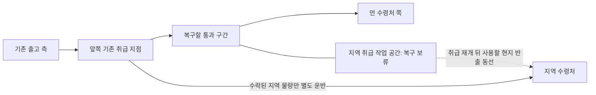

# 내러티브 현행 경계와 보존 대본 색인

> **D7 사용자 승인 — 2026-09-22:** 직전 D7 추천안에 대한 사용자 “ㄱㄱ”로 story-route-policy-v02의 A 선택 경로·신규1사건/run·적격/지원 시 이야기 및 일반 우회 경로 보장·첫층/중간4~8층/최종 대체2선택 예외·경로 표식·우회/실패 재도전 정책을 채택한다. 해당 신규 정책의 승인 대기 표기는 승인 전 이력으로 대체한다. 사건 성공 근거와 작전 승리 때 클리어/첫 보상 확정은 유지한다. 실제 콘텐츠/그래프/원장/미술/실기 검증은 별도다.


2026-09-21 통합. 이 문서는 기존 서사 구조·후보·상세 계약의 보존 위치를 한곳에 모은다. 문구 선정, 정사 승인, 데이터 연결, 출시, 실제 검증은 서로 다른 상태다. 정리 때문에 어떤 후보도 자동 승인하지 않는다. 현행 번호 문서의 명시적 정정이 아래 구형 계약·후보보다 우선한다. 보존 원문의 과거 `current`, `launch`, `Done` 표기는 당시 문맥이며 현재 구현 완료 판정이 아니다.

<a id="world-boss-rotation-confirmed-20260922"></a>
## 월드보스 수장·순환 확정 — 2026-09-22

사용자 “순환 확정”으로 직전 제시한 수장·소속·주간 순환을 확정한다.

1. 1장 약탈왕 / 열차 제압형 A
2. 2장 백선 구호국의 감독관 베일 / 본체 침입형 B (2026-09-29 승인 변경; 구 통제형은 역사자료)
3. 3장 합류 협약회의 총괄관 오르트 / 상호 협력형 C
4. 다음 순환은 다시 약탈왕으로 돌아간다.

기존 월요일05:00 KST의7일 이벤트 경계와 이벤트별 고정 boss/configuration version을 유지한다. 이 절은 위 인물·소속·전투 배정·순환 순서에 한해 앞선 후보/정사 미확정/사용자 답변대기 문구를 대체한다. 최초 운영 개시일·실제 event/content ID는 출시 및 발행 계약으로 별도 지정하며 오늘부터 자동 운영됐다고 해석하지 않는다.

2·3장 전체 줄거리·미션 수/ID·결말·수장의 생사·처분·조직 법제·전체 대본·Act2 목적지는 이번 승인에 포함하지 않는다. Raider King과 Crown Engine을 두 수장으로 세지 않는다. 반복전 “교전 재구성” 문구는 기존 추천으로 남으며 부활·복제 등의 세계관 사실을 확정하지 않는다. 계정별 중립 대사와 전투 경고의 동일성은 기존 승인 정책을 유지한다.

전투 상세 기준: [44 WB2](44_COMBAT_DETAIL_CONTRACTS.md#world-boss-three-encounters-v02). 완료 범위와 통합 인수: [34 WB5](34_COMBAT_POLICY_COMPANION.md#world-boss-final-audit-v05).

## 1. 구조와 안정 식별자

캐릭터의 현행 교차 관리 원본은 [17 전체 명단 연결표](17_OPERATOR_COMMON_STYLE.md#character-registry)다. 이32의 서사 후보와 실제 역할/스킬·개인 디자인·ID를 함께 대조한다. 서사 수정 시 도감·대사·합류 조건·스킬 표현·웹 공개 정보의 영향을 확인하며, 구 프로필을 새 역할의 최종 설정으로 자동 재사용하지 않는다.

Act 1은 총 3장이다. 기존 여섯 ordinary 작전과 약탈왕 story raid 전체가 **1장 Last Line**이다. 여섯 작전을 두 개씩 잘라 세 장으로 만들지 않는다. 2·3장은 Act 2·3이 아니며 새 단체·수장·결말·출시 포함은 별도 미확정이다. 기존 `act1.2026-08-30.001`은 기존 묶음의 fixture 호환 후보이지 신규 세 장 전체의 출시 완료가 아니다. 기존 데이터의 `Act 1 완료` 의미를 1장 완료로 임의 개명하거나 계정 상태를 취소·자동 승격하지 않는다.

| 순서 | stable ID | 표시명 | 보존할 사건·의미 |
|---|---|---|---|
| 0 | `none` | 스토리 진행 없음 | 서버 진행 없음과 조회 실패를 구분 |
| 1 | `opn_01_last_departure` | 마지막 출발 | 미완성 열차의 탈출; 탑승자를 기다리는 첫 책임 |
| 2 | `opn_02_first_signal` | 첫 신호 | 불확실한 구조 신호에 응답; 왕의 기관차와 끊어진 선로 연결 |
| 3 | `opn_03_water_stop` | 급수 정차 | 강탈 대신 수리·보호·동의로 물 확보 |
| 4 | `opn_04_scrapstar_show` | 스크랩스타 쇼 | 약탈자의 공포 방송과 포로 착취를 끊음 |
| 5 | `opn_05_night_boarders` | 야간 승선전 | 내부 습격 속 승객의 자발적 공동체 행동 |
| 6 | `opn_06_broken_line` | 끊어진 선로 | 선로를 지킨 이들의 마지막 기록을 계승 |
| 7 | `raid_raider_king_engine` | 약탈왕 기관차 | 사람을 소모품으로 쓰는 체계를 닮지 않고 기관차를 멈춤 |

Raider King은 수장의 칭호, Crown Engine은 기관차다. 둘을 서로 다른 수장으로 세지 않는다. 차장·통신 담당·정비장은 독립된 배역이며 Eve·Mira와 자동 동일시하지 않는다. 기존 story raid와 주간 경쟁 World Raid는 구별한다. 옛 15-wave·시작 패키지·재화·출시 설명은 현행 04/05/경제 문서와 대조할 이행 기록이며 이 서사 문서가 복원하지 않는다.

## 2. 2·3장과 인물 관계의 보존 상태

선호 A안은 **백선 구호국/감독관 베일 → 합류 협약회/총괄관 오르트**다. 정사 확정이 아니다. 2장은 보호받는 사람의 이동·거주 선택권, 3장은 다른 열차와 공동체에 미치는 부담을 함께 조정하는 책임을 다룬다. 베일의 실제 돌봄과 실제 위험을 거짓으로 만들지 않되 무기한 통제를 문제 삼는다. 오르트의 계획 자체보다 당사자 배제와 수정권 독점을 문제 삼는다. 두 장은 약탈왕의 힘에 의한 약탈과 갈등 방식을 구분하며 1장의 승리를 무효화하거나 배후 음모로 환원하지 않는다.

2장 끝의 양방향으로 열린 문, 3장 끝의 서로 보고하며 기다리는 첫 공동 조정은 결말 후보다. 베일·오르트의 사망·처분, 조직 법제, Act 2 목적지, 신규 progress/machine ID는 확정하지 않는다. 장별 ordinary 4개+수장전 1개는 추천 미션 구성이며 개수·ID·출시 확정이 아니다. 핵심 장면 네 개도 전체 대본 완료나 네 미션 확정을 뜻하지 않는다. 세계 전체의 복구를 약속하지 않는다.

보존된 B안은 거래/명성, C안은 기록/단절을 중심으로 한 비교 대안이다. 정확한 이름·비교표와 각 장면 대사는 아래 원문 색인에서 유지한다. A안 발전 작업 승인이 다른 대안의 삭제나 A 정사 채택을 뜻하지 않는다. 세 수장 순환 구조는 승인 범위지만 순서, 성향의 최종 배정, 반복 교전의 세계 내 설명은 미결정이다. 교전 재구성은 추천이며 부활·복제·훈련 시스템을 새 사실로 만들지 않는다.

기본 5인 후보의 공동 성장축은 혼자 감당하던 일을 신뢰·교대·보고로 나누는 것이다. Kyle의 문/교대, Reina의 확인/타인 판단 수용은 후보 장면으로 보존한다. 기존 후보에 등장한 Eve의 의료, Sera의 정찰, Mira의 정비 역할은 최신 기준과 충돌한다. **현재 22 Eve=현장 엔지니어/시설 방어·Sentry, 23 Sera=현장 의료, 24 Mira=화력지원**을 우선한다. 옛 인물의 과거·관계·문구를 역할이 닮은 다른 인물에게 통째로 옮기지 않는다. 재검토 전 역할 충돌 부분은 작가 참고이며 현행 프로필로 사용하지 않는다.

Elite 10인 후보는 Vex/Nyx/Sable/Marrow/Iris/Rail/Anchor/Lumen/Cinder/Warden이다. 과거·승선 사건·관계·성장선은 신규 제안이며 획득 조건·보유·편성·추가 개인 미션·호감도 해금으로 전환하지 않는다. Vex의 잠금 기술과 Warden의 비강압적 신뢰, Nyx/Lumen의 노출·빛 협의 등 관계 원문을 보존하되 최신 17~29 역할 기준과 개별 대조한다. 당시 부재한 요원을 과거 임무에 소급 출연시키지 않고 누구도 본편 해결의 필수 보유 인물이 되지 않는다. 필수 로맨스·숨은 혈연·세계 단일 배후를 추가하지 않는다.

## 3. 프로필 선정과 대본 사용

이전 Narrative 작업은 15인 **카드용 profile.snippet만** 초기 문구로 선정했다. 이는 당시의 문서 선정 상태다. 상세형·인물별 첫 인사·성장 후 문구는 후보 보관이고 공용 모집 안내는 유지했다. 신규 인사 ID/공용 gacha 슬롯 덮어쓰기/진행도별 자동 프로필 전환을 승인한 것이 아니다. 실제 소비 표면과 fixture 연결은 미확인·미연결로 기록됐으며 글자 수 19~26자는 픽셀 fit 근거가 아니다. 최신 역할 충돌 때문에 아래 선정표도 다시 검토할 대상이며 그대로 export하지 않는다.

보존할 ID 형식은 `narrative.operator.<operator_id>.profile.snippet`; 표시명은 `narrative.operator.<operator_id>.display.name`이다. 정확한 과거 카드용 원문은 아래 보존 표와 원문에 있으며 변경 없이 추출했다.

## 4. 권위·회복·스포일러 경계

서버는 영속 진행·해금·첫 클리어·보상 preview/claim·오프라인 보상의 진행 입력을 소유한다. Unity는 locale lookup·대사 재생·화면 fallback, Admin은 최초 범위의 읽기 전용 운영 가시성을 맡는다. 대사/선택/fixture/`narrativeVersion`은 보상·서버 진행도의 권위가 아니다. 클라이언트의 `storyProgress`, `highestStoryProgressId`, `unlockedOperations`, `narrativeFlags`를 사실로 받아들이지 않는다. 반복 finish는 원결과를 재사용하고 상위 진행을 낮추거나 첫 클리어·보상·플래그를 재적용하지 않는다. 실패·누락·미지원 ID는 raw ID 또는 안전한 누락 상태로 표시하며 조회 실패를 `none` 또는 미클리어 truth로 저장하지 않는다.

mission ID와 localization ID는 별개다. locale은 ID에 넣지 않고 메타/리소스에 둔다. 삭제된 string ID는 다른 의미에 재활용하지 않는다. 버전은 진단용이며 경제 권한이 아니다. 정확한 surface/slot/status/DTO/오류/flag/보존 조건은 부록의 원문 상세를 유지한다. 제안 API·미구현 필드·후보 상태를 현재 가동 중인 endpoint로 주장하지 않는다.

월드보스는 장 미클리어라도 공통 입장조건으로 참가한다. 자기 계정의 서버 진행도와 확인된 매핑만 정체·결말 대사의 공개 근거다. 파트너/호스트 진행, 참여 이력, 로컬 기록으로 해제하지 않는다. 미수신·실패·알 수 없는 진행·매핑 미정·재접속/계정 전환의 불확실성에는 중립본을 쓴다. 양쪽의 전투 기믹·역할 공략·경고 방향/대상/시점/가시성·점수/보상은 동일하다. 자막뿐 아니라 음성·화자·재생 이력도 숨김을 유지하고 파트너 공개 대사를 복사하지 않는다. 보스명/초상/모델/도감 익명화는 별도 미결정이므로 완전한 스포일러 차단이라고 말하지 않는다. 장별 공개 progress ID와 임계값을 문자열 정렬로 만들지 않는다.

Rail Choice Events는 기존 출시 범위에서 제외된 backlog다. 두 선택 모두 정당한 가치 갈등을 가진 flavor 후보이며 추가 보상·해금·진행·gacha·pity·오프라인·무결성 판정을 바꾸지 않는다. `rail_choice:<missionId>:<choiceId>`와 `rail_choice_option:<missionId>:<choiceId>:<optionId>`는 보존된 후보 형식이다. 서버 저장/API/optional flag 권한은 별도 승인이 필요하다. 새 2·3장 우회 경로 소재도 이 기능을 자동 도입하지 않는다.

<a id="story-random-map-v01"></a>
## 4-A. 기존7사건과 랜덤 작전 연결 v01 — 2026-09-21 / 진행 저장 시점 승인·나머지 후보

Plan_6 기획/통합 소유. 범위는 기존1장7사건의 선택·진입·완료·반복·실패/재개와 새 출격 계약 요구다.32가 서사 흐름을,14가 그래프/사건 배치 규칙을,Server가 계정 진행/보상/입장 권위를 소유한다. 이번 편집은32/14/33/WAIT-003만이며 코드·새 API·맵 수치·대본 원문·출시 범위를 변경하지 않는다. 아래는 사용자 검토 전 후보이며 기존7개 ID·사건 의미·첫 보상 권한은 보존한다.

### 선택지와 권고

A 권고: 계정의 다음 미완료 사건을 이번 랜덤 작전의 선택 가능한 이야기 경로에 제시한다. 플레이어는 이야기 경로 또는 일반 경로를 고르며, 일반 경로를 골라도 정상 작전 진행/기본 보상을 유지한다. 첫 시험은 **한 작전에서 새로 진행하는 사건 최대1개**로 제안한다. 노드/웨이브 수·맵 깊이·첫 출현 위치는 정하지 않는다. 이 한도는 기존7사건을 처음부터 끝내려면 사건 성공이 있는 작전이 최소7회 필요하다는 진행 길이상의 비용이 있으므로 사용자 판단 대상이다.

B 대안: 한 작전에 순서대로 여러 사건을 연결한다. 이야기를 빨리 진행할 수 있으나 생성 중 뒤 사건의 적격성, 대본 길이, 한 번의 실패가 되돌리는 범위가 커진다. C 대안: 적격 사건도 순수 확률로만 출현시킨다. 변주가 크지만 이야기 진행이 오래 지연될 수 있다. A는 사용자 선택을 남기면서 다음 사건을 찾기 위한 반복 추첨을 줄이는 안이다.

A의 배치 제약 후보: 서버가 이야기 적격성을 확인하고 지원되는 그래프라면, 다음 사건을 지나는 유효 경로와 그 사건을 거치지 않는 유효 경로를 마련한다. 이야기 경로 존재는 증강/장비/특정 서비스 보장과 별개다. 공통 필수 시작/최종 노드는 예외 설계가 필요하며 이 조건을 무리하게 적용해 불가능한 그래프를 발행하지 않는다. 지원되지 않는 그래프는 이유가 확인된 ‘이번 작전 이야기 경로 없음’으로 처리하고, 계정 조회 실패를 미완료 없음으로 바꾸지 않는다.

### 사건별 연결안

다음 사건은 기존 순서의 서버 확정 진행으로 고른다. 아래 사건 결과는 기존 사건 의미의 완료 조건 후보이며 새 버튼·미니게임·구출 수량을 확정하지 않는다. 각 기존 전투/대본을 실제로 연결할 때 성공 판정 근거가 없으면 해당 연결을 보류한다.

| 기존 사건 ID | 선택·진입 표현 후보 | 사건 성공의 의미 | 일반 노드와의 구분 / 재진입 |
|---|---|---|---|
| opn_01_last_departure | 첫 이야기 출발을 선택한 작전에서 미완성 열차 탈출·기다릴 사람을 확인 | 해당 탈출 사건의 기존 성공 조건 완료 | 일반 출격마다 첫 탈출을 반복하지 않음. 첫 경험 안내의 필수/스킵 범위는 별도 결정 |
| opn_02_first_signal | 이전 사건 완료 뒤 구조 신호 단서를 예고한 이야기 경로 | 단순 신호 발견을 넘어 해당 구조 신호 사건 해결 | 일반 정찰/신호 아이콘 방문은 완료 아님. 미해금 왕의 기관차 정체/결말을 예고에 노출하지 않음 |
| opn_03_water_stop | 급수 정차 사건 경로, 필요한 협의·보호 상황 안내 | 강탈이 아닌 기존 동의·수리·보호 맥락에서 물 확보 | 정비 구매/열차HP 회복만으로 완료 금지. 구매 필수 또는 미보유 요원 필수로 만들지 않음 |
| opn_04_scrapstar_show | 방송이 들리는 구역으로 접근 | 해당 방송·포로 착취 사건을 끝내는 기존 목표 달성 | 일반 적 전멸만으로 사건 완료 추정 금지. 사건 전용 신호/목표가 있어야 함 |
| opn_05_night_boarders | 내부 승선 위험의 이야기 예고 | 기존 야간 내부 습격 사건 해결 | 일반 객실 전투와 별개. 승객 장면은 확정된 사건 단계에서 재생, HP/다운 상태와 모순되는 출연 차단 |
| opn_06_broken_line | 끊어진 선로와 남겨진 기록 경로 | 선로를 지킨 사람들의 기록을 확인·계승하는 사건 해결 | 우회/장애물 통과만으로 완료하지 않음. 기록 열람 버튼 자체를 서버 성공 판정으로 쓰지 않음 |
| raid_raider_king_engine | 앞6사건 완료 후 이야기 결전 경로 | 사람을 소모하지 않고 기관차를 멈추는 기존 스토리 결전 성공 | World Raid 참가/점수/일반 목적지 승리와 별개. 해당 이야기 보스를 채택한 종료 프로필에 일반 최종보스를 추가로 강제하지 않음 |

기존7사건은1장 전체다. 기존6ordinary를 임의로2개씩 나눠3장으로 만들지 않는다.2·3장의 후보 이야기는 이번 생성 풀에 넣지 않는다. 완료한 이야기는 기존 기록실에서 재열람하며, ‘반복 출격으로 과거 사건이 다시 실제 발생함’이라는 부활/훈련/재구성 정사를 자동 추가하지 않는다. 스토리 전투 재도전 모드는 별도 결정 전 추가하지 않는다.

### 계정 진행·작전 결과·첫 보상 — 최신 사용자 확정

**2026-09-21 최신 정정: 스토리 작전 승리 시 클리어 확정 및 첫 보상 지급.** 사건/노드의 중간 목표 해결이나 대사 종료만으로 계정 클리어·다음 이야기 해금·첫 보상 권리를 확정하지 않는다. 이전 사건 해결 직후 진행 저장 승인은 이 결정으로 대체됐고, 사건 직후 보상을 주는 A안은 비채택이다.

- 해당 스토리 작전의 정의된 목표를 충족하고 서버가 승리를 검증했을 때 계정 클리어/진행·해금과 첫 보상 지급을 승리 정산에 연결한다. 일반 작전 승리나 World Raid 참가를 해당 스토리 클리어로 대체하지 않는다.
- 사건을 해결했더라도 작전 패배·포기·미승리 만료이면 이번 클리어/진행 증가와 첫 보상 지급은 없다. 기존에 확정된 다른 작전의 클리어·보상은 보존한다. 미클리어 상태로 다음 정상 도전이 가능하며 완료 사건용 별도 재전투 모드를 이 때문에 추가하지 않는다.
- 진행 중 체크포인트는 중간 사건/전투 상태 복원용이며 계정 클리어 영수증과 구분한다. 승리 응답이 유실됐다고 패배로 간주하지 않고 원 승리/지급 영수증으로 확정 결과를 복구한다.
- 승리 정산의 클리어·첫 보상 중복 방지를 원자 처리한다. 기술적으로 지급 단계가 나뉘면 서버가 검증한 승리에 결속한 영속 미지급 기록을 남겨 복구하고 실제 지급 확인 전 획득 완료로 표시하지 않는다. 이는 사건 중간 보상 권리를 부여하는 A안이 아니다.
- 같은 스토리 첫 보상은 재요청·다른 기기·다시 승리해도 중복 지급하지 않는다. 기존 작전/위험도별 최초 보상과 사건의 명시 매핑, 기존 미수령 보상/계정 이행, 별도 claim 내부 호출/화면 동선은 Server·Unity 계약에서 맞춘다. 새 재화·수량·위험도 보상 삭제·소급 지급은 승인하지 않았다.

<a id="story-first-reward-v01"></a>
### 스토리 클리어·첫 보상 현행 기준 — 승리 정산

현행은 **스토리 작전 승리 → 서버 검증 → 클리어/진행·첫 보상 정산 → 결과 표시/원결과 복구**다. 클리어 조건과 지급 시점은 더 이상 A/B/C 선택 대기가 아니다. 경로 배치·런당 사건 수·구체 API/이행/수치는 별도 미결을 유지한다.

<details>
<summary>비채택/대체 이력: 사건 즉시 진행 저장 및 A/B/C 비교 — 아래는 현행 지침이 아님</summary>

### 계정 진행·작전 결과·첫 보상

세 상태를 분리한다: 이번 노드의 사건 해결 사실 / 계정의 확정된 스토리 진행 / 기존 첫 보상의 지급 여부. 대사 재생, 맵 방문, 로컬 완료 표시는 어느 상태의 서버 권한도 대신하지 않는다.

**사용자 확정(2026-09-21): 사건 해결 직후 계정 스토리 진행을 영속 확정한다.** 전체 작전 FINISH 성공까지 기다리는 이전 권고는 비채택 이력이다. 서버가 원 run/노드/사건/정의 버전/계정 자격과 성공 근거를 검증한 후 사건 완료와 계정 진행을 같은 원자 처리로 기록한다. 클라이언트 대사 종료/방문/성공 표시만으로 저장하지 않는다. 이후 작전 실패·포기·만료가 이미 확정된 스토리 진행을 되돌리지 않는다.

사건 완료 영수증과 원 요청 식별을 보존해 응답 유실·재접속·중복 요청 시 원결과를 복구한다. 중복/동시 런/다른 기기에서 진행을 두 번 올리거나 기존 높은 진행을 낮추지 않는다. 수락된 런의 사건/목표를 계정 진행 상승 때문에 새 사건으로 교체하지 않는다. 전체 FINISH는 작전 결과/해당 보상을 별도로 처리하며 이미 확정한 사건 진행을 재적용하지 않는다.

이번 승인은 **스토리 진행 저장 시점**에 한정한다. 기존 스토리 첫 보상의 지급 시점·수령 방식은 별도 계약 확인/결정 대상으로 유지한다. 첫 보상 자격과 지급 여부를 진행도 하나로 대체하지 않으며, 노드 보상과 FINISH에서 같은 첫 보상을 중복 발급하지 않는다. 실제 사건 완료 저장/영수증/오류 DTO 및 기존 계정 호환은 Server 선행 작업이고 현재 구현 완료가 아니다.

원 run/노드/사건/정의 버전/적격성에 결속한 확정 결과를 사용한다. 순서를 건너뛰거나 기존 높은 진행을 낮추지 않는다. 같은 사건을 다른 런/기기에서 동시에 해결해도 첫 보상은 계정 기준 한 번만 지급하고 나머지는 원 결과/기존 정책으로 처리한다. 기존 계정 Act1 완료 의미를 새로운3장 전체 완료로 승격하거나 초기화하지 않는다.


### 스토리 첫 보상 지급 방식 v01 — 검토 후보 / 2026-09-21

이미 승인된 것은 **사건 성공 직후 계정 진행 저장**이다. 아래 보상 시점은 아직 미승인이다. 기존 첫 보상 정의만 대상으로 하며 새 재화·수량·보상표·메일함·재도전 모드를 추가하지 않는다. 일반 노드 보상/작전 FINISH 보상과 구분한다.

| 방식 | 사건 성공 이후 | 장점과 비용 |
|---|---|---|
| A 권고: 사건 성공 때 첫 보상 권리 확정·자동 지급 시도 | 서버가 사건/진행과 계정의 첫 보상 권리를 함께 확정. 기존 지급 경로로 지급하고 일시 실패는 미지급 권리로 복구 | 진행과 보상 자격의 시점이 일치. 이후 작전 실패에도 권리가 남음. 사건 처리와 보상 원장의 원자성 또는 영속 지급 대기 연결 필요 |
| B: 권리는 사건 성공 때, 지급은 작전 종료 정산 때 | 성공/실패/포기 종료 모두 이미 확보한 첫 보상 권리를 정산. 만료·종료 응답 유실에도 복구 필요 | 표시를 정산 화면에 모을 수 있으나 지급이 늦고 미종결/만료의 별도 복구 경로 필요 |
| C: 전체 작전 성공 때만 첫 보상 자격 인정 | 사건 진행은 저장되지만 이후 작전 실패하면 보상 자격은 아직 없음 | 작전 완주의 동기는 강하나 이미 완료한 사건에 다시 접근할 별도 수령/재도전 정책이 필요. 현재 완료 사건 재전투 모드가 미결이라 비권고 |

**추천:** A. 사건 성공을 서버가 확정했을 때 보상 권리를 잃지 않게 하고, 실제 지급이 확인됐을 때만 획득 완료를 표시한다. 정상 경로에서 별도 수령 버튼을 의무화하지 않는 안이다. 지급 대상/소유 용량/기존 거래 정책 때문에 즉시 지급할 수 없으면 보상을 지우거나 다른 종류로 바꾸지 않고 원 권리를 복구한다. 보유 용량/우편 등의 구체 수령 경로는 기존 정의를 먼저 확인하며 새 시스템으로 가정하지 않는다.

#### 권리와 지급의 경계

- 사건 완료·진행·첫 보상 권리가 부분 저장되어 진행만 앞서는 상태를 만들지 않는다. 같은 DB 거래로 저장할 수 있으면 원자 처리하고, 외부 지급 단계가 필요하면 사건 거래에 영속 미지급 기록까지 남긴 후 재처리하는 계약을 Server가 선택한다. UI 성공 후 임시 메모리에만 지급 대기를 두지 않는다.
- 중복 제한은 계정+기존 사건의 첫 보상 정체성에 둔다. run/기기/요청키가 달라져도 권리는1개다. 표현/밸런스 버전이 바뀌었다는 이유만으로 새 첫 보상을 만들지 않으며, 별도 재지급 정책이 필요하면 따로 승인한다. 실제 키/스키마는 Server 소유다.
- 권리 생성 때 적용된 기존 보상 정의/수량·버전과 원 사건 근거를 고정한다. 복구 때 현재 보상표로 다시 계산하거나 추첨하지 않는다. 작전 전용 장비를 영구 계정 보상으로 변환하지 않는다. 기존 첫 보상 종류가 미확인인 항목은 지급 가능하다고 표시하지 않는다.
- 미지급/지급 완료/결과 미확인을 구분한다. 화면이 닫히거나 응답이 끊겼다는 이유로 지급 실패를 확정하지 않는다. 원 영수증으로 실제 상태를 복구하고 FINISH는 같은 첫 보상을 새로 지급하지 않는다.

#### 실패·복구 수용 사례

| 상황 | A안의 요구 결과 |
|---|---|
| 사건 성공 전 실패/우회 | 새 진행·첫 보상 권리 없음 |
| 사건 성공 뒤 작전 실패·포기·만료 | 확정 진행과 첫 보상 권리 유지. 일반 작전 보상은 해당 기존 규칙 적용 |
| 사건 완료 응답 유실 | 원 요청/사건 영수증으로 진행·권리·지급 상태 복구. 화면이 확인 전 새 사건 성공을 추정하지 않음 |
| 서로 다른 런/기기에서 같은 사건 성공 | 각 런 결과는 보존하되 계정 첫 보상은1회. 충돌이 기존 높은 진행을 낮추지 않음 |
| 지급 후 FINISH·재로그인·기록실 재열람 | 기존 지급 결과 표시만 가능. 추가 지급0 |
| 영속 지급 대기 중 장애 | 사건을 다시 깨지 않아도 기존 권리로 재처리 가능. 중복 지급0을 원장/영수증으로 확인 |
| 기존 계정의 진행/지급 이력 불일치 | 완료 상태만 보고 자동 소급 지급하거나 지급 완료로 간주하지 않음. 기존 원장·영수증 대조 및 이행 정책 확인 |

사용자 결정은 A/B/C 지급 시점 선택이며 실제 보상표·API·기존 계정 소급·만료 수령 경로의 승인이 아니다. A 선택 이후 Server는 원자 저장/원장·기존 보상 정체성/복구·이행 계약, Unity는 확정/미지급/미확인 표시와 재진입을 연결한다. 이번은 문서 후보 작성으로 실제 지급·테스트·타 담당 자동 지시는 없다.

</details>

<a id="story-first-reward-current-code"></a>
#### 기존 처리 대조: 기존 첫 보상·진행 이행 — 2026-09-21

정적 확인 기준 S = D:/Project/LASTRAIL/Worktrees/11ec/LASTRAIL/attendance-pass-20260907/server. 최신 승인은 스토리 작전 승리 때 클리어/첫 보상 정산이다. 아래 기존 FINISH/claim 구조는 재사용 후보지만 정의된 승리 조건·지급 연결·이행 검증 완료를 뜻하지 않는다.

| 확인 경로 | 기존 동작 | 새 기획과의 차이 |
|---|---|---|
| S/apps/game-api/src/index.ts:6315~6346 | FINISH의 fullCompletion과 account_first_clears 존재 여부로 firstClearEligible 계산 | 중간 사건 해결만으로 클리어하지 않고 해당 스토리 작전 승리를 검증해야 함 |
| S/packages/balance/src/index.ts:771~794 | firstClearEligible·VICTORY·전체 웨이브 완료일 때 기존 firstClearRewards를 FIRST_CLEAR 행으로 포함 | 새 사건 완료 경로가 기존 작전 전체 성공을 거짓으로 만들어 보상 계산을 호출해서는 안 됨 |
| S/apps/game-api/src/index.ts:6406,6447~6575 | FINISH에서 진행 계획, 최종 결과, ACTIVE 보상 미리보기, 최초 클리어 기록, 진행 원장/해금과 요청 기록을 batch 저장 | 스토리 작전 승리의 클리어·보상 정산 경계를 연결해야 함. 완료 진행과 실제 지급을 같은 상태로 취급하지 않음 |
| S/packages/db/migrations/0003_progression.sql:74~80 | account_first_clears PK는(account_id, operation_key, risk) | 기존 작전/위험도별 첫 보상과 새 계정/사건별 첫 보상은 동일한 키가 아님 |
| S/apps/game-api/src/index.ts:6660~6788 | 별도 reward-preview claim: 계정 소유·원키·claimability 검사, 이미 CLAIMED면 DUPLICATE_REPLAY, settleRunReward로 지급 위임 | FINISH 최초 클리어 기록만으로 지갑 지급 완료를 판정하지 않음. 새 권리 복구가 기존 preview 유효기간/수령 조건에 묶이는지 확인 필요 |

##### 이행 시 구분해야 할 기존 계정 상태

- **진행+최초 기록+지급 원장 있음:** 기존 보상 정체성·위험도·원 지급 내역을 매핑한 뒤 새 체계의 중복 차단 근거로 삼는다. 위험도별 지급을 임의로 회수하거나 모두 하나의 신규 사건 보상으로 재계산하지 않는다.
- **최초 기록+미수령 preview 있음:** 미리보기의 FIRST_CLEAR 부분과 전체 보상 묶음을 함께 대조한다. 새 첫 보상을 별도로 발급하면서 구 묶음도 수령하게 만들지 않는다. 기존 수령 경로 보존 또는 명시 이행 중 하나로 원자성을 설계한다.
- **최초 기록+수령 불가/만료 preview:** 기록만으로 지급 완료/권리 소멸을 추정하지 않는다. 기존 원장·수령 영수증·만료 정책 확인이 먼저며 소급 지급은 별도 승인 대상이다.
- **진행만 있거나 매핑 불명:** 클라이언트 진행/작전명 문자열로 수령 여부를 추측하지 않고 미확인 상태로 기록한다. 완료한 계정에 사건 재플레이를 강제해 보상 상태를 복구하지 않는다.

##### Server·Unity 인수 조건

1. 기존 operationId/risk/첫 보상 정체성과 새 사건 ID의 명시 매핑 및 발효 범위(기존 run/신규 run)를 먼저 고정한다. 일반 위험도별 첫 클리어 보상을 새 스토리 보상으로 통째로 대체하는 권한은 이번 조사에 없다.
2. 사건 중간 저장은 체크포인트로 한정하고, 스토리 작전 승리 FINISH에서 클리어·해금·첫 보상을 판정한다. 재요청/동시 기기에서 진행이 내려가거나 동일 해금/지급이 중복되지 않게 한다.
3. 계정 상태·원요청·영수증·보상 계획을 확인한 기존 지급 경계는 재사용 후보로 둔다. settleRunReward 내부 원자성/부가 혜택·TTL 복구 및 전체 이행은 이번에 전수 검증하지 않았다. 별도 임시 지갑 지급 API를 추가하지 않는다.
4. 미지급/미확인/기존 수령 완료를 UI에서 구분하고, 응답 유실·두 기기·노드 완료/FINISH 경쟁·구 preview 뒤늦은 수령을 검증한다. 실제 지급·DB migration·운영 호출은 승인된 구현 단위에서 수행한다.

조사 결론: 기존 FINISH/claim/원장 경로는 존재한다. 필요한 작업은 사건 단위 정책과의 연결·기존 데이터 이행이며 보상 시스템 전체 신규 제작이 아니다. 이번은 소스 정적 대조만 수행했고 실제 운영 DB나 지급 내역을 조회하지 않았다.
### 실패·재개·반복·공개 상태

| 상황 | 처리 후보 / 보존 경계 |
|---|---|
| 이야기 경로 우회 | 일반 작전 진행. 미완료 사건/첫 보상 변화 없음. 다음 적격 작전에서 다시 제시 가능 |
| 사건 진행 중 실패 | 사건 성공 아님. 실패 대사는 가능하지만 진행/첫 보상 없음 |
| 사건 해결 뒤 작전 실패 | 이번 스토리 클리어·계정 진행 증가·첫 보상 없음. 중간 체크포인트와 계정 클리어를 구분하고 미확인 승리 결과는 원 영수증으로 확인 |
| 앱 종료/일시정지/재접속 | 같은 run/seed/node/사건 배정·진행 단계 복원. 새 이야기/보상 재추첨 금지 |
| 성공 FINISH 응답 유실 | 기존 원 key/body와 영수증 복구. 현재 편성/새 진행으로 요청 재작성하지 않음 |
| 보상 표시/대사 중 재접속 | 서버 결과와 표현 재생 위치 분리. 결과 재조회는 재지급이 아님. 미확인 결과를 성공/없음으로 단정하지 않음 |
| 다른 기기에서 진행 상승 | 수락된 런의 배정/난이도/목표를 몰래 교체하지 않음. 계정 보상 중복만 서버가 차단 |
| run 만료/지원종료 | 기존 만료/폐기 정책을 따르고 보상/스토리 완료를 추정하지 않음. 원 영수증 복구와 새 도전은 구분 |
| 완료 후 일반 반복 출격 | 신규 미완료 사건이 없으면 일반 경로. 기록실 재열람은 전투 진행/보상과 무관 |
| 진행 조회 실패/알 수 없는 버전 | 적격성 미확인 표시와 중립 표현. 미해금 대사·결말 음성·화자 정보 노출 금지 |

대사 트리거는 사건 진입/확정된 목표 변화/성공·실패로 나누며, 구 고정 웨이브 번호를 랜덤 웨이브에 그대로 붙이지 않는다. 경고·공략 정보는 스포일러 숨김 때문에 누락하지 않는다. 사용 가능한 실제 출연자만 인물 대사에 연결하며 특정 Elite 소유가 사건 해결의 전제가 되지 않는다. 인물 역할 변경으로 맞지 않는 구 대사는32의 재검토 후보 규칙을 따른다.

### 새 출격 계약에 필요한 의미 — wire 미확정

서버 입력/응답에 필요한 의미는 작전 정의 버전, 허용된 맵 생성 조건, 원 run/seed/그래프/노드, 계정 사건 적격성, 배정된 사건과 판정 버전, 기존 operationId/비용/견적 의미, 노드 완료 근거, FINISH와 첫 보상 영수증 연결이다. 이것들은 요구사항 목록이며 새 JSON 필드명/endpoint를 발행한 것이 아니다.

UI는 사전 임무목록 대신 현재 출격 조건과 확인된 이야기 기회/미확인 상태를 표시한다. 이야기 후보 미리보기만으로 비용 소비/진행 고정을 하지 않는다. 실제 배정은 서버가 수락한 시작 결과에서 확정한다. 최종 견적 유효성·중복 START·응답 유실·준비화면 복귀를 기존 원요청 저널에 연결한다. Server가 실제 계약을 확정하기 전 LobbyDeparture의 operationId만 지워서는 안 된다.

### 통합 수용 조건과 남은 결정

선택 가능한 이야기/일반 경로 모두 유효, 공유 노드 배정 동일, 같은 seed 재개 동일, 다음 사건 자격·순서/스포일러 경계, 전용 성공 조건, 일반 방문으로 완료0, 중복 FINISH/동시 런 첫 보상1회, 실패/만료 정책, 출연 자격, 기존 계정 호환을 검증한다. 그래프 제약으로 실제 노드 분포가 바뀌면 가중치/확률 공시도 다시 산출한다. 증강 최소횟수를 생성 검사에 넣지 않는다.

사용자 미결: A/B/C 연결 방식, 런당 신규 사건 한도, 다음 사건 경로 제시 보장/첫 이야기 예외, 구체 보상 수령/복구 계약. 클리어·진행 확정과 첫 보상 지급은 스토리 작전 승리 시점으로 확정됐다. 별도 선행: J04 맵/노드/최종 프로필 승인, 사건별 기존 성공 근거와 대사 stage 이행, Server START/진행/보상 계약. WAIT-003에 연결한다. 승리 시 클리어/첫 보상 정산 외의 연결 방식은 기획 후보이며 테스트 실행/통합 완료/운영 변경이 아니다.

## 5. 대본·후보 원문 보존 색인

각 원문은 ZIP의 **원래 상대경로와 SHA-256**으로 보존하고 검색 가능한 HTML의 동일 항목에서 전문을 읽는다. 아래 링크는 원본을 가리키며 보관 실행 시 해당 HTML 앵커로 치환한다. 앵커는 `doc-` + SHA-256(원래 상대경로 UTF-8)의 앞 20자리다. 이 색인은 대사 삭제를 뜻하지 않는다. 번역·출연 관계·브리핑·실패/결과·도감 문구를 사용할 때 전문을 열어 확인한다. 부록에 추출하지 않은 대본도 승인 상태와 함께 유지되는 현재 텍스트 참고 자료다.

### 5-A. 과거 선정 원문 — 현재 역할 대조 전 사용 보류

| Operator | 카드용 선정 | 상세 후보 | 첫 인사 후보 |
|---|---|---|---|
| `op_kyle` / Kyle | 사람들 앞에서 문과 방어선을 지키는 보호자. | 사람이 지나는 문 앞에 먼저 선다. 긴 설명보다 자리를 지키는 행동이 익숙하다. | "문 앞은 제가 맡겠습니다." |
| `op_reina` / Reina | 탄수와 출구, 남은 시간을 세는 사수. | 우선 위협을 정확히 겨누는 사수. 탄수와 출구, 남은 시간을 허투루 쓰지 않는다. | "경계 위치를 알려 주세요." |
| `op_eve` / Eve | 차분한 목소리로 현장을 살피는 의료 지원 요원. | 응급 처치와 짧은 안내로 혼란을 가라앉힌다. 상대가 숨을 고를 때까지 말을 재촉하지 않는다. | "천천히 말씀하세요. 듣고 있어요." |
| `op_sera` / Sera | 약속보다 현장의 발자국을 믿는 정찰병. | 선로와 먼지, 발자국으로 길을 읽는다. 주변을 살피면서도 짧은 농담을 놓치지 않는다. | "길부터 보죠. 짐은 가볍습니다." |
| `op_mira` / Mira | 열차의 소리를 살피며 장치를 고치는 기술자. | 계전기와 문, 비상 장비를 돌보는 기술자. 수리 중에는 기계에도 곧잘 말을 건다. | "엔진 소리, 가까이서 들어도 돼요?" |
| `op_vex` / Vex | 약탈자 장비의 허점을 아는 이탈자. | 약탈자의 장비와 함정에 익숙하다. 날카로운 농담 사이로 과거에 대한 불편함이 드러난다. | "잠금이 까다롭군요. 익숙한 일입니다." |
| `op_nyx` / Nyx | 어둠 속 접근로를 살피는 잠입 요원. | 소리와 노출을 줄이며 먼저 길을 살핀다. 뒤따르는 사람을 위한 길도 남긴다. | "Nyx입니다. 조용히 가죠." |
| `op_sable` / Sable | 물러날 곳 없는 전선에 방벽을 세우는 요원. | 무거운 방패로 전선을 지킨다. 맡은 범위를 분명히 말하고 절제된 태도로 버틴다. | "방벽을 맡을 Sable입니다." |
| `op_marrow` / Marrow | 급박한 현장에서 처치를 이어 가는 의료 요원. | 거친 환경에서도 처치에 집중한다. 말은 건조하지만 손길에는 필요한 주의가 담긴다. | "Marrow입니다. 무리한 건 숨기지 마십시오." |
| `op_iris` / Iris | 빛과 열의 흔적으로 표적을 읽는 관측 요원. | 빛과 열의 변화를 살펴 약점을 표시한다. 패턴을 발견하면 목소리에 작은 호기심이 묻어난다. | "창가에서 보면 흔적이 더 잘 보이겠네요." |
| `op_rail` / Rail | 막힌 곳에 먼저 힘을 보태는 돌파 요원. | 연결기와 관성을 활용해 가까운 위협에 맞선다. 함께 힘쓸 일을 찾을 때 목소리가 커진다. | "Rail입니다! 힘쓸 곳부터 알려줘요." |
| `op_anchor` / Anchor | 움직이는 열차의 고정점을 살피는 안정화 요원. | 위치와 압력을 살피며 동료가 움직일 기반을 잡는다. 급한 상황에서도 말의 속도를 잃지 않는다. | "Anchor입니다. 고정할 곳부터 보겠습니다." |
| `op_lumen` / Lumen | 시야와 불빛으로 다음 걸음을 돕는 지원 요원. | 조명으로 주변을 밝히고 숨은 위협을 드러낸다. 어둠을 가볍게 여기지 않으면서도 따뜻하게 말한다. | "불빛은 어디에 둘까요?" |
| `op_cinder` / Cinder | 범위를 정하고 불길을 다루는 철거 요원. | 소각과 폭파를 다루되 민간 구역에서는 특히 신중하다. 화가 나도 작업 범위를 먼저 짚는다. | "Cinder입니다. 남길 것부터 짚어주시죠." |
| `op_warden` / Warden | 군중과 포로를 인간적으로 대하는 경계 요원. | 혼란 속에서 대피선과 보호 구역을 지킨다. 엄중한 말투에도 사람을 겁주지 않으려는 원칙이 있다. | "Warden입니다. 이곳의 경계 원칙부터 듣겠습니다." |

### 5-A-1. 최신 역할에 맞춘 기본3인 소개 초안 — 2026-09-21 / 문구 미승인

Plan_6 작성.17에서 승인된 인물 관계는 Nyx/Iris 같은 인물 개정, Rin/Cipher 별도 신규 후보다. 이 절의 소개·인사·성장 표현은 검토 후보이며 그 관계 승인만으로 정사/발행 문구가 되지 않는다.32의 과거5-A 원문은 보존하고 최신 역할과 충돌하는 직업 설명은 현행 프로필에 사용하지 않는다.22/23/24의 외형·역할 기준을 따르며 출신·가족·합류 사건·나이·신규 능력은 추가하지 않는다.

| 인물 | 카드 소개 후보 | 상세 소개 후보 | 첫 인사 후보 |
|---|---|---|---|
| Eve / op_eve | 장치의 작은 이상을 놓치지 않는 현장 엔지니어. | 문제 지점을 살핀 뒤 필요한 공구부터 고른다. 동료에게는 지금 손대도 되는 곳과 기다려야 하는 곳을 차분히 짚어 준다. | 이브예요. 어디부터 확인하면 될까요? |
| Sera / op_sera | 부상자의 상태를 살피고 필요한 처치를 이어 가는 현장 의료 요원. | 작은 변화에도 주의를 기울이며, 급할수록 확인할 것을 짧고 분명하게 묻는다. 상대가 답하고 움직일 여지를 남긴다. | 세라예요. 불편한 곳부터 말씀해 주세요. |
| Mira / op_mira | 동료의 움직임에 맞춰 사격을 이어 가는 기관총 화력지원 요원. | 시선과 짧은 말로 사선을 확인한다. 평소에는 솔직하고 편한 표정이지만, 사격에 들어가면 자세와 호흡을 가다듬는다. | 미라야. 움직이기 전에 신호부터 맞추자. |

성장 장면 방향 후보: Eve는 모든 점검을 직접 끝내려 하기보다 점검 결과와 남은 위험을 공유하는 쪽, Sera는 자신이 확인한 상태를 명료하게 전달하고 동료에게 도움을 요청하는 쪽, Mira는 혼자 사격을 이어 가는 책임감에서 이동·교대 신호를 맞추는 쪽을 비교한다. 이는32의 공동 성장축인 신뢰·교대·보고를 새 역할에 맞춰 표현한 후보다. 특정 과거 사건/관계를 확정하거나 구 인물의 대사를 다른 인물에게 통째로 옮기지 않는다.

실제 스킬 경계: 현재 로컬 입력은 Eve 회복/Sera 공격·중단·표식/Mira 열차 수리로 남아 있다(33 최신 능력 대조). 위 소개는 목표 역할의 문구 후보이며 실제 플레이 가능 능력의 공개 설명이 아니다. 확정·연결 전 도감/모집/웹에 현행 정보로 발행하지 않는다. 센트리 소환 방식·회복/다운 조건·기관총 연사/재장전/과열은 이 소개로 결정하지 않는다.

<a id="existing-seven-personality-v01"></a>
### 5-A-2. 기존7인 개인 설정 방향 v01 — 2026-09-21 / 미승인

Plan_6 소유·통합. 범위는 기존7인의 서사·성격·말투·관계 장면 후보와17의 디자인 방향 연결이다. 성별/정확한 나이/출신/합류 사건/혈연/출시 시기/스킬 수치는 정하지 않는다. 아래 인물상·새 대사는 사용자 검토 전 후보이며5-A의 보존 원문을 삭제/대체하지 않는다. 같은 이름의 실제15 ID를 유지한다. 선행/후속 대기는 INTEGRATION_WAITLIST.md WAIT-002에서 추적한다.

| 인물 | 보존할 기존 방향 | 새 인물상·판단 방식 후보 | 갈등과 성장 후보 | 말투·짧은 대사 후보 |
|---|---|---|---|---|
| Sable / op_sable | 무거운 방패·방벽, 맡은 범위를 분명히 말함 | 지킬 수 있는 범위를 먼저 약속하고 그 약속을 끝까지 지키려 함. 과장된 안심보다 위치와 교대 시점을 말함 | 맡은 자리를 비우는 것을 실패로 여기다가, 후퇴/인계도 사람을 지키는 방법으로 받아들임 | 짧고 단정하며 범위를 먼저 말함. 「이 문까지 맡겠습니다. 뒤쪽은 부탁하죠.」 |
| Marrow / op_marrow | 거친 환경의 의료, 건조한 말과 주의 깊은 처치 | 당장 멀쩡해 보이는 사람도 상태를 확인하고, 처치 후 다시 볼 시점을 알려 줌. 무심함보다 설명의 절제를 강조 | 위험을 통제하려는 일방 지시에서 당사자의 판단과 협력을 끌어내는 설명으로 이동 | 관찰→필요 행동 순, 비난하지 않음. 「숨기면 늦어집니다. 지금 상태부터 듣겠습니다.」 |
| Rail / op_rail | 연결기/관성·돌파, 함께 힘쓸 일을 찾음 | 먼저 나설 의욕이 크지만 힘을 쓰기 전 동료의 준비 신호를 기다리는 인물. 밝은 반응과 큰 몸짓 후보 | 혼자 먼저 열어 놓으면 된다는 생각에서, 모두가 따라올 속도를 만드는 쪽으로 성장 | 힘 있는 짧은 문장, 강요보다 호응. 「다 같이 준비됐으면, 내가 먼저 간다!」 |
| Anchor / op_anchor | 고정점·압력·안정화, 급해도 말의 속도를 유지 | 무엇을 고정할지뿐 아니라 언제 풀어야 하는지도 확인함. 동료가 움직일 여유를 만드는 준비 담당 | 모든 변수를 고정하려는 태도에서, 변화를 받아들이며 안전하게 넘겨주는 태도로 이동 | 순서와 확인을 짧게 전달. 「여기는 고정됐습니다. 다음 신호에 풀겠습니다.」 |
| Lumen / op_lumen | 빛·시야·지원, 어둠을 가볍게 여기지 않는 따뜻함 | 밝히는 행위가 적에게 아군을 드러낼 수도 있음을 의식하고 먼저 필요한 사람에게 묻는 인물 | 모두에게 같은 도움이 통할 거라는 생각에서, 노출과 휴식의 필요가 다름을 배우는 방향 | 권유/확인형, 억지 낙관 금지. 「이 정도 밝기면 괜찮을까요?」 |
| Cinder / op_cinder | 소각/폭파·철거, 남길 범위를 먼저 정함 | 무엇을 없앨 수 있는가보다 무엇을 남겨야 하는가부터 확인함. 감정은 드러나도 작업 범위는 지킴 | 빨리 끝내는 효율과 회수/보존의 가치를 조정함. 폭발을 즐기는 난폭함으로 단순화하지 않음 | 경계→행동 순, 적은 말에 분명한 의도. 「남길 건 표시해 줘. 그 선은 넘기지 않을게.」 |
| Warden / op_warden | 군중/포로의 인간적 대우, 보호 구역·경계 원칙 | 규칙을 적용하기 전 이유와 선택지를 설명하고, 아군에게도 같은 기준을 요구함 | 정해진 절차만 따르면 공정하다는 생각에서, 설명과 이의 제기를 책임에 포함하는 방향 | 엄정하되 위협하지 않음. 「멈춰 주십시오. 먼저 이유를 설명하겠습니다.」 |

#### 관계 장면의 차별화 후보

- Sable↔Kyle: 둘 다 사람을 지키되 Sable은 담당 구역/교대 약속, Kyle은 문 앞의 직접 대응을 중심으로 비교. Iris의 순간 보호와도 분리한다. 누가 상관인지 또는 어느 쪽이 더 강한지는 정하지 않는다.
- Marrow↔Sera: Marrow는 처치 후 경과·무리 숨기기·설명, Sera는 현장 상태 확인과 당장 필요한 처치에 무게. 역할 우열·의료 자격·신규 질병/부상 시스템을 만들지 않는다. Sera 신규 궁극기는 미승인 초안임을 유지한다.
- Rail↔Anchor: 준비 신호를 기다리는 돌파와, 고정/해제 시점을 알리는 안정화의 호흡. 긴장과 상호 신뢰를 장면으로 표현하되 합동 스킬·숨은 연계 수치로 바꾸지 않는다. Rin과는 다른 인물이며 작은 정밀 개입과 큰 준비 동작을 비교한다.
- Lumen↔Nyx: 기존 빛/노출 협의 관계 후보를 최신 영역 제어 Nyx와 맞춰 재검토. 밝힐 범위에 대한 대화는 가능하나 Nyx 은신 기능이나 Lumen 탐지 효과를 자동 추가하지 않는다.
- Cinder↔Mira: 남길 곳과 사선을 맞추는 짧은 대화 후보. 폭파/지속사격 역할을 서로 가져오지 않고 작전 책임 분담을 표현한다.
- Warden↔Vex: 기존 비강압적 신뢰/잠금 기술 관계 후보를 보존. Vex의 과거를 폭로하거나 배신/체포 사건을 신규 정사로 넣지 않고, 권한과 설명을 둘러싼 현재 대화로 먼저 검토한다.

현재는 인물 방향 후보다. 기존7사건에 출연을 소급 추가하지 않고, 실제 편성·공개·등장 자격을 확인한 장면에만 추후 연결한다. 필수 캐릭터 보유·호감도 해금·로맨스·신규 미션을 붙이지 않는다. 외형 방향은17의 existing-seven-design-v01, 실제 능력 자료/실행 한계는33의 기본5인 능력 입력 대조를 참조한다.

### 5-B. 파일별 정확한 보관 주소

| 원문 | 상태와 용도 | SHA-256 | HTML 앵커 |
|---|---|---|---|
| [act1-chapters-2-3-key-scenes-dialogue.md](../../../QA/DocumentIntegration-20260921/md-cleanup/semantic/archive.html#doc-932568e96aa715efd854) | 후보 대사·장면·인물 관계 전문; 자동 정사/fixture 승인 없음 | `b8294d2ff7ba90b4934940f7e6dae22b42e7c1ec642c94f89ae7bc14717456e0` | `doc-932568e96aa715efd854` |
| [act1-chapters-2-3-mission-beat-plan.md](../../../QA/DocumentIntegration-20260921/md-cleanup/semantic/archive.html#doc-a447d23ffc4fb3c9aa1b) | 후보 대사·장면·인물 관계 전문; 자동 정사/fixture 승인 없음 | `541b96480a08cacac7b42b31bb2304184649c637e7275dcd1714e29a800e0f3c` | `doc-a447d23ffc4fb3c9aa1b` |
| [act1-chapters-2-3-ordinary-dialogue.md](../../../QA/DocumentIntegration-20260921/md-cleanup/semantic/archive.html#doc-ac199729bf64a44e1f46) | 후보 대사·장면·인물 관계 전문; 자동 정사/fixture 승인 없음 | `5b4ba323b143cfd3699f69ae3a7239328939fe92a898540f64491b1482d5edb6` | `doc-ac199729bf64a44e1f46` |
| [act1-chapters-2-3-presentation-copy.md](../../../QA/DocumentIntegration-20260921/md-cleanup/semantic/archive.html#doc-ebebd953718d675395d6) | 후보 대사·장면·인물 관계 전문; 자동 정사/fixture 승인 없음 | `bce641bc6c66b1fdfbdf07e4ae0e60059b96e4956caba28daf60234488f8c3f7` | `doc-ebebd953718d675395d6` |
| [act1-chapters-2-3-story-outline.md](../../../QA/DocumentIntegration-20260921/md-cleanup/semantic/archive.html#doc-d47afb3d157b9240c68e) | 후보 대사·장면·인물 관계 전문; 자동 정사/fixture 승인 없음 | `a68f7148f9f49ff977c678d2efdc494b023466808227e0bb186579ac7427a06b` | `doc-d47afb3d157b9240c68e` |
| [act1-elite-operator-character-stories.md](../../../QA/DocumentIntegration-20260921/md-cleanup/semantic/archive.html#doc-f30cbd59fe688b902738) | 후보 대사·장면·인물 관계 전문; 자동 정사/fixture 승인 없음 | `96d3103123891aae1e77e7742e451a28b6cc5f2c6f9115c37bd1a4927edd6a72` | `doc-f30cbd59fe688b902738` |
| [act1-initial-operator-character-stories.md](../../../QA/DocumentIntegration-20260921/md-cleanup/semantic/archive.html#doc-2eef826cd10b6d0010b0) | 후보 대사·장면·인물 관계 전문; 자동 정사/fixture 승인 없음 | `6830b532cf6fcf992464a6cf382f5df63249fe82c5cb53190d51d10ba0c84f8a` | `doc-2eef826cd10b6d0010b0` |
| [act1-localization-string-id-map.md](../../../QA/DocumentIntegration-20260921/md-cleanup/semantic/archive.html#doc-9ef4f71e33b724879417) | 상세 계약/후보 schema 전문을 아래 부록에 보존; 현행 번호 정책 우선 | `3827febf9c3cc0fc3bf3862086161d1ab813a050474d8187d79c49f7df92b255` | `doc-9ef4f71e33b724879417` |
| [act1-narrative-compatibility-summary.md](../../../QA/DocumentIntegration-20260921/md-cleanup/semantic/archive.html#doc-96d3e4b562a841138fe9) | 당시 coverage/검증·호환 기록; 현재 완료 주장의 근거 아님 | `3c8beded5dd99405560cdfac6cb6a20b3712bf504e8ce8f0ebeacf81afc2efe0` | `doc-96d3e4b562a841138fe9` |
| [act1-narrative-launch-checklist.md](../../../QA/DocumentIntegration-20260921/md-cleanup/semantic/archive.html#doc-a40489e35b7119fcd0e1) | 당시 coverage/검증·호환 기록; 현재 완료 주장의 근거 아님 | `db8ad600e9829b9800ab09a187c31b789c59446009bb2c0d7c0fe3980d81575f` | `doc-a40489e35b7119fcd0e1` |
| [act1-operator-profile-copy-selection.md](../../../QA/DocumentIntegration-20260921/md-cleanup/semantic/archive.html#doc-7f83288ad5f61c1f7757) | 당시 카드용 15개 문서 선정; 최신 역할 재검토·실제 표면/fixture 미검증 | `66bdae7c66ecc4c07e79187ec49e602837cdc8de292a8f7cb71de27e187b8ec1` | `doc-7f83288ad5f61c1f7757` |
| [act1-operator-voice-guide.md](../../../QA/DocumentIntegration-20260921/md-cleanup/semantic/archive.html#doc-f8c4d164849ddb320146) | 후보 대사·장면·인물 관계 전문; 자동 정사/fixture 승인 없음 | `ce1e550d52d21fcca82afbd2e6a6f1074f0fb2f6252895c02722c91d602f0c93` | `doc-f8c4d164849ddb320146` |
| [act1-story-outline.md](../../../QA/DocumentIntegration-20260921/md-cleanup/semantic/archive.html#doc-91654f630e09c3af643f) | 3장 구조와 기존 1장 사건 보존; 새 2·3장 이름/사건은 후보 | `110bd55f391227c44b32e3a6a27cda7e29038f3a94117b6dca66a6a53380a2bc` | `doc-91654f630e09c3af643f` |
| [act1-three-chapter-leader-candidates.md](../../../QA/DocumentIntegration-20260921/md-cleanup/semantic/archive.html#doc-07f97e2b75264e9dc228) | 후보 대사·장면·인물 관계 전문; 자동 정사/fixture 승인 없음 | `fd447039e3d7faf10aa90732f9ad037fc022987926f1e8bb09d98fef349af997` | `doc-07f97e2b75264e9dc228` |
| [narrative-localization-versioning.md](../../../QA/DocumentIntegration-20260921/md-cleanup/semantic/archive.html#doc-977eacbb6f5eeade08d3) | 상세 계약/후보 schema 전문을 아래 부록에 보존; 현행 번호 정책 우선 | `42b06d7715949dda3604d9abb8c414848d0bc66fa11894ef3be9e92305897400` | `doc-977eacbb6f5eeade08d3` |
| [opn_01_last_departure_dialogue.md](../../../QA/DocumentIntegration-20260921/md-cleanup/semantic/archive.html#doc-da02b985304c85176a90) | 후보 대사·장면·인물 관계 전문; 자동 정사/fixture 승인 없음 | `20f51a6cf17b74ce2ec74b407c8b211b2b075ed1735b7d14dfb06ade1c569d50` | `doc-da02b985304c85176a90` |
| [opn_02_first_signal_dialogue.md](../../../QA/DocumentIntegration-20260921/md-cleanup/semantic/archive.html#doc-75805a4e1de8e7cc14d1) | 후보 대사·장면·인물 관계 전문; 자동 정사/fixture 승인 없음 | `419da1f9649eadb026c6e56dfc78fab8953521c3b830173be38ad94b0afdc003` | `doc-75805a4e1de8e7cc14d1` |
| [opn_03_water_stop_dialogue.md](../../../QA/DocumentIntegration-20260921/md-cleanup/semantic/archive.html#doc-ed0f66774cb12303b200) | 후보 대사·장면·인물 관계 전문; 자동 정사/fixture 승인 없음 | `a57568e22f2a6a03bdee10dd0e6cedcec9f8bae3c50ac7b8bdd9edd7a0080cb7` | `doc-ed0f66774cb12303b200` |
| [opn_04_scrapstar_show_dialogue.md](../../../QA/DocumentIntegration-20260921/md-cleanup/semantic/archive.html#doc-4845cab630747ccaae39) | 후보 대사·장면·인물 관계 전문; 자동 정사/fixture 승인 없음 | `708e4355bbd9243e61bd5b95b29dc0e71d11ffb286cd82af45135860109517af` | `doc-4845cab630747ccaae39` |
| [opn_05_night_boarders_dialogue.md](../../../QA/DocumentIntegration-20260921/md-cleanup/semantic/archive.html#doc-b9a475892c3b5586b3bc) | 후보 대사·장면·인물 관계 전문; 자동 정사/fixture 승인 없음 | `770ee8d635424b2ed823ba9525550e0706bc32fc23c9e60a5bfbaa2e350858bf` | `doc-b9a475892c3b5586b3bc` |
| [opn_06_broken_line_dialogue.md](../../../QA/DocumentIntegration-20260921/md-cleanup/semantic/archive.html#doc-53525833e7348e30e651) | 후보 대사·장면·인물 관계 전문; 자동 정사/fixture 승인 없음 | `b7ad9f36a0139a3b38c1ef14939048d4565a1c37d752b113be639bdab36fac61` | `doc-53525833e7348e30e651` |
| [raid_raider_king_engine_dialogue.md](../../../QA/DocumentIntegration-20260921/md-cleanup/semantic/archive.html#doc-ac6fce9435166545c43f) | 후보 대사·장면·인물 관계 전문; 자동 정사/fixture 승인 없음 | `e857329565441c2bcb734feaa77de6fe9028ff4e417518fec1799530c8ab89ef` | `doc-ac6fce9435166545c43f` |
| [story-processing-architecture.md](../../../QA/DocumentIntegration-20260921/md-cleanup/semantic/archive.html#doc-388ebd46f6717f130336) | 상세 계약/후보 schema 전문을 아래 부록에 보존; 현행 번호 정책 우선 | `59206ae4e567004650d73bdb3ef017b5a0eafe0f78006eb7b1d4929c401a7d1f` | `doc-388ebd46f6717f130336` |
| [story-progress-readonly-api-admin-query.md](../../../QA/DocumentIntegration-20260921/md-cleanup/semantic/archive.html#doc-8b26a5fe7ffa092a6ec6) | 상세 계약/후보 schema 전문을 아래 부록에 보존; 현행 번호 정책 우선 | `d2cf6c47b94a0d1417d50e96a496356f6dd06f758a6c26615f61c72561b2aba8` | `doc-8b26a5fe7ffa092a6ec6` |
| [story-progress-readonly-rollout-checklist.md](../../../QA/DocumentIntegration-20260921/md-cleanup/semantic/archive.html#doc-03a1f5197c9be6e7f152) | 당시 coverage/검증·호환 기록; 현재 완료 주장의 근거 아님 | `07de0d37393df0314256eb11492d0e940df424870efe797d11d7a28ace6da7e0` | `doc-03a1f5197c9be6e7f152` |
| [story-unlock-flags-policy.md](../../../QA/DocumentIntegration-20260921/md-cleanup/semantic/archive.html#doc-d493e669ae340ec686e4) | 상세 계약/후보 schema 전문을 아래 부록에 보존; 현행 번호 정책 우선 | `eeae49a0e3134bd4d9cabf509acc5ea46997d5a0dd1fe489f934cd3a463ae336` | `doc-d493e669ae340ec686e4` |
| [world-boss-narrative-visibility-policy.md](../../../QA/DocumentIntegration-20260921/md-cleanup/semantic/archive.html#doc-88c9300a921a3ca7d08d) | 상세 계약/후보 schema 전문을 아래 부록에 보존; 현행 번호 정책 우선 | `2ffe4d30b35e0cc70bcbf8c6a20d814501402b8e41aebff9d31004db301f29c6` | `doc-88c9300a921a3ca7d08d` |
| [act-1-launch-scope.md](../../../QA/DocumentIntegration-20260921/md-cleanup/semantic/archive.html#doc-37ac928d91ffdd37e761) | 과거 출시 경계·실행 이력; 15wave/경제/CS/채널 구형 규칙 복원 금지 | `adb1e34d5c7fc638718bb0ddfead093eacee5f89c036c4f494d98b8c77583bfe` | `doc-37ac928d91ffdd37e761` |
| [rail-choice-events.md](../../../QA/DocumentIntegration-20260921/md-cleanup/semantic/archive.html#doc-e3a34c241f00b5ad8056) | 출시 제외 backlog; 두 선택 flavor 및 미래 저장 설계 후보 | `13c7e094192e4bafa053f9f55a427f5640dc531f7a42921dea462011d67042df` | `doc-e3a34c241f00b5ad8056` |

## 6. 세부 계약 보존 부록

아래는 원문의 세부 필드·오류·수명·현지화 키를 누락하지 않기 위한 전문 추출이다. `Recommended`, `Candidate`, `Future`, 과거 `launch`는 원래 상태를 유지한다. 현재 정책을 덮어쓰는 신규 승인본이 아니다. 특히 구형 Act 1 완료/역할/15-wave와 새 3장 구조·22~24 기준 사이의 이행은 위 경계를 따른다.


### 상세 보존: act1-localization-string-id-map.md

### Act 1 Localization String-Id Map Draft

#### Purpose

This document maps Act 1 launch narrative surfaces to stable localization string-id candidates.

It is a copy/localization planning artifact only. It does not create a server API, Unity implementation requirement, reward contract, gacha probability contract, unlock rule, or economy truth.

#### Source Documents

- `docs/narrative/narrative-localization-versioning.md`
- `docs/narrative/opn_01_last_departure_dialogue.md`
- `docs/narrative/opn_02_first_signal_dialogue.md`
- `docs/narrative/opn_03_water_stop_dialogue.md`
- `docs/narrative/opn_04_scrapstar_show_dialogue.md`
- `docs/narrative/opn_05_night_boarders_dialogue.md`
- `docs/narrative/opn_06_broken_line_dialogue.md`
- `docs/narrative/raid_raider_king_engine_dialogue.md`
- `docs/narrative/act1-operator-voice-guide.md`

#### Launch Guardrails

- Rail Choice Events are excluded from Act 1 launch. Do not add `rail_choice` ids to launch coverage.
- World Raid is future/backlog. Do not add ranking, settlement, score bracket, season, leaderboard, or participation ids to launch coverage.
- Do not encode reward quantities, economy values, ticket counts, pity state, probability, ownership state, ledger ids, account ids, tokens, secrets, or server calculation details in string ids.
- Reward framing ids may exist only for qualitative copy. They must not imply eligibility, claim success, guarantee, amount, or server mutation.
- Gacha flavor ids may describe signal response, assignment, arrival, or reveal mood. They must not say the player bought, owns, is guaranteed, or is owed an operator.
- Ultimate ids are short cue lines only. Long ultimate movie script ids are outside Act 1 launch scope.

#### Naming Convention

Use lowercase snake_case for all id segments.

General mission pattern:

```text
narrative.<mission_id>.<surface>.<slot>
```

Operator pattern:

```text
narrative.operator.<operator_id>.<surface>.<slot>
```

Gacha flavor pattern:

```text
narrative.gacha.<banner_or_context>.<surface>.<slot>
```

Recommended Act 1 launch fixture version candidate:

```text
act1.2026-08-30.001
```

This follows the versioning policy format `<scope>.<date>.<revision>` from `narrative-localization-versioning.md`.

This version indicates Act 1 launch fixture compatibility only. It is not a production localization readiness claim, reward eligibility input, unlock truth, economy truth, or server mutation signal.

#### Standard Mission Coverage

Applies to:

- `opn_01_last_departure`
- `opn_02_first_signal`
- `opn_03_water_stop`
- `opn_04_scrapstar_show`
- `opn_05_night_boarders`
- `opn_06_broken_line`

Required launch ids per ordinary operation:

| Surface | Required ids |
| --- | --- |
| Display | `narrative.<mission_id>.display.title` |
| Briefing | `narrative.<mission_id>.briefing.summary` |
| Briefing lines | `narrative.<mission_id>.briefing.line_001` through `line_005` |
| Commander response | `narrative.<mission_id>.commander_response.option_001` through `option_003` |
| Mission start | `narrative.<mission_id>.mission_start.copy` |
| Loading | `narrative.<mission_id>.loading.hint_001` |
| Battle opening | `narrative.<mission_id>.callout.opening_001` through `opening_003` |
| First pressure | `narrative.<mission_id>.callout.first_wave_001` through `first_wave_003` |
| Tutorial-adjacent | `narrative.<mission_id>.callout.tutorial_001` through `tutorial_003` |
| Escalation | `narrative.<mission_id>.callout.escalation_001` through `escalation_003` |
| Major turn | `narrative.<mission_id>.callout.major_turn_001` through `major_turn_003` |
| Final wave | `narrative.<mission_id>.callout.final_wave_001` through `final_wave_003` |
| Victory | `narrative.<mission_id>.callout.victory_001` through `victory_003` |
| Failure | `narrative.<mission_id>.callout.failure_001` through `failure_003` |
| Result | `narrative.<mission_id>.result.title` and `result.summary` |
| Reward framing | `narrative.<mission_id>.reward_framing.first_clear` and `reward_framing.repeat_clear` |
| Codex/archive | `narrative.<mission_id>.codex.title` and `codex.body` |

Notes:

- `first_wave` and `final_wave` are ordinary-operation slots only. Do not use them for the boss-only story raid.
- Optional-objective copy may remain in source dialogue drafts, but launch ids should only be promoted if the objective is presentation-only and not tied to scoring or reward contracts.
- If a mission needs fewer player-visible lines on mobile, keep the id reserved but leave it out of the launch fixture rather than recycling the id for unrelated text.

#### Reward Framing Candidate Selection

Recommended launch fixture status: include qualitative `reward_framing.first_clear` and `reward_framing.repeat_clear` ids for each ordinary operation and the story raid.

These strings are flavor wrappers for result/reward presentation only. They must not be treated as reward source of truth, claim confirmation, ownership confirmation, economy mutation, pity progress, ticket grant, or server validation text.

Ordinary operation candidates:

| Mission id | First clear direction | Repeat clear direction |
| --- | --- | --- |
| `opn_01_last_departure` | Emergency cache left by the last station crew. | Remaining station supplies used for train upkeep. |
| `opn_02_first_signal` | Preserved route intelligence and communication parts. | Residual parts and route data around the tower. |
| `opn_03_water_stop` | Shared station supplies given after repair and protection. | Maintenance supplies gained through continued exchange. |
| `opn_04_scrapstar_show` | Maintenance material and route data shared after captives are freed. | Tradeable parts and data recovered from the remaining market area. |
| `opn_05_night_boarders` | Emergency gear and internal defense records organized after the boarding attack. | Maintenance supplies and defense data from carriage repair. |
| `opn_06_broken_line` | Preserved cache tied to the broken route and prior crew records. | Maintenance material and route data around the temporary rail. |

Story raid candidate:

| Mission id | First clear direction | Repeat clear direction |
| --- | --- | --- |
| `raid_raider_king_engine` | Crown Engine command records, preserved route data, and freed support systems. | Maintenance material and route data around the stopped Crown Engine. |

Allowed wording:

- "recovered", "shared", "opened", "organized", "preserved", "route data", "maintenance supplies", "records", "parts".
- Korean equivalents that frame source and mood without amount or entitlement.

Forbidden wording:

- Amounts, rates, pity progress, ticket counts, claim success, compensation, guaranteed reward, owned operator, ledger update, server-verified mutation, rank, settlement, score bracket, or season reward.

Failure reward framing:

- Ordinary operation failure should use failure result/callout text, not reward framing ids.
- Story raid failure should use the dedicated refund UX ids below.

#### Ordinary Operation Mission Ids

| Mission id | Display title id | Required coverage status |
| --- | --- | --- |
| `opn_01_last_departure` | `narrative.opn_01_last_departure.display.title` | briefing, loading, callout, result, reward framing, codex |
| `opn_02_first_signal` | `narrative.opn_02_first_signal.display.title` | briefing, loading, callout, result, reward framing, codex |
| `opn_03_water_stop` | `narrative.opn_03_water_stop.display.title` | briefing, loading, callout, result, reward framing, codex |
| `opn_04_scrapstar_show` | `narrative.opn_04_scrapstar_show.display.title` | briefing, loading, callout, result, reward framing, codex |
| `opn_05_night_boarders` | `narrative.opn_05_night_boarders.display.title` | briefing, loading, callout, result, reward framing, codex |
| `opn_06_broken_line` | `narrative.opn_06_broken_line.display.title` | briefing, loading, callout, result, reward framing, codex |

#### Story Raid Coverage

Applies to:

- `raid_raider_king_engine`

`raid_raider_king_engine` is a boss-only story raid. It uses 5 operators, boss defeat as success, and stamina refund UX on failure. It must not use ordinary-operation `first_wave` or `final_wave` ids, and it must not use World Raid score/ranking/settlement ids.

Required launch ids:

| Surface | Required ids |
| --- | --- |
| Display | `narrative.raid_raider_king_engine.display.title` |
| Briefing | `narrative.raid_raider_king_engine.briefing.summary` |
| Briefing lines | `narrative.raid_raider_king_engine.briefing.line_001` through `line_006` |
| Commander response | `narrative.raid_raider_king_engine.commander_response.option_001` through `option_003` |
| Mission start | `narrative.raid_raider_king_engine.mission_start.copy` |
| Loading | `narrative.raid_raider_king_engine.loading.hint_001` |
| Boss entrance | `narrative.raid_raider_king_engine.callout.boss_entrance_001` through `boss_entrance_004` |
| Boss HUD/objective | `narrative.raid_raider_king_engine.raid_ui.objective` |
| Boss HUD success condition | `narrative.raid_raider_king_engine.raid_ui.success_condition` |
| Operator count copy | `narrative.raid_raider_king_engine.raid_ui.operator_count` |
| State transition | `narrative.raid_raider_king_engine.callout.state_transition_armor_001` through `state_transition_armor_004` |
| State transition | `narrative.raid_raider_king_engine.callout.state_transition_broadcast_001` through `state_transition_broadcast_004` |
| State transition | `narrative.raid_raider_king_engine.callout.state_transition_core_001` through `state_transition_core_004` |
| Danger warning | `narrative.raid_raider_king_engine.danger.fuel_core_001` and `fuel_core_002` |
| Danger warning | `narrative.raid_raider_king_engine.danger.collision_001` and `collision_002` |
| Danger warning | `narrative.raid_raider_king_engine.danger.brake_lock_001` and `brake_lock_002` |
| Danger warning | `narrative.raid_raider_king_engine.danger.last_rail_integrity_001` and `last_rail_integrity_002` |
| Final stop | `narrative.raid_raider_king_engine.callout.final_stop_001` through `final_stop_004` |
| Defeat/victory | `narrative.raid_raider_king_engine.callout.defeat_001` through `defeat_004` |
| Survivors found | `narrative.raid_raider_king_engine.callout.survivors_found_001` through `survivors_found_004` |
| Failure | `narrative.raid_raider_king_engine.callout.failure_core_overload_001` through `failure_core_overload_003` |
| Failure | `narrative.raid_raider_king_engine.callout.failure_boss_not_stopped_001` through `failure_boss_not_stopped_003` |
| Failure | `narrative.raid_raider_king_engine.callout.failure_train_integrity_001` through `failure_train_integrity_003` |
| Refund UX toast | `narrative.raid_raider_king_engine.failure_refund.toast` |
| Refund UX | `narrative.raid_raider_king_engine.failure_refund.stamina_001` through `stamina_003` |
| Result | `narrative.raid_raider_king_engine.result.title` and `result.summary` |
| Reward framing | `narrative.raid_raider_king_engine.reward_framing.first_clear` and `reward_framing.repeat_clear` |
| Codex/archive | `narrative.raid_raider_king_engine.codex.title` and `codex.body` |

Raid notes:

- `raid_ui.success_condition` may say boss defeat/stopping the Crown Engine. It must not say score threshold, rank, settlement, or participation.
- Recommended launch fixture choice: use `failure_refund.toast` as the consolidated player-facing toast id for stamina return. Keep `failure_refund.stamina_*` as source-copy candidates only unless the UI needs multiple lines.
- `failure_refund.toast` and `failure_refund.stamina_*` may communicate stamina return. They must not promise refund amount, compensation, ranking credit, claim success, or server mutation details.
- State transition ids are presentation beats inside one boss fight, not combat phases or score stages.

#### Optional Objective Copy

Recommended launch fixture status: exclude optional objective copy from the launch localization fixture.

Rationale:

- Optional objective lines in the mission drafts are useful for tone and future design continuity.
- Launch scope does not require optional objective scoring, ranking, bonus rewards, or reward eligibility.
- Keeping the lines in source drafts avoids losing writing work while preventing accidental fixture promotion.

If a later presentation-only pass uses optional objective lines, ids should use a clearly non-rewarding segment:

```text
narrative.<mission_id>.presentation_optional.<slot>
```

Do not use `objective_bonus`, `score`, `rank`, `reward`, `settlement`, or eligibility language for these lines unless a future launch contract explicitly promotes that behavior.

#### Raider King Naming

Recommended launch fixture status: keep Raider King as a title, not a named antagonist.

Use title-based ids and copy:

```text
narrative.raid_raider_king_engine.antagonist.title
```

Do not add a personal name to launch localization fixtures. A named antagonist can be decided in a future narrative identity pass after Act 1 launch copy is stable.

#### Operator Coverage

Initial operators:

- `op_kyle`
- `op_reina`
- `op_eve`
- `op_sera`
- `op_mira`

Gacha elite operators:

- `op_vex`
- `op_nyx`
- `op_sable`
- `op_marrow`
- `op_iris`
- `op_rail`
- `op_anchor`
- `op_lumen`
- `op_cinder`
- `op_warden`

Required ids per operator:

```text
narrative.operator.<operator_id>.display.name
narrative.operator.<operator_id>.profile.snippet
narrative.operator.<operator_id>.voice.keyword_001
narrative.operator.<operator_id>.voice.keyword_002
narrative.operator.<operator_id>.voice.keyword_003
narrative.operator.<operator_id>.callout.001
narrative.operator.<operator_id>.callout.002
narrative.operator.<operator_id>.callout.003
narrative.operator.<operator_id>.skill.cue
narrative.operator.<operator_id>.ultimate.cue
```

Operator notes:

- `display.name` should use the launch display name candidates in `act1-operator-voice-guide.md`.
- `display.name` is presentation-only and should not encode rarity, acquisition source, ownership, probability, reward status, or server truth.
- `profile.snippet` should frame the operator as assigned, rescued, defected, responding, or voluntarily aboard.
- `ultimate.cue` is the launch cue line only. Do not add cinematic script ids for launch.

#### Gacha Flavor And Reveal Coverage

Use `act1_pickup` as the launch banner/context string segment unless a later content naming pass chooses a more specific presentation-only name.

Required launch-safe gacha flavor ids:

```text
narrative.gacha.act1_pickup.banner.title
narrative.gacha.act1_pickup.banner.subtitle
narrative.gacha.act1_pickup.banner.flavor_001
narrative.gacha.act1_pickup.reveal.opening_001
narrative.gacha.act1_pickup.reveal.signal_rare
narrative.gacha.act1_pickup.reveal.signal_elite
narrative.gacha.act1_pickup.reveal.operator_arrival
narrative.gacha.act1_pickup.reveal.operator_repeat
narrative.gacha.act1_pickup.result.summary
narrative.gacha.act1_pickup.result.close
```

Allowed flavor direction:

- Signals answering the Last Rail broadcast.
- Operators reporting for assignment.
- Rescued specialists choosing to board.
- Defectors cutting ties with raider systems.
- The train making room, not taking ownership.

Forbidden flavor direction:

- Purchase, ownership, guaranteed person, owed operator, or compensation language.
- Probability, pity progress, ticket quantity, ledger, claim, drop table, or server validation language.
- World Raid, Rail Choice Event, ranking, settlement, score bracket, season, or leaderboard language.

#### Launch Coverage Checklist

- Every ordinary operation has display, briefing, commander response, mission start, loading, callout, result, reward framing, and codex ids.
- The story raid uses boss-only id slots, not ordinary `first_wave` or `final_wave` slots.
- The story raid includes boss entrance, danger warning, state transition, defeat, failure, and stamina refund UX ids.
- All 15 operators have display, profile, voice keyword, callout, skill cue, and ultimate cue ids.
- Operator display names use launch candidates from `act1-operator-voice-guide.md`.
- Codex/archive ids are included for all ordinary operations and the story raid.
- Reward framing ids are included as qualitative first clear and repeat clear flavor only.
- Story raid failure refund includes the consolidated `failure_refund.toast` candidate id.
- Gacha flavor ids are presentation-only and avoid probability, pity, ticket quantity, ownership, and guarantee promises.
- Reward framing ids remain qualitative and do not encode amounts or eligibility.
- Optional objective copy remains excluded from the launch fixture by default.
- Raider King remains a title for launch; personal naming is deferred to a future narrative pass.
- No Rail Choice Event ids are included in launch coverage.
- No World Raid ids are included in launch coverage.
- No server/API/Unity implementation requirement is introduced by this map.

#### Launch Freeze Recommendation

Recommended freeze candidate:

```text
act1.2026-08-30.001
```

Freeze-ready narrative coverage:

- `opn_01` through `opn_06` ordinary operation narrative slots.
- `raid_raider_king_engine` boss-only story raid narrative slots.
- 15 operator display/profile/callout/skill/ultimate cue ids.
- Codex/archive ids for all Act 1 missions and the story raid.
- Qualitative reward framing ids for first clear and repeat clear surfaces.
- Consolidated story raid failure refund toast id.
- Launch-safe gacha flavor/reveal id pattern.

Remaining before launch freeze:

- Unity integration review for copy length, line wrapping, safe-area placement, and slot timing.
- Final fixture export/version stamp after Unity review accepts the visible line lengths.
- Optional objective copy archival or future presentation-only grouping.
- Raider King personal name remains deferred and should not block launch fixture freeze.


### 상세 보존: narrative-localization-versioning.md

### Narrative Localization And Versioning Policy

#### Purpose

This document defines the first-pass naming and versioning policy for LAST RAIL narrative text.

The current Act 1 dialogue documents are narrative candidates. They are not finalized localized string IDs, and they must not become economy, auth, combat, reward, unlock, or story progress Source of Truth. This policy explains how those candidates can later be promoted into stable localization data without blurring Server, Unity, and Admin ownership boundaries.

#### Core Principles

- Stable mission ids are gameplay/data references. Localized string ids are presentation references.
- Narrative text can change without changing operation ids, reward contracts, gacha contracts, or run finish contracts.
- Server owns durable story progress, unlock truth, first clear, reward preview, and offline reward inputs.
- Unity owns localized text lookup, narrative playback, and fixture/catalog presentation.
- Admin owns read-only visibility into content/version/missing-state first.
- Narrative versions should help diagnose content compatibility. They should not control reward eligibility or economy mutation.

#### Id Families

##### Stable Mission Id

Stable mission ids identify operation/story progress milestones.

Examples:

- `opn_01_last_departure`
- `opn_02_first_signal`
- `opn_03_water_stop`
- `opn_04_scrapstar_show`
- `opn_05_night_boarders`
- `opn_06_broken_line`
- `raid_raider_king_engine`

Rules:

- Must remain lowercase snake_case.
- Must be stable across localization changes.
- May be used by Server, Unity, and Admin.
- Must not contain locale, text section, version, or reward information.

##### Localized String Id

Localized string ids identify display text entries.

Recommended format:

`narrative.<missionId>.<surface>.<slot>`

Examples:

- `narrative.opn_01_last_departure.briefing.summary`
- `narrative.opn_01_last_departure.briefing.line_001`
- `narrative.opn_01_last_departure.commander_response.option_001`
- `narrative.opn_01_last_departure.mission_start.copy`
- `narrative.opn_01_last_departure.loading.hint_001`
- `narrative.opn_01_last_departure.callout.opening_001`
- `narrative.opn_01_last_departure.callout.escalation_001`
- `narrative.opn_01_last_departure.callout.optional_objective_001`
- `narrative.opn_01_last_departure.callout.final_wave_001`
- `narrative.opn_01_last_departure.result.title`
- `narrative.opn_01_last_departure.result.summary`
- `narrative.opn_01_last_departure.reward_framing.first_clear`
- `narrative.opn_01_last_departure.reward_framing.repeat_clear`
- `narrative.opn_01_last_departure.codex.title`
- `narrative.opn_01_last_departure.codex.body`

Rules:

- Use lowercase snake_case for mission ids, surfaces, and slots.
- Use zero-padded numeric suffixes for ordered lines: `line_001`, `line_002`.
- Keep ids semantic enough for tooling but not so specific that copy edits require id churn.
- Do not include locale in the id. Locale belongs in the localization resource path or record metadata.
- Do not include quantities, reward codes, ledger ids, probability, token, account id, or secret-like material in ids.
- If a line is removed, do not recycle the old id for unrelated text in the same narrative version family.

#### Surface Names

Use these first-pass surface names:

| Surface | Intended use |
| --- | --- |
| `briefing` | Pre-mission summary and NPC briefing lines |
| `commander_response` | Player-facing response options |
| `mission_start` | Start button copy |
| `loading` | Loading screen hint text |
| `callout` | In-mission combat or objective lines |
| `result` | Post-mission title and summary |
| `reward_framing` | Qualitative first/repeat reward explanation |
| `codex` | Archive/codex title and body |

Use specific slots under the surface rather than inventing new surface names too quickly.

Recommended callout slots:

- `opening_001`
- `tutorial_001`
- `escalation_001`
- `optional_objective_001`
- `major_turn_001`
- `final_wave_001`
- `victory_001`
- `failure_001`

Raid-specific callouts may use phase slots:

- `phase_1_001`
- `phase_2_001`
- `phase_3_001`

#### Locale Resource Shape

Future localization files can use either flat key-value records or grouped records. The first implementation should favor flat records because they are easy to diff, search, and compare across locales.

Example flat entry:

```json
{
  "id": "narrative.opn_01_last_departure.briefing.summary",
  "locale": "ko-KR",
  "text": "정비역의 마지막 출발 창구가 닫히고 있다.",
  "narrativeVersion": "act1.2026-08-30.001"
}
```

Do not store reward quantities, economy grants, raw request bodies, tokens, secrets, raw RNG material, account shortcut fields, or internal probability data in localization resources.

#### Narrative Version

Recommended first-pass format:

`<scope>.<date>.<revision>`

Examples:

- `act1.2026-08-30.001`
- `opn_01_last_departure.2026-08-30.001`
- `raid_raider_king_engine.2026-08-30.001`

Recommended launch policy:

- Use `act1.<date>.<revision>` for Act-wide fixture/catalog compatibility.
- Optionally allow operation-level override later if one mission needs emergency localization repair.
- Keep `narrativeVersion` visible as diagnostic/read-only metadata.
- Do not use narrativeVersion as reward eligibility, first clear eligibility, unlock truth, or offline reward multiplier input.

#### Version Bump Rules

Patch-like revision bump inside the same date or next date:

- Typo fixes.
- Minor line polishing.
- Punctuation changes.
- Non-semantic label cleanup.

New revision with compatibility note:

- Adding or removing localized string ids.
- Moving text between surfaces.
- Changing mission start copy.
- Changing result title/summary.
- Changing reward framing language.
- Changing optional objective text that UI may reference.

Act-level compatibility review required:

- Reordering Act 1 story progress.
- Renaming stable mission ids.
- Changing a mission's story role.
- Changing ownership boundaries between Server, Unity, and Admin.
- Making optional objective text authoritative for scoring.
- Adding client-visible server narrative read model fields.

#### Server Boundary

Server may store or return:

- `narrativeVersion`
- stable mission id
- story progress id
- narrative content status
- localization status
- missing content status

Server should not own:

- full localized dialogue text
- cutscene timing
- callout playback timing
- UI layout
- copy fallback selection

Server must not trust client-supplied:

- `storyProgress`
- `highestStoryProgressId`
- `unlockedOperations`
- `narrativeFlags`
- `narrativeVersion` as Source of Truth

If future client requests attempt to write story truth or unlock truth through narrative fields, reject them with a stable contract error such as `contract_violation`.

#### Unity Boundary

Unity may own:

- `MissionNarrativeDefinition`
- `MissionNarrativeCatalog`
- localized string lookup
- local narrative fixtures
- briefing/callout/result/codex playback
- fallback display for unknown or missing ids

Unity should not calculate or own:

- durable story progress
- operation unlock truth
- first clear eligibility
- reward amount
- reward multiplier
- offline reward amount
- offline storage cap
- story progress multiplier

Unity fixtures should keep narrative text qualitative and should not include reward quantities, economy fixture values, gacha ownership language, token/secret material, raw RNG material, or server-internal diagnostics.

#### Admin Boundary

Admin may display read-only:

- stable mission id
- display label
- coverage status
- localization status
- fixture status
- narrative version
- missing content state
- player support context

Admin should not initially provide:

- narrative editing
- localization publishing
- story progress mutation
- unlock mutation
- reward repair mutation
- economy correction from narrative screens

Unknown backend ids and codes should remain visible through raw fallback.

#### Missing-State Labels

Recommended stable status candidates:

- `draft_exists`
- `localization_pending`
- `fixture_pending`
- `version_pending`
- `content_missing`
- `version_mismatch`
- `ready`

Suggested Korean display labels:

- `draft_exists` -> `초안 존재`
- `localization_pending` -> `현지화 대기`
- `fixture_pending` -> `fixture 대기`
- `version_pending` -> `버전 대기`
- `content_missing` -> `콘텐츠 누락`
- `version_mismatch` -> `버전 불일치`
- `ready` -> `준비 완료`

#### Act 1 Initial Version Candidate

Use this candidate until a formal localization pipeline replaces it:

- Scope: `act1`
- Version: `act1.2026-08-30.001`
- Covered ids:
  - `opn_01_last_departure`
  - `opn_02_first_signal`
  - `opn_03_water_stop`
  - `opn_04_scrapstar_show`
  - `opn_05_night_boarders`
  - `opn_06_broken_line`
  - `raid_raider_king_engine`

This version marks Act 1 launch fixture compatibility only. It does not indicate production localization readiness, reward eligibility, unlock truth, or economy truth.

#### Future Contract Checks

Before connecting narrative localization to server/client/admin contracts, verify:

- Every stable mission id has required string ids for briefing, start copy, loading hint, result title, and result summary.
- Unity catalog lookup fails soft for unknown ids and missing strings.
- Admin missing-state display uses stable status codes with raw fallback.
- Server read models expose version/status metadata without owning full localized text.
- Story progress replay cannot be affected by narrativeVersion changes.
- Offline reward calculations do not use local Unity narrative state.
- Reward and gacha systems remain independent from localized copy.


### 상세 보존: story-processing-architecture.md

### Story Processing Architecture

#### Purpose

This document defines how LAST RAIL should process story content across server, Unity, and admin surfaces.

The guiding rule is:

- Server owns durable story progress and unlock truth.
- Unity owns narrative presentation and localized text playback.
- Admin owns read-only operational visibility first.

Story text should not become an economy, auth, or combat contract dependency unless a future feature explicitly requires it.

#### Current Scope

This architecture covers:

- Act and operation story progress.
- Mission briefing text.
- Loading hints.
- In-combat callouts.
- Victory, failure, and result text.
- Codex/archive entries.
- First clear and repeat reward framing.
- Narrative status visibility for admin.

This architecture does not require immediate API, DB, or Unity implementation. It is the compatibility target for future implementation slices.

#### Server Responsibilities

The server is the Source of Truth for story progress, eligibility, and unlock state.

##### Server Owns

- Account story progress.
- Operation clear state.
- First clear state.
- Act and operation unlock state.
- Durable narrative milestone flags.
- Story progress updates caused by accepted run finish events.
- Validation that client-supplied story progress is not trusted.
- Optional narrative version metadata for compatibility checks.

##### Server Does Not Own

- Full localized dialogue text.
- Combat callout timing.
- Cutscene playback.
- UI layout for briefing or results.
- Long-form codex prose as an API payload.

##### Candidate Server State

The exact storage can be decided later. The preferred future shape is a dedicated account story progress model instead of overloading reward or runtime state.

Candidate fields:

- `account_id`
- `act_id`
- `highest_cleared_operation_id`
- `highest_story_progress_id`
- `cleared_operations_json`
- `story_flags_json`
- `narrative_version`
- `updated_at`

##### Candidate Server Response Shape

Server responses that need story context should return stable ids and state, not full prose.

Example:

```json
{
  "actId": "act_01",
  "operationId": "opn_03_water_stop",
  "storyProgress": "opn_03_water_stop",
  "firstClear": true,
  "narrativeFlags": ["water_station_trusted"],
  "unlockedOperations": ["opn_04_scrapstar_show"],
  "narrativeVersion": "act1.v1"
}
```

#### Unity Responsibilities

Unity is the Source of Presentation for story content.

##### Unity Owns

- Mission briefing UI.
- Localized string lookup.
- In-combat callout playback.
- Loading hint display.
- Victory/failure/result text display.
- Codex/archive entry display.
- Cutscene or lightweight event timing.
- Narrative text fixtures and adapters.

##### Unity Does Not Own

- Story progress truth.
- First clear eligibility.
- Reward calculation.
- Offline reward calculation.
- Operation unlock truth.
- Account milestone truth.

##### Candidate Unity Model

Unity should eventually use local data keyed by stable ids.

Candidate model:

```text
MissionNarrativeDefinition
- missionId
- displayName
- briefingSummary
- briefingLines
- commanderResponseCandidates
- missionStartButtonCopy
- loadingHint
- openingCallouts
- tutorialAdjacentLines
- escalationCallouts
- optionalObjectiveCallouts
- finalWaveCallouts
- victoryLines
- failureLines
- resultTitle
- resultSummary
- firstClearRewardFraming
- repeatClearRewardFraming
- codexEntry
```

The local data can come from JSON, ScriptableObject, generated C# fixtures, or another content pipeline. The first implementation slice should be small and testable, likely one operation such as `opn_01_last_departure`.

#### Admin Responsibilities

Admin should start with read-only visibility.

##### Admin Owns Initially

- Operation id display.
- Story progress display.
- First clear state visibility.
- Mission narrative status visibility.
- Localization/narrative data missing-state visibility.
- Read-only support context for player reports.

##### Admin Does Not Own Initially

- Narrative editing.
- Localization publishing.
- Story progress mutation.
- Reward repair mutation.
- Cutscene or callout timing.

Admin editing tools can be considered later, after the story data pipeline and permissions are stable.

#### Stable Id Policy

Stable ids remain English and API-safe. Player-facing labels can be Korean.

Act 1 ids:

- `act_01`
- `opn_01_last_departure`
- `opn_02_first_signal`
- `opn_03_water_stop`
- `opn_04_scrapstar_show`
- `opn_05_night_boarders`
- `opn_06_broken_line`
- `raid_raider_king_engine`

Current display labels:

- `opn_01_last_departure`: `마지막 출발`
- `opn_02_first_signal`: `첫 신호`
- `opn_03_water_stop`: `급수 정차`
- `opn_04_scrapstar_show`: `스크랩스타 쇼`
- `opn_05_night_boarders`: `야간 승선전`
- `opn_06_broken_line`: `끊어진 선로`
- `raid_raider_king_engine`: `약탈왕 기관차`

Unknown backend ids should remain visible as raw fallback in tools and diagnostics. They should not be silently hidden.

#### Narrative Content Source

The current narrative source documents are planning artifacts, not finalized localized string ids:

- `docs/narrative/act1-story-outline.md`
- `docs/narrative/opn_01_last_departure_dialogue.md`
- `docs/narrative/opn_02_first_signal_dialogue.md`
- `docs/narrative/opn_03_water_stop_dialogue.md`
- `docs/narrative/opn_04_scrapstar_show_dialogue.md`

Future operation dialogue documents should follow the same structure until a dedicated content pipeline exists.

#### Reward Framing Policy

Narrative text may explain reward meaning, but must not encode actual reward quantities or economy values.

Allowed:

- "정비역 비상 캐시"
- "경로 데이터"
- "공유 보급"
- "정비 자재"
- "잔존 보급품"

Avoid:

- Specific reward amounts.
- Exact multiplier values in story text.
- Gacha ownership language.
- Captives or recruited operators described as purchased goods.
- Loot/conquest framing when the story intent is rescue, trust, repair, or inheritance.

First clear rewards should feel like one-time trust, inheritance, route intelligence, or recovered caches.

Repeat rewards should feel like ongoing exchange, maintenance supply, salvage, or route support.

#### Interaction With Existing Systems

##### Run Finish

Accepted run finish remains the durable moment that can update clear state, first clear state, and future story progress.

Story progress updates should be idempotent and replay-safe.

##### Reward Preview / Claim

Reward preview and claim remain server Source of Truth. Narrative text may frame rewards, but must not control reward amounts.

##### Offline Rewards

Offline reward production can use highest story progress as a server-side input. Unity and admin should display story progress and cap information without calculating reward amounts.

##### Gacha / Recruitment

Recruitment should be framed as assignment, rescue, defection, or voluntary boarding. Avoid language that implies the player owns people.

##### Ops / Diagnostics

Diagnostics may include stable ids such as operation id, story progress id, and narrative version. They must not include tokens, secrets, raw request bodies, raw RNG material, or hidden probability details.

#### Recommended Implementation Sequence

1. Finish Act 1 dialogue drafts through `opn_06_broken_line` and `raid_raider_king_engine`.
2. Write an Act 1 narrative compatibility summary:
   - mission id
   - display label
   - narrative purpose
   - reward framing
   - first clear framing
   - forbidden wording
3. Add a Unity pure narrative definition model for one operation.
4. Add local Unity fixture/adapter for `opn_01_last_departure`.
5. Add server story progress read model design.
6. Add server story progress update on accepted run finish.
7. Add admin read-only story progress/narrative status skeleton.

#### Open Decisions

- Should the Commander speak directly, or only through response prompt labels?
- Should narrative content live in Unity JSON, ScriptableObjects, generated C# fixtures, or remote content later?
- Should server store `narrative_version` per account, per operation, or per balance config?
- Should admin ever support narrative editing, or only read-only validation?
- Should codex/archive entries unlock at accepted finish or at reward claim?


### 상세 보존: story-progress-readonly-api-admin-query.md

### Story Progress Read-Only API And Admin Query Contract

#### Purpose

This document defines the first-pass read-only contract for exposing story progress and narrative status to Unity and Admin surfaces.

It is a contract proposal, not an implementation requirement by itself. Server remains the Source of Truth for durable story progress and unlock truth. Unity remains the Source of Presentation. Admin remains read-only operational visibility first.

#### Current Foundation

The server now has a durable story progress read model candidate:

- `account_story_progress.account_id`
- `account_story_progress.act_id`
- `account_story_progress.highest_cleared_operation_id`
- `account_story_progress.highest_story_progress_id`
- `account_story_progress.cleared_operations_json`
- `account_story_progress.story_flags_json`
- `account_story_progress.narrative_version`
- `account_story_progress.last_progress_run_id`
- `account_story_progress.updated_at`

Accepted run finish can advance story progress when:

- outcome is `VICTORY`
- `completedWaveCount = 15`
- the cleared operation is higher than current stored progress

Duplicate finish replay must not recalculate, reapply, or regress story progress.

#### Goals

- Let Unity ask, "What story progress does this account have?"
- Let Admin inspect story progress, narrative coverage, localization status, and missing-state candidates.
- Let offline rewards and future read models reference server-stored highest story progress.
- Keep localized dialogue text out of Server APIs.
- Keep story progress mutation, unlock mutation, narrative editing, localization publishing, and reward repair out of the read-only contract.

#### Non-Goals

- No narrative editing API.
- No localization publishing API.
- No story progress mutation endpoint.
- No reward repair or economy correction endpoint.
- No full localized dialogue text payload.
- No cutscene timing or callout playback timing from Server.
- No trust in Unity-supplied story progress, unlocks, narrative flags, or narrativeVersion.

#### Game API Candidate

##### Endpoint

`GET /v1/story-progress`

##### Auth

- Player Bearer auth required.
- The account id comes from authenticated session context.
- Request body is not used.
- Query-supplied account id is not accepted.

##### Response Shape

```json
{
  "accepted": true,
  "actId": "act_01",
  "storyProgress": {
    "highestStoryProgressId": "opn_03_water_stop",
    "highestClearedOperationId": "opn_03_water_stop",
    "order": 3,
    "clearedOperationIds": [
      "opn_01_last_departure",
      "opn_02_first_signal",
      "opn_03_water_stop"
    ],
    "storyFlags": [],
    "lastProgressRunId": "run_example",
    "updatedAt": "2026-08-27T00:00:00.000Z"
  },
  "unlockedOperations": [
    "opn_04_scrapstar_show"
  ],
  "narrative": {
    "narrativeVersion": "act1.2026-08-30.001",
    "contentStatus": "draft_exists",
    "localizationStatus": "localization_pending",
    "fixtureStatus": "fixture_pending",
    "missingContentStatus": "version_pending"
  },
  "errorCode": null,
  "message": null
}
```

##### Empty Account Response

If an account has no story progress row yet, return stable default state rather than an error:

```json
{
  "accepted": true,
  "actId": "act_01",
  "storyProgress": {
    "highestStoryProgressId": "none",
    "highestClearedOperationId": null,
    "order": 0,
    "clearedOperationIds": [],
    "storyFlags": [],
    "lastProgressRunId": null,
    "updatedAt": null
  },
  "unlockedOperations": [
    "opn_01_last_departure"
  ],
  "narrative": {
    "narrativeVersion": "act1.2026-08-30.001",
    "contentStatus": "draft_exists",
    "localizationStatus": "localization_pending",
    "fixtureStatus": "fixture_pending",
    "missingContentStatus": "version_pending"
  },
  "errorCode": null,
  "message": null
}
```

#### Admin API Candidate

##### List Endpoint

`GET /v1/admin/story-progress`

##### Detail Endpoint

`GET /v1/admin/story-progress/:accountId`

##### Permission Candidate

`STORY_PROGRESS_READ`

If a dedicated permission is not ready, use an existing read-only support/admin permission temporarily and keep `STORY_PROGRESS_READ` as the target split.

##### Filters

- `accountId`
- `actId`
- `highestStoryProgressId`
- `highestClearedOperationId`
- `narrativeVersion`
- `contentStatus`
- `localizationStatus`
- `fixtureStatus`
- `missingContentStatus`
- `updatedFrom`
- `updatedTo`
- `limit`
- `cursor`

##### List Item Shape

```json
{
  "accountId": "acct_example",
  "actId": "act_01",
  "highestStoryProgressId": "opn_03_water_stop",
  "highestClearedOperationId": "opn_03_water_stop",
  "order": 3,
  "narrativeVersion": "act1.2026-08-30.001",
  "contentStatus": "draft_exists",
  "localizationStatus": "localization_pending",
  "fixtureStatus": "fixture_pending",
  "missingContentStatus": "version_pending",
  "lastProgressRunId": "run_example",
  "updatedAt": "2026-08-27T00:00:00.000Z"
}
```

##### Detail Shape

```json
{
  "accountId": "acct_example",
  "actId": "act_01",
  "storyProgress": {
    "highestStoryProgressId": "opn_03_water_stop",
    "highestClearedOperationId": "opn_03_water_stop",
    "order": 3,
    "clearedOperationIds": [
      "opn_01_last_departure",
      "opn_02_first_signal",
      "opn_03_water_stop"
    ],
    "storyFlags": [],
    "lastProgressRunId": "run_example",
    "updatedAt": "2026-08-27T00:00:00.000Z"
  },
  "unlockedOperations": [
    "opn_04_scrapstar_show"
  ],
  "firstClearSummary": {
    "scope": "account_operation_risk",
    "operationIds": [
      "opn_01_last_departure",
      "opn_02_first_signal",
      "opn_03_water_stop"
    ]
  },
  "narrative": {
    "narrativeVersion": "act1.2026-08-30.001",
    "contentStatus": "draft_exists",
    "localizationStatus": "localization_pending",
    "fixtureStatus": "fixture_pending",
    "missingContentStatus": "version_pending"
  },
  "supportContext": {
    "lastProgressRunId": "run_example",
    "canMutateStoryProgress": false,
    "canRepairRewards": false
  }
}
```

#### Stable Status Codes

Use the same status candidates from the localization/versioning policy:

- `draft_exists`
- `localization_pending`
- `fixture_pending`
- `version_pending`
- `content_missing`
- `version_mismatch`
- `ready`

Unknown backend status codes must remain visible through raw fallback in Admin and debug surfaces.

#### Act 1 Order

| Order | Stable id | Display label |
| --- | --- | --- |
| 0 | `none` | 스토리 진행 없음 |
| 1 | `opn_01_last_departure` | 마지막 출발 |
| 2 | `opn_02_first_signal` | 첫 신호 |
| 3 | `opn_03_water_stop` | 급수 정차 |
| 4 | `opn_04_scrapstar_show` | 스크랩스타 쇼 |
| 5 | `opn_05_night_boarders` | 야간 승선전 |
| 6 | `opn_06_broken_line` | 끊어진 선로 |
| 7 | `raid_raider_king_engine` | 약탈왕 기관차 |

Server should return stable ids. Unity/Admin should apply display labels in presentation layers.

#### Error Codes

Candidate stable error codes:

- `auth_required`
- `story_progress_unavailable`
- `story_progress_policy_missing`
- `story_progress_state_conflict`
- `narrative_content_missing`
- `narrative_version_mismatch`
- `contract_violation`

Admin label candidates:

- `story_progress_unavailable` -> `스토리 진행 조회 불가`
- `story_progress_policy_missing` -> `스토리 진행 정책 누락`
- `story_progress_state_conflict` -> `스토리 진행 상태 충돌`
- `narrative_content_missing` -> `내러티브 콘텐츠 누락`
- `narrative_version_mismatch` -> `내러티브 버전 불일치`

#### Security And Privacy

Do not return:

- tokens
- secrets
- Authorization headers
- Cloudflare Access JWTs
- raw request bodies
- raw response bodies
- account shortcut headers
- raw RNG material
- reward calculation internals
- full localized dialogue text
- unpublished narrative author notes

The read-only API may return stable ids, timestamps, run references, version/status metadata, and support context.

#### Unity Compatibility

Unity can consume the Game API story progress response as display/debug context, but should not use it to calculate:

- operation unlock truth
- first clear eligibility
- reward amount
- reward multiplier
- offline reward amount
- offline storage cap
- story progress multiplier

Recommended future Unity DTO fields:

- `actId`
- `highestStoryProgressId`
- `highestClearedOperationId`
- `order`
- `clearedOperationIds`
- `unlockedOperations`
- `narrativeVersion`
- `contentStatus`
- `localizationStatus`
- `fixtureStatus`
- `missingContentStatus`

`MissionNarrativeCatalog` should remain local presentation data keyed by stable mission id.

#### Admin Compatibility

Admin should connect existing read-only skeleton fields to the Admin API only after the server contract exists.

Initial mappings:

- Run detail story progress -> `highestStoryProgressId`
- Narrative coverage -> `contentStatus`
- Localization status -> `localizationStatus`
- Fixture status -> `fixtureStatus`
- Narrative version -> `narrativeVersion`
- Missing data state -> `missingContentStatus`
- Player support context -> `lastProgressRunId`, `updatedAt`, read-only permission context

Admin must not expose mutation controls from this contract.

#### Offline Reward Compatibility

Offline rewards should use server-stored `highestStoryProgressId` as an input. They should not use:

- Unity local story state
- client request body story progress
- risk tier
- first clear risk tier
- narrativeVersion
- localization status
- fixture status

#### Contract Tests To Add Later

- Empty account returns `none` progress without error.
- VICTORY full clear updates read model and read endpoint returns new highest progress.
- Duplicate finish replay does not change read endpoint output after first accepted response.
- Lower operation clear does not regress read endpoint output.
- Client-supplied story progress fields are rejected on write routes.
- Admin list filters by `highestStoryProgressId`.
- Admin detail returns no full localized dialogue text.
- Unity DTO preserves stable ids and does not calculate rewards/offline rewards.
- Unknown status code remains visible through raw fallback.

#### Open Decisions

- Whether Admin query should join `progression_ledger` history in the first version or expose only compact read model.
- Whether `firstClearSummary` belongs in story progress detail or in a separate reward/support query.
- Whether `narrativeVersion` is global Act-level only at launch or can be operation-level in the same response.
- Whether raid progress advances on clear only, participation, or season claim.
- Whether `STORY_PROGRESS_READ` should be separate from broader player support read permissions at launch.


### 상세 보존: story-unlock-flags-policy.md

### Story Unlock Flags Policy

#### Purpose

This document defines Act 1 story progress, unlock ids, and story flag policy for LAST RAIL.

The goal is to keep durable progression server-owned while giving Unity, Admin, and customer support stable ids for display, diagnostics, and read-only investigation.

#### Ownership

- Server owns durable story progress, operation unlock truth, feature unlock truth, and story flag truth.
- Unity owns presentation, local narrative fixture lookup, localized text playback, and debug display.
- Admin owns read-only visibility for support and operations.
- Customer support reads server records and does not mutate story progress or unlocks at launch.

Client-supplied `storyProgress`, `unlockedOperations`, `storyFlags`, `narrativeFlags`, `featureUnlocks`, or local completion data are not source of truth.

#### Act 1 Progression Order

| Order | Story Progress Id | Display Label | Progress Type |
| ---: | --- | --- | --- |
| 0 | `none` | 스토리 진행 없음 | Initial |
| 1 | `opn_01_last_departure` | 마지막 출발 | Operation clear |
| 2 | `opn_02_first_signal` | 첫 신호 | Operation clear |
| 3 | `opn_03_water_stop` | 급수 정차 | Operation clear |
| 4 | `opn_04_scrapstar_show` | 스크랩스타 쇼 | Operation clear |
| 5 | `opn_05_night_boarders` | 야간 승선전 | Operation clear |
| 6 | `opn_06_broken_line` | 끊어진 선로 | Operation clear |
| 7 | `raid_raider_king_engine` | 약탈왕 기관차 | Raid milestone |

Ordinary operation progress advances only on:

- server-accepted run finish
- `outcome = VICTORY`
- `clearedWaves = 15`
- operation id is higher than currently stored progress

Lower operation clears must not regress progress.

Duplicate finish replay must not reapply story progress, unlocks, or flags.

#### Raid Progress Condition

Launch recommendation:

- `raid_raider_king_engine` story progress advances on verified raid clear.
- Participation alone does not advance Act 1 completion.
- Season claim alone does not advance Act 1 completion.

Reasoning:

- The Act 1 raid is a narrative milestone, not a passive participation reward.
- Offline reward cap/multiplier reaches its Act 1 maximum at this milestone, so it should require durable clear evidence.
- Support can explain the condition clearly: the Crown Engine must be stopped, not merely encountered.

Future raid variants may add participation flags, but those should not equal story progress completion.

#### Operation Unlock Ids

Operation unlock ids use the existing granular unlock pattern:

```text
operation:<operationId>
```

Launch operation unlock chain:

| Trigger Progress | Unlock Id | Unlocks |
| --- | --- | --- |
| account creation | `operation:opn_01_last_departure` | `opn_01_last_departure` |
| `opn_01_last_departure` clear | `operation:opn_02_first_signal` | `opn_02_first_signal` |
| `opn_02_first_signal` clear | `operation:opn_03_water_stop` | `opn_03_water_stop` |
| `opn_03_water_stop` clear | `operation:opn_04_scrapstar_show` | `opn_04_scrapstar_show` |
| `opn_04_scrapstar_show` clear | `operation:opn_05_night_boarders` | `opn_05_night_boarders` |
| `opn_05_night_boarders` clear | `operation:opn_06_broken_line` | `opn_06_broken_line` |
| `opn_06_broken_line` clear | `operation:raid_raider_king_engine` | `raid_raider_king_engine` |

Clearing `raid_raider_king_engine` completes the Act 1 progression milestone but does not automatically unlock Act 2 until Act 2 ids are defined.

#### Feature Unlock Ids

Feature unlock ids should use:

```text
feature:<featureId>
```

Launch candidate feature ids:

| Trigger Progress | Feature Unlock Id | Meaning |
| --- | --- | --- |
| `opn_01_last_departure` | `feature:train_manifest` | Basic train/account status view |
| `opn_02_first_signal` | `feature:signal_decoder` | Signal/log/codex interpretation surface |
| `opn_03_water_stop` | `feature:water_reserve` | Water reserve/offline continuity explanation |
| `opn_04_scrapstar_show` | `feature:market_exchange` | Controlled exchange/shop candidate |
| `opn_05_night_boarders` | `feature:carriage_defense` | Train internal defense/support candidate |
| `opn_06_broken_line` | `feature:route_reconstruction` | Route reconstruction/Act 1 finale prep |
| `raid_raider_king_engine` | `feature:act1_after_report` | Act 1 completion/codex after report |

These are stable candidates. They should not be used for economy mutation until the relevant system contract exists.

#### Train Car Unlock Ids

Train car unlock ids should use:

```text
train_car:<carId>
```

Launch candidate car ids:

| Trigger Progress | Train Car Unlock Id | Narrative Meaning |
| --- | --- | --- |
| `opn_01_last_departure` | `train_car:rear_coach` | First survivor carriage stabilized |
| `opn_02_first_signal` | `train_car:signal_room` | Signal listening post restored |
| `opn_03_water_stop` | `train_car:water_tank` | Water storage becomes reliable |
| `opn_04_scrapstar_show` | `train_car:workshop` | Salvage/workshop capability restored |
| `opn_05_night_boarders` | `train_car:infirmary` | Passenger care and emergency station |
| `opn_06_broken_line` | `train_car:route_table` | Route records and reconstruction table |
| `raid_raider_king_engine` | `train_car:freed_car` | Freed support systems from Raider King |

Train car unlocks are story/feature visibility candidates. They are not item grants.

#### Story Flags

Story flags should use:

```text
story_flag:<flagId>
```

Launch required flags:

| Trigger Progress | Story Flag Id | Meaning |
| --- | --- | --- |
| `opn_01_last_departure` | `story_flag:last_departure_survivors_boarded` | First survivors boarded |
| `opn_02_first_signal` | `story_flag:first_signal_recovered` | First signal confirmed as real |
| `opn_03_water_stop` | `story_flag:water_pact_established` | Water stop resolved without looting |
| `opn_04_scrapstar_show` | `story_flag:scrapstar_broadcast_interrupted` | Arena broadcast interrupted |
| `opn_05_night_boarders` | `story_flag:night_boarders_repulsed` | Train interior defended |
| `opn_06_broken_line` | `story_flag:broken_line_reconnected` | Broken line route restored |
| `raid_raider_king_engine` | `story_flag:raider_king_engine_stopped` | Crown Engine stopped |

Optional flags may exist later, but launch story progress should not depend on optional objective flags.

#### Optional Objective Flags

Optional objective flags should use:

```text
optional_flag:<missionId>:<objectiveId>
```

Act 1 candidate optional flags:

| Mission | Optional Flag | Meaning |
| --- | --- | --- |
| `opn_03_water_stop` | `optional_flag:opn_03_water_stop:pump_station_intact` | Pump station preserved |
| `opn_04_scrapstar_show` | `optional_flag:opn_04_scrapstar_show:captive_section_secured` | Captive section secured |
| `opn_04_scrapstar_show` | `optional_flag:opn_04_scrapstar_show:broadcast_override_complete` | Broadcast override completed |
| `opn_05_night_boarders` | `optional_flag:opn_05_night_boarders:infirmary_protected` | Infirmary protected |
| `opn_05_night_boarders` | `optional_flag:opn_05_night_boarders:passenger_panic_contained` | Passenger panic contained |
| `opn_06_broken_line` | `optional_flag:opn_06_broken_line:bridge_integrity_preserved` | Bridge integrity preserved |
| `opn_06_broken_line` | `optional_flag:opn_06_broken_line:signal_record_complete` | Signal record fully recovered |
| `raid_raider_king_engine` | `optional_flag:raid_raider_king_engine:prisoner_car_preserved` | Prisoner car preserved |
| `raid_raider_king_engine` | `optional_flag:raid_raider_king_engine:broadcast_relay_captured` | Broadcast relay captured |
| `raid_raider_king_engine` | `optional_flag:raid_raider_king_engine:supply_car_stabilized` | Supply car stabilized |
| `raid_raider_king_engine` | `optional_flag:raid_raider_king_engine:fuel_core_stable` | Fuel core stable |
| `raid_raider_king_engine` | `optional_flag:raid_raider_king_engine:engine_integrity` | Engine integrity preserved |

Launch recommendation:

- Optional flags are diagnostic/narrative scoring candidates.
- They should not block ordinary story progress.
- They should not grant rare rewards until scoring/reward contracts are defined.
- They should not drive offline reward multipliers.

#### Unlock Transaction Rules

When progress advances, future server implementation should atomically write:

- account mutation record with story progress type
- `account_story_progress` update
- `account_unlocks` insert-or-ignore for next operation
- feature/train car unlock insert-or-ignore if enabled
- `progression_ledger` immutable entry
- idempotency record

Duplicate replay should return stored response and must not duplicate:

- account mutation
- progression ledger
- account unlock
- feature unlock
- story flag

#### Admin Read-Only Fields

Admin should expose:

- current story progress id
- highest cleared operation id
- unlocked operation ids
- feature unlock ids
- train car unlock ids
- required story flags
- optional objective flags if implemented
- narrative version
- last progress run id
- no-regress status
- duplicate replay status

Admin should not expose mutation controls at launch.

#### Unity Presentation Fields

Unity may use:

- stable mission id
- story progress id
- unlocked operation ids from server
- local narrative fixture/catalog keyed by mission id
- localized string id coverage
- narrative version for diagnostics

Unity must not:

- calculate durable unlock truth
- calculate first clear eligibility
- calculate reward/offline reward
- trust local optional objective flags as server truth
- unlock operations based only on local client state

#### Support Interpretation

Support can safely explain:

- Story progress advances from server-accepted full victory records.
- Lower operation clears do not reduce stored progress.
- Optional objectives are not launch story progress requirements unless later contracts say otherwise.
- Raid Act 1 completion requires verified raid clear.
- Narrative content status is separate from story progress truth.

Support should escalate:

- full victory but no expected unlock
- duplicate replay created extra progress
- lower clear regressed progress
- raid clear did not update Act 1 milestone
- server progress and progression ledger disagree

#### Open Decisions

- Whether feature/train car unlock ids should be stored in `account_unlocks` or a dedicated table.
- Whether optional objective flags need a separate score table.
- Whether `raid_raider_king_engine` clear should also unlock an Act 2 preview operation.
- Whether Act 2 unlock id should be `act:act_2` or `operation:<first_act2_operation>`.
- Whether story flags should be returned in Game API `GET /v1/story-progress` at launch or Admin-only first.
- Whether optional flags ever affect first clear reward lines.


### 상세 보존: world-boss-narrative-visibility-policy.md

### World Boss Narrative Visibility Policy

#### 문서 상태

2026-09-06 통합 기획을 통해 전달된 사용자 확정 정책을 기록한다. 월드보스 설계와 대사 표시 정책 문서이며 구현 완료나 출시 승격을 뜻하지 않는다. 기존 출시 copy 및 fixture 동결 후보 `act1.2026-08-30.001`은 변경하지 않는다.

#### 확정 정책

- Act 1은 총 3장이다. 각 장에 엮이는 단체 수장 3명을 주간 월드보스로 로테이션한다.
- 후속 승인: 기존 6작전과 약탈왕 story raid는 모두 Act 1의 1장으로 보존하고 2·3장에는 새 단체·수장 후보를 설계한다. 기존 ID·진행도·출시 fixture는 변경하지 않는다. 아래 기존 서사 대조는 이 승인 이전 자료의 공백을 기록한 것이며, 현재 구조와 신규 후보는 [3장 단체·수장 후보 설계](../../../QA/DocumentIntegration-20260921/md-cleanup/semantic/archive.html#doc-07f97e2b75264e9dc228)를 따른다. 신규 이름과 배경은 정사 미확정이다.
- 해당 장을 클리어하지 않은 계정도 공통 월드보스 입장조건을 충족하면 참여할 수 있다. 장 클리어를 추가 입장조건으로 삼지 않는다.
- 숨김 대상은 수장의 정체 공개와 스토리 결말을 드러내는 대사다. 숨긴 슬롯에는 중립 문구를 제공한다.
- 표시 판단의 근거는 그 계정의 서버 source-of-truth 스토리 진행도다. 로컬 클리어 기록, 파트너의 진행도, 호스트의 상태, 월드보스 참여 이력으로 해제하지 않는다.
- 2인 플레이에서는 각 기기가 각자 계정에 맞는 문구를 표시한다. 같은 전투를 보더라도 서사 대사는 다를 수 있다.
- 미수신, 조회 실패, 해석할 수 없는 진행도, 미확정 매핑은 중립 문구를 사용한다. 진행도 미확인을 해당 장 미클리어라는 확정 사실로 저장하거나 표시하지 않는다.
- 표시 분기에 따라 플레이 기믹, 역할별 공략 정보, 경고의 시점·가시성, 점수 규칙, 보상 규칙은 달라지지 않는다. 이는 추가 지급이나 보상 획득 보장을 뜻하지 않는다.
- 숨김 해제 기준의 progress ID와 세부 임계값은 서버계약 대조 전 생성하지 않는다. '해당 장 클리어'는 개념 기준이며 기존 미션 ID의 문자열 순서나 숫자로 임의 계산하지 않는다.

#### 추천과 승인 범위 밖 항목

열차 중심형, 요원 중심형, 상호 협동형은 세 수장의 전투 경험을 구분하기 위한 추천이다. 특정 장이나 수장에 아직 배정하지 않으며, 새 기믹 수치나 능력을 확정하지 않는다. '상호 협동형'이라는 이름만으로 기존 월드보스 솔로 입장을 폐지하지 않는다.

고유 이름, 초상, 보스 디자인까지 감추는 것은 이번 승인에 포함되지 않는다. 이름이나 외형 자체가 정체를 드러낼 가능성은 남아 있다. 목록, 초상, 모델, 보스명, 도감 링크 등에 별도 익명 표시가 필요한지는 기획 검토 항목이며, 현재 정책을 완전한 스포일러 차단이라고 설명하지 않는다.

#### 기존 서사 대조

| 근거 문서 | 확인된 내용 | 충돌 또는 미확정 | 이번 처리 |
| --- | --- | --- | --- |
| `act1-story-outline.md` | 6개 ordinary 작전과 약탈왕 기관차를 잇는 단일 Act 1 감정선 | 새 3장 구조의 경계와 장별 단체 배치가 없음 | 3장 확정 정책을 기록하되 2개 작전씩 자동 분할하지 않음 |
| `story-unlock-flags-policy.md` | 기존 6작전과 story raid의 진행 순서 및 ID | 3장별 클리어 ID 또는 월드보스 대사 공개 매핑이 없음 | 기존 ID를 신규 장별 공개 조건으로 재사용하지 않음 |
| `act1-story-outline.md`, `raid_raider_king_engine_dialogue.md` | Raider King은 칭호, Crown Engine은 기관차 명칭 | 둘을 서로 다른 수장으로 셀 수 없음; 월드보스 수장으로의 배정도 미확정 | 약탈왕을 기존 서사에서 대조 가능한 후보로만 기록, 고유명 확정 보류 |
| `opn_03_water_stop_dialogue.md`와 outline | 주민과 급수시설을 압박하는 약탈자 세력 | 주민 대표가 별도 적대 단체 수장이라는 근거 없음 | 주민 대표를 수장 후보로 승격하지 않음 |
| `opn_04_scrapstar_show_dialogue.md`와 outline | 약탈자의 방송·강압과 진행자 배역 | Scrapstar는 작전명이며 별도 단체나 그 수장이라는 근거가 아님 | 진행자를 두 번째 수장으로 확정하지 않음 |
| 기존 story raid 결말 | 기관차 정지가 Act 1 종료와 연결됨 | 3장 중 어느 장에 배치되는지, 주간 재등장과 시간적 관계가 불명확 | 결말 copy 보존; 부활·과거 재현·훈련·복제 설정을 임의 추가하지 않음 |

결론: 확인한 문서에는 세 명의 독립된 수장을 확정할 근거가 부족하다. 기존 인물과 기체를 중복 집계하거나 조연을 적대 수장으로 바꿔 수를 채우지 않는다. 신규 기본 5인 캐릭터 서사 초안도 수장 정체의 정사 근거로 사용하지 않는다.

#### 슬롯별 문구 원칙

아래 문구는 localization planning 후보이며 fixture 또는 새 string-id 등록이 아니다. 정체·결말 공개 대사의 원문이 정해지면 같은 슬롯의 중립본과 짝지어 검토한다. 실제 전투 상태와 맞는 문구만 채택한다.

| 슬롯 | 중립 문구 후보 | 유지할 정보 |
| --- | --- | --- |
| 전투 진입 서사 | "목표 접근 중. 전투 준비." | 보스 접근과 준비 시점 |
| 정체를 드러내는 도발·응답 | "통신 감지. 경계를 유지하세요." | 통신이라는 연출 사실만, 관계·본명·반전 제외 |
| 정체 설명이 섞인 위험 경고 | "전방 충격 경고. 방어 준비." | 실제 공격 방향과 대응; 해당 공격이 전방 충격인 경우에만 사용 |
| 결말을 회고하는 종료 대사 | "교전 종료. 상황을 확인합니다." | 시도 종료; 보스 사망, 스토리 클리어, 획득 완료를 암시하지 않음 |

- 공략 경고는 중립본에도 같은 위험, 대상, 방향, 행동을 담는다. '조심하세요'처럼 정보가 줄어드는 대체는 허용하지 않는다.
- 실제 공격 예고가 필요한 시점에 정체 대사 때문에 경고를 늦추지 않는다. 기존 전투 우선순위와 가독성 기준을 적용한다.
- 원문에 정보성 대사가 없다면 억지로 통신이나 별도 사건을 추가하지 않는다. 예시는 공통 확정 대사가 아니다.
- 공개본과 중립본의 정보량·길이를 같은 표시 슬롯에 맞춰 검토한다. 이름을 바꾸면서 문장 길이나 노출 시간으로 공략상의 차이를 만들지 않는다.
- 화면 자막 외에 음성, 화자 표기, 재생 이력에 같은 정체·결말 대사가 남는지 검토한다. 음성이 도입된다면 숨긴 내용을 그대로 들려주는 것은 중립 대체가 아니다. 새로운 음성 제작을 요구하지 않는다.
- 파트너용 공개 대사를 내 계정의 대화 이력이나 시스템 안내로 복사하지 않는다. 진행도 변경 및 재접속 시 언제 표시 상태를 갱신할지는 기존 세션 계약과 대조해 정하며, 불명확할 때는 중립본을 유지한다.

#### 확인 시나리오

| 상황 | 기대되는 표시 | 경계 확인 |
| --- | --- | --- |
| 장 미클리어, 공통 입장조건 충족 | 입장 가능, 정체·결말은 중립본 | 스토리 클리어 요구 팝업이나 추가 입장 차단 없음 |
| 장 클리어와 공개 매핑이 서버 근거로 확인됨 | 승인된 정체·결말 대사 사용 가능 | 진행도만으로 새 도감 해금이나 보상을 만들지 않음 |
| 한 명만 공개 조건 충족, 호스트를 바꿔 재시도 | 각자의 조건대로 독립 표시 | 호스트·파트너 상태에 따른 대사 해제 없음 |
| 양쪽 모두 진행도 미확인 또는 매핑 미확정 | 양쪽 모두 중립본 | 미확인 상태를 클리어 또는 미클리어 truth로 변환하지 않음 |
| 서로 다른 문구로 같은 공격을 관찰 | 동일한 공략 정보와 경고 시점 | 서버 공격 상태·점수·보상 규칙에 분기 없음 |
| 재접속 또는 계정 전환 후 표시 근거 불명확 | 해당 계정의 확인 전까지 중립본 | 이전 계정·파트너의 공개 상태를 이어 쓰지 않음 |
| 종료·재생 이력 확인 | 중립 대상 계정에 정체·결말 대사가 남지 않음 | 참여 종료를 story raid 승리나 결말 공개 조건으로 취급하지 않음 |

위 항목은 정책 검증 기대값이다. 두 기기 실행, 서버 응답, 스크린샷, 음성 재생은 이번 문서 작업에서 검증하지 않았다.

#### 남은 결정과 self-review

- Narrative/Plan: 3장별 미션 배치, 각 단체와 수장 정체, 주간 로테이션 순서, 세 전투 유형의 배정, story raid 이후 재등장의 서사적 관계.
- Server 계약 대조: 장별 공개 근거와 실제 progress ID 매핑. 표시를 위한 새 API나 진행도 mutation을 이 문서로 승인하지 않는다.
- 별도 사용자 검토: 이름·초상·보스 디자인까지 가리는 범위가 필요한지. 정체·결말 대사 대체 정책은 이미 확정된 것으로 유지한다.
- Copy 선정 이후: 공개본/중립본의 슬롯별 coverage, 공략 정보 동등성, 모바일 길이 검토. 승인 전 출시 fixture/version stamp 수정 없음.
- Self-review: 장 클리어 입장 게이트 없음, 계정별 서버 근거 및 미확인 중립 처리 명시, 파트너 해제 없음, story raid와 월드보스 종료 의미 분리, 신규 보상·경제·해금·API 규칙 없음.


<a id="story-route-policy-v02"></a>
## D7 스토리 경로 배치·우회·재도전 v0.2 — 2026-09-22 / 상세 검토안

Plan_6 소유. 기존1장7사건 ID·서사 순서·성공 의미를 보존하며 랜덤 작전과의 연결을 상세화한다. **D7 신규 경로 정책은 승인 대기**다. 이미 승인된 ‘스토리 사건 성공 근거 + 해당 작전 승리 시 계정 클리어/진행·첫 보상 확정’은 다시 선택하지 않는다. 기존 사건 직후 영구 저장안은 폐기 이력이다. 대사 원본/서사 의미를 임의 재작성하지 않는다.

### 1. 단일 추천안과 진행 속도

A안: 다음 미완료 사건으로 가는 선택 경로를 제시하고 일반 우회도 허용한다. **한 작전의 신규 진행 사건 최대1개**다. B 여러 사건 연속은 대사 길이/실패 손실 범위가 커지고, C 순수 확률 출현은 다음 사건을 찾는 반복이 길어져 이번 첫 시험에서는 사용하지 않는다.

스토리 적격 계정·콘텐츠/그래프 지원이 확인된 스토리 대응 작전에는 다음 사건에 도달하는 경로와 그 사건을 거치지 않는 정상 완주 경로를 모두 보장하는 안이다. 증강·장비·서비스 등장 보장과는 무관하다. 이미 우회 분기를 선택해 이야기에 도달할 수 없어진 뒤 사건을 앞으로 옮겨 재배치하지 않는다.

7사건을 모두 새로 완료하려면 해당 사건에 성공하고 승리한 작전 최소7회가 필요하다. 일반 D6의20~30분 목표를 단순 적용하면140~210분 규모이나 스토리 대사/특수 프로필·실패/우회는 제외한 산술 참고일 뿐 실제 완주 시간 약속이 아니다. 사건1개 제한은 서사 소모 속도와 재도전 부담을 함께 시험해야 한다.

### 2. 배치 위치와 예외

| 사건 | 배치 추천 | 성공/우회 이후 |
|---|---|---|
| opn_01_last_departure | 시작에서 고르는 첫 방문층1의 이야기 후보 | 탈출의 기존 성공 근거 확보 후 나머지 작전 진행, 승리 때 확정 |
| opn_02_first_signal | 방문층4~8 중 지원되는1개 노드 | 해당 사건 해결 후 최종 작전 승리 필요 |
| opn_03_water_stop | 방문층4~8 중 지원되는1개 노드 | 기존 동의·수리·보호 맥락 유지, 단순 구매/회복을 완료로 삼지 않음 |
| opn_04_scrapstar_show | 방문층4~8 중 지원되는1개 노드 | 방송·착취 사건 전용 목표 근거 필요 |
| opn_05_night_boarders | 방문층4~8 중 지원되는1개 노드 | 일반 내부전투와 별도 사건 근거 필요 |
| opn_06_broken_line | 방문층4~8 중 지원되는1개 노드 | 기존 기록 계승 사건 성공, 화면 열람만으로 판정하지 않음 |
| raid_raider_king_engine | 마지막 방문층12의 이야기 최종보스 후보 | 해당 결전 성공이 원 작전 승리 조건, 일반 보스를 추가하지 않음 |

층4~8 안에서 고르는 위치는 서버가 지원 프로필/그래프 조건으로 한 번 고정한다. 이 배치가 같은 층의 모든 노드를 이야기로 바꾸는 뜻은 아니다. 이미 존재하는 방문층의 한 사건을 배정하며13번째 노드를 삽입하지 않는다.

첫 사건은 일반 작전 시작 화면 자체를 사건 완료로 보지 않는다. 시작층의 이야기 후보와 일반 후보를 구분하고 첫 경험을 강제하지 않는다. 튜토리얼을 건너뛰었다는 이유로 이야기 완료를 부여하지 않는다. 기존 탈출 사건을 중간층 일반 탈출로 바꿔 서사 의미를 훼손하지 않도록 전용 연결이 필요하다.

마지막 결전은 스토리 전용 종료 프로필 예외다.11층을 마친 뒤 ‘이야기 결전’과 ‘일반 최종전’의 서로 다른 최종 목적지2개를 제시한다. 두 경로 모두 총12노드다. 일반 최종전을 고르면 스토리 진행 없이 정상 기본 정산한다. D6 일반 프로필의 마지막 단일 보스 합류를 전체 변경하지 않는다. 스토리 보스의 웨이브/페이즈는 기존 사건 정의를 검증해 연결하며 일반 보스3페이즈를 임의 덮어쓰지 않는다.

### 3. 경로 도달성과 미리보기

다음 목적지3선택/공유 하위 노드 규칙을 유지하되 위 최종2선택은 명시 스토리 예외 후보다. 사건 배정은 node identity에 고정하며 부모마다 내용이 달라지지 않는다. 해당 사건 노드를 제거한 그래프에서도 정상 종점 도달이 가능해야 우회가 보장된 것으로 판단한다.

시작부터 이야기 접근 경로를 구분할 수 있도록 다음 목적지 카드에 ‘이야기 경로’ 표식을 제공하는 안이다. 표식은 그 선택 이후 이번 사건에 도달할 수 있다는 뜻이지 자동 사건 해결/승리 보장이 아니다. 당장 다음 노드가 사건이면 공개 가능한 사건명·목표·확인된 위험/보상 조건을 표시한다. 중간 연결이면 ‘이야기 경로’만 표시하고 먼 사건의 대사/결말·보스 정체를 공개하지 않는다. 실제 미리보기 공개 범위는14 승인 원칙을 따른다.

어떤 선택 뒤 이야기에 도달할 수 없다면 ‘일반 경로’로 표시한다. 추가 우회 경고 팝업이나 상시 변경 불가 문구는 넣지 않는다. 아직 해금되지 않은 후속 사건을 미끼로 노출하거나 미완료 목록을 클라이언트 추정으로 배정하지 않는다.

### 4. 사건/작전/계정 상태 분리

| 상태 | 저장/표시 의미 | 다음 처리 |
|---|---|---|
| 배정됨·미방문 | 이번 run에 원 사건 배정 | 방문 또는 일반 우회 |
| 사건 진행 중 | 기존 목표/대사 단계 | 원 체크포인트 범위에서 복구 |
| 사건 성공 근거 확보 | 이번 run 안의 잠정 성공 | ‘사건 해결 · 작전 승리 시 진행 확정’ |
| 우회/사건 실패 | 신규 스토리 성공 근거 없음 | 원 프로필이 허용하면 일반 진행 |
| 사건 성공+작전 승리 확정 | 계정 진행/첫 보상 권리 원자 확정 | 실제 지급 상태 별도 표시 |
| 사건 성공 뒤 패배/포기/확정 만료 | 이번 신규 진행/첫 보상 없음 | 다음 적격 작전에서 같은 미완료 사건 |

사건 실패가 반드시 전체 작전 실패인지, 실패해도 계속할 수 있는지는 기존 사건 프로필의 성공/실패 조건을 따른다. 실패 의미가 연결되지 않은 사건을 UI 편의로 자동 성공/자동 진행시키지 않는다. 기존 사건 판정이 작전 패배를 요구하면 원 종료 흐름을 유지한다.

사건을 해결한 순간 다음 사건을 같은 run에 추가하지 않는다. 승리 전에 영구 클리어 체크나 첫 보상 ‘획득 완료’를 표시하지 않는다. 승리 확정 시 계정 진행·첫 보상 권리 및 영속 지급 대기를 함께 보존하고 실제 지급은 기존 원장/복구 계약으로 처리한다. 보상 종류·수량/새 메일함을 여기서 만들지 않는다.

### 5. 우회·재도전·계정 경합

우회는 일반 작전 기본 보상을 깎지 않으며 스토리 보상만 새로 생기지 않는다. 이번 작전 안에서 동일 사건을 다른 노드로 재생성하지 않는다. 실패/우회한 다음 적격 작전은 같은 미완료 사건을 대상으로 다시 배정한다. 별도 무료 입장권·연료 환급·스토리 전용 재전투 모드는 추가하지 않고 기존 출격 비용/권한을 따른다.

작전 수락 때 계정의 다음 미완료 사건·정의/그래프/종료 프로필을 고정한다. 실제 생성 시점/API는 기존 START 계약과 맞추되 수락된 작전의 원 사건을 다른 기기의 진행 상승 때문에 새 사건으로 교체하지 않는다. 허용되는 동시 작전/기기에서 같은 사건을 해결해도 계정 첫 보상은 한 번이며 이미 높은 진행을 낮추지 않는다. 동시 작전 지원 자체를 신규 허용하는 것은 아니다.

진행 조회 실패는 ‘완료한 계정’이나 ‘이야기 없음’이 아니다. 필수 적격성 검증 실패 상태를 복구한다. 콘텐츠가 미지원임이 확인된 경우에는 출격 확정 전에 이번 프로필의 이야기 진행 불가를 안내하고 지원되는 일반 작전을 선택할 수 있게 한다. 이야기 경로를 약속한 뒤 실패한 그래프를 일반 그래프로 조용히 바꾸거나 출격 비용을 먼저 확정하지 않는다.

1장7사건을 이미 완료한 계정은 일반 작전/기존 기록 재열람을 사용한다. 새로운 반복 정사·2/3장·과거 사건 재전투를 자동 출시하지 않는다. 기존 진행/첫 보상 이력 불일치는 원장 대조/이행 대상으로 남기고 자동 초기화·소급 지급하지 않는다.

### 6. 전달·검수 기준

| 사례 | 수용 기준 |
|---|---|
| 다음 사건 적격·그래프 지원 | 사건 경로와 우회 완주 경로 모두 존재 |
| 첫 탈출 | 시작층 선택, 단순 출격 성공을 클리어로 보지 않음 |
| 중간 사건 배정 | 층4~8·신규사건1개·총 방문12개 |
| 일반 우회 선택 | 기본 작전 정상, 신규 스토리 진행 없음 |
| 이야기 성공 뒤 일반 보스 승리 | 원 사건 진행/첫 권리1회 |
| 이야기 성공 뒤 패배/포기/만료 | 신규 진행/첫 보상 없음 |
| 이야기 자체 실패 | 기존 프로필 판정 준수, 임의 성공 없음 |
| 마지막 결전 선택 | 이야기 보스만 종료 목표,추가 일반 보스 없음 |
| 마지막 일반 최종전 선택 | 일반 승리 가능,이야기 미완료 유지 |
| 공유 노드·재접속 | 같은 사건/단계·보상 원본,재배정 없음 |
| 원 승리/지급 응답 유실 | 원 결과 복구·중복 지급0 |
| 계정 진행 조회 실패 | 완료/지원불가로 오인하지 않음 |
| 같은 사건 동시 성공 | 계정 최초 권리1회·진행 역행0 |
| 기존1장 완료 계정 | 재열람만,신규 사건/첫 보상 재생성 없음 |

**D7 승인 대상:** A 선택 경로, 신규1사건/run, 적격·지원 시 이야기/우회 경로 보장, 첫층/중간4~8층/최종 대체2선택 예외, 경로 표식, 실패/우회 재도전 정책. 작전 승리 정산은 기존 승인 유지다. 이 안은 실제7사건 콘텐츠 매핑·진입/성공/실패·원장/이행·그래프 검증·미술/실기 승인을 대신하지 않는다. 수용14사례는 향후 검증이며 테스트 실행 결과가 아니다. Plan32/14/00/33 및 WAIT-003만 편집,Server/Unity/Direction 담당 산출물은 보존한다.

- 2026-09-22 실제 정산 대조: [14 계약 조사](14_MAP_EVENTS_DROPS.md#route-story-contract-audit-v01). 기존 FINISH의15wave/operationId 중심 판정과 위험도별 account_first_clears를 신규 사건성공+작전승리·계정당 첫권리에 그대로 대입하지 않는다. 일반우회 승리의 스토리 오판정·위험도별 사건 첫권리 중복을 방지할 매핑/이행 검증 필요. 실제 지급 오류 발생을 확인한 것은 아니며 코드/DB 무변경.

- 2026-09-22 [S3 원그래프/승리계약 초안](14_MAP_EVENTS_DROPS.md#route-story-s3-contract-draft-v01): 배정사건/잠정성공/작전최종목표/계정첫권리를 분리,우회승리·사건성공후패배·동시진행·위험도별기존권리 이행 결정표. 정책은 승인 유지,실제7사건 판정/API/원장 연결은 미완료.

2026-09-22 월드WB2: [44 수장3종/9패턴](44_COMBAT_DETAIL_CONTRACTS.md#world-boss-three-encounters-v02) 신규안 작성. WB1 첫시험기준 사용자승인. A약탈왕/B베일후보/C오르트후보,서사정사는별도미확정·패턴승인으로승격금지. 전용상호작용·기본90/2500ms·장치복구 제안. 다음WB3 효과지원/협동참여. 전체월드완료아님.

## 작전 지도 공개범위 변경 연결 — 2026-09-22
[14 전체공개v02](14_MAP_EVENTS_DROPS.md#operation-map-full-reveal-v02) 사용자확정으로먼스토리노드도실제사건종류아이콘/허용제목을표시한다. D7의이야기경로/일반우회·신규1사건/run·성공+작전승리조건유지. 먼노드라는이유로아이콘을점으로숨기지않되미해금대사/결말·보스정체의계정별보호는유지한다. 공개가진입/클리어권한을부여하거나보상을확정하지않는다.

<a id="chapter-one-event-objectives-v01"></a>
## 1장 7사건 목표·실패·정산 상세 v01 — 2026-09-23 / 신규 조건 승인 대기

**2026-09-23 사용자 ‘ㄱㄱ’로 직전 제안의 사건1~6 조건 승인:** 2웨이브·사건별 필수 행동, 선택 목표는 기록만 반영하고 실패해도 필수 성공 가능, 최종 작전 승리 시 클리어/첫 보상·기존 포탑 해금 연결. 아래 승인 대기 문구는 이 범위에서 대체한다. 사건7의 새 수치/기믹과 실제 프로필/미술/구현은 포함하지 않는다.

Plan 소유. 사용자 ‘ㄱㄱ’에 따른 상세기획 작성이며 아래 신규 플레이 조건의 승인/구현 완료는 아니다. 원본은 본 문서의 4-A, D7, 보존된 사건/optional flag 의미, 14 route-story-s3-contract-draft-v01·operation-map-full-reveal-v02, 46 일반 협동 v03/v04, 04 turret-three-kits-v03이다. 기존 대사·인물 역할·7개 stable mission ID를 유지하며 원 대본 전체의 역할 정합화/번역 완료를 주장하지 않는다.

### 1. 목적과 설계 선택

사건이 일반 전투 아이콘에 대사만 붙은 것으로 끝나지 않도록 플레이어가 지킬 대상·처리할 순서·확인할 결과를 명확히 한다. A 추천은 기존 전투와 목표 대상 상호작용을 조합한 전용 사건 프로필이다. B 전 사건 별도 미니게임은 조작/리소스 범위가 커지고, C 대사 열람만으로 완료는 사건 성공 근거가 없으므로 채택하지 않는다.

필수 목표는 진행 조건, 선택 목표는 사건 기록의 차이로 분리한다. 선택 목표는 첫 시험에서 추가 재화·포탑 해금·스탯·후속 경로 잠금에 사용하지 않는 안이다. 특정 요원 보유/특정 포탑 종류/유료 선택을 사건 성공 필수 조건으로 만들지 않는다. 이야기 등장인물의 설명 대사와 실제 편성 요원의 행동/능력은 별도다.

### 2. 배치와 공통 행동 계약

승인 유지: 첫 사건은 방문층1, 사건2~6은 방문층4~8 중 지원되는 1노드, 결전은 층12. 신규 사건은 run당 최대1개, 전체 방문12, 접근/우회 경로 보장. 배정은 START에서 전체 그래프와 함께 고정하고 모든 노드의 실제 사건 종류 아이콘을 공개한다. 최종 이야기/일반 보스 2선택은 전용 예외다. 새 사건을 위해 13번째 노드를 더하지 않는다.

신규 추천: 사건1~6은 일반 전투 분류의 2웨이브 전용 프로필로 제작한다. 아래 목표 단계는 같은 노드의 전/중/후 처리이며 추가 웨이브가 아니다. 기존 구 사건의 웨이브/종료 조건은 구 START에 보존한다. 새 목표를 구15wave 정의에 문자열 치환해 적용하지 않는다. 사건7은 기존 스토리 결전의 전용 페이즈를 확인해 연결하고 월드보스 180초/점수/부활을 이식하지 않는다. 페이즈 수·적 편성/HP·시설 HP는 본 안에서 신규 확정하지 않고 기존 지원 전투 프로필과의 매핑이 완료돼야 발행 가능하다.

목표 상호작용은 조작 요원의 현행 이동·상호작용 가능 범위에서만 수락한다. 새 전장 전체 원격 버튼/자동 순간이동을 추가하지 않는다. 전투 중 목표 처리와 공격/스킬이 같은 행동 자원을 쓰면 동시 무료 실행을 허용하지 않고 기존 행동 큐를 따른다. 전투 후 확인형 목표는 위협 제거 후 활성화하고 추가 시간 제한·영구 재화 비용을 두지 않는 안이다. 같은 목표의 재입력은 원 결과만 반환한다. 대사 스킵은 표현을 넘길 뿐 필수 목표를 실행하지 않는다.

### 3. 사건별 필수 목표와 선택 목표

표의 개수는 새 목표 설계 제안이다. 화면에 등장하는 군중 수나 실제 생성 엔티티 수를 의미하지 않는다. 실제 대상 ID/위치/지원 프로필은 콘텐츠 계약에서 매핑해야 하며 임의 ID를 런타임에 발급하지 않는다.

| 기존 사건 / 노출 목표 | 필수 성공 절차 | 선택 목표 / 사건 실패와 후속 |
|---|---|---|
| `opn_01_last_departure` 마지막 출발 / 승선로를 확보하고 출발 준비 | 첫 웨이브로 승선로 위협 제거 → 승선 지점 확인 1회 → 두 번째 웨이브의 추격 위협 제거 → 출발 준비 확인 1회. 네 단계가 원 사건 순서로 완료되어야 잠정 성공 | 첫 시험 선택 목표 없음. 출발 화면 진입·튜토리얼 스킵은 승선 확인을 대신하지 않음. 필수 확인 전에는 노드 완료 불가, 임의 생존자 숫자·개별 NPC 사망 조건 없음 |
| `opn_02_first_signal` 첫신호 / 신호원을 확보하고 원본을 회수 | 첫 웨이브로 신호원 접근 확보 → 수신 장치 활성화 1회 → 두 번째 웨이브의 신호원 주변 위협 제거 → 수신 원본 회수 1회 | 별도 암호 퍼즐/정답 대사 없음. 기록 화면 열람은 회수가 아님. 사건 성공만으로 속사포를 즉시 지급하지 않음 |
| `opn_03_water_stop` 급수정차 / 시설을 보호하고 합의 급수를 완료 | 진입 브리핑의 수리·보호 약속 수락 → 펌프 시설을 지키는 2웨이브 → 전투 후 파손 상태가 있으면 수리 1회 → 주민 합의에 따른 급수 완료 1회 | 기존 `pump_station_intact`는 두 웨이브 중 시설 기능정지 0회일 때만 충족. 기능정지 후에도 전투를 끝내고 사후 수리하면 필수 성공 가능, 선택 목표만 실패. 수리는 전용 사건 행동이며 영구 재화 차감/새 회복 상품 없음. 주민 동의 없는 약탈 선택을 진행의 동등 해법으로 추가하지 않음 |
| `opn_04_scrapstar_show` 스크랩스타쇼 / 포로 구역을 확보하고 강압 방송 중단 | 2웨이브의 구역 위협 제거 → 포로 구역 개방 확인 1회와 방송 중단 1회, 둘 다 충족. 마지막 두 확인의 순서는 자유 | `captive_section_secured`: 전투 중 보호 구역 기능정지 0회. `broadcast_override_complete`: 전투 중 적격 중계기를 선제 무력화하여 추가 방송 차단 기록을 확보. 전투 후 필수 방송 중단과 별도 판정. 놓쳐도 필수 성공 가능. 포로 개별 사망/학대 장면을 추가하지 않음 |
| `opn_05_night_boarders` 야간승선전 / 내부 침입자를 격퇴하고 객차 안전 확인 | 전용 내부전투 2웨이브의 필수 위협 제거 → 격벽/승객 구역 안전 확인 1회. 침입자 0만으로 일반 내부전투와 같은 사건 완료를 부여하지 않음 | `infirmary_protected`: 전용 보호 구역 기능정지 0회. `passenger_panic_contained`: 전투 중 집결 안내 상호작용 1회 성공. 공포 게이지/민간인 전투 유닛/강제 특정 의료 요원은 추가하지 않음. 선택 목표 실패는 필수 성공과 독립 |
| `opn_06_broken_line` 끊어진 선로 / 통로를 확보하고 남겨진 기록을 인계 | 2웨이브로 복구 구간 확보 → 전투 후 선로 연결 확인 1회 → 필수 노선 기록 회수 1회. 단순 지도/도감 열람으로 성공하지 않음 | `bridge_integrity_preserved`: 전투 중 전용 교량 보호 구역 기능정지 0회. `signal_record_complete`: 전투 중 보조 기록 확보 1회. 필수 기록과 보조 기록은 별도 대상. 교량 선택 목표 실패 시 전투 후 승인된 우회 연결 연출로 필수 연결 가능, 새 지도 edge/13번째 방문을 생성하지 않음 |
| `raid_raider_king_engine` 약탈왕 기관차 / 억류 구역을 해방하고 기관차를 정지 | 지원된 스토리 결전 페이즈 목표 이행 + 억류 구역 해방 확인 + 최종 기관 정지. 세 조건이 충족된 원 결과가 작전 승리이며 별도 일반 보스전 없음 | 기존 prisoner_car/broadcast_relay/supply_car/fuel_core/engine_integrity 관련 선택 플래그는 원 의미를 보존하되 아래 연결 원칙 적용. 월드보스 본체 HP·점수 문턱을 승리 기준으로 사용하지 않음. 필수 목표를 충족할 수 없게 된 원 결전 실패는 작전 실패 |

사건7 선택 목표 매핑안: `prisoner_car_preserved`는 억류 구역 기능정지 0회, `broadcast_relay_captured`는 중계기 확보, `supply_car_stabilized`는 보급 구역 안정화, `fuel_core_stable`은 연료 제어 안정화, `engine_integrity`는 원 결전의 기관 보존 조건으로 연결한다. 기존 원 전투의 실제 단계/시설·손상 구분이 확인되지 않은 항목은 미지원으로 표시하고 전부 자동 성공 처리하지 않는다. 특히 기관 정지와 기관 파괴/보존을 같은 HP=0 조건 하나로 묶지 않는다. 이 다섯 항목의 실제 시간창·판정값과 스토리 결전 보스 수치 연결은 후속 상세기획 대상이며 이번 표만으로 사건7 실행 명세 완료라고 하지 않는다.

보호 구역은 전용 사건 목표 객체다. 계정이 해당 객차를 소유/편성해야 한다는 뜻이 아니다. 시설 HP를 열차/실객차 HP로 임의 공유하거나 시설 피해에 공통 객차→열차 피해 전이를 중복 적용하지 않는다. 원 전투가 두 객체의 관계를 제공하지 못하면 콘텐츠 미지원으로 남긴다. 기능정지는 해당 목표의 전용 상태이며 기능 회복 후에도 이번 사건의 ‘정지 0회’ 선택 기록은 복구되지 않는다.

### 4. 상태·실패·복구

`배정 → 진입 → 목표 진행 → 잠정 성공` 또는 `사건 실패`를 원 run에 저장한다. 우회는 미방문 종료이며 실패 연출/불이익을 강제하지 않는다. 잠정 성공은 해당 노드의 목표가 모두 끝났다는 뜻이고 계정 클리어가 아니다. 후속 작전 승리/패배는 독립 상태다.

새 사건1~6 프로필은 필수 목표를 고의로 건너뛰어 노드를 완료하는 버튼을 제공하지 않는 안이다. 전투 후 목표는 추가 위험/시간 제한 없이 처리할 수 있다. 선택 목표 상실은 노드 실패로 승격하지 않는다. 열차 패배·기존 포기 등 run 종료는 기존 규칙, 지원 데이터 누락·저장 오류·목표 판정 불명은 실패가 아니라 복구/지원 오류다. 원 구 사건이 다른 실패 전이를 갖는 경우 구 run에만 유지하고 신규 프로필 도입 전 충돌 목록에 명시한다.

공통 종료가 같은 시점이면 기존 모드 종료 우선순위를 따른다. 열차 패배 확정 후 목표 완료를 뒤늦게 수락해 승리로 바꾸지 않는다. 목표 성공 기록 뒤 최종 작전에서 패배하면 이번 스토리 클리어/첫 보상은 없다. 재접속은 같은 배정·완료 목표·선택 목표 실패 이력·원체크포인트를 복구한다. 대사 재열람/앱 재시작은 목표·보상 재실행 명령이 아니다.

### 5. 일반 협동·권한과 정산

일반 솔로/스토리 솔로는 클라이언트 전투 실행, 일반 협동은 단일 클라이언트 호스트 실행, 영속 진행·경제·선택·결과 검증은 서버라는 승인 경계를 유지한다. 사건 목표를 붙인다는 이유로 일반 전투 HP/매 틱을 서버 판정으로 되돌리지 않는다. story 성공 bool·영상·hash 하나만으로 성공을 신뢰하지 않고 원 배정/단계 순서/대상/모드·체크포인트/결과의 검증 범위를 Server가 명시한다.

협동 스토리 지원 프로필에 한해 하나의 사건 배정/공통 목표를 사용한다. 출발 때 각 참여자의 해당 사건 적격성/원 진행을 별도 고정한다. 서로 다른 다음 사건 두 개를 한 run에 배정하거나 호스트의 높은 진행을 파트너에게 복사하지 않는다. 실제 방의 사건 선정 규칙/지원여부가 없는 경우 새 협동 스토리 매칭을 임의 도입하지 않고 지원 미확인으로 남긴다.

서로 다른 목표 동시 입력은 각각 유효성을 검사하고, 같은 목표 경쟁은 원 행동 1회만 성공한다. 호스트 이관/1인 전환 후에도 원 목표 소유·버전·완료 기록을 보존한다. 둘이 함께 승리한 뒤 결과 전송만 끊긴 경우와 도중 이탈 후 잔류자만 승리한 경우를 구분한다. 후자는 잔류자 중 원 사건 적격자에게만 신규 클리어/첫 보상/해금을 부여하며 이탈자 진행/보상을 대신 받지 않는다.

FINISH에서 원 사건 잠정 성공 + 원 작전 승리 + 개인 적격성/보상 자격을 함께 검사한다. 기존 사건 첫 권리와 위험도별 작전 첫 권리는 기존 매핑에 따라 중복 차단한다. 속사포는 첫신호, 곡사포는 스크랩스타쇼의 개인 첫 클리어 확정에 연결하며 선택 목표 달성 여부는 요구하지 않는다. 미지급 상태는 영속 복구하고 이미 받은 권리를 다시 생성하지 않는다. 보상 수량·새 선택 목표 재화·상위 장 해금은 추가하지 않는다.

### 6. 화면·콘텐츠 계약과 수용 기준

지도는 전체 노드 아이콘과 공개 가능한 사건 제목/필수 목표를 제공하고 미해금 결말/대사는 감춘다. 다음 직접 연결 edge만 확정 가능하다. 목표 HUD는 현재 필수 목표와 선택 목표를 구분하고, 사건 종료에 ‘사건 해결 · 작전 승리 시 진행 확정’을 표시한다. 선택 목표 실패를 붉은 전체 패배 화면으로 표현하지 않는다. 확정 미술/공통 팝업을 보존하고 별도 시안이 필요한 독립 목표 아이콘·시설 상태·입력 영역만 추후 Direction에 전달한다.

콘텐츠 필수 필드 의미: 원 mission/version·node/profile·필수 단계/선행 관계·대상 매핑·수락 가능 전투 상태·필수/선택 분류·성공/실패 근거·행동 원키/sequence·원장 연결. 위치/범위/시설 수치·적 스폰·결전 단계가 비어 있으면 발행 불가다. 실제 JSON/API 필드명은 Server와 Unity의 기존 계약에 맞추며 본 문서의 설명 문자열을 새 실ID로 쓰지 않는다.

인수 사례: (1) 7개 기존 ID/순서 유지, (2) 첫/중간/마지막 배치와 우회 정상 완주, (3) 먼 사건 실제 아이콘 공개와 먼 노드 이동 금지, (4) 대사 스킵/도감 열람만으로 목표 0회, (5) 단계 역순·다른 대상·범위 밖 입력 거절, (6) 같은 목표 중복/호스트 이관 후 원 결과 1회, (7) 선택 목표 실패 후 필수 성공 가능, (8) 필수 성공 후 작전 패배의 신규 진행 0, (9) 우회 승리의 스토리 권리 0, (10) 정상 승리/응답 유실의 첫 권리 1회, (11) 협동 이탈자의 신규 권리 0·잔류 적격자만 확정, (12) 첫신호/스크랩스타 선택 목표 실패여도 적격 첫 클리어 포탑 해금, (13) 미지원 시설/결전 근거를 자동 성공하지 않음, (14) 구 START의 구 사건/정밀도/보상 유지.

### 7. 승인 범위와 후속 작업

이번 신규 승인 대상은 사건1~6의 2웨이브 전용 프로필·필수 단계·전투 중 선택 목표/전투 후 확인 방식·선택 목표는 기록만 반영하는 범위다. 7번째 결전은 성공 구성과 선택 플래그 매핑 방향을 제안했으며 실제 보스 페이즈/시설 수치가 남아 있다. 전체 7사건 구현 착수 가능/전투 상세기획 전체 완료로 선언하지 않는다.

승인 후 기존 WAIT-003/010의 S3-a~d 인수 범위에 연결한다. Server의 실제 프로필/대상·진행/정산 계약 → 필요한 Direction 표현 → Unity 실행/복구 → Plan 교차 검증 순서를 지킨다. 계약 미완료인 후속 실행 큐를 지금 생성하지 않는다. 현재는 32/14/33/WAIT 문서만 편집하며 Unity/Server/노드 JSON/미술/실계정은 무변경이다. 다음 기획은 약탈왕 스토리 결전의 필수 단계·선택 시설·실패 조건 상세화다.

<a id="raider-story-finale-v01"></a>
## 약탈왕 스토리 결전 상세 v01 — 2026-09-23 / 첫 시험안·승인 대기

**2026-09-23 사용자 ‘승인 다음 ㄱㄱ’로 본 절의 첫 시험 설계 승인.** 3페이즈·원H/B배율·300초/과열·냉각/제동 창·해방/선택5기록 및 실패 경계를 포함한다. 아래 승인대기 표기는 이 범위에서 대체. 실제 H/B·위험도/영역/대상 매핑·미술/구현/실기 밸런스 완료는 아니다.

목표: 기존 `raid_raider_king_engine`의 ‘기관차를 폭파하지 않고 멈추고 사람을 해방한다’를 실제 전투 선택으로 연결한다. 자료: 본 문서 1장 사건 표·D7·chapter-one-event-objectives-v01 및 보존 대본 `archive.html#doc-ac6fce9435166545c43f` 전문 확인. 원 대본의 장갑/방송/코어/제동 전환은 활용하되 모든 대사·옛 5인 독립 출격/스태미나 반환·반복 레이드 보상을 승인으로 가져오지 않는다. 이번 신규 수치·순서·선택 목표 활성화는 제안이다.

### 1. 선택과 범위

A 추천은 하나의 보스 전투 안에서 3페이즈를 진행하고 마지막 제동을 완료하는 방식이다. B 본체 HP만0은 ‘멈추기’가 일반 격파와 같아지고, C 모든 시설을 필수로 조작하는 방식은 선택 목표가 강제가 된다. A에서 필수는 전투 내구 소진·최종 제동·억류 구역 해방이며 그 외 5개 선택 기록은 보상/진행 조건이 아니다.

승인 유지: 방문층12에서 일반 최종전 대신 선택, 추가 웨이브/13번째 노드/두 번째 일반 보스 없음. 출발 때의 편성/성장/장비/모드와 이번 run에서 합법적으로 얻은 효과를 사용한다. 별도 요원5명 재편성·회복·새 START·별도 입장권·환급을 추가하지 않는다. 스토리 보스는 월드보스가 아니며 무한HP/180초 점수/열차 부활을 사용하지 않는다. 진행 중 run은 원 정의와 snapshot을 유지한다.

### 2. 첫 시험 수치와 전투 공통

최대 전투시간은 **300초** 제안. 보스 조작권 활성화부터 게임 전투 시계로 측정하고 준비/대사·모드가 인정한 일시정지 동안은 정지한다. 일반 협동 한 클라이언트 메뉴가 다른 참가자 시계를 정지시키지 않는다. 실제 저장/호스트 이관도 원 시각·남은 예약을 복원한다. 제동 완료가 정확300초인 경우 시간 종료가 우선이다.

같은 위험도의 승인 일반 최종보스 프로필에서 전체 유효 내구 예산 H와 기본 단일 공격 원피해 B를 명시 매핑해 **H×1.0, B×1.0**으로 시험한다. 플레이어 현재 공격력에 따라 H를 자동 올리지 않는다. H/B 원본·위험도 배율·방어/반올림 매핑이 없는 경우 지원 미완료이며 기본값0/임의 월드 수치로 발행하지 않는다. 3페이즈는 H의35%/35%/30%를 각각 소모한다. 정수 예산은 앞 두 개 floor(0.35H), 마지막 H-앞 두 개로 총합 보존한다. 이 바는 공격 가능한 장갑/구동·제동 저항의 합이지 포로/연료 코어 생명력이 아니다.

기본 공격은 3초 주기, 예고500ms, 원피해 B, 원 프로필이 지정한 합법적 Last Rail 표적1개. 충돌 공격은 페이즈 진입 후12초, 이후12초 주기, 예고2500ms, 원피해2B로 원 프로필의 실객차 표적1개. 사거리/내부·외부 적격성/피해 전이는 기존 승인 계약을 따른다. 기본과 충돌은 동일 보스 행동 큐를 사용하고 같은 시각이면 충돌 우선, 밀린 기본을 몰아 발사하지 않는다. 추가 임의 전체열차 피해·이중 피해 전이 없음.

피해는 기존 공통 장갑/관통/증폭·모드 정밀도대로 처리한다. 페이즈 내구를 넘는 피해는 다음 페이즈로 넘기지 않는다. 다음 페이즈는2초 전환 뒤 시작, 전환 중 보스 공격·새 공격 수락0, 기존에 발사된 공격은 구 페이즈 대상으로만 해결하고 새 예산을 깎지 않는다. 전환 시간은300초에 포함한다. 표적별 원천/영수증·피해 결과에 phase 식별을 결속한다.

### 3. 페이즈별 운영

| 페이즈 | 목표와 종료 | 플레이 선택 |
|---|---|---|
| 1 장갑 제거 / H35% | 합법 외부 장갑 표적의 내구0 → 2초 전환 | 기본/충돌 예고를 보고 기존 방어·수리·집중공격을 운영. 코어/포로를 자동 표적으로 넣지 않음 |
| 2 방송·억류 구역 / H35% | 구동부 내구0 → 2초 전환. 미완료 선택 시설은 닫히며 필수 해방은 전투 후에도 가능 | 방송 중계기 확보·억류 구역 선제 개방·보급 구역 안정화 중 행동 시간을 투자하거나 먼저 전투를 끝낼 수 있음 |
| 3 과열·제동 / H30% | 제동 저항 내구0 → 최종 제동 입력 가능. 제동 완료 시 정지 | 코어 열 관리와 화력/생존을 병행. 잔여 내구0만으로 승리가 아니며 최종 제동을 직접 완료해야 함 |

페이즈2에서 방송이 살아 있으면 보스 비장비 outgoing +10%를 공통30%상한 안에서 적용한다. 중계기 확보 성공 즉시 제거하며 재등장하지 않는다. 중계기는 피해로 파괴하는 표적이 아니라 전용 상호작용 목표이므로 광역 공격이 자동 완료하지 않는다. 억류 구역/보급 구역 조작에는 추가 화력 보상을 주지 않는다. 방송 방해를 제거하는 것과 선택 기록 이외의 경제 혜택을 혼동하지 않는다.

페이즈3 진입 때 열20, 전투시간1초마다 +1, 최대100. 열100 도달은 코어 폭주로 작전 실패. 냉각 조작 완료 때 열30 감소(최소0), 완료 시점부터20초 재사용 대기. 냉각은1.5초 상호작용이며 어느 적격 조작 요원이나 가능, 특정 의료/정비 요원 소유 조건 없음. 한 전투의 냉각 설비는 공통1개·공통 CD이며 협동 두 명이 중복 완료해60을 내리지 않는다. 중단은 냉각 효과/CD를 발생시키지 않고 기존 행동 취소 규칙을 따른다. 같은 틱에는 확정 종료/열100 도달 우선, 그 뒤 냉각 완료여서 정확 폭주 틱의 냉각은 구제하지 못한다.

열60 이상/80 이상에서 각각 주의/위험 표시, 구간을 내려갔다 다시 오를 때만 경고 재발생. 매초 경고 팝업을 띄우지 않는다. 열은 자동사격/곡사 범위공격으로 코어를 잘못 쳤다는 이유로 오르지 않는다. 코어는 피해 대상에서 제외하여 무기 종류별 숨은 실패를 만들지 않는다.

페이즈3 내구0이면 일반 보스 공격 예약/미발사 충돌을 취소하고 **6초 제동 가능 창**을 연다. 기발사 공격은 원 처리, 열/300초는 계속된다. 제동 상호작용1.5초를 창 안에 완료하면 정지. 창 끝과 완료가 동시면 창 닫힘 우선이다. 놓치면 열+15, 제동 재잠금8초, 이후6초 창 재개; 내구 회복/재격파는 없다. 재잠금 동안 기존 기본/충돌을 새 주기로 재개하고 다시 창이 열리면 미발사 예약을 취소한다. 냉각은 창/재잠금 중에도 가능하므로 냉각과 제동의 행동 순서를 선택한다. 열+15로100이면 즉시 실패한다. 창 반복 횟수에 별도 즉사 제한을 더하지 않는다.

### 4. 상호작용과 선택 기록5종

시설 조작은 기존 조작 요원의 이동·상호작용 범위에서 1.5초 지속 행동이다. 범위 이탈/다운/전투 종료 시 미완료 취소, 부분 진척 저장0, 단순 피해만으로 취소하지 않는 첫 시험안이다. 조작 중 그 요원의 기본/스킬 실행은 점유되며 다른 요원·포탑은 정상 행동한다. 자동 전투가 필수 제동/냉각을 대신 누르지 않는다. 장거리 원격버튼·순간이동은 추가하지 않는다.

실제 배치에서는 원 조작 범위·최대 이동시간과1.5초 입력이 제동6초 창 안에서 가능함을 확인해야 한다. 페이즈 전환 전에 냉각/제동 접근 위치를 인지 가능하게 배치하며 표적이동으로 창을 물리적으로 도달 불가하게 만들지 않는다. 지원 이동/영역 매핑이 없으면 구현/시안 완료로 취급하지 않는다.

| 보존 optional flag 접미사 | 이번 제안의 획득 조건 | 실패/미완료 의미 |
|---|---|---|
| prisoner_car_preserved | 페이즈2 종료 전 억류 구역 선제 개방 완료 | 미달이면 기록만 미충족. 정지 후 안전 해방 가능, 포로 사망이나 필수 클리어 불가로 바꾸지 않음 |
| broadcast_relay_captured | 페이즈2 종료 전 중계기 확보 완료 | 방송 +10%는 페이즈2 동안만. 나중 재열람으로 선택 기록 획득0 |
| supply_car_stabilized | 페이즈2 종료 전 보급 구역 안정화 완료 | 보급품/화폐/무료 회복 자동 지급0 |
| fuel_core_stable | 페이즈3 최고 열이80 미만이며 최종 제동 성공 | 정확80이면 미충족,100 미만에서 정지 성공 자체는 가능 |
| engine_integrity | 첫 제동 창 안에 제동 완료, 재잠금0회 | 늦은 정지도 승리 가능. 보존 조건을 보스HP가 남아야 한다는 뜻으로 쓰지 않음 |

**v01 제안 변경을 명시:** 직전 사건 목표 초안의 prisoner_car 기능정지0회는 원 런타임 시설HP가 없어 이번에는 ‘선제 개방’으로 변경 제안한다. 새 시설 피해/민간인 HP를 추가하는 대신 행동 시간 선택으로 보존 의미를 구현한다. 나머지 기록 역시 위 조건으로 명시 매핑하며 보존 원문 ID를 다른 사건의 의미로 재활용하지 않는다. 미승인 상태에서는 기존 선택 플래그 생성 규칙을 덮지 않는다. 5종 모두 별도 재화/추가 포탑 해금/엔딩 분기 조건이 아니다.

### 5. 정지·해방·종결

상태는 전투 페이즈1→2→3→제동 준비/재잠금 반복→정지→해방 확인→원 FINISH 검증이다. 열차HP0·열100·300초 만료·기존 포기 중 하나가 정지 이전에 확정되면 원 작전 실패/포기이며 일반 최종전으로 갈아타지 않는다. 최종 제동 성공과 실패 조건이 같은 틱이면 실패가 우선이다. 약탈왕 사망/처분을 전투 결과로 확정하지 않는다.

정지 확정 시 미래 공격/열/시간 예약을 닫는다. 같은 틱 우선순위에서 이미 해결된 피해는 보존하며 정지 뒤 지연 도착한 구 공격은 취소된 종료 원칙에 따라 추가 패배를 만들지 않는다. 페이즈2에서 선제 개방했다면 해방 조건은 충족. 아니라면 정지 후 위협/시간 제한 없는 억류 구역 해방 상호작용1회로 충족한다. 정지 뒤 자동 승리연출만 재생해 필수 해방을 생략하지 않는다.

정지+해방이 성립하면 사건 성공과 이 작전 최종 성공을 같은 원 결과로 검증한다. 해방 대기 중 앱 종료는 패배가 아니라 원 정지/미해방 체크포인트 복구이며 새 보스/열20을 생성하지 않는다. 일반 만료 정책 자체는 새로 정하지 않고 적용 원버전대로 처리, 승리 근거 미확인은 복구 대기다. 신규 클리어·첫 보상·1장 종료는 개인 적격성/참여 자격과 서버 원장 검증 뒤 확정한다. Act2/2장 미정 ID나 반복 보상을 자동 해금하지 않는다.

일반 솔로는 클라, 지원 일반 협동은 호스트가 전투를 실행하고 Server는 방·계정·목표 순서/결과·진행/경제를 검증한다. 세계보스 서버 판정에는 영향 없다. 일반 협동 호스트 이관 시 페이즈/원 내구·열/최고 열·CD·창 종료/다음 예약·5종 선택 기록·정지/해방을 같은 checkpoint로 복원한다. 이관이 새6초 창·냉각 리셋·최고 열 초기화를 만들면 안 된다. 도중 이탈 뒤 혼자 승리한 경우 원 적격 잔류자만 신규 권리를 얻는다.

### 6. 화면·지원 계약·검증

HUD는 현재 목표, 단계 내구, 열(페이즈3), 제동 창/재잠금 때의 남은 시간만 상황에 따라 표시한다. 점수/순위/기여도/월드보스 시즌 UI는 사용하지 않는다. 300초는 전투 제한으로 표시하고 선택 기록은 접힌 보조 목록에서 확인 가능하게 한다. 모든 목표의 미완료 상태를 패배 경고처럼 강조하지 않는다. 독립 게이지/아이콘/대상 입력 영역/예고/문구를 조합하며 기존 확정 미술을 교체하는 승인으로 읽지 않는다.

Server/Unity 발행 전 필수 계약: 원 H/B/위험도/방어 매핑, 페이즈별 합법 표적·영역/시설 위치·이동과 조작 권한, 원 게임시계/예약 순서·동일 틱 경계, 역할별 입력/호스트 이관, 종료/권리 매핑. 보스의 몸체를 여럿 그려도 실제 공유 내구에 같은 한 공격을 중복 적용하지 않는다. unsupported와 unresolved를 실패/승리로 바꾸지 않는다.

수용 사례: (1) H=1001이면350/350/301, 합1001. (2) 1페이즈 잔여10에100피해라도 다음페이즈0피해. (3) 방송 제거 후 보스10%만 제거하고 다른 증폭 보존. (4) 열20에서60초 무냉각이면80,80초면100 실패. (5) 열70 냉각 완료→40,20초 전 재사용 불가. (6) 정확열100/300초/창끝 입력은 경계 우선대로 실패/거절. (7) 창실패 열+15·8초 뒤 재개,내구 회복0. (8) 억류 선제 개방 실패여도 정지 후 해방하여 승리. (9) 모든 선택 기록 미충족이어도 필수 성공은 가능. (10) 정지 후 재접속 시 열/보스 재생성0. (11) 협동 동시 냉각1회·이관 새창0. (12) 열차패배와 제동동시 실패우선. (13) 구START/월드180초·점수정책 무변경. (14) 사건성공 원FINISH 재전송의 진행/첫권리1회. 실제 시험 실행 결과가 아니다.

이번 완료는 승인 가능한 첫 시험 설계다. 실제 H/B/영역 매핑·전투 구현·시안·플레이 밸런스/기획-구현 충돌 재검증은 미완료다. 다음은 사건1~7과 실제 프로필/계약의 차이를 표로 고정하고 선행 작업 완료에 따라 역할 큐로 인계하는 통합 점검이다. 전체 전투 기획 완료는 남은 Sable 자동수락/협동v05·지원 매핑 등의 미결을 확인한 후 별도로 알린다.

## 결전 기준 수치 참조 확인 — 2026-09-23
[49 지원 매핑v01](49_SERVER_API_CONTRACTS.md#story-seven-profile-mapping-v01):44의일반최종보스공유첫시험원본HP24000/장갑15%/원피해120확인. 해당기준프로필연결시승인식으로8400/8400/7200·기본120/충돌240. 모든위험도/실배포값확정아님. 신규약탈왕의35/35/30·3초/12초/열/제동정책이구2.5초/60·30%/14초ABC보다우선하며두패턴합산금지. 실H/B버전·시설/위치·실행매핑잔여.

## 사건1~6 시설·적 수치 후보 — 2026-09-23
[44 시설/편성v01](44_COMBAT_DETAIL_CONTRACTS.md#story-facility-roster-v01)은기존초중EHP를재사용한시설600/돌격역할교체·야간내부전투예외·1.5초조작·중간확인/DC01연결제안. 신규수치/역할/예외승인대기. 사건필수성공/선택실패와최종승리정산은유지. 약탈왕시설에600을복사하지않음.

<a id="world-boss-binding-v2"></a>
## 월드보스 수장·패턴 연결 — 2026-09-29
[44 v2](44_COMBAT_DETAIL_CONTRACTS.md#world-boss-binding-v2): 기존 확정 수장 순환을 보존하며 약탈왕=world_boss_raider_king/train-suppression, 베일=world_boss_veil/boarding-intrusion, 오르트=world_boss_ort/joint-coordination으로 신규 월드 전용 계약 ID를 지정했다. 베일은 기존 통제형에서 승인된 본체 침입형으로 변경. 이번 명명은 실제 DB등록/운영 발행완료 아님. 44 v1의 수장 후보표기는 2026-09-22 승인을 놓친 오류로 정정. 결말·생사·전체대본·최초주간날짜/진행공개ID 자동확정 없음.

<a id="recovered-world-origin-20260929"></a>
## 대단절·세력·직계제자 누락 복구 — 2026-09-29

이번 사용자 요청에 따라 과거 승인 근거를 대조해 누락된 설정만 복구한다. 앞선 이 세션의 “초월자 제자/공연 집단 미확인”은 파일 검색 범위의 한계였으며 설정 부재·폐기 판정이 아니었다. **해당 인물은 고철별 극단 단장 별이며, 베일과 다른 인물이다.**
원본: [스토리 수집본](../../../LASTRAIL_STORY_COLLECTION_20260929.md#recovered-chat-fracture), [누락 점검표](../../../LASTRAIL_CHAT_CATEGORY_GAP_CHECK_20260929.md). L번호는 통합기획 채팅 01a038c2-9ede-78f3-9a53-2c03793f7a39의 JSONL 줄이다. “확정”이라는 당시 assistant 표현만으로 승인을 인정하지 않고 사용자 직접 결정/후속 승인·정정을 기준으로 한다. 판정 전체는 [33 복구 대조표](33_CURRENT_WORK_STATUS.md#chat-gap-reconciliation-20260929).

### 복구하는 승인된 근원 설정
- L99: 스토리 최상위 주제는 **인간찬가**.
- L108: 과학·마법·무림 세력이 행성 단위 **판게아 프로젝트**를 시작하여 **인공신 창조**에 도전했다. 현행 서술 용어는 후속 L360/371의 과학·마도·무공을 사용하되 원문은 보존한다.
- L117: 완성 직전 각 순수 분야의 세계관 최강자, **초월자 3인**이 인공신은 세계를 구할 수 없다는 같은 결론에 도달했다. 폭주 전에 없애려 했으나 실패했다. 이 사건이 대단절의 근원 서사 축이다. 정확한 연도·세부 폭발 순서·인공신 고유명은 이 직접 결정에서 확정하지 않았다.
- L126: **미완성 인공신 잔재가 플레이어 열차의 심장 코어**다. 현재 성장 재화인 특수 코어와 같은 아이템이라는 뜻이 아니다.
- L185→190→196: 잠적한 세 초월자의 노선은 잔재를 모아 자신이 신이 되려는 과학 계열 / 잔재를 소멸시키려는 마도 계열 / 자기 방식으로 인간의 길을 모색하는 무공 계열로 나뉜다.
- L209: “무로권”은 **무권**으로 수정. 초월자들은 처음부터 열차 코어가 인공신 잔재임을 알지 못하고, 이야기 진행 후 알아낸 뒤 반응한다.
- L229: 진실 공개를 서두르지 않고 먼저 여러 장에 걸쳐 각 세력과 엮이며 세계관을 소개한다. 초반 3~4장 공명 공개 제안을 현행 확정 시점으로 복원하지 않는다.

과학 초월자 아스터 베이/설계자, 마도 초월자 세라핀 녹트/마지막 예언자는 L203에서 **가칭**으로 제안됐다. 관계 대조용 호칭으로 보존하되 고유명 최종 승인·모델/ID 발급으로 승격하지 않는다. 무연은 L533/555의 사용자 직접 지칭으로 관계를 확인한다. 은신 형태·지휘관 과거·공명 장소·코어의 인격/대사·상징은 원문 후보를 별도 검토하며 자동 복구하지 않는다.

### 세력 성격과 관계
L371/391/402/429/440/471의 직접 결정과 L496 정리→L502 진행 승인 맥락에서 아래 성격 축을 복구한다. 고유명 없는 집단을 임의 명명하거나 게임 factionId로 변환하지 않는다.

| 세력·집단·구역 | 복구하는 성격 |
| --- | --- |
| 철도 연합 | 책임·철도 복구·현실적인 운영 |
| 독립 정착지 | 생활·버팀·정착 공동체 |
| 고철별 극단 | 독립 정착지 계열 유랑 공연 공동체, 웃기지만 가볍지 않은 낭만·보호·동행 |
| 황무지 약탈단 | 고철 산업 폐품을 두른 야만·약탈 방향 |
| 바벨 컨소시엄 | 기업 잔재, 효율·설계·통제 |
| 철혈 군단 | 명예·군율 |
| 마도 교단 | 상실·피폐·봉인 |
| 문파 | 무공 계승·구도·시험 |
| 자율 AI 구역 | 인간이 사라진 뒤 남은 명령·공허. 단일 조직으로 확정하지 않음 |

현행 백선 구호국·합류 협약회는 2026-09-22 승인된 별도 세력으로 유지한다. 철도 연합=합류 협약회, 바벨=백선 구호국 같은 동일시 근거는 없다. 황무지 약탈단과 현행 약탈왕 조직의 정확한 상하관계/동일 factionId도 자동 확정하지 않는다.

### 초월자·직계제자
- L513→516→522: “단장 반짝”을 폐기하고 **별** 호칭 채택. L533: 별은 **무연의 막내 직계제자**, 고철별 극단을 이끌 만한 평균 이상의 무력을 갖춘 인물.
- L544: 각 초월자는 연결 집단에 수장급 직계제자를 둔다. L555: 무연의 맏제자를 문파 수장으로 추가.
- L549→555와 L558→564의 진행 맥락: 별의 정체는 Act 1에서 직접 밝히기보다 무력/움직임으로 암시하는 방향을 보존. 실제 사건·연출별 삽입은 현행 대본 충돌 해결 후 결정한다.
- L558의 현오는 가칭, L549의 칼릭스·엘리안은 후보로 제안됐고 L569 정리→L575 “ㄱㄱ”로 관계 구조를 이어갔다. **수장급 제자 구조를 복구하되 초기 가칭/후보 이름의 최종 명명은 확인 대상으로 보존**한다.

| 초월자 | 제자 관계·역할 | 명칭 경계 |
| --- | --- | --- |
| 과학 계열(아스터 베이 가칭) | 바벨 컨소시엄 회수부대 총책인 직계제자 | 칼릭스: 관계 대조용 후보명 |
| 마도 계열(세라핀 녹트 가칭) | 마도 교단 봉인장/수장급 직계제자 | 엘리안: 관계 대조용 후보명 |
| 무연/무권 | 맏제자, 문파 수장 | 현오: 가칭 |
| 무연/무권 | 막내 직계제자, 고철별 극단 단장 | 별: 사용자 정정·후속 승인 호칭 |

베일을 별·칼릭스·엘리안 중 하나로 합치지 않는다. 같은 보호/통제 소재라는 이유로 계보를 이식하지 않는다. 별걸음의 정확한 기술명·효과, 매듭·대사·무력 수치·플레이 가능 요원화는 이번 복구 승인에 포함하지 않는다.

### 고철별 공연과 현행 스크랩스타: 충돌 보류
초기 L527/549의 고철별 공연은 공연 공동체와 별, 약탈단으로부터의 보호를 다루지만, 현행 opn_04_scrapstar_show는 약탈자의 공포 방송·포로 구역 확보·방송 차단이다. 같은 번역/작전명이라고 동일 사건으로 취급할 수 없다.
현행 사건은 목표·클리어/첫 보상·곡사포 해금과 연결돼 있다. 초기 극단 설정 폐기를 명시한 사용자 근거는 이번 대조에서 확인하지 못했으므로 **극단과 별의 세계관 설정은 누락 복구**, **해당 작전 대본·목표 교체는 확인 대상**이다.
확인할 선택: 별도 사건으로 공존 / 동일 작전의 구조·보호 장면으로 연결 / 명시적 개정. 어느 안도 이번 문서 보완으로 채택하지 않는다. 기존 사건 ID·보상·진행 권리·대사·미술을 변경하지 않는다. 미승인 arena v6와 월드 베일 설정을 이 원문 복구의 실행 근거로 사용하지 않는다.

<a id="story-conflict-resolution-20260929"></a>
## 고철별 사건 연결 방향 승인
사용자 “기존작전 4종은 보상타입 4종으로 편입되서 최신꺼가 맞아 / 나머진 추천대로 ㄱㄱ”로 직전 충돌 정리의 추천 방향을 승인했다.
- 고철별 극단과 별은 보호·공연 공동체로 유지한다. **약탈자 방송을 중단하며 극단·포로를 구하는 사건으로 opn_04_scrapstar_show에 연결한다.** 별을 약탈자 진행자로 바꾸지 않는다.
- 기존 방송 차단·포로 구역 확보 목표와 사건 ID, 작전 승리 시 진행/첫 보상, 곡사포 해금 조건을 보존한다. 새 사건 ID·추가 필수 목표·보상은 만들지 않는다.
- 별은 Act 1에 등장하며 무연의 막내 제자라는 사실은 직접 공개하지 않고 무력/움직임으로 암시한다. 정확한 대사·컷신·개입 시점은 이 방향에 맞춰 후속 상세 기획한다. 별이 전투를 대신 승리시키거나 별 보유를 요구하지 않는다.
- 이전 recovered-world-origin 절의 공존/개정 선택 보류는 위 연결 방향에 한해 해소한다. 원문 대본은 역사자료로 보존하고 실제 대사 교체/리소스 제작은 이번에 진행하지 않는다.
- 초월자·제자 관계는 유지하며 현오·칼릭스·엘리안 등 가칭의 최종 이름과 후속 Act 공개 시점은 별도 확정한다. 베일·오르트와 합치지 않는다. 이번 승인은 특정 미제시 이름/출시시점을 승인한 것이 아니다.
<a id="scrapstar-story-detail-v1-20260929"></a>
## 고철별 사건 상세안 v1 — 2026-09-29 / 연결 방향 승인·신규 대본 검토안

### 1. 범위와 사건 전제
[승인 방향](#story-conflict-resolution-20260929)에 따라 opn_04_scrapstar_show의 고철별/별과 방송 차단 사건을 연결한다. 기존 표시명 ‘스크랩스타 쇼’, 사건 ID·2웨이브·필수/선택 목표·보상 권리는 유지한다. ‘고철별 공연’은 극단의 공연을 가리키는 서사 표현이며 새 작전 타입/ID가 아니다.
**신규 서사 제안:** 고철별 극단이 공연과 구호를 위해 머물던 고철 시장의 공연 거점을 약탈자들이 장악했다. 일부 단원과 피난민은 포로 구역에 갇혔고, 별과 나머지 단원들은 아직 붙잡히지 않은 사람들을 지키고 있다. 약탈자 진행자는 기존 방송 시설을 이용해 구조하러 온 열차까지 공개 사냥의 구경거리로 만든다.
따라서 극단은 공연의 원래 주체, 약탈자는 강압 방송의 가해자다. 극단 전체가 포로 구역 안에 있으면서 별은 밖에 있는 모순을 피한다. 시장 전체의 소유권·약탈왕의 직접 명령·세계관 전체 방송망은 새로 확정하지 않는다. 이 전제와 아래 문구는 이번에 제시하는 상세안이며 미술·더빙·게임 데이터 발행 승인이 아니다.

### 2. 배역과 역할
| 배역 | 맡는 일 | 처리 경계 |
| --- | --- | --- |
| 지휘관/출격 분대 | 위협 제거, 포로 구역 확보와 방송 중단 | 실제 클리어의 주체 |
| 별 | 미포로 피난민과 단원 보호, 탈출 안내, 짧은 무력 암시 | 비편성 서사 NPC. 보유/뽑기/전투 스탯 요구 없음 |
| 고철별 단원 | 보호받는 사람 안내, 구조 후 집결 | 개별 NPC HP·사망·호위 게이지 추가 없음 |
| 약탈자 진행자 | 위협·거짓 선전을 방송 | 별과 다른 배역. 새 보스전/처치 목표 없음 |
| 통신 담당/차장 | 목표 안내·연락 중계 | 기존 독립 배역. 특정 출격 요원으로 강제 대체하지 않음 |

별이 현장을 떠나 적을 모두 쓰러뜨리면 지킬 사람들이 노출된다. 그래서 강한 별과 플레이어 구조가 동시에 필요하다. 별은 자동 공격원·피해 감소 버프·선택 목표 구제 기능이 아니며, 연출이 서버 피해/보호 기록을 취소하지 않는다.

### 3. 진행 비트와 기존 목표 연결
| 단계 | 이야기·표현 | 게임 판정 |
| --- | --- | --- |
| 진입 브리핑 | 약탈자 방송 사이로 극단의 구조 신호 수신. 별이 포로 구역과 방송 위치를 알려줌 | 방문/대사 재생으로 성공하지 않음 |
| 첫 웨이브 | 진입로의 약탈자 제거. 별은 보호 중인 사람들 곁에 남음 | 기존 첫 웨이브 결과 |
| 웨이브 사이 | 위협을 비껴내며 사람을 등 뒤로 보내는 별의 짧은 움직임. 곧 농담으로 덮음 | 전투 결과를 바꾸지 않는 비전투 연결 장면. 적 추가/무적/회복/충전 없음 |
| 두 번째 웨이브 | 약탈자가 방송을 이어가며 구역을 압박. 분대는 보호 구역·중계기를 기존 목표에 맞춰 대응 | 기존 둘째 웨이브 및 선택 목표 기록 |
| 전투 후 확인 | 포로 구역 개방 확인 + 방송 중단 확인. 어느 쪽부터 해도 됨 | 두 확인 모두 충족해야 사건 잠정 성공 |
| 노드 마무리 | 사람들을 집결시키고 별이 짧게 감사. 공연의 의미를 되찾음 | 아직 계정 클리어/곡사포 지급 아님. 원 작전 승리 때 기존 개인 권리 검증 |

웨이브 사이 안전한 표시 지점이 실제 콘텐츠에 없으면 전투 논리를 멈추는 새 기능을 넣지 않고, 후속 상세 매핑에서 기존 비전투 표시 지점으로 옮긴다. 연출 위치 변경으로 목표 순서를 바꾸지 않는다.
두 전투 후 확인은 추가 시간 제한 없이 원 사건 행동을 사용한다. 새 선택 대사/퍼즐/필수 상호작용을 추가하지 않는다.

### 4. 대사 초안
아래는 문구 검토안이다. 실제 localization ID·화자 리소스 매핑은 후속 계약이며 영구 ID를 임의 발급하지 않는다. 한 행은 한 화자의 발화 단위이고 실제 화면 fit 검수 전이다.

| 시점 | 화자 | 대사 후보 |
| --- | --- | --- |
| 진입 | 통신 담당 | “방송에 구조 신호가 섞여 있습니다. 고철별 극단입니다.” |
| 진입 | 약탈자 진행자 | “새 손님이 왔다! 오늘은 열차까지 무대에 올려보자고!” |
| 진입 | 별 | “우리 무대를 빼앗더니 진행까지 엉망이네.” |
| 목표 안내 | 별 | “나는 이쪽 사람들을 지킬게. 갇힌 사람들과 방송을 부탁해.” |
| 첫 웨이브 후 | 별 | “뒤로 가. 내 뒤에 있으면 돼.” |
| 무력 암시 직후 | 별 | “방금 건 추가 공연이야. 관람료는 무사히 나가는 걸로.” |
| 둘째 웨이브 시작 | 통신 담당 | “포로 구역을 압박하고 있습니다. 진입로를 확보하세요.” |
| 선제 중계기 목표 달성 시만 | 통신 담당 | “추가 방송을 막았습니다. 마지막 송출은 현장에서 끊어야 합니다.” |
| 포로 구역 확인 완료 | 별 | “여기야. 서로 손 놓지 말고, 천천히 나와.” |
| 방송 중단 확인 완료 | 통신 담당 | “강압 방송이 멎었습니다.” |
| 두 확인 모두 완료 | 별 | “고철이면 어때. 별은 어두울수록 잘 보이는 법이야.” |
| 마무리 | 별 | “다음 공연은 우리가 할게. 오늘 주연은 너희였으니까.” |

카일·Rin 등 특정 요원의 감탄 대사를 정체 암시의 필수 전달 수단으로 사용하지 않는다. 편성에 없는 요원을 장면에 소급 출연시키지 않는다. 진행자가 별을 ‘무권의 제자’라고 부르거나 무연·현오·별걸음 명칭을 설명하지 않는다. 공개 가능한 사실은 ‘별은 평범한 공연자보다 훨씬 강하고 사람을 지킨다’까지다. 사부 이름·사형제 관계·대단절 코어 진실은 이 사건에서 밝히지 않는다.

### 5. 두 확인 순서·선택 목표·실패
- 포로 구역 먼저: “사람들은 나왔습니다. 방송 장치를 확인하세요.” 방송 확인 후 마무리.
- 방송 먼저: “방송은 멎었습니다. 포로 구역 개방을 확인하세요.” 구역 확인 후 마무리.
- 전투 중 broadcast_override_complete 충족은 추가 방송 차단 기록이다. 마지막 송출 중단의 필수 확인을 자동 완료하지 않는다. 두 효과/대사가 같은 의미로 보이지 않도록 ‘추가 방송’과 ‘최종 송출’을 구분한다.
- captive_section_secured 실패 시에도 기존 사후 개방으로 필수 성공 가능. “피해 없이 지켰다” 같은 대사는 쓰지 않는다. 기능정지가 민간인 사망/처형을 뜻하지 않는다.
- 선택 목표 미달에 별의 실망·비난, 추가 보상 차감, 새 진행 잠금을 넣지 않는다. 기존 선택 기록만 따른다.
- 전투 패배/포기: 미완료 목표 유지, 성공 마무리 재생 안 함. 별의 강함을 근거로 노드를 자동 성공시키지 않는다.
- 노드 잠정 성공 뒤 작전 패배: 원 승리 조건에 따라 신규 계정 클리어·첫 보상 확정 없음. 이를 ‘별이 죽었다/극단이 소멸했다’는 새 정사로 만들지 않는다.
- 미방문 우회: 극단 멸망이나 악행 선택으로 해석하지 않는다. 기존 재도전 기회를 유지한다.

### 6. 기록·스킵·재접속
진행 상태는 기존 사건 소유자가 관리하고 View는 상태·명령을 연결한다. 대사 종료/스킵/도감 열람은 목표 명령이 아니다. 완료된 두 확인 중 하나를 재접속 후 다시 요구하거나 중복 보상하지 않는다.
사건 도중 재접속하면 권위 목표 상태로 안내를 복원한다. 본 장면을 못 봤다고 이미 성공한 목표를 되돌리지 않는다. 저장/지원 데이터 오류는 플레이 실패로 처리하지 않고 원 복구 흐름을 사용한다.
기록실 문구 후보: “고철별 극단이 지키던 사람들을 구하고 약탈자의 강압 방송을 중단했다.” 개인 진행에서 허용된 시점에만 완료형 문구를 노출한다. 먼 노드의 실제 사건 아이콘 공개와 미해금 상세 대사 보호는 기존 정책을 유지한다. 스토리를 진행하지 않은 월드보스 참가자에게 이 사건 대사를 강제 공개하지 않는다.

### 7. 수용 사례·다음 경계
문서 대조: 두 확인의 양순서 모두 동일 잠정 성공, 선택 목표2개와 필수 목표2개 분리, 특정 요원/별 보유 불필요, 노드 성공만으로 보상0, 별 정체 직접 공개0. 이번 상세안은 기존2웨이브/ID/보상 조건을 변경하지 않는다.
후속 실제 검증: 양순서·중계기 선제 차단 후 최종 확인·보호 구역 기능정지 후 개방·스킵/재접속/중복 입력·작전 패배/재도전·구 START 대본 버전 유지·화자/화면 fit. 현재 모두 NOT_RUN이며 문서 대조만 완료했다.
승인 대기 범위는 공연 거점 장악 전제, 위 비트·대사·암시 배치다. 이 상세안 승인 뒤에도 기존 서버 사건 정의와 화면 계약을 대조한 후 실제 대사/리소스 작업 범위를 나눠야 한다. 이번 요청은 기획만이며 신규 실행큐 등록·구현·배포·미술 제작은 하지 않는다.

<a id="scrapstar-story-v1-approved-20260929"></a>
## 고철별 상세안v1 승인 반영 — 2026-09-29
사용자 “좋아 ㄱㄱ 그리고 이거 변경에 따라 월드보스 별이 나오나? 아니면 그대로야?” 및 월드보스 유지 설명 후 “좋아 그럼 다음 할거 ㄱㄱ”에 따라 scrapstar-story-detail-v1-20260929의 거점 장악 전제·비트·대사·정체 암시 범위를 승인 반영한다. 해당 절의 신규 상세 승인 대기를 해소한다. 실제 화면fit·localization/배역ID·런타임 검증은 여전히 미실행이다.
월드보스는 약탈왕→감독관 베일→총괄관 오르트 순환 유지. 별은 스토리 협력NPC이며 월드보스 추가/교체 없음. 원본/보존본 유지, 대사 데이터·미술·코드 발행 없음.
<a id="rare-crew-character-candidates-20260929"></a>
## 희귀 근무4인 인물 상세 후보 — 2026-09-29
승인된4전문구성에대한신규인물초안이다. 이름/과거/대사/외형은검토안이며현재세계관정사나미술승인으로승격하지않는다. 별·초월자·직계제자를근무요원으로전환하지않는다.

### 모린(가칭) — 물자 관리인
- 핵심: 적게받는사람부터알아보는꼼꼼한분배담당. 말수는적지만장부누락을그냥넘기지않는다.
- 과거후보: 독립정착지공동창고를관리하다운송이끊긴정착지들의거래를잇기위해열차근무에합류. 특정정착지의몰락/사망사건을새필수정사로추가하지않는다.
- 크레딧효율의서사: 재고·운송서류를맞춰물자손실과정산누락을줄인다. 사람을팔거나승객에게보호세를걷는효과가아니다.
- 인상후보: 안정된자세,정돈된작업조끼,장부와계량도구. 무기/대형가방으로전투지원병처럼보이게하지않는다.
- 첫인사후보: “짐은다세었습니다. 사람도빠진분없는지확인하죠.”
- 근무대사후보: “남은것보다빠진것부터찾겠습니다.”

### 토브(가칭) — 부품 정비사
- 핵심: 버릴부품도한번더살피는차분한수리공. 사람에게는느긋하지만안전검사는타협하지않는다.
- 과거후보: 철도연합수리거점에서분해/재생업무를맡았던민간기술자. 연합간부나전투요원Eve의스승관계는추가하지않는다.
- 부품효율의서사: 규격분류와재사용가능부품회수. 포탑ATK/수리속도/전투HP를추가로올리지않는다.
- 인상후보: 낮은중심의작업자세,작은분류함·캘리퍼·앞치마. Eve의센트리/원격설치장치와구별한다.
- 첫인사후보: “망가졌다고다끝난건아닙니다. 어디가망가졌는지부터봅시다.”
- 근무대사후보: “이건살릴수있겠네요.”

### 신호 전령 — 기존인물 매핑 전 후보
- 확정개인이름을찾지못했으므로‘신호전령’은표시작업명. op_signal_runner 문자열만으로과거서사나외형을확정하지않는다.
- 제안역할: 정착지에서받은운행신호/현장보고를운반하고중복/오류기록을정리하는근무인물. 권위있는운행명령을임의작성하는역할은아니다.
- 성격후보: 발이빠르고말은짧지만전달대상·출처확인을소홀히하지않음. 군사비밀을안다는이유로초월자진실을초반노출하지않는다.
- 데이터효율의서사: 흩어진기록에서쓸수있는자료를되찾는다. 적위치전역공개·상점예측·경로보상증가스킬은없다.
- 인상후보: 얇은메시지통/접힌노선도·휴대기록장치. Cipher의해킹전투역할/확정외형을복제하지않는다. 기존승인자산이있으면그원본을우선대조한다.
- 첫인사후보: “신호는도착했습니다. 이제뜻을맞춰볼차례죠.”
- 근무대사후보: “이기록,같은사건을두번세고있네요.”

### 로웰(가칭) — 훈련 기록관
- 핵심: 잘한동작과실수의이유를꾸준히기록하는실무자. 큰구호보다다음훈련에서고칠한가지를말한다.
- 과거후보: 피난거점의안전교육과실습기록을맡다가열차에서훈련보조를담당. 문파수장/무연제자·정예교관이라는설정을추가하지않는다.
- EXP효율의서사: 반복훈련의빠진절차를정리해학습효율을높임. 근무로전투스킬랭크/궁극기계수/요원레벨을즉시올리지않고기존계정EXP수입만증가한다.
- 인상후보: 곧은자세,실습기록판·작은측정도구. 무장/훈장으로철혈군단지휘관처럼표시하지않는다.
- 첫인사후보: “오늘못한건적어두죠. 내일다시해볼수있게.”
- 근무대사후보: “이번엔같은실수를안했군요.”

### 합류·표현·수용 기준
획득은승인된모집/보유계약을따른다. 위과거서사를읽는것이무료합류/추가모집권/스토리필수목표를만들지않는다. 이미보유한요원의소개는조회전용,미보유소개는기존정보공개정책에따른다. 정확한인사ID·프로필배치/글자수fit은아직미정이다.
공통미술은16/17의재질·렌더링과독립자산규칙을따르되지금원화/초상화/SD를제작하지않는다. 얼굴·성별·연령·최종복식은후속개인바이블에서검토하며새로운화풍을정하지않는다.
문서검수: 네전문과각효과1:1,전투15인과분리,기존signal_runner정체미확인표시,가칭/과거/대사후보구분. 실제카탈로그/보유이행/화면/미술검증은NOT_RUN. 다음확정대상은신규3인의이름·성격/과거방향과기존신호전령서사매핑이며후보전문을운영데이터로자동발행하지않는다.
## 희귀 근무4인 후보 승인 반영 — 2026-09-29
사용자 “승인 다음 ㄱㄱ”로 위 rare-crew-character-candidates-20260929의 인물 방향·과거·대사·외형 방향을 채택했다. [17 승인 경계](17_OPERATOR_COMMON_STYLE.md#rare-crew-roster-approved-20260929)를 따른다. 해당 초안의 인물 검토 대기는 해소하되 신호 전령의 기존 개인 정체/ID 연결, 최종 미술 및 실제 표시 검증은 별도다. 승인만으로 신규 작전·무료합류·캐릭터 생산을 시작하지 않는다.
<a id="act1-chapters-2-3-count-approved-20260929"></a>
## Act 1 2·3장 분량 승인 — 2026-09-29
사용자 “승인 다음 ㄱㄱ”로 직전 추천인 2·3장 각각 일반 사건4개+수장전1개 구성을 승인한다. 1장 기존7사건을 유지하므로 Act 1 전체는17사건이다. 이 수는 전체 스토리 사건 수이며 한 작전의 지도 노드 수나 실제 출시/구현 완료 수가 아니다. 앞선 분량 후보 표기는 이 범위에서 해소한다. 사건별 제목·새 목표·결말·실제 ID·전투 수치·보상은 이 승인만으로 확정하지 않는다.
<a id="act1-chapters-2-3-mission-detail-v1-20260929"></a>
## Act 1 2·3장 사건·완료 조건 상세 v1 — 2026-09-29 / 신규 내용 제안
### 원본과 설계 기준
보존된 [미션 구성 초안](../../../QA/DocumentIntegration-20260921/md-cleanup/semantic/archive.html#doc-a447d23ffc4fb3c9aa1b)의 사건 제목·서사 목적을 활용한다. 보존본은 변경하지 않는다. 구15웨이브/차폐 지휘차 중심 베일전/옛 요원 역할을 최신 계약으로 자동 복원하지 않는다.
이번 추천은 일반 사건마다2웨이브 필수 위협 제거 후 사건별 확인1회를 수행하는 구성이다. 단순15웨이브 복원은 최신 사건 진행과 맞지 않고, 사건마다 새로운 호위·설득·시간표 미니게임을 만드는 대안은 시스템 범위를 늘리므로 채택하지 않는다. 아래 편집용 번호는 stable ID가 아니다. 제목과 목표·순서는 신규 승인 대상이다.

### 2장 — 열린 문 앞에서
백선 구호국의 도움과 외부 위험은 실제다. 갈등은 보호를 이유로 당사자의 이동 선택을 무기한 막는 데 있다. 초반에는 지역 무장 약탈 세력, 후반에는 강제 명령을 집행하는 무장 경계가 위협인 안을 추천한다. 약탈왕 부활·베일의 배후 조종·환자/민간 직원 적대화는 추가하지 않는다. 구체 적 카탈로그는 후속 대조한다.

| 순서·제목 | 사건 목적과 필수 조건 | 잠정 성공이 뜻하는 범위 |
| --- | --- | --- |
| 2-1 응답의 정차 | 구호 거점 접근 방어2웨이브 → 구호 안내 인계 확인1회 | 접근 구간 확보와 도움 수령. 입소 강제나 주민 이동 완료를 선언하지 않음 |
| 2-2 돌아온 현장 보고 | 외곽 점검 구간 방어2웨이브 → 현장 보고 대조 확인1회 | 실제 위험과 보수 구간의 보고 누락 확인. 모든 길이 안전해졌다고 하지 않음 |
| 2-3 보류된 출입 | 주민을 전투 구역 밖으로 물린 뒤 무장 경계 대응2웨이브 → 이동 의사 전달 기록 확인1회 | 주민의 서로 다른 선택을 전달. 출입 통제 자체는 아직 남음 |
| 2-4 지휘차 앞의 대기 | 강제 통제 지휘 구간 접근 방어2웨이브 → 통제 명령 발신 위치 확인1회 | 대결 대상과 목적 확인. 문 전체 개방·베일 무력화를 선지급하지 않음 |
| 2-5 닫으라는 명령 | 베일 본체의 침입 전투 제압 → 무장 출입 통제 중단 확인1회 | 강제 통제 중지와 장 종료. 남을 사람/떠날 사람 모두의 선택을 인정하는 후일담 |

2-5는 베일 본체 침입형에 맞춘 스토리 결전 제안이다. 지휘차는 명령 출처의 서사 공간이며 공격 대상 본체 대신 차폐 지휘차만 파괴하는 구안은 사용하지 않는다. 제압은 생사 확정이 아니며 실제 유한 결전 내구도·단계·공격 적격은 별도 상세화한다. 월드보스180초 무한HP 점수전을 스토리 승리 조건으로 복사하지 않는다. 후일담에서 구호 업무는 계속되고, 전체 조직 해체·베일 사망/처분은 정하지 않는다.

### 3장 — 함께 정하는 시간표
합류 협약회의 조정은 실제로 도움이 되지만, 오르트가 현장 사정과 수정권을 독점하면서 부담이 같은 곳에 반복된다. Last Rail의 첫 대안도 다른 현장 의견을 반영해 고치는 흐름을 제안한다. 협약 자체를 없애거나 모든 열차가 제멋대로 움직이는 결말로 만들지 않는다.

| 순서·제목 | 사건 목적과 필수 조건 | 잠정 성공이 뜻하는 범위 |
| --- | --- | --- |
| 3-1 앞 열차의 자리 | 공용 구간 접근 방어2웨이브 → 앞뒤 열차 대기 조건 인계 확인1회 | 공동 조정의 필요 확인. 타 열차를 별도 호위HP 대상으로 추가하지 않음 |
| 3-2 늦게 도착한 보고 | 지연된 정거장 구간 방어2웨이브 → 현장 보고 대조 확인1회 | 기존 기록과 달라진 상황 확인. 첫 대안을 수정하는 후속 대사로 연결 |
| 3-3 유지되는 차단 | 중앙 강제 차단의 무장 압력 대응2웨이브 → 현장 수정안 전달 확인1회 | 대안 전달과 당장 위협 해소. 중앙 차단 해제나 전체 합의 완료가 아님 |
| 3-4 관제 편성으로 | 관제 접근 구간 방어2웨이브 → 내부/외부 상태 보고 취합 확인1회 | 최종 대응 준비. 관제 편성은 새 운전 조작/소유 객차가 아님 |
| 3-5 수정할 수 없는 시간표 | 오르트의 강제 차단 전투 체계 무력화 → 공동 조정 인계 확인1회 | 강제 차단 종료와 장 종료. 서로 보고하고 기다린 뒤 출발하는 후일담 |

3-5의 내부/외부 대응은 한 플레이어의 요원·포탑 운용과 사건 표현으로 구성하는 안이다. 온라인2인 필수를 추가하지 않는다. 실제 유한 결전 목표·단계·피해 창구는 별도 상세화하며 월드 협동 조작을 그대로 복제하지 않는다. 공동 조정 인계는 전투 종료 후 단일 확인이며 실시간 시간표 퍼즐·다수 열차 시뮬레이션이 아니다. 오르트 사망/처분·조직 법제·Act2 목적지는 미확정으로 유지한다.

### 공통 진행·실패·정산
- 장내 순서는 표 순서대로다.2장 첫 사건은1장 완료,3장 첫 사건은2장 완료가 선행한다. 일반 사건은 기존 이야기 경로 선택·신규1사건/run 정책을 따른다. 4+1이 한 작전에 사건5개를 강제 배치한다는 의미가 아니다.
- 두 웨이브 이후 확인은 사건 객체/기록에 대한 명시 상호작용이다. 주민 개별 호위HP·의료 성공률·설득 점수·새 재화 소비를 추가하지 않는다. 확인을 마쳐도 해당 사건은 원 run의 잠정 성공이다.
- 일반 사건의 계정 클리어와 첫 보상은 원 작전 승리 정산 때 확정한다. 이후 작전 패배/포기는 잠정 성공을 계정 클리어로 승격하지 않는다. 우회는 미방문이며 별도 처벌 없음. 다음 사건은 이전 사건 클리어 확정 후 적격이 된다.
- 수장 사건은 최종 결전 슬롯을 사용하고 별도 일반 최종 보스전을 이어 붙이지 않는 안이다. 필수 전투 제압+사후 확인이 원 작전 승리 근거가 된다.2장 수장 클리어로2장 완료,3장 수장 클리어와 승인된 선행 근거로 Act 전체 완료를 판정한다.
- 통신 단절/앱 종료만으로 실패를 만들지 않는다. 전투 완료 후 확인 대기 상태를 저장·복구한다. 실제 원 작전 만료/패배가 확정된 경우는 그 결과를 따른다. 대사 스킵/언어 변경/기록실 재열람으로 판정·보상·최초 발견을 재발행하지 않는다.
- 새 선택 목표/추가 보상은 이번에 만들지 않는다. 신규 첫 보상 수량은 별도 경제 기획 대상이며1장 보상을 자동 복사하지 않는다. 미등록 보상 행을 임의0이나 지급완료로 처리하지 않는다.
- 필수 특정 요원 소유/편성은 요구하지 않는다. 역할 대사는 현행 Eve=엔지니어, Sera=의료, Mira=화력지원에 맞춰 후속 정합화한다. 과거·성격을 다른 인물에게 통째로 옮기지 않는다.

### 검수와 다음 상세
보존 초안의8개 일반 사건 및2개 수장전 제목/목적과 대조했다. 1장7+2장5+3장5=17, 수장 순환과 장 순서는 일치한다. 구15웨이브·월드 점수 승리·역할 충돌은 복원하지 않았다. 실제 전투/맵/원장/화면 검증은 NOT_RUN이다.
이번 신규 승인 대상은 위 사건 제목·서사 흐름·일반2웨이브+확인·수장전 위치/승리 흐름이다. 남은 필수 작업은 베일/오르트 스토리 결전 단계·유한 목표 수치,8사건 적/피해/보상,실제stable ID/완료 정의,대사/화면 연결이다. 이 문서는 전체 스토리 상세 완료나 구현 착수 선언이 아니다. 실행큐/코드/리소스/배포는 변경하지 않는다.

<a id="act1-chapters-2-3-missions-approved-20260929"></a>
## 2·3장10사건 내용 승인 — 2026-09-29
사용자 “승인 다음 ㄱㄱ”로 직전 사건 상세v1의 제목·순서·서사 목적·일반2웨이브+사후확인·베일침입제압/오르트차단무력화 및 수장전 최종 슬롯·작전승리 정산 흐름을 승인한다. 해당 내용의 신규 승인 대기는 해소한다. 실제 적/보상/ID·대본·수장 수치 및 단계의 신규 제안까지 승인한 것은 아니다.
<a id="veil-ort-story-encounters-v1-20260929"></a>
## 베일·오르트 스토리 결전 v1 — 2026-09-29 / 첫 시험안·신규 승인 대기
### 1. 기준과 이번 수치의 의미
각 장4사건 클리어 확정 후 방문층12의 이야기 결전 경로에 배치한다. 일반 최종전과 택일하며 추가노드/별도출격/새입장권/강제회복/필수특정요원은 없다. 기존 장비·효과와 원 START 및 run 내 합법 변경을 유지한다. 스토리 판정 권한은 기존 일반 모드 계약, 월드보스는 기존 서버 판정을 유지한다. 이번 안으로 미지원 스토리 협동을 개방하지 않는다.
같은 위험도의 승인된 일반 최종보스 프로필을 원본으로 총 내구 H, 열차 표적 원피해 Bt, 요원 표적 원피해 Bo, 방어력 D를 각각 연결한다. H는 방어 적용 전 실제 내구 합계이며 D를 재차 HP로 환산하지 않는다. 실제 원본이 유효HP 예산만 제공하면 HP와 DEF의 변환 근거를 먼저 확정해야 한다. 월드240/140 등의 수치를 스토리에 복사하지 않는다. Bt/Bo를 하나의 B로 합치지 않는다.
숫자가 연결되지 않은 H/Bt/Bo/D를0이나 임의 값으로 채워 발행하지 않는다. 아래 배율·주기·시간은 검토 가능한 시험 수치이나 절대HP/피해량 및 실전 밸런스 확정은 아니다. 플레이어 장비가 좋아졌다는 이유로 실시간 보스HP를 올리지 않는다.

| 항목 | 베일 | 오르트 |
| --- | ---: | ---: |
| 총 내구 | floor(1.10H), 최소1 | floor(1.20H), 최소1 |
| DEF | 원 프로필 D | 원 프로필 D |
| 단계 분할 | 40% / 35% / 나머지25% | 35% / 35% / 나머지30% |
| 제한 시간 | 300초 | 300초 |
| 단계 전환 | 각2초, 제한시간에 포함 | 각2초, 제한시간에 포함 |
| 요원 기본 타격 | 3초 주기·0.6초 예고·0.90Bo | 4초 주기·0.8초 예고·0.85Bo |
| 열차 기본 타격 | 12초 주기·2.5초 예고·1.50Bt | 6초 주기·1.2초 예고·0.90Bt |
| 전용 강공격 | 15초 주기·2.5초 예고·표적요원1명에1.60Bo | 18초 주기·3초 예고·실객차1개에1.80Bt |

첫 두 단계 예산을 각각 총내구×비율 내림으로 정하고 마지막은 잔여를 사용해 합계를 보존한다. 피해 배율은 원피해 단계에 적용한 뒤 최신 공통 DEF·관통·피해감소·보호막·HP 처리와 모드 정밀도를 따른다. 표의 공격은 서로 다른 피해 사건이며 객차 타격을 열차/요원 전체에 중복 적용하지 않는다. 단계가 바뀐다는 이유로 추가 피해 배율을 자동 부여하지 않는다.

### 2. 베일 — 침입 압박과 통로 확보
- P1 진입부40%: 실제 전투 객차의 진입 anchor에서 본체를 공격한다. 기본 공격과 열차 압박을 먼저 보여 준다. 전용 강공격은 P2부터 활성화한다.
- P2 중앙35%: 같은 실제 객차 중앙 anchor로 이동하고 예고 뒤 표적요원1명을 압박한다. 주변 전원을 같은 타격으로 처리하지 않는다. ‘격벽 통제’ 장치를 사용하면 이후12초간 전용 강공격 준비를 중지한다. 내구는 계속 깎을 수 있다.
- P3 퇴각부25%: 같은 객차 퇴각 anchor에서 기본/열차/강공격 주기를 유지한다. 시간 경과 광폭화나 추가 즉사 게이지는 없다. 내구0이면 본체 제압 상태가 되고 안전한 사후 ‘출입 통제 중단’ 확인1회로 마친다.
격벽 조작은1.5초, 완료 후20초 재사용 대기. 성공 때 미발사 강공격 예고를 취소하고, 억제 종료15초 뒤 다음 강공격 준비를 시작한다. 이미 발사된 공격은 취소하지 않는다. P2→P3 전환에도 남은 억제/CD를 보존해 무료 초기화를 주지 않는다. 장치 미사용은 추가 패배 조건이 아니며 보호·치유·화력으로 대응할 수 있다.
표적은 예고 시작 시 적격 생존요원 중 보스와 가까운1명, 동률은 안정 슬롯순으로 고정한다. 발사 전 부적격이면 해당 공격을 취소하고 즉시 다른 요원에게 돌리지 않는다. 세 anchor 모두 실제 지원 공격 사거리와 포탑의 외부 피해 창구를 검증해야 한다. 연결된 외부 창구는 같은 본체 내구를 공유하며 동일 공격 사건의 다중 창구 적중은 본체 피해1회다. 원 공격의 여러 발/승인 추가피해까지 하나로 뭉개지는 않는다.

### 3. 오르트 — 차단 통제와 약점 창구
하나의 전투 체계 내구를 내부/외부 공격 창구가 공유한다. 내부는 요원, 외부는 원 범위에 적격한 포탑 등이 담당한다. P1은 외부 통제부35%, P2는 내부 제어부35%, P3는 양쪽 연계부30%의 진행 표현이다. 내부·외부 중 한쪽을 공격할 수 없다는 이유로 단계를 영구 잠그지 않는 구성을 추천한다.
P1/P2에는 주공격 창구로 들어온 피해가 원래대로 적용되고 반대 창구에는 이 결전 전용 최종피해×0.85를1회 적용한다. P3에는 양쪽 모두1.0이다. 이는 방어력·영구 장비 효과가 아닌 사건별 표적 배율이며 별도 로그로 구분한다. 무적/100%차단 창구는 없다. 다른 피해감소를 이 배율로 대체하지 않는다.
통제 장치 조작1.5초 완료 시12초간 반대 창구 감쇄를 해제하고 미발사 강공격을 취소한다. P3에는 감쇄 해제 대신 강공격 취소/억제만 작동한다. 완료 후20초 CD, 억제 종료18초 뒤 다음 강공격 준비. 원 공격 예고가 없을 때도 사용 가능하므로 입력 실패로 표시하지 않는다. 이미 발사된 피해는 유지한다. 단계 전환에도 억제/CD 유지.
내구0으로 강제 차단 체계 무력화를 확정하고, 위협 없는 ‘공동 조정 인계’ 확인1회로 장을 마친다. 두 사람의 동시 입력이나 온라인 파트너를 요구하지 않는다. 오르트 생사/조직 법제·Act2 목적지를 이 결과로 확정하지 않는다.

### 4. 행동·시계·종결
모든 표 주기는 예고 시작 간격이다. 단계 진입 후 각 주기가 지난 시점에 첫 예고를 시작한다. 보스 행동 큐는 하나이며 강공격→열차→요원 순으로 동일시각 충돌을 처리한다. 점유 중 만료된 하위 공격은 모아 쏘지 않고 건너뛰며 원 주기의 다음 예정시각으로 보낸다. 실제 공격 빈도는 아래 단순 예산 상한보다 낮을 수 있다.
단계 내구 초과피해는 다음 단계로 넘기지 않는다.2초 전환 중 새 공격 수락/보스 예고0, 구단계 기발사 공격은 구대상에만 해결한다. 단계 진입 시 새 공격 주기를 시작하지만 장치CD/억제·전투 경과시간은 보존한다. 지원하지 않는 anchor/피해창구/이동을 무한사거리·순간이동으로 메우지 않는다.
장치 조작은 기존 이동·상호작용이 지원되는 실제 위치에서 수행한다. 범위 이탈/다운으로 취소, 단순 피해만으로 취소하지 않음, 취소 시 효과·CD0, 부분진척0. 조작 요원은1.5초 행동 점유, 나머지는 원대로 전투. AUTO는 스킬 자동화이며 장치를 대신 조작하거나 사후 확인을 자동 처리하지 않는다. 접근성 검증 전 필수 구현완료로 취급하지 않는다.
전투시간은 보스 활성부터300초. 준비/대사/모드가 인정한 일시정지만 제외하며 협동 개인 메뉴로 공용시간을 멈추지 않는다. 전투 중 열차HP0/원 패배/포기/300초 만료가 확정되면 실패, 제압과 같은 틱이면 실패 우선이다. 마지막 내구0 확정 후에는 시계와 미래 공격을 닫고 사후확인을 무시간제한 안전 상태로 처리한다. 사후확인은 새 전투·새 보상·HP회복을 발생시키지 않는다.
재접속은 단계·내구·원시각·다음 공격/예고·표적·장치CD/억제·사후확인 상태를 복구한다. 단계/시계를 초기화하거나 확인 대기를 미클리어 신규 전투로 되돌리지 않는다. 원 작전의 계정별 적격성과 정산 멱등성으로 장 클리어/첫 보상을 확정한다.

### 5. 정적 검산과 실검증 경계
H=100000 설명용이면 베일 총110000의 단계44000/38500/27500, 오르트 총120000의42000/42000/36000이다. 실제 프로필 HP가100000이라는 뜻이 아니다.
행동 큐/예고/전환/억제를 무시한 공격 예산 상한 비교: 베일 요원0.9/3+1.6/15=0.406667Bo/초(P2·P3), 열차1.5/12=0.125Bt/초. 오르트 요원0.85/4=0.2125Bo/초, 열차0.9/6+1.8/18=0.25Bt/초. 대상 분산/DEF/치유/방벽을 적용하기 전이므로 생존시간·실DPS·클리어율이 아니다. 베일은 요원, 오르트는 열차 압박이 큰 설계다.
300초에서 전환4초를 뺀296초를 전부 공격한다는 낙관 조건에서도 요구 실제 내구소진률은 베일1.1H/296, 오르트1.2H/296이다. 오르트 반대창구만·장치미사용의 더 엄격한 경우 P1/P2 감쇄를 반영한 공격 예산은1.2H×(0.7/0.85+0.3)=1.348235H이다. 고성장 공격을 억제하기 위한 동적 스케일링 근거로 사용하지 않는다.
실제 저/중/고 적격 편성에서 공격원·치유/방벽·장치미사용/사용·AUTO ON/OFF·전환 큰타격·사후단절·타깃다운을 비교해야 한다. 피해창구 중복, 도달 불가 장치, 모든 지원편성 강제 시간초과, 복구 후 중복 정산은 결함이다. 절대 프로필과 실제 플레이 검증은 NOT_RUN. 승인 대상은 배율·단계·주기·장치 효과·실패/복구 경계이며 구현/발행/미술 변경은 없다.

<a id="veil-ort-story-v1-approved-20260929"></a>
## 베일·오르트 결전 v1 시험 설계 승인 — 2026-09-29
사용자 “승인 다음 ㄱㄱ”로 직전 결전v1의300초·3단계·H1.10/1.20·공격 계수/주기·장치1.5초/20초CD/12초억제·오르트 반대창구0.85·종결/복구 경계를 첫 시험 기준으로 승인한다. v1 승인 대기는 이 범위에서 해소한다. 실제 H/Bt/Bo/D 연결 및 절대HP·피해,실전 밸런스/운영 적용까지 승인·완료한 것은 아니다.
<a id="veil-ort-story-numeric-v2-20260929"></a>
## 스토리 결전 절대 수치 v2 — 2026-09-29 / 위험도I 시험 제안
### 근거 대조와 추천
44의 HP 재균형v07에는 일반 최종보스 HP60000/DEF176·원공격120이 기록돼 있다. 이후 승인 상태에서 DEF176은 일반/스토리 보스 변환 기준으로 승인됐지만 HP60000은 별도 후보다. 원공격120에는 이번 스토리용 열차/요원 분리 기준이 없다. 따라서 확정된 실제 프로필을 발견했다거나 운영 값이 이미60000이라고 보고하지 않는다.
추천: 이번 두 스토리 결전의 위험도I 시험 입력만 H60000, D176, Bt240, Bo120으로 명시한다. H60000은 기존 후보를 시험 기반으로 선택하는 신규 승인 대상이다. Bt240은 기존 단일120을 열차에 그대로 쓰지 않기 위한 새 분리 후보이며 실제 피해·수리/방벽 흡수 대조로 조정해야 한다. Bo120을 유지하고 베일의 요원 압박은 승인된 주기/강공격으로 표현한다. 원 일반보스·약탈왕·월드보스 공격을 이 값으로 일괄 변경하지 않는다.
실제 producer 연결은 별도다. v1의 ‘같은 위험도 원 프로필 참조’는 이 전용 시험 기준을 명시적으로 연결하는 방식으로 구체화하며, 실행 시 미등록 입력을 임의 기본값으로 제공하지 않는다. 위험도II~V와 협동 인원 보정은 이 표로 확정하지 않는다.

| 항목 | 베일 | 오르트 |
| --- | ---: | ---: |
| 총HP / DEF | 66000 / 176 | 72000 / 176 |
| 단계HP | 26400 / 23100 / 16500 | 25200 / 25200 / 21600 |
| 요원 기본 원피해 | 108, 3초 | 102, 4초 |
| 열차 기본 원피해 | 360, 12초 | 216, 6초 |
| 강공격 원피해 | 요원1명192, 15초(P2부터) | 실객차1개432, 18초 |

위 피해는 방어 적용 전이다. 실객차 HP손실의 기존30% 열차 전이는 별도 원규칙이며432를 열차 직접 피해와 동일하게 더하지 않는다. 피해감소·방벽과 정수처리·행동 큐를 적용한 실제 손실은 달라진다. 원문 v1의 ‘열차 압박 예산’은 열차/객차 원공격 빈도의 비교일 뿐 전부 열차 직접HP 손실이라는 뜻이 아니다.
### 처치시간 검산
방어약화/관통/별도감소가 없는 때 EHP=HP×1.176. 베일77616, 오르트84672. 아래 DPS는 ‘현재 적격 창구에 지속적으로 도달하는 방어 전 유효출력’이라는 설명 입력이며 실제 특정 레벨/장비의 측정값이 아니다. 단계 전환4초만 포함하고 공격 점유/과잉피해/다운/장치 조작시간은 제외했다.

| 입력DPS | 베일 | 오르트 감쇄 없는 창구 | 오르트 P1/P2 감쇄 창구만·장치미사용 |
| --- | ---: | ---: | ---: |
| 300 | 262.72초 | 286.24초 | 321.10초 |
| 600 | 133.36초 | 145.12초 | 162.55초 |
| 1400 | 59.44초 | 64.48초 | 71.95초 |

오르트 감쇄 경로 EHP=84672×(0.7/0.85+0.3)=95131.48235. 기본 경로에서300초 내 처치를 위한 방어전DPS 하한은 베일262.216, 오르트286.054이며 실전 필요치는 손실 때문에 더 높다. 300DPS·감쇄경로는 낙관모형에서도 시간초과이므로 ‘장치 조작 없이 모든 편성 클리어 보장’이라고 설명하면 안 된다. v1의 미조작 즉사/영구잠금 없음은 시간제한까지 면제한다는 뜻이 아니다.
### 균형 검증과 조정 기준
이 표를 실제 기준 저/중/고 성장 편성의 출력으로 오인하지 않는다. 지원 가능한 약한 획득 경로에서 장치를 정상 사용해도 지속 실패하면 우선 오르트 내구/감쇄 수치를 낮추는 조정안을 검토한다. 그때 별도 사용자 승인을 기록하며 현재0.85나300초를 조용히 변경하지 않는다. 높은 성장의 빠른 처치는 성장 보상으로 인정하며 최단 처치를 막는 최소시간·강제 무적을 추가하지 않는다.
열차/실객차/요원별 실제HP손실,수리·치유 실회복,방벽 발급 대비 실흡수,장치 사용률·행동점유·다운·실처치시간을 분리 기록해야 한다. 특히 오르트 강공격의 실객차 피격과30% 전이,베일의 가까운1명 집중 및 도달 가능한 장치 위치를 확인한다. 고점 치유로 무피해 유지/약한 편성 급사를 모두 검증한다.
이번 검증은 단계합·계수·EHP·처치시간의 정적 산술 PASS이며 실전 검증 NOT_RUN이다. 신규 승인 대상은 두 결전 위험도I의 H60000/Bt240/Bo120 및 도출된 절대 수치다. 일반 적 전체 HP60000안,상위 위험도,실제 버전ID/배포/보상은 함께 승인하지 않는다. 다음은 실제 적격 편성 기반 대조와 신규 사건 보상/안정 식별자 연결이며,기존 승인 후 변경할 경우 변경표를 남긴다.

<a id="veil-ort-story-numeric-v2-approved-20260929"></a>
## 스토리 결전 절대수치 v2 승인 — 2026-09-29
사용자 “승인 다음 ㄱㄱ”로 위험도I 전용 시험기준 H60000/DEF176/Bt240/Bo120 및 베일HP66000·오르트HP72000과 도출 공격값을 승인한다. 일반 최종보스 전체/약탈왕/월드·위험도II~V의 수치를 동시에 변경하지 않는다. 실전 균형·실프로필 발행은 별도다.
<a id="veil-ort-basic-probe-20260929"></a>
## 스토리 결전 기본공격·객차 부담 대조 — 2026-09-29
[스크립트](../../../QA/StoryBossBalance-20260929/basic_probe.py)·[결과](../../../QA/StoryBossBalance-20260929/results.json). 44의 기본5인 ATK/주기·Mira 기본피해10%,04 직사포40/2초·관통10%,35 포탑독립성장을 적용했다. 옛 역할·장갑%·희귀signal_runner 전투원은 복원하지 않았다. 보스DEF176·승인HP·오르트창구0.85,타격별 내림 적용. 요원Lv1/30/50×포탑Lv1/6/10×전 공격원ATK배율1/1.1/1.25/1.6×두보스=72개 산술 조건이다.
실계정·런타임 편성 검증이 아니다. 기본5인과 직사포2기 모두 사거리 적격·지속공격 가능한 지원 arena라는 가정이며 실제 배치/해금/보유·장비 획득은 확인하지 않았다. 동일ATK배율은 통제입력이지 해당 장비를7개 확정 지급한다는 뜻이 아니다. 스킬/궁극기/센트리·Reina표식·회복·방벽·다운·행동점유·과잉피해·입장 첫타격 손실 제외,전환4초만 포함한 지속출력 근사다. 전체 실전의 상한/하한이나 AUTO OFF 모델로 간주하지 않는다(포탑 자동액티브도 제외했음).

| Lv30 기본5인·직사포2기Lv6 | 베일 | 오르트(장치 미사용) |
| --- | ---: | ---: |
| 무장비 기본공격만 | 268.13초 | 309.40초 |
| 전 공격원 ATK+10% | 244.69초 | 282.22초 |
| 전 공격원 ATK+25% | 214.76초 | 247.74초 |
| 전 공격원 ATK+60% | 169.22초 | 194.74초 |

판정: 문서스탯으로 계산해도 오르트의 무장비 기본공격만으로는 시간 여유가 없다. 스킬·장비는 시간을 줄이고 다운·행동점유는 늘리므로 실제 초과/완주 여부는 추가 검증이 필요하다. 즉시 난도하향/균형통과를 선언하지 않고 승인값은 유지한다.
오르트 강공격432만 같은Lv6 실객차에 반복하고 회복/방벽/억제/단계전환/행동큐충돌을 모두 제외하면 Combat HP1540/DEF111에388씩,4회째 파괴된다. 실제손실388/388/388/376에서 열차전이는116/116/116/112=460이다. 원피해432 전부를 열차에 더하거나 누적1540의30%를 마지막에 한 번 내려462로 처리하지 않는다. Gun1400/DEF87은397씩4회,전이419;Cargo1260/DEF53은410씩4회,전이378이다.
강공격 예고18초·impact21초 이후18초마다라는 고립 조건이면 네 번째는75초다. 실제 큐/장치/전환으로 달라지고 객차 파괴는 원 복구 정책에 따르므로 이를75초 작전 패배로 해석하지 않는다. 포격객차 중단으로2기 화력까지 줄어드는 상호영향을 실전 검증해야 한다.
계산72조건·합계/해시/참조 검수와 실게임 실행을 구분한다. 다음 보상안은35의 별도 신규제안이며 이번 분석이 보상 승인이나 밸런스완료를 의미하지 않는다.

<a id="act1-story17-id-binding-v1-20260929"></a>
## Act 1 17사건 고정 ID·완료 연결 v1 — 2026-09-29 / 신규 계약 제안
### 범위와 기존 ID 보존
2·3장10사건 내용·첫보상은 승인됐고, 이번에는 구현에서 참조할 stable ID를 새로 제안한다. 실제카탈로그에 이미등록된ID를발견한것이아니다. 기존1장 opn_01~06 및 raid_raider_king_engine은문자열/권리를그대로보존한다. opn 번호는 일반사건 연속번호로서 Act전체진행순위와 다르다. 실제순서는아래명시연결을사용한다.
현재카테고리MD와읽은개발Server packages/game-api 소스범위에서 아래10개 신규문자열의 기존등장을찾지못했다. 이는DB·운영·Unity·다른브랜치전체의충돌없음인증이아니며 등록시대조가필요하다.

| 전체순서 / 장 | 사건 | 신규 stable ID 후보 | 직전 필수 사건 |
| --- | --- | --- | --- |
| 8 / 2 | 응답의 정차 | opn_07_relief_stop | raid_raider_king_engine |
| 9 / 2 | 돌아온 현장 보고 | opn_08_field_report | opn_07_relief_stop |
| 10 / 2 | 보류된 출입 | opn_09_blocked_exit | opn_08_field_report |
| 11 / 2 | 지휘차 앞의 대기 | opn_10_command_car_approach | opn_09_blocked_exit |
| 12 / 2 | 닫으라는 명령 | raid_veil_boarding_control | opn_10_command_car_approach |
| 13 / 3 | 앞 열차의 자리 | opn_11_shared_track | raid_veil_boarding_control |
| 14 / 3 | 늦게 도착한 보고 | opn_12_delayed_report | opn_11_shared_track |
| 15 / 3 | 유지되는 차단 | opn_13_enforced_blockade | opn_12_delayed_report |
| 16 / 3 | 관제 편성으로 | opn_14_control_convoy_approach | opn_13_enforced_blockade |
| 17 / 3 | 수정할 수 없는 시간표 | raid_ort_control_network | opn_14_control_convoy_approach |

新공유정의버전의문서상후보는 act1.story17.v1 이다. 기존actId/regionId를새로교체한다는뜻이아니며 act1.2026-08-30.001을문자열덮어쓰기하지않는다. 사건ID는권리식별을유지하고 정의버전은진행순서/전투/보상참조의변경을관리한다. 같은사건 새버전이새첫보상기회를뜻하지 않는다.
### 완료·권리 연결
- 1장 완료는기존7사건의검증된완료근거다. 2장 완료는위8~12의완료와1장선행근거,3장/Act전체완료는13~17의완료와앞장근거를사용한다. ‘마지막문자열이큼’이나클라이언트진행보고만으로선행완료를만들지 않는다.
- 각사건 stable ID는 노드에 배정된 storyEvent 참조다. 원run의operationId·노드ID·적boss ID·월드event ID를 모두 이값으로 덮지 않는다. 이야기사건의첫권리는원run+사건+계정자격으로검증하고계정+동일사건에한번만확정한다.
- 35승인첫보상을표사건과1:1로연결한다. 보상버전·실카탈로그가없으면미지원으로남기고임의0보상/다른사건보상/중복권리를발행하지 않는다.
- raid_veil_boarding_control은스토리유한HP66000 계약,raid_ort_control_network는유한HP72000 계약의위험도I를연결한다. world_boss_veil/world_boss_ort와전투참조를공유하지않는다. 인물대응만같고모드·판정·입장·보상은별도다.
- 새Act전체완료권위사건→이미승인된최초발견판정→3수장풀개방/칭호권리/엄격히다음월요일예약으로연결한다. 각장수장처치마다월드순환을초기화하지않는다. 개인스토리진행은기존대사공개근거로사용하되전체월드입장조건으로확대하지않는다.
### 발견한 구현 경계
개발 balance/src/index.ts의 maxRunWaves=15 및 승리시clearedWaves==15 조건은구계산기다. 새12방문실완료N/V정산을여기에ID만추가해서처리하면안된다. 실제지원된새프로필계산기에명시연결하고구START는구프로필로정산해야한다. 이번읽기만으로다른모든신규계산기부재를단정하지않는다.
OfflineStoryProgressKey도1장키만있다. [35 경제등급분리안](35_CURRENT_ECONOMY_ANNEX.md#chapter-two-three-offline-projection-v1-20260929)의별도3배/12시간투영을검토한다. 새진행을none으로fallback하거나구시간단가100/50/30/20을현행24/2/1/20에복원하지않는다.
### 기존 계정과 복구
기존1장ID·성공영수증·첫보상/포탑권리는보존한다. 서버의검증된순차완료원장또는검증된구완료정의를근거로1장선행을연결할수있으나옛Act완료문구만으로17사건을완료시켜서는안된다. 근거부족은이행확인대상이고기존정당한권리를초기화하지않는다.
진행중run은원버전고정,새정의는지원확인후신규START부터사용한다. 패치중UI목록이늘어났다고진행중맵에새사건을삽입하지않는다. 같은사건동시승리/응답유실은1개첫권리,완료후구저장복원은상위진행을낮추지않는다.신규ID가구서버/클라에미지원이면지원오류를명시하고유사ID로대체하지않는다.
### 수용 기준·후속
17사건순서일의성/순환0,새10ID유일,1장7보존,각사건첫보상1회,약탈왕만으로새Act개방0,월드참가로스토리완료0,구15wave/새N프로필분리,오프라인none오인0,구START복구를확인해야한다. 현재문자열탐색과문서연결만검토했으며API/DB/Unity실행은NOT_RUN이다.
新승인대상은10개ID후보·정의버전候補·명시진행/권리대응이며実登録은별도다. 다음은지원프로필·대사키/기록실공개연결,실전편성회귀다. 기존실행큐를중복발행하거나선행미완료인후속구현을착수시키지않는다.

<a id="act1-story17-id-approved-20260929"></a>
## 17사건 ID·진행 연결 승인 — 2026-09-29
사용자 “승인 다음 ㄱㄱ”로 직전 act1-story17-id-binding-v1의10개 신규 stable ID,정의버전 act1.story17.v1,명시선행/장·Act완료·첫권리 연결을 승인한다. 문서상 계약을 확정한 것이며 DB·운영·Unity 등록 완료가 아니다. 기존1장7ID/구START/보상권리를 보존한다. 실제 기존카탈로그와 충돌이 발견되면 임의덮어쓰기 없이 명시 이행 대응을 정한다.
<a id="story17-dialogue-archive-binding-v1-20260929"></a>
## 17사건 대사·기록실·월드 공개 연결 v1 — 2026-09-29 / 신규 상세 제안
### 1. 목적과 상태 구분
승인된 사건17개와 기존대사키형식을사용해 진행연출과 영속기록 공개를 연결한다. 기존확정미술/기록실화면을재사용하며새시안제작·대본전문/음성녹음·구현을시작하지 않는다. 기본방향은 서버클리어권위/자기계정공개/스킵과보상분리라는 기존정책을 유지하고 아래시점·짧은요약문을구체화하는것이다.

| 상태 | 재생·기록실 범위 | 금지되는 승격 |
| --- | --- | --- |
| 미적격/미완료 | 기록실에는 미완료 상태, 결말 본문/음성 미공개 | 타계정·월드참여·공유호스트 진행으로 완료 처리 없음 |
| 선행완료·사건배정 | 현재사건 제목·목적/브리핑 표시 | 배정만으로 기록실 완료본문 개방 없음 |
| 사건진입/전투중 | 현재단계에맞는 도입/경고/진행대사 | 재생한대사·대사선택을 목표완료 근거로 사용하지 않음 |
| 필수목표 잠정성공 | 해당run의국소성공연출,계정클리어는미확정 | 작전승리 전에 첫보상·완료형기록실 개방 없음 |
| 작전패배/포기 | 원종료정책대로 결과,기존계정기록 유지 | 이번잠정성공을신규완료기록으로 남기지 않음 |
| 적격작전승리·권위클리어확정 | 사건완료본문·대사재열람,수장클리어면장후일담 공개 | 기록재생으로보상/진행/최초발견 재실행 없음 |

이미클리어한기록을조회실패/패배로다시잠그지 않는다. 진행미수신은‘확인 중’,실제로미완료라는서버상태와구분한다. 작전지도 전체노드/이벤트아이콘공개는 유지하며 기록실의결말보호를먼노드아이콘숨김으로확대하지 않는다.
### 2. 새10사건의 완료요약 초안
아래짧은문구는권위클리어후기록실요약이다. 전투중목표/잠정성공문구로전부재사용하지 않는다. 본문전문은보존대사정합화후별도완성한다.

| 사건 ID | 완료 요약 후보 |
| --- | --- |
| opn_07_relief_stop | 구호 거점으로 향하는 구간을 지키고, 승객들에게 전달할 안내를 받았다. |
| opn_08_field_report | 외부 위험은 실제였다. 하지만 보수된 구간의 보고는 출입 판단에 반영되지 않고 있었다. |
| opn_09_blocked_exit | 무장 경계의 압박을 막고 주민들의 이동 의사를 전달했다. 출입 통제는 여전히 남아 있었다. |
| opn_10_command_car_approach | 통제 명령이 이어지는 지휘 구간에 도달했다. 주민들의 선택을 가로막는 명령과 대면할 준비를 마쳤다. |
| raid_veil_boarding_control | 베일의 무장 출입 통제를 중단시켰다. 구호는 계속되고, 주민들은 머물거나 떠날 길을 고르게 됐다. |
| opn_11_shared_track | 공용 구간을 지키며 앞뒤 열차의 대기 조건을 확인했다. 우리 열차의 출발에도 다른 현장의 사정이 걸려 있었다. |
| opn_12_delayed_report | 반복해서 밀린 정거장의 현장을 확인했다. Last Rail도 빠뜨린 조건을 받아들여 대안을 고쳤다. |
| opn_13_enforced_blockade | 무장 차단의 압박을 견디고 현장의 수정안을 전달했다. 중앙의 강제 차단은 아직 이어졌다. |
| opn_14_control_convoy_approach | 관제 편성 앞에서 안팎의 보고를 모았다. 차단을 멈추기 위한 마지막 대응을 준비했다. |
| raid_ort_control_network | 강제 차단을 멈추고 공동 조정을 인계했다. 열차들은 서로의 보고를 확인하며 차례를 맞추기 시작했다. |

1장7개요약을새문구로덮지 않는다. 별의제자정체·수장사망·조직해체·세계복구·Act2목적지는추가하지 않는다. 의료Sera/엔지니어Eve/화력지원Mira의현행역할을대사정합화기준으로삼고서사상전투역할을이유로특정요원편성을요구하지 않는다.
### 3. 키와 재생 계약
기존 `narrative.<mission_id>.display.title`, `briefing.summary`, `mission_start.copy`, `result.title/summary`, `codex.title/body` 형식을 새10ID에 그대로 연결하는 안이다. locale은키에붙이지않고리소스메타로관리한다. 동일키의의미를다른사건으로재사용하지않으며본문수정은번역/대본버전으로추적한다.
국소성공과최종결과의오용을막기위해새10사건에 `narrative.<mission_id>.event.provisional_success` 슬롯을추가하는안을추천한다. 일반8사건의 `callout.first_wave_*`는1번째, `callout.final_wave_*`는2번째웨이브에만연결한다. 수장2사건은일반웨이브슬롯을쓰지않고 승인된3단계진입/제압/사후확인상태에맞는별도큐를연결한다. 과거15웨이브전환시점이나미지원선택지3개를관성적으로생성하지 않는다.
재생시작/읽음/스킵은표현상태다. 재접속시run+사건+단계의재생기록으로같은긴대사를자동중복재생하지않되목표·현재위험표시는복구한다. 기록실에서의수동재열람은항상별도재생이며게임명령을발행하지않는다. 서버가목표를확정했는데클라이언트가대사를못읽었다고클리어를취소하지않는다.
안내보다실전공격예고·표적/장치시간을우선한다. 대사나보이스가없어도필수위험정보를표시해야한다. 검증된안전한기본언어가있으면그언어로fallback하고,진행권한불명상태에서는결말본문을fallback으로노출하지않는다. 필수공략큐의대체표시도없는콘텐츠는지원검수미완료다.
### 4. 월드보스 공개 기준
공개근거는권위있는자기계정의해당장완료다. 약탈왕은1장7사건완료,베일은2장완료(raid_veil_boarding_control과검증된선행),오르트는3장완료(raid_ort_control_network와검증된선행)를사용한다. 마지막ID문자열비교·파트너진행·월드점수로추정하지 않는다.
장완료계정에는그장범위의회고대사를허용하고,미완료/근거미확인계정에는현재상황을설명하는중립대사를사용한다. 미래장/별제자정체를회고대사로해금하지 않는다. 공개본이없으면안전한중립본을쓸수있으나중립본대신공개본을사용하지않는다.
두판본의패턴예고·색/문양·표적·입력순서·시간·점수·보상은동일하다. 음성/화자명/대사이력도판본에맞추며협동호스트판본을게스트에게복사하지않는다. 진행조회실패/계정전환때는민감판본을중립으로닫고권위진행재확인뒤허용한다. 이안은보스명·초상·모델전체를익명화하는정책을추가하지않으며완전한스포일러차단을보장하지않는다.
### 5. 수용 검토와 후속
핵심사례는10ID각각정확키연결,미완료본문비공개,잠정성공후패배공개0,승리후공개1,스킵보상불변,기록실재생명령0,언어누락안전fallback,협동상반진행별판본,계정전환캐시비움,구1장권리보존이다. 이번문서는정책/문구정합성검토이며실서버응답·UI·음성·픽셀fit 검증은NOT_RUN이다.
신규승인대상은상태별공개시점·10개요약문·잠정성공슬롯·장별월드대사명시매핑이다. 미술/본문전문/화자대사/실카탈로그구현완료로확대하지않는다. 다음은8일반사건적편성·피해/목표객체와수장피해창구지원대조,이후전체기획/실구현충돌인수다. 신규실행큐/배포/리소스제작없음.

<a id="story17-dialogue-approved-20260930"></a>
## 대사·기록실 공개 상세 승인 — 2026-09-30
사용자 “승인 다음 ㄱㄱ”로 직전 story17-dialogue-archive-binding-v1의 상태별 공개 시점·10개 완료 요약·잠정성공 슬롯·장별 월드 회고/중립 판본 연결을 승인한다. 해당 승인 대기는 해소한다. 실제 본문 전문·음성·UI/카탈로그·미술 제작 및 픽셀 검수는 별도다.
<a id="story-eight-encounters-targets-v1-20260930"></a>
## 2·3장 일반8사건 편성·목표·공격 적격 상세 v1 — 2026-09-30 / 신규 시험안
### 1. 근거와 범위
승인된2웨이브+사후확인 구조를 실제 적 역할과 연결한다.44 ordinary-enemy-boss-detail-v02의 기존 공격 행동/주기·내부4/외부2 동시 상한을 기준으로 삼는다. 아래 편성은 신규 시험안이며 원 일반 노드/1장 편성을 덮지 않는다.8사건 모두 필수 특정 요원·별도 호위HP·설득/의료 미니게임·추가 웨이브를 요구하지 않는다.
역할 기호: S=돌격, R=후열사수, H=중장, D=파괴견, J=교란, B=외부 바이크. 각각 기존 enemy_raider_scout / enemy_spike_cart_gunner / enemy_scrapshield_brute / enemy_cinder_hound_mech / enemy_signal_jammer_drone / enemy_railbike_marauder의 전투 행동 정의를 참조하는 설명 기호다. 엘리트/방송형/새 보스는 일반 사건에 넣지 않는다.
2·3장 초반2사건은 지역 약탈 세력,후반2사건은 해당 조직의 무장 통제 집행자다. 후반의 역할 재사용은 기존약탈자 인물·이름·진영을 구호국/협약회로 덮어쓰는 권한이 아니다. 후반용 적 개체 정의는 승인된 전투 행동 참조와 별도 진영/외형/표시명 매핑을 가져야 하며 아직 실제 catalog ID를 발행하지 않는다. 주민·환자·일반 직원은 적 대상0이다.

| 사건 | 1웨이브 내부 / 외부 | 2웨이브 내부 / 외부 | 사후 목표 객체 역할·확인 |
| --- | --- | --- | --- |
| opn_07_relief_stop | S2 / B1 | S1 R1 / B1 | 구호 안내 기록판: 안내 인계 |
| opn_08_field_report | S1 R1 / B1 | S1 D1 / B1 | 현장 보고 단말: 위험/보수 보고 대조 |
| opn_09_blocked_exit | S1 H1 / B1 | S1 R1 J1 / B1 | 출입 접수 단말: 주민 이동 의사 전달 |
| opn_10_command_car_approach | H1 R1 / B1 | S1 H1 J1 / B1 | 통제 통신 단말: 명령 발신 위치 확인 |
| opn_11_shared_track | S2 / B1 | S1 R1 / B2 | 공용 대기 기록판: 앞뒤 열차 조건 인계 |
| opn_12_delayed_report | S1 R1 / B1 | S1 D1 J1 / B1 | 정거장 현장 단말: 지연 보고 대조 |
| opn_13_enforced_blockade | S1 H1 / B1 | H1 R1 J1 / B1 | 현장 통신 단말: 수정안 전달 |
| opn_14_control_convoy_approach | S1 R1 J1 / B1 | S1 H1 R1 J1 / B2 | 관제 보고 단말: 내부/외부 상태 취합 |

### 2. HP·공격 예산
위험도I 새8사건에 한해44 HP재균형v07의 일반 EHP 후보를 시험 입력으로 채택하는 안을 제안한다. 실제 방문 깊이1~4는 내부1600/외부960,5~8은3600/2160,9~11은8000/4800을 웨이브당 적용한다. 장 번호나 사건 순서로 방문 깊이를 대신하지 않는다. 사건이 현행 배정규칙상 도달하지 않는 깊이를 이 표가 새로 허용하지 않는다. 일반 적 전체v07의 자동 승인이나 위험도II~V 확정이 아니다.
각 레인 총EHP를 그 웨이브 실제 개체 수로 균등분배하는 새 시험안이다. 정수 몫과 나머지는 고정spawn 순서로 배분한다. S/R/J/B DEF53,H250,D111. HP=floor(할당EHP×1000/(1000+DEF))이며 내림손실을다른개체에재분배하지 않는다. DEF는원공격감쇄와1회만적용하고EHP를그대로HP에넣지 않는다.
예:중반S1 R1 J1은각EHP1200→HP1139씩,실합EHP3598.101. 중반H1 R1은각1800→HP1440/1709,실합3599.577. 외부B2는각1080→HP1025씩,실합2158.65다. 다수화는공격빈도와범위공격가치를바꾸므로같은EHP만으로동일난도라고판정하지 않는다.
피해/주기/예고는44 승인 행동표 그대로다: S60/1.6초,R55/2초,H80/2.2초,J45/2초,D60/1.6초,B열차45/1.8초 및 각 원 특수. 신HP에추가공격배율을겹치지않는다. D의열차4tick과B2의동시압박,H/R/J의역할중첩은실전검증대상이다. 장갑%를복원하지않고 최신DEF·효과군/감속정합화규칙을따른다.
기본편성의두레인이완료되어야웨이브를닫는다. 승인된증강이정당한증원을생성하면원증원종료/보상계약을따르며 이문서의기본편성고정이증강효과를취소하지않는다. 미출현필수증원이있는데적0이라는이유로종료하지않는다. 별도숨은증원은추가하지않는다.
### 3. 사후 목표 객체
목표는전용사건객체로열차/객차/민간인HP를공유하지않으며 피격·파괴·자동사격 대상이아니다.2웨이브와의무증원완료 전에는조작미활성,완료후기존조작범위에서1.5초 확인한다. 이는명명된단일확인동작이며별도선택지/정답퍼즐/재화비용없음. 부분진척은취소하면0,완료기록은원run+노드+사건+객체에한번만남긴다.
확인완료는잠정성공이며작전승리정산전첫권리를지급하지않는다. 확인대기에는새적/별도시간제한을생성하지않고앱종료시원상태복구한다. 확인객체를숨기거나길밖에배치하여진행불가가되면콘텐츠결함이다. 지원된조작입력/범위매핑이없으면등록보류하며원격무한범위를대체기능으로추가하지않는다.
객체표현은기존독립패널/상호작용아이콘/동적문구를조합할수있으나신규미술의실제존재를가정하지않는다. 비활성/확인가능/진행/완료 상태를단일owner가관리하고View는명령만전달한다. 재바인딩/재접속이완료를두번호출하지않아야한다.
### 4. 수장 공격 가능 범위와 공유내구
이 절은 승인된 스토리 결전v1의공격창구를검수가능한기준으로구체화한다. 월드 arena v6의별도미결을승인으로바꾸지 않는다.
- 베일:같은실제전투객차의진입/중앙/퇴각anchor에같은본체. 요원기본/직접스킬은원사거리·필터를따르고Eve센트리는자기설치구역만지원한다. 가까운곳에있다는추정으로모든근접/센트리를자동적격처리하지 않는다.
- 외부창구:실제외부공간의연결표적을포탑등외부공격원에명시지원한다. 내부본체와내구는공유하지만포탑이객차내침입자를직접쏘는권한으로확대하지않는다. 위치·창구ref·지원공격매핑이없으면그arena등록보류다.
- 오르트:내부/외부창구는같은단계내구에연결하고승인된0.85/1.0배율은맞은창구별로1회적용한다. 직접피해예산이양창구에복제되지않게원공격/타격번호/본체로중복판정한다. 서로다른발사탄·승인추가피해를오인제거하지않는다.
- 목표장치는피해창구와다른객체다. 장치조작으로보스피해를발생시키거나광역피해로장치완료를대체하지않는다. 보스가전환중이더라도장치CD/억제는승인규칙대로보존한다.
- 포격객차파괴/포탑개별다운은해당실공격원가동을중단하고복구정책대로재개한다. 가상의포탑이나지원사격을생성하지않는다. 내부요원/센트리가객차파괴때어떻게되는지는원모드정의로대조해야하며이문서가임의자동이동을정하지 않는다.
### 5. 수용표와 남은 통합
각8사건×2wave×적격깊이에서레인상한/할당합/HP내림·실총EHP를검산한다. R후열압박·D열차특수·B2·H/J동시효과와2wave연속의실생존을검증한다. 베일3anchor와오르트3phase에대해기본/스킬/센트리/포탑0·1·2기/객차다운복구의적격이유와관측타격을남긴다.
현재문서기획·산술대조단계이며실카탈로그·배치·미술·플레이검수NOT_RUN. 특히낮은공격장비에서증가HP가피해노출을늘리는지확인해야한다. 신규승인대상은16wave편성·8사건한정EHP예산/균등배분·사후확인1.5초·명시공격창구지원기준이다. 다음은전체신규기획과실구현계약충돌을목록화하고기존의존성큐와중복대조한다. 구현/배포/리소스제작을시작하지 않는다.

<a id="story-eight-encounters-approved-20260930"></a>
## 8사건 편성·목표 상세 승인 — 2026-09-30
사용자 “ㄱㄱ”로 직전 story-eight-encounters-targets-v1의16웨이브편성·8사건한정깊이별EHP/균등할당·사후확인1.5초·원공격유지·수장공격창구지원기준을 승인한다. 해당 신규 승인 대기는 해소한다. 실제카탈로그/진영·모델·사거리/플레이검증은 별도이며 미완료 항목을 임의값으로 발행하지 않는다. 전체신규기획의구현대조는34 story17-integration-audit-20260930을 따른다.

<a id="ort-story-target-approved-20260930"></a>
## 오르트 스토리 강공격 표적 승인·경합 계약 — 2026-09-30
사용자 “승인 다음 ㄱㄱ”로 직전34 ST17-07 추천을 승인한다. 예고시앞쪽의살아있는실객차1개고정,동률은원START슬롯순,예고중파괴/대상소실시해당타격취소·즉시재표적0·열차직접피해자동치환0이현행정책이다. 승인된원피해432/주기18초/예고3초·장치억제·300초는변경하지 않는다. 월드오르트/일반물리충돌정책으로확대하지않는다.
### 표적 및 수명
후보는원START에결속한실객차중현재HP>0이고이강공격의정의된접근/표적필터에적격한객차다. 기관차본체·포탑·센트리·보스외부피해창구·사후확인객체는객차후보가아니다. 열차앞쪽순서는승인된실편성의기관차쪽부터의논리순서를사용하며카메라좌우/화면좌표/표시이름문자열로추정하지않는다. 실제순서매핑없음/중복슬롯은지원검증실패로남기고임의표적을발행하지않는다.
예고시원공격ID·단계·객차ID·대상수명/개정근거·예고종료시각을고정한다. 예고중객차파괴/제거사건이발생하면그공격의취소를기록한다. 같은객차가발사전복구돼도이미취소된공격을되살리지않는다. 다음정상18초예약때새로선정하고복구직후보복타격/밀린공격몰아치기는없다. 뒤쪽이이미예고표적이면앞쪽객차복구로대상을바꾸지않는다.
후보0일때는해당공격기회를건너뛰고다음정상예약을기다린다. 전객차파손의기존비상복구는계속되며무료새객차/열차직접공격/즉사조건을추가하지않는다. ‘모든객차파손’과‘열차본체HP0패배’를구분한다.
### 보호·피해·발사 경계
복구보호중의살아있는적격객차도표적이될수있다. 실제피해시점에보호중이면객차HP손실0·방벽소모0·열차전이0,보호만료정각이면원정책대로정상피해다. 예고때보호였다는이유로공격전체를무조건무효화하거나보호종료뒤로공격을미루지않는다.
정상명중은원피해432→객차의공통DEF/감소/방벽→실제HP손실확정→그손실30%내림전이1회다. 실객차잔여HP보다큰원피해를전이에쓰지않고열차DEF/방벽으로전이를재감쇄하지않는다. 열차긴급수리로객차HP/파손예약을변경하지않는다.
승인취소대상은예고중/발사전의표적파괴다. 이미발사된공격은기존원피해경로를따라야하며표적선정만으로새물리위험직접피해를만들수없다. 따라서실프로필인수때공격원분류·발사시점·명중시점·표적소실처리를반드시명시한다. 투사체라면기존파손객차피격0계약을사용하고,물리위험직접경로를택하려면이번‘자동직접치환0’과의정합성을별도검토한다. 분류미정상태에서둘을섞어출시하지않는다. 이절만으로새투사체/명중방식을확정하지않는다.
### 동시 사건·재접속
동일틱은기존자연복귀/보호만료단계와권위예정시각·사건순번을사용한다. 표적선정보다앞선순번의파괴면해당객차를선정하지않고,선정뒤발사전파괴면취소한다. UI수신순서로명중/취소를바꾸지않는다. 열차HP0과최종제압동시는기존패배우선이다.
복구checkpoint에는공격ID·고정표적·남은예고/다음예약·취소사유/확정여부를보존한다. 서버/클라역할은원일반전투계약대로이며재접속이재선정/새3초예고/중복피해를발행하지않는다. 새뷰바인딩은현재표적/남은예고만표시한다.
### 인수 사례
| 사례 | 기대 결과 |
| --- | --- |
| 앞A·뒤B생존 | A고정 |
| 앞A파손·뒤B생존 | B고정 |
| B예고중A복구 | B유지 |
| A예고중파괴 | 해당공격취소·B로전환0 |
| 취소후A복구 | 구공격부활0·다음정상예약만가능 |
| 후보0 | 해당기회건너뛰기·기존복구유지 |
| 명중시복구보호중 | HP/방벽/전이손실0 |
| 명중시보호정각만료 | 기존방어식으로판정 |
| 잔여객차HP20·방어후100 | 객차손실20·열차전이6 |
| 예고중저장/재접속 | 같은공격/표적/남은시간·명중최대1회 |
| 같은피해재전송 | 원영수증복원·재차전이0 |
| 발사후표적소실 | 원공격분류별기존규칙·임의재표적/직접치환0 |
문서대조만수행했으며이12사례의실전/API실행은NOT_RUN이다. ST17-07의표적선정정책공백만닫고,실공격분류·사거리/arena·다른ST17연결/전투회귀를완료로처리하지않는다.

<a id="combat-operator-strength-link-20261013"></a>
## 전투요원 세계관 위상 반영 — 2026-10-13 사용자 확정
[17 전원 강함 기준](17_OPERATOR_COMMON_STYLE.md#combat-operator-strength-approved-20261013)을 서사 공통 기준으로 적용한다. 뽑기로 합류하는 모든 전투요원은 세계관에서 상당히 강한 실력자다. 전문과 성격의 차이가 강함의 방식으로 드러나며 지원/정비/의료 역할을 평범한 비전투 인력처럼 묘사하지 않는다. 개별 대사·행동은 기존 역할과 실제 능력을 근거로 숙련·판단·위기 대응을 보여준다. 미승인 소개/성장 후보는 이 기준과 대조하되 후보를 정사로 승격하지 않는다. 강함은 동료와의 협력·실패·성장을 배제하지 않는다. 신규 과거사·전적·전투 효과·수치의 자동 확정은 없다. 이번은 기준 반영이며 기존 서사 전문과 출시 대사를 모두 수정·검수한 상태는 아니다.

<a id="sera-narrative-proposal-20261017"></a>
## 세라 과거·합류·성장 상세 제안 — 2026-10-17

상태: Direction_11에서 사용자 요청을 전달받아 Plan_7 작성. 전달된 채택 방향은 ‘사람을 믿지만, 살리지 못한 결과까지 자기 책임으로 떠안는 현장 의료 요원’, 성장축은 ‘최선을 다해도 모든 사람을 구할 수는 없다는 사실을 받아들이는 것’. 아래 구체 사건·관계·장면·대사는 신규 제안이며 정사 승인/원화 제작 승인 아님. 담당: Plan=서사/승인 구분, Direction=이후 디자인 상세. 원본 대조:23 §1·5·6,32 §5-A-1,44 지원/회복 경계. 기존 op_sera 유지; 나이·출신 조직·인물 고유명·신규 능력 확정0.

### 과거 후보 비교
- A(중심 제안): 철수하는 의료 거점의 현장 담당. 여러 사람을 살린 올바른 판단에도 끝내 구하지 못한 환자가 남았다는 경험. 유능함과 과잉 책임을 함께 보여주며 배신 서사와 분리된다.
- B: 장기간 같은 환자들을 돌보다 한 사람의 악화를 막지 못한 경험. 관계의 밀도는 높지만 합류 동기를 위한 추가 사건이 필요하다.
- C: 자기 판단 실수로 환자를 잃은 경험. 속죄/실력 증명 서사로 중심이 이동하므로 이번 성장축에는 우선하지 않는다.

### A안 상세 — 아직 미승인
1. 과거: 세라는 이동이 어려운 부상자들이 남은 임시 의료 거점에서 처치와 이송 인계를 맡았다. Science로 상태를 확인하고 실제 Arcana와 의료 촉매로 회복을 돕는 숙련자다. 위험 속에서도 처치 순서와 인계를 분명하게 정한다. 정확한 소속·자격·지역·사건 시기는 보류한다.
2. 결정적 경험: 철수가 필요한 날, 동료들은 맡은 일을 수행하고 세라도 가능한 처치를 다한다. 여러 환자가 살아서 이송되지만, 끝내 한 환자를 살리지 못한다. 배신·태만·숨긴 만능 치료법이 원인이 아니다. 환자의 구체적 신원과 사망 원인은 후속 검토한다. 세라는 당시 정보와 조건상 가능한 판단이었다는 사실을 알면서도 ‘내가 조금만 더 했더라면’을 반복한다. 올바른 우선순위 자체를 잔혹한 행동으로 묘사하지 않는다.
3. 합류 계기: 열차가 해당 철수의 이송 수단을 제공하고, 세라는 환자 인계를 마칠 때까지 동행한다. 이후 이동 중 계속 생기는 의료 수요와 현장 인력을 확인하고 잔류를 선택한다. 그녀의 조건은 환자 상태와 의료 준비에 필요한 정보를 제때 공유받는 것. 열차가 죄책감을 치료해 주거나 죽은 사람을 되살려 준다는 약속 때문에 타지 않는다. 열차의 기존 여정·합류 시점에 대한 연속성 대조는 승인 전 필요하다.
4. 결함의 표현: 동료의 보고와 실력을 믿고 일도 맡긴다. 그러나 손실이 나면 그 동료를 탓하지 않고 모든 책임을 자신에게 돌린다. 위급할 때 손이 떨려 처치를 못 하는 인물이 아니라, 일이 끝난 뒤 교대와 자기 휴식을 허락하지 못하는 인물이다. 기록을 다시 읽고 소모품을 정리하면서 쉬는 시간을 놓치는 장면으로 드러낸다.
5. 초반 성장: 동료가 환자 관찰을 맡아도 계속 돌아와 확인한다. 환자는 호전되지만 세라의 피로가 다음 처치 준비를 늦춘다. 동료는 무조건 ‘네 잘못이 아니다’라고 위로하기보다 관찰 결과를 보고하고 교대 시간을 지킨다. 세라가 받아들여야 하는 것은 동료의 선의가 아니라 자기 몸도 돌봄의 대상이라는 사실이다.
6. 중반 성장: 환자의 회복 지연을 혼자 메우려다가 처음으로 자신의 피로와 처치의 한계를 명확히 설명한다. 도움을 요청하는 장면은 이미 믿던 동료에게 부담을 나눠 맡기는 변화다. 환자 본인의 의사도 묻고, 결과를 자신 혼자 통제할 수 있다는 전제를 내려놓기 시작한다.
7. 후반 시험: 과거와 비슷한 제한 속에서도 적절한 처치·이송을 수행하지만 모든 환자가 살아남는 결말은 보장하지 않는다. 손실 뒤에는 원인과 개선점을 기록하고 필요한 애도를 한다. 남은 환자의 인계를 마친 뒤 동료에게 다음 교대를 맡기고 쉰다. 슬픔이 사라지는 것이 성장 완료의 증거가 아니다.
8. 도달점: 결과에 책임 있게 대응하되 통제할 수 없던 결과를 자신의 전적인 죄로 취급하지 않는다. 구하지 못한 사람을 잊지 않으면서 살아 있는 사람과 자기 자신을 계속 돌볼 수 있게 된다. 실패 검토·실제 과오의 책임을 면제하는 서사로 쓰지 않는다.

### 관계·대사 후보
- Eve: Eve는 타인을 믿고 맡기는 방향, Sera는 이미 믿는 사람에게 자신의 부담과 한계를 드러내는 방향. 서로를 한 번의 설득으로 고치지 않는다. Eve의 과거 사건을 이식하지 않는다.
- 지휘관: 의료 판단을 대신하는 구원자가 아니라 정보·이송·교대를 조정하는 협력자. 연애·가족·과거 인연 추가0.
- 이름 미정 동료/환자: 기존 인물에게 배정하기 전 관계·등장 시점 대조. 죽은 환자를 죄책감을 주기 위한 장식이나 생존자를 위로만 해주는 장치로 소비하지 않는다.
- 초반: ‘인계는 끝났어요. 저는 한 번만 더 확인하고 갈게요.’
- 중반: ‘지금은 제 손도 쉬어야 해요. 다음 관찰을 맡아 주시겠어요?’
- 후반: ‘못 구한 분은 기억할 거예요. 그래도 다음 환자에게 가야 해요. 이번에는 교대로요.’
대사는 미승인 후보이며 실제 UI/음성 발행0.

### 능력·디자인 소비 경계
현행 Science+Arcana 의료·치유·다운 복귀 지원 유지. 일반 치유를 다운 부활로 바꾸거나 영구 사망 복원·자기 부활·전원 소생·무제한 복귀를 추가하지 않는다.44의 공간 매핑 제안과 확정 능력 구분 유지; 본 서사로 계수/범위/쿨타임/회복 조건을 결정하지 않는다. 뽑기 요원의 강함은 현장 판단력·숙련된 손·위험 속 회복 지원의 결정적 가치로 표현하고 수치 상향/무적 능력을 만들지 않는다.

23의 낮은 매듭머리·오프화이트 의료 필드코트·세이지·소형 촉매·의료낭 기준 유지. 열린 시선과 안정된 손, 종료 후 피로가 대비되는 표정/자세가 디자인 참고다. 상시 눈물·겁먹은 표정·연약한 환자 이미지로 고정하지 않는다. 유품/추모 표식/종교 문장/상처/새 장비는 미결이며 추가하지 않는다. sera-idle-firstpose-d2-v01은 미승인 후보로 유지한다. 구체 서사 승인 전 이를 최종 디자인 근거로 승격하지 않는다.

수용 확인: 타인 불신 극복과 자기 책임의 한계 수용이 장면상 구별되는가; 세라의 유능함과 환자의 의사가 드러나는가; 손실의 애도와 필요한 개선이 함께 남는가; 동료가 모든 문제를 해결하거나 죽음 복원 능력을 암시하지 않는가. 현재는 문서 제안 작성이며 정사/대사/디자인 승인·게임 연결 완료가 아니다. 다음 결정은 A안 과거/합류 골격 채택 여부이며, 채택 후 기존 열차 여정과 사건 배치 대조 및 Direction 디자인 상세로 연결한다.
<a id="sera-narrative-approved-20261017"></a>
## 세라 서사 골격 승인 및 디자인 후속 — 2026-10-17
사용자 ‘승인 다음 ㄱㄱ’는 직전 제시한 A안 과거·합류 골격을 승인한다. 위 제안절의 미승인 표기는 이 승인 범위에 한해 이전 상태다. 확정: 철수 의료 거점의 숙련 의료 요원 / 적절한 처치로 여러 사람을 살렸으나 구하지 못한 환자를 자신의 책임으로 떠안음 / 환자 이송에 열차 동행 후 지속적인 의료 필요를 보고 잔류 / 동료의 실력을 믿되 결과를 혼자 짊어지는 성격 / 한계 공유·교대·애도를 통해 자신도 돌보는 성장. 이브의 불신→신뢰와 구분. B/C 과거 대안은 비채택 보존.
세부 장면·인용 대사·환자 신원/사인·지역/조직·나이·정확한 합류 날짜/작전 배치·유품·상처·최종 원화는 이번 승인으로 확정하지 않는다. 현행 op_sera·Science+Arcana·치유/다운 지원 계약 유지.

연속성 확인 범위:32 §1의 1장 기존6작전+결전 구조 및 사건 수용표의 마지막 출발/야간승선전 경계를 대조했다. 마지막 출발은 승선로 확보·출발 준비이지 세라 획득/환자 사망 판정이 아니며 야간승선전도 특정 의료 요원을 요구하지 않는다. 따라서 합류 골격은 인물 배경으로 채택하되 정확한 장면 삽입은 아직 미결이다. 기존 사건을 새 사망 조건/필수 세라 편성/무료 획득 조건으로 변경하지 않는다. 전체 대본 연속성 검증 완료 주장은 하지 않는다.

Direction 소비 가능: 사람을 직접 보는 열린 시선, 긴급 시 침착하고 안정된 손/접지, 교대 뒤 피로가 드러나는 대비. 상시 슬픔·불신·연약함을 기본 표정으로 삼지 않는다.23의 현행 코트·머리·촉매·의료낭 기준에서 디자인 상세를 진행하고 개별 시안은 별도 검수한다. 미승인 sera-idle-firstpose-d2-v01을 자동 승인하지 않는다. 신규 유품/추모장식 없이도 습관과 표정으로 책임감을 표현한다. 디자인 상세 후속 담당 Direction, 서사/사건배치 담당 Plan.

다음 기획 제안: ‘첫 승선—첫 교대—처음 쉬는 밤’ 세 장면으로 인물 소개와 성장의 대비를 잡는다. 첫 승선은 자신의 사연보다 환자의 상태·인계 정보를 먼저 설명하여 능숙함을 보여준다. 첫 교대는 동료의 보고를 믿으면서도 떠나지 못하는 행동으로 과잉 책임을 드러낸다. 성장 후의 밤은 필요한 기록과 인계를 끝내고 스스로 자리를 내어 주는 행동으로 마무리한다. 마지막 장면의 미소/대사/발생 사건은 후보이며 신규 사망 장면을 필수로 만들지 않는다. 메인 작전 번호·요원 획득/소유 조건과 연결하지 않은 장면 구성안이다.
<a id="sera-scene-detail-proposal-20261017"></a>
## 세라 디자인 승인·다음 장면 상세 제안 — 2026-10-17
사용자가 ‘좋아 세라 디자인 승인 리소스 세션에 원화 작업 시키고 여긴 다음 기획 ㄱㄱ’라고 명시했다.23#sera-narrative-design-proposal-20261017 디자인 상세의 제작 기준을 승인하고 Direction에 2번 대기 원화 제작을 요청한다. 완성 이미지 승인/나머지 방향 일괄 승인/미결 장신구 확정은 아니다.23 승인 상태 반영은 해당 원본 편집 담당 Direction이 맡는다. Plan은 기존32의 아래 장면 상세를 작성한다. 장면·대사·시점은 제안이며 기존 서사 골격과 구분한다.

### 장면1 — 첫 승선: 인계부터
목적: 과거의 손실보다 숙련된 의료 요원으로 먼저 소개한다. 시점은 승인된 합류 사건 내부이나 기존 작전 번호는 미정.
- 열차에 오른 세라는 환자를 인계할 사람을 찾고 지금 필요한 관찰과 준비를 짧게 설명한다. 화면은 피나 희생자의 얼굴보다 사람을 확인하는 눈, 안정된 도구 파지, 인계받는 손을 따라간다.
- 동료가 이미 필요한 준비를 해 두었다고 보고하면 세라는 즉시 그 도움을 받아 다음 처치를 이어간다. 모든 일을 되검사하며 동료를 의심하는 연출은 하지 않는다.
- 환자 인계가 끝난 뒤에야 자신의 이름을 말한다. 잔류 결정은 이어지는 의료 필요를 보고 자발적으로 내린다.
대사 후보: ‘지금 상태와 다음 확인 사항은 여기 적었어요.’ / ‘준비해 주셨군요. 그럼 다음 분을 볼게요.’ / ‘세라예요. 다음 구간에도 의료 인력이 필요하다면, 함께 가겠습니다.’

### 장면2 — 첫 교대: 끝난 일을 놓지 못함
목적: 타인에 대한 신뢰와 자기 자신에게 휴식을 허락하지 못하는 태도를 동시에 보여준다.
- 동료가 관찰 상태와 다음 확인 시점을 정확히 인계받는다. 세라는 믿고 고개를 끄덕이지만 의료낭 정리와 기록 확인을 반복하며 남는다.
- 동료는 무능을 지적하거나 과거를 캐묻지 않는다. 이미 끝난 인계를 다시 하지 않고 자신의 교대를 시작한다.
- 환자가 고맙다고 말하면 세라는 짧게 받아들인다. 감사가 죄책감을 즉시 없애지는 않는다. 마지막에는 빈 의자에 앉지만 장갑은 벗지 못한 채 남는 미완의 변화로 끝낸다.
대사 후보: 동료 ‘여기부터는 제가 볼게요. 변화가 있으면 부르겠습니다.’ 세라 ‘네, 알아요. 이것만 정리하고요.’
동료는 이름 미정 역할이며 Eve/지휘관/특정 요원에게 자동 배정하지 않는다.

### 장면3 — 성장 후의 밤: 인계가 끝나는 순간
목적: 애도와 책임 있는 개선을 유지하면서도 다음 교대를 맡길 수 있게 된 변화를 행동으로 보여준다.
- 사건을 돌아보며 다음에 바꿀 수 있는 점과 당시 할 수 없었던 일을 구분해 기록한다. 구체 사건이나 신규 사망을 이 장면의 필수 조건으로 삼지 않는다.
- 첫 교대와 같은 확인 질문을 동료에게 받는다. 세라는 필요한 정보를 전달한 뒤 도구를 정리하고 손을 놓는다. 동료의 다음 관찰을 지켜보러 돌아오지 않는다.
- 마지막 화면은 장비를 새로 바꾸는 변신 대신, 의자 등받이에 몸을 기대고 쉬는 같은 사람이다. 즉각적인 환호나 모든 상실의 치유로 마무리하지 않는다.
대사 후보: ‘기록은 여기까지예요. 다음 관찰은 부탁할게요.’ / ‘저도 쉬고 올게요.’

### 연출·소비 조건
세 장면은 사람을 확인하는 손→인계 뒤에도 멈추지 않는 손→일을 마치고 쉬는 손으로 연결한다. 기존 복식·촉매·의료낭 재사용, 신규 유품·상처·희생자 이름·조직 표식 추가0. 배경의 의료 공간은 서사 연출이며 새 객차 기능/해금/치료 시스템을 만들지 않는다. 사건 번호·도감/호감도/모집 노출·소유 및 해금 조건은 미결이므로 구현 큐를 발행하지 않는다. 컷 수/표정 리소스/음성 길이는 대사와 장면 채택 후 제작 상세에서 결정한다. Direction의 현재 원화 작업은 승인된 2번 대기 비교이며 이 장면안을 승인 원화 요청으로 넘기지 않는다.
<a id="kyle-narrative-detail-proposal-20261017"></a>
## 카일 과거·열차 합류·성장 상세기획 — 2026-10-17 / 제안
Plan_7. 사용자 ‘카일도 과거랑 열차 합류 계기, 성장 서사 상세기획’ 요청. 유지: op_kyle, Science+Martial, 전열 보호/Tank·Block·Taunt 정체성, 행동으로 사람을 지키는 성격,21 현행 외형.32의 문/교대는 기존 후보. 아래 과거·사건·관계·대사는 신규 제안이며 정사/미술/구현 승인 아님. 기존21·32 인물소개/공동성장과44의 보호/도발 경계를 필요한 범위에서 대조; 전체 과거 대본 감사 아님. 기획 소유 Plan, 개별 원화 원본 편집0.

### 핵심과 대안
추천 A: 피난 통로의 방어 담당. 반복된 성공 때문에 ‘내가 떠나면 위험해진다’는 확신이 굳어졌다. 한 번의 실패에 대한 속죄 대신 보호 방법을 갱신하는 성장에 집중한다.
대안 B: 고용된 호위가 계약 밖 사람까지 지키는 이야기. 의무와 양심 갈등에 적합하지만 현재 교대/방어선 축과 다르다.
대안 C: 버린 방어선에서 누군가 죽어 돌아가지 못하는 이야기. 사건은 강하지만 세라의 구하지 못한 결과·죄책감과 겹치므로 우선하지 않는다.

### 1. 과거 — 사람이 통과하는 자리를 지켜온 사람
지역과 조직 이름은 미정인 철도 거점에서 승선 통로·연결문·철수로의 방어를 맡았다. 정확한 군번/계급/나이/사이버 개조 범위는 확정하지 않는다. 강점은 기술 방호 장비를 활용하는 숙련과 안정된 자세, 적의 접근을 끊고 동료의 사격 시간을 만드는 전열 판단이다. 장비만 좋은 일반인을 끌어올린 설정이 아니라, 위험한 좁은 통로를 맡길 수 있는 뛰어난 현장 전투원으로 묘사한다. 초인적 무적/무한방어/새 이동·넉백 능력을 서사로 발급하지 않는다.
그가 버틸 때 사람들이 지나갔고, 더 버텼을 때 마지막 사람까지 도착했다. 동료도 제 역할을 했지만 카일에게 오래 남은 평가는 ‘네가 거기 있어서 살았다’였다. 타인의 배신 없이도 자리를 끝까지 지키는 행동이 자신의 가치와 결합한다. 계속 성공했던 방식이 상황이 바뀌어도 멈추기 어려운 습관이 된다.

### 2. 결정적 경험 — 더 버틸 수 있지만, 남을 이유가 사라진 문
거점 철수 중 카일은 승선로를 지킨다. 사람들은 열차로 이동하고 마지막 이송 확인도 끝나지만 그는 다음 교대가 오기 전에는 떠날 수 없다고 판단한다. 이번에는 거점 자체를 닫는 철수라 다음 교대가 존재하지 않는다.
열차 쪽 동료는 무모하게 구조하러 돌진하거나 힘으로 카일을 제압하지 않는다. 남은 인원 확인, 승선로 후방 엄호, 퇴로를 순서대로 확보해 전달한다. 카일이 계속 남아 있으면 이미 이동한 사람을 지키는 대신 열차와 엄호 인력을 묶어 두게 된다. ‘아직 버틸 힘이 있다’와 ‘여기를 계속 지켜야 한다’가 같지 않다는 첫 균열이다. 그 장면에서 적에게 밀려 패배시키지 않고, 전열 담당으로서 유효한 후퇴를 선택하도록 한다.
특정 사망자/배신자/파괴된 고향/새 적세력은 추가하지 않는다. 이 사건을 기존 마지막출발 작전의 추가승리조건으로 넣지 않으며 정확한 연대/작전 배치는 미정이다.

### 3. 합류 — 지킬 자리가 열차로 옮겨졌다
그는 철수 인원과 함께 승선한 뒤 출입 통로와 다음 구간의 방호 상태를 확인한다. 일회성으로 구출되어 은혜를 갚는 사람이 아니라, 이동하는 사람들에게 계속 전열이 필요하다는 사실을 보고 잔류를 선택한다.
합류 이유는 ‘돌아갈 곳이 없어서’보다 ‘지켜야 할 사람들이 여기 있으니까’다. 지휘관에게 요구하는 것은 무조건적인 자기희생 허가가 아니라 철수 신호와 인원 확인의 명료함이다. 다만 초반에는 그 신호가 있어도 자신이 직접 끝을 확인하려는 습관이 남는다. 지휘관의 과거 인연·계급 관계·모집/무료지급 조건은 확정하지 않는다.

### 4. 평상시 성격과 약점
말수가 적지만 대화를 거절하지 않는다. 통로를 비워 두고 짐이 넘어지지 않게 옮기며, 피곤한 동료에게 자리를 내주는 식으로 배려한다. 항상 굳은 얼굴의 명령형 인물이나 무조건 돌격하는 인물로 고정하지 않는다.
일반적인 분담과 동료의 실력은 인정한다. 문제는 위험이 가장 큰 자리를 자신이 계속 맡으려는 태도다. ‘내가 더 잘 버틴다’는 실제 강점이 ‘그러니 항상 내가 해야 한다’는 과도한 의무로 이어진다. 적의 공격을 버티는 능력보다 전열을 교체할 수 있는 유연성이 부족하다.

### 5. 성장 — 버티는 사람에서 방어선을 함께 만드는 사람으로
초반: 작전은 성공하지만 교대를 늦게 받아 후속 이동이 지연된다. 동료를 무능하게 만들거나 민간인 사망으로 벌주지 않고 이동/준비의 부담을 통해 한계를 보여준다.
중반: 자신이 남아 있는 곳은 안전한데 이동한 사람들의 새 진입로가 비어 있는 상황을 만난다. 둘 다 혼자 맡으려 하지 않고 기존 위치를 동료에게 넘기고 새 위험으로 옮겨야 한다. 동료가 카일과 같은 힘을 가질 필요는 없다. 다른 사선·엄호·닫을 수 있는 경로를 조합해 필요한 시간을 만드는 장면으로 각자의 능력을 존중한다. 실제 게임에 없는 문 조작/이동 능력은 전투 스킬로 구현하지 않는다.
전환: 카일이 먼저 교대 위치와 신호를 제안한다. 동료는 끝까지 버티라고 떠넘기는 것이 아니라 정해진 조건에 맞춰 돌려준다. 도움을 받아 살아남는 데서 끝나지 않고, 카일이 팀의 방어 방식을 설계하는 변화가 핵심이다.
후반: 비슷한 철수 상황에서 카일은 마지막까지 버틸 여력이 있어도 인원 확인과 엄호 완료 신호를 받고 제때 떠난다. 필요하면 새 위치에서 다시 전열에 선다. 후퇴가 비겁함이나 캐릭터 약화로 읽히지 않게, 그 이동이 사람들의 안전을 이어 주는 결과를 보여준다.
도달점: ‘내가 끝까지 여기 있어야 한다’에서 ‘우리가 끝까지 사람들을 지켜야 한다’로 이동. 위험한 순간 먼저 서는 성격과 강함은 유지한다. 무리한 포기나 확인 없는 철수를 성장으로 미화하지 않는다.

### 6. 세라·이브와의 구분 및 관계 후보
- 카일: 보호를 자기 자리의 고수와 동일시함 → 사람과 위험의 이동에 맞춰 공동 방어선을 바꿈. 성공이 굳힌 습관.
- 세라: 통제할 수 없던 손실도 자기 책임으로 떠안음 → 애도·개선·자기돌봄을 함께 지속. 결과에 대한 과잉 책임.
- 이브: 타인을 믿고 맡기는 성장축과 구분. 카일의 과거를 배신/불신 사건으로 바꾸지 않는다.
세라와는 부상 치료 장면만으로 관계를 소모하지 않는다. 세라가 이동이 필요한 환자의 상태를 설명하고 카일이 보호 위치를 조정하는 협력이 가능하다. 카일 역시 세라의 판단을 존중하며 무조건 안전한 곳에 가두지 않는다. 이브와는 물리적 유지 가능시간/장비 상태의 보고를 받고 전열 변경을 결정하는 협력이 가능하다. 구체 관계 장면은 후보이며 스킬 연계 버프나 조직상 상하관계를 추가하지 않는다.

### 7. 대표 장면·대사 후보
첫 등장: 다른 사람이 지나갈 만큼 통로를 내어 주되 자신의 발은 안정적으로 고정한다. ‘지나가세요. 이쪽은 제가 보겠습니다.’
초반 교대: 동료의 도착을 확인하고도 ‘조금 더 할 수 있습니다.’라고 말한다. 이 말은 허세가 아니라 자신의 체력과 의무를 혼동하는 표현이다.
중반 질문: ‘지금 지켜야 할 곳이 어디입니까?’ 먼저 다음 보호 대상을 확인한다.
후반 철수: ‘인원 확인됐습니다. 다음 구간 맡겠습니다.’ 기존 자리에서 발을 떼고 열차에 오른다.
정확한 대사/화자/컷 수/환자/동료 이름은 미승인. 후반 카일을 가볍고 수다스러운 성격으로 바꾸지 않는다.

### 8. 외형·능력·연속성 경계
기존21 넓고 안정된 상체·낮은무게중심·크롭컷·건메탈/올리브·중형방호 유지. 서사 대비는 고정된 발/주변을 살피는 시선→확인 후 방향을 바꾸는 발로 표현 가능. 신규 상처·의수·유품·부대마크·대형방패·새 무기를 확정하지 않으며 승인된 현재 원화/공격을 재제작 대상으로 돌리지 않는다. 과학+무술의 구체 강화 방식/기원은 별도 미결.
Tank/Block/Taunt와 원보호 능력은 유지하되 서사상 엄호를 신규 무적·밀쳐내기·순간이동·무제한 요격으로 바꾸지 않는다. 실제 이동/조작 가능 여부와 컷신의 행동은 별도로 검증한다. 세계관에서 강한 전투요원이라는 기준은 유효한 판단·숙련과 동료를 위한 시간 확보로 드러낸다.
합류의 정확한 시간·거점명·직업소속·동료배정은 기존1장6작전+결전/로스터 연속성 확인 후 결정. 세라와 같은 철수 사건이었다고 자동결합하지 않는다. 구체 인물 보유/필수편성/해금·웹프로필·음성 발행0. 승인 요청 범위는 추천A 과거/합류 골격과 공동방어로의 성장축이며 나머지 후보는 미결 유지.
<a id="kyle-reina-signature-design-detail-20261017"></a>
## 카일·레이나 서사 연동 장비·FX 상세 — 2026-10-17
Plan_7. 사용자 ‘승인 해당사항 관련된 상세 디자인 기획’. 승인된 방향은 카일 장갑고정부/하중전달광·짧은접지반응, 레이나 분절조준문양/응축탄흔적/원광역과연결된문양. 아래 신규 치수·형상·색/타이밍 비교값은 제작용 상세 제안이며 완성원화승인 아님. 기존21의 오른손배턴+왼팔소형방호판,20의 오른손권총+왼팔마도모듈 및 최신승인원화/동작 유지. 인물별 원화문서는 Direction 소유범위 확인 후 반영; 본기획은32에서관리. 카일 과거 상세안·레이나 미확정 과거까지 이번FX승인으로 정사화하지 않는다. 실제제작/검수/코드변경0.

### 카일 — 짧게 잠기고 충격을 분산하는 방호 구조
형태: 왼팔 방호판의 기존 가장자리 안쪽에 평행한 짧은레일2개, 어깨장갑의 겹침부와 옆구리에 사각형 걸쇠형 고정부를 비교한다. 몸밖으로 새구조물을 크게돌출시키거나 배턴/손가락/어깨관절을가리지않는다. 실제고정부수/좌우배치는 승인원화의접속부확인후확정. 체내개조·새동력원·신규방어기능설정아님.
색/재질: 기존건메탈·올리브/카키 유지. 비발광부는무광, 레일안쪽만제한적앰버. 비교색 core #FFE3AC / active #DFA84A / tail #785A32. HEX는미술검수용값. 흰전신광택/네온갑옷/빨간경고등과구분한다.
위치/가독성: 주표시는왼팔방호판, 보조는어깨와옆구리. 작은화면에서모든선이읽혀야하는설계는피하고 방호판의짧은점등과어깨한번의응답이먼저읽히게한다. 장비전체를밝히지않고기존겹침선의일부만사용. 원화프레임의고정형상은인물에포함가능, 동적잠금부변형은국소프레임차이로, 발광은별도alpha/mask로공급.
표현상태:
- 대기: 발광꺼짐,고정부평상위치. 상시방어가동/무적처럼보이지않음.
- 실제방어개시: 작은걸쇠가짧게맞물리고방호판안쪽광이켜짐. 전투시점에서는외곽실루엣변화보다틈이닫히는변화. 원방어시작신호가없으면이효과를임의대기반복하지않음.
- 유효접촉: 원방어/피격결과에따라방호판또는실제허용된접촉구역에서어깨→몸통으로짧은광응답. 접촉위치미공급시정확한흐름을발명하지않고해당방호부공통응답만사용. ordinary HP피격을성공차단광으로위장하지않음. 피해/흡수표시는기존권위결과.
- 해제: 원방어종료에맞춰광꺼짐·걸쇠평상복귀. 다음공격을해제애니메이션이막지않음.
- 발반응: 승인된접지와충격사건에한정한작은먼지/압력반응. 한발주변기준직경1~1.5신발길이 비교, 큰원형마법진/차체충격파/지속바닥균열0. 지붕재질과높이근거없이흙먼지/지면그림자를생성하지않음.
타이밍: 실제시작/유지/종료는전투owner. 접촉광의장식여운은80~140ms, 해제잔광100~180ms를비교하되원clock/hold적용. 충격축적게이지/반사/공격력충전/새쿨타임없음. 같은사건중복광0.
서사표현: 컷신에서상황종료후에도장비를정리하지못하는손→교대신호뒤스스로고정부를풀고옮기는손의대비. 전투에서는서사때문에실제보호효과를연장하지않는다. 고정장비는보호막소유·흡수량표시를대체하지않음.

### 레이나 — 분절된 마도 조준 구조와 응축 사격
형태: 기존왼팔모듈가까이작은열린호1개, 권총총구주변에분절된기하조각3개를비교. 완전한거대원/오각별/문자빽빽한마법진보다 짧은직선·끊어진호·작은쐐기. 조준정렬시세조각이총열축으로좁혀짐. 큰공중무기·신규기계팔·실물총열교체0.
배치: 손가락/권총실루엣을보존하며문양폭은권총길이의0.6~0.9배비교. 머리앞/양눈/팔꿈치동선은비움. 왼팔에서총구로연결되는선은순간의짧은구간만표현하며몸을가로지르는고정레이저줄을만들지않음. 원화각도별마스크로앞뒤구분, 임의반전으로주손변경0.
색: 기존딥레드복식과연결되는낮은채도진홍/장밋빛에상아색중심. 비교색 glyph #B85A76 / core #FFE7D8 / trace #D69BB2. 실제승인공격FX와불일치하면비교검수후채택; 기존이펙트를일괄색치환하지않음. 화면전체붉은섬광/눈의상시발광0.
표현상태:
- 대기: 문양꺼짐. 모듈과권총의비발광재질만보임.
- 실제준비: 조각이느슨하게어긋난상태에서총열축으로정렬. 실제준비구간이없는공격은이단계생략,발사순간응축만표현. 정렬완료를실제명중보장/새락온기능으로해석하지않음.
- 실제발사: 총구근처조각이작게접히며core가짧게밝아지고기존탄효과에연결. 원총구/발사방향고정준수. 모듈반응은같은원사건의보조광, 별도공격아님.
- 궤적: 기존탄의이전경로위에끊어진2~3개흔적, 뒤쪽부터소멸. 새유도/곡선/관통/실제탄추가0. 즉시판정공격은존재하지않는비행을만들지않고원허용발사/명중표현만사용.
- 명중: 단일효과는작은분절패턴이한번닫히며소멸. 원광역스킬일때만넓은문양으로확장하되원효과영역과같은투영기준사용. 일반탄에광역오해를주는큰원0. 실제피해지역/지속판정을문양으로새로생성하지않음.
- 취소/해제: 문양이접히지않고힘을잃고흩어져꺼짐. 발사없는취소에포구광/탄생성0. 원화의정렬몸짓이기존공격주기를늦추지않음.
타이밍: 장식포구core40~80ms/궤적여운60~120ms/명중문양120~200ms비교,실제준비·발사·도달은원사건우선. 프레임레이트때문에발사효과가사라지는지는실화면검수; 수치를게임선딜로사용하지않음. pause/배속은승인표시clock기준.
서사표현: 불확실한상황을거듭확인하는성향을기하정렬/확인손동작으로제안. 성장후에는조건의한계를알고결단하는장면과연결가능. 고의오조준/미완성마법폭발/성장후공속증가로바꾸지않으며, 구체성장서사자체는별도후보유지.

### 공통 제작·검수 및 다음 단계
독립산출물: 카일 고정부국소차이/방호부광mask/전달광/접지반응, 레이나 모듈문양/총구조각/응축광/탄흔적/단일명중/광역명중의개별alpha 또는독립제어가능한절차형효과. 인물몸·복식에발광·먼지·탄궤적을굽지않고, 기존통짜인물프레임방식을불필요한인체파츠리깅으로변경하지않음. 3D작업재개0.
anchor 계약: actor instance+generation/방향/프레임/원사건ID/총구·방호부·발anchor와mask를구분. 정확pixel pivot·도구각도는최신승인원화로실측하고world공간값과혼동하지않음. 원자료없는phase는제작preview와실연결을분리표시. 충격/문양표시만으로물리효과·상태소유권변경0.
검수순서: ①최신승인정지자세에FX OFF/ON비교 ②지원된접촉/발사순간확대 ③실5슬롯크기의얼굴/손/무기/발가림 ④방향별축/반전/밝은배경과어두운배경 ⑤hold·취소·반복발사/피격·generation교체. 신규색/치수/장식시간은여기서채택. 기본강함이과한네온/거대원형광으로만보이지않는지확인. 작은화면에서레이나문양전체가뭉치면조각/잔광을먼저줄이고권총크기와판정폭을바꾸지않음.
제작첫단위추천: 카일방어접촉1장+레이나발사1장 비교부터. 이는상세기획이며이번턴새이미지제작·타세션자동재개·실행큐발행없음. 원화/효과후보검수뒤기존승인방향으로확장하고원공격/방어사건producer공급후Unity연결. 카일/레이나기존완료원화를통째로재생성하지않는다.
<a id="signature-production-approved-20261017"></a>
## 카일·레이나 상세안 제작 큐 승인 — 2026-10-17
사용자가 상세안에 ‘좋아 이부분은 리소스 제작세션 큐에 등록하고 다음 기획 진행하자’로 응답. signature-design.v1.20261017 / 위상세절을첫비교제작기준으로채택,색/치수/장식시간은시각검수값,완성미술승인아님. KYLE-REINA-SIGNATURE:DIRECTION:20261017 첫카일접촉/레이나발사OFF·ON비교를등록. 카일과거상세/레이나미결서사전체승인으로확대0. 즉시다른세션깨우기없이큐저장.

<a id="reina-narrative-detail-proposal-20261017"></a>
## 다음 기획: 레이나 과거·합류·성장 — 제안
요청의 ‘다음 기획’을 기존 레이나 이야기의 미결 상세화로 이어간다. Science+Arcana/권총마도탄도/광역원거리/침착한사수 유지. 아래 사건·관계·대사는 신규후보. 이브의불신,세라의과잉죄책감,카일의자리고수와구분한다.

추천A: 끊긴정보를연결하며이송경로를여는사수. 정확한확인이실제로사람을살려온경험 때문에 자신의시야와계산밖의가능성을너무늦게받아들이는습관. 대안B 실험시설의통제된완벽한환경출신은새조직/실험체서사를크게추가하므로보류; 대안C 오판으로동료를잃은속죄는세라와겹쳐우선하지않음.
과거: 이름미정의철도물자·인원이동호위에서 위협위치/통과가능한시간/퇴로를확인하고사격으로길을열었다. 지휘·정찰·의료역할을통째로겸하는만능요원이아니라,공급된정보와자신이보는전장을정확한사격판단으로바꾸는전문가. 작은권총의마도화력을엄격히통제하여필요한곳에집중한다. 손실/탄수확인은성격표현이며새탄창·재장전·자원규칙아님.
사건: 마지막으로확인된통과로가현장에서막혀있음을발견한다. 현지안내자가제시한우회로는가능성이있지만전구간을눈으로확인할시간이없다. 레이나는보고자를거짓말쟁이라생각하지않는다. 정보의빈부분을스스로메우려다통과기회가줄어드는것이문제다. 동료들이각구간의관측/철수조건을나눠맡으면서완전한한장의지도없이이동에성공한다. 레이나는맡은사선을정확히열어성공에기여한다. 무능/공포로발사하지못하거나무작정쏘는사람으로만들지않는다.
열차합류: 그이동과정에서열차측과공동엄호를수행한뒤,상태가계속달라지는노선을통과할사수로동행을선택한다. ‘언젠가모든것을확인할수있어서’가아니라관측한사실/추정/위험을구분해공유하는운용방식에가치를느낀다. 정확한거점/시점/지휘관관계는미정. 카일/세라와같은철수사건이라고자동합치지않는다.
초반: 새보고를받으면자기가직접볼수있는위치로다시이동하려한다. 꼼꼼한대비는유효하지만이미동료가확보한정보까지중복확인하는동안좋은타이밍을놓친다. 확인자체를나쁜습관으로비난하지않는다.
중반: 판단표현을‘확실합니다/아직모릅니다’의양분법에서‘여기까지확인했고,이부분은미확인입니다. 이조건이면진행할수있습니다’로바꾼다. 새로운관측이들어오면계획수정가능성을미리남긴다. 앞선계획을고치는것을실패로여기지않는변화다.
후반: 전장을전부보지못해도동료보고와자기관측으로필요한결정을내린다. 필요한최소확인은하고,멈출조건도합의한뒤제때사격한다. 이후새위험이보이면자기판단을고집하지않고엄호방향을수정한다. 성장의결말은무모한직감이나사격정확도상승이아니라불확실성속에서도수정가능한결정을내리는것.
대사후보: 초반 ‘직접 확인하고 답하겠습니다.’ 중반 ‘제 쪽에서 확인한 건 여기까지예요. 반대편 상황을 알려 주세요.’ 후반 ‘사선 확보. 바뀌면 바로 알려 주세요.’ 문구/음성발행미승인.
마도문양연결: 형태를정렬하고짧게확인하는손버릇은성격을보조하지만원전투공격을지연하지않음. 성장후에도문양은제대로정렬된다. 미완성마법/불발/폭주를성장의상징으로사용하지않음. 준비신호없는일반공격에가짜충전추가0. 승인된기하FX제작을본서사승인까지중단시키지않는다.
관계후보: 카일의‘현재지켜야할위치’와레이나의‘현재확인된사선’을교환해움직임을맞춘다. 이브의측정정보를가치있게사용하되이브의불신갈등을대신살지않는다. 세라와는확인된위험/필요시간을주고받으며환자의생존을계산만으로단정하지않는다. 특정관계/상하서열·연애추가0.
미결: 소속/나이/가족/구체지명/합류연대/개별미션배치/인물명/대사/획득조건. 기존20외형·원화·주손·권총/모듈/스킬판정과ID유지. 다음채택단위는A과거·합류골격과‘불확실성을공유하며제때결단하는’성장축. 정사/미술·런타임연결완료아님.
<a id="reina-narrative-approved-20261017"></a>
## 레이나 서사 승인 — 2026-10-17
사용자 ‘좋아 레이나 서사 승인 다음 기획 ㄱㄱ’에따라 직전reina-narrative-detail-proposal-20261017 추천A의 철도이동호위사수 과거·불완전한정보를공동관측으로보완하는사건·열차측공동엄호후동행·불확실성을공유하며제때결단하고수정하는성장축 채택. 해당범위의제안표기는이전상태. 구체지명/소속/나이/가족/인물배정/작전시점/인용대사/획득조건은미결유지. 문양/권총/기존승인공격보존,공속·판정변경0. 카일서사전체를동시에승인하는것아님. 리소스큐의기존승인표현작업은유지하며새제작단위추가0.

<a id="mira-narrative-detail-proposal-20261017"></a>
## 다음 기획: 미라 과거·합류·성장 상세안 — 제안
Plan_7. 기본5인후속으로24의Science/지속기관총화력·솔직한표정/숙련된반동통제와32 §5-A-1의이동·교대신호후보를대조. 신규이하서사는미승인. 구정비사역할/열차수리서사복원0,새기계장치·발수·재장전/과열규칙추가0.
핵심: ‘계속 쏘고 있어야 내가 도움이 된다’는기준에서 ‘동료가 움직일 수 있는 시간을 만드는 것이 화력지원’이라는기준으로성장. 카일의위치고수,레이나의확인/결단,세라의결과죄책감,이브의불신과구분.
대안: A 이동호위화력담당(추천)은현재역할과신호교환성장에직결. B 전투공연/명성에집착하는명사수는새배경이과도하며Reina/Vex와중복. C 오발사망속죄는세라의손실서사와겹쳐보류.
과거: 이름미정의이동호위대에서 화력담당으로활동했다. 다른사람들이각자의일을하는동안 적의접근을끊는짧고통제된사격을이어갔다. 전투가길어져도사선과반동을흩뜨리지않는실력으로의지받았다. 무턱대고난사하는인물아니며세계관내강한뽑기요원기준유지. 성과를‘몇명을움직이게했는지’보다‘얼마나끊김없이사격을유지했는지’로평가받는환경이 자기유용성을끊임없는출력으로증명하는습관을굳혔다. 동료를악인으로만들거나실제탄약경제를신설하지않는다.
사건: 호위중대열이이동할기회가왔지만 미라는지원요청이없는짧은정적에도사격을더하려한다. 사선은안전하게관리했어도 본인의다음준비/위치전환이늦어져대열의다음이동과엇갈린다. 열차측동료가‘더많이쏘라’가아니라‘이신호부터여기까지만맡아달라’고요청한다. 정해진순간에집중하고필요한때사선을비워준결과사람들이더잘움직인다. 아군오발/희생자로교훈을강제하지않으며소리만으로적을제압하는새상태이상도추가하지않는다.
합류: 공동호위가끝난뒤 열차에서어느구간에어떤엄호가필요한지함께조율하는방식을경험하고동행을선택한다. 단순‘총이필요하니타라’가아니라자신의판단을말할수있는자리라는점이동기. 정확한호위대명/사건위치/시간·보수/계약·과거인연·획득조건미정. 다른기본요원의철수사건과자동합치지않음.
성격: 평소솔직하고말을붙이기쉬우며농담도한다. 친근함을항상웃는가면이나숨은비극으로설명하지않는다. 어려움은‘아직더할수있다’고넘기기쉽고 필요없다는말을듣기보다먼저자기몫을추가한다. 두려움은사람이싫어서가아니라할일이없는자신도팀의일원인지확신하지못하는것.
성장단계: 초반은요청이끝나도추가엄호를잡으려함. 중반은이동시작/종료신호를합의하고자신이커버할수없는구간을분명히말함. 후반은필요한순간에강한화력을제공한뒤사격하지않는구간에도다음위협을관찰하며팀의일원으로남음. 침묵/준비가무능이나놀고있음이아니라는변화. 전투스타일은여전히지속화력,성장후소극적으로싸우거나화력하향하지않는다.
대표장면후보: 초반 ‘더 필요하면 말해. 아직 할 수 있어.’ 중반 ‘움직일 때 알려줘. 그때 맞춰 열어줄게.’ 후반 ‘통과 확인. 다음 신호 기다릴게.’ 후반컷은총을무책임하게내려놓는것이아니라안전한방향을유지한채동료를보고응답하는장면. 실제원공격의중단/재개규칙을대사로변경하지않음.
관계후보: 카일이이동할때미라가필요한엄호시간을제공하고카일의위치고수를부추기지않음. 레이나와는위협우선순위와지속커버를분담하며사수우열을정하지않음. 이브는정비노동을미라에게이식하지않고장비상태보고를공유,세라는미라의무리신호를듣되유일한심리해결자로만들지않음.
디자인경계:24의짧고굵은땋은머리/헤드셋/슬레이트블루베스트/샌드복식/기관총유지. 헤드셋을듣고짧게응답하는표정/사격중안정된몸과전투후편한입가의대비가참고. 새과열계/탄약재충전·외골격·발광기믹·성장전후의상추가0. 구체독자장비/FX는이서사채택후별도검토.
수용: 강함과친근함을유지하는가,지원가치를발사량만으로평가하지않는변화가행동에보이는가,다른4인과갈등원인이다른가. 기존UI자동공격/첫미라시험·EN17/연구치명NA/발사명중수치등변경0. 다음결정은A과거/합류와‘계속출력해야한다→동료의움직임을만드는지원’성장축채택여부. 문서기획이며정사/실구현완료아님.
<a id="mira-narrative-approved-20261017"></a>
## 미라 서사 승인 — 2026-10-17
사용자 ‘좋아 미라 서사 승인 다음 기획 ㄱㄱ’로 직전추천A 이동호위화력담당과거·열차측공동호위에서시점/구간을조율한경험·자기판단을나눌수있는열차에동행·끊임없는출력으로자기가치를증명하려는태도에서동료의움직임을만드는지원으로의성장을채택. mira-narrative-detail-proposal-20261017의해당범위제안표기는이전상태. 인용대사/지명/조직/나이/관계배정/사건시점·획득조건은미결. Science/기관총/현행공격수치·원화유지,새재장전·과열·사격중단규칙없음.

<a id="mira-signature-design-proposal-20261017"></a>
## 다음 기획: 미라 고유 장비·공격 표현 — 미승인 제안
목표: 승인서사의정확한지원타이밍을과학계열사수의무기/손/시선에서보이게한다.24의짧은굵은땋은머리·밀착헤드셋·슬레이트블루베스트·샌드복식·기관총/급탄부구분과오른손파지/왼손지지유지. 신규장비구조/움직임/효과는아래제안이며제작큐발행0.
선택안: A 총본체내장보정추와짧은기계작동표현(추천)은총과사수숙련을함께보이고현재실루엣을보존. B 대형외골격은카일중량감/Eve장치와중복하고몸을가림. C 매발네온궤적은레이나마도와혼동되므로우선하지않음.
무기형태: 총본체하부에낮고길쭉한보정추하우징을제안. 보호된좁은틈에서내부작동부의짧은왕복만보이고손가락/왼손지지영역에는노출구동부를두지않음. 급탄함과구분되는낮은판형구조,대형추가총열/외부전선다발/자동조준눈장식없음. 실제신규반동감소스탯·무한탄·자동명중기능은부여하지않는세계관장비표현.
발사표현: 실제발사사건에총몸의짧은후퇴와내부작동부의반대방향응답을연결,양손/어깨는작은반동을흡수하고발anchor유지. 완전무반동/정지사진처럼보이지않되몸통전체가매번튕기지않음. 실제원주기/원발수대로만작동하며‘기관총’이라는이름으로기본공격1기회를여러발로시각복제하지않음. 신규준비지연/회수잠금0.
빛과재질: 본체는기존금속/복식색유지. 내부작동부의차가운강철반사와짧은따뜻한포구광대비. 카일의앰버전달광·레이나의기하문양과달리발광선없이기계가움직이는형태를주로읽힌다. 상시충전게이지/과열등/잔탄숫자추가0. 기존탄과명중FX는원궤도/실결과를따르며새확산/관통/제압영역효과없음.
헤드셋/성격: 기존낮은이어컵/밴드유지. 대기/서사에서짧게듣고고개로응답하는표정,사격중정리된시선·입가,작업종료후편한입가로대비. 매공격마다손을떼고헤드셋을만지게하지않음. 새통신버프/자동표적정보/공중HUD/LED신호체계없음. 성장이후만장비가업그레이드되는설정아님.
서사장면: 초반정적에도총을다시고쳐잡는손→성장후신호를듣고필요한때만준비하는손. 기본Idle은과잉불안/강박으로고정하지않음. 전투중원AI공격판정과이서사행동은분리하며시각이임의로사격을멈추지않음.
독립제작: 총하우징은통짜인물프레임에포함가능,구동위치차이는국소프레임수정. 포구광/탄/명중/연기는독립alpha/절차표현; 보정추를독립리깅해야한다고강제하지않음. 기존승인원화·원본보존,3D재개0. 없는총구/world기준을미술pixel로발명하지않음.
첫시안제안: 같은대기자세에서기존총과하우징추가총의OFF비교,발사순간1장으로실루엣/왼손지지/급탄함/보정추구분검수. 확대및실5인크기에서미라의얼굴이총에묻히지않는지확인. 고정첫시안검수전전체모션제작0. 원화가없거나최신승인불명확하면후보로표시. 현행실Player공간연결은이신규디자인을선행으로대기하지않음.
<a id="mira-signature-design-approved-20261017"></a>
## 미라 고유 장비 첫 시안 진행 승인 — 2026-10-17
사용자 ‘ㄱㄱ’로 직전 mira-signature-design-proposal-20261017의 A 보정추 하우징/실발사 연동 반동표현/헤드셋 응답 방향 및 기존총 대비 동일자세 비교+발사순간1장 제작을 승인. 버전 mira-signature-design.v1.20261017. 완성원화/전방향/전체모션 승인 아님. Science·기존인물/기관총/급탄함·오른손파지/왼손지지 유지; 새반동수치·발수·과열·무한탄·자동조준·통신버프 없음. KYLE-REINA 기존큐 보존, 신규 MIRA-RECOIL:DIRECTION:20261017 등록. 실제제작결과는Direction QA에서기록하며현재Plan은승인/큐저장만수행.
<a id="sera-medical-fx-detail-proposal-20261017"></a>
## 세라 의료 이펙트 상세기획 — 2026-10-17 / 제안
Plan_7. 사용자 ‘리소스는 이브 작업 계속하고 여긴 세라 이펙트 상세기획’. 현재Direction 이브카메라/애니메이션우선유지, 본절은기획만이며새제작큐/메시지/원화착수없음. 23 §5/6의Science+Arcana·캡슐촉매·봉합광과44의일반치유/다운복귀지원/공격구분을대조. 수치/대상/범위/시전시간을새로정하지않음. 구체아래색·선수·크기·여운은미승인미술제안이며기존세라원화승인상태변경0.

### 1. 고유 문법
‘작게 끊긴 빛을 정확하게 이어서 정리한다.’ 과학은도구외장/파지/엄지조작, 마도는물리실없이공간에서선이이어지는현상. 봉합광은작업용표현명이지스킬명/새봉합치료/사지재생능력아님. 레이나의총열축기하문양과달리짧고부드러운선,이리스의방벽과달리닫힌외곽/돔을만들지않음. 환자의상처를그려넣거나잘린신체를복원하는표현없음.

### 2. 촉매·시전자 반응
기존오른손캡슐촉매/왼손열림유지. 대기때좁은투명창은비발광재질. 실제시전시작에는창안쪽작은빛이모이고엄지조작/왼손안내가같은대상을가리킨다. 원시전준비구간이없으면준비광생략. 촉매를새총/지팡이로변형하거나회복시마다가방여는행동추가0. 실제발원점/스킬원천없이는촉매→대상연결빔을만들지않는다. 접촉/근접/지속채널링을효과만으로강제하지않는다.

### 3. 생존 대상 치유
표시위치: 적격수혜자의명시support anchor를사용. 손상부위정보없으면몸통주변중립위치,상처위치라고설명하지않는다. 신규anchor는실원화상대좌표authoring으로만정의하며물리hitshape/총구좌표변경0.
형태: 2~3쌍의짧은곡선이서로의끝을향해이어지고작은빛매듭으로정리된다. 빛은몸통앞의작은창에보여주되얼굴/손/무기를가리지않음. 전체둘레를감싸는띠/계속도는원/거대한십자/날개없음. 중심범위는해당인물표시어깨폭의0.6~0.8배로비교,최종값은실크기검수. 범위스킬반경으로쓰지않음.
순서: 원시전준비시대상표시가허용되면흐린분절선만; 확정치유적용사건에끝이이어짐→작은매듭→소멸. 준비표시를회복성공으로보이지않게한다. 첫비교는확정사건후200~320ms의장식여운,원clock/hold적용. 원회복tick/시전시간을이여운에맞춰늦추지않는다.
색: core #FFF2D4 / stitch #A9D5C2 / tail #567F79 비교. 밝은코트와분리되는얇은저채도청록가장자리,따뜻한중심. 색만으로치유를구별하지않고‘대상에서이어지는선’으로읽힌다. 고채도초록전신발광/상시눈빛0.
실HP증가0이면풍성한치유완료광을내지않고작은시전응답만가능. 초과치유가다른원효과를발동시키면해당별도원사건의표현으로처리. 회복숫자표시선택시실HP증가만사용,초과분을받았다고표시하지않음. 숫자신설은기존HUD계약대조후이며이번의무기능아님.

### 4. 다운 복귀 지원과 실제 복귀
단계A 지원적용: 다운대상주변의낮고짧은분절선2개가한번맞물려꺼지는표시. 적격한원복귀지원적용receipt가있을때만발행. HP치유용몸통매듭과위치/형태를구별하고대상을일으키거나공중에띄우지않음. 초읽기진행률/남은시간은원데이터가있을때기존UI에서만표시,빛으로가짜카운트다운하지않음.
단계B 복귀확정: 실제전투상태가복귀로변한시점에대상자신의Recover모션. 아직다운상태면일어서지않음. 지원표시가끝났다는이유로자동Recover호출0. 지원적용과복귀가다른시간이면시각도분리. 다른원인으로복귀했을때세라의공로로표시하지않음.
누적/중복: 동일원사건1회,원지원한도/시간하한보존. 재전송·rebind로지원광추가0. 영구사망부활/자기부활/전원소생/무제한시간단축/새HP회복추가0. 세라자신이일어나는모션과남을지원하는모션을혼동하지않음.

### 5. 공격·궁극기와 구별
공격표현후보: 원공격수단이촉매응축탄으로지원되는경우단단하고작은전방핵+짧은직선흔적. 치유의짝곡선/매듭을적에게붙이지않음. 동작은정확한적지향,빛은따뜻한core+청회외곽비교. 실제투사체원천없는공격에비행시간/여러발을만들지않음. 치유량→공격력전환0.
궁극기: 실제수혜자목록각각에적격치유/다운지원패턴을동시에또는원적용순서대로표현. 화면전체원형폭발·파도·열차전체봉합선은수혜범위를오해시키므로기본안제외. 시전자촉매의응축이더뚜렷해질수있지만원효과횟수/총량/대상을늘리지않는다. 최종수혜자데이터전에는시각preview를실연결이라부르지않음.

### 6. 책임·취소·가림·독립 제작
필수소비의미: context/epoch·caster/target instance+generation·원eventId/sequence/tick·효과종류·적용성공여부·실HP delta(있는경우)·원지원receipt·실Recover상태·표시anchor. 기존필드재사용,미공급값추정0. 표시Controller가읽고View는도메인치유/다운상태변경하지않음.
취소전에는미완성분절선이약하게꺼지고완료매듭생성0. 확정적용뒤시전자다운/표적소멸이면원결과는보존,남은표시는해당세대와수명정책으로종료. 풀재사용대상에붙지않음. pause에서여운정지,복원시과거완료광재생0. 선이사라짐을해제/치유취소로판정하지않음.
독립요소: 촉매반응광/수혜자분절선/완료매듭/다운지원표식/공격탄/명중별도alpha또는독립제어절차형. 기존통짜인물프레임유지,코트/얼굴에빛을영구굽지않음. 대상앞국소효과는상체허용mask안에서만,일반잔광은인물뒤. 최상위HUD를덮지않고입력raycast차단0. 소수선이너무작으면수를늘리기보다선간격/명도/폭을실크기로조정,물리사거리변경0.

### 7. 서사 표현·검수·후속
서사: 침착하게필요한처치를끝내고빛과손의힘을놓는모습. 초반/성장후의차이는컷신에서재확인손버릇과인계를끝내는행동으로표현,성장으로치유량/공속향상·죽음복원암시0. 실제치유가끝나도그결과를다책임지려는세라와능력의실제한계를함께유지.
첫시안제안: 같은수혜자배치에치유적용1장/다운지원적용1장/공격명중1장,촉매OFF/ON확대. 실제5인크기에서빛을보자마자종류가구분되는지,밝은코트/손·얼굴가림과레이나문양/이리스방벽혼동여부확인. 정지시안뒤원신호구간으로짧은preview,취소/HP0증가/다운지원후아직다운/실복귀/동시수혜/hold/세대교체검수. 신규이미지/큐/Unity구현은아직없으며Direction이브작업유지. 본상세안승인후별도큐등록여부를정한다.
<a id="nyx-narrative-proposal-20261018"></a>
## 닉스 과거·승선·성장 서사 — 2026-10-18 / 신규 제안
목적: 다섯 번째 제작 요원 op_nyx의 승인된 Arcana 영역 제어·열린 촉매 외형과 이야기를 연결한다. 승인 원본은17/27, 전투 규칙은44다. 아래 신규 직업 배경·사건·성격/대사·관계 장면은 사용자 검토 전 후보이며 정사나 리소스 제작 요구로 발행하지 않는다. 기존5-A ‘어둠 속 접근로를 살피는 잠입 요원’ 소개는 현재 영역 제어 역할의 현행 소개로 사용하지 않는다. 과거 원문은 보존한다.

### 방향 비교와 선택 제안
- 금지된 마술의 추방자: 신비함은 강하지만 새 학파/추방 사건/금기 체계가 필요해 현재 제작 범위를 크게 늘린다.
- 귀족 출신 결투사: 세련된 외형과 맞지만 개인 결투가 영역 제어·열차 생활과 직접 연결되지 않는다.
- 철도 정착지의 대피로를 지키던 영역술사: 한정된 범위와 시간을 다루는 기존 능력이 과거·승선·현재 판단에 이어진다. 이 안을 추천한다. 기관명·지명·귀족/학파 소속은 만들지 않는다.

### 핵심 인물상
닉스는 적의 공격 리듬이 흐트러지는 짧은 시간을 정확히 다루는 숙련된 마도사다. 큰 몸짓 없이도 제어 범위 안의 적에게 지속적인 피해를 줄 만큼 강하다. 다만 한 사람이 모든 접근로를 동시에 지킬 수는 없다. 힘이 약해서 구출받는 인물보다, 강한 힘을 어느 곳에 쓸지 결정해야 했던 인물로 그린다.
평소 차분하지만 냉담하지 않다. 안전을 단정하지 않고 통과 순서와 남은 여지를 구체적으로 말한다. 긴장이 풀리면 촉매를 내려놓고 상대의 말을 끝까지 듣는다. 신비주의 독백·항상 비웃는 표정·사람을 숫자로 부르는 말투는 피한다.

### 과거 제안
철도 정착지와 대피 경로를 오가며 위험한 접근 구역을 맡아온 영역술사. 고정된 경계 안에서 적을 억제하는 데 능숙해 사람들이 그녀의 이름을 알고 도움을 청했다.
이전 대피에서 두 갈래 접근로가 동시에 위협받았다. 닉스는 한쪽에 힘을 집중했고 일행은 다른 경로로 우회해야 했다. 통과 자체는 이루어졌지만 대피 순서가 무너지고 필요한 물자를 일부 남겼다. 사망/가족 희생/배신을 자동으로 추가하지 않는다.
그 뒤 닉스는 더 강한 주문보다 모든 경로를 직접 확인하는 데 집착한다. 영역을 믿고 움직이는 사람들의 사정을 자신이 놓치면 안 된다고 생각한다. 이 경험은 ‘시전 범위를 마음대로 늘리는 성장’으로 해결하지 않는다.

### 열차 합류 사건 제안
열차가 닿은 대피 지점에서 닉스는 이미 한 접근로를 억제하고 있다. 전투 장면은 경계에 들어온 적이 공격 리듬을 잃고 피해를 받는 모습으로 표현한다. 투명 장벽에 막히거나 시간이 멈추는 장면은 쓰지 않는다.
문제는 마지막 사람들의 탑승과 철수 시점. 닉스는 다른 경로의 상황을 직접 확인하려 하지만 열차 측은 통과 인원과 남은 경로를 나눠 맡고 짧게 보고한다. 특정 요원의 보유/편성을 필수로 요구하지 않는다.
닉스는 새 영역으로 갈아탈 시점을 통보하고 동료들의 보고에 맞춰 철수한다. 열차는 아직 끝나지 않은 대피를 이어갈 수 있는 이동 거점이기에 승선한다. 패배 후 구조 보답·명령에 따른 징집·무조건적인 운명적 합류로 고정하지 않는다. 이 사건은 인물 소개 후보이며 필수 모집 임무/획득 조건을 추가하지 않는다.

### 성장 3단계
| 단계 | 구체적인 행동 | 변화 |
|---|---|---|
| 초반: 직접 확인 | 영역 지정 전에 여러 접근로를 되묻고 교대 직전까지 남는다 | 확인하려는 책임감이 동료 판단을 늦추기도 함 |
| 중반: 나눠 맡기 | 자신이 맡은 구역과 맡지 못하는 구역을 먼저 말하고, 다른 경로의 보고를 받아 시전 시점을 정함 | 동료의 관측을 실제 결정에 사용 |
| 후반: 함께 철수 | 정해진 신호에 맞춰 영역을 교체하고 마지막 확인을 동료에게 맡겨 열차에 오른다 | 전장을 통제하는 힘과 동료에게 맡기는 판단을 함께 갖춤 |

성장 보상으로 무한 범위/영역2개/시간정지/부활을 추가하지 않는다. 기계적 능력 증가는 기존 성장 시스템 소유이며 서사로 별도 해금하지 않는다.

### 기존 네 명과의 관계 장면 후보
- 레이나: 닉스가 영역을 교체할 시점을 알리고 레이나가 사격 시점을 맞춘다. ‘더 오래 버티라’는 압박 대신 서로의 종료 신호를 신뢰하는 관계.
- 카일: 닉스는 어디까지 억제할 수 있는지, 카일은 어느 쪽을 방호할지 명확히 나눈다. 방패가 닉스 영역을 증폭시키는 새 합동 능력은 없다.
- 이브: 촉매 외장·고정부를 함께 살펴볼 수 있지만 마법을 기계 장치나 드론 기술로 환원하지 않는다. 이브가 닉스 대신 마법을 발동시키지 않는다.
- 세라: 닉스가 ‘조금 더 남겠다’고 할 때 세라는 실제 부상과 철수 가능 상태를 확인한다. 세라는 판단에 필요한 정보를 주며 보호자처럼 닉스를 일방적으로 다루지 않는다.
Lumen과 기존 빛/노출 협의 관계 후보는 보존한다. 닉스 은신/Lumen 탐지 능력의 근거로 쓰지 않는다.

### 소개·전투 대사 후보
카드 소개: ‘제어할 곳을 정하고, 동료가 움직일 시간을 만드는 영역술사.’
첫 인사: ‘닉스예요. 맡길 곳을 알려 주세요. 나머지는 함께 확인하죠.’
기본공격: ‘거기.’ / 액티브: ‘이 구역을 맡죠.’ / 궁극기: ‘지금이에요. 움직여요.’
영역 교체 장면: ‘여기는 놓습니다. 다음 구역으로.’ / 실제 복귀: ‘다시 맡을 수 있어요.’
이는 문구 후보이며 음성 제작/자동 재생 큐가 아니다. 과도한 반복 재생과 수치·면역·효과 성공을 거짓으로 보장하는 대사는 추후 실제 사건 연결 시 제외한다.

### 제작 영향과 미확인
기존27 외형·장비·4방향/다운복귀2번·독립FX를 바꾸지 않는다. 새로운 조직 문양/상처/유품/제복/촉매 기능은 요구하지 않는다. 승인 전 새 이야기 CG/음성/개인 임무 큐 없음. 공식 소개 발행은 역할·실제 능력 구현 상태와 별도 대조한다. 이번 작업은 기존 문서 관련절 검토와 서사 초안 작성이며 자산/Player 검수는 수행하지 않았다.

<a id="nyx-narrative-approved-20261018"></a>
## 닉스 서사 승인 — 2026-10-18
사용자 ‘닉스 서사 승인 다음 기획’ 명시. #nyx-narrative-proposal-20261018의 추천안인 철도 정착지 대피로 영역술사 과거·열차 합류·협업으로 성장·네 명 관계 장면·소개/대사 후보를 서사 기준으로 채택한다. 비교 대안인 추방자/귀족 결투사는 채택하지 않는다. 해당 절의 미승인 상태는 이 기록으로 해소한다.
이야기 채택과 음성 녹음·CG/개인 임무 제작·모집 조건·공개 프로필 발행은 구분한다. 새 지명/기관/가족 희생/은신/시간정지/영역 수 증가를 추가하지 않는다. 기존 op_nyx,27 승인 외형/동작·44 능력 계약 유지. 현재 리소스 큐의 첫후보 범위는 그대로다.

<a id="kyle-pure-martial-narrative-correction-20261026"></a>
## 카일 서사 원천 전환 — 2026-10-26
사용자 순수 무공 전환 지시:21#kyle-pure-martial-direction-20261026 우선. 카일 개인서사의 Science+Martial·과학신체보강/장비동력에 의존한 강함 설명은 신규 적용 폐기. 전열을 지키는 보호자/자리를 고수하는 습관에서 동료와 방어를 이어가는 성장 후보는 무공가와 양립하므로 보존하되 기존 제안의 미승인 세부를 정사로 승격하지 않는다. 문파/사부/가족/사건연도·다른무공요원과 관계는 미정. 맨손 중량권법가·호신강기 표현은21의 추천안이며 원화/새효과 구현 승인 아님. 역사 원본 보존, 실제코드 태그변경/자산재제작은 아직 없음.

<a id="kyle-school-joining-detail-v1-20261026"></a>
## 카일 문파·합류 인과 보완 — Story_1 검토 후보 v1 / 2026-10-26

상태: 상세 후보 작성 완료, 사용자 정사 승인 전. 조직·수련·생활 원본은 [21 문파 보완](21_KYLE_VISUAL_BIBLE.md#kyle-school-continuity-detail-v1-20261026). 기존 카일20261017 과거/합류/성장 후보와20261026 원천 전환을 대조했다. 맨손 중량형 디자인은21#kyle-pure-martial-design-approved-20261026에서 이미 승인됐으므로 앞 전환절의 '맨손 추천'은 승인 전 이력이다. Science·기계 방호 기원을 복구하지 않는다. 외형 승인으로 문파나 과거까지 승인된 것은 아니다.

### 연속성에서 해결할 점

- 무연의 맏제자 문파와 카일의 호위 무맥을 동일시할 근거 없음. 카일에게 초월자 혈통·직계 관계·코어 지식을 부여하지 않는다. 인간찬가의 연결은 특별한 출생보다 평범한 사람들이 이동할 수 있도록 숙련을 쓰는 선택으로 제안한다.
- 1장 첫 사건은 이미 '미완성 열차 탈출/탑승자를 기다리는 책임'을 다룬다. 카일 합류를 뒤 장의 필수 신규 사건으로 삽입하면 초기5인 전투 경계와 충돌할 수 있다. 추천은 첫 사건 이전의 승선 경위로 두고 회상·인물 소개에서 풀 수 있게 하는 것. 이것은 배치 후보이지 사건0/새 progress ID/획득조건이 아니다. 마지막 출발과 같은 철수인지도 아직 확정하지 않는다.
- 레이나의 공동엄호 합류, 세라의 인계, 미라의 지원 서사에 닮은 요소가 있어도 동일 날짜·거점·사건으로 합치지 않는다. 합류 장면의 동료는 기능만 정하고 실명 배정은 후속5인 연속성 검토로 남긴다.
- 옛 후보의 '교대가 없는 철수인데 교대를 기다림'을 문자 그대로 쓰면 숙련자가 임무 종료를 이해하지 못하는 인상이 생긴다. 아래 안은 철수를 이해하지만 마지막 확인을 자기 손으로 반복하려는 행동으로 구체화한다. 과거 본문은 이력으로 보존한다.

### 합류 장면 후보 — 떠날 힘이 아니라 떠날 근거

1. **공동 임무.** 지역 호위 일을 맡던 카일이 주민의 이동을 돕는 과정에서 열차 측과 통로를 나누어 맡는다. 문파 대표 외교사절이나 군 지휘관으로 등장하지 않는다. 보호 대상의 다음 인계처와 마지막 확인 담당을 사전에 정한다.
2. **유효한 강점.** 카일은 좁은 구간에서 짧은 권장과 안정된 보법으로 접근을 막아 이송 시간을 만든다. 동료도 이동 확인과 엄호를 수행한다. 무한 요격/무적/초월자급 적 격파로 실력을 과장하지 않는다.
3. **선택의 비용.** 인계 담당이 미이동 인원 없음과 후방 엄호 준비를 알린다. 카일은 신호를 들었지만 직접 한 번 더 훑으려 한다. 그 사이 동료의 엄호와 열차 출발 준비가 길어지고 다음 보호 위치가 비어 간다. 사망자를 만들어 벌주지 않고 실제 분담이 정지하는 비용을 보여준다.
4. **첫 변화.** 동료는 '믿어 달라'만 말하지 않고 누가 마지막 구간을 확인했고 어느 경로를 통해 빠질지 알려준다. 카일은 자신의 시야가 전부가 아님을 받아들여 그 근거로 이동한다. 불확실한 잔류자가 실제로 남았으면 그냥 떠나는 장면으로 쓰지 않는다.
5. **임시 승선의 이유.** 주민이 다음 안전한 인계처에 닿을 때까지 호위를 이어가기 위해 승선한다. 귀환 불가나 문파 해산을 강제하지 않아도 된다. 동료 호위자들의 남은 책임은 따로 인계되며 카일 혼자 임무를 버리고 가는 모양이 되지 않는다.
6. **동행 선택.** 다음 인계가 끝난 뒤에도 열차가 거점 사이의 사람과 길을 이어야 한다는 사실을 보고 남기를 제안한다. 열차 측 역시 그의 전열 판단이 필요해 역할을 합의한다. 구출의 빚을 갚는 종속 관계 대신 서로 필요한 일을 맡는 선택이다. 문파에는 가능한 연락·인계 경로로 소식을 남기는 후보이며 통신 장비/새 시스템은 추가하지 않는다.

최초 승선과 동행 결정은 다른 단계다. 이를 한 전투의 무료지급·캐릭터 해금과 연결하지 않는다. 정확한 두 시점/지역/담당 인물은 미결이다. 첫 장면에서 완전히 성장시키지 않는다. 카일은 한 번 옳게 떠났어도 다음 위험에서는 여전히 마지막 확인을 떠맡으려 할 수 있다.

### 성장의 증거와 장면 차이

| 단계 | 관찰 가능한 행동 후보 | 달라지는 점 |
|---|---|---|
| 초반 | 교대 신호를 듣고도 '남은 쪽은 제가 확인하겠습니다'라며 자기 일을 덧붙임 | 강점이 남의 역할과 다음 준비를 막는 비용이 드러남 |
| 중반 | 작전 전에 확인 담당·교대 신호·다음 보호 위치를 동료와 정함 | 끝나고 구조받는 대신 시작할 때 공동 방어를 설계 |
| 후반 | 자기 체력이 남아 있어도 인계 완료를 받고 먼저 발을 뗌 | 버틸 수 있는가보다 지금 누구를 어디서 지켜야 하는가로 판단 |

문파의 가르침을 부정하거나 힘이 약해져 물러서는 결말로 만들지 않는다. 상황이 바뀌면 다시 앞에 선다. 성장 보상은 새 비기·추가3타·각성·능력 수치가 아니라 판단과 관계의 변화다.

### 관계와 짧은 대사 후보

카일은 공동체 전체의 안전을 혼자 정의하지 않는다. 세라는 환자 이동의 필요와 한계를, 이브는 장치·통로 상태를, 레이나는 실제 확인한 사선과 미확인을, 미라는 엄호를 이어갈 조건을 말한다. 카일은 그 정보를 받아 보호 위치와 교대를 조정한다. 이 역할 분담은 서로 같은 장소에 처음 만났다는 주장도 합동스킬 승인도 아니다.

- 사부의 가르침을 회상하는 말 후보: “돌아오는 사람에 너도 들어간다.”
- 초반 카일: “조금 더 버틸 수 있습니다.” 동료: “압니다. 다음 구간이 비었습니다.”
- 합류 선택 카일: “다음 인계까지 동행하겠습니다.” 이후 잔류 제안: “그다음 길에도 전열이 필요하겠군요.”
- 성장 후 카일: “이쪽은 맡기겠습니다. 다음을 열겠습니다.”

대사·화자 배정·컷 수·음성은 미승인이다. 과묵함을 모든 장면에서 같은 '버틴다' 문장만 반복하는 것으로 처리하지 않고, 짐을 통로 밖으로 옮기거나 동료의 퇴로를 먼저 남기는 행동으로 표현한다.

### 사용자 검토와 후속 경계

추천 묶음: 독립 지역 호위 전승 + 성공으로 굳어진 마지막 확인 습관 + 임시 호위 승선에서 자발적 동행으로 이어지는 합류 + 공동 방어를 미리 설계하는 성장. 아직 채택되지 않았다. 문파 이름은 요청대로 미정 유지; 사부 신상/생사·창건 시기·거점·다른 문파와 계보·문양 최종·합류의 정확한 작전 배치는 별도 결정한다.

후속 후보는 초기5인의 '승선 전 인연/승선 계기/첫 공동작전'을 분리한 관계 대조와 첫 작전 장면이다. 이번에는 대본 제작·미승인 정사화·제작 큐 발행을 시작하지 않았다. 도감/웹/음성은 이 후보를 확정 프로필로 소비하지 않는다. 17 명단 연결은 승인 후 원본 소유자가 확인할 사항이며44 능력/수치/태그 런타임은 이번 서사 편집으로 바뀌지 않는다.

검증 범위:21 순수무공 디자인·문파 후보,32 근원/세력/직계제자 복구절·첫7사건/초기5인 경계·카일20261017/전환20261026·레이나 승인 관련 범위,17 네 축 원본 역할,44 BASIC-KYLE-EVE 제안§1~4와 승인절을 정적 대조. 기존 조직과의 동일시 근거 부재 및 합류 배치 미결을 명시했다. 전체 보존 대본/원채팅/세계관 전수 감사, 실제 원화·애니메이션·런타임·플레이 검증은 수행하지 않았다.


<a id="kyle-school-story-approved-20261026"></a>
## 카일 문파·합류·성장 골격 사용자 승인 — 2026-10-26

사용자 “좋아 이 방향으로 승인하고 문파 이름은 추천해줘”로 직전 Story_1 추천 골격 채택. 독립 지역 호위 전승/교대·귀환의 가르침, 성공에서 비롯한 마지막 확인 습관, 주민 호위를 위한 임시 승선→자발적 동행, 공동 방어를 미리 설계하는 성장이다. 앞 #kyle-school-joining-detail-v1-20261026의 해당 골격 미승인 표기는 이전 상태. 구체 연대·첫 사건과의 동일성·사부/거점·대사·문양까지 승인 확대하지 않는다. 명명 후보는 [21 추천](21_KYLE_VISUAL_BIBLE.md#kyle-school-name-recommendation-20261026), 수로문은 아직 추천명이다.

<a id="initial-five-joining-first-operation-v1-20261026"></a>
## 초기5인 합류 관계·첫 공동작전 상세 v1 — 2026-10-26 / 신규 검토안

작성·편집 Story_1, 전투·승인 연결 Plan. 사용자 상세기획 진행 요청에 따른 제안이며 아래 합류 순서/새 장면/관계·대사는 아직 정사가 아니다. 실제 ID op_kyle/op_reina/op_eve/op_sera/op_mira 유지. 기존 사건 opn_01_last_departure를 첫 공동작전으로 연결하는 안을 추천한다. 새 사건 ID·보유/무료지급/필수편성·호감도·새 능력/수치·제작큐는 발행하지 않는다.

### 1. 승인 원천과 선택안

| 인물 | 이번 설계가 보존하는 것 | 이번에 제안하는 연결 |
|---|---|---|
| 카일 | 위 승인: 지역 호위 무맥, 임시 호위 승선→동행, 성공/마지막 확인→공동 방어 | 피난 행렬의 접근로를 맡다 승선 구간에 합류. 최종 동행 결정은 인계 뒤 |
| 레이나 | #reina-narrative-approved-20261017: 철도 이동 호위 사수, 공동 관측/엄호 뒤 동행 | 거점으로 향하는 다른 접근 구간의 호위에서 열차 측과 협력, 임시 방어에 참여 |
| 세라 | #sera-narrative-approved-20261017: 의료 철수·환자 인계 동행 뒤 잔류, 손실의 과잉 책임 | 환자와 함께 승선 준비. 과거 구하지 못한 환자 사건을 이번 작전에서 다시 강제하지 않음 |
| 미라 | #mira-narrative-approved-20261017: 이동 호위 화력 담당, 구간/시점 조율을 경험하고 동행 | 들어오는 호위 대열의 마지막 엄호를 맡아 합류. 레이나와 같은 과거 호위대였다고 확정하지 않음 |
| 이브 |22#eve-current-glove-authority-20261017 및44 BASIC-KYLE-EVE 승인: 장갑 명령·기체 운용, 강한 전투요원 | 열차 측의 임시 현장 협력자로 먼저 배치. 구체 고용·과거·지휘관 인연은 이번 신규 후보/미결 |

이브의 불신→신뢰 축은 다른 인물의 승인절에서 구분 기준으로 등장하지만, 이번에 읽은 관련 절에는 이브 개인의 구체 과거·승선 골격 승인 원문이 없다. 따라서 배신/실험/군 경력/과거 재난을 만들어 채우지 않는다. 정모·장교형 복식이 실제 군 계급·지휘권을 증명하지도 않는다. 이브를 구 공구 타격/의료 담당으로 되돌리지 않고, 차장·통신 담당·정비장을 이브 한 명으로 합치지 않는다.

**구성 비교.** A 서로 다른 현장 임무로 합류하여 마지막 출발에서 처음 다섯이 한 조로 움직이는 구조를 추천한다. 각자의 승인된 합류 동기를 보존하고 기존 사건의 '기다릴 사람'이라는 책임과 연결할 수 있다. B 다섯 모두 같은 문파·호위대 출신은 우연을 줄이지만 미승인 공동과거를 크게 만든다. C 다섯 명을 이후 장마다 새로 모집하면 초기5인 경계와 맞추기 위해 별도 이행이 필요하다. B/C는 이번 추천에서 제외한다.

### 2. 상대 순서 — 처음 만남·임시 승선·동행 결정은 별개

1. **열차 주변의 준비.** 이브가 먼저 현장 협력 중인 안. 기체를 운용해 자기 담당을 지키며, 열차의 완성 여부·기관 운용은 담당 승무원에게 확인한다. 창조자·열차 코어 발견자·원소유자로 정하지 않는다.
2. **환자 이송 접점.** 세라는 의료 철수 인원과 함께 승선 준비에 참여한다. 이브와는 장치/이동 동선을 두고 먼저 실무 대화를 나눈다. 둘의 오래된 친분이나 이브가 의료 거점을 구해 줬다는 사건은 추가하지 않는다.
3. **접근로 호위들의 도착.** 카일·레이나·미라는 각각 다른 보호 구간에서 열차 측과 접촉한다. 세 사람의 정확한 도착 순서는 이야기 효과가 없으므로 고정하지 않는다. 세라의 모든 환자와 카일의 모든 주민이 같은 집단일 필요도 없다.
4. **첫 공동작전.** 출발 준비 중 접근로 압박이 겹치자 다섯이 임시 전열을 이루는 것이 '마지막 출발'. 서로의 전문은 현장에서 확인했지만 하나의 팀으로 철수까지 마친 경험은 아직 없다.
5. **작전 후 선택.** 카일·세라는 보호/의료 인계가 끝날 때까지 동행을 이어간다. 그 뒤에도 계속 함께할 이유를 각자 선택한다. 레이나·미라는 이번을 포함한 공동엄호에서 판단을 나누는 방식에 가치를 느낀다. 이브의 지속 동행은 아래 제안 동기로 남긴다.

이 순서는 절대 연대·승선 날짜·지역을 만들지 않는다. '마지막 출발' 이전에 완성 열차로 여러 차례 운행했다는 설명도 필요하지 않다. 앞선 공동엄호는 거점 접근과 승선 준비 구간에서 성립할 수 있다. 마지막 출발을 세라의 과거 손실 사건·카일의 과거 성공·레이나/미라의 모든 결정적 경험과 하나로 압축하지 않는다.

### 3. 관계망 — 열 쌍의 실무 접점과 남을 긴장

| 관계 | 서로에게서 처음 확인하는 것 | 이어갈 마찰과 변화 |
|---|---|---|
| 카일–레이나 | 보호할 위치와 실제 보이는 사선을 짧게 맞추는 정확함 | 둘 다 직접 확인을 늘리기 쉬움. 확인 범위를 나눌 수 있어야 함 |
| 카일–이브 | 카일은 기체의 담당 범위를, 이브는 그가 약속한 통로를 지키는 것을 확인 | 이브가 모든 빈틈을 기계로 채우거나 카일이 기체를 방패로 삼는 새 능력 없이 분담 |
| 카일–세라 | 세라는 부상자의 이동 필요를 명료하게 말하고 카일은 그 이동 공간을 만듦 | 안전을 이유로 세라/환자의 판단을 빼앗지 않음. 두 사람 모두 마지막 일을 추가하려는 경향은 원인이 다름 |
| 카일–미라 | 버팀과 엄호가 서로의 이동 시간을 만듦 | '더 버팀/더 사격'을 서로 부추길 수 있어 시작·종료 신호를 맞추는 관계 |
| 레이나–이브 | 이브의 보고에 확인 범위와 한계가 있고 레이나가 이를 사격 판단에 사용 | 이브는 결론을 혼자 쥐고, 레이나는 전부 다시 확인하려는 경향을 후보로 비교. 전지 센서 추가 없음 |
| 레이나–세라 | 시야가 확보됐다는 말과 환자가 이동 가능하다는 말은 다르다는 전문성 | 한쪽의 '가능'만으로 결정을 끝내지 않고 두 조건을 맞춤 |
| 레이나–미라 | 정밀한 위협 우선순위와 지속 엄호의 다른 가치 | 미라를 거친 난사수, 레이나를 상위 사수로 서열화하지 않음 |
| 이브–세라 | 세라가 필요한 조건을 구체적으로 묻고 이브가 가능한 범위를 답함 | 세라가 이브를 상담 한 번으로 바꾸지 않음. 이브의 의료능력/치유드론 발명 없음 |
| 이브–미라 | 미라는 장치 상태를 함부로 만지지 않고 자기 사격 범위를 알려 줌 | 미라의 추가 지원 요청과 이브의 통제 욕구를 짧은 업무 대화로 드러냄 |
| 세라–미라 | 미라는 전투 후에도 동료와 자연스럽게 말을 잇고 세라는 상태를 살핌 | 미라의 '아직 괜찮아'와 세라의 끝나지 않는 확인이 겹쳐 휴식을 미룰 수 있음 |

어느 쌍도 혈연·연애·사제·계급 관계로 확정하지 않는다. 역할표를 열 명의 대사로 읽어 주는 장면은 만들지 않고 첫 작전에서는 핵심 접점만 보여 준다. 나머지는 후속 일상/사건 후보로 남긴다.

### 4. 첫 공동작전 — 마지막 출발 / 장면 작업명 '한 사람의 몫'

핵심 질문: 다섯 명 모두 강하지만, 각자 자기 자리에서 잘 싸우는 것만으로 모두 출발할 수 있는가. 답은 한 명의 희생이나 지휘관의 만능 판단이 아니라, 각자가 확인한 일을 다음 사람에게 넘기는 행동이다. 적은 기존 첫 사건의 위협 편성을 사용하며 새 수장·배후·추격 군단을 추가하지 않는다.

**장면 A — 출발할 수 있는 것과 출발해도 되는 것.** 정비 담당은 기관 쪽 준비 상태를, 차장은 승선 확인이 끝나지 않았음을 알린다. 이브는 자신이 담당하는 장치와 방어 준비만 보고한다. 세라는 남은 이송 준비를, 카일은 접근 통로를 확인한다. 지휘관은 '승선 확인 뒤 출발 준비를 마친다'는 순서를 공유한다. 처음부터 완벽한 편성이 완성된 느낌보다 각자가 필요한 정보를 짧게 보태는 장면이다.

**장면 B — 첫 웨이브, 서로의 실력을 본다.** 카일이 전열을 지키고 미라가 접근 위협에 지속 화력을 제공한다. 레이나는 자신이 확인한 위협을 처리하며 반대편 상황을 보고받는다. 이브는 장갑 명령으로 자기 기체를 운용하고, 세라는 기존 적격 대상에게 필요한 지원을 한다. 다섯 명의 궁극기를 연속 시연하거나 특수 합동기를 만들지 않는다. 전투는 강함을 먼저 보여 주고 성격 설명은 행동 사이의 짧은 말로 제한한다.

**장면 C — 승선 지점 확인, 첫 인계.** 위협 제거 후 원래의 승선 확인 절차로 넘어간다. 차장이 인원/승선 확인을 맡고 세라는 환자 이동 상태를 보탠다. 카일은 마지막 구간을 다시 보려다가 보고의 출처를 묻고 답을 받는다. 동료를 믿으라는 설교 대신 자신이 볼 수 없는 구간을 누가 확인했는지 듣는 순간이다. 이때의 머뭇거림이 적을 소환하거나 사상자를 발생시키는 원인은 아니다.

**장면 D — 두 번째 웨이브, 잘 싸우는 다섯이 함께 빠져나온다.** 기존 추격 위협이 온다. 미라는 카일이 다음 방어 위치로 넘길 때 엄호 시점을 맞추고 레이나는 확인된 위협을 처리한다. 이브는 맡을 수 있는 쪽을 먼저 말하며 보고를 독점하지 않는다. 세라는 현재 지원 가능한 범위와 다음 인계에 필요한 상태를 공유한다. 카일은 실제 확인·엄호 조건이 갖춰졌을 때 자기 자리를 넘긴다. 이 변화는 작은 첫 성공이며 다섯의 결함을 한 전투로 치료하지 않는다.

**장면 E — 출발 준비 확인.** 두 번째 위협이 제거되면 원 출발 준비 확인을 수행한다. 차장은 승선을, 정비 담당은 열차 상태를, 전투요원들은 자기 구간의 위협/복귀를 보고한다. 지휘관은 보고를 모아 출발을 조정한다. 이브가 기관장·차장 역할을 흡수하거나 세라의 '환자 안정'만으로 전체 출발을 판정하지 않는다.

**장면 F — 떠난 뒤 남는 사람들.** 잠깐의 조용한 구간에서 카일은 다음 인계까지 호위를 계속하겠다고 하고, 세라는 다음 의료 인계 준비를 확인한다. 레이나는 자신이 보지 못한 쪽의 기록을 받아 보고, 이브는 장치 상태뿐 아니라 남은 위험도 공유한다. 미라는 추가 사격할 일을 찾다가 동료가 건네는 짧은 말에 응답한다. 같은 충성 맹세를 다섯 번 하지 않는다. 함께 남는 결정은 각 인물의 후속 대화에서 완결한다.

### 5. 대표 대사 후보 — 핵심 장면만

- 차장: “기관 쪽은 준비됐습니다. 승선 확인은 아직입니다.”
- 레이나: “제 쪽 통로는 보입니다. 반대편은 누가 확인했죠?”
- 이브: “그쪽은 제가 확인했습니다. 다음 구간은 아직입니다.”
- 세라: “이동할 수 있어요. 통로를 잠깐 비워 주세요.”
- 카일: “뒤쪽 확인을 부탁드립니다. 저는 여기까지 맡겠습니다.”
- 미라: “넘어올 때 말해. 그동안은 내가 맡을게.”
- 차장: “승선 확인 끝났습니다.”
- 카일: “확인했습니다. 다음 위치로 갑니다.”

화자·문구·컷 수는 후보. 차장의 첫 문장은 정비 담당에게 받은 기관 준비 보고를 전달하는 것이며, 실제 전체 출발 준비 확인은 마지막 단계다. 새 방송 장비·호출명·동작을 요구하지 않는다. 실제 확인을 받기 전 성공 대사를 재생하지 않는 것이 소비 조건이다.

### 6. 기존 플레이와 연결할 경계

32#chapter-one-event-objectives-v01의 승인 순서인 첫 웨이브 위협 제거→승선 지점 확인1회→둘째 웨이브 추격 위협 제거→출발 준비 확인1회를 그대로 사용한다. 임의 시간제한/생존자 수·사망 카운터·정답대사·새 조작·추가 웨이브를 넣지 않는다. 서사상의 담당 분담이 특정 요원 보유·편성·스킬 사용을 성공 조건으로 만들지 않는다.

다섯 명의 이야기에 등장하는 것과 플레이어가 실제 편성한 요원이 그 자리에서 공격하는 것은 별개다. 해당 요원이 실제 전장에 없으면 그 요원의 기체·방호·치유·타격을 가짜로 발동하지 않는다. 인물 소개 장면/브리핑과 실제 전투 행동을 분리해 연결할 수 있는지 Unity/Plan의 소비 검토가 필요하다. 첫 작전을 이 다섯의 고정 튜토리얼 편성으로 확정하지 않는다.

대사 스킵은 필수 확인을 수행하지 않고, 실패/중단 시 출발 성공·영구 합류 대사를 먼저 내지 않는다. 재도전은 같은 최초 사건의 재시도이며 과거 손실을 매번 새로 만드는 정사가 아니다. 성공 뒤 회상 재생은 다시 영입/보상/승선 결정을 실행하지 않는다. 실제 세계 내 출발/임무 성공과 서버의 작전 종료 시 진행·첫 보상 확정 시점을 혼동하지 않는다. 이 문서는 코드·진행 상태를 변경하지 않는다.

### 7. 남은 결정과 완료 기준

이번 추천: A 분산 접촉→마지막 출발에서 첫5인 공동방어→각자의 인계/동행 선택. 사용자 채택이 필요한 항목은 이 배치와 첫 작전 장면 골격, 이브의 임시 현장 협력/지속 동행 후보다. 이브의 동행 이유는 '장치 상태뿐 아니라 자신의 판단을 공유하고 동료에게 담당을 맡길 수 있는 곳인지 확인해 보려 한다'를 제안한다. 과거 배신자·군 소속·왜 그 열차였는지는 미확인으로 남긴다. 관계표와 대사는 아직 후보이며 정식 프로필·음성 발행 대상이 아니다.

서사 수용 기준: 다섯의 전문과 결함 원인이 구분됨; 승선/동행 선택이 각자 성립함; 카일의 승인 문파와 세라의 승인 손실을 같은 사건으로 뭉개지 않음; 첫 작전에서 변화는 시작만 보임; 기관/승선/의료/방어 책임을 구분함; 첫 사건 기존 성공 조건과 특정요원 비필수 경계를 보존함. 실제 승인 이후 기존 대본·등장 자격·콘텐츠 버전/표현 소비를 대조해야 하며 이번 작성이 그 연결 완료는 아니다.

검증 근거:32 카일 신규 승인,세라/레이나/미라20261017 승인 및 관련 상세,32 첫7사건과chapter-one-event-objectives-v01 첫 사건 순서/특정요원 비필수,22 현행 전술장갑·드론,44 앞서 확인한 BASIC-KYLE-EVE. 이브 개인 과거 승인 원문·과거 보관 대본 전문·실제 자산/런타임은 미확인. 문서의 현재 승인과 이번 추천을 분리했고 새로운 전투 판정·수치·제작요청은 만들지 않았다.


<a id="initial-five-joining-first-operation-approved-20261026"></a>
## 수로문 명명·초기5인 합류와 첫 공동작전 방향 승인 — 2026-10-26

사용자 “좋아 문파 이름은 수로문으로 확정하고 초기 5인 합류랑 첫 공동작전 방향도 승인. 다음으로 이브 과거랑 열차 합류 계기 상세기획 진행해줘.”에 따라 수로문 명칭은 [21 명명 승인](21_KYLE_VISUAL_BIBLE.md#suromun-name-approved-20261026)을 따른다.

#initial-five-joining-first-operation-v1-20261026의 A 방향 채택: 각자 다른 임무로 열차 주변에 모임→임시 협력/승선→기존 마지막 출발에서 첫5인 공동작전→각자의 인계와 동행 선택. 이브는 먼저 현장 협력, 세라는 환자 이송·인계, 카일은 주민 호위, 레이나·미라는 접근 구간 공동엄호로 연결한다. 첫 교전에서 실력을 확인하고 승선 확인/추격 교전/출발 확인에서 분담과 신뢰의 첫 성공을 보여 준다. 각자 성장의 완결이 아니며 기존 두 웨이브·승선/출발 확인 순서와 특정요원 비필수 경계 유지.

방향의 미승인 표기는 이 범위에서 이전 상태다. 열 쌍의 관계 세부·정확한 대사/컷 수·과거 인연/소속·날짜/지역·실제 콘텐츠 배치·기체/장비 제작까지 일괄 승인하지 않는다. 이브가 현장 협력을 시작한 구체 사유와 과거 사건은 아래 새 상세 제안으로 구분한다. 특정5인 보유/고정편성/무료지급·새 게임 조건을 확정하지 않는다.

<a id="eve-history-joining-detail-v1-20261026"></a>
## 이브 과거·열차 합류·신뢰의 변화 상세 v1 — Story_1 / 2026-10-26 신규 제안

사용자 상세기획 요청. 고정 원천은 위 초기5인 승인,22#eve-current-glove-authority-20261017의 장갑 명령/드론 운용,44 BASIC-KYLE-EVE-v1.20261026 및17 전투요원 강함 기준이다. op_eve 유지. 아래 구체 직업 이력·과거 사건·임시 협력 계약·대사·성장 장면은 신규 후보이며 사용자 승인 전이다.

### 1. 중심 인물상과 대안

추천 A: **다른 사람이 맡은 몫이 바뀌어도 자신만 뒤늦게 알았던 현장 운용자.** 이브는 정확한 명령과 기체의 응답을 다루는 강한 전투요원이다. 타인의 약속을 믿고 자기 구간에 집중했던 경험이 무너진 뒤, 모든 변경을 자기 판단을 거치게 하려는 습관이 생겼다. 성장 방향은 사람을 무조건 믿는 것이 아니라, 역할·변경·인계에 책임지는 동료에게 실제 판단을 맡기는 것.

| 안 | 장점 | 이번 판단 |
|---|---|---|
| A 공동 방어에서 통보 없이 담당이 바뀐 경험 | 불신의 대상이 사람의 약속·책임임이 선명하고 첫 공동작전과 연결됨 | 추천. 구체 조직명·사망자를 만들지 않아도 성립 |
| B 자신이 만든 기체가 폭주한 사고 | 기술자 과거를 강하게 보여 줌 | 자기 기술에 대한 불신/죄책감으로 바뀌고 새 기체 비밀이 필요해 보류 |
| C 군 상관에게 배신당한 장교 | 정모·지휘 동작과 외형상 연결이 쉬움 | 외형만으로 군 계급·조직·정치 관계를 확정하게 되므로 보류 |

A의 기체 운용 숙련과 사람에 대한 경계는 공존한다. 이브는 기계가 절대 틀리지 않는다고 믿지 않는다. 장치의 한계·고장 가능성을 이해하고, 사람이 확답한 일과 실제 한 일이 다른 상황을 특히 경계한다. 차갑게 모두를 비웃거나 평범한 정비 인력으로 낮추지 않는다.

### 2. 과거 — 자기 구간을 맡길 수 있었던 사람

지역 간 이동과 거점 방어를 지원하는 현장 조직에서 장치 운용과 전투 대응을 맡았던 안을 제안한다. 군대·바벨·철도 연합 산하로 명명하지 않고, 정확한 고용 형태와 조직명은 미정으로 둔다. 여러 전문 인력이 역할을 나누는 현장에서 경험을 쌓았다는 범위다.

이브의 강점은 문제가 커지기 전에 상태를 읽고, 필요한 순간에 정확한 명령으로 기체를 움직여 맡은 구간을 지키는 것. 기체를 발명한 유일한 천재나 장비 덕분에만 싸우는 인물이 아니다. 자기 장치의 운용·점검에는 밝지만 열차 기관·의료·모든 통신을 혼자 책임지지는 않는다. 현재 기체의 제조사·소유권·과거부터 같은 기체였는지는 확정하지 않는다.

당시에도 동료와 분담했다. 다른 구간은 다른 담당이 맡는다는 전제 아래 자신의 판단에 집중할 줄 알았던 사람이다. 그래서 현재의 불신은 원래부터 남을 싫어했던 성격이 아니라, 그 전제가 깨진 경험에서 나오는 변화로 만든다.

### 3. 결정적 사건 — 바뀐 배치, 남겨진 확답

공동 방어 임무에서 이브는 지정된 접근 구간을 맡고, 다른 조는 다음 인계 구간의 엄호를 맡기로 한다. 진행 중 다른 조의 배치가 변경되지만, 이를 조정한 담당이 이브에게 변경과 공백을 알리는 절차를 생략한다. 이브가 받은 마지막 보고는 여전히 '맡고 있다'는 확답이다.

이브는 현장 불일치를 발견하고 자기 운용과 다른 인원의 철수를 다시 맞춰 당장의 붕괴를 막는다. 이 과정에서 일부 보호 대상의 이동이 지연되고 이미 끝낸 준비를 되돌려야 한다. 인명 전멸·가족 사망·기체 희생을 필수로 붙이지 않는다. 사후에 책임자는 전체 임무가 끝났다는 이유로 '결국 해결되지 않았느냐'며 통보 누락을 사소하게 취급한다. 이브에게 남는 것은 통제하지 못한 손실의 죄책감보다 **남의 판단이 자기 책임으로 넘어왔는데 그 사실조차 제때 받지 못했다는 경험**이다.

변경 자체가 무조건 잘못은 아니다. 상황에 따라 재배치는 필요할 수 있다. 문제는 맡긴 구간이 사라졌는데도 원래 약속이 유효한 것처럼 남았고, 그 비용을 현장 사람이 떠안았다는 점이다. 악의적 밀고·거대한 음모·문파/세력 전체의 악행으로 확대하지 않는다. 책임자의 신원과 의도, 정확한 현장·피해 규모는 미정이다.

이후 이브는 불명확한 분담을 거부하고 담당·변경 통보·철수 조건이 분명한 일만 받는 방향으로 움직인다. 파문·탈영·수배·복수 목적을 추가하지 않는다. 전 조직에서 떠난 정확한 행정 경위는 확정하지 않는다.

### 4. 현재의 장점과 대가

이브는 위험과 장치 상태를 동료에게 숨기지 않는다. 안전에 필요한 정보를 독점해서 팀을 위기에 빠뜨리는 사람으로 쓰지 않는다. 대신 다른 사람이 판단해도 되는 작은 변경까지 자기 확인을 거치게 하려 한다. 맡겼다고 말하면서도 마지막 승인권은 놓지 않는 것이다.

이 습관은 초반에 누락을 잡아내는 장점이 있다. 그러나 담당이 늘어나면 동료들이 이미 아는 일도 이브의 대답을 기다리게 되고, 이브는 정작 자기 구간의 판단에 쓸 여유가 줄어든다. 큰 실수를 반복하거나 전투 중 얼어붙는 약점 대신, 유능한 사람이 팀 전체의 판단을 자기 손에 모아 생기는 한계로 드러낸다.

레이나는 '내가 아직 보지 못한 정보'를 더 확인하려 하고, 이브는 '상대가 맡겠다고 한 일을 실제로 맡고 변경을 알려 줄 것인가'를 경계한다. 카일의 마지막 확인은 보호 자리의 의무와 연결되고, 이브의 확인은 타인에게 넘긴 판단권과 연결된다. 세라의 결과 책임·미라의 계속 기여해야 한다는 불안과도 구분한다.

### 5. 왜 이 열차였는가 — 일을 받아들이는 이유

추천 접점은 출발 준비 거점에서 필요한 임시 방어 협력이다. 이브는 이동 준비에 시간이 필요한 열차 측이 방어 담당을 찾는 것을 알고 범위를 확인한 뒤 참여한다. 미완성 열차 전체를 고쳐 달라는 의뢰나 열차 코어의 비밀에 끌린 합류가 아니다.

그녀가 확인하는 조건은 세 가지다. 자신이 맡을 구간, 변경을 서로 알려야 할 시점, 협력을 끝내고 인계할 기준. 열차 측은 '모두 안전할 것'을 약속하지 않고 각 담당이 아는 것과 아직 모르는 것을 구분한다. 보수·계약 기간·소개자의 실명은 미정이며 새 경제/고용 시스템을 뜻하지 않는다.

초기에는 이 조건이 분명하기 때문에 일한다. 지휘관에게 첫눈에 감화되거나 과거에 구원받은 빚 때문에 남지 않는다. 이브가 다른 네 명보다 먼저 현장에 있는 것은 준비 단계부터 자기 방어 범위와 장치 운용 조건을 확인해야 했기 때문이라는 인과로 연결한다. 열차의 설계자/발견자/주인·기관장 역할은 부여하지 않는다.

### 6. 왜 떠나지 않고 타는가 — 작은 증거가 쌓이는 합류

1. **준비 단계.** 세라가 환자 이송을 위해 통로 사용 변경을 요청한다. 허락 없이 들어온 뒤 수습을 맡기는 대신, 필요한 공간과 이유를 먼저 알려 준다. 이브는 장치의 담당을 조정할 수 있는 범위를 말한다. 서로의 전문을 침범하지 않는 첫 접점이다.
2. **공동작전.** 이미 승인된 마지막 출발에서 레이나·카일·미라가 각자의 범위와 진행 상황을 짧게 교환한다. 누군가 모든 상황을 안다고 주장하지 않는다. 이브도 '여기까지는 확인했고 다음은 아직'이라고 말할 수 있다.
3. **자기 판단을 맡기는 첫 행동.** 이브는 자신이 확인할 필요가 없는 한 구간의 완료 판단을 담당자에게 맡긴다. 담당자는 실제 완료 뒤 보고하고, 이브는 다시 전 구간을 확인하러 가지 않고 자기 운용을 이어간다. 새로운 기체 자동화·원격 탐지 능력이 아니라 인간 사이의 역할 분담이다.
4. **출발 조건의 존중.** 열차 측은 이브가 아직 방어를 계속할 수 있다는 이유로 임무를 무한 연장하지 않는다. 승선·엄호·복귀가 확인되면 약속한 순서대로 정리한다. 이브의 능력을 칭찬하는 말보다 인계 약속을 지킨 행동이 남는다.
5. **계속 동행하는 선택.** 이브는 이곳에서도 문제가 생길 것임을 안다. 다만 문제가 생겼을 때 바뀐 사실을 숨기지 않고 책임을 나눌 수 있는지 더 확인해 볼 가치가 있다고 판단한다. 다음 구간의 장치 운용과 방어 협력을 제안하면서 임시 협력이 동행으로 이어진다.

계약 종료 직후 무조건 떠나야 하는 사람이 열차에 갇혀 어쩔 수 없이 남는 구도로 만들지 않는다. 이브가 거절·종료 조건을 말할 수 있고 열차 측도 역할을 합의한다. 평생 충성이나 전권 위임이 아닌, 함께 다음 구간을 맡아 보겠다는 선택이다. 정확한 승선 순간·계약 문서·소개자·보수는 미결이며 게임 영입/무료지급 조건과 연결하지 않는다.

### 7. 성장 — 확인을 포기하지 않고 판단을 나눈다

| 단계 | 장면 후보 | 변화의 증거 |
|---|---|---|
| 초반 | 인계는 받았지만 다음 담당의 사소한 변경까지 승인하려 함 | 신뢰를 말해도 결정은 여전히 자신에게 모임 |
| 중반 | 담당 범위 안의 변경은 상대가 판단하게 하고, 공동 경계에 영향이 생길 때만 공유하기로 정함 | 동료가 실제로 결정할 여지가 생김 |
| 후반 시험 | 동료가 맡은 일을 끝낼 수 없다고 먼저 알림 | 이브는 이를 곧 배신으로 보지 않고 이유·대안을 확인해 함께 배치를 바꿈 |
| 도달점 | 잘못은 따지되 필요했던 계획 변경과 통보를 숨긴 책임을 구분함 | 기대와 달라져도 곧바로 모든 지휘를 회수하지 않음 |

후반 시험은 동료가 항상 완벽하게 약속을 지켜서 신뢰하는 결말보다 중요하다. 진짜 차이는 실패 가능성이 없어지는 것이 아니라, 문제가 생겼을 때 제때 알리고 책임 있게 대응하는 관계다. 반복적인 은폐·무책임까지 용서하는 것이 성장은 아니다. 상대가 약속을 지킬 수 없는 근거가 있으면 경계를 세우고 역할을 다시 정할 수 있다.

### 8. 말투·일상·짧은 장면 후보

평소에는 짧고 구체적으로 묻고 답한다. 사람의 감정을 전부 수치로 번역하거나 계속 냉소적인 말을 하지 않는다. 동료가 정확히 인계하면 긴 감사 대신 “받았어요. 나머지는 제가 하죠”라고 말한다. 일을 맡기기 전 습관적으로 붙이던 세부 지시를 한 문장 줄이는 것으로도 변화를 보일 수 있다.

- 과거 사건 뒤: “끝났다는 건 알아요. 바뀐 건 왜 저만 몰랐죠?”
- 임시 협력 협의: “어디까지 제 몫인지 먼저 정하죠. 바뀌면 바로 알려 주세요.”
- 세라와 첫 접점: 세라 “이쪽으로 옮겨도 될까요?” / 이브 “이쪽은 돼요. 장치가 보는 쪽은 비워 주세요.”
- 첫 작전 뒤: “다음 구간도 맡겠습니다. 같은 조건으로요.”
- 성장 후: 동료 “약속한 쪽을 끝까지 맡기 어렵습니다.” / 이브 “알려 줘서 됐어요. 바뀐 조건부터 맞추죠.”

대사·화자·말투 최종은 미승인. 임시 협력의 조건을 무례한 협박이나 사람을 계약서로만 평가하는 성격으로 고정하지 않는다. 장갑을 벗어 누군가에게 맡기거나 기체 제어권을 넘기는 상징은 실제 장비 소유·능력 계약을 건드리므로 이번 장면에 넣지 않는다. 성장 표현에 새 장비·군번·유품·외형 재제작이 필요하지 않다.

### 9. 제작·게임 경계와 다음 검토

현재 외형인 정모·장교형 복식·맨손 전술장갑과 실제 승인 기체 운용을 유지한다. 과거 현장 일을 했다는 설정 때문에 구 고글·공구 공격·정비재킷을 현행 전투원화로 복원하지 않는다. 기체의 수·피해·실드/치료/요격·사거리·지원영역·충전·태그·저장 계약을 새로 만들지 않는다. 이브가 맡기는 것은 사람의 역할이지 자신의 BASIC/액티브 기체 소유권이 아니다.

이번 사용자 검토 대상은 A 과거 사건→통제 집중 습관→범위가 분명한 임시 현장 협력→인계·변경을 함께 책임지는 열차에 동행하는 골격이다. 소속/책임자·연대·세부 피해·현재 기체 취득 경위·보수/기간·정확 대사는 미결. 승인 이후 필요하면 초기5인 첫 만남 장면 중 이브–세라 접점과 작전 후 대화를 구체화한다. 원화/음성/컷신 제작·도감 발행·새 큐는 시작하지 않았다.

검증 범위: 이번 사용자 승인,32의 초기5인 방향 및 카일/세라/레이나/미라의 차별화 축,22 현행 전술장갑/드론 기준을 대조. 보존 수집본에서 이브 불신/배신 관련 제한 검색은 일치가 없었으며, 검색 불일치를 과거 설정 부재나 폐기 근거로 사용하지 않았다. 전체 과거 대본·원채팅·실제 자산/런타임 검증은 하지 않았다. 새 과거는 복구된 정사가 아니라 이번 작성 후보로 명시한다.


<a id="eve-history-joining-approved-20261026"></a>
## 이브 과거·합류 방향 승인 — 2026-10-26

사용자 “좋아 이브 과거랑 합류 방향도 승인. 다음으로 이브랑 세라 첫 만남 장면이랑 첫 공동작전 끝난 뒤 초기 5인 대화 상세기획 진행해줘.”에 따라 #eve-history-joining-detail-v1-20261026의 추천 A 골격을 채택한다.

공동 임무의 담당 변경을 제때 전달받지 못하고 현장에서 대응했지만 사후 통보 누락이 가볍게 취급된 경험, 이후 판단을 자기 확인에 집중시키는 습관, 범위·변경 통보·인계 조건이 명료한 열차의 임시 방어 협력자로 참여, 실제 인계·변경 공유를 지키는 동료들을 보고 다음 구간도 함께하는 방향이다. 신뢰는 맹신이 아니라 문제를 알리고 책임지는 관계라는 성장 방향을 유지한다. 해당 과거/합류 골격의 미승인 표기는 이전 상태다.

정확한 조직·책임자·연대·피해 규모·보수/기간·현재 기체 취득 경위·대사·미술/음성은 미결이다. 구 군 계급/공구 공격·새 능력·열차 코어 지식은 추가하지 않는다. 아래 두 장면의 구체 행동·문구는 이번에 새로 작성한 검토 후보이며 이 승인에 포함된 완성 대본으로 취급하지 않는다.

<a id="eve-sera-first-meeting-scene-v1-20261026"></a>
## 장면 상세 A — 이브와 세라의 첫 만남 / 신규 대본 후보

### 배치와 목적

시간은 마지막 출발의 첫 교전 이전, 환자 승선 준비가 진행되는 구간. 장소는 기존 승선로와 열차 측 방어 담당 구간의 접점으로 제안한다. 정확한 거점·차량 구조·문 좌표는 미정. 이브는 이미 임시 협력 중이고 세라는 환자 이송 인계 때문에 왔다. 친분·소개자의 과거 인연·서열은 없다.

목적은 '통로를 내어 달라는 의료 요원'과 '담당 범위가 바뀌는 것을 경계하는 운용자'가 서로의 일을 이해하는 첫 경험이다. 이브가 과거 상처를 설명하거나 세라가 이를 알아맞히는 상담 장면은 쓰지 않는다. 세라는 이브의 허락을 받아야 치료할 수 있는 부하가 아니다. 서로 겹치는 공간과 시점을 조정하는 대등한 전문 인력이다.

다른 선택인 우연한 부상 치료로 첫 만남을 시작하면 이브를 구조받는 쪽으로 고정하고 통보·인계의 연결이 약해진다. 현재 승인된 이송 접점을 살리는 안을 추천한다. 환자의 구체 신원·진단·인원 수는 정하지 않고 장면에서는 한 환자의 짧은 질문으로 당사자의 의사를 보여 준다.

### 감정과 행동 순서

1. 이브는 자기 담당을 살핀다. 세라가 급하게 와도 말을 끊거나 손부터 뻗어 장치를 만지지 않고 필요한 동선을 묻는다.
2. 이브는 허용/금지만 말하지 않고 어떤 쪽이 방어 범위와 겹치는지 알려 준다.
3. 세라는 환자를 급하게 꺾어 옮기기 어렵다는 요구를 구체적으로 설명한다. 진단을 길게 설명하거나 환자를 설득 도구로 쓰지 않는다.
4. 두 사람이 함께 가능한 경로를 찾는다. 환자에게도 이동 순서를 알려 주고 반응을 기다린다.
5. 이송이 끝나면 세라가 돌아와 통로를 다시 사용할 수 있다고 알린다. 이브는 불필요한 재확인을 붙이지 않고 보고를 받는다.
6. 그제야 이름을 교환한다. 한 번의 신뢰가 생겼을 뿐 이브가 모든 판단을 맡기거나 세라가 자기 휴식을 쉽게 허락하게 되지는 않는다.

### 대본 v1

*승선로 가장자리. 이브가 담당 구간을 살핀다. 세라가 이동 대열을 잠시 멈추고 다가온다. 환자와 이송을 돕는 사람들은 안전한 대기 구간에 있다.*

**세라:** “이쪽으로 옮겨도 될까요?”

**이브:** “어디까지 가야 하죠?”

**세라:** “승선로까지요. 여기서 급하게 방향을 틀기는 어려워요.”

*이브는 세라가 가리킨 길을 따라 본다. 사람을 향해 기체를 겨누거나 위협적으로 길을 막지 않는다.*

**이브:** “가장자리로 곧게 가면 돼요. 그 안쪽은 비워 주세요. 제가 맡고 있는 쪽이라서요.”

**세라:** “저 끝에서 방향을 바꾸면 되겠네요.”

**이브:** “네. 도중에 멈춰야 하면 알려 주세요.”

**세라:** “그럴게요.”

*세라는 환자에게 돌아가 눈높이를 맞춘다.*

**환자:** “여기서 기다려야 하나요?”

**세라:** “길은 정했어요. 준비되시면 천천히 움직일게요.”

*환자의 반응을 확인한 뒤 이동을 시작한다. 이송 중 필요한 멈춤은 세라가 알리고 이브는 자기 담당을 유지한다. 기체의 새 이동·방벽·치유 동작을 넣지 않는다.*

*통로를 지나간 뒤, 세라는 이송 담당에게 환자 상태와 다음 행동을 인계하고 이브에게 돌아온다.*

**세라:** “지나갔어요. 이쪽은 다시 쓰셔도 돼요.”

**이브:** “알겠습니다.”

*세라가 짧게 숨을 고른다. 이브는 이미 보고받은 길을 다시 확인하라고 요구하지 않는다.*

**세라:** “아, 세라예요.”

**이브:** “이브입니다.”

**세라:** “다음에 동선이 바뀌면 먼저 말씀드릴게요.”

**이브:** “제 쪽이 바뀌어도 알려 드리죠.”

*세라는 다음 일을 하러 돌아간다. 이브도 자기 담당으로 시선을 돌린다. 두 사람을 오래 바라보게 하거나 의미심장한 미소로 끝내지 않는다.*

### 장면의 의미와 한계

첫 교환은 통제권 경쟁이 아니라 필요한 조건을 맞추는 대화다. 세라는 환자 상태를 판단하고, 이브는 방어 범위를 설명하며, 이송 담당은 자기 역할을 이어받는다. 통로 확보를 새 이브 스킬·원격 문 개방·치료드론으로 표현하지 않는다. 이 장면의 인계는 승선 준비 중 작은 실무 인계이며 마지막 출발의 필수 '승선 지점 확인'을 미리 완료하는 처리가 아니다.

표현 후보는 세라가 먼저 묻는 순간, 두 사람이 같은 길을 보는 순간, 마지막 이름 교환에 집중한다. 환자의 고통 클로즈업·구체 상처·새 의료 기구를 추가하지 않는다. 환자 대사를 생략하는 짧은 버전에서도 세라가 당사자 반응을 확인하는 행동은 남긴다. 정확한 컷 수·길이·임시 배역 음성·배경 제작은 미승인이다.

<a id="initial-five-post-operation-scene-v1-20261026"></a>
## 장면 상세 B — 첫 공동작전 뒤 초기5인 대화 / 신규 대본 후보

### 배치와 장면 목표

마지막 출발의 필수 성공 절차와 실제 출발이 성립한 뒤, 담당 승무원이 다음 경계와 이동을 맡는 짧은 여유 구간을 제안한다. 전투요원 다섯이 자리를 떠난 탓에 전장이 방치되는 상황으로 만들지 않는다. 환자는 필요한 관찰/인계가 이어지고 있으며 다섯은 당장 대응할 위협이 없는 범위에서 대화한다. 정확한 객차·시간대·좌석 모양은 기존 배경에 맞춰 후속 결정한다.

장면의 목적은 친목 선언이나 다섯 과거사의 소개가 아니라, 이름과 실력을 알게 된 사람들이 일의 범위를 나누고 잠깐 같은 공간에 머무는 것. 영구 동행/의형제·연애를 일괄 확정하지 않는다. 카일·세라는 아직 다음 인계 책임이 있고 이브는 다음 구간의 협력을 선택한다. 레이나·미라는 계속 함께할 뜻을 자신의 말로 보인다.

장면 방식은 다섯이 순서대로 보고하는 회의보다 미라의 짧은 말에서 대화가 엇갈려 이어지는 방식을 추천한다. 전투에서 보여 준 장면을 모두 말로 복습하지 않는다.

### 인물별 시작 상태

| 인물 | 대화 시작 때의 행동 | 끝날 때 달라지는 작은 점 |
|---|---|---|
| 카일 | 통로 가까이에 서서 자리를 비켜 주려다 오히려 좁게 만듦 | 동료의 말에 옆으로 물러나 자기 자리도 차지함 |
| 레이나 | 이동 중 보지 못했던 반대편 상황을 묻고 싶음 | 현재 대답받은 범위는 받아들이고 다음 확인은 다음 일로 남김 |
| 이브 | 다음 구간의 담당을 명확히 하려 함 | 다른 사람의 맡을 범위를 인정하고 자기 몫만 제안 |
| 세라 | 인계를 마쳤지만 의료낭을 다시 열까 망설임 | 필요한 인계가 끝난 사실을 확인하고 잠깐 손을 놓음 |
| 미라 | 일이 더 있는지 묻는 말을 먼저 꺼냄 | 당장 할 일이 없어도 대화에 남아 있을 수 있음 |

이 행동은 실력 부족이나 희화화가 아니다. 카일을 둔한 덩치, 레이나를 소심한 확인 강박, 이브를 차가운 로봇, 세라를 불안정한 환자, 미라를 떠드는 광대로 만들지 않는다. 이번 한 번의 작은 여유가 이후 습관의 소멸을 뜻하지 않는다.

### 대본 v1

*열차가 움직인다. 기존 휴식 공간의 한쪽. 다섯에게도 잠깐의 틈이 생겼지만 누구도 먼저 자리를 잡지 않는다. 미라가 빈자리를 보고 카일에게 말한다.*

**미라:** “카일, 조금만 옆으로. 거기 앉으려고.”

**카일:** “아. 미안합니다.”

*카일이 비킨다. 미라가 앉고 옆의 빈자리를 한 번 본다. 카일도 통로에서 물러나 자리를 잡는다.*

**미라:** “더 할 일 있으면 말해. 아직 괜찮아.”

**세라:** “지금 급한 건 인계했어요.”

*세라는 의료낭의 잠금에 손을 얹었다가 떼지 못한다.*

**이브:** “돌아가 봐야 하나요?”

**세라:** “아뇨. 상태가 바뀌면 알려 주기로 했어요.”

*짧은 침묵. 세라가 의료낭을 닫은 채 내려놓는다. 이브는 쉬라고 훈계하지 않는다.*

**레이나:** “아까 반대편은 끝까지 못 봤어요. 마지막에는 어땠죠?”

**카일:** “제가 넘어오기 전까지는 비어 있었습니다.”

**미라:** “그다음은 내가 봤어. 다 넘어온 뒤에는 나도 빠졌고.”

**레이나:** “알겠어요. 그쪽까지 보려고 했으면 제 자리가 비었겠네요.”

**이브:** “다음에는 처음부터 나눠 두죠.”

**레이나:** “네. 제가 확인할 쪽부터 말할게요.”

*이브가 세라 쪽을 본다.*

**이브:** “다음 이송도 같은 길을 쓸 건가요?”

**세라:** “상태를 봐야 해요. 바꿔야 하면 먼저 말씀드릴게요.”

**이브:** “그러면 제 쪽도 맞추겠습니다.”

**카일:** “저는 다음 인계까지 호위를 계속하겠습니다.”

**미라:** “엄호가 필요한 구간은 같이 정하자. 끝나는 쪽도.”

**카일:** “알겠습니다.”

**이브:** “저도 다음 구간은 맡겠습니다. 범위부터 정하죠.”

**레이나:** “저도 함께 갈게요. 다음에는 보이지 않는 쪽을 조금 일찍 물어볼게요.”

**미라:** “좋아. 그 얘기는 조금 있다가 하자.”

*다시 짧은 침묵. 이번에는 누가 먼저 일을 찾아 일어나지 않는다. 세라는 의료낭에서 손을 떼고, 카일은 옆 사람의 자리까지 비워 둔 채 앉는다. 이브는 더 지시를 붙이지 않는다. 레이나는 잠시 차창 쪽으로 시선을 돌린다. 미라는 말을 채우지 않고 그대로 머문다.*

*열차의 주행음이 이어진다. 다음 목적지나 코어의 비밀을 예고하는 대사를 덧붙이지 않는다.*

### 대화에서 확정하지 않는 것

'마지막에는 어땠나'는 방금 끝난 사건의 회고다. 현재 경계가 비었다는 뜻이나 실시간 적 확인 명령으로 연결하지 않는다. 카일→미라의 담당 인계는 서사 후보이며 플레이에서 특정 요원의 이동/사격을 강제하지 않는다. 다음 이송 경로는 환자 상태와 실제 상황에 따라 달라질 수 있고, 대화 중 확정된 퀘스트 목표가 아니다.

카일의 '다음 인계까지'는 승인된 임시 동행 단계다. 영구 잔류 선택은 인계 이후 별도 장면으로 이어질 수 있다. 세라도 이 한 장면에서 모든 환자의 장기 인계를 끝낸 것은 아니다. 레이나·미라의 동행 의지, 이브의 다음 구간 협력은 이미 승인된 방향을 드러내며 정확한 문구·계약은 미승인이다.

다섯의 과거를 이 장면에서 공개하지 않는다. 이브의 배치 변경 경험, 세라의 구하지 못한 환자, 수로문의 사부나 거점은 이야기 속 필요한 때 다룬다. 문파명 수로문은 확정이지만 이름 소개를 억지로 끼워 넣지 않는다.

<a id="story-two-scenes-consumption-review-20261026"></a>
### 두 장면 공통 소비·검토 경계

두 장면은 승인된 서사를 구체화한 대본 후보이며 새 미션/동적 게임 상태/보상·영입 행위를 만들지 않는다. 첫 만남은 인물 소개 표현, 작전 후 대화는 첫 사건 성공 이후의 표현이다. 전투 중 자유로운 실시간 대화/추가 정지 구간/강제 신규 컷신을 이번 문서로 발행하지 않는다. 기존 기록실·스킵/재생 정책과 연결 시 노출 자격·시점·처음/반복 표현을 Plan/Unity가 확인해야 한다.

장면을 재생했다는 이유로 승선 확인·출발 확인·작전 승리·서버 첫 보상·캐릭터 보유를 생성하지 않는다. 실패/중단에서는 작전 후 성공 장면을 먼저 내지 않고, 재시도/회상은 과거 인계를 반복 실행하지 않는다. 실제 편성에 없는 요원의 전투 능력을 가짜로 실행하지 않는다. 환자/승무원 등장 자격과 기존 배경 활용도 실제 제작 전에 확인할 사항이다.

제작 참고는 기존 승인 인물 외형/장갑·의료낭·복식과 기존 열차 공간을 우선한다. 새 문양·유품·군 계급·장비·FX/의료 능력을 요구하지 않는다. 좌석/차창/통로 배치는 아직 콘티 후보이므로 제작 담당 자산을 직접 수정하지 않는다. 문서 대본이 음성 녹음·영상 제작 지시나 제작 큐 등록을 뜻하지 않는다.

정적 검토: 이브의 경계→변경 공유, 세라의 유능함/당사자 존중/과잉 책임, 카일의 인계 전 호위, 레이나의 관측 한계, 미라의 친근함/추가 기여 습관을32의 승인 방향과 대조했다. 첫 만남 인계를 기존 필수 승선 확인과 구분하고, 작전 후 대화를 모든 성장의 완결/동행 일괄 확정으로 쓰지 않았다. 정확한 발화 길이·배우 낭독·영상/자산·실제 게임 연결 검증은 하지 않았다. 다음 사용자 검토 단위는 두 장면의 행동·대화 흐름이며, 신규 제작은 별도다.


<a id="story-two-scenes-direction-approved-20261026"></a>
## 이브–세라 첫 만남·작전 뒤5인 대화 방향 승인 — 2026-10-26

사용자 “좋아 두 장면 방향도 승인. 다음으로 카일이랑 세라가 인계를 마친 뒤 열차에 계속 남기로 결정하는 장면 상세기획 진행해줘.”에 따라 #eve-sera-first-meeting-scene-v1-20261026과 #initial-five-post-operation-scene-v1-20261026의 방향을 채택한다. 첫 만남은 환자 동선 협의→실제 이송/인계→이름 교환으로 서로의 전문과 통보를 존중하는 첫 경험. 작전 후는 미라가 빈자리에 앉으며 말을 열고, 지난 구간의 확인과 다음 분담을 나눈 뒤 잠깐 함께 머무는 장면이다. 각자의 성장 미완결, 카일·세라의 다음 인계 책임을 유지한다.

해당 방향의 미승인 표기는 이전 상태다. 정확한 대사·행동 길이·컷 수·객차 구조·환자/배역·음성·미술 제작·실제 게임 연결까지 승인 확대하지 않는다. 아래 인계 이후 잔류 장면은 별도의 신규 상세 후보이며, 기존 작전의 성공·보상·캐릭터 획득 조건을 바꾸지 않는다.

<a id="kyle-sera-stay-after-handover-scene-v1-20261026"></a>
## 카일·세라 인계 이후 동행 선택 — 장면 상세 v1 / 신규 검토안

### 1. 이야기의 자리와 선택

마지막 출발과 그 직후5인 대화보다 뒤, 호위 주민과 이송 환자를 받아 줄 수 있는 거점에 도착한 시점으로 제안한다. 정확한 지명·소속 세력·날짜·몇 번째 작전인지는 미정. 기존 급수정차/첫신호 등 특정 사건에 자동 배정하거나 새 필수 정차 노드를 만들지 않는다.

추천 A는 같은 정차지에서 두 사람의 인계를 각각 보여 주고, 각자의 잔류 선택을 다른 대화로 이어가는 구조다. 하나의 이동 흐름 안에서 임시 동행과 자발적 동행의 차이를 비교할 수 있다. 대안 B는 서로 다른 정차지에 분리하는 방식으로, 장기 여정의 밀도는 생기지만 현재 미정인 지역과 사건 배치가 더 필요하다. 이번은 A를 후보로 구체화하며 카일과 세라의 과거 철수 사건/보호 대상 집단이 원래 같았다고 소급하지 않는다.

핵심은 **떠나도 맡은 책임을 저버리는 것이 아닌 순간에 남기를 고르는 것**이다. 주민의 생활 인계와 환자의 의료 인계는 서로 다른 책임이며 두 담당이 각각 받는다. 인계가 끝나지 않았는데 출발을 위해 완료한 것처럼 꾸미지 않는다. 갈 곳이 없어서, 동료가 강요해서, 떠나면 환자가 죽어서 남는 결론을 피한다.

### 2. 장면에서 인계 완료를 보여 줄 근거

| 카일의 호위 인계 | 세라의 의료 인계 |
|---|---|
| 거점 수용 담당이 도착한 주민을 맞고 머물 곳/다음 이동을 안내함 | 받을 의료 담당이 환자 상태와 진행된 처치, 계속 볼 사항을 이해하고 맡음 |
| 새 경계 담당이 생활 구역과 접근로의 자기 책임을 확인함 | 필요한 관찰·대응을 이어갈 실제 인력과 여건이 있는지 확인됨 |
| 주민들이 카일의 지시만 기다리지 않고 새 담당과 직접 이야기함 | 환자도 다음 담당을 알고 궁금한 점과 불편함을 그에게 말할 수 있음 |
| 누락되거나 아직 위험 속에 남은 보호 대상이 없다는 확인 뒤 임무 종료 | 해결되지 않은 의료 문제가 있다는 사실까지 전달한 뒤 담당 전환 |

의료 인계 완료는 완치·전원 회복·향후 안전 보증이 아니다. 구체 처치·약물·상병 수치·새 의료시설 설정을 만들지 않는다. 수용·경계·의료 담당은 기능상 배역이며 새 이름/상시 로스터/조직을 발급하지 않는다. 부족한 여건이 있으면 인계를 끝낼 수 없으므로, 실제 대본 배치 때 이를 해결할 상황이 공급되어야 한다.

### 3. 카일 — 지켜 낸 자리에 남는 대신 다음 길을 택한다

**전반 행동.** 거점 입구. 카일은 호위해 온 사람들이 안내를 받아 안쪽으로 이동하는 것을 지켜본다. 새 담당은 카일에게만 설명하지 않고 주민들의 질문에 직접 답한다. 카일이 발을 뗀 뒤에도 보호가 이어진다는 것을 보여 준다. 카일의 힘을 시험하려고 갑자기 적을 습격시키지 않는다.

**인계 대화 후보**

수용 담당: “이분들은 안쪽으로 모시겠습니다.”

카일: “뒤에 오는 분은 없습니다. 제가 맡은 사람들은 모두 도착했습니다.”

경계 담당: “여기부터는 저희가 맡죠.”

카일: “부탁드립니다.”

*주민 한 사람이 머물 곳을 묻는다. 수용 담당이 곁에서 안내를 잇는다. 카일은 덧붙이려던 말을 멈추고 길을 비킨다. 감사나 작별을 받을 때까지 사람들을 붙잡아 두지 않는다.*

**선택 대화 후보**

*열차로 돌아가는 길, 지휘관에게 호위 종료를 알린다. 지휘관의 말투는 이번 장면용 후보이며 기존 고정 인격/과거를 새로 확정하지 않는다.*

카일: “호위 인계, 끝났습니다.”

지휘관: “수고했습니다. 약속한 일은 여기까지입니다.”

카일: “다음 구간은 어떻게 갑니까?”

지휘관: “노선과 맡을 구간을 확인하고 있습니다. 설명을 듣고 결정해도 됩니다.”

*카일은 필요한 이동 계획과 현재 알려진 위험을 듣는다. 미확정 다음 목적지·적 세력·보상은 대사로 채우지 않는다.*

카일: “그 길은 제가 맡고 싶습니다.”

지휘관: “호위를 계속하겠다는 뜻입니까?”

카일: “네. 이곳은 맡아 줄 분들이 있습니다. 저는 열차와 가겠습니다.”

**의미.** 카일은 여전히 앞에 서기를 원하는 보호자다. 변화의 시작은 한 자리를 영원히 지키겠다는 약속이 아니라, 지켜 온 사람들을 다른 보호자에게 맡긴 후 자기 다음 역할을 고르는 데 있다. 주민을 버리거나 수로문을 떠나는 선언이 아니다. 수로문의 철학과 양립하며 계급/파문/독립 창파를 추가하지 않는다.

수로문과의 기존 의무·귀환 연락은 정확한 거점/연락 경로가 정해질 때 확인할 잔여다. 연락이 이미 성공했다고 쓰거나 문파가 자동으로 평생 파견을 허가했다고 만들지 않는다. 이번 합류는 다음 여정을 이어가는 자발적 선택이며 무기한 복무 서약이 아니다.

### 4. 세라 — 치료가 끝나지 않아도 자기 담당은 넘길 수 있다

**전반 행동.** 환자를 받을 공간. 세라는 다음 의료 담당과 상태·관찰할 점을 주고받는다. 상대는 필요한 것을 되묻고 자신이 맡은 뒤의 일을 설명한다. 세라의 말 한마디만 듣고 무조건 완치시키는 명의로 만들지 않는다. 환자가 다음 담당에게 직접 질문하는 순간, 세라는 그 대화를 대신 답하지 않는다.

**인계 대화 후보**

의료 담당: “말씀하신 변화는 계속 살피겠습니다.”

세라: “네. 제가 확인한 건 여기까지예요. 그 뒤는 부탁드릴게요.”

환자: “나중에 불편하면 누구에게 말하면 되나요?”

의료 담당: “저에게 말씀해 주세요. 곁에서 확인하겠습니다.”

*세라는 추가로 설명할 것이 있는지 잠시 생각한다. 이미 전달한 사항을 처음부터 되풀이하지 않고 필요한 기록을 맡긴다.*

세라: “그럼 인계는 여기까지 할게요.”

*환자에게 짧게 인사하고 밖으로 나온다. 문밖에서 잠깐 멈추지만, 안에서 자기 없이도 대화와 돌봄이 이어지고 있음을 듣는다. 동료가 억지로 끌고 나오지 않는다.*

**선택 대화 후보**

*열차 쪽에서 다음 구간의 의료 준비를 확인한다. 여유 인력/의료품이 없다는 사실을 숨긴 채 세라에게 전부 맡기지 않는다.*

세라: “환자 인계는 끝났어요.”

지휘관: “알겠습니다. 이후 일은 어떻게 생각합니까?”

세라: “저는 계속 타고 싶어요.”

지휘관: “이유를 물어봐도 되겠습니까?”

세라: “도착해서 받을 치료도 필요하지만, 도착할 때까지 해 줄 치료도 필요하니까요. 그 일을 맡고 싶어요.”

*세라는 필요한 준비와 인계 방식을 확인한다. 구조할 수 없는 사람도 반드시 살리겠다는 약속을 하지 않는다.*

세라: “다만 상태가 바뀌면 제때 알려 주세요. 이동 준비를 함께 해야 해요.”

지휘관: “다음 구간 계획을 같이 보죠.”

**의미.** 환자가 아직 돌봄을 필요로 한다는 사실이 곧 세라가 영원히 곁에 있어야 한다는 뜻은 아니다. 다음 담당에게 적절히 넘긴 뒤 자신이 일하고 싶은 자리를 선택한다. 그렇다고 첫 인계 한 번으로 과거의 손실을 받아들이거나 쉬는 데 익숙해진 것은 아니다. 또 확인하고 싶은 마음은 남는다. '남으면 속죄할 수 있다'는 목적이나 열차가 죄책감을 치료해 준다는 약속으로 합류시키지 않는다.

환자는 세라의 선택을 허락하거나 그녀의 죄를 용서하기 위한 배역이 아니다. 환자의 질문은 앞으로 누구에게 도움을 청할지 알고 싶어서 나온다. 눈물·유품·새 사망자 없이도 작별이 성립하도록 한다.

### 5. 두 선택이 만나는 짧은 끝 장면

카일과 세라는 각각 결정한 뒤 승선로에서 만난다. 한 사람이 남으니 다른 사람도 따라 남는 인과로 보이지 않도록 결정 대화를 먼저 끝낸다. 서로를 상담하거나 동행의 약속을 대신해 주지 않는다.

**대본 후보**

세라: “카일도 다시 타시나요?”

카일: “네. 다음 길도 함께 가기로 했습니다.”

세라: “저도요.”

*세라는 잠깐 거점 안쪽을 돌아본다. 카일은 재촉하지 않는다.*

카일: “인계는 잘 됐습니까?”

세라: “네. 이제 저쪽에서 맡아 주실 거예요.”

카일: “이쪽도 그렇습니다.”

*세라가 열차 쪽으로 몸을 돌린다.*

세라: “그럼, 갈까요?”

카일: “갑시다.”

*둘은 다음 출발 준비에 합류한다. 남아 있는 거점 사람들과 움직이는 열차 사람들을 모두 보여 줄 수 있는 구도를 후보로 둔다. 거점이 닫히거나 붕괴하는 장면으로 귀환 선택을 없애지 않는다.*

마무리는 '이제 둘은 영원한 동료'라는 해설 대신, 이번에는 끝내야 할 인계 때문에 떠밀려 타는 것이 아니라 자신이 고른 다음 일을 하러 오른다는 행동이다. 지휘관의 환영 연설이나5인 전체의 두 번째 맹세는 생략한다.

### 6. 앞선 승인 장면과 연결

- 작전 직후 카일의 “다음 인계까지”가 이 장면에서 실제로 끝나고, 다음 호위는 새로 선택한다. 이전 약속이 자동 연장되지 않는다.
- 세라의 작전 직후 잠깐의 휴식과 이번 장기 인계는 다른 단계다. 앞 장면에서 모든 환자를 이미 넘겼다고 해석하지 않는다.
- 이브–세라 첫 만남의 작은 통보/인계가 이번 의료 책임 이전과 같은 게임 행동이나 동일 환자라는 뜻은 아니다.
- 두 사람이 같은 정차지에서 인계한다는 구성은 이번 추천. 과거 철수/사망 사건·고향·수로문 거점을 같은 곳으로 합치지 않는다.
- 레이나·미라·이브의 합류 동기를 대신하거나 세 사람을 카일·세라 잔류의 심사위원으로 만들지 않는다. 각자 맡을 일을 협의하는 관계를 유지한다.

### 7. 승인·제작·게임 소비 경계

이번 검토 대상은 같은 정차지의 별도 인계→각자의 자발적 선택→승선로의 짧은 재회 구조와 행동/대사 흐름이다. 정확한 지명·배역·대사·컷/길이·다음 여정·의료/수용 인원·수로문 연락은 아직 미정. 인계 가능성을 실제 장면에서 확인할 수 있어야 하며 부족한 설정을 숫자나 무조건 안전 선언으로 메우지 않는다.

합류 서사는 캐릭터 지급·보유·편성·상점·해금 조건이 아니다. 특정 캐릭터의 부재 때문에 기존 작전을 실패시키거나 환자 사망 카운터를 만들지 않는다. 대사 스킵/회상은 인계·영입·보상·출발을 재실행하지 않는다. 첫 공동작전 직후 자동으로 이 정차지가 생성된다고도 보장하지 않는다. 기존 장/노드/기록실 정책에 맞춘 배치는 Plan/소비 담당 확인 대상이다.

기존 인물/열차 배경 재사용 우선. 수용 공간·진료 공간·승선로의 정확한 구성과 배역 표현은 후보이며 새 자산 제작 지시가 아니다. 의료 능력의 추가·기계장비 복구·문양 발광·새 스킬·실제 병명/약물/처치 절차·원화/음성 제작큐는 추가하지 않았다.

검토 근거는32의 카일/세라 승인 과거·합류,초기5인 첫작전/작전후대화,이브 서사·첫만남과21 수로문 승인. 인계의 종료와 계속동행 선택을 분리하고, 거점의 수용 능력을 확인하는 장면 조건 및 남은 미정을 명시했다. 기존 문서 정적 대조이며 낭독 길이·실제 배경/원화·현 게임 배치/전투/상태 검증은 수행하지 않았다.


<a id="kyle-sera-stay-scene-direction-approved-20261026"></a>
## 카일·세라 인계 후 잔류 장면 방향 승인 — 2026-10-26

사용자 “좋아 카일이랑 세라 잔류 장면 방향도 승인. 다음으로 레이나랑 미라가 열차에 계속 동행하기로 결정하는 장면 상세기획 진행해줘.”에 따라 #kyle-sera-stay-after-handover-scene-v1-20261026의 방향을 채택한다. 한 정차지에서 호위/의료 인계를 각각 실제로 끝내고, 카일은 다음 길의 호위를, 세라는 이동 중 의료를 자발적으로 선택한 뒤 승선로에서 만나는 구조다. 환자 완치와 인계 종료, 임시 동행과 계속 동행, 잔류 선택과 성장 완결을 구분한다.

지명·정확한 배역/대사/컷·다음 여정·수용 규모·수로문 연락·실제 제작/게임 배치까지 승인 확대하지 않는다. 해당 방향의 미승인 표기는 이전 상태이고 아래 레이나·미라 장면은 새로운 상세 후보로 구분한다.

<a id="reina-mira-continuing-journey-scenes-v1-20261026"></a>
## 레이나·미라 계속 동행 선택 — 장면 상세 v1 / 신규 검토안

### 1. 배치와 기존 대사의 관계

시간 후보는 첫 공동작전 직후5인 대화가 끝난 뒤, 다음 구간의 분담을 구체화하는 준비 시간이다. 카일·세라가 맡은 사람들을 인계할 정차지에 닿기 전으로 둔다. 문서 작성 순서는 카일·세라 잔류 장면 다음이지만 이야기 시간까지 그 이후로 밀지 않는다. 정확한 이동 구간·지명·시각·새 노드를 확정하지 않는다.

5인 대화에서 레이나는 이미 함께 가겠다고 말했고 미라는 다음 엄호를 함께 정하자고 했다. 이번은 그 말을 없던 것으로 하고 다시 모집하는 장면이 아니다. 두 사람이 다음 일을 구체적으로 맡으며 그 선택의 이유를 드러내는 장면이다. 카일은 이 시점에 아직 '다음 인계까지'의 호위 중이므로 자신의 영구 잔류가 정해진 것처럼 미라를 영입하지 않는다.

추천 A는 레이나–이브의 준비 대화와 미라–카일의 짧은 회고를 나눠 보여 준 뒤 실제 분담 참여로 잇는 방식. 지휘관과 각각 면담하는 B는 선택은 명료하지만 앞선 카일·세라 장면을 반복하고 동료 사이에서 발견한 동행 이유가 약해진다. 두 사수가 같은 과거를 털어놓고 함께 결심하는 C는 미승인 공동과거와 사수 우열 구도를 만들기 쉬워 우선하지 않는다.

### 2. 레이나 — 빈 부분을 숨기지 않는 사람들과 가기로 한다

**시작 상황.** 이브가 다음 구간에 대해 현재 받은 보고와 미확인 부분을 구분해 두고 있다. 이것은 기존에 사용할 수 있는 기록을 함께 보는 표현이며 새 작전지도 UI·전지 센서·상세 지형 자산을 요구하지 않는다. 이브는 자신이 가진 정보만 다루고 전체 노선/정보망의 소유자가 되지 않는다.

레이나는 미확인 구간을 먼저 발견한다. 예전 습관이라면 직접 보지 못한 부분을 모두 확인하고 싶어 한다. 그러나 이브는 그 빈 부분을 확정 정보로 메우거나 '그냥 믿으라'고 하지 않는다. 레이나도 이번에는 무엇을 더 알아야 하고 누구에게 물을지를 말한다. 확인을 포기하는 것이 아니라 여러 사람의 관측을 함께 쓸 자리를 찾는 것이다.

**대본 후보**

*전투가 끝난 뒤의 준비 시간. 레이나가 이브와 다음 구간의 기록을 본다. 빈 부분은 아직 확인하지 못했다는 표시일 뿐 실제로 길이 없다는 뜻은 아니다.*

레이나: “여기는 아직 못 봤군요.”

이브: “네. 들어오는 보고도 더 봐야 해요.”

레이나: “마지막으로 확인한 사람은 누구죠?”

*이브가 기존 보고의 출처와 확인 범위를 알려 준다. 구체 인명·시점·지도 내용은 현재 원본이 정해질 때 배정한다.*

레이나: “새로 들어오는 내용은 저도 알려 주세요. 제가 볼 쪽과 맞춰 볼게요.”

이브: “다음 구간도 맡겠다는 뜻인가요?”

레이나: “네. 기록만 넘기고 갈 생각은 없어요.”

이브: “못 보는 쪽까지 혼자 맡을 필요는 없어요.”

레이나: “그쪽은 물어볼게요. 대신 제가 보는 쪽은 분명히 말씀드리죠.”

*레이나는 자신이 맡을 수 있는 범위와 추가로 필요한 확인을 남긴다. 모든 미확인 부분을 채워 넣지 않는다.*

**선택의 이유.** 이 열차는 모든 정보를 보장하지 않는다. 대신 관측한 것과 아직 모르는 것을 구분하고, 바뀐 보고에 맞춰 판단을 고칠 수 있다. 레이나는 그 안에서 자기 정확함을 버리지 않고 동료의 관측과 함께 쓸 수 있다고 본다. '앞으로는 확인하지 않고 바로 쏘겠다'거나 사격 정확도가 상승하는 서사가 아니다.

**남길 미완성.** 대화 후에도 레이나는 미확인 부분을 다시 본다. 바로 마음이 편해진 얼굴보다 질문할 사람과 필요한 조건을 정한 뒤 자기 준비로 돌아가는 행동을 쓴다. 실제 위험 때문에 추가 확인이 필요하면 수행한다. 필요한 정찰을 생략하는 것이 성장이라는 뜻이 아니다.

이브도 이 한 장면에서 모든 판단권을 넘기는 사람이 되지 않는다. 정보를 공유한 뒤 구체적인 범위를 맞추려는 현재 모습으로 남긴다. 둘은 서로의 결함을 진단하거나 과거를 알아맞히지 않는다.

### 3. 미라 — 쏜 양보다 필요한 순간을 함께 정하는 곳

**시작 상황.** 자기 장비의 필요한 확인을 마친 미라가 더 도울 일이 있는지 둘러본다. 실제 새 정비/탄약/재장전 게임 규칙은 만들지 않는다. 카일은 지난 교전에서 자신이 구간을 넘길 수 있었던 엄호에 대해 짧게 말을 건넨다.

미라는 칭찬을 듣자 자신이 더 오래 할 수 있었다고 답한다. 카일은 강함을 부정하지 않고, 필요한 순간을 맞춰 준 것이 고마웠다고 말한다. 미라는 그 자리에서 다음 엄호를 일방적으로 더 맡기보다 시작과 끝을 함께 정하자고 제안한다. 카일의 인정 하나로 자기 가치를 완전히 회복하는 장면이 아니라, 자기 판단을 말해도 되는 팀을 선택하는 근거다.

**대본 후보**

*미라가 자기 쪽 준비를 마친다. 곧바로 다음 할 일을 찾으려는 순간, 카일이 말을 건넨다.*

카일: “아까는 감사합니다.”

미라: “엄호? 더 오래 해 줄 수도 있었는데.”

카일: “제가 넘어올 때까지면 충분했습니다. 그다음에 길을 비워 주셔서 뒤쪽도 움직일 수 있었고요.”

미라: “그것도 봤어?”

카일: “네.”

*미라는 잠깐 카일을 본다. 크게 웃어 넘기거나 자신의 과거를 설명하지 않는다.*

미라: “다음도 같이 갈게. 어디서 시작해서 언제 빠질지, 이번엔 먼저 맞추자.”

카일: “제 구간부터 말씀드리겠습니다.”

미라: “내가 못 보는 쪽도 있을 거야. 거기까지 맡겼다고 생각하면 안 돼.”

카일: “그쪽은 다른 담당과 맞추겠습니다.”

미라: “좋아. 설명할 때 불러 줘.”

*미라는 빈 일을 찾으려던 시선을 거둔다. 당장 자기에게 더 맡길 일이 없어도 대화를 급하게 끝내고 다른 역할을 빼앗지 않는다.*

**선택의 이유.** 열차에서 경험한 지원은 '계속 쏴 달라'는 요구만이 아니다. 사람의 이동과 자기 준비를 맞춰 언제 강하게 지원할지 함께 정하는 일이다. 미라는 그 결정에 자기 의견을 넣을 수 있다는 점 때문에 계속 동행한다. 화력이 필요 없어서 남는 것도, 더 많은 전투를 찾아가는 것도 아니다.

**남길 미완성.** 미라는 여전히 '아직 더 할 수 있다'고 말하고 싶어 한다. 이 장면에서는 한 번 자기 한계와 담당 범위를 먼저 말하는 데 그친다. 이후에도 일을 덧붙이려는 습관은 남는다. 지속 화력의 강점·친근함은 유지하며 소극적이 되거나 사격을 덜 하는 것이 성장이라는 식으로 바꾸지 않는다.

카일은 자기 인계 전 호위 구간만 말한다. 미라의 상관이나 팀 전체 편성 결정자가 아니며, 그녀의 동행을 승인/거부할 권한을 새로 갖지 않는다. 세라가 대신 미라의 심리를 풀어 주는 장면도 넣지 않는다.

### 4. 두 선택의 결말 — 다음 준비에 각자의 이름을 올린다

정확한 편성표/서명 장치/신규 UI를 만들지 않고, 이미 함께 쓰는 준비 대화에 두 사람이 자기 역할을 제안하는 것으로 끝낸다. 기존 조정 담당은 현재 정보와 인원을 바탕으로 범위를 맞추며 두 사람이 전장 전체를 독점하지 않는다.

- 레이나는 자신이 확인한 쪽과 모르는 쪽을 구분해 말한다.
- 미라는 엄호가 필요한 시점과 자신이 맡을 수 없는 쪽을 말한다.
- 서로의 빈 곳이 있다는 이유로 누가 더 뛰어난 사수인지 겨루지 않는다.
- 새로운 동행 이유를 다섯 앞에서 다시 연설하거나, 둘이 손을 맞잡고 같은 맹세를 하지 않는다.

선택의 결과는 '좋은 말을 했다'에서 끝나지 않고 다음 구간 준비에 실제로 참여하는 것이다. 구체 배치/무기/능력 판정은 기존 계약의 영역이며 이번 서사가 고정 전열·사거리·새 합동 스킬을 정하지 않는다. 두 사람의 말이 반영되는 과정을 보여 주되 영입/보유 데이터 변경과 동일시하지 않는다.

### 5. 다섯 동행 동기의 차이

| 인물 | 계속 함께할 이유 | 이 장면에서 대체하지 않을 것 |
|---|---|---|
| 카일 | 인계한 뒤 다음 길의 호위를 스스로 선택 | 미라의 권유 때문에 남는 것으로 바꾸지 않음 |
| 세라 | 거점에 닿을 때까지 필요한 의료를 맡고 싶음 | 두 사수의 정서적 보호자로만 소비하지 않음 |
| 이브 | 변경·인계에 책임지는 사람들에게 판단을 맡겨 볼 가치 | 레이나와 같은 '정보가 부족해서 불안함'으로 축소하지 않음 |
| 레이나 | 불완전한 관측을 나누고 판단을 수정할 수 있음 | 확인/정밀함 자체를 버리지 않음 |
| 미라 | 자신의 화력을 언제 쓸지 함께 정하고 의견을 낼 수 있음 | 카일의 인정이나 계속 사격하는 성과만으로 소속을 얻지 않음 |

다섯 모두의 과거가 같은 호위대/재난에서 비롯됐다고 묶지 않는다. 초기5인 공통 성장축과 각 개인의 다른 출발점을 유지한다.

### 6. 검토·제작·게임 경계

이번 장면은 #reina-narrative-approved-20261017/#mira-narrative-approved-20261017과 초기5인 방향,작전후대화의 이미 승인된 동행 의지를 구체화한 신규 대본 후보다. 이번 신규 배치·정확한 대사/행동·연출 길이·기록 소품·현재 구간의 보고 출처는 승인 전이다. 기존 과거·외형·실제 공격 계약은 유지한다. 특히 미라의 신규 준비/회수·발수·중단 규칙이나 레이나의 충전/불발/광역 판정은 서사로 변경하지 않는다.

사격을 멈추고 길을 비웠다는 회고는 장면 속 맡은 구간의 엄호 종료를 뜻한다. 실제 자동공격을 대사로 정지시키는 새 명령/조건이 아니다. 비전투 준비 장면에서 무기 방전·기체 추가 소환·발광 문양·새 스캔 FX를 넣지 않는다. 미확인 표시는 열차 안 인물들이 가진 정보의 한계이며 플레이어 맵의 기존 전체 공개 정책을 미공개로 되돌리지 않는다.

확인해야 할 소비 경계는 실제 등장 자격·기록실/최초/반복 노출·현재 준비 정보의 공급이다. 회상 재생/대사 스킵이 합류·보유·전투·보상 효과를 실행하지 않는다. 필수 요원 보유/고정편성·새 튜토리얼/노드·특별 보상은 추가하지 않는다. 기존 승인 인물과 열차 배경을 우선하며 제작파일/음성/컷신 큐는 수정하지 않는다.

정적 검토: 레이나·미라 기존 승인 상세,작전후5인 대화,카일의 인계 전/후 단계를 대조했다. 이미 말한 동행 의지와 새로운 분담 참여를 분리했고 지휘관 면담 반복·사수 우열·전원 성장 완료로 만들지 않았다. 새 대사의 낭독 길이,원화/영상·실제 게임 소비 검증은 하지 않았다.


<a id="reina-mira-continuing-scenes-approved-20261026"></a>
## 레이나·미라 동행 장면 방향 승인 — 2026-10-26

사용자 “좋아 레이나랑 미라 동행 장면 방향도 승인. 다음으로 초기 5인 합류부터 잔류 결정까지 시간순으로 정리하고 1장 스토리 흐름에 연결해줘.”에 따라 #reina-mira-continuing-journey-scenes-v1-20261026의 방향을 채택한다. 작전후5인 대화 뒤/카일·세라 인계 전, 레이나는 이브와 미확인 정보를 공유하며 다음 관측 분담에 참여하고 미라는 카일과 엄호의 시작·종료를 함께 정하며 계속동행 의지를 구체화한다. 이미 말한 동행 의지를 없던 것으로 하고 다시 모집하지 않는다.

정확한 문구·보고 출처·소품·지형·컷/길이·실제 편성/능력·제작은 미결. 아래 시간순 표는 승인 장면의 읽기 순서를 묶고 아직 미정이던1장 내 배치를 제안하는 통합 기준이다. 정리 요청만으로 새 거점 설정·전체 대본·런타임 연결 완료를 주장하지 않는다.

<a id="initial-five-timeline-chapter-one-v1-20261026"></a>
## 초기5인 합류→잔류 시간순 및1장 연결 v1 — 2026-10-26

### 1. 이 절의 사용법과 상태

초기5인 합류 흐름을 읽을 때는 이 절의 시간순 표에서 시작하고, 대사·행동 전문은 연결된 원본 장면을 읽는다. 과거/장면 전문을 다시 복제하거나 새 인계 문서를 만들지 않는다. 작성 순서와 이야기 순서를 구분한다. 기존 역할·성격·장면 방향의 사용자 승인은 유지하고, 아래에서 새로 제안하는 사건2/3 사이 배치와 사건4~7의 인물 강조는 **통합 배치 후보**다.

확정된 큰 흐름은 별개 현장 임무로 접촉→마지막 출발 첫 공동작전→다음 구간 분담→카일·세라의 실제 인계→각자의 계속동행 선택이다. 새 추천은 그 인계 정차지를 기존 사건3 '급수 정차'에 연결하는 것. 지명/의료·수용 여건은 미정이며 성립 조건을 아래에 적는다. 장면 방향 승인을 특정 노드 위치·신규시설 승인으로 확대하지 않는다.

### 2. 초기 합류부터 잔류까지 시간순

| 이야기 순서 | 시점·장면 | 각자의 상태 / 다음 장면으로 넘어가는 이유 | 원본 |
|---|---|---|---|
| 0 | 각자의 과거 | 수로문 호위/의료 철수/장치 운용/이동 호위 경험은 서로 다른 과거. 정확한 상호 연대와 동일 사건 관계는 미정 | [카일](#kyle-school-story-approved-20261026),[이브](#eve-history-joining-approved-20261026),[세라](#sera-narrative-approved-20261017),[레이나](#reina-narrative-approved-20261017),[미라](#mira-narrative-approved-20261017) |
| 1 | 마지막 출발 전: 이브 현장 협력 | 담당·변경 통보·인계 조건을 정하고 열차 측 방어 준비에 참여. 장기 동행은 아직 선택 전 | [이브 과거·합류](#eve-history-joining-detail-v1-20261026) |
| 2 | 승선 준비: 세라 도착/이브와 첫 만남 | 세라는 환자 이송 때문에 참여. 통로를 먼저 협의하고 끝난 뒤 알리며 실무 신뢰가 생김 | [첫 만남](#eve-sera-first-meeting-scene-v1-20261026) |
| 3 | 접근 구간: 카일·레이나·미라 접촉 | 각각 주민 호위/관측·사격/대열 엄호로 연결. 세 사람의 정확한 선후는 미정이며 순서2와 일부 겹칠 수 있음 | [초기5인 합류](#initial-five-joining-first-operation-v1-20261026) |
| 4 | 사건1 마지막 출발 | 처음으로 다섯의 전문을 나눠 공동작전을 수행. 승선 확인과 출발 준비를 마치며 각자의 강함을 함께 쓸 수 있음을 경험 | [첫 작전](#initial-five-joining-first-operation-v1-20261026) |
| 5 | 사건1 뒤: 초기5인 짧은 대화 | 카일·세라는 다음 인계까지 임시 동행. 이브는 다음 구간 협력을 선택. 레이나·미라는 계속 함께할 뜻을 밝힘. 아직 전원 잔류 완료 아님 | [작전 뒤 대화](#initial-five-post-operation-scene-v1-20261026) |
| 6 | 사건2 전 준비: 레이나·미라의 구체 분담 | 레이나는 이브와 관측/미확인 공유, 미라는 카일과 엄호 시작·종료 협의. 다음 역할을 실제로 맡으며 동행 선택을 구체화 | [두 사수 장면](#reina-mira-continuing-journey-scenes-v1-20261026) |
| 7 | 사건2 첫 신호 | 함께 움직이는 방식을 다음 외부 사건에서 사용. 카일·세라의 인계 의무는 아직 남아 있음 | 기존 opn_02_first_signal |
| 8 | 사건3 급수 정차: 합의·보호·수리/급수 | 외부 공동체와 약속을 지키는 경험. 성공 후 인계 장면을 둘 후보. 급수 성공이 수용·의료 능력을 자동 증명하지는 않음 | 기존 opn_03_water_stop / 아래§4 |
| 9 | 급수 정차 뒤: 호위·의료 별도 인계 | 카일은 새 보호 담당에게, 세라는 적격 의료 담당에게 맡긴 책임을 실제로 넘김. 이 시점까지 계속동행을 강제하지 않음 | [인계/잔류 장면](#kyle-sera-stay-after-handover-scene-v1-20261026) |
| 10 | 같은 정차 뒤: 각각 잔류 선택/승선로 재회 | 카일은 다음 길의 호위, 세라는 이동 중 의료를 선택. 임시 동행을 연장당한 것이 아니라 새로 선택한 것. 다섯의 자발적 동행 이유가 모두 드러남 | [카일·세라 잔류 승인](#kyle-sera-stay-scene-direction-approved-20261026) |
| 11 | 사건4~7 | 함께 남기로 한 선택을 낯선 사람·자기 승객·남겨진 책임·적의 체계 앞에서 시험함. 개인 성장의 완결은 아님 | 아래§3 |

순서6을 카일·세라 잔류 장면 뒤에 놓지 않는다. 그 장면의 카일은 아직 인계 전이다. 이브의 임시 협력→계속동행도 순서1과5로 나뉜다. 순서9의 장기 인계는 순서2/5의 승선 준비·잠깐의 관찰 인계와 다른 단계다.

### 3. 1장 Last Line의 일곱 사건 연결

1장은 아래 여섯 일반 사건과 약탈왕 스토리 결전 전체다. 일곱 사건을 한 run에 연속 넣거나 두 개씩 세 장으로 쪼개지 않는다. 아래 인물 초점은 새 **서사 배치 후보**이며 개별 필수 출전/능력 발동을 뜻하지 않는다.

| 기존 순서·ID | 보존할 중심 사건 | 초기5인 이야기가 이어지는 부분 | 사건 사이 인과 |
|---|---|---|---|
| 1 마지막 출발 / opn_01_last_departure | 미완성 열차 탈출, 승선로·추격 위협 제거와 두 필수 확인 | 각자 맡은 사람/일 때문에 모인 다섯이 첫 공동방어. 이후 짧은 대화와 다음 분담 | 일단 함께 빠져나왔지만 어디까지 함께할지는 아직 각자 다름 |
| 2 첫 신호 / opn_02_first_signal | 구조 신호에 접근, 수신 장치 활성화, 원본 회수 | 레이나가 자기 관측과 받은 보고를 구분하는 첫 후속 적용. 이브는 자기 담당 정보만 공유. 카일·세라의 기존 호위/의료 책임도 계속됨 | 자기 일행을 데리고 가는 길에서 다른 사람의 신호에도 응답하는 범위로 넓어짐 |
| 3 급수 정차 / opn_03_water_stop | 약속한 수리·보호를 수행하고 주민 동의로 급수 | 열차와 거점이 서로 맡은 일을 지키는 경험. 성공 뒤 수용/의료 조건이 성립하면 별도 인계와 카일·세라 잔류 선택 배치 | 잠깐 함께 탄 사람들이 각자 이유로 다음 여정을 선택한 팀으로 이어짐 |
| 4 스크랩스타 쇼 / opn_04_scrapstar_show | 고철별 극단을 장악한 약탈자의 강압 방송, 포로 구역 개방/방송 중단 | 자신들과 직접 관련 없는 사람도 보호하는 공동 임무. 별이 지키는 사람들과 분대가 맡을 일을 나누는 기존 구조가 팀의 분담과 호응 | 함께 남은 선택을 새로운 공동체와의 협력으로 확장 |
| 5 야간 승선전 / opn_05_night_boarders | 내부 침입 격퇴, 승객 구역 안전 확인, 승객의 자발적 공동체 행동 | 도움받는 승객도 행동 주체. 다섯이 모든 일을 독점하지 않는 모습, 미라의 엄호 종료/다음 준비와 세라의 담당 인계를 필요한 장면에서 강조 | 밖의 사람을 도운 팀이 자기 열차 안에서도 같은 원칙을 지키는지 시험 |
| 6 끊어진 선로 / opn_06_broken_line | 복구 구간 확보, 선로 연결 확인, 필수 노선 기록 회수 | 남겨진 기록을 이어받는 책임. 카일의 '자리를 영원히 붙들기보다 다음 길을 맡음', 레이나의 기록과 현재 관측 구분을 연결할 수 있음 | 현재 동료뿐 아니라 앞서 길을 지킨 사람들의 몫을 이어받음 |
| 7 약탈왕 기관차 / raid_raider_king_engine | 억류 구역 해방과 최종 기관 정지. 사람을 소모품으로 쓰는 체계를 닮지 않고 멈춤 | 한 명을 희생시키거나 무한히 버티게 하지 않고 맡은 범위·인계·판단을 연결하는 팀의1장 단계적 결실 | 처음에는 각자 일을 위해 함께 탔고, 끝에는 사람을 대하는 방식을 함께 선택하는 팀이 됨 |

사건2 신호와 사건4 극단의 신호를 같은 송신원으로 합치지 않는다. 기존 단서 공개 시점보다 먼저 약탈왕 기관차의 전모를 밝히지 않는다. 급수 거점의 소속을 백선 구호국/합류 협약회로 임의 배정하지 않으며2·3장 조직을 당겨 쓰지 않는다.

고철별은 [20260929 승인 상세](#scrapstar-story-v1-approved-20260929)를 유지한다. 별은 비편성 협력NPC이고 무연의 직계 관계를 이 장에서 직접 밝히지 않는다. 수로문 카일이 문양/기술로 별의 계보를 알아맞히는 장면을 추가하지 않는다. 별을 새 전투요원·월드보스로 만들지 않고 기존 필수 확인/선택 기록도 보존한다.

야간 승선전의 승객은 거점에 인계한 특정 주민·환자와 자동 동일시하지 않는다. 호위·의료 인계 대상 집단이 열차의 전체 승객이었다는 승인도 없으므로, 순서9를 '전원 하차해서 승객 없는 열차가 됨'으로 쓰지 않는다. 이후 등장하는 승객의 정확한 명단·승선 경위는 기존 대본/배역과 대조할 미결이다.

끊어진 선로의 기록을 카일 사부의 유서·이브의 과거 사건 증거·레이나 가족 자료로 바꾸지 않는다. 약탈왕은 모든 개인 과거의 배후로 합치지 않는다. 결전에서 개인별 새 각성/합동기·전원 무적·특정 요원 희생 조건을 추가하지 않는다. 1장 팀 형성의 결실과 이후 개인 성장의 잔여를 함께 남긴다.

### 4. 급수 정차 뒤 인계를 두기 위한 조건

급수 거점은 이미 주민의 협의·시설 보호·동의라는 서사 기반이 있어 인계를 위한 신뢰가 쌓이는 장소로 적합하다. 다만 기존 계약은 펌프와 급수에 대한 것이므로, 다음 조건은 이번 연결안을 성립시키기 위해 확인할 **신규 설정 요구**다.

- 주민 수용 담당과 생활/경계 책임자가 실제로 받아들일 의사가 있고 가능한 자리가 있어야 한다. 시설을 지켜 준 대가로 환자나 주민을 강제로 떠넘기지 않는다.
- 의료 담당과 환자의 상태에 맞는 관찰·돌봄 여건이 있어야 한다. 펌프 수리 성공/선택목표 달성으로 이를 자동 생성하지 않는다. 정확한 시설 규모·직급·병명은 아직 정하지 않는다.
- 승선 인원 중 어떤 집단을 인계하는지 구분해야 한다. 전체 승객/전원 환자가 내린다고 확장하지 않는다.
- 기존 급수 사건의 필수 성공 절차를 먼저 보존하고, 인계와 잔류 대화는 성공 이후의 비전투 표현으로 연결한다. '의료 인계 완료'를 급수 사건의 새로운 클리어 조건으로 추가하지 않는다.
- 선택 목표 pump_station_intact가 실패했어도 사후 수리·합의 급수로 필수 성공할 수 있다는 기존 계약을 유지한다. 선택 실패 때문에 카일/세라 잔류가 거부되거나 환자가 죽는 분기를 만들지 않는다.

이 조건이 확보되지 않으면 카일·세라의 승인된 잔류 골격은 보존하고 위치만 재검토한다. 의료 능력이 없는 거점에 인계한 것으로 처리하거나 자동 새 정차 노드를 발급하지 않는다. 현재는 급수 정차 뒤가 추천 배치이며 관련 배경/배역/상태 소비를 실제 구현한 것은 아니다.

### 5. 이야기 시간과 게임 진행의 구분

기존 D7은 서버 확정 진행에 따른 다음 이야기 사건을 사용하고 신규 사건은 run당 최대1개다. 사건1→2→3 순서는 이야기 순서이며 세 사건이 하나의 작전에서 즉시 연속 발생한다는 뜻이 아니다. 일반 출격/우회/재시도 사이에 임의 날짜를 붙이지 않는다. 여러 플레이 세션에 걸친 진행과 세계 내 정확한 경과 시간은 별개다.

위 표의 '사건 뒤'는 서사상 위치다. 계정 진행/첫 보상은 기존 작전 승리 확정 경계를 따른다. 노드의 잠정 성공만으로 이후 사건의 확정 장면·기록실을 해금하지 않는다. 같은 작전이 뒤에서 실패해도 인물이 새로 죽거나 인계 사실을 번복했다는 정사를 자동 만들지 않는다.

초기5인이 서사에 등장하는 것과 실제 전투에 편성되는 것은 다르다. 실제로 없는 요원의 스킬·기체·방호/치유를 연출상 성공한 판정으로 만들지 않는다. 요원별 강조는 적격한 비전투 이야기/회상에서 쓰며 기존 사건의 필수 요원 보유·고정편성·무료지급 조건을 신설하지 않는다.

최초 읽기에서는 시간순 연결을 사용하고 이미 완료한 사건은 기존 기록실/표현 계약을 따른다. 대사 스킵/재생은 승선·급수·의료 인계·영입·진행·보상 명령을 실행하지 않는다. 새 소비용 필드/별도 원장을 만드는 대신 현행 사건 진행 원천과 적격성을 재사용하며 부족한 계약은 구현 담당이 확인해야 한다.

### 6. 현재 완료와 다음 확인

완료: 승인된 합류/동행/잔류 장면의 상대 시간 정리, 기존1장7사건의 의미와 연결, 승인 방향과 신규 배치 후보 구분, 사건4 고철별 최신 승인 및 사건 성공/보상/등장 경계 대조. 기존 원본 대본은 링크로 재사용했다.

미결: 급수 거점의 수용·의료 인계 여건과 실제 배역, 사건2 전/3 뒤 표시 지점, 후반4~7 인물 강조의 구체 대사·등장 적격성, 승객 연속성, 지명·날짜·수로문 연락. 다음 승인 단위는 이1장 통합 배치안이며 모든 미결 설정을 동시에 확정하는 것은 아니다.

검증은32의 장면 승인/개별 서사,첫7사건 표·목표 상세,D7 진행 경계,고철별 상세승인 관련 절 정적 대조다. 전체 보존 대본·배역/지명 전수검사,실제 인계시설/원화·게임 실행은 하지 않았다. 새 사건ID·노드/퀘스트·보상/능력·제작큐/코드 변경0. 이야기 연결 문서 완료와 런타임 통합 완료를 구분한다.


<a id="initial-five-chapter-one-link-approved-20261026"></a>
## 초기5인 시간순·1장 연결 방향 승인 — 2026-10-26

사용자 “좋아 1장 연결 방향도 승인. 다음으로 급수 정차 거점의 주민 수용이랑 의료 인계 여건을 상세기획하고 카일·세라 잔류 장면에 연결해줘.”에 따라 #initial-five-timeline-chapter-one-v1-20261026의 방향을 채택한다. 마지막 출발 뒤5인 대화/이브의 다음협력,사건2 전 레이나·미라 분담,첫신호,급수정차 뒤 카일·세라 별도 인계와 자발적 잔류,이후 고철별/야간승선/끊어진선로/약탈왕에서 공동책임을 시험하는 흐름이다.

급수 정차 뒤 인계 배치는 채택됐지만 주민 수용·의료 여건의 구체 내용은 아래 신규 상세안이다. 지명/조직/인원·대사·배역·실제 콘텐츠 발행까지 일괄 승인하지 않는다. 기존 일곱 사건 순서/ID·성공 조건·선택 목표·run당 신규1사건·진행/보상 확정 경계 유지. 구체 조건 부족을 자동 성공이나 새 미션으로 메우지 않는다.

<a id="water-stop-reception-medical-handover-v1-20261026"></a>
## 급수 정차 거점 — 주민 수용·의료 인계와 잔류 장면 연결 v1 / 신규 상세 후보

### 1. 거점의 성격: 머물 사람과 지나갈 사람이 함께 쓰는 곳

추천은 **기존 철도 작업반의 급수 시설·공동 숙소·소규모 진료 공간을 이어 쓰는 주민 정착지**다. 현재 생활을 꾸리는 주민과 시설을 돌보는 숙련자가 있고, 지나가는 사람을 잠시 받아 본 경험이 있다. 급수 펌프 하나만 남은 무인 정거장에 전투 직후 의료기관이 생기는 설정을 피한다.

독립 정착지라는 기존 세계관 성격과 양립하는 후보로 두되 정식 지명·창설 연대·철도 연합 산하 여부·새 factionId는 확정하지 않는다. 전 주민이 철도 직원의 후손일 필요도 없다. 현재 주민의 운영과 참여를 중심에 둔다. 수로문의 분관이나 백선 구호국의 비밀시설로 연결하지 않는다.

시설을 정비하고 교대하면서 버티는 작은 거점이다. 외부 침입을 절대로 막는 요새나 모든 환자를 치료할 병원은 아니다. 열차가 떠난 뒤에도 기존 주민이 생활·경계·의료를 이어갈 기반이 있다는 정도를 장면에서 확인한다.

### 2. 생활 수용이 가능한 이유와 한계

| 필요한 기반 | 이번 후보 설정 | 장면에서 보일 근거 / 한계 |
|---|---|---|
| 머물 공간 | 공동 숙소의 일부를 이동객용으로 유지. 현재 주민의 방을 빼앗지 않고 가능한 자리를 확인 | 수용 담당이 실제 쓸 자리를 안내. 무한한 빈 건물·정확 침상 수는 만들지 않음 |
| 물과 생활 물자 | 펌프를 중심으로 생활을 유지하고, 단기 중단에 대비한 제한된 생활 비축과 기존 보급/교환 경로가 있음 | 이번 도착 집단을 더해 감당할 수 있는지 담당이 확인. 무한 비축·확정 정기지원 세력은 아님 |
| 안전한 이동·경계 | 생활 구역을 아는 경계 담당과 교대 인력이 있음 | 카일에게 자기 담당 구역과 인계 시점을 말함. 영구 무위험을 약속하지 않음 |
| 주민의 동의 | 운영 담당이 남을 자리·공동 생활 규칙을 기존 주민과 확인하고 새로 올 사람에게 설명 | 수용 희망자도 머물 의사를 말함. 열차 측과 대표 한 명의 거래만으로 강제 정착시키지 않음 |
| 이후 생활 | 임시 수용 뒤 정착/다음 이동을 당사자와 협의 | 거주 기간·노동 배치·보수·게임 재화를 이번에 정하지 않음. 치료/숙소를 강제노동의 조건으로 만들지 않음 |

이번 인계 대상은 카일이 호위해 온 주민 집단과 세라의 해당 이송 대상이다. 정확한 규모는 거점 여력과 맞춰 후속 대본에서 정해야 하며 '얼마든지 받아 준다'는 문구를 쓰지 않는다. 그 집단이 열차의 모든 승객이라는 뜻은 아니다. 이후 야간 승선전의 승객 명단과 함께 대조할 사항이다.

기존 주민을 냉정한 방해물로 만들지 않는다. 그들도 물과 돌봄을 나누어 쓰는 사람들이므로 실제 여력을 묻는 것은 정당하다. 반대로 능력이 있는데도 영웅의 활약을 기다리며 인간적 대우를 보류하는 구조로 만들지 않는다. 시설 보호/수리는 기존 급수 협의의 일부이고 사람을 받아 주는 대가로 지불하는 몸값이 아니다.

### 3. 의료 인계가 가능한 이유와 한계

진료 공간은 오래된 작업반 진료실을 주민들이 유지·보수해 사용하는 후보. 펌프 설비의 직접 작업 구역과 분리되어, 머물며 관찰과 돌봄을 이어갈 수 있는 자리다. 새 대형 병원·만능 치유 장치·숨은 초월자 의료인을 추가하지 않는다. 구체 구조/장비/약품은 제작이나 치료 절차로 확정하지 않는다.

| 책임 | 담당 후보 | 인수 시 확인할 내용 |
|---|---|---|
| 환자 상태 판단과 치료 연속성 | 실제 현장 경험이 있는 거점 의료 담당 | 현재 상태,진행된 처치,아직 해결되지 않은 문제와 다음에 살필 사항을 이해하고 질문함 |
| 관찰·생활 돌봄 | 의료 담당과 교대하며 환자를 살피는 인력 | 환자/보호자가 누구에게 불편을 말하고 누가 담당자에게 알릴지 분명함 |
| 공간·생활 지원 | 수용 담당과 필요한 지원 인력 | 진료 공간·생활 물자가 실제로 준비됐고 환자 이동과 일반 생활 동선이 충돌하지 않음 |

이는 기능상 역할이며 모든 역할을 한 사람이 잠도 자지 않고 수행하는 구조가 아니다. 같은 인원이 관찰과 경계를 동시에 맡는 것으로도 쓰지 않는다. 이름·성별·자격 명칭·인원 수는 미정이지만, 인계 장면에는 **지금 받을 의료 담당과 다음 돌봄을 이어갈 사람**이 실제로 등장하거나 소개되어야 한다.

세라는 이곳에서 이어갈 수 있는 돌봄과 환자에게 필요한 돌봄이 맞는지 확인한다. 임의로 안정 환자라고 선언하거나 중한 상태도 무조건 넘기지 않는다. 기존에 미정인 환자 상태는 이 수준의 시설에서 인수 가능한 범위로 후속 설정해야 한다. 만약 후속 대본에서 그보다 높은 처치가 필요하다고 확정되면 본 인계 조건도 재검토해야 하며, 세라가 떠나기 위해 능력 한계를 숨기지 않는다.

인계 후에도 환자는 아플 수 있고 치료가 계속될 수 있다. 완료되는 것은 세라의 이번 이송/담당 책임 이전이지 치료 성공률이나 완치가 아니다. 거점 의료 담당도 필요할 때 도움을 구하거나 다음 이송을 협의할 수 있는 사람으로 남긴다. 이번 장면에서 새 후속퀘스트·원격의료 시스템을 발급하지 않는다.

### 4. 급수 사건에서 인계까지의 순서

1. **진입 협의에서 존재를 보여 준다.** 열차는 급수와 기존 수리·보호 협의를 진행한다. 별도로 주민/환자의 수용 가능성을 묻는다. 거점 측은 숙소·진료 공간이 있다고 설명하되 현재 여력을 확인하기 전 확답하지 않는다. 카일과 세라가 보호·이송 대상의 필요를 각각 전달한다. 수용 시설이 결말에서 갑자기 등장하지 않게 한다.
2. **수용 의사와 조건을 맞춘다.** 가능한 공간·돌봄 범위와 당사자의 의사를 확인한다. 전투 전에는 협의/준비 단계이며 아직 인계 완료가 아니다. 위험한 공간으로 환자를 미리 내려놓거나 카일·세라가 책임을 먼저 놓지 않는다.
3. **기존 사건을 수행한다.** 펌프 시설을 지키는2웨이브,필요한 사후 수리,주민 동의에 따른 급수 완료라는 기존 순서를 유지한다. 싸우면서 새 의료시설 건설·침상 제작·환자 수집을 요구하지 않는다.
4. **변경된 실제 여건을 확인한다.** 시설 기능과 생활 물자·수용/관찰 준비에 문제가 없는지,담당과 당사자의 의사가 여전히 유효한지 확인한다. 일어난 변화가 없는데 모든 협의를 처음부터 되풀이하는 연출은 생략한다.
5. **별도 인계를 마친다.** 주민은 수용/경계 담당에게,환자는 의료 담당에게 이어진다. 기존 급수 사건 성공과 구분되는 서사상 책임 이전이다. 다음 담당이 일을 실제로 시작하는 모습까지 보여 준다.
6. **카일·세라가 계속동행을 선택한다.** 기존 [잔류 장면](#kyle-sera-stay-after-handover-scene-v1-20261026)의 각자 지휘관 대화와 승선로 재회를 사용한다. 이브/레이나/미라의 동행을 다시 심사하지 않는다.

새 거점 정보는 이 순서에 필요한 만큼만 공개한다. 지도 전체·주민 전원·모든 시설을 설명하는 안내 장면으로 늘리지 않는다.

### 5. 카일 장면 보완 — 새 보호자가 주민과 직접 이야기한다

기존 인계 대화 앞에 수용 담당의 준비 확인을 짧게 붙인다. 카일이 확인을 끝내지 못해 정체되는 장면이나 거점 사람을 시험하는 결투는 필요 없다.

**진입 협의 대사 후보**

수용 담당: “자리가 있는지부터 보겠습니다. 지금 머무는 분들과 함께 쓸 수 있어야 하니까요.”

카일: “필요한 것부터 말씀드리겠습니다. 남을 뜻은 각자 확인해 주십시오.”

**사건 이후 인계 대사 후보**

수용 담당: “말씀 나눈 자리는 준비됐습니다. 안쪽 생활 공간부터 안내하죠.”

주민: “지내다가 궁금한 게 생기면 어디로 가면 되나요?”

수용 담당: “제가 있는 곳을 먼저 알려 드릴게요. 같이 가시죠.”

경계 담당: “이쪽부터는 저희 교대가 맡습니다.”

카일: “부탁드립니다.”

*주민들이 새 담당과 이야기를 이어 간다. 카일은 추가 설명을 대신하지 않고 통로에서 물러난다. 이 장면 뒤 기존 '호위 인계, 끝났습니다' 보고로 이어진다.*

새 담당이 카일에게만 완벽한 약속을 하는 대신 주민과 직접 관계를 시작한다는 점이 중요하다. 카일이 떠나도 실제 보호가 계속됨을 행동으로 확인한다. 정착지를 자기 감독 아래 두거나 수로문의 후견 지역으로 삼지 않는다.

### 6. 세라 장면 보완 — 다음 담당이 질문하고 교대를 준비한다

기존 의료 인계 대화에 실제 인수자가 무엇을 이해했고 무엇을 더 알아야 하는지 묻는 과정을 붙인다. 병명·약물·수치·상세 치료 순서를 새로 쓰지 않는다.

**인계 대사 후보**

의료 담당: “여기까지 해 주신 건 들었습니다. 아직 확인하지 못한 부분도 말씀해 주세요.”

세라: “네. 기록에 적은 것과, 옮겨 오는 동안 달라진 게 있어요.”

*세라가 필요한 상태와 미확인을 설명한다. 의료 담당이 자기 이해가 맞는지 확인한다.*

세라: “담당이 바뀌면 누가 이어서 보나요?”

의료 담당: “다음 돌봄을 맡을 분도 같이 듣고 있습니다. 바뀌기 전에 제가 다시 넘기겠습니다.”

환자: “그럼 불편하면 이분께 말씀드리면 되나요?”

돌봄 담당: “네. 제가 듣고 담당에게 알리겠습니다.”

*세라는 환자가 새 담당의 설명을 이해했는지 확인한다.*

세라: “그럼 여기서부터 부탁드릴게요.”

*기록과 책임을 넘긴 뒤에도 돌봄의 대화는 이어진다. 세라는 문밖에서 잠깐 멈췄다가 열차 쪽으로 돌아간다. 기존 '도착할 때까지 해 줄 치료도 필요하다'는 잔류 선택으로 연결한다.*

세라는 상대를 시험해 합격증을 주는 사람이 아니다. 맡을 책임과 실제 여건이 맞는지를 함께 확인한다. 거점 담당도 그녀에게 무조건 감사만 하는 인물이 아니라 질문하고 자기 일을 시작하는 동료다. 세라의 주저함이 남더라도 동료가 끌고 나오거나 환자가 “이제 죄책감 갖지 마세요”라고 치유해 주지 않는다.

### 7. 실패·한계와 기존 목표의 정합성

| 경우 | 서사·계약 처리 |
|---|---|
| pump_station_intact 선택 목표 충족 | 시설 보호 기록에 맞는 표현 사용. 이것만으로 수용·의료 인계 완료를 주장하지 않음 |
| 선택 목표 미달,사후 수리와 합의 급수로 필수 성공 | 펌프 기능을 회복한 사실을 먼저 반영. 제한된 생활 비축과 직접 설비 구역 밖의 수용 공간이라는 설정은 단기 중단을 견딜 근거일 뿐 무한공급이 아님. 실제 준비 확인 후 같은 인계/잔류 방향 가능 |
| 사건 패배/급수 미완료 | 확정 성공 후 장면을 먼저 재생하지 않음. 환자 사망/거점 몰살·영구 잔류 거부를 새 정사로 만들지 않음 |
| 후속 제작에서 공간/인력이 빠진 상태 | 인계가 성립한다고 출시하지 않음. 필요한 배역·여건을 보완할 문서/콘텐츠 미완료로 남김 |
| 후속 서사에서 이번 환자를 시설이 감당할 수 없음 | 안전한 인계 조건을 다시 설계. 이번 승인 방향을 지키려 환자 상태를 임의 축소하거나 만능치료를 추가하지 않음 |
| 새 주민이 원치 않음 | 강제 하차/강제 정착 금지. 장면의 인계 집단은 실제 동의한 사람으로 구성하고,이견을 조작 정답/벌점으로 만들지 않음 |

마지막 두 행은 새 선택형 게임 분기·실패조건이 아니라 대본이 지켜야 할 제약이다. 이번 후보의 완성 장면은 동의와 여건이 성립한 대상 집단의 인계를 다룬다. 아직 정하지 않은 인원·환자 상태를 나중에 넣을 때 이 조건을 깨지 않도록 한다.

### 8. 승인·소유·남은 확인

이번 신규 제안은 기존 철도 작업반 기반의 작은 주민 거점,제한된 이동객 숙소/생활 여력,의료 담당과 돌봄 교대,수용의 자발성,사전 협의→급수 정상화→각자 인계→잔류 선택이라는 상세다. 정확한 지명·세력 소속·인원/침상·배역 이름·조직 운영 규정·진료실 구조·환자 상태·대사/길이·수로문 연락은 미결이다. 1장 연결/잔류 방향 승인과 이 구체 설정 승인을 구분한다.

이 절은 거점 설정과 인계 성립 근거를 소유한다. 잔류 선택 대본은 #kyle-sera-stay-after-handover-scene-v1-20261026,시간순은 #initial-five-timeline-chapter-one-v1-20261026을 따른다. 후속 담당은 본절과 연결된 원본을 함께 읽고 지명·수용 범위가 바뀌면 관련 장면만 재대조한다.

서사상 숙소·물자·인계는 새 게임 재화/건설·호감도·의료 UI/배역ID·미션 목표가 아니다. 필수 사건 절차·선택 기록·서버 승리 확정·보상/요원 보유는 기존 소유자를 따른다. 대사 스킵/회상이 인계·급수·잔류·보상 처리를 실행하지 않는다. 신규 코드·제작큐/원화·음성·배포 변경 없음.

정적 검토:32 급수 사건의 기존 합의·2웨이브·필요수리·급수와 선택실패후필수성공,승인된1장/카일·세라 잔류 방향,임시동행/전체승객 구분을 대조했다.14의 제한검색에 일치가 없었다는 사실만으로 과거 상세설정 부재를 단정하지 않았다. 보존대본 전수/새시설 실제자산/배역/게임 구현·낭독 검증은 미수행. 상세 후보 작성과 기존 문서 연결 완료이며 실거점 구현·인계 연출 완성은 아니다.


<a id="water-stop-reception-medical-direction-approved-20261026"></a>
## 급수 거점 수용·의료 인계 방향 승인 — 2026-10-26

사용자 “좋아 급수 거점 수용·의료 인계 방향도 승인. 다음으로 거점 이름 추천하고 수용 담당이랑 의료 담당 인물 설정 상세기획 진행해줘.”에 따라 #water-stop-reception-medical-handover-v1-20261026의 방향을 채택한다. 철도 작업반의 숙소/급수/작은 진료 공간을 주민이 이어 쓰는 정착지,제한된 생활 여력과 자발적 수용,실제 의료 담당과 돌봄 교대,사전 협의→급수 정상화→각자 책임 인계→카일·세라 잔류 선택의 구조다.

정확한 지명·인물·인원/침상·조직 소속·시설 구조/진료 수준·대사·원화/음성/게임 연결은 미결이며 아래 신규 추천과 구분한다. 기존 펌프 선택 목표 미달 뒤 사후 수리로 필수 성공 가능한 계약,환자 완치와 의료 인계의 구분,새 게임 조건 없음은 유지한다.

<a id="water-stop-name-and-resident-npcs-v1-20261026"></a>
## 급수 거점 명칭 추천·상주 담당2인 상세 v1 — 신규 검토안 / 2026-10-26

### 1. 거점명 추천

| 후보 | 읽히는 의미·장점 | 주의 / 판단 |
|---|---|---|
| **이음역** | 끊긴 철도 시설을 주민들이 이어 쓰고,지나가는 사람의 일을 다음 사람이 이어받는 곳. 짧고 발음이 명료 | 의미가 다소 상징적이므로 인물 대사마다 '잇는다'를 반복하지 않음. 최우선 추천 |
| 잇목 급수소 | 길과 길이 만나는 목이라는 조어. 소규모 현장 거점의 인상 | '잇목'의 뜻이 처음에는 낯설고 구어 전달이 불편할 수 있음 |
| 돌샘역 | 물과 거친 재질의 이미지가 직관적이고 생활감이 있음 | 실제 샘/수원이 있다는 인상을 주므로 채택 시 급수원 설정과 대조 필요 |

작업 추천은 이음역,설명용 호칭은 '이음역 급수 거점'. 사용자는 추천을 요청했으므로 아직 명칭 확정이 아니다. '역'은 철도 시설을 이어 쓰는 장소명이지 정기 여객노선/매표·숙박 서비스가 게임에 새로 열린다는 뜻이 아니다. 옛 정식 역명을 주민들이 바꿨는지,처음부터 같은 이름인지는 보류한다. 새 지명 때문에 창설 연대·지도 좌표·철도 연합 소속을 만들어 넣지 않는다.

번호 기획 Markdown에서 이음역/잇목/돌샘/마르타/오웬 문자열 일치는 발견하지 못했다. 이는 해당 범위의 명칭 검색이며 전체 보존 대본·원채팅·외부 작품/상표의 중복 검사를 뜻하지 않는다. 이름 승인 전 안내판/로고/음성에 굽지 않는다.

### 2. 두 사람의 역할과 채택 상태

두 인물은 **거점에 남아 생활과 돌봄을 이어가는 서사 NPC 후보**다. 새 뽑기 요원·희귀 근무 요원·상점/강화 담당·전투 지원 유닛으로 만들지 않는다. 카일·세라가 떠난 뒤 이곳에도 자기 일을 하는 사람들이 남아 있음을 보여 주는 배역이다. 정식 npcId·operatorId·초상/모델 경로는 발급하지 않는다.

아래 이름·성별/연령대·과거·성격·말투·외형은 이번 신규 상세 제안이다. 수용 담당과 의료 담당이 필요하다는 승인과 이 구체 인물을 혼동하지 않는다. 경계 담당과 돌봄 교대 인력은 별도로 존재해야 하며 두 사람이 모든 기능을 겸하지 않는다.

### 3. 수용 담당 — 마르타(가칭)

**인물 제안:** 중년 후반의 여성. 처음 보는 사람에게도 말을 어렵게 하지 않고 움직이며 설명하는 생활 조정자. 강점은 빈 공간의 개수보다 그 안에서 누가 어떻게 지낼지를 보는 것. 사람을 기억할 때 첫 만남의 호위자보다 본인에게 들은 이름과 생활상 필요를 기억한다.

**과거 후보.** 거점 공동 숙소의 관리와 배정을 맡아 왔다. 처음에는 짧게 쉬어 갈 사람들을 받았지만,떠날 날짜를 정하지 못한 사람들이 늘면서 공동 공간을 '잠시 눕는 곳'만으로 운영할 수 없다는 것을 배웠다. 특정 재난 연도·가족 사망·전쟁 고아 수용사를 강제하지 않는다. 원래 철도연합 간부였거나 정착지를 혼자 세운 지도자로 만들지 않는다.

**현재 일.** 사용할 수 있는 자리와 생활 물자를 관련 담당에게 확인하고,기존 주민과 새로 올 사람 사이에 필요한 설명을 잇는다. 방을 안내할 때 머물 사람에게 직접 묻고,수용 결정은 주민의 운영 합의 안에서 조정한다. 경계 인력에게 지시권을 독점하거나 환자 상태를 판정하지 않는다. 개인 호의로 무한 수용을 약속할 수도 없다.

**원하는 것.** 내일 또 다른 열차가 와도 주민들의 일상이 유지되는 거점을 만드는 것. 영웅이 왔을 때만 좋은 곳이 아니라,아침이면 누구나 자기 자리를 찾을 수 있는 곳을 원한다. 길을 떠나는 사람만 존중하는 것도,정착을 유일하게 올바른 선택으로 강요하는 것도 아니다.

**마찰이 되는 습관.** 오래 일해 본 경험 때문에 상대가 원하는 것을 듣기 전에 '이렇게 하면 편할 것'이라고 정해 주기 쉽다. 새로 온 사람을 배려하면서도 기존 생활 방식에 빨리 맞추려는 면이다. 카일의 집단 인계에서도 그에게 한꺼번에 설명하려다 당사자가 다른 희망을 말하면 멈추고 직접 듣는 작은 수정이 가능하다. 자원을 독점하는 냉혹한 관리자나 무조건 품어 주는 어머니상으로 고정하지 않는다.

**장면에서 보일 개성.** 말을 하다 문을 열어 주거나 안내 방향을 몸으로 가리키며 대화를 이어간다. 감사 인사보다 실제 불편한 점을 묻는 데 익숙하다. 영웅을 만나도 과장되게 굽히지 않고,카일이 부탁을 마친 뒤에도 주민의 질문에 계속 답한다.

**말투 후보.**
- “짐 놓을 자리는 있습니다. 지낼 자리는 같이 봐야죠.”
- “그건 제가 미리 정했네요. 어느 쪽이 편한지 말씀해 주세요.”
- “감사는 받겠습니다. 불편한 건 따로 말해 주세요. 그건 고칠 일이니까요.”

**외형 참고 후보.** 현장 일을 하기 편한 겹옷,움직임이 드러나는 소매,단정히 정리한 짧은 머리 또는 묶은 머리 비교. 정장/군복·계급장·거대한 열쇠 꾸러미로 지배자를 상징하지 않는다. 성별·정확 나이·얼굴·헤어·팔레트·소품 최종은 미술 검토 전이며 새 원화 요청은 아니다.

### 4. 의료 담당 — 오웬(가칭)

**인물 제안:** 중년의 남성. 환자와 일상 이야기를 자연스럽게 나누며,말을 다 듣기 전에 결론을 대신 내리지 않으려는 지역 의료인. 강점은 화려한 한 번의 구조보다 어제의 상태와 오늘의 변화를 이어 보는 꾸준함이다. 성격은 온화하지만 인수 가능한 범위에는 분명하다.

**과거 후보.** 철도 현장 일을 하는 사람들과 거점 주민의 진료·관찰을 이어 온 실무 의료인. 선배들에게 배워 경험을 쌓았다는 정도를 두고 국가 자격 체계·특정 의과기관·군의관 경력·유명한 스승은 미정으로 둔다. 세라나 마로우의 전직 동료/사부로 자동 연결하지 않는다. 숨겨진 대마도사나 어떤 부상도 고치는 명의가 아니다.

**현재 일.** 새로 받을 환자의 상태를 이해하고 이곳의 공간·인력으로 이어갈 수 있는지 판단한다. 해결되지 않은 사항을 기록에 남기며,관찰/생활 돌봄을 맡을 사람과 교대한다. 한 사람이 모든 밤을 지새우는 체계가 아니라 다음 담당이 듣고 일할 수 있도록 설명한다. 생활 물자나 거점 전체 인원을 혼자 배분하지 않는다.

**원하는 것.** 환자가 자신의 상태와 다음에 도움을 청할 사람을 알고,필요할 때 다시 문을 두드릴 수 있는 진료 공간을 유지하는 것. 세라처럼 이동 중의 위기 대응을 맡기보다 같은 자리에 남아 돌봄이 이어지도록 한다. 열차에 합류하면 더 큰 일을 할 수 있다는 유혹으로 거점을 버리는 후속을 자동 추가하지 않는다.

**마찰이 되는 습관.** 오래 같은 주민을 만나 온 탓에 처음 온 사람도 거점의 생활과 교대 방식을 알고 있을 거라고 생각할 때가 있다. 그래서 익숙한 표현을 쓰고 중요한 설명을 지나칠 수 있다. 세라가 “이분은 아직 다음 담당을 모르세요”라고 짚으면 환자에게 다시 소개한다. 세라의 과잉 죄책감이나 이브의 통제 습관을 복제하지 않고,익숙한 공동체의 안쪽 시선이 낯선 사람에게도 열린다는 작은 변화다.

**장면에서 보일 개성.** 환자를 세라와 이야기하는 대상물로 두지 않는다. 필요한 설명을 주고받다가 환자의 질문이 나오면 대화를 멈추고 답한다. 세라의 조치를 평가하는 심사위원처럼 군림하지 않으며 인수할 상태가 애매하면 질문한다. 모르는 것을 숨기는 것보다 확인을 요청하는 쪽이다.

**말투 후보.**
- “여기서 이어 볼 수 있는 일부터 맞춰 봅시다.”
- “알고 계실 줄 알았네요. 제가 설명을 빠뜨렸습니다.”
- “남은 건 남은 대로 적어 주세요. 그래야 저희가 이어서 볼 수 있습니다.”

**외형 참고 후보.** 거점 일상에 맞는 깨끗하고 실용적인 진료용 겉옷,환자와 앉아 이야기할 때 얼굴이 잘 보이는 열린 자세. 세라의 필드코트·의료 촉매/낮은 매듭머리,마로우의 거친 현장 의료 인상을 복제하지 않는다. 새 마법 촉매·기계팔·특수 의료기기를 붙이지 않는다. 정확 얼굴·헤어·색·나이는 후속 비교 대상이다.

### 5. 둘의 관계 — 서로의 빈 부분을 확인하는 오래된 실무 동료

정확한 함께한 기간은 미정이지만 같은 거점에서 여러 차례 인수를 맞춰 본 동료라는 후보. 부부·혈연·과거 연애·상하 계급은 정하지 않는다.

마르타는 머물 공간과 생활 요구를,오웬은 돌봄 여건과 환자에게 필요한 사항을 말한다. 한쪽이 '받자',다른 쪽이 '안 된다'만 반복하는 대립은 피한다. 마르타가 충분하다고 본 공간도 돌봄에 필요한 동선과 맞지 않을 수 있고,오웬이 적합하다고 본 자리도 당사자가 다른 사람과 함께 지내기를 원할 수 있다. 둘이 결정해 통보하는 대신 당사자에게 묻고 다시 맞춘다.

짧은 장면 후보:
- 마르타: “머물 자리는 마련했습니다. 아직 어떤 자리가 편한지는 못 물었어요.”
- 오웬: “그럼 같이 듣죠. 제가 필요한 쪽도 설명하겠습니다.”
- 이후 두 사람이 주민/환자에게 말을 건넨다. 서로의 배역을 소개하는 긴 설명은 생략한다.

수용을 성사시키기 위해 의료 한계를 속이지 않고,의료를 핑계로 주민의 의사를 생략하지 않는다. 갈등을 푸는 방식이 거점의 운영 철학을 보여 준다.

### 6. 카일·세라 인계 장면에 적용할 구체 배역

| 기존 기능 배역 | 이번 인물 후보의 연결 | 유지할 별도 책임 |
|---|---|---|
| 수용 담당 | 마르타가 여력 확인·생활 안내·주민과 직접 대화를 맡음 | 기존 경계 담당이 안전 구역/교대를 인수. 마르타가 경계대장 역할까지 흡수하지 않음 |
| 의료 담당 | 오웬이 상태·미확인 사항을 인수하고 환자에게 다음 담당을 소개 | 돌봄 교대 인력은 따로 등장/소개. 오웬 혼자 상시 관찰하지 않음 |

**카일에게 남길 모습.** 마르타는 카일에게 “잘 지켜 오셨네요”라고 끝내기보다 주민에게 원하는 생활 조건을 묻는다. 카일은 답을 대신하려다 멈추고 물러난다. 경계 담당의 인수 확인까지 받은 뒤 기존 잔류 선택으로 이어진다. 마르타가 카일에게 수로문 복귀를 허락하거나 열차에 남으라고 명령하지 않는다.

**세라에게 남길 모습.** 오웬은 아직 미확인인 점을 묻고,돌봄을 이어갈 사람을 환자에게 소개한다. 세라는 부족한 내용을 추가한 뒤 인계를 마친다. 오웬이 “당신 잘못이 아니다”라는 말로 과거를 치유하거나 환자 완치를 보증하지 않는다. 두 사람의 전문성이 서로를 인정하는 근거다.

이름이 승인되기 전에는 기존 기능 배역을 모두 확정 이름으로 일괄 치환하지 않는다. 이번 연결표가 후보 매핑 원본이다. 승인을 받으면 해당 인계 대본의 배역 표기부터 필요한 범위에서 갱신한다.

### 7. 기존 인물과의 구분·후속 사용

- 모린은 열차 물자 관리/분배를 소유한다. 마르타는 거점의 생활 공간과 수용 협의를 맡는다. 장부를 든다는 이유로 같은 인물이나 모린의 과거 동료로 합치지 않는다.
- 세라는 이동 중 의료와 위기 대응,오웬은 거점에서 이어지는 진료·교대의 인물이다. 같은 일을 잘한다는 이유로 우열을 정하지 않는다.
- 마로우의 기존 의료 인상·능력을 오웬에게 복제하지 않고,오웬을 전투 지원 요원으로 추가하지 않는다.
- 경계 담당과 돌봄 인력의 이름은 이번2인 외 신규 명단으로 늘리지 않는다. 실제 인계가 성립하도록 필요한 기능 배역은 남긴다.
- 향후 다시 등장한다면 안내/근황/변경된 여건을 보여 줄 수 있지만,지금 새 재방문 퀘스트·상점·호감도·보상·플레이어블 승격을 기획하지 않는다.

### 8. 승인·소비·검증 경계

사용자 검토 단위는 거점명 이음역 추천과 마르타/오웬 두 NPC의 이름·성격/과거·관계 방향이다. 거점 수용/의료 인계 방향은 이미 승인됐지만 이번 고유명·성별/연령대·대사/외형은 후보. 세력 소속·지도 위치·절대 연대·새 NPC/배역 ID·수용/치료 숫자는 아직 미정이다.

32가 서사/배역 후보 원본,기존 거점 상세는 #water-stop-reception-medical-handover-v1-20261026,잔류 대본은 #kyle-sera-stay-after-handover-scene-v1-20261026이다.17 전투/근무 로스터와 구분하며 새 playable 행을 만들지 않는다. 향후 확정 배역을 실제 화면에서 소비하려면 이름·공개 시점·기존 배역ID·초상·대사 매핑을 원본 소유자가 확인해야 한다. 이번에17/14/21/23·타역할 큐·제작파일은 편집하지 않았다.

검증: 승인된 거점/인계 방향과32의 희귀근무4인 후보·후속승인 및 기존 인물 역할을 정적 대조,번호 기획MD에서 후보명 검색. 원문 전체/외부명칭·정확 미술 유사성·실제 배역/게임 실행은 미검수. 기존 기능을 구체 인물로 만드는 기획이며 원화·음성 제작/배역발행·운영 반영은 수행하지 않았다.


<a id="water-stop-named-episode-v1-20261026"></a>
## 이음역 에피소드 연결 대본 v1 — 도착·협의에서 재승선까지 / 2026-10-26

### 진행 근거와 원본

거점/NPC 추천 직후 사용자 “다음 ㄱㄱ”에 따라 후속 집필을 진행한다. 직전 추천명 이음역·마르타·오웬을 집필 기준으로 사용한다고 알렸으며,사용자가 각 이름을 따로 지목해 명시 확정한 발언으로 바꾸어 기록하지 않는다. 개인 외형·대사·배역ID·제작 발행은 미승인이다. 본 신규 대본은 사용자 검토 후보로 남긴다.

거점/담당인물 원본은 [명칭·NPC](#water-stop-name-and-resident-npcs-v1-20261026),수용/의료 조건은 [거점 상세](#water-stop-reception-medical-handover-v1-20261026),카일·세라의 선택 대본은 [기존 잔류 장면](#kyle-sera-stay-after-handover-scene-v1-20261026)이다. 여기서는 새 도착/협의 장면을 집필하고 이미 작성된 인계·잔류 전문은 연결해 사용한다. 같은 장면의 새 최종본을 여러 벌 만들지 않는다.

### 에피소드 흐름

| 순서 | 장면의 일 | 인물·기존 사건 연결 |
|---|---|---|
| A 도착 | 급수 필요와 거점의 사정을 서로 확인 | 마르타 첫 등장. 수용 협의와 급수 협의를 구분 |
| B 수용 협의 | 실제 머물 사람의 희망과 의료 필요를 듣고 준비 | 마르타·오웬의 전문과 습관을 짧게 보여 줌. 인계 완료 전 |
| C 시설 보호 | 기존 펌프 보호2웨이브,필요 시 사후 수리 | 전투/성공 조건 변경0. 별도 NPC 보호/환자 사망 기믹0 |
| D 급수·준비 확인 | 주민 동의에 따라 급수 완료,인계 여건의 변경 여부 확인 | 펌프 선택 결과에 맞는 표현. 급수=의료 인계 아님 |
| E 별도 인계 | 주민은 마르타/경계 담당에게,환자는 오웬/돌봄 담당에게 | 기존 인계 대본의 기능 배역에 후보 이름 연결 |
| F 잔류 선택·재승선 | 카일·세라가 각자 선택한 뒤 승선로에서 만남 | 기존 승인 방향 유지. 두 NPC는 거점에 남음 |

장면을 위해 실제 전투에 없는 안전 시간·새 정지 기능·지도 노드를 만들지 않는다. 표시 지점이 부족하면 기존 비전투 표현 위치에서 도착/협의를 보여 주고 전투 순서는 유지한다.

### A. 도착 — 물을 받으러 온 열차, 사람을 받는 문제

*정차 뒤 협의할 수 있는 안전한 구간. 마르타가 열차 측과 만난다. 환자와 주민은 수용이 정해지지 않은 상태에서 임의로 내려놓지 않는다. 거점 내부 전경은 소규모 생활이 계속되는 곳으로 제안하며 정확한 배경은 미정.*

마르타: “물 받으러 오셨죠?”

지휘관: “네. 이쪽 사정부터 듣고 싶습니다.”

마르타: “펌프 쪽이 위협받고 있어요. 필요한 점검과 보호를 같이 맡아 주셔야 합니다.”

지휘관: “담당들과 맞추겠습니다.”

*실제 정비/시설 조건은 기존 사건 안내로 전달한다. 이브가 기관·급수·전체 정비를 혼자 맡는 장면으로 바꾸지 않는다.*

카일: “사람들이 머물 자리도 상의하고 싶습니다.”

마르타: “얼마나 필요한지 들어 봐야겠네요. 지금 지내는 분들 자리부터 빼낼 수는 없으니까요.”

카일: “필요한 것부터 말씀드리겠습니다. 남을 뜻은 각자 확인해 주십시오.”

세라: “돌봄을 이어갈 수 있는지도 확인하고 싶어요.”

마르타: “그건 오웬과 같이 봅시다. 빈방만 보고 제가 답할 수는 없어요.”

*마르타는 가능성을 닫지 않지만 확답도 서두르지 않는다. 열차가 싸워 주면 누구든 받아 주겠다는 거래를 하지 않는다. 이후 수용/의료 담당이 실제 필요와 여력을 확인한다.*

### B. 협의 — 익숙한 방식에 새 사람의 목소리를 넣는다

*마르타가 사용할 수 있는 생활 공간을 설명한다. 새로 머물 희망이 있는 주민이 직접 듣는다. 구체 인원·성별·이름은 배역 확정 전이며 이 질문 하나로 전원 의사를 대신하지 않는다.*

마르타: “안쪽 자리가 덜 붐빕니다. 그쪽으로 안내하면—”

주민: “같이 온 사람과 가까이 지낼 수 있나요?”

*마르타가 설명을 멈춘다.*

마르타: “그걸 먼저 물었어야 했네요. 어느 쪽이 편한지 같이 봅시다.”

*카일은 주민 대신 답하지 않는다. 마르타가 당사자와 다시 자리를 맞춘다. 즉석에서 없는 공간을 만들어 주거나 기존 주민에게 비우라고 하지 않는다.*

*다른 쪽에서 오웬이 세라의 설명을 듣는다. 별도 면담 시간을 길게 늘리지 않고 다음 진료/관찰을 이어갈 수 있는지 확인하는 핵심만 보여 준다.*

오웬: “이동 중 달라진 것부터 말씀해 주세요.”

세라: “네. 확인한 것과 아직 확인하지 못한 게 있어요.”

오웬: “남은 건 남은 대로 적어 주세요. 여기서 무엇을 이어 봐야 할지 맞추겠습니다.”

*상태와 준비 여건을 확인한 뒤,오웬은 환자에게 평소 하던 설명을 건넨다.*

오웬: “나중에 불편하면 돌보는 분에게 말씀하시면 됩니다.”

세라: “이분은 아직 누가 맡는지 모르세요.”

오웬: “아, 제가 설명을 빠뜨렸네요. 인계할 때 직접 소개하겠습니다.”

*오웬이 환자에게 돌아가 앞으로의 담당과 질문할 방법을 설명한다. 세라를 향해 사과만 한 뒤 환자를 놓아두지 않는다. 진료실의 존재/인수 가능 범위는 여기서 확인하지만,실제 책임 이전은 사건 뒤 준비 확인과 인계가 끝난 때다.*

### C. 시설 보호 — 기존 사건을 수행한다

펌프 보호의 원2웨이브를 유지한다. 마르타는 자기 생활/수용 준비를,오웬과 돌봄 인력은 자기 의료 준비를 이어간다. 두 사람의 전투 참여·필수 생존 HP·치료 버프·수리 스킬을 추가하지 않는다. 원사건에서 적이 무엇을 공격하는지도 새 대사로 변경하지 않는다.

초기5인 전원의 스킬 시연을 강제하지 않는다. 실제 편성/생존·공간 조건에 맞는 원전투가 진행하며,카일/세라가 전장에 없다면 해당 인물의 능력이 발동한 것처럼 표현하지 않는다. 열차 안 의료·승객 돌봄이 전투 중 누구에게 이어지는지는 기존 인계/담당 경계에 맞춰야 하며 모두가 자리를 비운 것으로 그리지 않는다.

새 전투 도중 대사는 작성하지 않는다. 이 단위의 추가 표현은 비전투 협의/인계이며 공격 타이밍·난이도·플레이 조작을 바꾸지 않는다.

### D. 급수 완료 — 실제 결과에 맞춰 말한다

두 웨이브 뒤 원시설 상태에 따라 필요한 사후 수리를 수행하고 주민 합의 급수 완료를 확인한다. 기능정지가 있었다면 처음부터 손상 없이 지켰다는 대사를 쓰지 않는다.

- 시설 보호 선택 목표가 충족되고 급수까지 완료된 경우,담당 확인 후보: “급수까지 마쳤습니다.”
- 시설 기능정지 뒤 사후 수리와 급수가 완료된 경우,담당 확인 후보: “수리를 마쳤고, 급수도 끝났습니다.”
- 필수 급수 미완료/원작전 실패 상태에서는 위 완료 대사와 이후 확정 장면을 먼저 노출하지 않는다.

마르타: “앞서 말씀 나눈 자리는 준비됐습니다. 달라진 건 없는지 마지막으로 맞추죠.”

오웬: “이쪽도 인계받을 준비를 마쳤습니다.”

이 말은 시설 피해/의료 능력의 게임 판정을 대신하지 않는다. 실제 인계 여건이 준비된 대본과 표현 시점에만 쓰며,앞서 확인한 모든 내용을 다시 처음부터 읽는 장면은 생략한다. 변경이 있다면 그 부분만 확인한다.

### E. 인계 — 약속한 두 사람이 실제로 일을 이어받는다

[거점 상세§5~6](#water-stop-reception-medical-handover-v1-20261026)의 인계 대본을 사용한다. 기능 배역의 연결은 다음과 같다.

- 수용 담당의 생활 안내는 마르타가 맡고,주민이 직접 질문한다.
- 경계 담당은 별도 배역으로 남겨 카일에게 자신의 교대가 맡는 구간을 확인한다.
- 의료 담당의 질문과 상태 인수는 오웬이 맡는다.
- 오웬은 장면B에서 약속한 대로 돌봄 교대자를 환자에게 직접 소개한다. 돌봄 담당은 별도 배역으로 남긴다.
- 세라가 필요한 기록과 미확인을 전달한 뒤 책임 이전을 확인한다. 환자의 완치를 선언하지 않는다.

도착 때의 협의가 실제 행동으로 이어지는 것이 장면의 보상이다. 마르타·오웬은 열차 일행에게 감사하는 말만 남기는 NPC가 아니라,그들이 떠나도 자기 일을 계속하는 사람이다.

### F. 재승선 — 떠나는 쪽과 남는 쪽의 일이 모두 이어진다

카일·세라는 [기존 잔류 선택 대본](#kyle-sera-stay-after-handover-scene-v1-20261026)으로 이어진다. 선택의 이유와 지휘관 대화는 이 단위에서 다시 쓰지 않는다. 마지막 승선로 재회 뒤,마르타는 새로 온 주민의 안내를,오웬은 환자/돌봄 담당과의 대화를 이어가는 짧은 전환을 후보로 둔다.

마르타·오웬이 모두 승선로까지 나와 긴 환송을 하느라 맡은 사람을 비워 두지 않는다. 재방문·보상·후속 의뢰를 약속하는 대사를 추가하지 않는다. 열차가 떠난 뒤 거점이 불타거나 배신당하는 반전으로 이번 인계의 의미를 무효화하지 않는다.

### 소비·검수와 남은 단계

이번 대본의 새 부분은 A/B의 도착·협의와 D의 결과별 짧은 연결이다. E/F는 기존 승인 방향/작성 대본을 링크로 재사용한다. 정확한 문구·화자 표기·배경/소품·낭독 길이·장면 수는 신규 후보이며 원화/음성/컷신 큐를 발행하지 않았다.

원사건 필수 목표/선택기록·작전 승리/계정진행 경계,run당 신규1사건,특정요원 비필수,대사 스킵·회상 무효과를 유지한다. NPC 이름 사용은 플레이어블/상점/별도 보유·배역 ID 발급이 아니다. 향후 실제 표현 연결 때 기존 배역/상태 계약을 대조해야 하며 이번 문서 저장으로 연결 완료를 주장하지 않는다.

검토 근거는32의 수용·의료 승인,거점/NPC 직전 추천,급수 목표 및 기존 인계·잔류 장면이다. 마르타의 성급한 생활 배정과 오웬의 익숙한 절차 설명 생략을 본인 행동의 수정으로 드러냈고,동의/의료 한계를 거래·명예 보상으로 바꾸지 않았다. 기존 대본 전문을 다시 복제하지 않았으며 새명명·시각·낭독·게임 실행 검증은 수행하지 않았다.


<a id="water-stop-named-episode-direction-approved-20261026"></a>
## 이음역 연결 대본 방향 승인 — 2026-10-26

사용자 '승인 다음 ㄱㄱ'으로 [직전 이음역 연결안](#water-stop-named-episode-v1-20261026)의 방향을 승인했다. 이음역·마르타·오웬을 사용한 도착/협의, 당사자 의견에 따른 생활 배정 수정, 돌봄 담당 직접 소개, 실제 인계 뒤 카일·세라 잔류로 이어지는 흐름을 후속 집필 기준으로 삼는다. 별도의 이름 지목 확정 발언을 소급하여 만들지 않는다. 원화·배역 ID·성우·최종 낭독/컷신 제작 승인은 포함하지 않는다.

<a id="scrapstar-five-first-cooperation-v1-20261026"></a>
## 스크랩스타 쇼 — 별과 초기 5인의 첫 협력 상세 v1 — 2026-10-26

상태: 기존 고철별 사건/대본 승인은 유지, 이번 첫 접촉 연결과 작전 후 대화는 신규 후보.
원천: [고철별 기존 상세](#scrapstar-story-detail-v1-20260929), [그 상세의 사용자 승인](#scrapstar-story-v1-approved-20260929), [1장 시간순 연결](#initial-five-timeline-chapter-one-v1-20261026).
담당/범위: Story_1의 이야기 본문. 별의 정체 공개, 신규 전투능력, 플레이어블/상점/동료 등록, 사건 목표/보상 변경은 없다.

### A. 사건의 역할과 배치

이음역에서는 주민과 의료진에게 책임을 넘긴 뒤 떠날 수 있었다. 이번에는 위험이 끝나기 전에도 현장을 아는 사람의 판단을 믿고 역할을 나눠야 한다. 다섯은 자기들이 모든 사람을 직접 이끌어야 한다고 가정하지 않고, 별과 극단원이 이미 지키고 있는 사람/동선과 작전의 경계를 맞춘다.

별에게도 선택이 있다. 자신이 사람들 곁을 비우지 않으면서 포로 구역과 방송은 열차 쪽에 맡긴다. 구조받는 사람도 이름을 확인하고 서로를 찾고 이동 의사를 말한다. 공연 재개는 즉시 열리는 축하 공연이 아니라, 사람들을 추스른 뒤 극단이 스스로 결정할 미래다.

서사 상대순서는 이음역 인계·카일/세라 잔류 뒤이다. 같은 run에서 1장 전 사건을 연속 실행한다는 뜻이 아니다. 아래 5인 대화는 열차 안 비전투 장면 후보이며 실제 출전 편성을 강제하지 않는다.

### B. 첫 접촉 — 웃는 목소리 뒤의 정확한 요청

도입의 통신 담당 구조 신호, 약탈자 아나운서의 공개 사냥 방송, 별의 '우리 무대를 빼앗더니 진행까지 엉망이네.'는 기존 승인본을 재사용한다. 별과 통신 담당을 이브로 합치지 않는다.

추가 연결 대사 후보:

별: “여기 남은 사람들은 우리가 데리고 있어. 아직 못 나온 사람들은 저쪽이야.”
지휘관: “그쪽에서 계속 맡을 수 있는 범위를 알려줘.”
별: “여기서 사람들을 모으는 것까지. 저쪽으로 나가면 이 뒤가 비어.”
지휘관: “그 자리는 맡아줘. 우리는 진입로부터 열겠다.”
별: “나는 이쪽 사람들을 지킬게. 갇힌 사람들과 방송을 부탁해.”

마지막 줄은 기존 승인 대사를 연결점으로 재사용한다. 별이 도움을 청하는 이유를 '약해서' 혹은 '정체를 숨기려 일부러 방치해서'로 만들지 않는다. 자신이 지키는 범위를 명확히 말하고, 지휘관은 현장 정보에 따라 전투를 지휘한다. 드론의 새로운 감지/원격개방 기능을 대체 해결책으로 넣지 않는다.

### C. 전투 중 연결 — 짧은 단서만 남긴다

기존 첫 웨이브 진입로 확보 → 웨이브 사이 별의 짧은 실력 암시 → 두 번째 웨이브 압박 대응을 그대로 따른다. 별의 “뒤로 가. 내 뒤에 있으면 돼.”와 “방금 건 추가 공연이야. 관람료는 무사히 나가는 걸로.”를 재사용한다.

실력 암시는 사람을 자기 뒤로 보내는 동작에 붙이며 새 적 처치·버프·구출 자동판정으로 사용하지 않는다. 안전한 비전투 표현 지점이 없으면 기존 비전투 전환 지점으로 옮긴다. 이를 보여주려고 새 강제정지나 별 전투 유닛을 만들지 않는다.

카일이 수로문 전승/무연의 무공으로 알아보거나 별의 사형을 묻는 대사는 없다. 이브의 분석으로 정체를 확정하지도 않는다. 이번 인상은 '상황을 읽고 사람을 지킬 줄 아는 공연자'까지다.

### D. 전투 뒤 — 두 확인이 끝난 뒤 사람들의 말을 듣는다

포로 구역 개방 확인과 최종 방송 중단 확인은 순서에 관계없이 모두 필요하다. 한쪽만 끝났을 때의 기존 안내를 사용하고, 아래 대화/성공 맺음은 두 확인 뒤에 둔다. 중계 선점 선택 성공을 최종 방송 중단으로 대체하지 않는다.

새 연결 대사 후보:

극단원: “나온 사람들부터 서로 아는 얼굴을 확인해 주세요. 찾는 사람이 있으면 여기서 말해 주세요.”
구조된 사람: “같이 잡혀 온 사람이 있어요. 아직 못 봤어요.”
별: “이름을 알려줘. 혼자 돌아가진 말고, 같이 확인하자.”
지휘관: “우리 쪽 확인 내용도 넘기겠다.”

이 대사는 새 실종자 탐색 퀘스트나 추가 포로 생성 조건이 아니다. 이미 확보한 사람들의 확인·합류 과정 안에서 마무리한다. 최종 인원/개별 이름은 미정이며 전원 무상처를 선언하지 않는다. 극단원이 자기 사람을 맞이하고 안내하는 역할을 가져간다.

이후 기존 “고철이면 어때. 별은 어두울수록 잘 보이는 법이야.”와 “다음 공연은 우리가 할게. 오늘 주연은 너희였으니까.”를 원래의 성공/퇴장 맥락에서 재사용한다. 지휘관 일행이 공연을 명령하거나 구출 대가를 요구하지 않는다.

### E. 열차로 돌아온 뒤 — 맡겼던 일을 이야기한다

위치: 사건의 기존 성공 뒤 열차 내 비전투 전환 후보. 별과 극단원은 사람들을 정리하는 현장에 남는다. 다섯 모두가 현장에서 싸웠다는 회상이나 '네가 처치했다' 같은 편성 의존 발언을 피한다. 현장 보고를 들은 인물도 참여할 수 있는 대화로 쓴다.

미라: “다음 공연, 진짜로 볼 수 있으면 좋겠다.”
레이나: “우리가 지나갈 때도 그 사람들이 거기 있을지는 모르지.”
미라: “그럼 어디서든. 오늘 들은 방송 말고, 자기들이 고른 걸로.”
세라: “나온 사람들이 서로 이름부터 찾더라.”
카일: “별도 그쪽을 먼저 봤어. 우리한테 인사하는 중에도.”
이브: “그래서 맡을 수 있는 범위를 물은 거겠지. 사람들 곁을 비울 수 없었으니까.”

마지막 두 줄의 직접 목격은 배역 표현 시 유의한다. 카일이 현장에 없거나 해당 행동을 볼 수 없는 구성에서는 “보고에 보니, 별도 그쪽을 먼저 확인했더군.”으로 사용하며, 보고에 그 정보가 실제 제시되지 않는 구성에서는 해당 줄을 생략한다. 이브의 문장은 지휘관의 첫 접촉을 해석하는 말이며 자신이 그 질문을 했다고 소유권을 바꾸지 않는다.

카일: “우리가 돌아간 뒤에도 할 일이 많겠군.”
세라: “응. 그래도 누가 이어서 할지는 알고 돌아왔으니까.”
이브: “다음에도 먼저 확인하자. 이미 누가 무엇을 맡고 있는지.”
미라: “좋아. 그럼 지금은 누가 자리를 좀 맡아줘. 나 앉게.”
카일이 승선로를 막지 않는 쪽으로 몸을 옮긴다. 레이나가 빈자리를 짧게 가리킨다.

미라의 마지막 말은 첫 공동작전 뒤 대화의 생활감을 잇는다. 카일이 같은 실수를 반복해 통로를 가로막는 연출로 만들지 않고, 비켜 앉아 공간을 내주는 행동으로 처리한다. 반복을 피하려면 마지막 두 줄/동작은 삭제 가능한 짧은 여운이다.

다섯의 변화는 완치/완성 선언이 아니다. 카일은 현장에 남을 담당을 인정하고, 세라는 후속 돌봄의 주체를 말하며, 이브는 역할 확인을 다음 협력의 기준으로 삼는다. 레이나는 다시 만날지 모르는 현실을 남기고, 미라는 그 불확실성 안에서도 다음 공연을 바란다. 모든 성장 주제를 한 장면에서 설명하지 않는다.

### F. 결과·소비 경계와 다음 사건

선택 보호기록 실패는 필수 구출 불가나 별의 비난으로 바꾸지 않는다. 선택 실패 후 필수 목표를 달성해도 확인된 사실만 말한다. 패배/중단에는 성공 맺음과 E의 완료 회고를 재생하지 않는다. 우회는 극단 전멸로 확정하지 않으며, 노드 성공 뒤 run 실패 역시 별의 사망/배신이나 계정 보상 확정으로 서술하지 않는다.

새 구조 신호가 야간 승선 사건을 자동 호출하거나 고철별 사람들이 전원 승객으로 합류하는 연결은 넣지 않는다. 다음 사건은 기존 '야간 승선자들'이며, 서로 정한 역할을 열차 내부의 압박 속에서도 유지할 수 있는지를 시험하는 방향만 남긴다.

본 절은 원래 사건의 전투/목표 대본을 복제하지 않는 추가 집필안이다. 소비 단계에서는 기존 사건 상태·화자 가용성·스킵/회상 무효과·서버 확정 진행 및 run당 신규1사건을 대조해야 한다. 새 표정/동작/장면 길이·정확한 배역은 후보, 원화/음성/게임 연결 완료가 아니다.


<a id="scrapstar-five-cooperation-direction-approved-20261026"></a>
## 스크랩스타 쇼 초기 5인 연결 방향 승인 — 2026-10-26

사용자 '승인 다음 ㄱㄱ'으로 [직전 첫 협력 상세](#scrapstar-five-first-cooperation-v1-20261026)의 방향을 승인했다. 별의 보호 범위 확인, 기존 전투/정체 암시 유지, 극단이 주도하는 사람 확인, 열차 복귀 뒤 다음 공연을 바라는 대화를 후속 기준으로 삼는다. 새 능력·강제 편성·원화/성우/런타임 연결 승인은 아니다.

<a id="night-boarders-five-cooperation-v1-20261026"></a>
## 야간 승선전 — 객차 내부 위기와 초기 5인 상세 v1 — 2026-10-26

상태: 신규 장면/대사 후보. 기존 사건명은 '야간 승선전', ID는 opn_05_night_boarders이다. 대화에서 사용한 '야간 승선자들'은 이 사건을 가리키며 새 사건명이 아니다.
원천: 본문 사건별 필수/선택 목표, [1장 연결](#initial-five-timeline-chapter-one-v1-20261026), [보존 구대본 후보](../../../QA/DocumentIntegration-20260921/md-cleanup/semantic/archive.html#doc-b9a475892c3b5586b3bc). 구대본은 정사가 아닌 후보 자료다. 이번 안은 최신 목표와 충돌하는 구후보를 채택하지 않는다.
편집 범위: Story_1의32와 기존 인계. 사건ID·진행/보상·전투 계약·배역ID·시각 원본은 변경하지 않는다.

### 1. 장면의 중심 — 도움을 청할 수 있는 사람이 늘어난 밤

고철별 사건에서는 현장의 보호자를 믿었다. 이번에는 자기 열차 안에서 승객이 알고 있는 사정과 자발적인 도움을 받아들인다. 요원들은 침입자를 상대하고, 승객은 안전이 확보된 공간에서 서로 이름과 위치를 확인하거나 안내를 돕는다. 도움을 거절하거나 쉬는 승객도 똑같이 보호받는다.

낯선 승객이 범인이라는 의심을 정답으로 만들지 않는다. 침입 경로·내통자·세부 장비는 이번에 확정하지 않는다. 이음역에 인계한 주민이 다시 탔거나 고철별 극단 전원이 승선했다는 설명도 없다. 이 사건의 구체적 승객 명단은 기존 배역과 대조할 미결이다.

### 2. 경보 직후 — 같은 곳으로 몰리지 않게 한다

객차 안의 쉬던 소리가 경보에 끊긴다. 정확한 조명 고장/자동 잠금/드론 감지 기능을 원인으로 확정하지 않는다. 차장과 통신 담당의 기존 역할을 유지하며 이브가 모든 통신을 대신하지 않는다.

도입 후보:
차장: “침입이 확인됐습니다. 승객 여러분은 앞사람을 밀지 말고, 안내가 확인된 구역에서 기다려 주세요.”
승객: “뒤에 있는 사람은요?”
차장: “확인 중입니다. 찾는 분의 이름과 마지막으로 본 곳을 알려 주세요. 혼자 돌아가지는 마세요.”
지휘관: “확인된 위치부터 공유해. 전투 구역과 승객 이동 구역을 나눈다.”

승객의 질문은 지시 불복종이 아니라 동행자를 걱정하는 말이다. 차장은 확인되지 않은 안전을 약속하지 않는다. 이름 확인은 이야기 표현이며 새 수색 목표/명단 입력 UI가 아니다.

### 3. 초기 5인의 역할 — 한 사람이 모두 붙들지 않는다

아래는 각 인물이 현장 대사에 사용 가능한 경우의 표현 후보다. 다섯의 강제 출전/동시 전투/분대 밖 무료 능력은 없다. 실제 편성에 없는 인물의 전투 행동은 생략하고, 필요한 목표 안내는 차장·통신 담당 등 기존 화자가 맡는다. 세라가 없다고 의료 목표를 막지 않는다.

| 인물 | 이번 사건에서 보여줄 행동 | 변화가 드러나는 순간 |
|---|---|---|
| 카일 | 자기 방어 구간과 승객 이동이 끝났다는 보고를 구분하여 받음 | 종료 확인 후 다음 담당에게 구간을 넘기고 이동. 혼자 남아 무한히 버티지 않음 |
| 레이나 | 직접 확인한 위협 위치와 아직 확인되지 않은 구역을 분리해 전달 | 미확인 구간을 안전하다고 단정하지 않고 새 보고에 맞춰 판단을 고침 |
| 미라 | 승인된 엄호 구간을 맡고, 구간 정리/역할 변경 보고 뒤 사격을 끝냄 | 계속 쏘는 것으로 공헌을 증명하지 않고 다음 이동에 맞춰 준비 |
| 세라 | 필요한 처치를 맡되 비의료적인 곁 지킴/연락 역할은 의사를 물어 나눔 | 자신만 환자 곁에 있어야 한다는 부담을 내려놓고 다음 요청으로 이동 |
| 이브 | 확인된 정보로 담당 범위를 정리하고 변경 사항을 공유 | 현장 보고를 받고 지휘관의 판단에 맞춰 자기 담당을 조정. 독자 총지휘로 격상하지 않음 |

레이나 현장 보고 후보: “연결문 쪽은 확인했어. 그 너머는 아직이야.”
이브 현장 응답 후보: “그 너머는 미확인으로 전달할게. 이동 안내는 확인될 때까지 기다려.”

### 4. 첫 웨이브와 집결 안내 — 자발적인 작은 일

기존 첫 웨이브 중 선택 집결 안내 상호작용을 성공했을 때 사용할 후보:
차장: “이쪽으로 모여 주세요. 길을 아는 분 중 안내를 도와주실 분 있습니까?”
승객 지원자: “안내는 할 수 있어요. 싸우는 건 못 합니다.”
차장: “확인된 집결 구역 안에서만 부탁합니다. 위험해지면 물러나세요.”
승객 지원자: “혼자 오신 분은 이쪽에 같이 계세요. 찾는 분이 있으면 말씀해 주세요.”

지원자는 전투 구역의 문을 몸으로 버티거나 적과 맞서지 않는다. 이 장면은 기존 집결 안내 성공의 표현이며 추가 상호작용/민간인HP/사기·공포 게이지가 아니다. 안내를 실행하지 못했으면 '집결 완료/선택 성공' 대사를 재생하지 않는다. 필수 성공 뒤에는 일반적인 승객 확인 장면을 쓸 수 있지만 선택 기록을 소급 성공시키지 않는다.

### 5. 두 번째 웨이브 — 엄호의 끝을 아는 미라

별도 세 번째 공세를 추가하지 않고 기존 두 번째 웨이브의 위협 압박에 배치한다. 위치/시간/사격 효과는 실제 전투 결과에 종속된다.

미라의 현장 배역이 있고 해당 엄호 구간 정리와 이동 준비가 확인된 경우:
통신 담당: “해당 구간 위협 정리 확인. 다음 이동 준비됐습니다.”
미라: “확인. 여기 엄호 끝낼게.”
카일: “이쪽도 넘길 준비 됐다.”

카일의 줄은 그가 실제 해당 구간을 맡았을 때만 사용한다. 다음 담당의 인수 확인 뒤 이동하며 두 사람이 없는 구성은 기존 목표 안내로 처리한다. 사격 종료 자체를 적 전체 제거/무적 이동 판정으로 삼지 않는다. 미라의 성장은 엄호가 필요한 도중에 임의로 총을 놓는 것이 아니라, 종료 보고에 맞춰 역할을 바꾸는 정확성이다.

### 6. 위협 제거 뒤 — 세라의 돌봄 인계와 필수 안전 확인

두 웨이브의 필수 위협 제거 뒤에도 바로 작전 완료를 띄우지 않는다. 기존 격벽/승객 구역 안전 확인 1회가 남아 있다. 세부 수리·객차별 반복 클릭·추가 제한시간을 만들지 않는다.

통신 담당: “필수 위협 제거를 확인했습니다. 격벽과 승객 구역 안전 확인이 남았습니다.”

세라의 비전투 장면 후보:
세라: “지금 곁에 있어 드릴 사람이 필요해요. 괜찮으세요?”
승객 지원자: “다친 사람을 돌본 적은 없는데요.”
세라: “처치는 저희가 할 거예요. 여기 같이 계시면서 도움이 필요하면 의무 담당을 불러 주세요.”
환자: “손 좀 잡아주실래요?”
승객 지원자: “네. 여기 있을게요.”
세라: “저는 옆쪽을 확인하고 올게요. 의무 담당은 여기 있습니다.”

의료 담당의 인수와 환자가 연락할 실제 담당이 있는 구성에서만 사용한다. 승객에게 전문 처치/위험한 이송을 떠넘기지 않는다. 지원자가 거절하면 의료 담당에게 맡기며, 거절에 대한 비난이나 불이익이 없다. 이 대화 자체는 필수 안전 확인을 대신하지 않는다.

실제 안전 확인 완료 뒤 차장: “승객 구역 안전 확인됐습니다. 불편하거나 도움이 필요한 분은 알려 주세요.”
의무칸 선택 보호 성공만으로 환자 전원 안정/완치/무상처를 말하지 않는다. 기능정지 이력이 있다면 그 기록을 보존하며, 필수 확인이 완료됐다는 범위만 말한다. 새 부상·사망 숫자를 선택 실패에 붙이지 않는다.

### 7. 사건 뒤 — 이름을 아는 사이

공통 성공 장면 후보:
승객 지원자: “이제 어디에 있으면 돼요?”
차장: “쉬셔도 됩니다. 더 돕고 싶으시면 의무 담당에게 가능한 일을 물어봐 주세요.”
승객 지원자: “조금 쉬고요. 아까 같이 있던 분한테 이름도 못 물었네요.”

상설 승무원 등록/무료 전투요원 획득/자동 근무 의무를 만들지 않는다. 승객이 무섭지 않게 되었다고 선언하는 대신 쉬었다가 스스로 다시 말을 걸 수 있는 여지를 남긴다.

열차 내 짧은 후속 대화 후보:
미라: “경보 끝났는데도 한동안 계속 듣고 있었어.”
세라: “누가 또 부를까 봐?”
미라: “응. 이제 쉬어도 되는지 몰라서.”
세라: “나도. 그래서 누구한테 맡겼는지 다시 생각했어.”
미라: “그럼 이번엔 좀 앉자.”
세라: “응. 나도.”

사격·현장 처치의 직접 회상이 없는 대사라 비출전 인물에게 전투 공적을 만들어 주지 않는다. 다른 세 사람은 이 장면의 교훈을 차례로 설명하지 않는다. 피로가 사라지거나 두 사람의 과거 문제가 완전히 해결됐다는 결론도 없다.

### 8. 분기·검수·다음 연결

- 필수 성공: 내부 2웨이브 위협 제거 + 기존 안전 확인. 대사 스킵/회상은 목표를 수행하지 않는다.
- 선택: infirmary_protected의 기능정지0회와 passenger_panic_contained의 안내 상호작용 성공을 각각 독립 유지한다. 선택 실패를 작전 실패/동료 비난/추가 보상 차감으로 바꾸지 않는다.
- 패배/중단: 완료 확인·쉬는 후일담은 사용하지 않는다. 특정 승객 사망이나 배신을 자동 확정하지 않는다.
- 구대본의 문잠금30초/문 제어로 적 감속/지원자 고정인원/침입자제압즉시완료/의무칸 피해로 실패/부상자 전원 안정/강제 지원명단 등록은 이번 신규안에 채택하지 않는다. 보존 원본은 수정하지 않는다.
- 고철별 보복설·약탈왕의 모든 개인 과거 배후설·새 배신자 정체를 추가하지 않는다. 다음은 기존 '끊어진 선로'이며 밤의 혼란이 새 사고/노드 발생을 자동 판정하지 않는다.
- 열차 안에서 서로를 맡아 준 경험 뒤, 다음 사건은 앞서 길을 지킨 사람들이 남긴 기록을 이어받는 문제로 확장한다. 구체적 연결 대사/기록 상세는 다음 집필 범위다.
- 기존 run당 신규1사건·서버 확정 진행·작전/계정 보상 경계를 유지한다. 이번 저장은 장면후보 완성이며 실제 편성별 화자조건/전투 타이밍/자산·낭독/게임 연결 검증은 아니다.


<a id="night-boarders-five-direction-approved-20261026"></a>
## 야간 승선전 초기 5인 상세 방향 승인 — 2026-10-26

사용자 '승인 다음 ㄱㄱ'으로 [직전 야간 승선전 상세](#night-boarders-five-cooperation-v1-20261026)의 방향을 승인했다. 승객의 자발적인 비전투 도움, 미라의 엄호 종료 판단, 세라의 돌봄 인계, 안전 확인 뒤 휴식 대화를 후속 집필 기준으로 유지한다. 최종 음성/연출·편성별 실제 연결 승인은 아니다.

<a id="broken-line-kyle-reina-record-v1-20261026"></a>
## 끊어진 선로 — 기록 인계와 카일·레이나 상세 v1 — 2026-10-26

상태: 신규 상세/대사 후보. 기존 사건 opn_06_broken_line의 후속 집필이며 신규 사건/능력/목표를 만들지 않는다.
원천: 본문 사건별 필수·선택 목표, [초기 5인·1장 연결](#initial-five-timeline-chapter-one-v1-20261026), [보존 구대본 후보](../../../QA/DocumentIntegration-20260921/md-cleanup/semantic/archive.html#doc-53525833e7348e30e651).
구대본의 인물·문구·전개는 자동 정사가 아니다. '선로를 지킨 이들의 기록을 계승한다'는 기존 방향을 유지하면서 아래 문구와 공개 순서를 후보로 구체화한다. 원본 보존, 편집은32/기존 인계만.

### 1. 사건의 질문과 감정 흐름

야간 승선전에서 일행은 지금 곁에 있는 사람에게 일을 맡겼다. 여기서는 이미 남겨진 기록을 받아 자신들이 다음 일을 결정한다. 기록 작성자에게 답을 요구할 수 없다는 점이 다르다.

카일에게는 '지키던 자리를 떠나는 것'과 '책임을 버리는 것'의 차이가, 레이나에게는 '남겨진 판단을 존중하는 것'과 '지금도 그대로 맞다고 여기는 것'의 차이가 드러난다. 사부의 유서나 가족의 흔적으로 개인적 인연을 추가하지 않는다. 앞선 사람들의 실패를 재판하는 장면보다 그들이 남기려 한 부탁에 응답하는 장면에 무게를 둔다.

흐름은 끊어진 길의 현재 상태 확인 → 기존 2웨이브로 복구 구간 확보 → 선로 연결 확인 → 필수 노선 기록 회수 → 기록 청취와 짧은 대화 → 다음 결전 준비다. 필수 기록과 전투 중 선택 보조 기록은 서로 다른 대상이다.

### 2. 도착 — 기록에 있던 길과 눈앞의 길

새 선로 복구 퍼즐/정밀 측정 능력/드론 탐사 기능을 넣지 않는다. 정비 판단은 정비 담당, 신호·회수 정보는 통신 담당이 맡는다. 레이나는 자기 관측 범위를 말한다.

도착 대사 후보:
통신 담당: “앞서 받은 기록과 이어지는 구간입니다. 남은 원본은 아직 확보하지 못했습니다.”
정비 담당: “현재 연결 상태부터 확인하겠습니다. 예전 기록만으로 열차를 보낼 수는 없습니다.”
레이나: “여기서 보이는 연결부는 끊어져 있어. 너머는 아직 확인 못 했어.”
지휘관: “확인된 구간부터 공유해. 작업 구역을 확보한다.”

레이나의 줄은 관측 가능한 현장 배역일 때 사용한다. 부재 시 같은 사실은 확인한 기존 담당의 보고로 처리하고, 관측 자체가 없으면 미확인으로 남긴다. 지도상 연결/옛 기록만 보고 안전하다고 선언하지 않는다. 첫 신호와 고철별 구조 신호를 같은 송신원으로 합치지 않는다.

### 3. 두 웨이브 — 지킬 구간과 인계할 시점

기존 복구 구역 방어를 따른다. 선로반이 있다면 작업 상황을 알리는 비전투 배역이며 새로운 보호 NPC HP·강제 희생·복구율 게이지는 추가하지 않는다. 전투 중 보조 기록을 확보했어도 필수 원본 회수 완료나 전문 공개로 대체하지 않는다.

카일 현장 대사 후보:
작업 담당: “이쪽 작업을 마치면 다음 구간으로 옮깁니다.”
카일: “옮길 때 알려줘. 이쪽은 그때까지 맡겠다.”

이후 해당 구간 위협 정리와 작업 종료가 실제 확인되면:
작업 담당: “이쪽 작업 끝났습니다. 남은 사람 없이 이동 준비됐습니다.”
카일: “확인했다. 다음 구간으로 간다.”

카일은 같은 확인을 불신하여 반복하거나, 자기 판단만으로 안전을 선포하지 않는다. 필요한 인수/이동 확인을 받고 역할을 전환한다. 새 순간이동·무한방어·다른 요원 대체 스킬은 없다. 카일 비출전 시 이 전투 대사는 생략하며 필수 목표는 실제 편성과 기존 담당으로 성립한다.

### 4. 연결 확인과 기록 회수 — 성공 사실을 분리한다

두 웨이브 뒤 먼저 기존 선로 연결 확인 1회를 수행한다. 선택 교량 보호 성공 시 유지된 구간에 맞는 연결 보고를, 선택 실패 시 승인된 우회 연결 연출에 맞는 보고를 사용한다. '우회로는 절대 없다'는 구대본 후보를 이번 도입에 쓰지 않는다. 우회 연결은 같은 사건 안의 처리이며 새 지도 edge/13번째 방문이 아니다.

연결 완료 후:
정비 담당: “선로 연결 확인됐습니다.”
통신 담당: “필수 노선 기록 회수가 남았습니다.”

필수 회수 성공 후:
통신 담당: “노선 기록 회수했습니다. 재생할 수 있습니다.”

회수 전 기록 화면을 여는 행동/대사 스킵은 회수를 대신하지 않는다. 선택 보조 기록을 놓쳤다면 '모든 자료를 온전히 복원했다'고 말하지 않는다. 필수 원본의 핵심 부탁은 선택 성공 여부와 무관하게 들을 수 있어야 한다.

### 5. 회수한 목소리 — 과거의 판단을 현재에 그대로 덮지 않는다

다음은 구후보의 핵심 문구를 재사용한 신규 배치안이다. 첫 신호가 현재 생존자의 실시간 구조 요청이 아니라 남겨진 기록이었다는 의미를 회수 뒤 밝힌다. 녹음만으로 당시 모든 사람의 사망·내면·정확한 희생 인원을 단정하지 않는다.

통신 담당: “실시간 교신이 아닙니다. 이 구간에 남겨진 기록입니다.”
기록: “우리는 사람을 내리고 엔진만 보냈다. 그래서 졌다.”
기록: “다음 열차가 있다면, 사람을 버리지 마라.”

짧게 침묵한다. 음악/표정/길이는 연출 후보이며 확정하지 않는다. 기록 작성자가 왜 그런 선택을 했는지 장황한 새 회상으로 보충하지 않는다.

열차 내 기록 청취 장면 후보:
카일: “끝까지 여길 지키라는 말은 아니군.”
레이나: “응. 누구를 데리고 갈지 잊지 말라는 말 같아.”
카일: “그럼 우리가 맡을 건 다음 길이겠지.”
레이나: “어떻게 갈지는 지금 확인한 걸로 정해야 해. 이 기록을 남길 때와는 달라졌으니까.”

이 대화는 카일·레이나가 열차에서 회수된 기록을 듣는 비전투 장면으로 둘 수 있다. 두 인물이 현장 전투에 출전했다고 회고하지 않는다. 레이나의 해석은 '같아'로 남기며 기록 작성자의 진의를 전지적으로 확정하지 않는다.

### 6. 책임을 넘겨받는 구체적인 행동

긴 결의문 대신 각 담당이 이미 맡은 일을 이어간다. 통신 담당은 회수 기록을 보존하고, 정비 담당은 현재 연결 확인 결과를 전달한다. 카일과 레이나가 그 역할을 빼앗아 기록 관리자·철도 기술자가 되지 않는다.

후속 후보:
레이나: “과거 기록과 이번 확인 내용은 구분해서 남겨줘. 다음에 보는 사람이 헷갈리지 않게.”
통신 담당: “회수 원본은 그대로 보존하고, 이번 확인 내용은 따로 남기겠습니다.”
카일: “작업 인원 이동은?”
차장: “담당자 확인 받았습니다.”
카일: “알겠다. 다음 경계 준비하겠다.”

등장 화자가 실제 확인받은 범위에서만 말한다. 정확한 명단·인원·새 UI/저장 형식/자동 로그 기능은 이 대사로 확정하지 않는다. 기록을 별도 아이템 보상으로 지급하거나 회수자를 소유자로 취급하지 않는다.

### 7. 약탈왕 기관차로 이어지는 끝

기존 약탈왕 위협을 향한 이야기 진행을 유지하되, 구대본의 '대형 열원 실시간 접근→즉시 추격전→교량 붕괴'를 새 필수 연쇄로 고정하지 않는다. 사건 사이 진행/run 경계를 지킬 수 있도록 이번 말미는 대응 원칙과 준비로 끝낸다.

차장: “다음은 왕의 기관차입니다.”
지휘관: “기관을 멈출 준비와 억류된 사람들을 빼낼 준비를 함께 한다.”

이 대사는 다음 사건의 상세 전투 순서·억류 인원·작전 승리·즉시 입장을 확정하지 않는다. 약탈왕을 카일/레이나의 개인 과거 배후로 만들지 않으며 새 각성/합동기를 예고하지 않는다. 두 조건을 함께 준비한다는 방향이 1장 마지막 사건으로 넘어가는 연결이다.

### 8. 결과별 표현과 검수 범위

- 필수 성공은 2웨이브 구역 확보→선로 연결 확인→필수 기록 회수다. 통과 연출/도감 열람만으로 완료하지 않는다.
- bridge_integrity_preserved는 전투 중 전용 보호 구역 기능정지0회, signal_record_complete는 전투 중 보조 기록 확보 기록이다. 각각 놓쳐도 필수 성공과 핵심 기록 청취가 가능하다.
- 보조 기록 실패를 핵심 유언 소실/기록 계승 불가로 쓰지 않는다. 교량 선택 실패를 자동 작전 실패나 새 민간인 사망으로 쓰지 않는다.
- 필수 회수 미완료·패배/중단에는 전문 공개와 성공 후 대화를 재생하지 않는다. 우회 선택으로 선행자의 부탁을 배신했다고 단정하지 않는다.
- 구후보의 고정 복구율/무한 공세/선로반 피해0 선언/통과 직후 필수 교량붕괴/회수 전 최종 기록 공개는 이번에 채택하지 않는다. 보존 구대본은 수정하지 않는다.
- run당 신규1사건, 서버 확정 진행, 노드 잠정 성공과 작전 승리/계정 지급의 분리를 유지한다. 이번 문서는 콘텐츠 후보이며 원화·음성·현장 배역/전투 타이밍·게임 연결은 미검수다.
- 다음 상세 범위는 기존 약탈왕 기관차 결전에서 억류 구역 해방과 최종 기관 정지를 잇는 초기5인의 역할/장면이다. 새 전투 계약을 선결하지 않는다.


<a id="broken-line-record-direction-approved-20261026"></a>
## 끊어진 선로·기록 인계 방향 승인 — 2026-10-26

사용자 '승인 다음 ㄱㄱ'으로 [직전 끊어진 선로 상세](#broken-line-kyle-reina-record-v1-20261026)의 방향을 승인했다. 최신 필수 목표 순서에 맞춘 회수 뒤 전문 공개, 카일의 인계 후 전진, 레이나의 과거 기록/현재 관측 구분, 사람 구출과 기관 정지를 함께 준비하는 연결을 유지한다. 최종 연출/음성·실제 게임 연결 승인은 아니다.

<a id="raider-finale-five-chapter-close-v1-20261026"></a>
## 약탈왕 기관차 — 초기 5인 결전과 1장 마무리 상세 v1 — 2026-10-26

상태: 신규 장면/대사 후보. [승인된 결전 첫 시험 설계](#raider-story-finale-v01)를 소비하는 서사이며 전투 수치/목표/진행을 새로 정하지 않는다.
원천: [1장 연결](#initial-five-timeline-chapter-one-v1-20261026), [끊어진 선로](#broken-line-kyle-reina-record-v1-20261026), [보존 결전 구후보](../../../QA/DocumentIntegration-20260921/md-cleanup/semantic/archive.html#doc-ac6fce9435166545c43f).
담당 Story_1,32/기존 인계만 편집. 제작큐·배역ID·외형·코드 변경 없음.

### 1. 결전의 의미와 장면 순서

약탈왕은 사람을 버릴 수 있는 짐으로 취급한다. 일행은 기관차를 멈추고 억류된 사람을 해방하는 행동으로 답한다. 긴 논쟁에서 약탈왕을 설득하거나 다섯이 차례로 성장 선언을 하지 않는다.

장면 순서: 진입 브리핑 → 장갑 제거 → 방송·억류 구역 → 과열·제동 → 정지 확인 → 필요 시 사후 해방 → 성공 확인 뒤 사람들과 대면 → 열차의 일상으로 돌아오는5인.
페이즈2 선제 해방은 선택이며, 늦은 해방도 필수 성공에 이르는 정상 경로다. 약탈왕의 사망·도주·체포·처형은 이번에 확정하지 않는다. 기관차 정지를 세계관 모든 약탈의 종말이나 Act 전체 종료로 쓰지 않는다.

### 2. 진입 — 하나의 목적, 나누어 맡을 일

구후보의 약탈왕 “길 위의 짐은 버려라.”를 도입 후보로 재사용한다. 응답은 짧게 둔다.

약탈왕: “길 위의 짐은 버려라.”
지휘관: “기관을 멈춘다. 억류된 사람들을 확인하고 나오는 것까지가 작전이다.”
차장: “이쪽의 안내와 인수 준비는 맡겠습니다.”

차장의 말은 이미 준비된 담당 범위에 맞춰 사용한다. 새 객차를 즉시 연결하거나 구출자 전원 탑승/정착을 무조건 약속하지 않는다. 승선·대기·의료·후속 이동은 해방 뒤 확인할 일이다.

### 3. 다섯의 결실 — 행동의 주체는 실제 편성

이 표는 이야기 역할이다. 현재 run의 합법적인 편성을 그대로 사용하며 다섯 재편성·무료 회복·분대 밖 능력 지원을 만들지 않는다. 부재 인물의 전투 대사는 생략하고 필수 상태 안내는 기존 담당/시스템이 실제 결과에 따라 제공한다.

| 인물 | 결전에서 드러낼 행동 | 앞선 장면과의 연결 |
|---|---|---|
| 카일 | 맡은 방어 구간의 종료/인수를 확인하고 다음 구간으로 이동 | 이음역 인계와 끊어진 선로에서 배운 책임의 이전 |
| 세라 | 실제 의료 역할이 있을 때 우선순위를 정하고 다음 담당에게 필요한 사실 전달 | 모든 사람 곁을 혼자 지키지 않는 돌봄 |
| 레이나 | 보이는 표적/열린 경로와 미확인 구간을 구분해 보고 | 현재 관측을 근거로 동료의 판단을 돕는 정확성 |
| 미라 | 필요한 엄호를 제공하고 역할 변경 신호에 맞춰 종료 | 계속 쏘기보다 동료의 행동 시간을 만드는 협력 |
| 이브 | 자기 담당 정보와 변경 사항을 지휘관/동료에게 공유 | 모든 결정을 자기 손에 붙잡지 않는 협력 |

세라의 치유량·이브 드론의 조작권·카일 방어 수치·레이나 정찰 범위·미라 탄약/과열 규칙은 추가하지 않는다. 냉각과 제동은 기존 적격 조작 요원이 수행하며 특정 캐릭터 전용 해법으로 배정하지 않는다.

### 4. 페이즈1과2 — 공격 가능한 곳과 사람 있는 곳을 구분

장갑 제거는 기존 합법 표적의 전투 내구로 처리한다. 레이나 현장 배역이 있고 실제 관측됐을 때:
레이나: “확인된 장갑 쪽이야. 억류 구역은 공격 대상으로 잡지 마.”
이브: “확인된 표적 공유했어. 변경되면 바로 알릴게.”

이 문구는 원래 공격 대상에서 제외된 억류 구역을 플레이어가 오사할 수 있다는 뜻이 아니다. 오사 패널티·민간인HP·특정 무기 금지를 만들지 않는다. 표현이 오해를 낳으면 첫 줄을 “장갑 표적 확인. 위치 공유할게.”로 축약한다.

페이즈2 선제 개방이 실제 완료됐을 때만 통신 담당: “억류 구역 선제 개방 확인.”
미완료인 채 다음 페이즈로 넘어가면 통신 담당: “억류 구역 해방은 아직입니다. 기관 정지 뒤 확인해야 합니다.”
선제 개방을 못 했다는 이유로 세라가 자책하거나 동료가 비난하지 않는다. 선택 중계기 확보 대사도 실제 완료했을 때만 사용한다. 방송 미확보를 별도의 필수 패배로 묘사하지 않는다.

### 5. 페이즈3 — 멈출 기회를 서로에게 넘긴다

기존 열 경고/냉각/제동 창/재잠금 상태 안내를 사용한다. 새 예고 시간이나 대사 중 무적·시간정지를 만들지 않는다. 뜨거워지는 이유를 포탑이 코어를 잘못 쐈기 때문이라고 설명하지 않는다.

제동 창이 실제 열린 경우의 짧은 안내 후보:
정비 담당: “제동 가능합니다.”
지휘관: “현재 담당은 유지. 조작 준비된 쪽에서 제동한다.”

현장 인물이 실제 역할을 맡고 있고 조작을 방해하지 않는 경우에만:
미라: “이 구간 맡고 있어. 준비되면 알려줘.”
카일: “내 쪽도 유지한다.”

특정 두 사람이 반드시 버티거나 제동 요원이 반드시 이브여야 하는 연출로 고정하지 않는다. 긴 대화는 전투 뒤로 보내고 조작 안내를 덮지 않는다.
첫 창을 놓쳤다면 기존 재잠금/냉각 운영으로 이어지며 “끝났다/사람들을 잃었다”는 대사는 없다. 뒤 창에서 성공해도 동일한 핵심 해방·마무리 장면을 볼 수 있다.

### 6. 정지 뒤 — 끝났다고 말하기 전에 문을 확인한다

최종 제동 성공 시:
정비 담당: “기관 정지 확인.”
차장: “억류 구역 상태는?”

선제 개방 완료 경로:
통신 담당: “개방 확인됐습니다.”
차장: “이동 안내와 인수를 이어갑니다.”

미개방 경로:
통신 담당: “해방 확인이 남았습니다.”
지휘관: “구역을 개방한다.”

사후 기존 해방 상호작용 완료 뒤 통신 담당: “억류 구역 개방 확인.”
정지 뒤 이 절차에는 새 적/시간 제한/교환 대가를 붙이지 않는다. 선제 개방은 선택기록을 유지하고, 사후 해방으로 그 기록을 소급 성공시키지 않는다. 정지와 해방이 모두 충족된 원 결과를 검증하기 전 '작전 승리/1장 완료'를 확정하지 않는다.

### 7. 해방된 사람과 첫 대면 — 고마워해야 할 의무도 없다

작전 성공 뒤 비전투 대사 후보. 차장/승선 지원반은 기존 배역, 새 이름/플레이어블 인물은 발급하지 않는다.

해방된 사람: “어디로 데려가는 겁니까?”
차장: “먼저 안전하게 기다릴 곳을 안내하겠습니다. 그다음 갈 곳을 함께 확인하죠.”
해방된 사람: “일을 해야 합니까?”
차장: “지금은 쉬셔도 됩니다.”
해방된 사람: “같이 있던 사람이 있어요.”
차장: “이름을 알려 주세요. 확인할 담당을 부르겠습니다.”

즉시 웃거나 감사하게 만들지 않는다. 강제 탑승/강제 승무원 전환/인력 획득/구출 보상을 요구하지 않는다. 알려지지 않은 동행자의 생사를 이 장면으로 확정하지 않는다. 확인은 기존 후속 보호 업무이며 새 실종자 추적 퀘스트를 자동 생성하지 않는다.

세라의 비전투 현장 배역이 있을 때:
세라: “아픈 곳이 있으면 말씀해 주세요. 지금 말하기 어려우면 의무 담당에게 나중에 말씀하셔도 돼요.”
세라가 없는 구성은 기존 의무 담당이 맡는다. 전원 무상처·완치·후속 의료 수용 완료를 한 문장으로 선언하지 않는다.

### 8. 열차로 돌아온5인 — 다음 일을 자연스럽게 함께 묻는다

성공 뒤 열차 내 비전투 장면. 실제 전투 공적을 개별 인물에게 소급 배분하지 않으며, 다섯이 같은 기록/보고를 확인한 뒤 대화할 수 있다. 처음 합류할 때의 임시 동행과 달리 이제는 서로의 다음 일을 묻는다.

미라: “그래서, 이제 어디로 가?”
레이나: “아직 다음 길은 확인 중이야.”
미라: “목적지부터 물은 건데.”
레이나: “알아. 확인되면 같이 보자.”
카일: “출발 전까지 쉬자. 다음 경계는 맡을 때 정하면 된다.”
세라: “의무 담당에게 전달할 건 끝났어. 나도 잠깐 쉴게.”
이브: “변경 사항 생기면 공유할게.”
미라: “너도 앉아서 기다려.”
잠깐 뒤 이브도 자리를 잡는다. 새 좌석 배치/소품 디자인은 미확정이다.

세라의 줄은 실제 후속 전달이 끝난 맥락에서만 쓴다. 열차 내 담당이 아직 없다면 해당 완료 대사를 생략하고 인수 전 휴식을 확정하지 않는다. 카일은 자기 혼자 다음 경계를 독점하지 않고 교대를 전제로 말한다. 레이나는 불확실함을 이유로 대화를 닫지 않는다. 미라는 이브에게 휴식을 권하고, 이브는 모든 준비를 혼자 끝낸 뒤에야 쉴 수 있다는 태도에서 한 걸음 움직인다.

여기서 다시 전원 잔류 맹세를 하지 않는다. 각자의 과거 문제가 끝났다고 선언하거나 사랑/가족 관계를 자동 확정하지 않는다. 함께 앉아 다음 정보를 기다릴 수 있다는 행동이1장 팀 형성의 마지막 장면이다.

### 9. 마지막 컷과 다음 집필

열차 안에서 누군가 사람의 이름을 부르고 다른 사람이 대답한다. 초반 구조 신호를 좇던 이야기의 끝에, 이제는 같은 열차 안에서 서로를 부르는 목소리를 놓는다. 새 구조 신호나 특정2장 세력의 등장을 자동 추가하지 않는다. 다음 목적지·날씨·시간대·새 객차 수·승객 수는 이 장면으로 고정하지 않는다.

이번 단위로1장7사건을 잇는 상세 후보가 갖춰졌다. 다음 집필은 새 사건 확장보다 '1장 통합 대본 편집': 합류/잔류와7사건의 중복 대사, 반복 인계 장면의 차이, 정보 공개 순서, 필수/선택 결과별 화자조건을 기존32에서 대조하고 읽기 순서를 정리하는 범위다. 새 파일/제작큐를 미리 만들지 않는다.

### 10. 결과·소비 경계

- 현재 결전v01의3페이즈·최종제동·해방/실패 우선순위·복구 조건을 그대로 따른다. 약탈왕 사망/처분이나 전체Act 종료는 미확정이다.
- 억류 구역 선택기록은 더 오래된 기능정지0회 초안이 아니라 승인v01의페이즈2 선제 개방 조건을 따른다. 다른 선택4종도 v01을 참조하며 전부 성공했다고 자동 서술하지 않는다.
- 정지 전 패배/포기에는 해방 완료·휴식 후일담을 재생하지 않는다. 정지 후 해방 대기는 원 체크포인트 복구 대상이며 새 보스전/열을 만들지 않는다.
- 구대본의5인 별도출격/정지즉시승리/코어오사실패/스태미나반환/객차자동획득·전원탑승은 채택하지 않는다. 보존원본은 수정하지 않는다.
- 신규 클리어·첫보상·1장종료는 개인 적격성과 서버 원장 검증 이후 확정한다. 영상/대사 재생은 진행·보상 명령이 아니다.
- 이번 결과는 이야기 상세 후보와 정적 대조다. 실제 편성별 화자/위치·전투 타이밍·낭독·자산·런타임 및 밸런스는 미검수다.


<a id="raider-finale-five-direction-approved-20261026"></a>
## 약탈왕 결전·1장 마무리 방향 승인 — 2026-10-26

사용자 '승인 다음 ㄱㄱ'으로 [직전 결전과1장 마무리](#raider-finale-five-chapter-close-v1-20261026)의 방향을 승인했다. 역할을 나누는5인, 제동/해방 확인, 구출된 사람의 선택 존중, 다음 길을 함께 묻는 일상과 이름을 부르는 마지막 컷을 후속 기준으로 삼는다. 실편성별 연출·제작/런타임 승인은 아니다.

<a id="chapter-one-integrated-story-edit-v1-20261026"></a>
## 1장 통합 대본 편집 v1 — 합류부터 결전까지 — 2026-10-26

상태: 기존 장면 방향은 각 승인절 유지. 이번 읽기 구성·축약·교체 문구는 신규 편집안이다. 아래를 통합 검토의 진입점으로 사용한다. 기존 원대본을 삭제/덮어쓰지 않으며 채택 시 본 절의 명시한 교체 범위만 우선한다. 나머지는 연결된 원본을 그대로 읽는다. 새 문서/사건/진행 규칙은 만들지 않는다.

이번 산출물은 장면 연결과 적용 가능한 대사 편집본이다. 모든 전투 안내/연출 지시를 한 문서로 복제한 최종 낭독 대본이나 런타임 화자표는 아니다. 특히 첫 신호의 전체 장면별 낭독본과 초기3인 접촉의 정확한 선후는 이번에도 미확정이다.

### 1. 통합 읽기 순서

| 순서 | 읽을 원본·범위 | 통합본에서 남길 감정/기능 |
|---|---|---|
| 1 | [이브 합류](#eve-history-joining-detail-v1-20261026) §5, [초기5인 접근](#initial-five-joining-first-operation-v1-20261026) §2 | 각자의 일을 위해 일시 협력. 과거 설명을 전원 회상으로 먼저 나열하지 않음 |
| 2 | [이브·세라 첫 만남](#eve-sera-first-meeting-scene-v1-20261026) 대본 | 통로 협의→이동 완료 보고→이름 교환. 이름을 아는 관계의 시작 |
| 3 | [마지막 출발](#initial-five-joining-first-operation-v1-20261026) §4~5 | 첫 공동작전. 특정5인 강제 출전과 이야기상의 관계는 구분 |
| 4 | [첫 작전 뒤5인](#initial-five-post-operation-scene-v1-20261026) 대본 | 서로 맡았던 일을 묻고 임시/지속 동행의 차이를 남김 |
| 5 | [레이나·미라 동행](#reina-mira-continuing-journey-scenes-v1-20261026) §2~4 | 처음 함께하겠다고 밝힌 뜻을 구체적인 관측/엄호 분담으로 실행 |
| 6 | [1장 사건표](#initial-five-timeline-chapter-one-v1-20261026) §3의 첫 신호와 기존 사건 목표 | 수신 장치 활성화와 원본 회수. 마지막 기록의 의미를 아직 풀지 않음 |
| 7 | [이음역](#water-stop-named-episode-v1-20261026) A~D | 생활 수용·의료 협의→시설 보호/급수. 주민도 자기 뜻을 말함 |
| 8 | 같은 이음역 E/F가 연결하는 [카일·세라 인계/잔류](#kyle-sera-stay-after-handover-scene-v1-20261026) | 실제 담당 이전→독립적인 잔류 선택→승선로 재회. 본절§3 축약 적용 |
| 9 | [고철별](#scrapstar-five-first-cooperation-v1-20261026) B~D와 본절§2 교체 후일담 | 외부 공동체에 역할을 맡기고 다음 공연을 바람 |
| 10 | [야간 승선전](#night-boarders-five-cooperation-v1-20261026) §2~7 | 승객의 자발 행동과 미라/세라의 피로. 후일담 기존6줄 유지 |
| 11 | [끊어진 선로](#broken-line-kyle-reina-record-v1-20261026) §2~7 | 과거 기록과 현재를 구분하고 다음 길을 맡음 |
| 12 | [약탈왕 결전](#raider-finale-five-chapter-close-v1-20261026) §2~7, 본절§4의 교체 마무리, 원본§9 마지막 컷 | 제동과 해방을 마친 뒤 다음 일을 자연스럽게 함께 생각함 |

읽기 순서는 이야기 상대순서다. 한 run에서7사건을 연속 처리하는 진행 변경이 아니다. 카일·세라 인계는 첫 작전 뒤의 잠깐 관찰 인계와 달리 거점에 책임을 실제 넘기는 장면이다. 두 장면을 하나로 합치지 않는다.

### 2. 고철별 후일담 교체본 — 다음 공연만 남긴다

교체 범위: 고철별 원본 E의 대사/동작 전체. B~D의 협력·실력 암시·구출과 사건 결과 조건은 유지한다.

미라: “다음 공연, 진짜로 볼 수 있으면 좋겠다.”
레이나: “다시 만날 때까지 그 사람들이 거기 있을지는 모르겠어.”
미라: “그럼 어디서든. 오늘 들은 방송 말고, 자기들이 고른 걸로.”

여기서 장면을 마친다. 세라·카일의 직접 목격 회고, 이브의 교훈 정리, '누가 무엇을 맡는지 다음에도 확인하자', 미라의 다시 앉기와 카일 자리 비키기를 이번 편집본에서는 사용하지 않는다. 세라의 '나온 사람들이 이름부터 찾더라'까지 함께 빠지므로 카일만 보완했던 비출전 목격 조건의 빈틈도 줄인다. 사건 중 극단의 안내/사람 확인은 그대로 남는다.

### 3. 이음역 승선로 재회 교체본 — 설명 대신 다시 타는 선택

교체 범위: 카일·세라 잔류 원본§5의 재회 대사/중간 행동. 앞선 두 사람의 개별 인계와 결정은 그대로 둔다.

세라: “카일도 다시 타시나요?”
카일: “네. 다음 길도 함께 가기로 했습니다.”
세라: “저도요.”

세라가 거점 안쪽을 잠깐 돌아본다. 마르타·오웬과 실제 담당자들은 맡은 사람들과 일을 이어간다. 카일은 재촉하지 않는다.

세라: “그럼, 갈까요?”
카일: “갑시다.”

이미 앞 장면에서 인계를 보여줬으므로 '인계는 잘 됐습니까/이제 저쪽에서 맡아 줄 거예요/이쪽도 그렇습니다' 세 줄은 통합본에서 생략한다. 마르타·오웬 모두가 긴 환송으로 자리를 비우는 연출은 없다. 이 재회로 각자의 잔류 결정을 대신하지 않는다.

### 4. 결전 뒤5인 마무리 교체본 — 함께 다음 길을 기다린다

교체 범위: 결전 원본§8 대사. 원본의 성공 조건·후속 담당 존재·전투 공적 소급 금지와§9 마지막 컷은 유지한다.

미라: “그래서, 이제 어디로 가?”
레이나: “아직 다음 길은 확인 중이야.”
미라: “목적지부터 물은 건데.”
레이나: “알아. 확인되면 같이 보자.”
카일: “다음 경계가 정해지면 알려 주십시오.”
세라: “그때 저도 불러 주세요.”
이브: “변경 사항 생기면 공유할게요.”
미라: “너도 앉아서 기다려.”

이브가 자리를 잡는다. 다섯의 시선이 한곳으로 모일 필요는 없다. 객차에서 누군가 이름을 부르고 다른 사람이 대답한다.

카일/세라의 말투는 초반의 공손함을 유지한다. 친해졌다는 이유만으로 전원이 일괄 반말로 바뀌지 않는다. 이브는 짧은 존댓말을 유지하고, 레이나와 미라의 편한 말투는 두 사람 사이에 한정해 사용한다. 전체 상대별 호칭표는 미확정이며 이 장면 수정만으로 로스터 전체 말투를 확정하지 않는다.

'쉬자/인계가 끝났어/나도 쉬겠다'를 각자 반복하는 대사를 줄인다. 세라의 '불러 주세요'는 다음 안내/준비 시점에 동참한다는 뜻이며 전투 경계 업무를 새로 맡긴다는 뜻이 아니다. 필요한 돌봄 담당의 인수는 앞 장면에서 실제 성립해야 한다.

### 5. 반복 모티프의 위치와 차이

| 모티프 | 유지할 위치 | 반복을 줄이는 방법 |
|---|---|---|
| 이름 | 이브·세라 첫 만남, 야간 승객의 이름 묻기, 결전 마지막 소리 | 첫 만남은 상호 소개, 야간은 자발적 관계, 마지막은 일상으로 구분. 모든 구출 장면의 끝을 같은 질문으로 닫지 않음 |
| 인계 | 첫 만남의 통로 반환, 이음역의 장기 책임 이전, 야간의 비의료 곁 지킴, 선로의 작업 종료 | '맡긴다'는 설명을 반복하기보다 서로 다른 실제 행동을 보여줌 |
| 휴식 | 첫 작전의 어색한5인 휴식, 야간의 미라/세라6줄, 결전 이브에게 자리 권하기 | 고철별의 앉기 삭제. 결전의 전원 휴식 선언 삭제 |
| 확인/미확인 | 레이나 동행, 첫 신호, 끊어진 선로 | 첫 신호는 실제 정보 취득, 선로는 과거와 현재 구분. 같은 교훈을 다시 말하지 않음 |
| 다음 | 개인 잔류 선택, 고철별 다음 공연, 마지막 다음 길 | 의무가 끝나지 않아 남음→함께할 일을 고름→함께 미래를 묻는 변화 |

### 6. 정보 공개 순서

- 이브의 과거는 작성자를 위한 설정 원본이다. 첫 만남 전에 긴 회상으로 모두 설명하지 않는다. 현재의 역할·변경 통보 요구를 먼저 보여주며 상세 회상 배치는 미정이다.
- 첫 신호에서는 수신 원본을 회수한다. 기록이 남긴 핵심 부탁의 전문은 끊어진 선로의 필수 기록 회수 뒤 공개한다. 고철별 구조 신호는 별도다.
- 별은 실력의 짧은 암시까지만. 수로문과의 인맥·무연/현오·막내 제자 정체를 카일이 알아보지 않는다.
- 이음역은 수용/의료 동의와 실제 인계가 확인된 뒤 떠난다. 재방문·붕괴·배신·신규세력 소속을 예고하지 않는다.
- 약탈왕의 사람을 수단으로 보는 태도는 결전 행동과 짧은 발언으로 드러낸다. 모든 요원의 개인 과거 배후로 만들지 않는다.
- 1장 마지막은 팀의 현재 관계를 닫는다. 약탈왕 생사/처분·2장 목적지/새세력·Act 전체 결말은 미확정으로 남긴다.

### 7. 결과별 대사 사용표

| 지점 | 대사를 쓸 수 있는 근거 | 이번 통합 편집의 금지/대체 |
|---|---|---|
| 마지막 출발 | 기존 승선 확인·출발 준비 단계 완료 | 첫 작전 후 대화가 승선/출발 판정을 대신하지 않음 |
| 첫 신호 | 장치 활성화 뒤 원본 회수 완료 | 열람/스킵을 회수로 처리하지 않음. 결말 전문 선공개 없음 |
| 급수 정차 | 합의·전투·필요수리·급수 완료, 별도 수용/의료인계 성립 | 펌프 선택 실패후수리 성공도 인계 가능. 전원 완치/무제한 수용 선언 없음 |
| 고철별 | 두 웨이브와 포로 개방/최종 방송 중단 모두 완료 | 후일담3줄 사용. 중계 선택 성공을 최종 방송 중단으로 대체하지 않음 |
| 야간 승선전 | 두 웨이브 뒤 격벽/승객 구역 안전 확인 | 선택 안내 미성공이면 집결 성공 대사 생략. 의무칸 선택 실패를 필수 실패로 격상하지 않음 |
| 끊어진 선로 | 두 웨이브→연결 확인→필수 기록 회수 | 보조 기록 실패해도 핵심 부탁은 청취 가능. 옛 지도만으로 현재 안전 선언 없음 |
| 약탈왕 기관차 | 승인3페이즈·최종제동·선제 또는 사후 해방과 원 성공 검증 | 첫 제동 창/선제 해방 선택 실패에도 동일한 핵심 끝장면. 약탈왕 사망·보상 자동확정 없음 |
| 공통 | 해당 역할/관측/인수 사실이 실제 제공됨 | 부재 요원의 전투 대사 생략. 필수 안내는 기존 담당이 맡으며 보고에 없는 목격을 '들었다'로만 바꾸어 유지하지 않음 |

패배/포기에는 해당 성공 후일담을 재생하지 않는다. 회상은 이미 공개된 장면의 표현이며 결과/보상을 재실행하지 않는다. 전투 중 이야기 대사 때문에 조작 창을 가리거나 시간을 새로 멈추지 않는다.

### 8. 실제 편집 결과와 남은 범위

이번에 적용할 교체본은 고철별 E 전체3줄, 이음역 승선로 재회 축약본, 결전5인 끝대화8줄이다. 세 곳의 원본과 교체 범위를 명시하여 중복 재생을 피한다. 기존 방향 승인은 보존하지만 이번 편집 문구를 사용자 승인으로 미리 승격하지 않는다.

관련 장면의 반복/말투/직접목격 조건과 최신 목표 순서를 정적으로 대조했다. 원본 전체의 모든 문장·로컬라이즈 문자열·편성 조합·낭독 길이를 전수검증한 것은 아니다. 초반3인 개별접촉의 정확한 선후, 첫 신호 장면별 상세, 실제 화자/목표 상태 매핑이 남아 있다.

다음 작업 추천은 첫 신호 사건의 레이나·이브 중심 상세 대본이다. 이번 통합표에서 원사건 목표 연결만 있고 별도 장면별 집필이 부족한 구간을 보완한다. 이후 승인된 본절 교체본과 함께 낭독용으로 조립할 수 있으며 새 제작큐/게임 변경을 선행 발행하지 않는다.


<a id="chapter-one-integrated-edit-approved-20261026"></a>
## 1장 통합 편집 방향 승인 — 2026-10-26

사용자 '승인 다음 ㄱㄱ'으로 [통합 편집v1](#chapter-one-integrated-story-edit-v1-20261026)의 방향을 승인했다. 읽기12단계와 고철별3줄/이음역재회축약/결전8줄 교체본을 후속 집필 기준으로 사용한다. 기존 원대본은 보존하고 명시한 교체 범위에서는 통합본을 사용한다. 전체 낭독·편성별 실행/제작 승인은 아니다.

<a id="first-signal-reina-eve-detail-v1-20261026"></a>
## 첫 신호 — 레이나·이브 협력 상세 v1 — 2026-10-26

상태: 신규 장면·대사 후보. 기존 opn_02_first_signal의 상세이며 새 사건/목표/전투능력 없음.
연결: [통합편집](#chapter-one-integrated-story-edit-v1-20261026) 읽기순서6의 상세 원본으로 본 절을 추가한다. 순서5 [레이나 동행](#reina-mira-continuing-journey-scenes-v1-20261026)의 관측 분담을 실제 일로 이어가며, 이후 이음역 도착으로 연결한다.
원천: 본문 최신 사건별 목표, [보존 첫신호 구후보](../../../QA/DocumentIntegration-20260921/md-cleanup/semantic/archive.html#doc-75805a4e1de8e7cc14d1). 구후보 전체를 정사로 승인하지 않는다.

### 1. 장면의 역할과 공개 범위

방금 함께 가기로 한 사람들에게 열차 밖의 불확실한 목소리가 들린다. 지금도 누가 기다리는지, 같은 신호를 누가 더 들었는지는 모른다. 지휘관은 확인할 범위와 역할을 정해 접근한다. 우회 선택을 악행으로 비난하거나 무조건 생존자를 구할 수 있다고 약속하지 않는다.

레이나는 자기 시야 밖을 혼자 메우려 하지 않고 필요한 질문을 한다. 이브는 보고의 출처와 범위를 받아 변경 사항을 나눈다. 둘의 과거를 설명하거나 서로 심리 상담을 하는 대사는 없다. 통신 담당은 신호 수신/기록, 지휘관은 작전 판단을 계속 맡는다.

이번에 들을 수 있는 정보는 '왕의 엔진'과 '끊어진 노선'이라는 단서까지다. '사람을 내리고 엔진만 보냈다/사람을 버리지 마라'는 핵심 부탁, 발신자 신원·생사·과거 선택의 전모는 끊어진 선로의 필수 회수 뒤로 남긴다. 첫 신호와 고철별의 구조 신호는 별개다.

### 2. 접근 전 — 들린 것과 기대하는 것을 구분한다

통신 담당: “반복 신호입니다. 사람 목소리가 섞여 있습니다.”
차장: “지금 보내는 건지, 남겨진 기록인지는 알 수 있습니까?”
통신 담당: “아직은 구분하기 어렵습니다.”
지휘관: “신호원 접근부터 확보한다. 확인된 범위만 공유해.”

레이나: “저는 장치로 가는 쪽을 보겠습니다. 반대편은 여기서 안 보여요.”
이브: “그쪽 확인은 따로 요청할게요. 지금 보는 쪽은 유지해 주세요.”
레이나: “네. 움직임이 바뀌면 바로 알리겠습니다.”

장치/반대편이라는 표현은 기존 지원 전장에 두 관측 구간이 성립할 때 사용한다. 새 갈림길·지형·전지센서·지도 UI를 요구하지 않는다. 둘이 현장에 없는 편성에서는 뒤3줄을 생략하며, 필수 브리핑은 기존 담당이 제공한다.

### 3. 첫 웨이브 — 자기 자리를 지키며 질문한다

첫 웨이브는 신호원 접근 확보다. 수신 장치 활성화 전 '원본 회수/복원 완료'를 말하지 않는다. 실제 위협/관측 상태에 맞춰 짧은 대사를 사용한다.

레이나: “이쪽 접근은 확인했습니다. 반대편 보고는 왔나요?”
이브: “요청한 확인은 아직입니다. 들어오면 바로 전하겠습니다.”

레이나는 답이 없다는 이유로 맡은 구간을 비우지 않는다. 이브도 아직 모르는 곳을 안전하다고 메우지 않는다. 필요한 확인을 고의로 늦춰 위험을 만드는 연출이나 무능한 다른 담당을 두지 않는다. 이 대화는 실제 보고 대기 상태일 때만 사용하고, 보고가 이미 있다면 바로 그 결과를 전달한다.

첫 웨이브 목표 완료:
통신 담당: “신호원 접근 확보됐습니다. 수신 장치를 활성화해 주세요.”

### 4. 장치 활성화 — 타인의 관측을 받아 다음 행동을 정한다

적격 조작 요원이 기존 활성화1회를 실제 완료한 뒤:
통신 담당: “수신 장치 활성화 확인. 수신이 이어지고 있습니다.”

이브에게 요청한 구간의 확인 보고가 실제 도착했고 지휘관이 담당 유지를 결정한 경우:
이브: “반대편 담당이 현재 구간 확인했습니다. 지금 담당은 유지합니다.”
레이나: “알겠습니다. 이쪽 움직임은 제가 계속 보겠습니다.”

이브가 대신 관측했다고 말하지 않고 출처를 전달한다. 직접 다시 보러 가라고 요구하지 않는다. 구간 확인은 앞으로도 적이 절대 오지 않는 보증이 아니므로 이후 변화는 새 보고로 다룬다. 이 장면을 새 무전 NPC·추가 정찰 상호작용·필수 보고 대기 타이머로 구현하지 않는다.

레이나/이브의 현장 가용성이 없거나 해당 보고가 없는 구성은 인물 대화를 생략한다. 장치 활성화와 두 번째 웨이브 진행은 그 대사의 재생 여부와 독립이다. 드론이 원격으로 장치를 조작하거나 새로운 신호 복호 능력을 얻지 않는다.

### 5. 두 번째 웨이브 — 수신은 진행 중, 회수는 아직

장치 활성화 뒤 기존 두 번째 웨이브의 신호원 주변 위협을 제거한다. 무한 공세/복원율 게이지/장비HP/영구 기록 소실 조건을 새로 만들지 않는다.

통신 담당: “주변 위협이 남아 있습니다. 수신 원본 회수는 아직입니다.”

실제 관측 변화가 있을 때 레이나: “제 쪽 움직임이 바뀌었습니다. 확인한 위치를 알릴게요.”
이브: “받았습니다. 변경 사항 전달하겠습니다.”

정확한 적의 이동 방향·종류·수는 실제 전투에 맞춰야 한다. 스크립트가 정해진 순간에 적의 위치를 거짓 보고하지 않는다. 두 번째 대화는 변화가 없으면 생략한다. 둘이 같은 정보를 반복 확인하는 것이 아니라 달라진 사실만 공유하는 장면이다.

두 번째 웨이브 목표 완료:
통신 담당: “주변 위협 제거 확인. 수신 원본을 회수해 주세요.”

### 6. 필수 회수 뒤 — 단서는 생겼지만 답은 남는다

수신 원본 회수1회가 실제 성공한 뒤:
통신 담당: “원본 회수했습니다. 들리는 부분을 재생하겠습니다.”
회수된 신호: “…왕의 엔진… 끊어진 노선…”
차장: “누가 보낸 겁니까?”
통신 담당: “이것만으로는 알 수 없습니다. 확인한 단서부터 정리하겠습니다.”
지휘관: “원본은 보존해. 다음 경로를 검토할 때 함께 본다.”

구후보의 '전체 메시지 재생/구조 요청이 아니라 경고였군요'를 이 구간의 확정 발언으로 쓰지 않는다. 위협을 암시하는 두 단어는 들리지만, 발신자의 의도·현재 생존·신호의 전체 의미는 아직 모른다. 원본 회수는 이번 수신 자료를 확보했다는 뜻이며 노선에 남겨진 모든 기록을 완전히 회수했다는 뜻이 아니다.

실패/포기나 회수 전에는 이 공개 장면을 재생하지 않는다. 단서를 들었다는 이유만으로 특정 보상/속사포 즉시 지급을 선언하지 않는다.

### 7. 두 사람의 짧은 뒤 대화 — 끝난 확인을 다시 시작하지 않는다

열차 안. 현장에 있었거나 관련 보고가 실제 공유된 구성에서 사용할 후보:
레이나: “반대편을 직접 보러 갈까 했어요.”
이브: “보고가 늦었죠.”
레이나: “그래도 아직 확인 중이라고 알려 주셔서요. 기다릴 수 있었어요.”
이브: “다음에도 바뀌는 건 바로 전할게요.”
레이나: “네. 제가 보는 쪽도요.”

두 사람이 현장에 없고 그 보고도 공유되지 않았다면 이 대화는 생략한다. '작전에서 내가 했다'를 '들었다'로만 바꾸어 공적을 만들어 주지 않는다. 무조건 기다리라는 교훈도 아니다. 그때 맡은 구간 유지가 타당했고 필요한 확인을 다른 담당이 수행했다는 상황에서만 성립한다.

독립된 잔류 선언/과거 고백/전원 휴식 장면은 붙이지 않는다. 동행 전 약속했던 방식을 한 번 실제로 해냈다는 정도의 변화로 끝낸다. 기존 레이나 동행 장면의 “다음 구간도 맡겠다는 뜻인가요?” 같은 결심 확인을 반복하지 않는다.

### 8. 급수 정차로 연결

차장: “다음 급수 정차 준비를 이어가겠습니다.”
이후 기존 이음역 도착/협의로 전환한다. 이 한 줄이 새로운 연료 고갈/시간제한/추가 노드 또는 신호가 이음역에서 왔다는 설정을 만들지 않는다. 이동 시간·정차 순서의 게임 실행은 기존 사건 배정/진행을 따른다.

카일과 세라는 이 시점에 원래 호위/의료 인계 책임을 아직 지고 있다. 둘의 거점 인계와 잔류 결정은 급수 뒤에 남긴다. 이번 신호 확인이 이송 대상의 의사나 의료 필요를 무시한 우회였다고 새 갈등을 만들지 않는다. 노선/운행 가능성은 열차 측 기존 판단 범위다.

### 9. 표현·상태 대조와 남은 범위

- 필수 단계: 첫 웨이브 접근 확보→장치 활성화1회→두 번째 웨이브 위협 제거→원본 회수1회. 별도 선택 목표/퍼즐/정답 대사 없음.
- 장치 활성화는 조작 결과, 보고는 서사 표현이다. 대사 스킵/재열람이 목표나 보상을 수행하지 않는다. 최신 START/서버 확정 진행/run당 신규1사건 경계를 유지한다.
- 구대본의 정비역 선행 강제·추가 연료 차감·통신탑HP/파괴 즉시 실패·영구 신호 소실·복원율90/95·전체 메시지 공개·환급/반복 보상은 이번 신규안에 채택하지 않는다. 역사 원본은 보존한다.
- 이번에 새로 고정하지 않은 것: 관측 구간 좌표·담당자 이름·신호 발신자·통신 기술·다음 사건 자동 실행·인물 능력/수치·미술.
- 이번 결과는 장면별 집필과 목표/정보공개 정적 대조다. 실제 전장과 보고 가용성·화자조건·낭독·게임 실행은 미검수다.
- 다음 추천은 초기 카일·레이나·미라의 접근 접촉 선후를 정하고 마지막 출발에 연결하는 짧은 대본이다. 통합편집에서 남긴 초반 공백을 보완하며 별도 새 과거 사건을 만들지 않는다.


<a id="first-signal-detail-direction-approved-20261026"></a>
## 첫 신호 상세 방향 승인 — 2026-10-26

사용자 '승인 다음 ㄱㄱ'으로 [첫 신호 상세](#first-signal-reina-eve-detail-v1-20261026)의 방향을 승인했다. 관측 분담과 실제 보고의 공유, 필수 회수 뒤 두 단서 공개, 핵심 부탁은 끊어진 선로까지 보류하는 순서를 후속 기준으로 유지한다. 최종 낭독·현장 보고/화자·게임 연결 승인은 아니다.

<a id="initial-three-contact-departure-v1-20261026"></a>
## 카일·레이나·미라 첫 접촉과 마지막 출발 연결 v1 — 2026-10-26

상태: 신규 장면/대사 후보. 원천은 [초기5인 합류·첫 공동작전](#initial-five-joining-first-operation-v1-20261026), [이브·세라 첫 만남](#eve-sera-first-meeting-scene-v1-20261026), [미라·레이나 동행](#reina-mira-continuing-journey-scenes-v1-20261026).
[통합편집](#chapter-one-integrated-story-edit-v1-20261026) 읽기순서1~3의 접촉 구간을 보완한다. 기존 관계/과거/요원ID/능력/목표는 보존하고 Story_1이32/인계만 편집한다.

### 1. 화면 순서와 실제 시간의 구분

보여 주는 순서는 이브 현장 협력→세라와 통로 협의→카일 주민 호위 접촉→레이나의 다른 접근 구간 보고→미라의 후미 엄호 접촉→공동작전이다.
세라의 이송과3인의 접근은 일부 겹칠 수 있다. '카일이 몇 분 먼저 도착했다'는 절대시간·순위를 정하지 않는다. 초기안의 정확한 도착 선후 미정은 유지하며 이번에 정하는 것은 장면의 읽기/노출 순서다.

카일의 주민·세라의 환자·레이나/미라가 호위하던 사람들이 모두 같은 집단이었다고 합치지 않는다. 레이나와 미라가 같은 과거 부대였거나, 카일이 둘을 고용한 설정도 없다. 정확한 지명·인원·호위 계약자는 미정으로 남긴다.

### 2. 카일 — 자기 일행이 갈 곳부터 묻는다

세라와 이브의 기존 첫 만남이 끝난 뒤 다른 접근 구간을 보여 준다. 카일은 주민을 동반한 채 차장에게 승선 안내를 요청한다. 주민은 안전하게 기다릴 수 있는 구역에서 안내를 듣는다.

카일: “함께 온 분들이 있습니다. 어디서 승선을 기다리면 됩니까?”
차장: “안내 담당이 대기 구역으로 모시겠습니다. 승선 확인은 아직입니다.”
카일: “그분들 이동이 끝날 때까지 접근 쪽을 맡겠습니다.”
차장: “맡을 범위를 지휘관에게 알려 주세요.”

이브: “저는 이쪽을 맡고 있어요. 이동이 필요하면 먼저 알려 주세요.”
카일: “카일입니다. 제가 맡은 쪽도 말씀드리겠습니다.”
이브: “이브예요.”

이브는 승선 허가/열차 운행 전체를 결정하지 않는다. 카일은 문파 소개나 충성 약속 대신 당장 필요한 일을 말한다. 수로문은 확정된 출신이지만 첫 접촉에서 설명할 의무는 없다.

### 3. 레이나 — 자신이 본 길만 보고한다

별도의 접근 구간을 맡던 레이나가 열차 측과 연결된다. 카일을 먼저 구해 주거나 사격 솜씨를 겨루는 사건을 만들지 않는다. 특정 외형·무기 모델·사거리는 기존 원본을 따른다.

레이나: “제가 따라온 구간은 여기까지 확인했습니다. 그 너머는 보지 못했어요.”
이브: “확인한 범위를 알려 주세요. 다른 보고와 맞추겠습니다.”
카일: “제가 맡을 접근로와 겹치는 곳이 있습니까?”
레이나: “일부는 보입니다. 하지만 전부는 아니에요.”
카일: “보이는 쪽에 변화가 있으면 부탁드립니다.”
레이나: “그러죠. 레이나입니다.”
카일: “카일입니다.”

구체 지형/사선이 실제로 성립할 때만 '겹침' 대사를 사용한다. 성립하지 않는 구성에서는 “확인하신 범위를 알려 주십시오.”로 바꾸고 겹침을 가정하지 않는다. 레이나는 다른 사람의 판단을 무시하지 않으며 카일도 정찰을 전부 맡기지 않는다. 새 사격/관측 인터페이스를 요구하는 장면이 아니다.

### 4. 미라 — 맡던 엄호를 끝낼 때까지 남는다

미라는 들어오는 대열의 후미 엄호를 맡고 있다. 대열이 안내받은 구역으로 들어오는 상태를 기존 담당이 확인하는 동안, 카일과 짧게 범위를 맞춘다. 앞선 두 사람이 미라를 구하러 가는 새 전투를 추가하지 않는다.

미라: “뒤쪽은 내가 보고 있어. 아직 넘어오는 중이야.”
카일: “이쪽 안내는 연결됐습니다. 넘어오시는 쪽을 맡겠습니다.”
미라: “좋아. 내 쪽 끝나면 알려 줄게. 미라야.”
카일: “카일입니다.”

안내 담당이 해당 대열의 이동을 실제 확인한 뒤:
미라: “이쪽 이동 끝났어. 다음은 어디야?”
카일: “지휘관 쪽에서 범위를 맞추고 있습니다. 같이 확인하시죠.”

미라는 자기 담당이 끝나기 전에 관심을 돌리지 않는다. 카일은 그녀의 상관처럼 다음 일을 명령하지 않는다. 이 접촉의 '대열 이동 완료'는 전체 승선 확인이 아니며 원사건 필수 승선 지점 확인을 앞당기지 않는다.

### 5. 첫 공동작전으로 모이는 짧은 브리핑

차장: “기관 쪽 준비는 보고받았습니다. 승선 확인은 아직입니다.”
세라: “이송은 준비하고 있어요. 이동할 때 통로가 필요합니다.”
이브: “제가 맡은 쪽 동선은 맞췄습니다.”
레이나: “보이는 접근 구간의 변화는 알리겠습니다.”
미라: “넘어오는 동안 필요한 엄호를 맡을게.”
카일: “접근로는 맡겠습니다.”
지휘관: “먼저 승선로의 위협을 정리한다. 그다음 승선 지점을 확인한다.”

이것은5인의 이야기상 첫 역할 제안이다. 실제 게임 시작 편성을5인으로 고정하지 않는다. 브리핑의 소개와 전투 실행을 분리하고, 부재 요원의 공격/기체/치유/엄호를 가짜로 발동하지 않는다. 실제 편성·배역 표현에서 사용할 수 없는 줄은 생략하며 필수 안내는 기존 담당이 맡는다.

### 6. 첫 웨이브 뒤 — 확인받고도 다시 보고 싶은 카일

첫 웨이브의 위협 제거 뒤 기존 승선 지점 확인 절차로 넘어간다. 원본의 세라 이송·차장 확인 역할을 유지한다.

카일: “뒤쪽은 누가 확인했습니까?”
이브: “제가 맡은 구간은 확인했습니다. 나머지는 차장 쪽에 보고가 모이고 있어요.”

카일은 몸을 돌리려다 확인 절차가 진행되는 쪽을 본다. 이브의 답 하나로 전체 승선을 확정하지 않는다. 필요한 미확인이 남으면 기존 담당이 계속 확인한다. 카일의 머뭇거림 때문에 새 적/사상자가 생기지 않는다.

실제 승선 지점 확인1회가 완료된 뒤:
차장: “승선 지점 확인 끝났습니다.”

이브가 해당 구간을 실제 확인하지 않은 구성에서는 직접 목격 줄을 생략한다. 전체 승선 상태는 원목표 결과를 따른다.

### 7. 두 번째 웨이브 — 미라의 엄호를 받아 자리를 옮긴다

기존 추격 위협 대응 중 카일·미라가 실제 해당 역할을 맡은 경우:
카일: “이쪽을 넘기고 다음 위치로 가겠습니다.”
미라: “넘어올 때 말해. 그동안은 내가 맡을게.”
카일: “지금 이동합니다.”

기존 지원 이동/엄호 범위에서 실제 이동이 완료된 뒤:
카일: “넘어왔습니다.”
미라: “확인. 나도 다음 위치로 갈게.”

새 자동이동·무적·합동기·강제 두 요원 보유는 없다. 엄호 종료 시점에 남은 위협/다음 담당이 성립하는 상황에서만 마지막 줄을 사용한다. 실제 편성에 둘 중 한 명이 없으면 이 인물별 전투 대사를 생략한다. 요원의 부재가 필수 목표를 막지 않는다.

이 작은 행동이 첫 작전 뒤 미라·카일 대화에서 '넘어올 때까지면 충분했다'고 말할 근거다. 이후 미라의 동행 장면을 여기서 미리 끝내지 않는다. 같은 엄호를 새 회상으로 한 번 더 길게 재현하지 않는다.

### 8. 출발과 기존 후일담 연결

두 번째 웨이브의 추격 위협 제거 뒤:
차장: “출발 준비 확인을 진행합니다.”

원래 출발 준비 확인1회가 실제 완료되면:
차장: “출발 준비 확인됐습니다.”
지휘관: “출발한다.”

이후 [첫 공동작전 뒤5인 대화](#initial-five-post-operation-scene-v1-20261026)로 바로 연결한다. 미라가 카일에게 자리를 조금 비켜 달라고 하는 첫 장면은 유지한다. 새 환영 연설/5인 영입 선언/영구 동행 맹세를 끼워 넣지 않는다.

기존 후일담의 “제가 넘어오기 전까지는 비어 있었습니다/그다음은 내가 봤어” 같은 직접 행동 회고는 해당 인물이 실제 그 역할을 맡았을 때만 사용한다. 역할이 없는 구성에서는 그 문답을 생략하고 이미 확인된 공통 결과에 관한 대화로 이어간다. 보고가 없는 사건을 '들었다'로 바꾸어 남기지 않는다. 동일 조건은 이후 미라 동행 장면의 구체 엄호 감사에도 적용한다.

### 9. 편집 범위·검수와 다음 단계

이번 신규안은 통합순서1~3의 접촉 공백을 채우고 기존 첫 작전 A~E를 장면으로 잇는 후보다. 기존 초기5인 관계망/개인 과거/각자 잔류 이유는 유지한다. 통합본 조립 시 원초안의 대표대사 목록과 본절을 연속 재생하지 않고, 같은 장면에는 본절의 상세 대본 하나를 선택한다. 통합편집의 고철별/이음역/결전 교체본은 그대로 유지한다.

첫사건의 필수 순서는 첫 웨이브→승선 지점 확인→두 번째 웨이브→출발 준비 확인이다. 새 사망 카운터·제한시간·선택 목표·게임UI·보상/요원 지급은 없다. 스킵/회상은 목표 실행이 아니며 실패/중단에는 출발 성공 후일담을 재생하지 않는다.

검토 범위는 원합류설정·두 후일담·첫사건 목표와의 정적 대조다. 정확한 전장/관측 구간·배역별 가용성과 실제 편성에 맞는 대사 연결, 낭독/화면/게임 검수는 남아 있다. 구간 보고는 신뢰를 표현하지만 검증되지 않은 사실을 만드는 장치가 아니다.

다음 추천은 현재까지 승인된1장 장면의 연속 읽기본 조립이다. 이번 초반 접촉과 직전 첫신호를 포함하고 이미 승인된 축약본을 적용하여, 기획 설명을 제외한 대사/최소 행동 지시를 기존32 안에서 하나의 읽기 경로로 묶는다. 전투 분기 조건은 별도 참조하고 제작/런타임 적용으로 과장하지 않는다.


<a id="initial-three-contact-direction-approved-20261026"></a>
## 초기3인 접촉·마지막 출발 연결 방향 승인 — 2026-10-26

사용자 '승인 다음 ㄱㄱ'으로 [초기3인 접촉 상세](#initial-three-contact-departure-v1-20261026)의 방향을 승인했다. 카일→레이나→미라의 화면 접촉순서와 기존 첫작전4단계/후일담 연결을 후속기준으로 사용한다. 절대도착시각·공동과거·강제편성/제작승인은 아니다.

<a id="chapter-one-continuous-reading-v1-20261026"></a>
## 1장 연속 읽기본 v1.2 — 2026-10-27 / 실전 검토 승인 반영

현재 적용: [실전 검토 승인 반영](#act1-dialogue-practical-review-applied-20261027). 이전 조립·검수 설명은 당시 이력이며 현재 문구는 본문의 개정본을 따른다. 사건/장면·확인/전환 조건은 유지한다.

승인된 장면과 [통합편집 교체본](#chapter-one-integrated-story-edit-v1-20261026)을 조립한 검토용 대본. 조립v1은 사용자 승인 상태이며, 아래 v1.1의 말투12줄·행동지시7곳 보완만 신규 검토안이다. 현장 대사가 가능한 인물/보고가 성립하는 성공 경로 한 가지를 읽으며 실제5인 강제편성을 뜻하지 않는다. 급수 보호·야간 안내는 성공, 결전은 기관 정지 후 해방하는 경로를 택했다. 선택기록 전부 성공/전체Act 종료/계정 보상 확정을 뜻하지 않는다.

개별 장면의 배역부재/관측범위·실패·선택결과·목표 판정은 상세 원본이 소유한다. 읽기본의 행동 지시는 게임 목표를 대신 실행하지 않는다. 원본 대사를 재사용하고 기획 설명/중복후일담을 덜었으며, 전투를 생략한 곳은 필수단계를 행동 지시에 표시했다. 조립용 원본은 같은32 안의 초기접촉, 첫만남, 첫작전후, 레이나/미라동행, 첫신호, 이음역, 카일/세라잔류, 고철별, 야간, 선로, 결전 상세다. 기존 원문은 보존한다.

### 1. 승선로 — 이브와 세라

*이브가 맡은 구간으로 세라가 이송 동선을 상의하러 온다. 환자와 이송 담당은 안전한 곳에서 기다린다.*

세라: “이쪽으로 옮겨도 될까요?”

이브: “어디까지 가야 하죠?”

세라: “승선로까지요. 여기서 급하게 방향을 틀기는 어려워요.”

이브: “가장자리로 곧게 가면 돼요. 그 안쪽은 비워 주세요. 제가 맡고 있는 쪽이라서요.”

세라: “저 끝에서 방향을 바꾸면 되겠네요.”

이브: “네. 도중에 멈춰야 하면 알려 주세요.”

세라: “그럴게요.”

환자: “여기서 기다려야 하나요?”

세라: “길은 정했어요. 준비되시면 천천히 움직일게요.”

*환자와 이송 담당이 통로를 지난다. 세라는 다음 담당에게 상태를 전한 뒤 이브에게 돌아온다.*

세라: “지나갔어요. 이쪽은 다시 쓰셔도 돼요.”

이브: “알겠습니다.”

세라: “아, 세라예요.”

이브: “이브입니다.”

세라: “다음에 동선이 바뀌면 먼저 말씀드릴게요.”

이브: “제 쪽이 바뀌어도 알려 드리죠.”

### 2. 다른 접근로 — 카일

*카일이 주민들과 도착해 승선 안내를 요청한다.*

카일: “함께 온 분들이 있습니다. 어디서 승선을 기다리면 됩니까?”

차장: “안내 담당이 대기 구역으로 모시겠습니다. 승선 확인은 아직입니다.”

카일: “그분들 이동이 끝날 때까지 접근 쪽을 맡겠습니다.”

차장: “맡을 범위를 지휘관에게 알려 주세요.”

이브: “저는 이쪽을 맡고 있어요. 이동이 필요하면 먼저 알려 주세요.”

카일: “카일입니다. 제가 맡은 쪽도 말씀드리겠습니다.”

이브: “이브예요.”

### 3. 관측 보고 — 레이나

*레이나가 자신이 확인한 접근 구간을 알린다.*

레이나: “제가 따라온 구간은 여기까지 확인했습니다. 그 너머는 보지 못했어요.”

이브: “확인한 범위를 알려 주세요. 다른 보고와 맞추겠습니다.”

카일: “제가 맡을 접근로와 겹치는 곳이 있습니까?”

레이나: “일부는 보입니다. 하지만 전부는 아니에요.”

카일: “보이는 쪽에 변화가 있으면 부탁드립니다.”

레이나: “그러죠. 레이나입니다.”

카일: “카일입니다.”

### 4. 후미 — 미라

*미라가 대열 이동을 엄호한다. 안내 담당의 이동 확인을 받은 뒤 다음 역할을 묻는다.*

미라: “뒤쪽은 내가 보고 있어. 아직 넘어오는 중이야.”

카일: “이쪽 안내는 연결됐습니다. 넘어오시는 쪽을 맡겠습니다.”

미라: “좋아. 내 쪽 끝나면 알려 줄게. 미라야.”

카일: “카일입니다.”

*안내 담당이 해당 대열의 이동 완료를 알린다.*

미라: “이쪽 이동 끝났어. 다음은 어디야?”

카일: “지휘관 쪽에서 범위를 맞추고 있습니다. 같이 확인하시죠.”

### 5. 마지막 출발 — 브리핑

*각자의 보고가 지휘관에게 모인다.*

차장: “기관 쪽 준비는 보고받았습니다. 승선 확인은 아직입니다.”

세라: “이송은 준비하고 있어요. 이동할 때 통로가 필요합니다.”

이브: “제가 맡은 쪽 동선은 맞췄습니다.”

레이나: “보이는 접근 구간의 변화는 알리겠습니다.”

미라: “넘어오는 동안 필요한 엄호를 맡을게.”

카일: “접근로는 맡겠습니다.”

지휘관: “먼저 승선로의 위협을 정리한다. 그다음 승선 지점을 확인한다.”

### 6. 마지막 출발 — 승선 지점

*첫 웨이브의 위협을 제거한다. 카일은 뒤를 돌아보려다가 담당자들의 확인을 기다린다. 완료 보고는 승선 지점 확인이 끝난 뒤 이어진다.*

카일: “뒤쪽은 누가 확인했습니까?”

이브: “제가 맡은 구간은 확인했습니다. 나머지는 차장 쪽에 보고가 모이고 있어요.”

차장: “승선 지점 확인 끝났습니다.”

### 7. 마지막 출발 — 함께 이동

*두 번째 웨이브. 카일과 미라가 엄호와 이동을 맞춘다. 이동 완료 보고 뒤 미라가 다음 위치로 향한다.*

카일: “이쪽을 넘기고 다음 위치로 가겠습니다.”

미라: “넘어올 때 말해. 그동안은 내가 맡을게.”

카일: “지금 이동합니다.”

*카일이 엄호받는 구간을 지나 다음 위치에 도착한다.*

카일: “넘어왔습니다.”

미라: “확인. 나도 다음 위치로 갈게.”

### 8. 마지막 출발 — 출발

*추격 위협을 제거한다. 출발 준비를 확인한 뒤 열차가 움직인다.*

차장: “출발 준비 확인을 진행합니다.”

*각 담당의 보고가 모이고 출발 준비 확인을 마친다.*

차장: “출발 준비 확인됐습니다.”

지휘관: “출발한다.”

### 9. 첫 휴식 — 아직은 임시 동행

*열차 안. 미라가 빈자리를 발견한다. 대화 끝에는 누구도 서둘러 다음 일을 찾아 일어나지 않는다.*

미라: “카일, 조금만 옆으로. 거기 앉으려고.”

카일: “아. 미안합니다.”

*카일이 비켜 주자 미라가 앉는다. 카일도 통로에서 물러난다.*

미라: “더 할 일 있으면 말해. 아직 괜찮아.”

세라: “지금 급한 건 인계했어요.”

*세라는 의료낭의 잠금에 손을 얹은 채 멈춘다. 이브가 세라를 본다.*

이브: “돌아가 봐야 하나요?”

세라: “아뇨. 상태가 바뀌면 알려 주기로 했어요.”

레이나: “아까 반대편은 끝까지 못 봤어요. 마지막에는 어땠죠?”

카일: “제가 넘어오기 전까지는 비어 있었습니다.”

미라: “그다음은 내가 봤어. 다 넘어온 뒤에는 나도 빠졌고.”

레이나: “알겠어요. 그쪽까지 보려고 했으면 제 자리가 비었겠네요.”

이브: “다음에는 처음부터 나눠 두죠.”

레이나: “네. 제가 확인할 쪽부터 말할게요.”

이브: “다음 이송도 같은 길을 쓸 건가요?”

세라: “상태를 봐야 해요. 바꿔야 하면 먼저 말씀드릴게요.”

이브: “그러면 제 쪽도 맞추겠습니다.”

카일: “저는 다음 인계까지 호위를 계속하겠습니다.”

미라: “엄호가 필요한 구간은 같이 정하자. 끝나는 쪽도.”

카일: “알겠습니다.”

이브: “저도 다음 구간은 맡겠습니다. 어디를 맡을지 같이 보죠.”

레이나: “저도 함께 갈게요. 다음에는 보이지 않는 쪽을 조금 일찍 물어볼게요.”

미라: “좋아. 그 얘기는 조금 있다가 하자.”

### 10. 다음 준비 — 레이나

*레이나와 이브가 다음 구간의 기록을 본다.*

레이나: “여기는 아직 못 봤군요.”

이브: “네. 들어오는 보고도 더 봐야 해요.”

레이나: “마지막으로 확인한 사람은 누구죠?”

*이브가 보고의 출처와 확인 범위를 설명한다.*

레이나: “새로 들어오는 내용은 저도 알려 주세요. 제가 볼 쪽과 맞춰 볼게요.”

이브: “다음 구간도 맡겠다는 뜻인가요?”

레이나: “네. 기록만 넘기고 갈 생각은 없어요.”

이브: “못 보는 쪽까지 혼자 맡을 필요는 없어요.”

레이나: “그쪽은 물어볼게요. 대신 제가 보는 쪽은 분명히 말씀드리죠.”

### 11. 다음 준비 — 미라

*미라가 장비 확인을 마친다. 카일이 지난 이동의 엄호에 대해 말을 건넨다.*

카일: “아까는 감사합니다.”

미라: “엄호? 더 오래 해 줄 수도 있었는데.”

카일: “제가 넘어올 때까지면 충분했습니다. 그다음에 길을 비워 주셔서 뒤쪽도 움직일 수 있었고요.”

미라: “그것도 봤어?”

카일: “네.”

미라: “다음도 같이 갈게. 어디서 시작해서 언제 빠질지, 이번엔 먼저 맞추자.”

카일: “제 구간부터 말씀드리겠습니다.”

미라: “내가 못 보는 쪽도 있을 거야. 거기까지 맡겼다고 생각하면 안 돼.”

카일: “그쪽은 다른 담당과 맞추겠습니다.”

미라: “좋아. 설명할 때 불러 줘.”

### 12. 첫 신호 — 접근

*약한 신호가 들린다. 두 사람이 관측 범위를 맞춘다.*

통신 담당: “반복 신호입니다. 사람 목소리가 섞여 있습니다.”

차장: “지금 보내는 건지, 남겨진 기록인지는 알 수 있습니까?”

통신 담당: “아직은 구분하기 어렵습니다.”

지휘관: “신호원 접근부터 확보한다. 확인된 범위만 공유해.”

레이나: “저는 장치로 가는 쪽을 보겠습니다. 반대편은 여기서 안 보여요.”

이브: “그쪽 확인은 따로 요청할게요. 지금 보는 쪽은 유지해 주세요.”

레이나: “네. 움직임이 바뀌면 바로 알리겠습니다.”

### 13. 첫 신호 — 기다리는 보고

*첫 웨이브. 요청한 확인은 아직 도착하지 않았다. 위협 제거 뒤 장치 활성화를 안내한다.*

레이나: “이쪽 접근은 확인했습니다. 반대편 보고는 왔나요?”

이브: “요청한 확인은 아직입니다. 들어오면 바로 전하겠습니다.”

통신 담당: “신호원 접근 확보됐습니다. 수신 장치를 활성화해 주세요.”

### 14. 첫 신호 — 수신

*장치 활성화를 완료한다. 다른 구간의 확인 보고가 도착하고 지휘관은 현재 담당을 유지한다.*

통신 담당: “수신 장치 활성화 확인. 수신이 이어지고 있습니다.”

이브: “반대편 담당이 현재 구간 확인했습니다. 지금 담당은 유지합니다.”

레이나: “알겠습니다. 이쪽 움직임은 제가 계속 보겠습니다.”

### 15. 첫 신호 — 원본 회수

*두 번째 웨이브의 주변 위협을 제거하고 수신 원본을 회수한다. 회수 뒤 들리는 부분을 재생한다.*

통신 담당: “원본 회수했습니다. 들리는 부분을 재생하겠습니다.”

회수된 신호: “…왕의 엔진… 끊어진 노선…”

차장: “누가 보낸 겁니까?”

통신 담당: “이것만으로는 알 수 없습니다. 확인한 단서부터 정리하겠습니다.”

지휘관: “원본은 보존해. 다음 경로를 검토할 때 함께 본다.”

### 16. 첫 신호 — 다음에도

*열차에서 두 사람이 방금 나눈 보고를 돌아본다. 이후 급수 정차 준비를 이어간다.*

레이나: “반대편을 직접 보러 갈까 했어요.”

이브: “보고가 늦었죠.”

레이나: “그래도 아직 확인 중이라고 알려 주셔서요. 기다릴 수 있었어요.”

이브: “다음에도 바뀌는 건 바로 전할게요.”

레이나: “네. 제가 보는 쪽도요.”

### 17. 이음역 — 협의

*마르타가 일행을 맞는다. 주민과 환자의 수용을 먼저 협의한다.*

마르타: “물 받으러 오셨죠?”

지휘관: “네. 이쪽 사정부터 듣고 싶습니다.”

마르타: “펌프 쪽이 위협받고 있어요. 필요한 점검과 보호를 같이 맡아 주셔야 합니다.”

지휘관: “담당들과 맞추겠습니다.”

카일: “사람들이 머물 자리도 상의하고 싶습니다.”

마르타: “얼마나 필요한지 들어 봐야겠네요. 지금 지내는 분들 자리부터 빼낼 수는 없으니까요.”

카일: “필요한 것부터 말씀드리겠습니다. 남을 뜻은 각자 확인해 주십시오.”

세라: “돌봄을 이어갈 수 있는지도 확인하고 싶어요.”

마르타: “그건 오웬과 같이 봅시다. 빈방만 보고 제가 답할 수는 없어요.”

### 18. 이음역 — 당사자에게 묻기

*마르타가 주민의 말을 듣고 자리를 다시 상의한다. 오웬은 환자의 인수 가능 범위를 세라와 확인한다.*

마르타: “안쪽 자리가 덜 붐빕니다. 그쪽으로 안내하면—”

주민: “같이 온 사람과 가까이 지낼 수 있나요?”

마르타: “그걸 먼저 물었어야 했네요. 어느 쪽이 편한지 같이 봅시다.”

오웬: “이동 중 달라진 것부터 말씀해 주세요.”

세라: “네. 확인한 것과 아직 확인하지 못한 게 있어요.”

오웬: “남은 건 남은 대로 적어 주세요. 여기서 무엇을 이어 봐야 할지 맞추겠습니다.”

오웬: “나중에 불편하면 돌보는 분에게 말씀하시면 됩니다.”

세라: “이분은 아직 누가 맡는지 모르세요.”

오웬: “아, 제가 설명을 빠뜨렸네요. 인계할 때 직접 소개하겠습니다.”

### 19. 이음역 — 카일의 선택

*합의한 두 웨이브의 시설 보호를 마치고 주민 동의에 따라 급수를 완료한다. 실제 수용 준비를 다시 확인하고 주민을 인계한다. 카일은 지휘관에게 돌아와 다음 구간의 계획을 듣는다.*

마르타: “이분들은 안쪽으로 모시겠습니다.”

카일: “뒤에 오는 분은 없습니다. 제가 맡은 사람들은 모두 도착했습니다.”

경계 담당: “여기부터는 저희가 맡죠.”

카일: “부탁드립니다.”

*마르타가 주민의 질문에 답한다. 카일은 길을 비킨 뒤 지휘관에게 돌아간다.*

카일: “호위 인계, 끝났습니다.”

지휘관: “수고했습니다. 약속한 일은 여기까지입니다.”

카일: “다음 구간은 어떻게 갑니까?”

지휘관: “노선과 맡을 구간을 확인하고 있습니다. 설명을 듣고 결정해도 됩니다.”

*카일이 다음 이동 계획과 알려진 위험에 대한 설명을 듣는다.*

카일: “그 길은 제가 맡고 싶습니다.”

지휘관: “호위를 계속하겠다는 뜻입니까?”

카일: “네. 이곳은 맡아 줄 분들이 있습니다. 저는 열차와 가겠습니다.”

### 20. 이음역 — 세라의 선택

*오웬은 약속대로 돌봄 담당을 환자에게 직접 소개한다. 세라는 상태와 기록을 전달한다. 인계 뒤 열차의 의료 준비를 확인한다.*

오웬: “말씀하신 변화는 계속 살피겠습니다.”

세라: “네. 제가 확인한 건 여기까지예요. 그 뒤는 부탁드릴게요.”

환자: “나중에 불편하면 누구에게 말하면 되나요?”

오웬: “저에게 말씀해 주세요. 곁에서 확인하겠습니다.”

세라: “그럼 인계는 여기까지 할게요.”

*세라가 인사하고 밖으로 나온다. 안에서는 돌봄이 이어진다. 열차 쪽으로 돌아가 지휘관과 만난다.*

세라: “환자 인계는 끝났어요.”

지휘관: “알겠습니다. 이후 일은 어떻게 생각합니까?”

세라: “저는 계속 타고 싶어요.”

지휘관: “이유를 물어봐도 되겠습니까?”

세라: “다음에 내릴 곳까지도 돌볼 사람이 필요하니까요. 제가 그 일을 맡고 싶어요.”

세라: “다만 상태가 바뀌면 제때 알려 주세요. 이동 준비를 함께 해야 해요.”

지휘관: “다음 구간 계획을 같이 보죠.”

### 21. 이음역 — 재승선

*각각 결정한 두 사람이 승선로에서 만난다. 거점 담당자들은 맡은 사람들과 일을 이어간다.*

세라: “카일도 다시 타시나요?”

카일: “네. 다음 길도 함께 가기로 했습니다.”

세라: “저도요.”

*세라가 거점 안쪽을 잠깐 돌아본다. 카일은 재촉하지 않는다.*

세라: “그럼, 갈까요?”

카일: “갑시다.”

### 22. 스크랩스타 쇼 — 별의 요청

*약탈자의 방송 사이에 구조 신호가 들린다. 별은 자유롭게 남아 있는 극단원들과 사람들을 지키고 있다.*

별: “여기 남은 사람들은 우리가 데리고 있어. 아직 못 나온 사람들은 저쪽이야.”

지휘관: “그쪽에서 계속 맡을 수 있는 범위를 알려줘.”

별: “여기서 사람들을 모으는 것까지. 저쪽으로 나가면 이 뒤가 비어.”

지휘관: “그 자리는 맡아줘. 우리는 진입로부터 열겠다.”

별: “나는 이쪽 사람들을 지킬게. 갇힌 사람들과 방송을 부탁해.”

### 23. 스크랩스타 쇼 — 구출

*첫 웨이브 뒤, 별이 짧은 동작으로 위협을 비켜내며 사람을 자기 뒤로 보낸다.*

별: “뒤로 가. 내 뒤에 있으면 돼.”

별: “방금 건 추가 공연이야. 관람료는 무사히 나가는 걸로.”

*두 번째 웨이브의 위협을 제거한다. 포로 구역 개방과 최종 방송 중단을 모두 확인한 뒤 극단이 사람들을 맞는다.*

극단원: “나온 사람들부터 서로 아는 얼굴을 확인해 주세요. 찾는 사람이 있으면 여기서 말해 주세요.”

구조된 사람: “같이 잡혀 온 사람이 있어요. 아직 못 봤어요.”

별: “이름을 알려줘. 혼자 돌아가진 말고, 같이 확인하자.”

지휘관: “우리 쪽 확인 내용도 넘기겠다.”

별: “고철이면 어때. 별은 어두울수록 잘 보이는 법이야.”

별: “다음 공연은 우리가 할게. 오늘 주연은 너희였으니까.”

### 24. 스크랩스타 쇼 — 다음 공연

*일행은 열차로 돌아온다. 극단은 현장에서 사람들을 돌본다.*

미라: “다음 공연, 진짜로 볼 수 있으면 좋겠다.”

레이나: “다시 만날 때까지 그 사람들이 거기 있을지는 모르겠어.”

미라: “그럼 어디서든. 오늘 들은 방송 말고, 자기들이 고른 걸로.”

### 25. 야간 승선전 — 경보

*객차 안의 쉬던 소리가 경보에 끊긴다.*

차장: “침입이 확인됐습니다. 승객 여러분은 앞사람을 밀지 말고, 안내가 확인된 구역에서 기다려 주세요.”

승객: “뒤에 있는 사람은요?”

차장: “확인 중입니다. 찾는 분의 이름과 마지막으로 본 곳을 알려 주세요. 혼자 돌아가지는 마세요.”

지휘관: “확인된 위치부터 공유해. 전투 구역과 승객 이동 구역을 나눈다.”

### 26. 야간 승선전 — 지원자

*첫 웨이브 중 집결 안내가 이루어진다. 지원자는 안전한 집결 구역 안에서 사람들을 돕는다.*

차장: “이쪽으로 모여 주세요. 길을 아는 분 중 안내를 도와주실 분 있습니까?”

승객 지원자: “안내는 할 수 있어요. 싸우는 건 못 합니다.”

차장: “확인된 집결 구역 안에서만 부탁합니다. 위험해지면 물러나세요.”

승객 지원자: “혼자 오신 분은 이쪽에 같이 계세요. 찾는 분이 있으면 말씀해 주세요.”

### 27. 야간 승선전 — 엄호의 끝

*두 번째 웨이브에서 해당 구간의 위협 정리와 다음 이동 준비를 확인한다.*

통신 담당: “해당 구간 위협 정리 확인. 다음 이동 준비됐습니다.”

미라: “확인. 여기 엄호 끝낼게.”

카일: “이쪽도 넘길 준비 됐습니다.”

### 28. 야간 승선전 — 곁을 지키는 사람

*필수 위협을 제거한다. 의무 담당이 있는 곳에서 환자와 지원자의 의사를 묻는다. 이후 격벽과 승객 구역 안전 확인을 마친다.*

통신 담당: “필수 위협 제거를 확인했습니다. 격벽과 승객 구역 안전 확인이 남았습니다.”

세라: “지금 곁에 있어 드릴 사람이 필요해요. 괜찮으세요?”

승객 지원자: “다친 사람을 돌본 적은 없는데요.”

세라: “처치는 저희가 할 거예요. 여기 같이 계시면서 도움이 필요하면 의무 담당을 불러 주세요.”

환자: “손 좀 잡아주실래요?”

승객 지원자: “네. 여기 있을게요.”

세라: “저는 옆쪽을 확인하고 올게요. 의무 담당은 여기 있습니다.”

*격벽과 승객 구역 안전 확인을 마친다.*

차장: “승객 구역 안전 확인됐습니다. 불편하거나 도움이 필요한 분은 알려 주세요.”

### 29. 야간 승선전 — 잠깐의 휴식

*객차 안전 확인 뒤 승객과 요원들에게 쉴 틈이 생긴다.*

승객 지원자: “이제 어디에 있으면 돼요?”

차장: “쉬셔도 됩니다. 더 돕고 싶으시면 의무 담당에게 가능한 일을 물어봐 주세요.”

승객 지원자: “조금 쉬고요. 아까 같이 있던 분한테 이름도 못 물었네요.”

*승객 지원자는 쉬러 간다. 잠시 뒤, 열차 안의 다른 자리에서 미라와 세라가 말을 나눈다.*

미라: “경보 끝났는데도 한동안 계속 듣고 있었어.”

세라: “누가 또 부를까 봐?”

미라: “응. 이제 쉬어도 되는지 몰라서.”

세라: “나도. 그래서 누구한테 맡겼는지 다시 생각했어.”

미라: “그럼 이번엔 좀 앉자.”

세라: “응. 나도.”

### 30. 끊어진 선로 — 눈앞의 길

*옛 기록이 가리킨 곳에서 현재의 선로 상태를 확인한다.*

통신 담당: “앞서 받은 기록과 이어지는 구간입니다. 남은 원본은 아직 확보하지 못했습니다.”

정비 담당: “현재 연결 상태부터 확인하겠습니다. 예전 기록만으로 열차를 보낼 수는 없습니다.”

레이나: “여기서 보이는 연결부는 끊어져 있습니다. 너머는 아직 확인하지 못했어요.”

지휘관: “확인된 구간부터 공유해. 작업 구역을 확보한다.”

### 31. 끊어진 선로 — 다음 구간

*두 웨이브 동안 작업 구간을 보호한다. 작업 종료와 이동 준비를 확인한 뒤 카일도 자리를 옮긴다.*

작업 담당: “이쪽 작업을 마치면 다음 구간으로 옮깁니다.”

카일: “옮길 때 알려 주십시오. 그때까지 이쪽을 맡겠습니다.”

작업 담당: “이쪽 작업 끝났습니다. 남은 사람 없이 이동 준비됐습니다.”

카일: “확인했습니다. 다음 구간으로 가겠습니다.”

### 32. 끊어진 선로 — 남겨진 목소리

*위협 제거 뒤 선로 연결을 확인하고 필수 노선 기록을 회수한다. 열차에서 회수된 기록을 재생한다.*

통신 담당: “실시간 교신이 아닙니다. 이 구간에 남겨진 기록입니다.”

기록: “우리는 사람을 내리고 엔진만 보냈다. 그래서 졌다.”

기록: “다음 열차가 있다면, 사람을 버리지 마라.”

카일: “끝까지 여길 지키라는 말은 아니군요.”

레이나: “네. 누구를 데리고 갈지 잊지 말라는 말 같아요.”

카일: “그럼 우리가 맡을 건 다음 길이겠군요.”

레이나: “어떻게 갈지는 지금 확인한 걸로 정해야겠죠. 이 기록을 남길 때와는 달라졌으니까요.”

### 33. 끊어진 선로 — 이어받은 일

*과거 원본과 이번 확인 내용을 구분해 남긴다. 차장은 작업 인원의 이동을 확인한다.*

레이나: “과거 기록과 이번 확인 내용은 구분해서 남겨 주세요. 다음에 보는 사람이 헷갈리지 않게요.”

통신 담당: “회수 원본은 그대로 보존하고, 이번 확인 내용은 따로 남기겠습니다.”

카일: “작업 인원은 이동했습니까?”

차장: “담당자 확인 받았습니다.”

카일: “알겠습니다. 다음 경계를 준비하겠습니다.”

### 34. 약탈왕 기관차 — 진입

*약탈왕의 방송이 들린다. 지휘관은 정지와 해방을 함께 준비한다.*

약탈왕: “길 위의 짐은 버려라.”

지휘관: “기관을 멈춘다. 억류된 사람들을 확인하고 나오는 것까지가 작전이다.”

차장: “이쪽의 안내와 인수 준비는 맡겠습니다.”

### 35. 약탈왕 기관차 — 제동

*장갑과 구동부를 거쳐 과열·제동 단계에 이른다. 선제 개방은 완료하지 못했다. 냉각과 방어를 이어가며 제동 창을 맞는다.*

정비 담당: “제동 가능합니다.”

지휘관: “현재 담당은 유지. 조작 준비된 쪽에서 제동한다.”

미라: “이 구간 맡고 있어. 준비되면 알려줘.”

카일: “제 쪽도 유지하겠습니다.”

### 36. 약탈왕 기관차 — 문이 열린다

*최종 제동에 성공한다. 기관 정지 뒤 남은 해방 확인을 진행한다.*

정비 담당: “기관 정지 확인.”

차장: “억류 구역 상태는?”

통신 담당: “해방 확인이 남았습니다.”

지휘관: “구역을 개방한다.”

*억류 구역 개방을 완료한다.*

통신 담당: “억류 구역 개방 확인.”

### 37. 해방된 사람들

*정지와 해방을 모두 확인한 뒤 차장이 사람들을 맞는다. 도움을 받아도 곧바로 안심하지 못하는 사람이 있다.*

해방된 사람: “어디로 데려가는 겁니까?”

차장: “먼저 안전하게 기다릴 곳을 안내하겠습니다. 그다음 갈 곳을 함께 확인하죠.”

해방된 사람: “일을 해야 합니까?”

차장: “지금은 쉬셔도 됩니다.”

해방된 사람: “같이 있던 사람이 있어요.”

차장: “이름을 알려 주세요. 확인할 담당을 부르겠습니다.”

세라: “아픈 곳이 있으면 말씀해 주세요. 지금 말하기 어려우면 의무 담당에게 나중에 말씀하셔도 돼요.”

### 38. 같은 열차 — 다음 길

*후속 담당에게 필요한 일을 전달한 뒤 다섯이 열차 안에 모인다.*

미라: “그래서, 이제 어디로 가?”

레이나: “아직 다음 길은 확인 중이야.”

미라: “목적지부터 물은 건데.”

레이나: “알아. 확인되면 같이 보자.”

카일: “다음 경계가 정해지면 알려 주십시오.”

세라: “그때 저도 불러 주세요.”

이브: “달라지는 게 있으면 알려 줄게요.”

미라: “너도 앉아서 기다려.”

*이브가 자리를 잡는다. 객차에서 누군가 이름을 부르고, 다른 사람이 대답한다.*


<a id="chapter-one-reading-approved-and-polish-v11-20261026"></a>
## 연속 읽기본 v1 승인·v1.1 문장 검수 — 2026-10-26

사용자 '승인 다음 ㄱㄱ'으로 직전38장면/252대사 연속읽기본v1의 구성과 조립 방향을 승인했다. 승인대상은 수정전 SHA256 BB740EB5D09F8AF0DBB85D05E96A4986D81B0B9C0EADA331DDCDFF4F48323EE8의 읽기본이다. 위 고정앵커는 유지하고 읽기본만v1.1로 갱신했다. 새12줄 문구와7곳 행동지시는 별도 신규 검토안이며, v1승인을 이번 수정의사전승인으로확대하지않는다.

### 말투 변경 이력 — 읽기본에만 적용

카일은 작업담당·차장·동료에게 초반의 공손한 말투를 유지한다. 레이나는 공식보고와카일/통신담당에게 존댓말을 사용하고, 미라와의편한대화는유지한다. 세라와미라의야간휴식대화도그대로둔다. 연령·서열·호칭을새로확정하거나, 같은내용의개별상세원본을일괄치환하지않는다.

| v1 원문 | v1.1 문구 |
|---|---|
| 카일: “이쪽도 넘길 준비 됐다.” | 카일: “이쪽도 넘길 준비 됐습니다.” |
| 카일: “옮길 때 알려줘. 이쪽은 그때까지 맡겠다.” | 카일: “옮길 때 알려 주십시오. 그때까지 이쪽을 맡겠습니다.” |
| 카일: “확인했다. 다음 구간으로 간다.” | 카일: “확인했습니다. 다음 구간으로 가겠습니다.” |
| 카일: “끝까지 여길 지키라는 말은 아니군.” | 카일: “끝까지 여길 지키라는 말은 아니군요.” |
| 카일: “그럼 우리가 맡을 건 다음 길이겠지.” | 카일: “그럼 우리가 맡을 건 다음 길이겠군요.” |
| 카일: “작업 인원 이동은?” | 카일: “작업 인원은 이동했습니까?” |
| 카일: “알겠다. 다음 경계 준비하겠다.” | 카일: “알겠습니다. 다음 경계를 준비하겠습니다.” |
| 카일: “내 쪽도 유지한다.” | 카일: “제 쪽도 유지하겠습니다.” |
| 레이나: “여기서 보이는 연결부는 끊어져 있어. 너머는 아직 확인 못 했어.” | 레이나: “여기서 보이는 연결부는 끊어져 있습니다. 너머는 아직 확인하지 못했어요.” |
| 레이나: “응. 누구를 데리고 갈지 잊지 말라는 말 같아.” | 레이나: “네. 누구를 데리고 갈지 잊지 말라는 말 같아요.” |
| 레이나: “어떻게 갈지는 지금 확인한 걸로 정해야 해. 이 기록을 남길 때와는 달라졌으니까.” | 레이나: “어떻게 갈지는 지금 확인한 걸로 정해야겠죠. 이 기록을 남길 때와는 달라졌으니까요.” |
| 레이나: “과거 기록과 이번 확인 내용은 구분해서 남겨줘. 다음에 보는 사람이 헷갈리지 않게.” | 레이나: “과거 기록과 이번 확인 내용은 구분해서 남겨 주세요. 다음에 보는 사람이 헷갈리지 않게요.” |

### 행동 지시 보완과 확인 범위

장면4 대열이동확인,7 카일이동완료,8 출발준비확인,9 카일자리비킴/세라의의료낭동작,21 거점돌아보기,29 승객대화에서미라·세라로전환의7곳을대사사이에표시했다. 새로운게임상태·목표·도구·추가전투는없다. 첫휴식의의료낭행동은기존원대본에서재사용했다.

대사수252/장면수38/순서는유지하고,첫신호·선로·결전의정보공개와성공경로는바꾸지않았다. 이번검수는해당대사와전환의문면검수이며모든말투의유일한정답·전체완성도·실제낭독시간을확정하지않는다. 실제편성/화자·지형·연출·음성/게임연결은미검수다.

다음검토후보는장면별필수대사와생략가능대사를구분하는연출용편집이다. 영상길이·성우발행·제작큐를미리확정하지않는다.


<a id="chapter-one-reading-v11-approved-20261026"></a>
## 연속 읽기본 v1.1 수정 방향 승인 — 2026-10-26

사용자 '승인 다음 ㄱㄱ'으로 [v1.1 말투·호흡 수정](#chapter-one-reading-approved-and-polish-v11-20261026)을 승인했다. 카일/레이나12줄과행동지시7곳을후속편집기준으로사용한다. 실제낭독·연출/게임발행승인은아니다.

<a id="chapter-one-dialogue-retention-v1-20261026"></a>
## 1장 연출용 대사 유지·축약표 v1 — 2026-10-26

상태: 신규 연출 편집안. [연속읽기본v1.1](#chapter-one-continuous-reading-v1-20261026)의38장면/252대사를 대상으로 한다. 읽기본 자체의 문구·장면·분기는 수정하지 않는다.

'필수'는 이번 단축 편집에서도 이야기 이해와 선택의 근거를 보존한다는 뜻이며, 강제 재생/스킵 금지/진행 조건이 아니다. 아래에서는 '유지'로 표시한다. 플레이어 스킵은 기존 계약을 따른다. 화자 부재/관측 미성립/실패·선택결과 조건이 편집 중요도보다 우선하며, 유지 줄이라도 조건이 성립하지 않으면 원상세의 생략/대체를 따른다.

번호는 각 장면에서 화자 대사를 위에서부터 센 상대번호다. 행동 지시·제목은 세지 않는다. 예:09.7–15는장면9의7번째부터15번째대사다. 새 런타임ID/문자열키가 아니며 문구/순서가 바뀌면 이 표도 다시 대조해야 한다. 같은 칸의 범위는 질문·응답을 함께 생략하는 묶음이다. 쉼표로 나눈 묶음은 별개로 선택 가능하다.

### 장면별 적용표

| 장면 | 유지할 대사 번호 | 생략 가능한 묶음 | 남길 근거와 연결 조건 |
|---|---|---|---|
| 01 승선로 — 이브와 세라 | 1, 2, 3, 4, 8, 9, 10, 12, 13, 14, 15 | 5-7, 11 | 통로 협의·이송 의사·반환·이름과 변경 통보 약속 유지. 5–7의 방향 재확인 문답은 함께 생략. |
| 02 다른 접근로 — 카일 | 1, 2, 3, 4, 6 | 5, 7 | 주민 동반·대기 안내·접근로 책임과 카일의 이름 유지. 이브의 반복 구간 소개와 이름 응답만 축약. |
| 03 관측 보고 — 레이나 | 1, 2, 6, 7 | 3-5 | 레이나의 관측 한계와 이름 유지. 3–5의 겹치는 구간 협의는 소개를 짧게 할 때 묶음 생략. |
| 04 후미 — 미라 | 1, 2, 3, 4, 5, 6 | 없음 | 미라의 후미 책임·이동 종료·다음 역할 연결 모두 유지. |
| 05 마지막 출발 — 브리핑 | 1, 2, 7 | 3-6 | 기관 준비와 승선 미완료, 이송 필요, 지휘관의 순서 유지. 앞서 보인 개인 역할 보고4줄만 묶음 축약. |
| 06 마지막 출발 — 승선 지점 | 1, 2, 3 | 없음 | 카일의 질문·확인 범위·전체 승선 확인은 한 묶음으로 유지. |
| 07 마지막 출발 — 함께 이동 | 1, 2, 3, 4, 5 | 없음 | 이동 예고→엄호→이동→도착→미라 이동의 연결 유지. |
| 08 마지막 출발 — 출발 | 2, 3 | 1 | 확인 시작 안내만 축약 가능. 실제 준비 확인 행동과 완료 보고는 유지. |
| 09 첫 휴식 — 아직은 임시 동행 | 1, 2, 3, 4, 5, 6, 16, 19, 20, 21 | 7-15, 17-18 | 7–15는 회고/다음 이송 문답 전체,17–18은 엄호 제안/응답 묶음. 임시 호위와 이브·레이나 참여 의사는 유지. |
| 10 다음 준비 — 레이나 | 3, 4, 5, 6, 7, 8 | 1-2 | 기록을 함께 보는 행동은 남기고 첫 관찰/응답만 묶음 축약. 출처 질문과 동행 의사는 유지. |
| 11 다음 준비 — 미라 | 1, 2, 3, 6, 7, 8, 9 | 4-5, 10 | 4–5의 목격 질문/대답과 마지막 호출 요청만 축약. 필요한 엄호였다는 근거와 다음 동행/범위 한계는 유지. |
| 12 첫 신호 — 접근 | 1, 2, 3, 4, 5, 6 | 7 | 신호의 현재성 미확인과 접근 판단/관측 분담 유지. 마지막 수락만 축약. |
| 13 첫 신호 — 기다리는 보고 | 1, 2, 3 | 없음 | 확인 대기와 첫 웨이브 뒤 활성화 안내 유지. |
| 14 첫 신호 — 수신 | 1, 2 | 3 | 활성화 완료와 타담당 보고 유지. 레이나의 재확인 응답만 축약. |
| 15 첫 신호 — 원본 회수 | 1, 2, 3, 4, 5 | 없음 | 두 단서와 발신자 미확인·원본 보존을 모두 유지. |
| 16 첫 신호 — 다음에도 | 1, 2, 3, 4, 5 | 없음 | 기다릴 수 있었던 이유와 상호 약속을 문답 전체로 유지. |
| 17 이음역 — 협의 | 3, 4, 5, 6, 7, 8, 9 | 1-2 | 도착 인사2줄만 함께 축약. 시설 협의·수용 여력·주민 의사·의료 별도 확인 유지. |
| 18 이음역 — 당사자에게 묻기 | 1, 2, 3, 4, 5, 6, 7, 8, 9 | 없음 | 주민의 선택과 마르타의 수정, 의료 미확인 전달과 오웬의 소개 약속 모두 유지. |
| 19 이음역 — 카일의 선택 | 1, 2, 3, 5, 6, 7, 8, 11 | 4, 9-10 | 인계 답례와 호위 의사 재질문 묶음만 축약. 인계 종료·의무 종료·설명 듣기·자발 잔류는 유지. |
| 20 이음역 — 세라의 선택 | 1, 2, 3, 4, 6, 7, 8, 10, 11, 12 | 5, 9 | 인계 종료의 중복 문구와 이유를 묻는 질문만 축약. 실제 인계/독립 선택/선택 이유와 의료 조건은 유지. |
| 21 이음역 — 재승선 | 1, 2, 3, 4, 5 | 없음 | 서로의 선택을 짧게 확인하는5줄 모두 유지. |
| 22 스크랩스타 쇼 — 별의 요청 | 1, 2, 3, 4, 5 | 없음 | 별이 지키는 범위와 자리를 비울 수 없는 이유를 함께 유지. |
| 23 스크랩스타 쇼 — 구출 | 1, 2, 3, 4, 5, 8 | 6-7 | 지휘관의 보고 전달과 표어성1줄만 묶음 축약. 실력 암시·사람 찾기·다음 공연 약속 유지. |
| 24 스크랩스타 쇼 — 다음 공연 | 1, 2, 3 | 없음 | 승인된3줄 축약본 그대로 유지. |
| 25 야간 승선전 — 경보 | 1, 2, 3, 4 | 없음 | 승객 질문에 답하면서 미확인과 이동 제한을 알리는 전체 흐름 유지. |
| 26 야간 승선전 — 지원자 | 1, 2, 3, 4 | 없음 | 자발 지원·비전투 범위·물러날 권리 유지. |
| 27 야간 승선전 — 엄호의 끝 | 1, 2 | 3 | 구간 정리 확인과 미라의 엄호 종료 유지. 카일의 병렬 준비 보고만 축약. |
| 28 야간 승선전 — 곁을 지키는 사람 | 1, 2, 3, 4, 5, 6, 7, 8 | 없음 | 처치와 곁 지킴의 구분·환자의 요청·실제 담당 존재·안전 확인 유지. |
| 29 야간 승선전 — 잠깐의 휴식 | 1, 2, 3, 4, 5, 6, 7, 8, 9 | 없음 | 승객의 쉴 권리와 미라/세라의 피로 문답을 각각 유지. 둘 사이 장소 전환 유지. |
| 30 끊어진 선로 — 눈앞의 길 | 1, 2, 3, 4 | 없음 | 과거 기록과 현재 관측의 구분, 작업 구역 확보 판단 유지. |
| 31 끊어진 선로 — 다음 구간 | 1, 2, 3, 4 | 없음 | 작업 시작/종료 보고와 카일의 이동을 모두 유지. |
| 32 끊어진 선로 — 남겨진 목소리 | 1, 2, 3, 4, 5, 6, 7 | 없음 | 기록의 현재성·핵심 부탁2줄·두 사람의 해석 전체 유지. |
| 33 끊어진 선로 — 이어받은 일 | 1, 2 | 3-5 | 과거/현재 기록 구분2줄 유지. 인원 이동 재확인3줄은 묶음 생략하되 실제 확인 행동은 유지. |
| 34 약탈왕 기관차 — 진입 | 1, 2 | 3 | 약탈왕의 가치관과 정지+해방 목적 유지. 차장의 준비 응답만 축약하되 준비 행동은 유지. |
| 35 약탈왕 기관차 — 제동 | 1, 2, 3 | 4 | 실제 제동 가능 안내·지휘관 판단·미라 엄호 유지. 카일의 같은 시점 병렬 응답만 축약. |
| 36 약탈왕 기관차 — 문이 열린다 | 1, 2, 3, 4, 5 | 없음 | 정지→미해방 확인→개방 실행→완료 확인 전체 유지. |
| 37 해방된 사람들 | 1, 2, 3, 4, 5, 6, 7 | 없음 | 거처 질문·강제 노동 우려·동행자 찾기·의료 안내 유지. |
| 38 같은 열차 — 다음 길 | 1, 2, 3, 4, 5, 6, 7, 8 | 없음 | 승인된 끝대화8줄과 이브가 앉는 행동/이름 응답 소리 유지. |

분류 결과: 유지 205줄 / 생략 가능 47줄 / 합계 252줄. 모든 축약 묶음을 적용하는 단일 짧은 편집은 205줄이며,38장면의 순서와 비대사 필수 행동은 유지한다. 시간은 측정하지 않았다.

### 묶음 위치 찾기

범위는 첫 줄과 마지막 줄로 표시한다. 두 줄만 삭제한다는 뜻이 아니라 그 사이를 포함한 범위 전체다.

| 장면.대사 묶음 | 첫 줄 → 마지막 줄 |
|---|---|
| 01.5-7 | 세라: “저 끝에서 방향을 바꾸면 되겠네요.” → 세라: “그럴게요.” |
| 01.11 | 이브: “알겠습니다.” |
| 02.5 | 이브: “저는 이쪽을 맡고 있어요. 이동이 필요하면 먼저 알려 주세요.” |
| 02.7 | 이브: “이브예요.” |
| 03.3-5 | 카일: “제가 맡을 접근로와 겹치는 곳이 있습니까?” → 카일: “보이는 쪽에 변화가 있으면 부탁드립니다.” |
| 05.3-6 | 이브: “제가 맡은 쪽 동선은 맞췄습니다.” → 카일: “접근로는 맡겠습니다.” |
| 08.1 | 차장: “출발 준비 확인을 진행합니다.” |
| 09.7-15 | 레이나: “아까 반대편은 끝까지 못 봤어요. 마지막에는 어땠죠?” → 이브: “그러면 제 쪽도 맞추겠습니다.” |
| 09.17-18 | 미라: “엄호가 필요한 구간은 같이 정하자. 끝나는 쪽도.” → 카일: “알겠습니다.” |
| 10.1-2 | 레이나: “여기는 아직 못 봤군요.” → 이브: “네. 들어오는 보고도 더 봐야 해요.” |
| 11.4-5 | 미라: “그것도 봤어?” → 카일: “네.” |
| 11.10 | 미라: “좋아. 설명할 때 불러 줘.” |
| 12.7 | 레이나: “네. 움직임이 바뀌면 바로 알리겠습니다.” |
| 14.3 | 레이나: “알겠습니다. 이쪽 움직임은 제가 계속 보겠습니다.” |
| 17.1-2 | 마르타: “물 받으러 오셨죠?” → 지휘관: “네. 이쪽 사정부터 듣고 싶습니다.” |
| 19.4 | 카일: “부탁드립니다.” |
| 19.9-10 | 카일: “그 길은 제가 맡고 싶습니다.” → 지휘관: “호위를 계속하겠다는 뜻입니까?” |
| 20.5 | 세라: “그럼 인계는 여기까지 할게요.” |
| 20.9 | 지휘관: “이유를 물어봐도 되겠습니까?” |
| 23.6-7 | 지휘관: “우리 쪽 확인 내용도 넘기겠다.” → 별: “고철이면 어때. 별은 어두울수록 잘 보이는 법이야.” |
| 27.3 | 카일: “이쪽도 넘길 준비 됐습니다.” |
| 33.3-5 | 카일: “작업 인원은 이동했습니까?” → 카일: “알겠습니다. 다음 경계를 준비하겠습니다.” |
| 34.3 | 차장: “이쪽의 안내와 인수 준비는 맡겠습니다.” |
| 35.4 | 카일: “제 쪽도 유지하겠습니다.” |

### 대사와 함께 없애면 안 되는 행동

- 출발/급수/기록 회수/제동/해방의 실제 완료와 그 순서는 대사 분류와 무관하게 유지한다. 확인 시작 말을 줄여도 확인 자체를 생략하지 않는다.
- 장면1에서 방향 재확인 문답을 줄여도 환자가 이동할 의사를 확인하는 문답과 통로 반환은 남긴다.
- 장면9의7–15를 줄이면 회고에서 바로 카일의 인계 전 임시동행으로 이어진다.17–18도 함께 줄인 경우 카일의 약속 뒤 이브·레이나의 다음 구간 참여로 이어진다. 질문/지시를 남겨 놓고 응답만 자르지 않는다.
- 장면10의 첫2줄을 줄여도 두 사람이 기록을 보고 있다는 행동 지시는 유지한다. 출처 질문 뒤 이브가 출처/범위를 설명하는 행동도 남긴다.
- 장면19의9–10을 줄이면 다음 계획을 듣는 행동 뒤 카일의 “네. 이곳은 맡아 줄 분들이 있습니다. 저는 열차와 가겠습니다.”로 이어진다.20의9를 줄이면 “저는 계속 타고 싶어요.” 뒤 이유를 스스로 말하는 흐름이다.
- 장면23의6–7을 줄여도 실제 확인된 사람들에 관한 정보 인수는 본래 업무로 남는다. 별의 다음 공연 약속은24의 대화를 받쳐 주므로 유지한다.
- 장면33의3–5를 줄여도 차장이 작업 인원의 이동을 실제 확인하는 행동은 유지한다. 장면34의 차장 응답을 줄이면 기존 안내/인수 준비가 이루어지고 있음을 행동으로 남긴다. 새 인력·시설/배경 자산을 확정하는 뜻은 아니다.
- 장면27/35의 병렬보고를 줄인다고 해당 인물의 실제 수행·인수 조건이 없어지지 않는다. 없는 인물의 행동을 새로 만들어 보완하지 않는다.
- 장면36은 읽기본이 선택한 사후 해방 경로다. 선제 해방 경로에 이 대사를 그대로 붙이지 않으며 원결전 상세의 해당 분기를 사용한다.

### 짧은 적용 예 — 첫 휴식 끝부분

아래는09.7–15와17–18을함께생략한뒤남는마지막4줄이다. 새대사가아니며장면9전체를대체하지않는다.

카일: “저는 다음 인계까지 호위를 계속하겠습니다.”
이브: “저도 다음 구간은 맡겠습니다. 범위부터 정하죠.”
레이나: “저도 함께 갈게요. 다음에는 보이지 않는 쪽을 조금 일찍 물어볼게요.”
미라: “좋아. 그 얘기는 조금 있다가 하자.”

위 인용은4줄이며 장면9의1–6은앞에서유지한다. 이브/레이나의참여와카일의임시책임을같은영구합류선언으로합치지않는다.

### 확인 범위와 다음 작업

38장면의252대사를유지/축약중하나로매핑했고중복·누락을검사했다. 축약은문구삭제의허용안이며현재252대사원본은그대로다. 대사수감소를낭독시간·영상길이·제작비절감실측으로환산하지않는다. 필수상태안내의실제HUD/음성대체·배역조건·영상재생/낭독은미검수다.

다음단계는이분류를승인받은뒤축약묶음을적용한짧은읽기본과전후대화연결을확인하는것이다. 기존전체읽기본/상세원본을삭제하지않고새제작큐·성우발행·런타임반영은하지않는다.


<a id="chapter-one-retention-approved-20261026"></a>
## 1장 대사 유지·축약표 승인 — 2026-10-26

사용자 '승인 다음 ㄱㄱ'으로 [유지·축약표v1](#chapter-one-dialogue-retention-v1-20261026)의205줄유지/47줄생략가능·문답묶음/행동보존조건을승인했다. 아래짧은읽기본은이승인안을적용한다. 전체읽기본을삭제하거나제작·런타임발행을승인한것은아니다.

<a id="chapter-one-short-reading-v1-20261026"></a>
## 1장 축약 읽기본 v1.1 — 38장면·205대사 — 2026-10-27 / 실전 검토 승인 반영

현재 적용: [실전 검토 승인 반영](#act1-dialogue-practical-review-applied-20261027). 이전 조립·검수 설명은 당시 이력이며 현재 문구는 본문의 개정본을 따른다. 사건/장면·확인/전환 조건은 유지한다.

[전체 읽기본v1.2](#chapter-one-continuous-reading-v1-20261026)에 승인된 유지 번호를 적용했다. 대사47줄을 제외하고 나머지205줄의 문구와 순서를 그대로 사용한다.38장면과 실제 이동·인계·확인 행동은 유지한다. 장면23의 정보 인수와34의 안내/인수 준비는 축약표대로 행동 지시에 명시했다. 새 대사는 없다. 문답 사이의 대상/이동을 분명히 하는 행동 지시를 보완하고, 앞에서 미리 반복 설명하던 전환은 실제 대사 사이의 지시에 맡겼다.

이 문서는 같은 단일 성공 경로의 짧은 검토본이다. 현장 배역/보고가 성립하고 급수 보호·야간 집결 안내에 성공하며, 결전은 정지 후 해방한다. 다른 결과/편성에서는 상세 원본의 화자·관측·완료 조건을 먼저 적용한다. 필수 대사라는 이유로 강제 시청시키거나 목표를 자동 완료하지 않는다. 전투는 행동 지시로 압축했으며 낭독 시간·영상 길이는 미측정이다. 원252줄 읽기본과 분기 원본은 그대로 보존한다.

### 1. 승선로 — 이브와 세라

*이브가 맡은 구간으로 세라가 이송 동선을 상의하러 온다. 환자와 이송 담당은 안전한 곳에서 기다린다.*

세라: “이쪽으로 옮겨도 될까요?”

이브: “어디까지 가야 하죠?”

세라: “승선로까지요. 여기서 급하게 방향을 틀기는 어려워요.”

이브: “가장자리로 곧게 가면 돼요. 그 안쪽은 비워 주세요. 제가 맡고 있는 쪽이라서요.”

*세라가 환자에게 돌아가 눈높이를 맞춘다.*

환자: “여기서 기다려야 하나요?”

세라: “길은 정했어요. 준비되시면 천천히 움직일게요.”

*환자와 이송 담당이 통로를 지난다. 세라는 다음 담당에게 상태를 전한 뒤 이브에게 돌아온다.*

세라: “지나갔어요. 이쪽은 다시 쓰셔도 돼요.”

세라: “아, 세라예요.”

이브: “이브입니다.”

세라: “다음에 동선이 바뀌면 먼저 말씀드릴게요.”

이브: “제 쪽이 바뀌어도 알려 드리죠.”

### 2. 다른 접근로 — 카일

*카일이 주민들과 도착해 승선 안내를 요청한다.*

카일: “함께 온 분들이 있습니다. 어디서 승선을 기다리면 됩니까?”

차장: “안내 담당이 대기 구역으로 모시겠습니다. 승선 확인은 아직입니다.”

카일: “그분들 이동이 끝날 때까지 접근 쪽을 맡겠습니다.”

차장: “맡을 범위를 지휘관에게 알려 주세요.”

*카일이 옆 구간을 맡은 이브에게 몸을 돌린다.*

카일: “카일입니다. 제가 맡은 쪽도 말씀드리겠습니다.”

### 3. 관측 보고 — 레이나

*레이나가 이브와 카일에게 자신이 확인한 접근 구간을 알린다.*

레이나: “제가 따라온 구간은 여기까지 확인했습니다. 그 너머는 보지 못했어요.”

이브: “확인한 범위를 알려 주세요. 다른 보고와 맞추겠습니다.”

레이나: “그러죠. 레이나입니다.”

카일: “카일입니다.”

### 4. 후미 — 미라

*미라가 대열 이동을 엄호한다. 안내 담당의 이동 확인을 받은 뒤 다음 역할을 묻는다.*

미라: “뒤쪽은 내가 보고 있어. 아직 넘어오는 중이야.”

카일: “이쪽 안내는 연결됐습니다. 넘어오시는 쪽을 맡겠습니다.”

미라: “좋아. 내 쪽 끝나면 알려 줄게. 미라야.”

카일: “카일입니다.”

*안내 담당이 해당 대열의 이동 완료를 알린다.*

미라: “이쪽 이동 끝났어. 다음은 어디야?”

카일: “지휘관 쪽에서 범위를 맞추고 있습니다. 같이 확인하시죠.”

### 5. 마지막 출발 — 브리핑

*각자의 보고가 지휘관에게 모인다.*

차장: “기관 쪽 준비는 보고받았습니다. 승선 확인은 아직입니다.”

세라: “이송은 준비하고 있어요. 이동할 때 통로가 필요합니다.”

지휘관: “먼저 승선로의 위협을 정리한다. 그다음 승선 지점을 확인한다.”

### 6. 마지막 출발 — 승선 지점

*첫 웨이브의 위협을 제거한다. 카일은 뒤를 돌아보려다가 담당자들의 확인을 기다린다. 완료 보고는 승선 지점 확인이 끝난 뒤 이어진다.*

카일: “뒤쪽은 누가 확인했습니까?”

이브: “제가 맡은 구간은 확인했습니다. 나머지는 차장 쪽에 보고가 모이고 있어요.”

차장: “승선 지점 확인 끝났습니다.”

### 7. 마지막 출발 — 함께 이동

*두 번째 웨이브. 카일과 미라가 엄호와 이동을 맞춘다. 이동 완료 보고 뒤 미라가 다음 위치로 향한다.*

카일: “이쪽을 넘기고 다음 위치로 가겠습니다.”

미라: “넘어올 때 말해. 그동안은 내가 맡을게.”

카일: “지금 이동합니다.”

*카일이 엄호받는 구간을 지나 다음 위치에 도착한다.*

카일: “넘어왔습니다.”

미라: “확인. 나도 다음 위치로 갈게.”

### 8. 마지막 출발 — 출발

*추격 위협을 제거한다.*

*각 담당의 보고가 모이고 출발 준비 확인을 마친다.*

차장: “출발 준비 확인됐습니다.”

지휘관: “출발한다.”

### 9. 첫 휴식 — 아직은 임시 동행

*열차 안. 미라가 빈자리를 발견한다. 대화 끝에는 누구도 서둘러 다음 일을 찾아 일어나지 않는다.*

미라: “카일, 조금만 옆으로. 거기 앉으려고.”

카일: “아. 미안합니다.”

*카일이 비켜 주자 미라가 앉는다. 카일도 통로에서 물러난다.*

미라: “더 할 일 있으면 말해. 아직 괜찮아.”

세라: “지금 급한 건 인계했어요.”

*세라는 의료낭의 잠금에 손을 얹은 채 멈춘다. 이브가 세라를 본다.*

이브: “돌아가 봐야 하나요?”

세라: “아뇨. 상태가 바뀌면 알려 주기로 했어요.”

카일: “저는 다음 인계까지 호위를 계속하겠습니다.”

이브: “저도 다음 구간은 맡겠습니다. 어디를 맡을지 같이 보죠.”

레이나: “저도 함께 갈게요. 다음에는 보이지 않는 쪽을 조금 일찍 물어볼게요.”

미라: “좋아. 그 얘기는 조금 있다가 하자.”

### 10. 다음 준비 — 레이나

*레이나와 이브가 다음 구간의 기록을 본다.*

레이나: “마지막으로 확인한 사람은 누구죠?”

*이브가 보고의 출처와 확인 범위를 설명한다.*

레이나: “새로 들어오는 내용은 저도 알려 주세요. 제가 볼 쪽과 맞춰 볼게요.”

이브: “다음 구간도 맡겠다는 뜻인가요?”

레이나: “네. 기록만 넘기고 갈 생각은 없어요.”

이브: “못 보는 쪽까지 혼자 맡을 필요는 없어요.”

레이나: “그쪽은 물어볼게요. 대신 제가 보는 쪽은 분명히 말씀드리죠.”

### 11. 다음 준비 — 미라

*미라가 장비 확인을 마친다. 카일이 지난 이동의 엄호에 대해 말을 건넨다.*

카일: “아까는 감사합니다.”

미라: “엄호? 더 오래 해 줄 수도 있었는데.”

카일: “제가 넘어올 때까지면 충분했습니다. 그다음에 길을 비워 주셔서 뒤쪽도 움직일 수 있었고요.”

미라: “다음도 같이 갈게. 어디서 시작해서 언제 빠질지, 이번엔 먼저 맞추자.”

카일: “제 구간부터 말씀드리겠습니다.”

미라: “내가 못 보는 쪽도 있을 거야. 거기까지 맡겼다고 생각하면 안 돼.”

카일: “그쪽은 다른 담당과 맞추겠습니다.”

### 12. 첫 신호 — 접근

*약한 신호가 들린다. 두 사람이 관측 범위를 맞춘다.*

통신 담당: “반복 신호입니다. 사람 목소리가 섞여 있습니다.”

차장: “지금 보내는 건지, 남겨진 기록인지는 알 수 있습니까?”

통신 담당: “아직은 구분하기 어렵습니다.”

지휘관: “신호원 접근부터 확보한다. 확인된 범위만 공유해.”

레이나: “저는 장치로 가는 쪽을 보겠습니다. 반대편은 여기서 안 보여요.”

이브: “그쪽 확인은 따로 요청할게요. 지금 보는 쪽은 유지해 주세요.”

### 13. 첫 신호 — 기다리는 보고

*첫 웨이브. 요청한 확인은 아직 도착하지 않았다. 위협 제거 뒤 장치 활성화를 안내한다.*

레이나: “이쪽 접근은 확인했습니다. 반대편 보고는 왔나요?”

이브: “요청한 확인은 아직입니다. 들어오면 바로 전하겠습니다.”

통신 담당: “신호원 접근 확보됐습니다. 수신 장치를 활성화해 주세요.”

### 14. 첫 신호 — 수신

*장치 활성화를 완료한다. 다른 구간의 확인 보고가 도착하고 지휘관은 현재 담당을 유지한다.*

통신 담당: “수신 장치 활성화 확인. 수신이 이어지고 있습니다.”

이브: “반대편 담당이 현재 구간 확인했습니다. 지금 담당은 유지합니다.”

### 15. 첫 신호 — 원본 회수

*두 번째 웨이브의 주변 위협을 제거하고 수신 원본을 회수한다. 회수 뒤 들리는 부분을 재생한다.*

통신 담당: “원본 회수했습니다. 들리는 부분을 재생하겠습니다.”

회수된 신호: “…왕의 엔진… 끊어진 노선…”

차장: “누가 보낸 겁니까?”

통신 담당: “이것만으로는 알 수 없습니다. 확인한 단서부터 정리하겠습니다.”

지휘관: “원본은 보존해. 다음 경로를 검토할 때 함께 본다.”

### 16. 첫 신호 — 다음에도

*열차에서 두 사람이 방금 나눈 보고를 돌아본다. 이후 급수 정차 준비를 이어간다.*

레이나: “반대편을 직접 보러 갈까 했어요.”

이브: “보고가 늦었죠.”

레이나: “그래도 아직 확인 중이라고 알려 주셔서요. 기다릴 수 있었어요.”

이브: “다음에도 바뀌는 건 바로 전할게요.”

레이나: “네. 제가 보는 쪽도요.”

### 17. 이음역 — 협의

*마르타가 일행을 맞는다. 주민과 환자의 수용을 먼저 협의한다.*

마르타: “펌프 쪽이 위협받고 있어요. 필요한 점검과 보호를 같이 맡아 주셔야 합니다.”

지휘관: “담당들과 맞추겠습니다.”

카일: “사람들이 머물 자리도 상의하고 싶습니다.”

마르타: “얼마나 필요한지 들어 봐야겠네요. 지금 지내는 분들 자리부터 빼낼 수는 없으니까요.”

카일: “필요한 것부터 말씀드리겠습니다. 남을 뜻은 각자 확인해 주십시오.”

세라: “돌봄을 이어갈 수 있는지도 확인하고 싶어요.”

마르타: “그건 오웬과 같이 봅시다. 빈방만 보고 제가 답할 수는 없어요.”

### 18. 이음역 — 당사자에게 묻기

*마르타가 주민의 말을 듣고 자리를 다시 상의한다. 오웬은 환자의 인수 가능 범위를 세라와 확인한다.*

마르타: “안쪽 자리가 덜 붐빕니다. 그쪽으로 안내하면—”

주민: “같이 온 사람과 가까이 지낼 수 있나요?”

마르타: “그걸 먼저 물었어야 했네요. 어느 쪽이 편한지 같이 봅시다.”

오웬: “이동 중 달라진 것부터 말씀해 주세요.”

세라: “네. 확인한 것과 아직 확인하지 못한 게 있어요.”

오웬: “남은 건 남은 대로 적어 주세요. 여기서 무엇을 이어 봐야 할지 맞추겠습니다.”

오웬: “나중에 불편하면 돌보는 분에게 말씀하시면 됩니다.”

세라: “이분은 아직 누가 맡는지 모르세요.”

오웬: “아, 제가 설명을 빠뜨렸네요. 인계할 때 직접 소개하겠습니다.”

### 19. 이음역 — 카일의 선택

*합의한 두 웨이브의 시설 보호를 마치고 주민 동의에 따라 급수를 완료한다. 실제 수용 준비를 다시 확인하고 주민을 인계한다.*

마르타: “이분들은 안쪽으로 모시겠습니다.”

카일: “뒤에 오는 분은 없습니다. 제가 맡은 사람들은 모두 도착했습니다.”

경계 담당: “여기부터는 저희가 맡죠.”

*마르타가 주민의 질문에 답한다. 카일은 길을 비킨 뒤 지휘관에게 돌아간다.*

카일: “호위 인계, 끝났습니다.”

지휘관: “수고했습니다. 약속한 일은 여기까지입니다.”

카일: “다음 구간은 어떻게 갑니까?”

지휘관: “노선과 맡을 구간을 확인하고 있습니다. 설명을 듣고 결정해도 됩니다.”

*카일이 다음 이동 계획과 알려진 위험에 대한 설명을 듣는다.*

카일: “네. 이곳은 맡아 줄 분들이 있습니다. 저는 열차와 가겠습니다.”

### 20. 이음역 — 세라의 선택

*오웬은 약속대로 돌봄 담당을 환자에게 직접 소개한다. 세라는 상태와 기록을 전달한다.*

오웬: “말씀하신 변화는 계속 살피겠습니다.”

세라: “네. 제가 확인한 건 여기까지예요. 그 뒤는 부탁드릴게요.”

환자: “나중에 불편하면 누구에게 말하면 되나요?”

오웬: “저에게 말씀해 주세요. 곁에서 확인하겠습니다.”

*세라가 인사하고 밖으로 나온다. 안에서는 돌봄이 이어진다. 열차 쪽으로 돌아가 지휘관과 만난다.*

세라: “환자 인계는 끝났어요.”

지휘관: “알겠습니다. 이후 일은 어떻게 생각합니까?”

세라: “저는 계속 타고 싶어요.”

세라: “다음에 내릴 곳까지도 돌볼 사람이 필요하니까요. 제가 그 일을 맡고 싶어요.”

세라: “다만 상태가 바뀌면 제때 알려 주세요. 이동 준비를 함께 해야 해요.”

지휘관: “다음 구간 계획을 같이 보죠.”

### 21. 이음역 — 재승선

*각각 결정한 두 사람이 승선로에서 만난다. 거점 담당자들은 맡은 사람들과 일을 이어간다.*

세라: “카일도 다시 타시나요?”

카일: “네. 다음 길도 함께 가기로 했습니다.”

세라: “저도요.”

*세라가 거점 안쪽을 잠깐 돌아본다. 카일은 재촉하지 않는다.*

세라: “그럼, 갈까요?”

카일: “갑시다.”

### 22. 스크랩스타 쇼 — 별의 요청

*약탈자의 방송 사이에 구조 신호가 들린다. 별은 자유롭게 남아 있는 극단원들과 사람들을 지키고 있다.*

별: “여기 남은 사람들은 우리가 데리고 있어. 아직 못 나온 사람들은 저쪽이야.”

지휘관: “그쪽에서 계속 맡을 수 있는 범위를 알려줘.”

별: “여기서 사람들을 모으는 것까지. 저쪽으로 나가면 이 뒤가 비어.”

지휘관: “그 자리는 맡아줘. 우리는 진입로부터 열겠다.”

별: “나는 이쪽 사람들을 지킬게. 갇힌 사람들과 방송을 부탁해.”

### 23. 스크랩스타 쇼 — 구출

*첫 웨이브 뒤, 별이 짧은 동작으로 위협을 비켜내며 사람을 자기 뒤로 보낸다.*

별: “뒤로 가. 내 뒤에 있으면 돼.”

별: “방금 건 추가 공연이야. 관람료는 무사히 나가는 걸로.”

*두 번째 웨이브의 위협을 제거한다. 포로 구역 개방과 최종 방송 중단을 모두 확인한 뒤 극단이 사람들을 맞는다.*

극단원: “나온 사람들부터 서로 아는 얼굴을 확인해 주세요. 찾는 사람이 있으면 여기서 말해 주세요.”

구조된 사람: “같이 잡혀 온 사람이 있어요. 아직 못 봤어요.”

별: “이름을 알려줘. 혼자 돌아가진 말고, 같이 확인하자.”

*열차 측과 극단이 확인한 사람들에 관한 정보를 주고받는다.*

별: “다음 공연은 우리가 할게. 오늘 주연은 너희였으니까.”

### 24. 스크랩스타 쇼 — 다음 공연

*일행은 열차로 돌아온다. 극단은 현장에서 사람들을 돌본다.*

미라: “다음 공연, 진짜로 볼 수 있으면 좋겠다.”

레이나: “다시 만날 때까지 그 사람들이 거기 있을지는 모르겠어.”

미라: “그럼 어디서든. 오늘 들은 방송 말고, 자기들이 고른 걸로.”

### 25. 야간 승선전 — 경보

*객차 안의 쉬던 소리가 경보에 끊긴다.*

차장: “침입이 확인됐습니다. 승객 여러분은 앞사람을 밀지 말고, 안내가 확인된 구역에서 기다려 주세요.”

승객: “뒤에 있는 사람은요?”

차장: “확인 중입니다. 찾는 분의 이름과 마지막으로 본 곳을 알려 주세요. 혼자 돌아가지는 마세요.”

지휘관: “확인된 위치부터 공유해. 전투 구역과 승객 이동 구역을 나눈다.”

### 26. 야간 승선전 — 지원자

*첫 웨이브 중 집결 안내가 이루어진다. 지원자는 안전한 집결 구역 안에서 사람들을 돕는다.*

차장: “이쪽으로 모여 주세요. 길을 아는 분 중 안내를 도와주실 분 있습니까?”

승객 지원자: “안내는 할 수 있어요. 싸우는 건 못 합니다.”

차장: “확인된 집결 구역 안에서만 부탁합니다. 위험해지면 물러나세요.”

승객 지원자: “혼자 오신 분은 이쪽에 같이 계세요. 찾는 분이 있으면 말씀해 주세요.”

### 27. 야간 승선전 — 엄호의 끝

*두 번째 웨이브에서 해당 구간의 위협 정리와 다음 이동 준비를 확인한다.*

통신 담당: “해당 구간 위협 정리 확인. 다음 이동 준비됐습니다.”

미라: “확인. 여기 엄호 끝낼게.”

### 28. 야간 승선전 — 곁을 지키는 사람

*필수 위협을 제거한다. 의무 담당이 있는 곳에서 환자와 지원자의 의사를 묻는다. 이후 격벽과 승객 구역 안전 확인을 마친다.*

통신 담당: “필수 위협 제거를 확인했습니다. 격벽과 승객 구역 안전 확인이 남았습니다.”

세라: “지금 곁에 있어 드릴 사람이 필요해요. 괜찮으세요?”

승객 지원자: “다친 사람을 돌본 적은 없는데요.”

세라: “처치는 저희가 할 거예요. 여기 같이 계시면서 도움이 필요하면 의무 담당을 불러 주세요.”

환자: “손 좀 잡아주실래요?”

승객 지원자: “네. 여기 있을게요.”

세라: “저는 옆쪽을 확인하고 올게요. 의무 담당은 여기 있습니다.”

*격벽과 승객 구역 안전 확인을 마친다.*

차장: “승객 구역 안전 확인됐습니다. 불편하거나 도움이 필요한 분은 알려 주세요.”

### 29. 야간 승선전 — 잠깐의 휴식

*객차 안전 확인 뒤 승객과 요원들에게 쉴 틈이 생긴다.*

승객 지원자: “이제 어디에 있으면 돼요?”

차장: “쉬셔도 됩니다. 더 돕고 싶으시면 의무 담당에게 가능한 일을 물어봐 주세요.”

승객 지원자: “조금 쉬고요. 아까 같이 있던 분한테 이름도 못 물었네요.”

*승객 지원자는 쉬러 간다. 잠시 뒤, 열차 안의 다른 자리에서 미라와 세라가 말을 나눈다.*

미라: “경보 끝났는데도 한동안 계속 듣고 있었어.”

세라: “누가 또 부를까 봐?”

미라: “응. 이제 쉬어도 되는지 몰라서.”

세라: “나도. 그래서 누구한테 맡겼는지 다시 생각했어.”

미라: “그럼 이번엔 좀 앉자.”

세라: “응. 나도.”

### 30. 끊어진 선로 — 눈앞의 길

*옛 기록이 가리킨 곳에서 현재의 선로 상태를 확인한다.*

통신 담당: “앞서 받은 기록과 이어지는 구간입니다. 남은 원본은 아직 확보하지 못했습니다.”

정비 담당: “현재 연결 상태부터 확인하겠습니다. 예전 기록만으로 열차를 보낼 수는 없습니다.”

레이나: “여기서 보이는 연결부는 끊어져 있습니다. 너머는 아직 확인하지 못했어요.”

지휘관: “확인된 구간부터 공유해. 작업 구역을 확보한다.”

### 31. 끊어진 선로 — 다음 구간

*두 웨이브 동안 작업 구간을 보호한다. 작업 종료와 이동 준비를 확인한 뒤 카일도 자리를 옮긴다.*

작업 담당: “이쪽 작업을 마치면 다음 구간으로 옮깁니다.”

카일: “옮길 때 알려 주십시오. 그때까지 이쪽을 맡겠습니다.”

작업 담당: “이쪽 작업 끝났습니다. 남은 사람 없이 이동 준비됐습니다.”

카일: “확인했습니다. 다음 구간으로 가겠습니다.”

### 32. 끊어진 선로 — 남겨진 목소리

*위협 제거 뒤 선로 연결을 확인하고 필수 노선 기록을 회수한다. 열차에서 회수된 기록을 재생한다.*

통신 담당: “실시간 교신이 아닙니다. 이 구간에 남겨진 기록입니다.”

기록: “우리는 사람을 내리고 엔진만 보냈다. 그래서 졌다.”

기록: “다음 열차가 있다면, 사람을 버리지 마라.”

카일: “끝까지 여길 지키라는 말은 아니군요.”

레이나: “네. 누구를 데리고 갈지 잊지 말라는 말 같아요.”

카일: “그럼 우리가 맡을 건 다음 길이겠군요.”

레이나: “어떻게 갈지는 지금 확인한 걸로 정해야겠죠. 이 기록을 남길 때와는 달라졌으니까요.”

### 33. 끊어진 선로 — 이어받은 일

*과거 원본과 이번 확인 내용을 구분해 남긴다. 차장은 작업 인원의 이동을 확인한다.*

레이나: “과거 기록과 이번 확인 내용은 구분해서 남겨 주세요. 다음에 보는 사람이 헷갈리지 않게요.”

통신 담당: “회수 원본은 그대로 보존하고, 이번 확인 내용은 따로 남기겠습니다.”

### 34. 약탈왕 기관차 — 진입

*약탈왕의 방송이 들린다. 지휘관은 정지와 해방을 함께 준비한다.*

약탈왕: “길 위의 짐은 버려라.”

지휘관: “기관을 멈춘다. 억류된 사람들을 확인하고 나오는 것까지가 작전이다.”

*차장이 기존 담당들과 안내와 인수 준비를 이어간다.*

### 35. 약탈왕 기관차 — 제동

*장갑과 구동부를 거쳐 과열·제동 단계에 이른다. 선제 개방은 완료하지 못했다. 냉각과 방어를 이어가며 제동 창을 맞는다.*

정비 담당: “제동 가능합니다.”

지휘관: “현재 담당은 유지. 조작 준비된 쪽에서 제동한다.”

미라: “이 구간 맡고 있어. 준비되면 알려줘.”

### 36. 약탈왕 기관차 — 문이 열린다

*최종 제동에 성공한다. 기관 정지 뒤 남은 해방 확인을 진행한다.*

정비 담당: “기관 정지 확인.”

차장: “억류 구역 상태는?”

통신 담당: “해방 확인이 남았습니다.”

지휘관: “구역을 개방한다.”

*억류 구역 개방을 완료한다.*

통신 담당: “억류 구역 개방 확인.”

### 37. 해방된 사람들

*정지와 해방을 모두 확인한 뒤 차장이 사람들을 맞는다. 도움을 받아도 곧바로 안심하지 못하는 사람이 있다.*

해방된 사람: “어디로 데려가는 겁니까?”

차장: “먼저 안전하게 기다릴 곳을 안내하겠습니다. 그다음 갈 곳을 함께 확인하죠.”

해방된 사람: “일을 해야 합니까?”

차장: “지금은 쉬셔도 됩니다.”

해방된 사람: “같이 있던 사람이 있어요.”

차장: “이름을 알려 주세요. 확인할 담당을 부르겠습니다.”

세라: “아픈 곳이 있으면 말씀해 주세요. 지금 말하기 어려우면 의무 담당에게 나중에 말씀하셔도 돼요.”

### 38. 같은 열차 — 다음 길

*후속 담당에게 필요한 일을 전달한 뒤 다섯이 열차 안에 모인다.*

미라: “그래서, 이제 어디로 가?”

레이나: “아직 다음 길은 확인 중이야.”

미라: “목적지부터 물은 건데.”

레이나: “알아. 확인되면 같이 보자.”

카일: “다음 경계가 정해지면 알려 주십시오.”

세라: “그때 저도 불러 주세요.”

이브: “달라지는 게 있으면 알려 줄게요.”

미라: “너도 앉아서 기다려.”

*이브가 자리를 잡는다. 객차에서 누군가 이름을 부르고, 다른 사람이 대답한다.*


<a id="chapter-one-short-reading-approved-20261026"></a>
## 205줄 축약 읽기본 승인 — 2026-10-26

사용자 '승인 다음 ㄱㄱ'으로 [38장면·205대사 축약본](#chapter-one-short-reading-v1-20261026)의 조립과 행동 보완 방향을 승인했다.252줄전체본과분기원본은보존한다. 낭독시간·영상/음성제작·편성별게임적용까지승인한것은아니다.

<a id="chapter-one-scene-direction-v1-20261026"></a>
## 1장 장면별 연출 구성 v1.1 — 분기 연결 — 2026-10-26

현재 참조 갱신 — [실전 검토 승인 반영](#act1-dialogue-practical-review-applied-20261027): 같은 읽기본 앵커의 최신 문구를 사용한다. 아래 기존 검증 기록은 당시 이력으로 보존하며 장면 번호·완료/분기 조건은 변경하지 않았다.

상태: 신규 연출 제안. 원본은 [205줄 축약 읽기본](#chapter-one-short-reading-v1-20261026)과 [유지·축약표](#chapter-one-dialogue-retention-v1-20261026). Story_1의 서사 배치 범위이며 미술 원본/카메라 구현/성우/제작큐를 발행하지 않는다.38장면번호는읽기본의편집번호로유지하고새런타임ID로쓰지않는다.

비전투 대화는 기존 준비/전투 후 장면에 놓을 대화, 실행 중 보고는 원래 전투/상호작용을 유지하며 짧게 제시할 표현, 단계별 혼합은 한 읽기 장면 안에서도 상태 전후로 나눠 제시할 표현이다. 이 분류는 새 모드/화면/일시정지 기능을 추가하지 않는다. 표현 수단과 지원 여부는 후속 연결에서 확인한다.

분기 연결 v1.1: 기존5열과38장면을 유지하고 마지막 열에 [결과·화자 분기 원본](#chapter-one-outcome-speaker-lines-v1-20261026)의 적용 위치를 붙였다. 열의 §1은 결과구분, §2는필수단계안내, §3은선택12종, §4는화자묶음, §5는대체대화다. 원분기의조건과문구를우선하며표의짧은요약만으로새상태/역할을만들지않는다. 이번 연결은신규문서편집이며기존연출·분기내용의승인은유지한다.

### 38장면 구성표

| 장면 | 표현 배치 | 시작/갱신 근거 | 보여줄 행동·시선 | 종료·연결 주의 | 분기 적용 — 아래 연결 원본 참조 |
|---|---|---|---|---|---|
| 01 승선로 — 이브와 세라 | 비전투 대화 | 승선 준비 중 통로 협의 가능 | 이브→세라→환자의 시선을 따라 이동 동의를 보여주고, 이동 뒤 두 사람의 이름 교환으로 돌아옴 | 환자 이동/임시 인계가 끝난 뒤 통로 반환. 첫사건 전체 승선 완료와 구분 | §4: 비출전만으로 소개 삭제 금지. 실제 이야기 등장 불가이면 연결 재설계. |
| 02 다른 접근로 — 카일 | 비전투 대화 | 카일 일행이 안전한 대기 구역 안내를 받을 수 있음 | 카일만 소개하지 않고 함께 온 주민과 안내 담당의 관계를 먼저 보여줌 | 카일이 이브에게 자기 이름을 말한 뒤 관측 보고로 전환 | §4: 주민 호위 소개 유지. 이름/과거를 다른 요원에게 이전하지 않음. |
| 03 관측 보고 — 레이나 | 비전투 대화 | 레이나가 실제 확인한 구간 보고 | 말하는 레이나와 듣는 이브·카일을 함께 인지할 수 있게 구성 | 보지 못한 곳을 확정 지도/시야로 보여주지 않음 | §4: 실제 관측만 보고. 구간 미확인을 다른 화자의 확답으로 대체하지 않음. |
| 04 후미 — 미라 | 단계별 혼합 | 후미 호위 접촉→해당 대열 이동 확인 | 엄호 중 짧은 접촉 뒤, 안내 담당의 실제 확인을 받은 미라가 다음 일을 물음 | 대열 이동 전후 대사를 분리. 전체 승선 확인을 대신하지 않음 | §4: 해당 대열 이동 전 완료 줄 생략. 이야기 접촉과 실제 전투 행동을 분리. |
| 05 마지막 출발 — 브리핑 | 비전투 브리핑 | 첫사건 진입 전 담당 범위 조정 | 차장의 승선 미완료 보고와 세라의 이송 필요를 거쳐 지휘관의 목표로 모음 | 브리핑 종료를 첫 웨이브 성공으로 처리하지 않음 | §4: 소개/목표 안내 유지, 부재 요원의 실제 능력 시연 없음. |
| 06 마지막 출발 — 승선 지점 | 단계별 혼합 | 첫 웨이브 제거→승선 지점 확인 | 카일이 뒤를 돌아보려다 확인 담당 쪽을 봄. 이브의 제한된 보고 뒤 차장의 전체 확인 | 완료 줄은 실제 승선 지점 확인 후. 질문 재생을 조건으로 만들지 않음 | §2/4: 승선 미완료 안내 또는 실제 완료 보고. 이브 관측 없으면 카일 질문/답변 함께 생략. |
| 07 마지막 출발 — 함께 이동 | 실행 중 보고 | 두번째 웨이브 중 실제 엄호/이동 | 전투 시야 유지. 이동 예고와 도착 보고를 실제 이동 전후로 배치 | 부재 요원/불가능한 사선은 생략. 새 강제 이동·무적 컷신 없음 | §4: 역할 부재 시 카일·미라 개인 이동 문답/행동 전체 생략. 원 전투는 유지. |
| 08 마지막 출발 — 출발 | 단계별 혼합 | 두번째 위협 제거→출발 준비 확인 | 담당 보고가 모인 뒤 완료 안내, 지휘관 출발 지시로 전환 | 열차가 움직이는 표현은 출발 확인 이후 | §2: 확인 전 완료/출발/09 생략. 확인 완료면 원본 유지. |
| 09 첫 휴식 — 아직은 임시 동행 | 비전투 후일담 | 출발 성공 뒤 휴식 가능 | 미라의 자리 요청→카일 비켜주기→세라의 의료낭→각자의 다음 일 | 카일·세라의 임시 책임과 이브·레이나 참여 의사를 구분 | §4: 축약본은 직접 목격 회고 없음. 출발 성공 뒤 등장 가능한 인물의 동행 의사 유지. |
| 10 다음 준비 — 레이나 | 비전투 대화 | 다음 구간 준비 중 기록 공유 | 두 사람이 같은 자료를 보되 레이나의 출처 질문 뒤 이브의 설명을 배치 | 모든 빈칸이 채워지는 화면을 만들지 않음 | §4: 비전투 동행 선택 유지. 출처 설명은 실제 공유된 자료 범위. |
| 11 다음 준비 — 미라 | 비전투 대화 | 미라 준비 완료·실제 엄호 경험 성립 | 미라가 다음 일을 찾으려다 카일의 감사에 시선을 돌림 | 동행 선택 뒤 곧바로 새 일을 떠맡는 행동으로 취지를 되돌리지 않음 | §4: 엄호 경험 없으면 감사/회고 묶음 생략, 등장 가능한 미라의 동행/범위 협의 유지. |
| 12 첫 신호 — 접근 | 비전투 브리핑 | 첫신호 진입 전 반복 신호 수신 | 통신 담당의 목소리와 차장의 질문으로 불확실성을 먼저 전달 | 발신자 얼굴/시점/생사를 보여주지 않음 | §4: 실제 관측 없는 개인 줄 생략. 신호 현재성 미확인 브리핑 유지. |
| 13 첫 신호 — 기다리는 보고 | 단계별 혼합 | 첫 웨이브 보고 대기→접근 확보 | 레이나의 질문에 이브가 미확인을 답함. 위협 제거 후 활성화 안내 | 활성화 안내를 웨이브 제거 전에 재생하지 않음 | §2/4: 관측 문답 생략 가능. 첫 웨이브 제거 뒤 활성화 안내는 원 상태로 제공. |
| 14 첫 신호 — 수신 | 실행 중 보고 | 실제 장치 활성화·타담당 보고 도착 | 활성화 안내 뒤 보고 출처가 다른 담당임을 명료히 전달 | 보고 도착 대사 때문에 새 정찰 대기 조건/타이머 없음 | §2/4: 장치 활성화와 보고 도착 각각 확인. 보고 없으면 이브 전달 줄 생략. |
| 15 첫 신호 — 원본 회수 | 비전투 공개 | 두번째 웨이브 제거와 원본 회수 완료 | 회수 확인 뒤 두 단어를 들려주고 발신자 질문으로 여운 | 핵심 부탁/발신자 진상은 아직 공개하지 않음 | §2: 미회수이면 회수 안내. 회수 뒤만 단서 재생/발신자 질문. |
| 16 첫 신호 — 다음에도 | 비전투 후일담 | 관련 현장/보고가 성립한 뒤 열차 | 두 사람의 짧은 문답. 과거 회상이나 주변의 칭찬을 덧붙이지 않음 | 이후 급수 정차 준비로 이동. 두 사건 자동 연쇄 실행 아님 | §4: 현장·보고 경험 없으면 회고 전체 생략. 급수 준비 연결은 유지. |
| 17 이음역 — 협의 | 비전투 협의 | 급수 거점과 안전한 협의 가능 | 마르타의 시설 요청에서 카일의 거처·세라의 돌봄 질문으로 이동 | 수용 동의 전에 주민/환자를 임의 하차시키지 않음 | §4: 실제 여력·동의 협의 유지. 수용 완료를 선포하는 대체 없음. |
| 18 이음역 — 당사자에게 묻기 | 비전투 대화 | 생활/의료 수용 여건 확인 | 주민이 말을 꺼낼 때 마르타가 멈춤. 의료 쪽에서는 오웬이 환자에게 설명을 돌려줌 | 아직 실제 인계 전. 당사자 의견 확인을 인계 완료로 표현하지 않음 | §4: 소개 약속과 실제 인수 구분. 담당 미확인 상태를 다른 배역으로 메우지 않음. |
| 19 이음역 — 카일의 선택 | 단계별 전환 | 합의 급수 완료·실제 수용 준비와 호위 인계 | 인수하는 거점 사람들의 행동→카일이 길을 비킴→지휘관에게 자발 잔류 제안 | 시설 보호 전투와 급수는 기존실행으로 처리. 카일 대사만으로 인수 성립하지 않음 | §2/3/4: 필요수리→합의급수→별도수용인계. 펌프 선택 실패만으로 잔류 차단 없음. |
| 20 이음역 — 세라의 선택 | 비전투 대화 | 적격 의료 인수/돌봄 담당 확인 | 오웬과 환자의 대화가 이어지는 가운데 세라가 밖으로 나옴. 다른 자리에서 잔류 선택 | 인수 담당/연락 방법이 없는 상태에서 세라를 떠나게 하지 않음 | §4: 의료 인수/연락 담당 미성립이면 인계 완료·잔류 장면 보류. 게임 목표 추가 아님. |
| 21 이음역 — 재승선 | 비전투 전환 | 두 사람의 독립 결정 완료 | 승선로 재회. 세라가 거점을 돌아보는 동안 카일은 재촉하지 않음 | 짧은 이동으로 끝냄. 전원 맹세/긴 환송 반복 없음 | §4: 두 사람 독립 결정 후 유지. 선행 장면 보류이면 완료된 듯 재회시키지 않음. |
| 22 스크랩스타 쇼 — 별의 요청 | 비전투 접촉 | 극단 구조 신호와 별의 보호 범위 확인 | 별만 강조하기보다 그가 자리를 비울 수 없는 사람들의 존재를 함께 보여줌 | 별의 과거/사문 정체 공개 없음 | §4: 별은 기존 비파티 협력자. 실제 플레이어 편성과 무관하나 정체/능력 추가 없음. |
| 23 스크랩스타 쇼 — 구출 | 단계별 혼합 | 첫 웨이브 뒤 실력암시 / 두번째 위협 제거+개방+방송중단 뒤 구출대화 | 전반은 사람을 뒤로 보내는 짧은 동작. 후반은 극단과 구조된 사람의 질문·정보인수·공연약속 | 전반과 후반을한번에재생하지않음. 두 필수확인 전 감사/완료대사 금지 | §2/3: 개방/방송 중 하나만 완료면 남은 목표 안내. 둘 다 완료 후 구출/공연 약속. |
| 24 스크랩스타 쇼 — 다음 공연 | 비전투 후일담 | 고철별 필수 성공 뒤 열차 | 3줄의 공연 기대. 별의 반응을 보여주러 다시 현장으로 돌아가지 않음 | 바로 다음 흐름으로 연결. 앉기/인계 교훈 반복 없음 | §2/3: 고철별 필수 성공 뒤 유지. 선택 미달성만으로 기대 대화 삭제하지 않음. |
| 25 야간 승선전 — 경보 | 실행 중 안내 | 침입 실제 확인과 기존 위기 시작 | 경보에 이어 승객의 질문과 확인 중이라는 답. 전투 시야를 가리지 않음 | 전원 배신 의심/공포 게이지를 새로 만들지 않음 | §1: 실제 침입 확인 때 유지. 확정 종료 뒤 오래된 위기 지시 중단. |
| 26 야간 승선전 — 지원자 | 실행 중 표현 | 선택 집결 안내 상호작용 성공 | 안전한 구역 안에서 지원자가 다른 사람에게 말을 건넴 | 선택 미성공이면 성공 표현 생략. 안내 대사가 전투를 멈추거나 성공시키지 않음 | §3/4: 집결 성공이면 원본. 미성공이면 성공 묶음 생략; 거절은 명시된 거절 문답만. |
| 27 야간 승선전 — 엄호의 끝 | 실행 중 보고 | 해당 구간 위협정리·다음 이동준비 확인 | 상태 보고 뒤 미라의 엄호 종료. 사격 중단을 혼자 결정한 것처럼 보이지 않게 함 | 이미 끝난 구간의 오래된 보고를 다음 위협 위에 재생하지 않음 | §4: 미라 실제 엄호 없으면 개인 종료 줄 생략. 구간 정리 상태는 실제 근거로 안내. |
| 28 야간 승선전 — 곁을 지키는 사람 | 단계별 혼합 | 필수 위협 제거→의료 돌봄 연결→안전 확인 | 환자가 손을 잡아 달라고 직접 말하는 순간을 중심에 둠 | 안전 미확인 안내와 완료 안내는 다른 시점. 요약/본문의 확인 행동은 같은1회 | §2/4/5: 세라 부재·의무 담당 존재이면 대체본. 담당도 없으면 돌봄 인수 보류. 안전 확인은 별도. |
| 29 야간 승선전 — 잠깐의 휴식 | 비전투 후일담 | 승객 구역 안전 확인 완료 | 승객의 휴식 의사 뒤 장소를 전환해 미라·세라의 피로 문답 | 대화 중 지원자가 계속 둘을 듣고 있는 구도로 고정하지 않음 | §4:26·28 어느 쪽에도 역할 근거가 없으면 지원자3줄 생략. 등장 가능한 미라/세라 피로 대화 유지. |
| 30 끊어진 선로 — 눈앞의 길 | 비전투 브리핑 | 현재 선로 상태 관측 | 옛 기록과 눈앞의 끊긴 구간을 구분하며 정비 담당과 레이나의 역할을 보임 | 옛 지도를 현재의 안전 경로처럼 강조하지 않음 | §4: 레이나 현장관측 없으면 해당 보고 생략. 정비 담당의 현재 상태 판단을 추측으로 대신하지 않음. |
| 31 끊어진 선로 — 다음 구간 | 실행 중 보고 | 작업구역 방어 중 시작/종료·이동 확인 | 작업 담당이 종료를 알리고 카일이 이동. 두 보고 사이에 실제 작업 경과가 있음 | 말을 연속 재생하여 작업/전투가 즉시 끝난 듯 표현하지 않음 | §4: 카일 해당 역할 없으면 개인 호위/이동 문답 생략. 작업 완료는 실제 담당 근거. |
| 32 끊어진 선로 — 남겨진 목소리 | 비전투 공개 | 두 웨이브→선로 연결→필수 기록 회수 완료 | 기록 두 줄은 다른 대사에 덮이지 않게 하고, 이후 카일·레이나의 해석을 잇음 | 정확한 침묵 시간은 미정. 생사 확정 회상·보조기록 성공 강제 없음 | §2/3/4: 연결·필수회수 뒤 핵심 기록 유지. 보조 기록 미달성 무관. 개인 해석은 비전투 등장 가능 시. |
| 33 끊어진 선로 — 이어받은 일 | 비전투 전환 | 필수 기록 확보 뒤 인계 정리 | 통신 담당이 과거 원본/현재 확인을 분리하고 차장이 작업 인원을 확인 | 줄어든 대사 대신 실제 확인 행동은 남김 | §3/4: 필수 원본/현재 확인을 구분. 보조 기록 없으면 모든 자료 확보 주장 없음. |
| 34 약탈왕 기관차 — 진입 | 비전투 브리핑 | 기존 결전 진입 전 | 약탈왕의 발언과 정지+해방 목표를 대비. 차장은 인수 준비를 이어감 | 약탈왕 생사/처분을 미리 예고하지 않음 | §1/4: 기존 결전 진입에서 목적 유지. 실제 실패/포기 후 브리핑을 완료 후일담처럼 사용하지 않음. |
| 35 약탈왕 기관차 — 제동 | 실행 중 안내 | 기존3페이즈 진행·제동 가능 창 실제 활성 | 전투시야/조작과 상태안내 우선. 준비된 조작 담당에게 기회가 넘어가는 흐름 | 고정컷/자동카메라/시간정지 없음. 늦어진 인물대사를 제동창이 닫힌 뒤 재생하지 않음 | §2/3/4: 재잠금이면 재잠금 안내. 늦은 제동도 필수 성공 가능. 미라 역할 없으면 엄호 줄 생략. |
| 36 약탈왕 기관차 — 문이 열린다 | 단계별 혼합 | 최종제동 성공→미해방확인→실제개방완료 | 기관 정지 뒤에도 확인할 일이 남았음을 보이고 문이 열린 뒤 완료 안내 | 선제해방이면원본분기로대체. 정지완료를승리/계정완료로조기확정하지않음 | §2/5: 사후해방/선제해방/정지후복귀 중 실제 상태에 맞는 한 경로. 결과불명은 확인중 표시. |
| 37 해방된 사람들 | 비전투 대화 | 정지+해방과 원성공 검증 뒤 보호업무 | 해방된 사람의 질문을 기다리고 차장이 답함. 즉시 감사/웃음을 요구하지 않음 | 강제탑승/노동·개인동행자생사/신규영입확정 없음 | §4: 원성공 검증 뒤 유지. 세라 부재면 실제 의무 담당만 대체, 의료 담당 없으면 해당 안내 생략. |
| 38 같은 열차 — 다음 길 | 비전투 마무리 | 후속담당 인수 성립 뒤 열차 | 다음길을묻는대화→이브가앉음→객차의이름호명과응답 | 새목적지/2장세력예고 대신 현재관계를 닫음. 전체Act종료아님 | §4: 원성공·후속 인수·비전투 등장 성립 시 유지. 이야기상 실제 부재는 결말 재설계 항목. |

### 혼합 장면의 발화 순서

- 04: 후미 엄호 중 접촉 → 실제 해당 대열 이동 확인 → 미라가 다음 역할 질문. 전체 승선 확인은06에남는다.
- 06/08: 먼저 확인 안내/질문, 실제 해당 필수 목표 완료 뒤 완료 보고. 행동을 촬영했다는 이유로 목표가 완료된 것으로 처리하지 않는다.
- 13/14: 첫 웨이브 도중 미확인 보고 → 위협 제거 뒤 활성화 안내 → 실제 장치 활성화 뒤 완료 보고. 장치활성화와타담당관측은서로다른근거다.
- 23: 첫 웨이브 뒤 별의 실력 암시와 농담 / 두 번째 웨이브·포로 개방·방송 중단 모두 완료 뒤 구출 대화와 다음 공연 약속. 안전한 표현 지점이 없으면 실력 암시는 기존 비전투 전환으로 옮기며 새 전투 정지창을 만들지 않는다.
- 28: 위협 제거·안전 확인 미완료 안내 → 환자/지원자/의료 담당 연결 → 원안전 확인1회 완료 → 완료 보고. 읽기본 첫 요약과 뒤 행동 지시는 동일 절차를 설명한 것이며 두 번 누르는 목표가 아니다.
- 35/36: 실제 제동 가능 상태에서 조작 안내 → 실제 제동 성공 뒤 정지 안내 → 원상태가 미해방일 때만 해방 안내 → 실제 개방 완료 뒤 확인. 선제해방기록은그대로이어받으며두경로를연속재생하지않는다.

### 연출의 공통 우선순위

전투 중에는 현재 위험/목표 상태와 조작 가능성을 인물 감상보다 먼저 전달한다. 제동 창 등 짧은 행동 기회에 긴 대화가 끼어들지 않도록 한다. 현재 장면에 맞지 않게 늦어진 장식 대사는 생략하거나 기존 안전한 구간에서 검토하며, 오래된 '지금 가능/위협 제거'를 뒤늦게 재생하지 않는다. 이 원칙은 자동 큐/우선순위 시스템 구현 완료를 뜻하지 않는다.

새 강제 카메라 이동·입력 잠금·전투 시계 정지로 대사를 보호하지 않는다. 이미 지원된 화면과 정보 표현 안에서 검토한다. 별의 짧은 동작도 적처치/버프/자동구출을 판정하지 않는다. 원화/합성 화면을 실행UI로 대체하지 않으며 독립리소스 제작정책은 실제 제작 단계에서 대상별로 적용한다.

대화에 필요한 침묵은 기록의 의미를 듣거나 상대의 결정을 기다리는 지점에 둔다. 초 단위 길이·컷 수·영상 총길이·음악/효과음 자산은 이번에 확정하지 않는다. 첫 만남의 긴 시선/미소로 관계를 과장하거나, 마무리에 전원 각성/충성 맹세를 추가하지 않는다.

### 스킵·재생·부재와 결과 경계

이 표의 시작 근거는 대사를 언제 보여줄지에 관한 조건이다. 새게임판정·저장필드·별도완료명령이아니다. 스킵은표현만넘기고승선/수신/급수/안전확인/제동/해방을실행하지않는다. 반대로대사가재생되지않았다는이유만으로이미완료된원목표를취소하지않는다.

같은 장면이 다시 표시되더라도 목표/보상/선택기록을 다시 만들지 않는다. 회상은 기존 공개범위 안에서 재생하며 현재 전투 상태가 바뀌는 것으로 표현하지 않는다. 재접속은원상태를복원한뒤그상태와일치하는표현을선택해야한다. 실제이벤트키/저장·재생계약은후속소비담당확인이필요하다.

화자가 실제 출전/현장/보고 조건을 충족하지 않으면 원상세의 생략/대체를 따른다. 서사상5인이존재한다는사실이분대밖무료스킬이나무료관측을보장하지않는다. 상태안내는해당근거를가진기존담당/시스템으로검토하고미확정화자를임의창설하지않는다.

실패/포기/선택미성공에는해당성공표현을사용하지않는다.205줄읽기본은단일성공경로이므로본표만으로모든분기콘텐츠준비완료라고하지않는다.

### 완료와 후속 범위

38개편집장면의원본제목/상대순서와표를대조했고, 필수상태와감정장면이섞인구간의발화시점을분리했다. 읽기본205줄과252줄전체본은수정하지않았다. 실제화면/애니메이션/음성·낭독시간·전장/편성/입력·저장복구검증은수행하지않았다.

다음추천은이연출표의실패·선택미성공·화자부재시생략/대체대사목록이다. 기존상태만사용하여성공경로밖에서거짓완료/목격발언이나빈응답이남지않도록보완한다. 새진행규칙·제작큐·구현작업을자동발행하지않는다.


<a id="chapter-one-direction-approved-20261026"></a>
## 1장 장면별 연출 방향 승인 — 2026-10-26

사용자 '승인 다음 ㄱㄱ'으로 [38장면 연출 구성](#chapter-one-scene-direction-v1-20261026)의 방향을 승인했다. 표현 배치·시작 근거·행동/전환과 혼합 장면의 발화 시점을 후속 기준으로 사용한다. 카메라/입력·음성·제작/런타임 적용 승인은 아니다.

<a id="chapter-one-outcome-speaker-lines-v1-20261026"></a>
## 1장 결과·화자 분기 대사 v1 — 2026-10-26

상태: 신규 대사·생략안. 원본은 [205줄 읽기본](#chapter-one-short-reading-v1-20261026), [연출표](#chapter-one-scene-direction-v1-20261026), 본문 사건1~6 필수/선택 목표와 [승인 결전v01](#raider-story-finale-v01). 기존205줄은 단일 성공 경로로 보존한다. 이번 문구는 조건에 맞춰 대신 사용하거나 생략할 후보이며205줄에 전부 이어 붙이지 않는다.

### 1. 어떤 결과인지 먼저 구분한다

| 확인된 상황 | 표현 후보 | 사용 경계 |
|---|---|---|
| 원 작전 실패 확정 | 시스템: “작전이 종료되었습니다.” | 실패 결과 화면의 기존 원인 표시는 유지. 전원 사망/영구 신호 소실/거점 붕괴를 창작하지 않음 |
| 사용자 포기 확정 | 시스템: “작전을 중단했습니다.” | 실패/승리의 감정 연설을 덧붙이지 않음. 원 포기 처리 후에만 사용 |
| 접속·저장·판정 결과가 불명확 | 시스템: “진행 상태를 확인하고 있습니다.” | 실패/성공/환급을 확정하지 않음. 실제 복구가 진행 중인 경우의 표현 후보 |
| 사건의 필수 목표가 아직 진행 중 | 아래 사건별 남은 목표 안내 | 작전 실패로 부르지 않음. 같은 안내를 매 순간 반복할 필요 없음 |
| 선택 목표 미달성, 필수 목표는 성공 | 성공 후 핵심 이야기 유지, 해당 선택의 성공 표현만 제외 | 추가 비난·사망·보상 차감·후속 잠금 없음 |
| 대사 화자의 현장/관측 근거가 없음 | 문답 묶음 생략 또는 검증된 상태 안내 | 새 화자/무료 능력/허위 보고를 만들어 메우지 않음 |

시스템 문구는 서사 화자의 추측을 대신하는 결과 표시 후보다. 기존 UI/접근성 표시와 충돌하지 않게 소비 단계에서 맞춰야 하며 새 팝업·오류코드·저장필드를 발급하지 않는다. 모든 분기에서 종료 우선순위는 원 게임 결과를 따른다.

### 2. 일곱 사건의 필수 단계 안내

아래 대사는 해당 상태가 실제 확인된 경우에만 기존 차장/통신/정비 담당이 말한다. 해당 배역도 사용할 수 없으면 같은 사실을 원 목표 표시에서 전달하는 방식을 검토한다. 상태 근거가 없으면 완료/미완료 어느 쪽도 추정하지 않는다.

| 사건·읽기 장면 | 남은 단계/조건 | 대체 안내 후보 | 생략할 성공 표현 |
|---|---|---|---|
| 마지막 출발 /06 | 첫 웨이브 제거, 승선 확인 전 | 차장: “승선 지점 확인이 남았습니다.” | “승선 지점 확인 끝났습니다.” |
| 마지막 출발 /08 | 두번째 위협 제거, 출발 확인 전 | 차장: “출발 준비를 확인하고 있습니다.” | 출발 완료·열차 출발·09 첫 휴식 |
| 첫 신호 /13 | 첫 웨이브 제거, 장치 비활성 | 통신 담당: “수신 장치를 활성화해 주세요.” | 활성화 완료 보고 |
| 첫 신호 /15 | 두번째 위협 제거, 원본 미회수 | 통신 담당: “수신 원본 회수가 남았습니다.” | 회수 완료·두 단서 재생·16 회고 |
| 급수 정차 /19 앞 | 전투 종료, 파손 수리 필요 | 정비 담당: “급수 전에 펌프 수리가 필요합니다.” | 바로 급수 완료/거점 인계로 넘어가는 전환 |
| 급수 정차 /19 앞 | 필요한 수리 완료, 합의 급수 미완료 | 차장: “합의한 급수를 마쳐야 합니다.” | 급수 완료. 수용/의료인계 역시 별도 성립 전에는 완료 선언 금지 |
| 고철별 /23 | 포로 개방 완료, 최종 방송 미중단 | 통신 담당: “포로 구역은 열렸습니다. 방송 중단이 남았습니다.” | 두 목표 완료 후 감사/공연 약속/24 |
| 고철별 /23 | 최종 방송 중단 완료, 포로 개방 미완료 | 통신 담당: “방송은 멎었습니다. 포로 구역 개방이 남았습니다.” | 극단의 구출 완료 안내/24 |
| 야간 승선전 /28 | 두 웨이브 위협 제거, 안전 확인 전 | 통신 담당: “격벽과 승객 구역 안전 확인이 남았습니다.” | 차장의 안전 확인 완료·29 |
| 끊어진 선로 /32 앞 | 두 웨이브 제거, 선로 연결 미확인 | 정비 담당: “선로 연결 확인이 남았습니다.” | 연결 완료·기록 청취로 바로 전환 |
| 끊어진 선로 /32 | 연결 확인 완료, 필수 기록 미회수 | 통신 담당: “필수 노선 기록을 회수해 주세요.” | 전문 공개·32 해석/33 인계 |
| 약탈왕 /35 | 제동 창이 닫혀 재잠금 상태 | 정비 담당: “제동이 다시 잠겼습니다. 열을 확인해 주세요.” | 오래된 “제동 가능합니다.”·정지 완료 |
| 약탈왕 /36 | 기관 정지, 해방 미완료 | 통신 담당: “해방 확인이 남았습니다.” | 승리·37/38. 원 상호작용 뒤 해방 확인으로 복귀 |
| 약탈왕 /36 | 기관 정지, 페이즈2 선제 개방 완료 | 통신 담당: “억류 구역 개방은 확인됐습니다.” | “해방 확인이 남았습니다/구역을 개방한다”와 추가 개방 동작 |

원목표 완료 전 대사를 들었다고 실제 상태가 바뀌지 않는다. 실패가 확정되면 위 '남은 단계' 지시도 중단하고 결과 표시로 넘긴다. 목표 안내를 위해 새로운 상호작용이나 확인 횟수를 추가하지 않는다.

### 3. 선택 목표12종 — 미달성에서도 핵심 결말 유지

판정은 기존 계약을 그대로 인용하며 새 수치/상태를 제안하지 않는다. '미달성'이라는 결과만으로 별도 손상·생사·분노를 추론하지 않는다. 말할 가치가 없는 선택 누락은 대사를 추가하지 않는 것을 기본으로 한다.

| 기존 선택 기록 | 실제 미달성/변경 상태 | 대사 처리 |
|---|---|---|
| pump_station_intact | 전투 중 기능정지 이력, 전투 뒤 수리로 필수 성공 가능 | 기능정지0회/무손상 표현 제외. 실제 수리 완료 뒤 정비 담당: “펌프 수리됐습니다.” 이후 합의 급수 완료는 별도 확인 |
| captive_section_secured | 전투 중 보호구역 기능정지 이력 | “구역이 온전히 보존됐다”는 말 제외. 필수 개방/방송 중단 뒤 구출 대화 유지. 포로 부상·사망을 새로 붙이지 않음 |
| broadcast_override_complete | 전투 중 선제 중계 무력화 미완료 | “추가 방송을 막았다” 제외. 최종 방송 중단은 여전히 수행. 최종 중단을 선택 성공으로 재분류하지 않음 |
| infirmary_protected | 전용 보호구역 기능정지 이력 | 무손상/전원 안정 대사 제외. 실제 안전 확인 뒤 차장: “승객 구역 안전 확인됐습니다.” 의료진의 가능 범위는 별도 확인 |
| passenger_panic_contained | 전투 중 집결 안내 미성공 |26의 지원 모집/수락/집결 성공 묶음 생략. 안전 확인 뒤 일반 승객 안내는 가능하나 원 선택기록을 복구하지 않음 |
| bridge_integrity_preserved | 전투 중 교량 보호구역 기능정지 이력 | 기존 우회 연결이 실제 완료된 뒤 정비 담당: “우회 연결 확인됐습니다.” 새 지도 경로나 무손상 주장은 없음 |
| signal_record_complete | 전투 중 보조 기록 미확보 | 전체 자료를 빠짐없이 확보했다는 말 제외. 필수 기록 회수 뒤 핵심 부탁과32/33 유지 |
| prisoner_car_preserved | 페이즈2 종료 전 선제 개방 미완료 | 정지 후 해방 안내 경로 사용. 포로 사망/구출 포기를 뜻하지 않음. 더 오래된 기능정지0회 초안을 적용하지 않음 |
| broadcast_relay_captured | 페이즈2 종료 전 중계 확보 미완료 | 확보 성공 대사 제외. 원 페이즈2 효과만 따르고 페이즈3/후일담까지 임의 연장하지 않음 |
| supply_car_stabilized | 페이즈2 보급구역 안정화 미완료 | 별도 비난/손실 대사 없음. 선택 성공 여부와 무관하게 무료보급/화폐/회복을 약속하지 않음 |
| fuel_core_stable | 최고 열80 미만 조건 미달성이나 폭주 전 정지 성공 | “열을 안정적으로 유지했다”는 총평 제외. 실제 정지 사실만 보고. 열100의 원 실패와 혼동하지 않음 |
| engine_integrity | 첫 제동 창을 놓쳤으나 뒤 창에서 정지 성공 | “한 번에 멈췄다/재잠금 없었다” 제외. “기관 정지 확인.”과 해방 경로 유지 |

### 4. 화자 부재 — 한 사람의 대사만 지워 빈 문답을 만들지 않는다

이야기 장면의 등장 가능 여부와 플레이어 보유/출전은 동일하지 않다. 비전투 소개/잔류 장면을 '미보유'만으로 자동 삭제하지 않는다. 반대로 이야기 인물이 존재한다고 실제 전장 행동까지 있었다고 가정하지 않는다.

| 장면/묶음 | 성립하지 않는 근거 | 생략·대체안 |
|---|---|---|
|01~05 소개·초기 접촉 | 인물은 이야기상 등장하되 실제 전투 편성에는 없음 | 비전투 소개 가능. 후속 실제 공격/기체/치유를 가짜로 실행하지 않음. 특정 등장 불가가 별도 확정된 경우는 대본 연결 재설계 필요, 임의로 다른 인물에게 이름/과거를 넘기지 않음 |
|06 카일 질문/이브 구간 보고 | 이브에게 직접 확인 근거 없음 | 해당 구간의 “제가 확인” 답변 생략. 카일 질문도 함께 생략하고 실제 승선 확인 뒤 차장 완료 보고만 유지 가능 |
|07 카일·미라 이동 | 둘 중 해당 역할 수행자 부재 | 개인 이동/엄호 문답 전체와 그 개인의 동작 생략. 원 전투와08 출발 확인은 실제 편성으로 진행 |
|09/11 회고·엄호 감사 | 회고하는 실제 역할 경험 없음 |09 축약본은 직접목격 문답을 이미 제외.11의 감사~엄호 경험 회고는 생략하고, 미라의 자발 동행/범위 협의는 비전투 등장 가능 시 유지 |
|10/12~16 레이나·이브 관측 | 해당 현장 관측/보고 공유가 없음 | 관측 문답과16의 그 경험 회고를 묶어 생략. 통신 담당의 장치/회수 안내와 단서 공개는 실제 상태가 있으면 유지.10의 비전투 동행 선택을 출전 부재만으로 지우지 않음 |
|19~21 인계·잔류 | 실제 수용/의료 인수 근거가 아직 없음 | 대사 재배정으로 완료를 꾸미지 않음. 완료/잔류 장면을 근거 성립까지 보류. 게임 필수 목표를 추가하는 뜻은 아님 |
|26 지원자 | 집결 안내 미성공 또는 지원자가 거절 | 성공 대화 생략. 거절을 표현할 경우 지원자: “지금은 어렵겠어요.” 차장: “알겠습니다. 안내된 구역에서 쉬세요.” 비난/불이익 없음 |
|28 세라의 처치/곁 지킴 안내 | 세라 현장 배역 없음, 기존 의무 담당은 실제 존재 | 아래 의무 담당 대체본 사용. 세라의 능력을 다른 인물에게 이전하지 않음 |
|28 의료 인수 | 의무 담당도 확인되지 않음 | 전문 처치/인수 완료를 말하지 않음. 돌봄 장면 보류, 실제 목표 안전 확인은 그 별도 근거에 따라 처리 |
|29 승객 지원자 후일담 |26 지원 역할이 없고28에서도 별도 곁 지킴을 맡지 않음 | 지원자3줄을 묶어 생략. 미라·세라가 비전투 등장 가능하면 피로 대화는 유지 가능 |
|30~33 레이나·카일 현장 행동 | 현장 관측/작업 호위 역할 없음 | 현장 보고/호위 문답 생략. 기록 회수 후 비전투 청취는 가능하며 참여한 사실만 사용. 핵심 기록2줄은 두 인물 없이도 재생 가능 |
|35 미라 엄호 | 실제 엄호 역할 없음 | 미라의 엄호 줄과 관련 동작 생략. 현재 제동 가능 상태 안내/지휘관 조작 안내는 실제 근거가 있을 때 유지 |
|37 세라 안내 | 세라 현장 배역 없음, 실제 의무 담당은 존재 | 동일 안내를 기존 의무 담당이 제공 가능. 담당도 없다면 해당 의료 안내 생략, 없는 의료 지원을 약속하지 않음 |
|38 마지막5인 | 비전투 등장 가능한5인 | 출전5인 강제 조건 없음. 실제 이야기상 인물 부재가 새로 확정되면 관계 결말 재검토 대상이며 동명이인/대체인물로 자동 치환하지 않음 |

현재의 승인 관계를 바꾸는 '이야기상 완전 부재'까지 모든 조합을 억지로 채우지 않는다. 위 표는 현장/보고/역할 미성립과 기존 단일 이야기 흐름의 소비 조건을 구분한 것이다. 장면19~21/38의 이야기 재설계 필요를 런타임 완료로 처리하지 않는다.

### 5. 바로 사용할 대체 대화 후보

**28 — 세라 부재, 기존 의무 담당이 실제 처치를 맡는 경우**

의무 담당: “곁에 있어 주실 수 있나요?”
승객 지원자: “다친 사람을 돌본 적은 없는데요.”
의무 담당: “처치는 저희가 합니다. 같이 계시다가 도움이 필요하면 불러 주세요.”
환자: “손 좀 잡아주실래요?”
승객 지원자: “네. 여기 있을게요.”

*실제 의무 담당이 돌봄 책임을 유지한다. 이 대화가 끝나도 안전 확인이 자동 완료되는 것은 아니다.*

**36 — 선제 해방을 마친 뒤 최종 제동에 성공한 경우**

정비 담당: “기관 정지 확인.”
차장: “억류 구역 상태는?”
통신 담당: “억류 구역 개방은 확인됐습니다.”
차장: “이동 안내와 인수를 이어갑니다.”

*정지·해방 원 결과의 검증 뒤37로 이어진다. 추가 해방 상호작용을 요구하지 않는다.*

**36 — 정지 후 해방 대기 상태로 복귀한 경우**

통신 담당: “기관은 정지 상태입니다. 해방 확인이 남았습니다.”

*복원된 상태가 실제로 정지/미해방일 때만 사용한다. 보스·열·제동 창을 처음부터 재생하지 않는다. 복원 전 결과가 불명확하면 이 대사 대신 상태 확인 중 표시를 사용한다.*

### 6. 적용 우선순위와 검토 사례

적용 순서는 원 결과/지원 여부 확인 → 필수 목표 단계 → 해당 선택 기록 → 실제 화자/관측 근거 → 표현 선택이다. 이는 새로운 판정 코드를 정의하는 것이 아니라 대사를 고르는 검토 순서다. 완료 불명확을 '미완료'로 단정하지 않는다. 여러 대체안을 동시에 이어 재생하지 않는다.

문면 대조 사례:
- 펌프 기능정지 뒤 수리·합의 급수 완료: 무손상 줄 없이 인계/잔류 가능하되 수용·의료 조건은 별도 확인.
- 고철별 방송만 중단: 포로 개방 남음 안내만 사용, 공연 약속은 아직 보류.
- 집결 안내 미성공:26 성공 묶음과 그 역할에 의존한29 지원자 대화는 제외. 별도28 곁 지킴이 실제 성립했다면 그 역할의 후일담은 가능.
- 보조 노선 기록 미확보: 필수 회수 뒤 핵심 부탁 공개 유지.
- 늦은 제동 성공: 실패 연설 없이 정지 안내와 실제 해방 경로.
- 선제 해방 완료: 사후 개방 지시를 덧붙이지 않고 인수로 연결.
- 이브 현장 관측 없음: “제가 확인”을 통신 담당의 허위 목격으로 바꾸지 않고, 근거 있는 목표 상태만 전달.
- 세라 부재/의무 담당 존재: 위 비의료 곁 지킴 대체본. 의무 담당 부재까지 같은 대사로 덮지 않음.
- 저장/판정 불명확: 실패·완료·보상 확정 대사 없음. 실제 복구 결과를 기다림.

이번 완료는7사건필수대체안/선택12종/화자묶음의문면검토다. 모든보유·출전·선택조합을실행한검증,실제상태키/화자매핑,저장복구·HUD/음성·연출발행완료는아니다.205줄읽기본과기존상세는무변경이다. 다음은승인된대체안의장면별소비조건을원본과함께검토하는단계이며구현/제작큐는별도요청없이발행하지않는다.


<a id="chapter-one-outcome-lines-approved-20261026"></a>
## 1장 결과·화자 분기 대사 승인 — 2026-10-26

사용자 '승인 다음 ㄱㄱ'으로 [결과·화자 분기v1](#chapter-one-outcome-speaker-lines-v1-20261026)의 문면 방향을 승인했다. 확정실패/포기/미확인/미완료 구분,선택12종,화자조건과대체대화를후속기준으로사용한다. 실제상태키/배역·저장복구·UI/음성연결승인은아니다.

<a id="chapter-one-narrative-package-review-20261026"></a>
## 1장 서사 문서 정리·분기 연결 검토 — 2026-10-26

현재 참조 갱신 — [실전 검토 승인 반영](#act1-dialogue-practical-review-applied-20261027): 같은 읽기본 앵커의 최신 문구를 사용한다. 아래 기존 검증 기록은 당시 이력으로 보존하며 장면 번호·완료/분기 조건은 변경하지 않았다.

이번 작업은 기존 연출표38행에 분기 적용 열을 추가한 문서 편집이다. 별도 복제표나 새 게임 상태를 만들지 않았다. 원252줄/205줄대사,38장면,기존연출5열과분기문구는보존했다.

### 현재 읽을 원본

- 이야기 전체 검토: [252줄 읽기본v1.1](#chapter-one-continuous-reading-v1-20261026).
- 짧은 성공경로 검토: [38장면·205줄 축약본](#chapter-one-short-reading-v1-20261026).
- 덜어낸 이유/범위: [유지·축약표](#chapter-one-dialogue-retention-v1-20261026).
- 언제 어떤 행동/대사를 보여줄지: [연출표v1.1](#chapter-one-scene-direction-v1-20261026)의 마지막 분기 열.
- 실패·선택미달성·현장 역할 부재: [분기대사원본](#chapter-one-outcome-speaker-lines-v1-20261026).
- 결전의 최신 필수/선택/실패 순서: [승인 결전v01](#raider-story-finale-v01). 더 오래된 억류 구역 기능정지0회 초안으로 되돌리지 않는다.

### 문서 수준에서 닫은 범위

초기5인의 접촉과 각자 동행·잔류,1장7사건 연결,전체/축약 대본,반복·말투 편집,장면별 표현 배치,실패·선택·화자 대체안까지 문서로 연결했다.38행의 시작조건과 분기원본을 대조했으며,필수행동 성공과 대사 재생을 서로 대신시키지 않았다. 게임을 실행하거나 지원 프로필을 확인한 결과가 아니므로 '1장 제작/게임 연결 완료'로 보고하지 않는다.

특히 26의 집결 역할과28의 별도 곁 지킴 역할을29후일담의 근거로 구분했다. 둘 다 없으면 지원자후일담을 생략한다.36은선제해방/사후해방/정지후복귀를한경로로선택하며이미열린문을다시열지않는다.19~21의사회적·의료적 인계조건은임의새전투목표로등록하지않는다.

### 실제 연결 전에 남은 확인

1. 장면별 실제 상태/이벤트 식별자와 그 정보를 제공하는 주체. 지금의 편집번호는 런타임ID가 아니다.
2. 실제 편성·위치·관측/보고 가능 여부와 기존 화자 지원. 이야기상 등장과 전투 실행을 따로 확인한다.
3. 수용·의료 인수 등 비전투 서사 근거를 표현할 기존 콘텐츠 지원. 근거 없는 인계완료로 빈 곳을 메우지 않는다.
4. 스킵/회상/재접속에서 현재 상태에 맞는 표현과 목표·진행·보상 중복 없음. 문서 대조만으로 실행검증을 대신하지 않는다.
5. 낭독 호흡·전투 중 가독성·연출/음성·필요한 독립자산의 실제 검수.

이 잔여는 누락을 숨기기 위한 새 설정 후보가 아니라 실제 연결에 필요한 확인이다. 이번 턴에서 타담당 파일·제작큐·실행 작업을 발행하지 않았다. 현재 서사 문서는 검토 가능한 묶음으로 정리된 상태이며, 같은 대사를 다시 늘려 쓰거나 문서 전용 표를 더 만드는 작업은 기본 후속으로 잡지 않는다.

<a id="chapter-one-package-approved-20261026"></a>
## 1장 분기 연결·문서 정리 승인 — 2026-10-26
사용자 '승인 다음 ㄱㄱ'으로 [연출표 분기 연결](#chapter-one-scene-direction-v1-20261026)과 [문서 정합 검토](#chapter-one-narrative-package-review-20261026)의 방향을 승인했다. 기존38장면의 분기 참조와 원본 진입점을 후속 기준으로 사용한다. 실제 상태·화자 매핑, 낭독·게임·자산 연결의 미검수 상태는 유지한다.

<a id="chapter-two-opening-relief-stop-v1-20261026"></a>
## 2장 도입·응답의 정차 상세 v1 — 2026-10-26 / 신규 장면 후보

원본: [2·3장 사건 승인](#act1-chapters-2-3-missions-approved-20260929), [17사건 ID 승인](#act1-story17-id-approved-20260929), [기록실 요약 승인](#story17-dialogue-approved-20260930). 이번에는 2장 「열린 문 앞에서」의 도입과 opn_07_relief_stop만 상세화한다. 아래 새 행동·대사는 검토안이며 기존 성공 조건을 바꾸지 않는다.

### 1. 첫 사건이 남길 감정과 갈등
다섯은 1장에서 서로에게 일을 맡길 수 있게 됐다. 2장에서는 그 믿음을 처음 만난 구호 인력에게도 넓혀 본다. 구호국은 실제로 쉬게 해 주고 필요한 도움에 연결한다. 그러나 도움을 받으러 들어오는 절차에 비해 다시 떠나려는 사람에게 돌아오는 답은 불분명하다.
추천은 도움을 먼저 충분히 경험한 뒤 출발 절차의 작은 걸림을 남기는 흐름이다. 시작부터 감금 증거나 베일의 악의를 보여주는 안은 이후 현장 보고의 발견을 앞당긴다. 마지막까지 구호 업무만 보여주는 안은 다음 사건을 조사하러 가는 동기가 약하다. 따라서 첫 사건 끝에서는 질문을 접수하고, 답을 확인하러 가는 이유까지만 만든다.

이음역의 마르타·오웬과 인계한 주민은 그곳의 생활을 계속한다. 그들을 새 거점으로 자동 이동시키거나 인계가 실패했다고 되돌리지 않는다. 백선 구호국 거점의 고유명·새 직원 고유명은 이번에 추가하지 않는다. 1장 마지막의 이름을 부르고 응답하는 장면은 그대로 끝내며, 아래 도입은 2장 적격 사건에 들어온 별도 시간의 시작이다.

### 2. 장면 순서와 정보 공개

| 장면 | 행동과 중심 인물 | 여기서 알게 되는 사실 / 아직 모르는 것 |
| --- | --- | --- |
| 1. 응답이 돌아오다 | 휴식·진료 안내를 요청한 열차에 구호 연락이 돌아온다. 이브가 접점과 다음 연락 주체를 확인하고 승객에게 안내한다. | 안내를 받을 곳이 있다는 사실. 입소·치료·다음 출발까지 보장된 것은 아님. |
| 2. 비워 둔 접근로 | 현장 인력이 민간 대기 위치를 알려 준다. 카일은 동선 확보, 레이나는 실제 관측 보고, 미라는 필요한 구간의 화력지원, 이브는 보고 취합을 맡는다. | 지역 약탈 세력의 실제 위협. 베일이 공격을 시켰다는 단서는 없음. |
| 3. 두 번째 접근 | 기존 두 웨이브에 따라 방어한다. 첫 웨이브 종료 때 현장 측 보고를 받아 역할을 이어 간다. | 첫 위협 제거가 전체 구간 안전을 뜻하지 않음. 새 호위 대상·추가 전투는 없음. |
| 4. 안내를 건네는 손 | 두 웨이브 뒤 구호 안내 기록판에서 안내 인계를 확인한다. 열차 측이 받은 내용을 되짚고 직원이 미확인 부분을 분리한다. | 이 사건의 필수 확인 완료. 주민의 입소나 의료 인계 완료는 아님. |
| 5. 잠깐 앉아도 되는 자리 | 안내 구역에서 쉬는 사람, 진료 순서를 설명받는 사람을 보여 준다. 세라는 환자의 동의를 확인한 뒤 현장 의료 담당에게 필요한 질문을 맡긴다. | 구호가 실제로 작동한다. 모든 환자 수용·완치·무제한 물자는 선언하지 않음. |
| 6. 나가는 쪽의 질문 | 한 주민은 더 쉬고 싶어 하고 다른 주민은 가족에게 돌아가려 한다. 담당 직원은 출발 판단을 별도 담당에게 확인해야 한다고 답한다. | 서로 다른 의사와 미해결 문의. 아직 보고 누락·악의·위험 소멸을 확정하지 않음. |
| 7. 다음 보고를 기다리며 | 다섯은 당장 누구를 데려갈지 정하지 않고 현장 확인이 필요함을 공유한다. 이브는 현장 점검 담당과 연락할 창구를 확인한다. | 다음 사건의 동기. 실제 점검·보고 대조·다음 사건 완료는 후속에 남음. |

장면2~3의 실제 전투 대사는 해당 행동·관측 근거가 있는 배역에만 붙인다. 특정5인 소유·출전 조건을 추가하지 않는다. 장면4의 안내 수령은 필수 상호작용이고, 장면5~7은 그 뒤의 서사다. 민간인 안내·진료 묘사에 추가 호위HP·설득·의료 성공 판정을 붙이지 않는다.

### 3. 장면별 핵심 대사 초안

**장면1 — 응답이 돌아오다.** 새 연락 경위의 후보로, 열차가 먼저 구호 안내를 요청한 뒤 답을 받는다. 1장 신호 발신자와 동일하다고 연결하지 않는다.

- 연락 직원: “백선 구호국입니다. 안내 요청 받았습니다. 접근 구간에는 아직 약탈자들이 있습니다.”
- 이브: “현장에서 연락받을 사람을 알려 주세요. 도착하면 그쪽 보고부터 듣겠습니다.”
- 카일: “쉴 곳이 있대?”
- 이브: “안내받을 곳은 있어. 자리가 있는지는 가서 확인해야 해.”

**장면2~3 — 접근 방어.** 아래 관측은 실제 화면/현장 보고와 일치할 때만 사용한다. 웨이브 시작·종료 판정을 대사가 대신하지 않는다.

- 현장 직원: “대기 중인 분들은 안쪽으로 옮겼습니다. 이쪽 통로를 쓰세요.”
- 카일: “들었어. 그쪽은 비워 둘게.”
- 레이나: “접근로 쪽 움직임 확인. 보이는 범위부터 전할게.”
- 미라: “좋아. 네가 짚어 주는 쪽부터 맡을게.”
- 이브: “다음 보고는 현장 쪽에서 받아. 달라진 게 있으면 바로 맞추자.”

이브의 마지막 말은 현장에 모든 판단을 넘기는 선언이 아니다. 현장 측이 주민 위치를 알고, 열차 측은 자신들이 본 위협과 전투를 맡는 분담이다. 미라의 지원은 실제 적 위치·유효 공격 범위를 따르며 새 표적지정 기능을 만들지 않는다.

**장면4 — 안내 인계.** 직원이 안내 내용을 짚고 이브가 되묻는다. 그 뒤 플레이어의 기존 확인이 성립한 시점에만 수령 완료로 넘어간다.

- 안내 직원: “여기는 쉴 곳, 여기는 진료 접수입니다. 필요한 걸 말씀해 주시면 담당자에게 연결해 드립니다.”
- 이브: “우선 이 안내를 승객들에게 전하겠습니다. 수용 여부는 각각 확인받는 거죠?”
- 안내 직원: “네. 아직 자리를 배정받지 않은 분도 계십니다.”

**장면5 — 도움을 받는 시간.** 현장 의료 담당이 실제로 있는 구역의 후보다. 안내 직원이 의료 판단을 대신하지 않는다. 특정 치료 내용·처방·치유 결과는 쓰지 않는다.

- 세라: “지금 불편한 점을 여기 담당자에게 같이 말씀드려도 될까요?”
- 승객: “네. 제가 잘 설명할 수 있을지 모르겠어요.”
- 현장 의료 담당: “천천히 말씀하세요. 필요한 건 제가 여쭤보겠습니다.”
- 세라: “저도 옆에 있을게요.”

세라는 의료 담당의 말을 끊어 모든 설명을 대신하지 않는다. 카일은 기다리는 사람이 앉을 자리를 비워 준 뒤 한발 물러난다. 레이나는 질문을 정리하고 미라는 짐을 옮길 때 먼저 주인의 의사를 묻는다. 새 기량 시연 없이 1장에서 배운 분담이 생활 속에 이어진다.

**장면6 — 서로 다른 바람.** 두 주민은 동일한 대사를 번갈아 말하는 군중이 아니라 서로 다른 결정을 가진 인물이다. 직업·가족 신상·고유명은 아직 고정하지 않는다.

- 머물려는 주민: “오늘은 여기서 더 쉬고 싶어요.”
- 안내 직원: “쉬실 자리부터 확인하겠습니다.”
- 떠나려는 주민: “저는 가족에게 돌아가야 해요. 나가는 쪽은 어디에 물으면 되나요?”
- 안내 직원: “출발은 별도 확인이 필요합니다. 제가 담당자에게 문의할게요.”
- 떠나려는 주민: “답은 언제 받을 수 있죠?”
- 안내 직원: “지금은 말씀드리기 어렵습니다. 문의하셨다는 건 남겨 두겠습니다.”

직원의 답 뒤에 악의적인 미소·무기 위협·베일의 감시 장면을 붙이지 않는다. 직원은 현재 자신의 권한과 답의 한계를 말하며 실제로 문의를 남긴다. 주민도 즉시 열차에 태워 달라거나 모두가 떠나야 한다고 주장하지 않는다.

**장면7 — 다음 확인.** 주민에게 들은 내용은 그의 의사로, 길의 상태는 아직 확인할 대상으로 분리한다.

- 미라: “쉬겠다는 사람한테는 자리를 찾아주는데, 떠나겠다는 사람은 답을 기다려야 하네.”
- 레이나: “밖에서 공격받은 건 사실이야. 다른 구간이 어떤지는 아직 몰라.”
- 카일: “돌아가고 싶다는 말도 들었어. 그냥 넘기진 말자.”
- 세라: “쉬고 싶은 분은 쉬게 해 드리고요. 두 분이 같은 결정을 하실 필요는 없으니까.”
- 이브: “그럼 현장 확인부터 하자. 점검 담당과 연락할 곳을 물어볼게.”

마지막은 다음날 즉시 출격하거나 전원이 자리를 비운다는 선언이 아니다. 후속 사건 opn_08_field_report가 적격이 됐을 때 외곽 방어와 보고 대조로 이어진다. 보수 구간 보고가 판단에 반영되지 않았다는 사실은 그 사건에서 처음 확인한다.

### 4. 베일의 등장과 1장 인물 성장의 연결
이번 추천에서는 베일의 직접 대면·독백을 보류한다. 첫인상을 위협적인 감독관의 등장으로 닫지 않고, 구호 직원의 실제 도움과 주민의 미해결 질문으로 끝낸다. 베일의 존재를 지우거나 출입 통제 명령의 주체를 다른 사람으로 바꾸는 것은 아니다. 직접 첫 대면 시점과 말투는 이후 사건 상세에서 정한다.

- 카일: 구호를 거부하지 않으면서 떠나려는 사람의 말을 기억한다. 처음부터 문을 부수겠다고 약속하지 않는다.
- 세라: 현장 의료 담당에게 질문을 맡기고 당사자의 말을 기다린다. 도움을 받는 것과 머물 의무를 같은 것으로 보지 않는다.
- 이브: 접점·인계·변경 보고를 확인한다. 조직의 안내도 유효한 정보로 받아들이며 미확인 출발 조건을 확인할 일로 남긴다.
- 레이나: 실제 공격과 미확인 노선 상황을 나눈다. 구호국을 즉시 의심하는 탐정이나 틀림없는 위험 판독기가 되지 않는다.
- 미라: 전투가 끝나면 지원을 끝내고 생활을 돕는다. 먼저 알아챈 불균형을 말하되 혼자 탈출 작전을 시작하지 않는다.

### 5. 완료·분기와 검토 경계
두 웨이브 위협 제거 → 구호 안내 기록판의 안내 인계 확인이라는 기존 필수 순서를 유지한다. 전투만 끝나면 안내 확인 대기이고, 안내 인계를 마치면 해당 run의 잠정 성공이다. 계정 완료·기록실 요약·다음 사건 적격은 기존 권위 정산을 따른다. 1장 완료 전 강제 재생하거나 2장5사건을 한 run에 몰아넣지 않는다.

기록실 확정 요약은 승인 문구 그대로 사용한다: “구호 거점으로 향하는 구간을 지키고, 승객들에게 전달할 안내를 받았다.” 새 도입 대사는 이 문구를 입소/의료 인계/주민 이동 완료로 확대하지 않는다. 새 선택 목표·보상·상태키는 없다.

위협 미제거/안내 미확인에서는 뒤 장면을 완료 사실로 표시하지 않는다. 결과가 불명확하면 실패·거절로 꾸미지 않고 원 상태 복구를 따른다. 현장 의료 인력의 실제 장면 근거가 마련되지 않으면 장면5의 치료 접점은 미연결이며 안내만으로 의료 인수를 선언할 수 없다. 이야기 등장과 전투 편성을 구분하되, 실제 부재 인물의 개인 대사를 다른 화자에게 통째로 옮기지 않는다. 스킵·기록 재열람은 안내 인계·보상을 다시 실행하지 않는다.

문서 대조 범위: 승인된 사건/ID/요약과 첫 사건의 필수 단계, 1장 마지막 장면의 보존, 이음역 인계 유지, 다음 사건에서 확인할 보고 누락의 미선공개. 신규 검토 대상은 7장면 구성·새 대사·베일 대면 보류다. 실제 지도·NPC 배역/의료 인력·상태/화자 연결·낭독·게임/미술은 미검수다. 다음 서사 단위는 opn_08_field_report의 외곽 확인과 보고 대조, 직원과의 첫 의견 충돌이다.
<a id="chapter-two-relief-stop-approved-20261026"></a>
## 2장 도입·응답의 정차 방향 승인 — 2026-10-26
사용자 '승인 다음 ㄱㄱ'으로 [2장 도입·응답의 정차](#chapter-two-opening-relief-stop-v1-20261026)의 7장면·대사 방향과 베일 직접 대면 보류를 승인했다. 실제 구호 뒤 서로 다른 체류/출발 의사와 답변 대기를 보여 주고 현장 확인으로 잇는다. 실제 NPC·의료/화자 연결과 낭독·게임·미술 검수는 별도다.

<a id="chapter-two-field-report-detail-v1-20261026"></a>
## 돌아온 현장 보고 상세 v1 — 2026-10-26 / 신규 장면·대사 후보

원본: [사건 내용 승인](#act1-chapters-2-3-missions-approved-20260929), [ID·선행 승인](#act1-story17-id-approved-20260929), [편성·목표 승인](#story-eight-encounters-approved-20260930), [기록실 요약 승인](#story17-dialogue-approved-20260930), [직전 사건](#chapter-two-opening-relief-stop-v1-20261026). opn_08_field_report는 opn_07_relief_stop 확정 완료 뒤 적격이다. 이번 신규안은 외곽 점검과 보고 대조를 실제 인물의 행동·말로 만드는 서사다. 새 조사 시스템이나 전투 규칙을 추가하지 않는다.

### 1. 사건의 중심과 선택한 구성
추천 구성은 '위험을 겪음 → 보수된 구간을 확인함 → 접수된 보고와 현재 판단을 대조함 → 재검토 요청이 보류됨'이다. 위험 보고를 거짓으로 만드는 안은 실제 구호의 필요를 무너뜨린다. 직원 한 명이 자료를 숨긴 것으로 끝내는 안은 그 사람의 실수를 고치는 것으로 갈등이 끝난다. 이번에는 사실을 기록하는 사람도, 위험을 우려하는 직원도 존재하지만 새 사실이 출입 판단을 바꾸지 못하는 문제를 드러낸다.

첫 충돌의 당사자는 출입 판단을 안내하는 기록 담당 직원이다. 현장 점검 담당과 역할을 구분하되 고유명·직급·새 인물 ID는 정하지 않는다. 베일의 직접 대면·비밀 독백·명령 발신 위치 발견은 아직 없다. 기록 담당이 적으로 바뀌거나 무기를 들지도 않는다.

### 2. 발견을 성립시키는 세 가지 근거
아래는 장면용 정보의 내용 후보다. 실존 API 필드·상태키·구현된 단말 화면이라고 주장하지 않는다. 시간은 '보수 전/보수 후/현재 판단 시점'의 선후로만 구분하며 임의 날짜·정밀 시각을 확정하지 않는다.

| 근거 | 장면에서 직접 확인할 것 | 이것만으로 말할 수 없는 것 |
| --- | --- | --- |
| 현장 점검 보고 | 같은 점검 구간의 파손 지점이 보수됐다는 기록과 점검 담당의 설명. 레이나도 자신이 볼 수 있는 해당 지점을 대조한다. | 전체 노선 안전, 주민별 이동 가능, 약탈 위협 소멸. |
| 보고 접수 이력 | 보수 후 보고가 출입 판단 담당 쪽에 도착해 접수됐다는 이력. 송신만 성공한 기록으로 대신하지 않는다. | 담당자가 읽고 승인했다는 사실이나 고의 은폐. |
| 현재 출입 판단에 사용 중인 기록 | 동일 구간의 보수 전 파손 상태가 여전히 현행 사유로 사용되고, 이후 보수 내용은 판단에 반영되지 않았음을 담당자가 확인한다. | 모든 통제가 무근거라는 결론, 베일 개인의 동기, 즉시 통행 허가. |

세 자료는 같은 구간을 가리켜야 한다. 파손 지점의 개선과 외곽의 무장 위협은 서로 다른 위험으로 남긴다. 이번 발견은 '보수 보고가 판단에 반영되지 않았다'이며, '기록이 없으니 접수되지 않았다'나 '보수됐으니 아무 위험도 없다'가 아니다. 수신 여부나 현재 판단 근거를 확보하지 못하면 대사만으로 확정 발견을 발행하지 않는다.

### 3. 일곱 장면의 흐름

| 장면 | 행동·전환 | 인물과 정보의 변화 |
| --- | --- | --- |
| 1. 보고를 찾으러 | 점검 담당에게 미해결 출발 문의의 배경을 설명한다. 주민 대신 출발을 신청하지 않고 현장 상태를 확인한다. | 이브는 필요한 확인 범위를 정하고 레이나는 구간을 맞춘다. |
| 2. 남아 있는 위험 | 승인된 첫 웨이브 S1 R1 / B1의 외곽 위협을 상대한다. 주민은 전투 동선에 데려오지 않는다. | 실제 공격이 있으므로 직원의 위험 우려도 현실적이다. |
| 3. 고쳐 놓은 자리 | 두 번째 웨이브 S1 D1 / B1까지 대응한다. 전투 뒤 점검 담당이 보수 지점을 짚고 레이나가 관측 범위를 보고한다. | 고친 곳과 여전히 위험한 바깥을 동시에 보여 준다. |
| 4. 도착한 보고 | 현장 보고 단말에서 동일 구간의 보고·접수·현재 판단 자료를 대조하고 기존1.5초 사후 확인을 수행한다. | 접수와 판단 반영 사이의 차이를 처음 확정한다. |
| 5. 바뀌지 않은 답 | 기록 담당과 대화한다. 직원은 위험이 남았다는 이유로 기존 대기 안내를 유지하고, 팀은 보수 사실을 포함한 재검토를 요구한다. | 도움을 주던 조직과 첫 명시적 의견 충돌. 합의·출입 허가는 아직 없음. |
| 6. 말을 돌려주다 | 안전한 구역에서 출발 문의 주민에게 확인한 범위와 미해결 상태를 설명한다. 주민은 여전히 자신의 요청을 말한다. | 주민의 판단과 말할 자리를 되돌려 준다. 자동 탑승·이동 완료 없음. |
| 7. 다음 접수로 | 이브가 확인 자료를 정리한다. 카일은 주민이 원하면 다음 접수 때 함께 가겠다고 한다. | 다음 사건의 이동 의사 전달 동기만 확보. 무장 경계 대응은 다음 사건에 남는다. |

점검 담당은 구호국 안에서도 현장을 고치고 알리려는 사람이 있다는 근거다. 새 구조 대상·전투 호위HP·추가 수리 미니게임으로 만들지 않는다. 장면3의 보수는 이미 수행된 작업이며 다섯의 전투 승리로 선로가 자동 수리되는 연출을 하지 않는다.

### 4. 핵심 대사와 행동

**장면1 — 범위를 정하다.** 점검 담당이 보고의 해당 구간을 직접 짚는다.

- 점검 담당: “고친 곳은 여기입니다. 보고도 보냈습니다. 바깥쪽 경계까지 끝났다는 뜻은 아니고요.”
- 이브: “그 구간부터 확인하죠. 출입 쪽에는 어디까지 전달됐는지도요.”
- 레이나: “보고의 위치와 내가 보는 곳이 같은지 먼저 맞출게.”

**장면2~3 — 위험과 개선을 함께 보다.** 아래 전투 발화는 실제 행동·관측이 성립한 배역에만 사용한다. 긴 대조 설명은 두 웨이브 종료 뒤로 보낸다.

- 미라: “다음 접근 막을게. 통로 쪽은 비워 둬.”
- 카일: “알았어. 이쪽으로 넘어오는 건 내가 맡지.”
- 점검 담당: “저 연결부가 보수한 자리입니다. 전에는 벌어져 있었어요.”
- 레이나: “지금은 이어져 있어. 내가 확인한 건 저 지점까지야.”
- 미라: “고친 것도 맞고, 아직 공격받는 것도 맞네.”

**장면4 — 접수와 반영.** 기존 확인을 마친 뒤 결과 대사로 이어진다. 필요한 자료는 단말에 합법적으로 제공된 업무 기록 범위이며 해킹·비밀 문서 탈취가 아니다.

- 이브: “보수 뒤 보고는 접수돼 있어요. 그런데 지금 출입 판단에는 그 전 기록이 쓰이고 있네요.”
- 기록 담당: “맞습니다. 보수 보고는 들어왔습니다. 현재 안내는 변경되지 않았고요.”
- 레이나: “그 파손 지점은 지금 상태와 달라요. 바깥 위협이 남은 건 따로 적어야 하고요.”
- 점검 담당: “제가 보고한 것도 그겁니다. 고친 곳과 아직 확인하지 못한 곳을 나눠 뒀어요.”

레이나가 자료 전체를 보기도 전에 오류를 맞히지 않는다. 이브의 과거와 닮은 상황이지만 긴 회상 대신 구기려던 보고 모서리를 펴고, 다음 질문을 동료에게 넘기는 짧은 행동으로 표현한다.

**장면5 — 첫 의견 충돌.** 기록 담당은 떠난 사람의 위험을 걱정한다. 그 걱정이 새 사실을 검토하지 않는 근거가 될 수 있는지를 놓고 충돌한다.

- 기록 담당: “밖에서 공격받으셨잖습니까. 지금 나가도 된다고 안내할 수는 없습니다.”
- 레이나: “안전하다고 안내해 달라는 게 아니에요. 고쳐진 곳까지 계속 끊어져 있다고 말하면 판단할 수가 없어요.”
- 기록 담당: “보고는 첨부할 수 있습니다. 출입 판단을 바꾸는 건 제 권한이 아닙니다.”
- 이브: “그럼 다시 판단할 담당에게 보내 주세요. 보수가 끝난 곳과 위험이 남은 곳을 같이요.”
- 기록 담당: “재검토 요청으로 넘기겠습니다. 답이 오기 전까지는 기존 안내를 따라야 합니다.”
- 카일: “답을 기다리는 사람한테도 달라진 건 알려 줘야지.”
- 기록 담당: “돌아가겠다는 마음을 이해 못 하는 건 아닙니다. 나갔다가 다치면 되돌릴 수 없어요.”
- 세라: “그래서 위험은 설명해야 해요. 그분이 왜 돌아가려는지도 함께 들어 주세요.”

직원은 요청을 실제로 넘긴다. 그 행동을 빈 약속으로 미리 판정하지 않는다. 이번 장면의 국소 변화는 재검토 요청이 전달되고 사실 불일치를 서로 인정한 것이다. 그럼에도 출입 판단은 그대로이며 답변 시점도 제시되지 않는다. 베일이 고의로 무시했다는 결론은 아직 내리지 않는다. 신규 요청 제출을 두 번째 필수 게임 목표로 만들지 않고 사후 대화의 행동으로 처리한다.

**장면6 — 주민에게 설명하다.** 직전 사건에서 떠나려던 주민과 같은 인물인 구성 후보다. 그가 이동 허가를 얻었다거나 열차에 합류했다고 전제하지 않는다.

- 이브: “고쳐진 구간은 확인했어요. 그 보고도 도착했고요. 하지만 출입 판단은 아직 바뀌지 않았습니다.”
- 떠나려는 주민: “그럼 아직 나가도 된다는 답은 없는 거네요.”
- 레이나: “네. 밖에 공격도 남아 있어요. 어느 길로 가실지는 더 확인해야 합니다.”
- 떠나려는 주민: “그건 듣고 정할게요. 가족에게 돌아가려 한다는 말은, 제가 직접 하고 싶어요.”
- 카일: “원하면 같이 가자. 네가 말할 때 옆에 있을게.”

세라는 떠나려는 이유를 진단하거나 대신 결정하지 않는다. 머물려던 주민은 계속 쉴 수 있도록 기존 구호가 이어지는 모습을 짧게 보여 준다. 누구도 두 사람의 선택을 용기/겁의 차이로 평가하지 않는다.

**장면7 — 기록을 들고 돌아가다.** 이브가 확인 자료를 정리하고 레이나가 관측 범위를 짚는다. 미라는 장비를 내려놓고 대화에 합류한다.

- 미라: “보고는 도착했는데, 답은 그대로였네.”
- 이브: “이번에 확인한 것까지 붙였어. 다음엔 그 사람의 말을 같이 전하자.”
- 세라: “말씀하실 때까지 기다려 드려요.”

여기서 문을 열거나 직원의 승인을 받아내는 장면으로 끝내지 않는다. 다음 opn_09_blocked_exit에서 주민을 전투 구역 밖으로 물린 뒤 무장 경계에 대응하고 이동 의사 전달을 확인하는 기존 순서를 따른다. 다음 사건에서도 주민을 전투 증인·호위 대상으로 앞세우지 않는다.

### 5. 이번 사건에서 전진한 것과 남은 것
전진: 실제 외곽 위험과 국소 보수를 모두 확인했다. 보고 접수와 판단 반영을 구별했고, 사실 불일치에 근거한 첫 재검토 요청을 보냈다. 주민이 직접 자신의 사정을 말하겠다는 의사를 밝혔다. 다섯은 누군가의 말을 대신 결정하지 않는 방식으로 다음 행동을 정한다.

미해결: 출입 통제는 유지된다. 재검토가 언제·어떻게 답변될지, 다른 길의 상태, 주민별 실제 이동 가능 여부, 베일의 직접 대응은 남아 있다. 기록 담당 교체·조직 해체·전원 탈출·새 승객 모집·베일 패배를 이번 결과에 넣지 않는다.

필수 완료는 기존 외곽 방어2웨이브 → 현장 보고 단말 대조 확인1.5초다. 확인 뒤 사건의 잠정 성공, 원 run의 적격 승리 정산 뒤 계정 완료라는 경계를 유지한다. 확정 기록 요약은 기존 문구를 그대로 쓴다: “외부 위험은 실제였다. 하지만 보수된 구간의 보고는 출입 판단에 반영되지 않고 있었다.”

대조 자료가 아직 열리지 않거나 확인 중이면 발견을 확정해 말하지 않는다. 저장/복구 결과 불명은 직원의 은폐나 보고 유실이라는 이야기로 바꾸지 않는다. 전투 패배/포기는 원 작전 결과를 따르며 주민 사망을 추가하지 않는다. 대사 스킵·재열람으로 보고 대조/요청 전송·보상을 중복 실행하지 않는다. 실제 NPC와 자료 제공·관측 역할의 매핑은 미연결이며, 특정5인의 강제 편성·새 데이터 조회·추가 상태키를 요구하지 않는다.

문서 검토 범위: 사건 순서/기존 편성·필수 확인, 동일 구간 자료의 대조 근거, 접수/판단의 분리, 다음 사건의 통제·이동 의사 전달을 미리 완료하지 않는 경계. 새 승인 대상은7장면·대사·접수된 보고가 현행 판단에 반영되지 않는 구체 연출이다. 실제 화면·NPC/자료·화자·전투/낭독 검수는 미실행. 다음은 「보류된 출입」의 주민별 의사와 무장 경계의 첫 강제 개입 상세다.

<a id="chapter-two-field-report-approved-20261027"></a>
## 돌아온 현장 보고 방향 승인 — 2026-10-27
사용자 '승인 다음 ㄱㄱ'으로 [돌아온 현장 보고 상세](#chapter-two-field-report-detail-v1-20261026)의7장면·대사 방향을 승인했다. 실제 위험과 국소 보수, 접수된 보고의 판단 미반영, 직원과의 첫 의견 충돌 및 주민 본인 발언 의사를 후속 기준으로 유지한다. NPC·자료/화자·실제 게임/낭독 연결 검수는 별도다.

<a id="chapter-two-blocked-exit-detail-v1-20261027"></a>
## 보류된 출입 상세 v1 — 2026-10-27 / 신규 장면·대사 후보

원본: [2·3장 사건 승인](#act1-chapters-2-3-missions-approved-20260929), [ID·선행 승인](#act1-story17-id-approved-20260929), [편성·목표 승인](#story-eight-encounters-approved-20260930), [기록실 요약 승인](#story17-dialogue-approved-20260930), [직전 사건 상세](#chapter-two-field-report-detail-v1-20261026). opn_09_blocked_exit는 opn_08_field_report 확정 완료 뒤 적격이다. 아래는 주민의 서로 다른 의사와 무장 통제의 첫 직접 충돌을 구체화한 후보이며 기존 전투·정산 계약은 유지한다.

### 1. 갈등이 전투가 되는 이유
이번 추천은 주민의 문의를 받던 민간 직원과 접수를 중단시키려는 무장 경계를 구분하는 구성이다. 주민이 소동을 일으키거나 팀이 먼저 문을 부숴 전투를 시작하는 안은 당사자의 의사를 듣는 흐름을 약화한다. 외부 약탈자가 또 습격하는 안은 이 사건의 승인된 무장 통제 갈등을 늦춘다.

기록 담당은 재검토 답변이 아직 없다고 설명하되 본인 진술을 받으려 한다. 무장 경계는 출입 관련 접수를 중단하고 열차를 물리라는 명령을 집행한다. 이브가 승객과 민간 직원의 이동을 마칠 시간을 요구하는 동안 카일이 후퇴 통로를 지킨다. 경계가 분리된 열차 측에 무력으로 후퇴를 강제하면서 승인된 전투로 넘어간다. 주민을 향한 실제 공격·사망·새 인질 사건을 전투 계기로 추가하지 않는다.

무장 집행자의 행위는 화면에서 분명히 보여 준다. 단순 경고나 의견 차이만으로 플레이어가 공격하는 흐름이 되지 않게 한다. 전투는 당장의 무장 압박을 막는 범위이며 민간인·항복/전투불능 인원을 추격하는 연출은 없다. 이 서사 방향을 비살상 판정·새 제압 기술·추가 처치 조건으로 바꾸지 않는다.

### 2. 주민이 말할 자리
두 주민은 앞선 구호 장면에 등장한 인물들을 이어 쓰는 후보다. 출발 문의 주민은 가족에게 돌아가고 싶지만 아직 경로 안전과 이동 가능 여부를 설명받아야 한다. 머물려는 주민은 휴식이 더 필요하며 열차의 싸움 때문에 구호가 끝날까 걱정한다. 어느 쪽도 다른 주민을 대표하지 않는다.

출발 문의 주민은 접수 장소에서 본인 진술을 시작한다. 머물려는 주민의 뜻은 안전한 대기 구역에서 먼저 듣는다. 두 사람을 함께 전투 현장으로 데려가지 않는다. 전투 전 당사자 동의를 받아 기록한 요청만 이후 단말에 전달한다. 모든 주민을 조사하는 새 수집 퀘스트나 대표 선출은 없다. 요청 내용 확인과 동의는 서사 행동이며 별도 선택 점수·UI·상태키를 추가하지 않는다.

### 3. 여섯 장면의 흐름

| 장면 | 행동·전환 | 이 장면에서 성립하는 것 |
| --- | --- | --- |
| 1. 각자의 요청 | 안전한 대기 구역에서 머물려는 주민의 뜻을 듣고, 출발 문의 주민은 원해서 접수에 동행한다. | 체류와 출발 요청을 따로 보존. 이동 허가나 탑승 약속은 없음. |
| 2. 접수 중단 | 출입 접수에서 본인 진술이 시작되지만 무장 경계가 업무 중단과 열차 후퇴를 명령한다. 기록 담당은 미완료 접수임을 밝힌다. | 보호 업무와 강제 명령의 충돌이 드러남. 명령 발신 위치는 아직 모름. |
| 3. 먼저 물러날 사람들 | 기존 현장 직원이 확인한 비전투 대기 구역으로 주민·직원을 안내한다. 세라는 안내를 돕고 카일은 통로를 확보한다. | 민간인 분리 완료 뒤 전투로 전환. 주민 호위HP/타이머 없음. |
| 4. 무장 압박 대응 | 경계가 열차에 무력을 행사한다. 기존1웨이브 S1 H1 / B1,2웨이브 S1 R1 J1 / B1에 대응한다. | 이 구간의 공격을 멈춤. 전체 출입 통제와 지휘 명령은 남음. |
| 5. 남겨진 말을 전달하다 | 안전 확인 뒤 출입 접수 단말에서 동의받은 서로 다른 의사를 전달하고 기존1.5초 확인을 마친다. | 이동 의사 전달 기록 확인. 허가·통제 해제·최종 답변 수령은 아님. |
| 6. 닫힌 문 너머 | 주민에게 전달 결과와 미해결 상태를 알린다. 팀은 명령을 바꾸려면 그 출처를 확인해야 한다고 정한다. | 다음 사건의 목적 확보. 지휘차 위치 발견·베일 대면은 후속에 남음. |

위 역할 배치는 이야기상의5인 협력안이다. 실제 특정5인 보유/출전 조건이 아니다. 관측·공격·안내를 수행했다는 대사는 해당 행동과 화자의 존재 근거가 있어야 한다. 직원의 안전 안내 역할을 세라의 치료 능력으로 대체하지 않는다. 의료 인계·새 환자·치유 성공을 요구하지 않는다.

### 4. 장면별 핵심 대사

**장면1 — 각자의 요청.** 대기 구역의 주민은 출발 문의를 하러 가는 일행을 붙잡는다.

- 머물려는 주민: “저는 아직 여기 있고 싶어요. 다들 나가야 하는 건 아니죠?”
- 세라: “떠나셔야 하는 건 아니에요. 쉬고 싶다는 말씀도 함께 전할까요?”
- 머물려는 주민: “네. 그건 꼭 전해 주세요.”
- 출발 문의 주민: “저는 돌아갈 길을 알아보고 싶습니다. 제 얘기는 제가 할게요.”
- 카일: “그래. 옆에 있을게.”

세라는 거점 전체의 구호 지속을 보증하지 않는다. 이 대사는 열차 측이 주민을 떠나도록 몰지 않겠다는 응답이다. 실제 구호 담당은 남은 구역의 업무를 계속하고, 팀은 이를 자기 공적으로 말하지 않는다.

**장면2 — 말을 마치기 전에.** 기록 담당은 보고를 다시 설명하게 하지 않고 앞서 접수한 자료와 이번 본인 진술을 함께 다룬다.

- 기록 담당: “보수 보고는 요청에 붙어 있습니다. 아직 답은 없어요. 돌아가시려는 사정을 말씀해 주세요.”
- 출발 문의 주민: “가족이 기다리고 있습니다. 위험한 구간을 알려 주시면—”
- 무장 경계: “출입 관련 접수를 중단한다. 열차는 이 구역에서 물러나라.”
- 기록 담당: “이분 접수는 아직 끝나지 않았습니다.”
- 무장 경계: “기존 대기 명령을 유지한다. 더 받지 마라.”
- 이브: “먼저 사람들을 옮기겠습니다. 이동이 끝날 때까지 접근을 멈추세요.”

여기서 베일의 목소리·인장·발신 좌표를 새로 공개하지 않는다. 경계가 직접 말한 집행 명령과 관측된 행동까지만 확인된다. 민간 기록 담당은 무장 지휘권이 없으며 항의 한마디로 경계를 해산시키지 못한다.

**장면3 — 안전한 쪽으로.** 현장 직원이 실제 확인한 대기 구역을 가리킨다. 카일은 주민과 경계 사이에서 이동 공간을 남기고, 세라는 주민의 발걸음에 맞춘다.

- 현장 직원: “이쪽 대기 구역으로 오세요. 접수대에서 떨어져 있어야 합니다.”
- 출발 문의 주민: “아직 제 말을 다 못 했어요.”
- 카일: “알아. 지금은 저쪽으로 가자. 아까 말한 내용은 전해도 되겠지?”
- 출발 문의 주민: “네. 돌아갈 길을 알아보고 싶다고, 그대로요.”
- 세라: “제가 같이 갈게요.”

실제 동선 확인 없이 레이나가 안전을 단정하지 않는다. 주민이 분리됐다는 보고가 도착한 뒤 팀의 짧은 대응 대사와 전투가 시작된다. 스킵해도 이 선후관계는 유지해야 하며, 실제 구현 연결이 없으면 완료로 간주하지 않는다.

**장면4 — 지키는 범위.** 민간인 분리 뒤 경계가 열차 측에 무력으로 접근하는 행동을 보여 준다. 전투 중 발화는 짧게 제한한다.

- 레이나: “주민들은 접수대에서 빠졌어. 접근하는 경계만 볼게.”
- 이브: “이쪽 공격을 막는다. 대기 구역 쪽으로 밀어붙이지 마.”
- 미라: “진입하는 쪽 맡을게.”
- 카일: “통로는 내가 지킨다.”

공격 대상은 무장 집행자와 승인된 전투 개체다. 역할 기호 S/H/R/J/B의 재사용은 약탈자 외형·이름을 구호국으로 그대로 바꾸는 권한이 아니다. 후반용 진영·외형/카탈로그 매핑은 기존 미검수 경계를 유지한다. 교란 역할 J를 이유로 보고 삭제·접수 기록 변조가 발생했다고 꾸미지 않는다.

두 웨이브가 끝나면 이 구간의 공격이 멎는다. 미라는 다음 명령 없이 빈 통로나 물러난 인원을 계속 사격하지 않는다. 현장 직원이 안전 상태를 확인한 뒤 민간 업무로 돌아오며, 추가 적 출현·세 번째 웨이브·추격전은 붙이지 않는다.

**장면5 — 같은 말로 남기다.** 주민을 위험했던 단말 앞으로 다시 불러들이지 않는다. 안전 확인 뒤 팀과 기록 담당이 동의받은 내용을 전달한다.

- 기록 담당: “아까 중단된 요청부터 이어서 받겠습니다.”
- 이브: “가족에게 돌아갈 길을 알아보고 싶다는 요청입니다. 위험 구간에 대한 설명도 원합니다.”
- 기록 담당: “이동 검토와 경로 설명 요청으로 남기겠습니다.”
- 세라: “쉬고 싶다고 하신 분도 계세요. 그분의 체류 의사는 따로 적어 주세요.”
- 기록 담당: “네. 서로 다른 요청으로 전달하겠습니다.”

기존 출입 접수 단말의 전달 확인이 끝난 뒤에만 다음 완료 대사를 사용한다.

- 이브: “전달 기록 확인했어요.”
- 기록 담당: “출입 통제는 그대로입니다. 아직 허가가 난 건 아닙니다.”
- 이브: “알고 있어요. 받은 답까지 그대로 전하겠습니다.”

단말을 열기만 한 시점·확인 진행 중·결과 불명에서는 '전달 기록 확인'을 재생하지 않는다. 기록 담당의 말은 접수와 허가를 구분하며 통제 명령을 그가 발령했다는 뜻이 아니다. 실제 전달 계약에 없는 별도 재조회·문서 전송·수신 승인 기능을 추가하지 않는다.

**장면6 — 다음에 물을 것.** 주민은 안전한 구역에서 결과를 듣는다. 구호 업무가 계속되는 소리가 배경에 남는다.

- 출발 문의 주민: “제가 돌아가고 싶다는 말은 들어갔나요?”
- 카일: “응. 길을 설명해 달라는 말도. 아직 나갈 수 있다는 답은 없어.”
- 출발 문의 주민: “그럼 답이 오면 제게도 알려 주세요.”
- 이브: “받으면 전하겠습니다.”

주민이 자리를 정리한 뒤 다섯의 대화로 옮긴다.

- 미라: “접수하던 사람까지 막더라. 여기서 얘기만 더 해서는 안 풀리겠어.”
- 레이나: “여기 경계는 멎었어. 다른 곳까지 풀린 건 아니야.”
- 세라: “직원분들은 여기 남아서 사람들을 돌봐야 해요.”
- 카일: “그럼 우린 저 명령을 바꿀 사람을 찾아야겠네.”
- 이브: “어디서 내려오는지부터 확인하자.”

마지막 대사는 실제 발신 위치 발견이 아니다. 다음 opn_10_command_car_approach의 접근 방어2웨이브와 통제 명령 발신 위치 확인을 수행할 동기다. 베일의 결전·전체 문 개방·주민 출발은 그 뒤의 승인된 순서에 남긴다. '받으면 전하겠다'는 극중 약속이며 실제 자동알림 기능이나 시간 경과 이벤트가 아니다.

### 5. 완료와 남겨 둔 문제
이번 국소 성과는 무장 경계의 압박을 막고 서로 다른 주민 의사를 전달한 것이다. 문은 여전히 통제되고, 주민은 안전한 구역에서 기다리며, 직원은 구호를 계속한다. 머물려는 사람이 배신자로 보이거나 떠나려는 사람이 전투를 일으켰다고 비난받는 결말은 쓰지 않는다.

기존 순서인 민간인 분리 → 무장 경계2웨이브 → 출입 접수 단말의 이동 의사 전달 확인1.5초를 유지한다. 대사상의 사전 동의/민간인 이동을 새 반복 호위·민간인 생존 점수·추가 보상으로 만들지 않는다. 전투 완료만으로 전달 완료가 되지 않으며 원 run 적격 승리 정산 전에는 계정 클리어가 확정되지 않는다.

확정 기록 요약은 기존 문구를 보존한다: “무장 경계의 압박을 막고 주민들의 이동 의사를 전달했다. 출입 통제는 여전히 남아 있었다.” 실패/포기·통신 단절을 주민 사망이나 직원 배신으로 변환하지 않는다. 결과 불명은 원 상태 복구 대상이고 대사 스킵/재열람은 의사 전달·보상을 재실행하지 않는다.

검토한 문서 범위는 승인된 사건/선행/편성·필수 확인/기록 요약과 직전 주민 요청이다. 신규 검토 대상은6장면, 무장 경계의 접수 중단·열차 후퇴 강제라는 구체 계기, 동의받은 요청 전달과 대사다. 실제 NPC/안전 동선·전투 개체·화자·단말/저장 연결 및 낭독·게임/미술은 미검수. 다음 서사 단위는 「지휘차 앞의 대기」의 명령 출처 확인과 베일 대면 직전 긴장이다.


<a id="chapter-two-blocked-exit-approved-20261027"></a>
## 보류된 출입 방향 승인 — 2026-10-27
사용자 '승인 다음 ㄱㄱ'으로 [보류된 출입 상세](#chapter-two-blocked-exit-detail-v1-20261027)의6장면·대사와 강제 개입 계기를 승인했다. 주민별 요청과 동의, 접수 중단·열차 후퇴 강제, 민간인 분리 후 대응, 의사 전달 뒤에도 남는 통제를 후속 기준으로 유지한다. 실제 안전 동선·NPC/전투/단말·낭독 검수는 별도다.

<a id="chapter-two-command-car-detail-v1-20261027"></a>
## 지휘차 앞의 대기 상세 v1 — 2026-10-27 / 신규 장면·대사 후보

원본: [사건 승인](#act1-chapters-2-3-missions-approved-20260929), [ID·선행 승인](#act1-story17-id-approved-20260929), [편성·목표 승인](#story-eight-encounters-approved-20260930), [기록실 요약 승인](#story17-dialogue-approved-20260930), [직전 사건](#chapter-two-blocked-exit-detail-v1-20261027). opn_10_command_car_approach는 opn_09_blocked_exit 확정 완료 뒤 적격이다. 이번에는 명령 발신 위치 확인과 결전 직전의 팀 대화를 구체화한다. 베일의 직접 첫 대면·본체 침입은 다음 raid_veil_boarding_control에 남긴다.

### 1. 이번 사건의 변화
접수 현장에서 들은 명령을 따라 올라가 실제로 어디서 유지되는지 확인한다. 팀의 목적은 주민 대신 출발을 결정하거나 구호국을 없애는 것이 아니다. 주민의 서로 다른 의사를 무력으로 막는 명령을 중단시키고, 위험과 도움에 관한 정보를 받은 당사자가 선택할 수 있게 하려는 것이다.

추천은 구호 현장과 지휘 구간을 분리해 보여 주고, 위치 확인 뒤 짧은5인 대화로 끝내는 구성이다. 지휘차를 부수는 안은 승인된 베일 본체 침입형 결전과 충돌한다. 베일의 긴 원격 연설을 먼저 넣는 안은 다음 첫 대면의 긴장을 소모한다. 이번에는 발신 근거와 감독관의 책임을 확인하되 그가 어떤 논리로 직접 명령을 정당화하는지는 다음 장면에서 듣는다.

### 2. 출발 전 남겨 둘 사람과 일
직원들은 구호 업무를 계속한다. 기록 담당은 전달된 주민 요청을 보존하고, 현장 직원은 대기 구역을 맡는다. 열차 측은 주민에게 도착 시각·개방 시각을 약속하지 않는다. 기존 의료 접점도 그곳 담당이 계속 소유하며 세라가 떠난다는 이유로 진료가 중단되거나 모두 완치됐다고 말하지 않는다.

출발 문의 주민에게 다시 싸움을 따라오게 하지 않는다. 머물려는 주민도 팀의 행동에 찬성한다는 선언을 강요받지 않는다. 두 사람의 기존 의사는 추가 설득 없이 유지하며 변경 의사가 나오면 그 사람의 말로 다뤄야 한다. 이번 사건에는 새 동의 수집·주민 호위·의료 인계 목표를 추가하지 않는다.

### 3. 다섯 장면의 흐름

| 장면 | 행동·전환 | 정보와 감정의 변화 |
| --- | --- | --- |
| 1. 남아 있는 업무 | 주민과 직원이 안전한 구역에 남고 구호가 이어짐을 확인한다. 팀은 출처 확인에 필요한 기존 접수 기록을 챙긴다. | 도움을 지키면서 강제 명령에 맞선다는 목적을 세움. |
| 2. 지휘 구간으로 | 안내 가능한 접근 경로를 이용한다. 경계가 무장 압박을 가하고 기존1웨이브 H1 R1 / B1에 대응한다. | 출처 확인을 가로막는 무장 통제가 실제로 지속됨. |
| 3. 확인 지점까지 | 기존2웨이브 S1 H1 J1 / B1까지 대응해 통제 통신 단말에 접근한다. | 국소 위협 제거. 지휘차 내부 진입·파괴·감독관 제압은 없음. |
| 4. 명령이 돌아오는 곳 | 단말의 현재 통제 명령과 발신 위치를 대조하고 기존1.5초 확인을 마친다. | 지휘차가 해당 명령의 발신 위치임을 확인하고 베일에게 물을 근거를 얻음. |
| 5. 대면 전에 | 다섯이 전투 목적과 구호 지속의 경계를 짧게 맞춘다. 닫힌 지휘 구간을 바라보며 끝낸다. | 누구와 무엇을 놓고 맞설지 명확해짐. 다음 결전은 아직 시작하지 않음. |

접근 경로 안내는 발신 위치 확정과 다르다. 직원이 아는 구간 안내와 단말이 증명하는 실제 명령 출처를 구분한다. 단말 접근은 이야기 목표이며 신규 해킹·주파수 퍼즐·문 따기 능력이나 이브의 전역 탐지 기능을 추가하지 않는다.

### 4. 발신 위치를 확인하는 근거
단말은 기존 사건 목표 객체인 통제 통신 단말이다. 장면에 필요한 정보는 아래 세 묶음이며 실제 데이터 필드·API·추가 상태키를 확정하는 표가 아니다.

| 확인 내용 | 장면에서 필요한 근거 | 과장하면 안 되는 결론 |
| --- | --- | --- |
| 명령의 동일성 | 직전 접수 중단·대기 유지와 같은 통제 범위의 현재 유효 명령임을 단말에서 대조 | 비슷한 문구만으로 같은 발신자라고 단정하지 않음. |
| 발신 위치 | 해당 명령의 발신으로 표시되는 지휘차 위치를 단말의 위치 정보와 현장 표식으로 맞춤 | 단순 중계 위치를 원발신으로 오인하거나 전파 방향만으로 확정하지 않음. |
| 책임 주체 | 그 명령의 발령 책임자가 감독관 베일임을 표시하는 출처 정보 | 베일의 현재 신체 위치·악의·과거 모든 사건의 배후를 증명하지 않음. |

위 정보를 확인할 수 있다는 구체 표현은 신규 후보다. 실제 단말 제공 계약이 부족하면 추측으로 보완하지 않고 미연결로 남긴다. 명령 내용만 듣고 출처 확인 목표를 완료시키거나, 화면에 지휘차가 보인다는 이유로 발신 여부를 확정하지 않는다. 베일이 지휘차 안에 지금 앉아 있다는 장면은 넣지 않아 다음 본체 침입의 이동 경로를 임의 고정하지 않는다.

### 5. 핵심 대사와 행동

**장면1 — 자리를 맡기다.** 기록 담당이 요청 기록을 보관하고 현장 직원이 대기 구역으로 돌아간다.

- 기록 담당: “전달된 요청은 여기 남겨 두겠습니다. 답이 오면 당사자에게 알릴게요.”
- 세라: “저희가 움직여도 여기 안내는 계속되는 거죠?”
- 현장 직원: “네. 기다리는 분들은 저희가 맡습니다.”
- 출발 문의 주민: “아직 문이 열리는 건 아니죠?”
- 카일: “응. 먼저 저 명령이 어디서 내려오는지 확인할 거야.”
- 이브: “확인한 뒤에 말씀드릴게요.”

열차 측이 직원에게 모든 상황을 통제할 수 있다는 보증을 요구하지 않는다. '맡는다'는 기존 대기·안내 업무의 인수이며 거점 전체 안전·치료 완료 계약이 아니다. 요청 기록을 새로 제출하거나 앞 사건 보상을 다시 발생시키지 않는다.

**장면2~3 — 접근을 지키다.** 실제 관측과 전투 행동이 있는 배역에만 다음 짧은 말을 붙인다. 특정5인 편성 조건을 만들지 않는다.

- 레이나: “접근로에 무장 경계. 안내 직원들은 그쪽에서 빠졌어.”
- 이브: “통신 단말까지 접근한다. 구호 구역 쪽은 건드리지 마.”
- 미라: “접근하는 적부터 막을게.”
- 카일: “통로가 비면 알려 줘.”
- 레이나: “계속 보고할게.”

주민·민간 직원이 적 목록에 들어가지 않으며 기존 약탈자 모델/이름을 그대로 구호국 집행자로 간주하지 않는다. 후반용 진영·외형·실제 카탈로그 연결은 기존 미검수 항목이다. 교란 역할 J를 새 기록 삭제 능력으로 확장하지 않는다. 전투 종료 뒤 사격과 추격을 끝내고 사후 확인으로 전환한다.

**장면4 — 출처를 맞추다.** 이브가 단말 내용을 읽고 레이나는 위치 표식을 대조한다. 화면 구성은 표현 후보이며 실제 장치 모델·카메라·UI 제작 승인은 아니다.

- 이브: “접수 중단, 대기 유지. 아까 현장에서 집행하던 명령과 같은 건이야.”
- 레이나: “표시된 위치는 저 지휘차와 맞아.”
- 이브: “중계 지점이 아니라 발신 위치로 기록돼 있어. 발령 책임자는 감독관 베일.”
- 카일: “그럼 그 사람에게 물어야겠네. 왜 저 사람들 말을 막는지.”
- 이브: “확인부터 마칠게.”

기존 확인 진행이 완료된 뒤 결과 발화를 둔다.

- 이브: “발신 위치 확인했어. 통제 명령은 아직 유효해.”

단말 읽기·위치 대조는 확인 과정이며 마지막 발화만 실제 필수 확인 완료 뒤 사용한다. 자료 부족/확인 중/결과 불명에서 완료 발화를 앞당기지 않는다. 베일이 기록을 위조했다거나 모든 공격을 배후 조종했다는 대사는 없다.

**장면5 — 무엇을 멈출 것인가.** 긴 연설 없이 전투가 끝난 여유 속에 서로의 생각을 확인한다. 미라는 무기를 내리고, 세라는 대기 구역 쪽을 한 번 돌아본다.

- 미라: “아까 접수하던 사람도 명령을 못 바꾸더라. 여길 막아 세워도 저쪽 일은 계속돼야 할 텐데.”
- 세라: “그분들은 지금도 사람들을 돌보고 있어요. 그 자리는 남아 있어야 해요.”
- 레이나: “밖의 위험도 그대로야. 문이 열린다고 모든 길이 안전해지진 않아.”
- 카일: “알아. 그래도 돌아가고 싶다는 말까지 막을 순 없잖아.”
- 이브: “베일에게 요구할 건 분명해. 무장 통제를 멈추고, 각자 결정할 수 있게 하라는 것.”
- 미라: “남겠다는 사람도 포함해서.”
- 이브: “응. 그 사람도.”

짧은 침묵 뒤 카일이 일행을 돌아본다.

- 카일: “가자. 이번엔 명령을 내린 사람에게 듣자.”

화면은 지휘 구간과 일행의 준비에서 닫는다. 베일의 얼굴·직접 목소리·접근 애니메이션이나 첫 공격을 덧붙이지 않는다. 결전으로 이어지는 긴장은 남기되 다음 사건이 같은 run에서 자동 시작되거나 즉시 추가 보스가 등장하는 약속은 하지 않는다.

### 6. 다음 결전과의 접속
다음 사건 「닫으라는 명령」은 승인된 베일 본체 침입형 결전이다. 이번에 확인한 지휘차는 명령의 출처이며 지휘차 HP를 깎아 베일을 이기는 구안으로 돌아가지 않는다. 실제 대면 방식·베일이 열차 측에 침입하는 계기·명령 중단 요구에 대한 그의 답은 다음 상세의 대상이다. 무장 통제 중단 확인과 남을/떠날 사람의 후일담도 그 결전 뒤에 배치한다.

이 장면은 구호국 전체 해체·베일 처형/체포·지휘차 소유·새 객차 획득을 약속하지 않는다. 직원이 다른 사람의 결정을 대신하지 못했던 문제를 다섯이 대신 전원 출발을 명령하는 방식으로 해결하지 않는다.

### 7. 완료·검토 경계
기존 지휘 구간 접근 방어2웨이브 → 통제 통신 단말의 명령 발신 위치 확인1.5초를 유지한다. 전투 종료만으로 출처 확인은 완료되지 않는다. 사후 확인은 원 run의 잠정 성공이고 적격 작전 승리 정산 뒤 계정 완료·다음 사건 적격이 성립한다. 새 상호작용·선택 보상·권한 상태키는 만들지 않는다.

확정 기록 요약은 승인 문구 그대로다: “통제 명령이 이어지는 지휘 구간에 도달했다. 주민들의 선택을 가로막는 명령과 대면할 준비를 마쳤다.” 스킵·언어 변경·기록 재열람으로 발신 확인·보상·다음 결전을 다시 실행하지 않는다. 저장 결과 불명은 원 상태 복구를 따르며 베일의 은폐·도주로 각색하지 않는다. 실패/포기에서 구호 중단·주민 사망을 자동 추론하지 않는다.

문서 대조 범위: 선행 사건09의 미해결 통제, 사건10의 편성/필수 확인·요약, 사건11에 해당하는 일반 번호가 아닌 전체순서11이라는 진행 구분, 다음 raid_veil_boarding_control의 본체 침입형 경계. 신규 검토 대상은5장면·대사·명령 동일성/발신 위치/책임 주체의 표현이다. 실제 단말 자료·NPC/화자·적 개체·동선/카메라·낭독·게임 연결은 미검수. 다음은 「닫으라는 명령」의 베일 첫 대면·침입 계기와 결전 전후 서사 상세다.


<a id="chapter-two-command-car-approved-20261027"></a>
## 지휘차 앞의 대기 방향 승인 — 2026-10-27
사용자 '승인 다음 ㄱㄱ'으로 [지휘차 앞의 대기 상세](#chapter-two-command-car-detail-v1-20261027)의5장면·대사 방향을 승인했다. 구호 지속, 명령 동일성·발신 위치·베일의 책임 확인, 무장 통제 중단을 요구할 목적을 후속 기준으로 유지한다. 베일 직접 대면은 아래 신규 상세로 이어지며 단말/화자·실제 게임/낭독 검수는 별도다.

<a id="chapter-two-veil-finale-detail-v1-20261027"></a>
## 닫으라는 명령 상세 v1 — 2026-10-27 / 신규 장면·대사 후보

원본: [2·3장 사건 승인](#act1-chapters-2-3-missions-approved-20260929), [ID·선행 승인](#act1-story17-id-approved-20260929), [결전 시험 설계 승인](#veil-ort-story-v1-approved-20260929), [기록실 요약 승인](#story17-dialogue-approved-20260930), [직전 사건 상세](#chapter-two-command-car-detail-v1-20261027). raid_veil_boarding_control은2장 일반4사건의 확정 완료를 선행으로 하는 기존 최종 결전이다. 아래는 기존 결전 규칙에 붙이는 서사이며 수치·피해/장치·보상·모드 계약을 수정하지 않는다.

### 1. 베일의 주장과 침입 이유
베일은 구호가 생명을 구했고 바깥에 실제 위협이 남았음을 알고 있다. 그 사실에서 '위험이 남는 동안 출발 여부는 자신만 정해야 한다'는 결론으로 넘어간다. 구호를 가짜로 만들거나 부하의 모든 보고를 몰랐다는 반전으로 면책하지 않는다. 보수된 구간이 있다는 사실을 인정해도 그것이 당사자의 재검토 요구를 들을 이유는 되지 않는다는 태도를 드러낸다.

추천하는 침입 계기는 열차를 통제 대상에 편입하려는 베일의 직접 집행이다. 팀은 무장 통제 중단을 요구하며 열차를 넘기라는 명령을 거부한다. 베일은 열차가 자신의 허가 없이 움직일 수 없도록 본인이 올라타 강제로 장악하려 한다. 새 인질·기관 탈취 미니게임·전원 구금 상태를 실제 규칙에 추가하지 않는다. 제압 전 실제 운전권을 잃거나 새 패배 조건이 생긴 것으로 처리하지 않는다.

긴 과거 회상이나 사고로 잃은 가족 등 신규 비극은 추가하지 않는다. 베일의 논리는 이번 구호 현장에서 본 도움·위험과 그의 현재 선택만으로 전달한다. 죽여야 할 악인이라는 선언보다, 무엇을 강제로 결정하려는지와 팀이 무엇을 막는지를 행동으로 보여 준다.

### 2. 여덟 장면과 결전 단계

| 장면 | 행동·전환 | 완료와 표현의 경계 |
| --- | --- | --- |
| 1. 감독관의 답 | 결전의 새 진입 시점, 베일이 열차 진입부 밖의 대면 가능한 위치에서 요구를 듣는다. | 전 사건 끝에 몰래 대면했다고 소급하지 않음. 준비 대화는 전투시간 밖. |
| 2. 이 열차도 대상이다 | 베일이 열차 통제권 인계를 명령하고 거부한 팀에게 직접 무장 진입한다. | 기존 본체 침입형 시작. 주민·직원은 전투 객차에 없음. |
| 3. 진입부를 지키다 | P1 진입부40%에서 본체와 맞선다. | 기존 기본/열차 압박. P2 강공격을 앞당기지 않음. |
| 4. 중앙을 내주지 않다 | P2 중앙35%에서1인 강공격 압박과 선택 격벽 통제를 보여 준다. | 같은 실제 객차. 장치 사용을 필수 대사·승리 조건으로 강제하지 않음. |
| 5. 마지막 압박 | P3 퇴각부25%에서 기존 전투를 이어 본체 내구0에 도달한다. | 퇴각부는 위치 명칭. 도주·추격·새 제한시간 없음. |
| 6. 명령을 멈추다 | 제압 후 안전한 상태에서 기존 출입 통제 중단 확인을 수행한다. | 제압과 통제 중단을 구분. 확인 대기 중 시간제한/새 공격 없음. |
| 7. 서로 다른 길 | 중단 이행 뒤 직원이 정보를 설명하고 주민이 체류·이동을 각각 선택한다. | 모든 노선 안전·모든 주민 출발·모든 환자 완치 아님. |
| 8. 다시 출발할 사람들 | 팀은 구호가 이어지는 모습을 보고 다음 여정 준비로 돌아간다. |2장 종료.3장 사건·목적지·새 인물 등장은 선지급하지 않음. |

첫 대면의 위치는 실제 지휘 구간과 열차 진입부가 연결되는 동선으로 제작 단계에서 검증해야 한다. 베일이 지휘차에서 순간이동하거나 새 보행 전투 맵으로 이동한다고 확정하지 않는다. 세 전투 위치는 승인된 동일 실제 객차의 진입/중앙/퇴각 anchor를 따른다. 지휘차를 공격해 본체HP를 대신 깎는 구조는 없다.

### 3. 첫 대면 — 듣고도 닫는 사람
직전 발신 확인 자료와 주민의 서로 다른 요청을 이브가 제시한다. 주민을 증인으로 데려오지 않고 앞서 동의받아 전달한 내용만 말한다.

- 이브: “감독관 베일. 접수를 막고 대기를 유지하라는 명령, 당신에게서 나온 걸 확인했습니다.”
- 베일: “그렇다. 밖에서 공격받고도 이유를 모르겠나.”
- 레이나: “위험은 남아 있어요. 고쳐진 구간도 있고요. 보고는 도착했는데 판단은 그대로였어요.”
- 베일: “한 구간을 고쳤다고 바깥 전체를 책임질 수는 없다.”
- 이브: “전체가 안전하다는 말이 아닙니다. 바뀐 사실을 반영하고, 떠나려는 사람의 사정도 들으라는 겁니다.”
- 베일: “돌아가고 싶은 이유가 위험을 없애 주지는 않는다.”
- 세라: “그렇다고 그분의 말을 없애도 되는 건 아니에요.”
- 카일: “남고 싶은 사람은 남아. 돌아가려는 사람도 자기 얘길 할 수 있어야지.”
- 베일: “그들이 나간 뒤 잘못되면 누가 책임지지?”
- 이브: “우리가 안전을 보증하겠다는 게 아닙니다. 알고 결정할 수 있게 하자는 겁니다.”
- 베일: “내가 지키는 동안은 내가 정한다.”

베일은 낮고 단정하게 말한다. 비웃음·광기·살인 예고로 논쟁을 단순화하지 않는다. 팀도 위험을 무시하거나 모든 결과를 대신 책임진다고 허세를 부리지 않는다. 이 대화는 위험 판단과 선택 권한의 충돌을 정리하며 협상 성공이나 새 설득 분기를 만들지 않는다.

### 4. 침입 — 지키겠다는 명령의 대상
베일은 팀을 설득할 대상으로 대하던 자세를 접고 열차를 통제할 대상으로 본다.

- 베일: “이 열차도 출입 통제를 따른다. 이동 권한을 넘겨라.”
- 이브: “넘기지 않겠습니다. 무장 통제를 중단하세요.”
- 베일: “그럼 직접 멈추겠다.”
- 카일: “여기서 더 들어오지 마.”

베일의 무장 진입 행동이 먼저 명확히 보이고 전투 활성로 이어진다. 주민을 총구 앞에 두거나 카일이 먼저 베일을 기습해 갈등을 유발하지 않는다. 실제 전투 활성과300초 시계 시작은 원 계약대로이며 대사가 끝났다는 추측으로 별도 시계를 시작하지 않는다. 장비 장착 해제·객차 무료 회복·강제5인 교체도 없다.

### 5. 세 단계 안의 짧은 발화
장시간 대화를 전투 위에 얹지 않는다. 실제 수행/관측 근거가 있는 인물에게만 발화시키고 비출전과 이야기상 부재를 구분한다. 특정 인물의 발화를 위해 강공격 표적을 바꾸지 않는다.

**P1 진입부.**
- 이브: “진입부에서 막아. 각자 보이는 움직임을 알려 줘.”
- 레이나: “보고할게. 빈틈은 내가 확인한 것만.”
- 미라: “공격 범위 잡히면 지원할게.”

카일이 공격을 받아내는 연출을 고정하지 않는다. 실제 표적·편성과 다르면 개인 피격 대사를 생략하고 본체 접근만 전달한다. 세라가 모든 피해를 즉시 회복했다는 말도 넣지 않는다.

**P2 중앙.**
- 이브: “중앙으로 이동했어. 다음 공격 예고 확인해.”
- 레이나: “한 사람을 노리고 있어.”

마지막 줄은 실제1인 강공격 예고가 발생했을 때만 사용한다. 장치를 사용하지 않아도 기존 대응과 승리가 가능하다. 사용 완료가 확인된 경우에만 “강한 공격 준비가 멎었어. 지금 압박해.”라는 관측 대사 후보를 둔다. 이것을 본체 전체 행동 정지·무적 해제·12초 완전 안전으로 설명하지 않는다. 이미 발사된 공격은 원대로 남고, 억제/CD와 단계전환은 기존 계약을 따른다.

**P3 퇴각부.**
- 베일: “아직 끝나지 않았다.”
- 이브: “위치 바뀌었어. 마지막까지 보고 맞춰.”

퇴각부를 새 도주전으로 바꾸지 않는다. 감정 고조를 이유로 새 광폭화·즉사기·추가 지원군·숨은4단계를 붙이지 않는다. 내구0과 실패 조건이 같은 틱이면 기존 실패 우선이며 대사로 승리를 덮지 않는다.

### 6. 제압 이후 — 말과 이행을 분리
본체 제압 확정 뒤 미래 공격과 전투 시계가 닫힌 안전 상태로 넘어간다. 베일을 사망·처형·영구 구금된 것으로 묘사하지 않는다. 즉시 선인이 되거나 다섯에게 모든 권한을 넘기는 결말도 아니다.

- 카일: “더 싸울 생각은 없어. 명령을 멈춰.”
- 베일: “문을 열어도 위험은 남는다.”
- 레이나: “그건 숨기지 않을 거예요.”
- 이브: “출입을 막는 무장 명령을 중단하세요. 구호 업무는 계속돼야 합니다.”
- 베일: “……무장 출입 통제를 중지한다. 구호는 유지해라.”

이 발언은 제압 뒤 철회 명령을 내리는 서사 후보이며 전투 결과만으로 즉시 전체 명령망을 해제했다는 판정이 아니다. 뒤이어 현장 통제 담당이 해당 중단을 수신·집행하는 근거를 보여 주고, 플레이어가 기존 '출입 통제 중단' 확인을 수행한다. 새 통신 퍼즐·베일 상호작용·추가 직원 접촉을 별도 필수 목표로 늘리지 않고 하나의 기존 확인에 연결한다.

- 현장 통제 담당: “무장 출입 통제 중단을 확인했습니다. 현장 경계에 전달했고, 출입을 막던 배치를 거두고 있습니다.”
- 이브: “현장 반영까지 확인하겠습니다.”

기존 확인 완료 뒤에만 “출입 통제가 중단됐어.”라는 결과 대사를 둔다. 실제 자료/현장 상태를 무엇으로 검증할지는 원 구현 계약에 연결해야 하며 이번 대사만으로 연결 완료를 주장하지 않는다. 베일의 발언 직후나 확인 중에는 승리 후일담을 앞당기지 않는다. 사후확인 대기에 통신이 끊겨도 전투를 다시 열지 않고 원 상태로 복구한다. 진행 복구 오류를 베일의 거짓말·명령 번복으로 각색하지 않는다.

베일의 확신이 완전히 바뀌었다는 표정·독백은 생략한다. 그의 이후 처분·지위·재등장은 별도이며 패배를 구호국 전체의 붕괴로 확대하지 않는다.

### 7. 후일담 — 양쪽으로 열리는 문
통제 중단 확인을 마친 뒤의 성공 경로 후보다. 계정 기록/첫 보상 공개는 원 권위 정산에 따르며 후일담 재열람은 효과를 재발행하지 않는다.

현장 직원은 출입 길을 안내하고 위험 설명을 다시 시작한다. 쉬려는 사람을 내보내지 않고, 떠나려는 사람에게 잔류 서약을 요구하지 않는다. 도움을 받았다는 이유로 빚이나 입소 의무를 새로 부과하지 않는다.

- 기록 담당: “이제 이동 의사를 따로 검토하겠습니다. 아직 위험한 구간도 설명드릴게요.”
- 출발 문의 주민: “그 설명부터 들을게요. 돌아갈 방법을 같이 알아봐 주세요.”
- 기록 담당: “어디로 가시려는지부터 확인하죠.”
- 머물려는 주민: “저는 오늘도 여기 있어도 되나요?”
- 현장 직원: “네. 배정받으신 자리는 그대로입니다.”

마지막 줄은 실제 자리가 배정된 주민의 후일담으로만 사용한다. 자리 배정 근거가 없는 판본에서는 “네. 쉬실 자리부터 확인해 드릴게요.”로 바꾸고 무한 수용을 약속하지 않는다. 두 주민 모두 여기서 가족 상봉·안전 도착·완전 회복을 확정하지 않는다.

새로 거점에 들어오는 사람이 길을 묻고 직원이 안쪽 안내로 연결한다. 한편 이미 경로 설명과 실제 출발 여건 확인을 마친 다른 이동 희망자는 밖으로 나간다. 이것은 누구나 위험을 무시하고 즉시 출발한다는 뜻이 아니다. 확인 근거 없는 인물에게 출발 장면을 붙이지 않는다. 앞의 가족에게 돌아가려는 주민을 이 이동자와 자동 동일시하지 않는다. 문을 오가는 두 방향의 일상으로 결말을 보여 준다.

### 8. 다섯의 마지막 대화
열차로 돌아가기 전, 팀은 직원들이 다시 일을 나누고 주민들이 각자 질문하는 모습을 본다.

- 미라: “나가는 사람도 있고, 들어오는 사람도 있네.”
- 세라: “여기서 더 쉬는 분들도요.”
- 카일: “그래. 같은 쪽으로 갈 필요는 없지.”
- 레이나: “우리가 갈 길도 다시 확인해야 해. 밖은 달라진 게 없으니까.”
- 이브: “확인된 구간부터 나눠서 보자. 보고 모이면 출발 준비하고.”
- 미라: “좋아. 이번엔 준비 끝나면 좀 앉아.”
- 이브: “……너도.”

짧은 휴식의 여지를 남기며 끝낸다.3장 공용 시간표·협약회·오르트의 직접 등장을 붙이지 않는다. 다음 장의 공동 조정 문제를 예고하려고 이번 구호 거점의 선택 회복을 실패나 더 큰 음모의 일부로 뒤집지 않는다.

### 9. 검토 경계
신규안은8장면·베일의 논리/침입 동기·제압 뒤 철회 발언과 이행·주민 후일담이다. 기존 본체3단계40/35/25·동일 객차·선택 장치·300초/실패 우선·제압 후 안전한 확인은 유지한다. 기존 승인 수치를 이번 대본이 재산정하지 않는다. 새 전투/보상/캐릭터 능력/단말 상태키·베일 사망·조직 해체는 추가하지 않는다.

확정 기록 요약은 보존한다: “베일의 무장 출입 통제를 중단시켰다. 구호는 계속되고, 주민들은 머물거나 떠날 길을 고르게 됐다.” 실제 연결에서는 베일 발언·담당 수신·현장 중단·필수 확인을 구분해야 한다. 근거가 없으면 후일담을 완료 판본으로 내보내지 않는다. 원 패배·포기에서 주민 사망을 자동 추론하지 않고 스킵·재열람으로 명령/보상을 재실행하지 않는다.

문서 검토 범위는 기존 결전 단계·시계/장치/사후확인, 앞 사건의 발신 확인과 주민 의사,2장 결말/기록 요약이다. 실제 대면/침입 동선·공격/장치·NPC/자료·화자·현장 중단 확인/복구·낭독/게임/미술은 미검수다. 다음은2장5사건을 시간순으로 묶어 감정 변화와 중복 대사를 정리하는 통합 흐름 검토다.


<a id="chapter-two-veil-finale-approved-20261027"></a>
## 닫으라는 명령 방향 승인 — 2026-10-27
사용자 '승인 다음 ㄱㄱ'으로 [베일 결전 상세](#chapter-two-veil-finale-detail-v1-20261027)의8장면·대사 방향을 승인했다. 위험을 근거로 선택권을 독점하는 주장, 열차 통제권 요구와 본체 침입, 제압 뒤 철회·이행 확인, 구호 지속과 주민별 선택을 후속 기준으로 유지한다. 베일의 생사/처분·전향과 실제 전투/자료/후일담 연결 검수는 별도다.

<a id="chapter-two-integrated-story-edit-v1-20261027"></a>
## 2장 시간순 통합·감정선·대사 편집 v1 — 2026-10-27 / 신규 편집 후보

이 절은 승인된5사건 상세의 읽기 순서와 편집안을 묶는다. 원본은 [응답의 정차](#chapter-two-opening-relief-stop-v1-20261026), [돌아온 현장 보고](#chapter-two-field-report-detail-v1-20261026), [보류된 출입](#chapter-two-blocked-exit-detail-v1-20261027), [지휘차 앞의 대기](#chapter-two-command-car-detail-v1-20261027), [닫으라는 명령](#chapter-two-veil-finale-detail-v1-20261027)이다. 기존33장면/대사를 삭제하거나 승인된 상세를 덮지 않는다. 아래 통합 번호는 편집용이며 실제 이벤트·대사·상태 ID가 아니다. 사건 사이의 기간은 미정이고5사건을 한 run에 넣지 않는다.

### 1. 시간순 읽기와 각 사건이 새로 주는 것

| 통합 장면 / 원본 장면 | 흐름 | 이번에 처음 성립하는 것 | 다음 사건에 남기는 것 |
| --- | --- | --- | --- |
| 01~07 / 응답1~7 | 구호 응답→접근 방어→안내 인계→휴식/진료 접점→출발 문의→현장 확인 동기 | 구호는 실제 도움이 되고, 주민의 체류/출발 바람이 다르다. 출발 문의에는 답이 지연된다. | 보고 누락 원인·강제 명령·베일 대면 미확인. |
| 08~14 / 보고1~7 | 점검 담당 접촉→외곽 위협→국소 보수 확인→보고 대조→첫 의견 충돌→주민에게 설명→다음 접수 준비 | 접수된 보수 보고가 현재 판단에 반영되지 않았음을 확인한다. 주민은 직접 말하겠다고 한다. | 재검토 답변·출입 허가 없음. |
| 15~20 / 출입1~6 | 주민별 동의→접수 중단→민간인 분리→무장 경계 대응→의사 전달→출처 확인 결심 | 대기 안내가 실제 무장 강제로 집행된다. 서로 다른 주민 의사가 전달된다. | 전체 통제와 명령의 발신 위치는 남는다. |
| 21~25 / 지휘차1~5 | 구호 현장 유지→접근 방어→단말 도달→발신 확인→대면 목적 정리 | 같은 명령의 발신 위치와 베일의 책임을 확인한다. | 베일의 직접 답과 본체 침입·제압은 아직 없다. |
| 26~33 / 결전1~8 | 첫 대면→통제권 요구/침입→P1/P2/P3→제압 후 중단 확인→주민 후일담→5인 대화 | 베일이 사실을 듣고도 선택권을 독점하려 함을 드러낸다. 무장 통제 중단이 이행되고 선택지가 돌아온다. | 전 노선 안전·개별 주민 도착·베일 처분·3장 사건은 미확정. |

26의 첫 대면은 준비 대화,27의 무장 진입은 전투 활성로 이어진다. 28~30은 기존3단계이며31은 제압 뒤 안전한 사후 확인이다.32~33은 성공 후일담이다. 이 편집표가 실제 전투/정산 시점의 권위가 되지 않는다.

장 전체의 질문은 '도움을 받으면서도 내 뜻을 말할 수 있는가'다. 초반에는 편히 앉는 행위, 중반에는 말을 마치지 못하는 상황, 후반에는 말을 듣고도 거절하는 책임자, 결말에는 각자 질문하는 주민으로 바뀐다. 설명을 반복하기보다 사람의 말이 어떻게 취급되는지가 달라지는 모습을 보여 준다.

### 2. 다섯의 감정 변화

| 인물 | 초반 | 충돌을 겪으며 | 결말에서 보이는 변화 |
| --- | --- | --- | --- |
| 카일 | 필요한 도움을 받아들이고 주민 곁에 서 있다. | 문의를 끝내지 못한 주민의 말을 기억하며, 함께 가되 대신 결정하지 않는다. | 문을 열었다고 모두를 데려가지 않는다. 사람마다 다른 방향을 인정한다. |
| 세라 | 현장 의료 담당에게 질문을 맡기고 당사자의 말을 기다린다. | 체류 의사도 전달해 달라는 요청을 받아, 출발 희망자만 대표하지 않도록 한다. | 구호가 계속되는 것을 확인하고 자기 역할을 마친다. 모든 환자 완치를 약속하지 않는다. |
| 이브 | 접점과 보고 범위를 맞추며 다른 조직의 정보를 받아들인다. | 접수/판단 불일치가 과거를 건드리지만 혼자 모든 판단을 회수하지 않고 동료와 근거를 나눈다. | 베일의 발언만으로 끝내지 않고 현장 이행을 확인한다. 출발 준비도 나눠 맡긴다. |
| 레이나 | 관측한 위험과 아직 모르는 길을 구분한다. | 보수된 사실과 남은 위험을 함께 보고한다. 소극적인 경고 역할에 머무르지 않고 잘못된 판단 근거를 바로잡는다. | 다음 여정에서도 필요한 확인을 하며 동료에게 맡긴다. 전역 안전을 선언하지 않는다. |
| 미라 | 전투가 끝나면 지원을 멈추고 생활을 돕는다. | 도움을 받는 절차와 떠나는 절차의 차이를 먼저 말하고, 점차 명령의 집행 방식에 주목한다. | 승리 뒤에도 계속 싸울 대상을 찾지 않는다. 동료에게 앉으라고 말하며 휴식으로 돌아온다. |

새 개인 비극·능력 각성·이념 전향은 없다.1장에서 생긴 분담을 구호국이라는 외부 관계에 적용하다가 강제 통제와 충돌하는 성장이다. 각자의 과거를 설명하는 긴 독백은 이번 편집에서 늘리지 않는다.

### 3. 반복 주제의 주된 배치

| 반복되는 내용 | 주된 장면 | 다른 위치의 편집 원칙 |
| --- | --- | --- |
| 밖의 위험은 실제다 | 보고의 외곽 전투/관측, 베일 첫 대면 | 중간 팀 대화에서 같은 경고를 되풀이하지 않는다. 실제 주민의 판단에 필요한 위험 설명은 보존한다. |
| 접수와 판단은 다르다 | 보고의 단말 대조·직원 충돌 | 출입에서는 대조 과정을 다시 강의하지 않고 기존 접수 자료를 이어 쓴다. |
| 남을 사람과 떠날 사람의 선택 | 응답의 첫 질문, 출입의 당사자 동의, 결전 후일담 | 지휘차의 팀 대화에서는 주민을 대신한 원칙 연설을 줄인다. |
| 구호 업무는 계속돼야 한다 | 지휘차 출발 전 직원의 실제 업무, 결전 통제 중단 요구/후일담 | 모든 사건 말미에 같은 보증 대사를 붙이지 않는다. 실제 업무 인수에 필요한 말은 남긴다. |
| 아직 허가는 아니다 | 출입의 전달 확인 뒤 직원 설명, 주민에게 받은 결과를 전달하는 장면 | 각 필수목표 직후 동일한 팀 해설을 추가하지 않는다. 전달/허가 구분 자체는 생략하지 않는다. |
| 명령의 출처를 찾는다 | 출입 마지막 행동 결정→지휘차 실제 확인 | 지휘차 시작에서 이미 발견한 것처럼 말하지 않는다. 베일의 주장은 결전에서 처음 듣는다. |

같은 표현이 있다는 이유만으로 안전·동의·완료 근거를 지우지 않는다. 현장 사실, 주민에게 필요한 설명, 다음 행동을 정하는 팀 대화는 기능이 다르다. 핵심 정보가 처음 제시되는 장면은 남기고 후속 팀 대화의 재설명만 아래처럼 줄인다.

### 4. 구체 교체본3곳
아래는 승인 전 새 편집 후보다. 해당 원본 장면의 명시된 팀 대화 묶음만 교체하며 전투·주민 발언·동의·필수 확인과 행동 근거는 유지한다. 승인 전 원문에 자동 적용하지 않는다.

**A. 통합14 / 보고 장면7 — 다음 접수 준비.**
원본의 미라 “보고는 도착했는데, 답은 그대로였네.”부터 세라 “말씀하실 때까지 기다려 드려요.”까지3줄을 다음3줄로 교체한다. 직전 주민의 직접 발언 의사가 다음 행동을 만든다는 데 집중한다.

- 이브: “다음 접수에는 본인이 말하겠대. 확인한 자료만 챙겨 가자.”
- 미라: “옆에서 말할 시간은 지켜 줘야겠네.”
- 세라: “네. 먼저 설명하시게 기다려요.”

이브는 자료를 정리하고 미라는 장비를 내려놓는다. 이 대사에서 아직 발생하지 않은 강제 접수 중단을 예견하거나 전투를 약속하지 않는다.

**B. 통합20 / 출입 장면6 — 주민 대화 뒤 팀 대화.**
주민에게 전달 여부와 허가 미확정을 설명하는 앞4줄은 보존한다. 이어지는 미라 “접수하던 사람까지 막더라.”부터 이브 “어디서 내려오는지부터 확인하자.”까지5줄을 아래3줄로 교체한다.

- 미라: “접수하던 사람까지 막았어. 여기 직원들한테만 더 물어선 안 풀리겠네.”
- 카일: “명령을 내리는 쪽에 가 보자.”
- 이브: “출처부터 확인하자. 여기는 담당자에게 맡기고.”

이 구간의 국소 공격이 멎고 직원이 업무에 복귀하는 행동은 유지한다. '여기 직원에게 더 묻지 않는다'는 말로 주민의 문의나 기록 접수를 중단시키지 않는다. 다음 장면21에서 현장 업무를 실제로 맡는 사람이 확인된다.

**C. 통합25 / 지휘차 장면5 — 대면 전에.**
원본 미라 “아까 접수하던 사람도 명령을 못 바꾸더라.”부터 카일 “가자. 이번엔 명령을 내린 사람에게 듣자.”까지8줄을 아래4줄로 교체한다. 베일을 만나기 전에 같은 논쟁을 팀끼리 미리 완주하지 않는다.

- 미라: “우리가 가면 저쪽 안내는 누가 맡아?”
- 세라: “아까 직원분들이 맡으셨어요. 기다리는 분들께도 설명했고요.”
- 이브: “좋아. 베일에게는 무장 통제 중단을 요구한다.”
- 카일: “가자. 직접 듣고 오자.”

이 대화는 장면21의 업무 인수 근거가 유지되는 판본에만 성립한다. 레이나는 이미 확인한 위치를 가리키고 팀의 이동 방향을 맞춘다. 발언 축약을 인물의 무관심·부재로 표현하지 않는다. 위험과 선택에 관한 본격 문답은26의 베일 첫 대면에 집중한다.

세 교체 묶음은 원본16줄을10줄로 줄이는 후보이며 이외 대사를 전부 검수·축약했다는 뜻이 아니다. 실제 낭독 시간 감소는 측정하지 않았다. 33장면 수와 사건별 필수목표는 그대로다.

### 5. 주민과 직원의 연속성 점검
- 출발 문의 주민은 응답에서 질문하고, 보고에서 설명을 듣고, 출입에서 직접 진술하다 중단된다. 동의받은 요청은 전투 뒤 전달되고 결전 후에는 경로 설명을 듣는다. 후일담에서 곧바로 가족과 재회하거나 안전하게 도착했다고 하지 않는다.
- 머물려는 주민은 초반 휴식을 원하고 출입에서 체류 의사 전달에 동의한다. 마지막에는 계속 머물 수 있다. '자리 유지' 대사는 실제 배정 근거가 있을 때만 쓰고, 없으면 기존의 자리 확인 대체문구를 사용한다.
- 기록 담당은 보고를 숨기는 범인이 아니다. 접수는 하지만 출입 판단을 바꿀 권한은 없고, 재검토를 넘긴 뒤에도 강제 명령에 제약받는다. 결말에는 요청을 처리할 수 있게 된다. 전투의 적으로 전환하지 않는다.
- 현장/의료 담당은 구호의 실제 가치와 지속을 보여 준다. 무장 집행자와 구분하며, 팀이 자리를 뜰 때 담당 없는 업무를 완료됐다고 처리하지 않는다.
- 베일은 지휘차에서 책임 주체로 확인되고 결전에서 직접 대면한다. 실제 구호의 성과를 근거로 자신의 결정권을 주장하며, 패배 후 통제 철회를 지시한다. 이행 확인과 그의 사상 변화는 별개다.

### 6. 사건 사이 연결과 생략할 수 없는 경계
응답→보고는 답이 없는 출발 문의 때문에 현장을 확인하러 간다. 보고→출입은 주민이 직접 말하겠다는 의사로 연결된다. 출입→지휘차는 현장 직원의 접수를 막는 명령의 출처를 찾아간다. 지휘차→결전은 발신 책임자에게 중단을 요구하고, 그가 열차까지 통제하려 침입하면서 충돌한다. 결전→후일담은 제압만이 아니라 통제 중단 이행과 기존 사후 확인을 거쳐야 한다.

일반4사건은 각2웨이브 뒤 기존 사후 확인이며, 사건별 계정 완료와 다음 적격은 원 run의 정산에 따른다. 주민 분리·관측·발신 확인을 줄거리상 이미 끝났다고 소급하지 않는다. 결전의 동일 객차3단계·선택 격벽 통제·제압 후 안전한 확인·실패/복구 경계는 원본을 따른다. 편집용 연결 장면이 새 입장 조건·노드·웨이브·필수5인 편성·상태키가 되지 않는다.

읽기본은 역할과 사실 근거가 성립한 한 경로를 읽는 것이며 실제 모든 편성·스킵·재접속 조합이 검증됐다는 뜻이 아니다. 새 대사가 없는 부분도 실제 화자와 행동의 연결 검증은 남는다.

### 7. 이번 통합의 결과와 다음 단위
원본33장면을 사건 순서에 맞춰 묶고 발견의 순서,5인 감정선, 주민/직원의 연속성을 대조했다. 이번 신규 승인 대상은 통합 읽기 흐름과 교체본 A/B/C다. 원본5사건 상세와 기존 대사는 보존했다. 전투 수치·보상·실제 구현·리소스는 변경하지 않았다.

다음 단위는 승인된 교체안을 적용한2장 연속 읽기본이다. 새 사건을 늘리지 않고 기존33장면의 대사와 최소 행동 지시를 한 경로로 조립한다. 실제 통제 이행/자료·NPC/화자·낭독·게임 검수는 남아 있으며 문서 통합을 제작 완료로 보고하지 않는다.


<a id="chapter-two-integrated-edit-approved-20261027"></a>
## 2장 통합 흐름·교체안 승인 — 2026-10-27
사용자 '승인 다음 ㄱㄱ'으로 [통합 흐름·대사 편집](#chapter-two-integrated-story-edit-v1-20261027)의33장면 흐름과 교체 A/B/C를 승인했다. 원본16줄을10줄로 바꾸는3개 묶음을 아래 읽기본에 적용한다. 기존 상세 원문은 보존하며 실제 게임·낭독/제작 검수는 별도다.

<a id="chapter-two-continuous-reading-v1-20261027"></a>
## 2장 연속 읽기본 v1.2 — 33장면·152대사 — 2026-10-27 / 실전 검토 승인 반영

현재 적용: [실전 검토 승인 반영](#act1-dialogue-practical-review-applied-20261027). 이전 조립·검수 설명은 당시 이력이며 현재 문구는 본문의 개정본을 따른다. 사건/장면·확인/전환 조건은 유지한다.
원본은 [2장 통합 편집](#chapter-two-integrated-story-edit-v1-20261027)에 연결된5사건 상세다. 아래는 역할·관측·민간인 안내·기록 근거가 성립한 성공 경로 한 가지다.33장면을 유지하고 승인된 대사 교체3곳을 적용했다. 조립v1은 승인 상태이며 v1.1의4대사·3행동 보완은 신규 검토안이다. 베일전은 격벽 장치 미사용 경로, 후일담은 자리 미배정 시 승인된 대체문구를 사용한다. 실제5인 강제편성·모든 분기의 완료를 뜻하지 않는다. 사건 사이 기간은 미정이고 각 사건의 선행 완료/원 run 정산을 거치며 한 run 연속5사건이 아니다. 일반 사후 확인과 결전의 제압/안전 확인은 각 원본 계약을 따른다.

### 01. 응답의 정차 — 돌아온 응답

[열차가 요청한 구호 안내에 답이 돌아온다. 이브는 연락할 현장 담당을 확인한다.]

- 연락 직원: “백선 구호국입니다. 안내 요청 받았습니다. 접근 구간에는 아직 약탈자들이 있습니다.”

- 이브: “현장에서 연락받을 사람을 알려 주세요. 도착하면 그쪽 보고부터 듣겠습니다.”

- 카일: “쉴 곳이 있대?”

- 이브: “안내받을 곳은 있어. 자리가 있는지는 가서 확인해야 해.”

### 02. 응답의 정차 — 비워 둔 접근로

[현장 직원이 민간 대기 위치와 사용할 통로를 알려 준다.]

- 현장 직원: “대기 중인 분들은 안쪽으로 옮겼습니다. 이쪽 통로를 쓰세요.”

- 카일: “알겠습니다. 그쪽은 비워 두겠습니다.”

- 레이나: “접근로 쪽 움직임 확인. 보이는 범위부터 전할게.”

- 미라: “좋아. 네가 짚어 주는 쪽부터 맡을게.”

[관측한 접근 방향에 맞춰 첫 웨이브를 막는다.]

### 03. 응답의 정차 — 두 번째 접근

[첫 위협이 멎는다. 이브가 다음 대응에 필요한 현장 보고를 요청한다.]

- 이브: “다음 보고는 현장 쪽에서 받아. 달라진 게 있으면 바로 맞추자.”

[현장 보고를 받아 다음 대응을 맞춘다. 두 번째 웨이브에 대응한다. 접근 구간의 위협을 제거한 뒤 안내 지점으로 향한다.]

### 04. 응답의 정차 — 안내 인계

[안내 직원이 구호 안내 기록판을 짚는다.]

- 안내 직원: “여기는 쉴 곳, 여기는 진료 접수입니다. 필요한 걸 말씀해 주시면 담당자에게 연결해 드립니다.”

- 이브: “우선 이 안내를 승객들에게 전하겠습니다. 수용 여부는 각각 확인받는 거죠?”

- 안내 직원: “네. 아직 자리를 배정받지 않은 분도 계십니다.”

[이브가 내용을 되짚는다. 기존 안내 인계 확인을 마치고 받은 안내를 승객에게 전달한다.]

### 05. 응답의 정차 — 잠깐 앉아도 되는 자리

[안내 구역에서 쉬는 사람과 진료 순서를 기다리는 사람이 보인다. 세라는 현장 의료 담당 앞에서 승객의 동의를 묻는다.]

- 세라: “지금 불편한 점을 여기 담당자에게 같이 말씀드려도 될까요?”

- 승객: “네. 제가 잘 설명할 수 있을지 모르겠어요.”

- 현장 의료 담당: “천천히 말씀하세요. 필요한 건 제가 여쭤보겠습니다.”

- 세라: “저도 옆에 있을게요.”

[의료 담당이 승객에게 질문한다. 세라는 옆에서 기다린다. 카일은 앉을 공간을 비워 주고 한발 물러난다. 미라는 짐을 옮겨도 되는지 주인에게 먼저 묻는다.]

### 06. 응답의 정차 — 서로 다른 바람

[한 주민은 더 쉬고 싶어 하고, 다른 주민은 나가는 절차를 묻는다.]

- 머물려는 주민: “오늘은 여기서 더 쉬고 싶어요.”

- 안내 직원: “쉬실 자리부터 확인하겠습니다.”

- 떠나려는 주민: “저는 가족에게 돌아가야 해요. 나가는 쪽은 어디에 물으면 되나요?”

- 안내 직원: “출발은 별도 확인이 필요합니다. 제가 담당자에게 문의할게요.”

- 떠나려는 주민: “답은 언제 받을 수 있죠?”

- 안내 직원: “지금은 말씀드리기 어렵습니다. 문의하셨다는 건 남겨 두겠습니다.”

[직원은 출발 문의를 남긴다. 답변 시각은 아직 정해지지 않는다.]

### 07. 응답의 정차 — 다음 확인

[주민들이 각자 안내를 기다리는 동안 다섯이 이야기를 나눈다.]

- 미라: “쉬겠다는 사람한테는 자리를 찾아주는데, 떠나겠다는 사람은 답을 기다려야 하네.”

- 레이나: “밖에서 공격받은 건 사실이야. 다른 구간이 어떤지는 아직 몰라.”

- 카일: “돌아가고 싶다는 말도 들었어. 그냥 넘기진 말자.”

- 세라: “쉬고 싶은 분은 쉬게 해 드리고요. 두 분이 같은 결정을 하실 필요는 없으니까.”

- 이브: “그럼 현장 확인부터 하자. 점검 담당과 연락할 곳을 물어볼게.”

[이브가 점검 담당과 연락할 창구를 확인한다. 현장 점검은 다음 사건으로 이어진다.]

### 08. 돌아온 현장 보고 — 보고의 범위

[점검 담당이 확인할 구간을 짚는다.]

- 점검 담당: “고친 곳은 여기입니다. 보고도 보냈습니다. 바깥쪽 경계까지 끝났다는 뜻은 아니고요.”

- 이브: “그 구간부터 확인하죠. 출입 쪽에는 어디까지 전달됐는지도요.”

- 레이나: “보고의 위치와 내가 보는 곳이 같은지 먼저 맞출게.”

### 09. 돌아온 현장 보고 — 남아 있는 위험

[주민이 없는 외곽 점검 구간에서 실제 위협과 마주친다.]

- 미라: “다음 접근 막을게. 통로 쪽은 비워 둬.”

- 카일: “알았어. 이쪽으로 넘어오는 건 내가 맡지.”

[첫 웨이브의 접근을 막는다.]

### 10. 돌아온 현장 보고 — 고쳐 놓은 자리

[두 번째 웨이브까지 대응한다. 전투가 끝난 뒤 점검 담당이 보수 지점을 가리킨다.]

- 점검 담당: “저 연결부가 보수한 자리입니다. 전에는 벌어져 있었어요.”

- 레이나: “지금은 이어져 있어. 내가 확인한 건 저 지점까지야.”

- 미라: “고친 건 맞네. 오는 길엔 공격도 받았고.”

### 11. 돌아온 현장 보고 — 접수와 반영

[현장 보고 단말에서 동일 구간의 보수 보고·접수 이력·현재 판단 자료를 대조한다. 기존 대조 확인을 마친 뒤 결과를 함께 읽는다.]

- 이브: “보수 뒤 보고는 접수돼 있어요. 그런데 지금 출입 판단에는 그 전 기록이 쓰이고 있네요.”

- 기록 담당: “맞습니다. 보수 보고는 들어왔습니다. 현재 안내는 변경되지 않았고요.”

- 레이나: “그 파손 지점은 지금 상태와 달라요. 바깥 위협이 남은 건 따로 적어야 하고요.”

- 점검 담당: “제가 보고한 것도 그겁니다. 고친 곳과 아직 확인하지 못한 곳을 나눠 뒀어요.”

[이브는 구기려던 보고 모서리를 펴고 동료에게 다음 질문을 넘긴다.]

### 12. 돌아온 현장 보고 — 첫 의견 충돌

[기록 담당은 남은 외부 위험을 이유로 기존 안내를 유지한다.]

- 기록 담당: “밖에서 공격받으셨잖습니까. 지금 나가도 된다고 안내할 수는 없습니다.”

- 레이나: “안전하다고 안내해 달라는 게 아니에요. 고쳐진 곳까지 계속 끊어져 있다고 말하면 판단할 수가 없어요.”

- 기록 담당: “보고는 첨부할 수 있습니다. 출입 판단을 바꾸는 건 제 권한이 아닙니다.”

- 이브: “그럼 다시 판단할 담당에게 보내 주세요. 보수가 끝난 곳과 위험이 남은 곳을 같이요.”

- 기록 담당: “재검토 요청으로 넘기겠습니다. 답이 오기 전까지는 기존 안내를 따라야 합니다.”

- 카일: “기다리는 분들께도 달라진 건 알려 주셔야죠.”

- 기록 담당: “돌아가겠다는 마음을 이해 못 하는 건 아닙니다. 나갔다가 다치면 되돌릴 수 없어요.”

- 세라: “그래서 위험은 설명해야 해요. 그분이 왜 돌아가려는지도 함께 들어 주세요.”

[기록 담당이 재검토 요청을 넘긴다. 출입 판단과 답변 시각은 아직 바뀌지 않는다.]

### 13. 돌아온 현장 보고 — 주민에게 설명하다

[안전한 구역으로 돌아와 출발을 문의했던 주민에게 확인한 사실을 전한다.]

- 이브: “고쳐진 구간은 확인했어요. 그 보고도 도착했고요. 하지만 출입 판단은 아직 바뀌지 않았습니다.”

- 떠나려는 주민: “그럼 아직 나가도 된다는 답은 없는 거네요.”

- 레이나: “네. 밖에 공격도 남아 있어요. 어느 길로 가실지는 더 확인해야 합니다.”

- 떠나려는 주민: “그건 듣고 정할게요. 가족에게 돌아가려 한다는 말은, 제가 직접 하고 싶어요.”

- 카일: “원하시면 같이 가겠습니다. 말씀하실 때 옆에 있을게요.”

### 14. 돌아온 현장 보고 — 다음 접수 준비

[이브는 자료를 정리하고 미라는 장비를 내려놓는다.]

- 이브: “다음 접수에는 본인이 말하겠대. 확인한 자료만 챙겨 가자.”

- 미라: “옆에서 말할 시간은 지켜 줘야겠네.”

- 세라: “네. 먼저 설명하시게 기다려요.”

### 15. 보류된 출입 — 각자의 요청

[안전한 대기 구역. 머물려는 주민이 접수에 가려는 일행을 붙잡는다.]

- 머물려는 주민: “저는 아직 여기 있고 싶어요. 다들 나가야 하는 건 아니죠?”

- 세라: “떠나셔야 하는 건 아니에요. 쉬고 싶다는 말씀도 함께 전할까요?”

- 머물려는 주민: “네. 그건 꼭 전해 주세요.”

- 출발 문의 주민: “저는 돌아갈 길을 알아보고 싶습니다. 제 얘기는 제가 할게요.”

- 카일: “네. 옆에 있겠습니다.”

[체류 의사는 동의를 받아 남겨 둔다. 출발 문의 주민만 자신의 뜻에 따라 접수에 동행한다.]

### 16. 보류된 출입 — 말을 마치기 전에

[기록 담당이 기존 자료와 본인의 진술을 함께 접수하려 한다.]

- 기록 담당: “보수 보고는 요청에 붙어 있습니다. 아직 답은 없어요. 돌아가시려는 사정을 말씀해 주세요.”

- 출발 문의 주민: “가족이 기다리고 있습니다. 위험한 구간을 알려 주시면—”

- 무장 경계: “출입 관련 접수를 중단한다. 열차는 이 구역에서 물러나라.”

- 기록 담당: “이분 접수는 아직 끝나지 않았습니다.”

- 무장 경계: “기존 대기 명령을 유지한다. 더 받지 마라.”

- 이브: “먼저 사람들을 옮기겠습니다. 이동이 끝날 때까지 접근을 멈추세요.”

### 17. 보류된 출입 — 안전한 쪽으로

[직원이 확인한 대기 구역을 가리킨다. 카일은 주민과 경계 사이에 이동 공간을 남긴다.]

- 현장 직원: “이쪽 대기 구역으로 오세요. 접수대에서 떨어져 있어야 합니다.”

- 출발 문의 주민: “아직 제 말을 다 못 했어요.”

- 카일: “알겠습니다. 지금은 저쪽으로 가시죠. 아까 하신 말씀은 전해도 될까요?”

- 출발 문의 주민: “네. 돌아갈 길을 알아보고 싶다고, 그대로요.”

- 세라: “제가 같이 갈게요.”

[현장 직원과 세라가 주민을 대기 구역으로 안내한다. 민간인 분리 완료가 보고된다.]

### 18. 보류된 출입 — 지키는 범위

[민간인이 빠진 뒤 무장 경계가 열차 측에 무력을 행사한다.]

- 레이나: “주민들은 접수대에서 빠졌어. 접근하는 경계만 볼게.”

- 이브: “이쪽 공격을 막는다. 대기 구역 쪽으로 밀어붙이지 마.”

- 미라: “진입하는 쪽 맡을게.”

- 카일: “통로는 내가 지킨다.”

[두 웨이브의 압박을 막는다. 사격과 추격을 끝내고 현장 안전을 확인한다. 대기 구역은 현장 직원이 계속 맡는다. 세라는 그 안내가 이어지는 것을 확인하고 접수대로 돌아온다. 기록 담당도 접수 업무를 잇는다.]

### 19. 보류된 출입 — 같은 말로 남기다

[주민은 안전한 구역에 머문다. 동의받은 요청을 접수 단말로 전달한다.]

- 기록 담당: “아까 중단된 요청부터 이어서 받겠습니다.”

- 이브: “가족에게 돌아갈 길을 알아보고 싶다는 요청입니다. 위험 구간에 대한 설명도 원합니다.”

- 기록 담당: “이동 검토와 경로 설명 요청으로 남기겠습니다.”

- 세라: “쉬고 싶다고 하신 분도 계세요. 그분의 체류 의사는 따로 적어 주세요.”

- 기록 담당: “네. 서로 다른 요청으로 전달하겠습니다.”

[기존 이동 의사 전달 확인을 완료한다.]

- 이브: “전달 기록 확인했어요.”

- 기록 담당: “출입 통제는 그대로입니다. 아직 허가가 난 건 아닙니다.”

- 이브: “알고 있어요. 받은 답까지 그대로 전하겠습니다.”

### 20. 보류된 출입 — 다음에 물을 것

[안전한 구역에서 주민에게 결과를 전한다.]

- 출발 문의 주민: “제가 돌아가고 싶다는 말은 들어갔나요?”

- 카일: “네. 길을 설명해 달라는 말씀도요. 아직 나가도 된다는 답은 없습니다.”

- 출발 문의 주민: “그럼 답이 오면 제게도 알려 주세요.”

- 이브: “받으면 전하겠습니다.”

[주민이 자리를 정리한 뒤 다섯이 대화한다. 현장의 공격은 멎었지만 출입 통제는 남아 있다.]

- 미라: “접수하던 사람까지 막았어. 여기 직원들한테만 더 물어선 안 풀리겠네.”

- 카일: “명령을 내리는 쪽에 가 보자.”

- 이브: “출처부터 확인하자. 여기는 담당자에게 맡기고.”

### 21. 지휘차 앞의 대기 — 자리를 맡기다

[기록 담당은 요청을 보관하고 현장 직원은 대기 구역으로 돌아간다.]

- 기록 담당: “전달된 요청은 여기 남겨 두겠습니다. 답이 오면 당사자에게 알릴게요.”

- 세라: “저희가 움직여도 여기 안내는 계속되는 거죠?”

- 현장 직원: “네. 기다리는 분들은 저희가 맡습니다.”

- 출발 문의 주민: “아직 문이 열리는 건 아니죠?”

- 카일: “네. 먼저 저 명령이 어디서 내려오는지 확인하겠습니다.”

- 이브: “확인한 뒤에 말씀드릴게요.”

### 22. 지휘차 앞의 대기 — 지휘 구간으로

[안내받은 접근 구간에 무장 경계가 보인다.]

- 레이나: “접근로에 무장 경계. 안내 직원들은 그쪽에서 빠졌어.”

- 이브: “통신 단말까지 접근한다. 구호 구역 쪽은 건드리지 마.”

- 미라: “접근하는 적부터 막을게.”

[무장 경계가 접근하는 열차 측에 무력을 행사한다. 민간 직원이 빠진 구간에서 첫 웨이브에 대응한다.]

### 23. 지휘차 앞의 대기 — 확인 지점까지

[통신 단말까지의 접근을 이어 간다.]

- 카일: “통로가 비면 알려 줘.”

- 레이나: “계속 보고할게.”

[두 번째 웨이브까지 대응한다. 국소 위협이 멎은 뒤 단말로 향한다.]

### 24. 지휘차 앞의 대기 — 출처를 맞추다

[이브가 현재 명령을 읽고 레이나는 현장 표식과 위치를 맞춘다.]

- 이브: “접수 중단, 대기 유지. 아까 현장에서 집행하던 명령과 같은 건이야.”

- 레이나: “표시된 위치는 저 지휘차와 맞아.”

- 이브: “중계 지점이 아니라 발신 위치로 기록돼 있어. 발령 책임자는 감독관 베일.”

- 카일: “그럼 그 사람에게 물어야겠네. 왜 저 사람들 말을 막는지.”

- 이브: “확인부터 마칠게.”

[기존 명령 발신 위치 확인을 완료한다.]

- 이브: “발신 위치 확인했어. 통제 명령은 아직 유효해.”

### 25. 지휘차 앞의 대기 — 대면 전에

[미라는 무기를 내린다. 세라는 대기 구역 쪽을 돌아보고, 레이나는 확인한 위치를 짚어 이동 방향을 맞춘다.]

- 미라: “우리가 가면 저쪽 안내는 누가 맡아?”

- 세라: “아까 직원분들이 맡으셨어요. 기다리는 분들께도 설명했고요.”

- 이브: “좋아. 베일에게는 무장 통제 중단을 요구한다.”

- 카일: “가자. 직접 듣고 오자.”

[일행은 대면을 준비한다. 이 사건 안에서 베일의 침입이나 다음 결전은 시작되지 않는다.]

### 26. 닫으라는 명령 — 감독관의 답

[결전 진입 시점. 열차 진입부 밖의 대면 가능한 위치에서 베일과 마주한다. 이브가 확인 자료와 주민 요청을 제시한다. 주민은 전투 구역에 없다.]

- 이브: “감독관 베일. 접수를 막고 대기를 유지하라는 명령, 당신에게서 나온 걸 확인했습니다.”

- 베일: “그렇다. 밖에서 공격받고도 이유를 모르겠나.”

- 레이나: “위험은 남아 있어요. 고쳐진 구간도 있고요. 보고는 도착했는데 판단은 그대로였어요.”

- 베일: “한 구간을 고쳤다고 바깥 전체를 책임질 수는 없다.”

- 이브: “전체가 안전하다는 말이 아닙니다. 바뀐 사실을 반영하고, 떠나려는 사람의 사정도 들으라는 겁니다.”

- 베일: “돌아가고 싶은 이유가 위험을 없애 주지는 않는다.”

- 세라: “그렇다고 그분의 말을 없애도 되는 건 아니에요.”

- 카일: “남고 싶은 사람은 남아. 돌아가려는 사람도 자기 얘길 할 수 있어야지.”

- 베일: “그들이 나간 뒤 잘못되면 누가 책임지지?”

- 이브: “우리가 안전을 보증하겠다는 게 아닙니다. 알고 결정할 수 있게 하자는 겁니다.”

- 베일: “내가 지키는 동안은 내가 정한다.”

### 27. 닫으라는 명령 — 이 열차도 대상이다

[베일이 열차를 바라보고 통제권 인계를 명령한다.]

- 베일: “이 열차도 출입 통제를 따른다. 이동 권한을 넘겨라.”

- 이브: “넘기지 않겠습니다. 무장 통제를 중단하세요.”

- 베일: “그럼 직접 멈추겠다.”

- 카일: “여기서 더 들어오지 마.”

[베일이 무장 진입한다. 기존 전투가 활성화되고 제한시간이 시작된다.]

### 28. 닫으라는 명령 — 진입부를 지키다

[P1. 실제 전투 객차의 진입부에서 본체를 상대한다.]

- 이브: “진입부에서 막아. 각자 보이는 움직임을 알려 줘.”

- 레이나: “빈틈이 보이면 바로 알려 줄게.”

- 미라: “공격 범위 잡히면 지원할게.”

[기존 기본 공격과 열차 압박에 대응한다. 첫 단계 내구를 소진한 뒤 원 전환을 거친다.]

### 29. 닫으라는 명령 — 중앙을 내주지 않다

[P2. 같은 객차의 중앙으로 베일이 이동한다.]

- 이브: “중앙으로 이동했어. 다음 공격 예고 확인해.”

[실제1인 강공격 예고가 발생한다.]

- 레이나: “한 사람을 노리고 있어.”

[이 읽기 경로에서는 격벽 장치를 사용하지 않는다. 기존 전투 수단으로 압박에 대응하고 단계 내구를 소진한다.]

### 30. 닫으라는 명령 — 마지막 압박

[P3. 같은 객차의 퇴각부로 위치가 바뀐다.]

- 베일: “아직 끝나지 않았다.”

- 이브: “위치 바뀌었어. 마지막까지 보고 맞춰.”

[기존 전투를 이어 본체 내구를 소진한다. 제압이 확정되면서 미래 공격과 전투 시계가 닫힌다.]

### 31. 닫으라는 명령 — 명령을 멈추다

[제압 후 안전한 상태. 팀은 베일에게 통제 철회를 요구한다.]

- 카일: “더 싸울 생각은 없어. 명령을 멈춰.”

- 베일: “문을 열어도 위험은 남는다.”

- 레이나: “그건 숨기지 않을 거예요.”

- 이브: “출입을 막는 무장 명령을 중단하세요. 구호 업무는 계속돼야 합니다.”

- 베일: “……무장 출입 통제를 중지한다. 구호는 유지해라.”

[현장 통제 담당이 철회 명령을 수신하고 집행을 확인한다.]

- 현장 통제 담당: “무장 출입 통제 중단을 확인했습니다. 현장 경계에 전달했고, 출입을 막던 배치를 거두고 있습니다.”

- 이브: “현장 반영까지 확인하겠습니다.”

[기존 출입 통제 중단 확인을 마친다. 현장 중단이 확인된 뒤 성공 후일담으로 이어진다.]

### 32. 닫으라는 명령 — 서로 다른 길

[구호 업무가 이어지는 현장. 직원이 주민에게 이동에 필요한 설명을 시작한다.]

- 기록 담당: “가시려는 길을 함께 확인하겠습니다. 아직 위험한 구간도 설명드릴게요.”

- 출발 문의 주민: “그 설명부터 들을게요. 돌아갈 방법을 같이 알아봐 주세요.”

- 기록 담당: “어디로 가시려는지부터 확인하죠.”

- 머물려는 주민: “저는 오늘도 여기 있어도 되나요?”

- 현장 직원: “네. 쉬실 자리부터 확인해 드릴게요.”

[직원은 머물려는 주민의 자리를 확인한다. 들어오는 사람에게는 안쪽 안내를, 이미 경로 설명과 출발 여건 확인을 마친 다른 이동 희망자에게는 바깥길 안내를 한다. 가족에게 돌아가려는 주민은 아직 방법을 상담하고 있다.]

### 33. 닫으라는 명령 — 다시 출발할 사람들

[열차로 돌아가기 전, 다섯은 주민들이 각자 질문하고 직원들이 일을 나누는 모습을 본다.]

- 미라: “나가는 사람도 있고, 들어오는 사람도 있네.”

- 세라: “여기서 더 쉬는 분들도요.”

- 카일: “그래. 같은 쪽으로 갈 필요는 없지.”

- 레이나: “우리가 갈 길도 확인해야 해. 아직 위험한 구간이 남아 있으니까.”

- 이브: “확인된 구간부터 나눠서 보자. 보고 모이면 출발 준비하고.”

- 미라: “좋아. 이번엔 준비 끝나면 좀 앉아.”

- 이브: “……너도.”

[일행은 다음 길을 확인하고 출발을 준비한다. 잠깐 앉을 여유가 남는다.]

읽기본 검토 경계:33장면/152대사. 기존 승인 문구와 대체문구를 조립했고 행동 지시를 연결했다. 실제 화자/관측·동선·통제 이행/복구·낭독시간·게임/미술은 미검수다. 본문 재생으로 사건 확인·보상을 재실행하지 않는다.


<a id="chapter-two-reading-approved-and-polish-v11-20261027"></a>
## 2장 읽기본 v1 승인·v1.1 최소 문장 검수 — 2026-10-27
사용자 '승인 다음 ㄱㄱ'으로 직전 [33장면·152대사 읽기본](#chapter-two-continuous-reading-v1-20261027)의 조립과 행동 연결 방향을 승인했다. 승인된v1의 수정 전 문서 SHA256은 F13D40E238C3601513FDA04E93E7F028B958598777E24968CD64B6845F18E86B다. 위 고정앵커의 읽기본만v1.1로 갱신하며 아래4대사/3행동 변경은 신규 검토안으로 구분한다. 사건 상세 원본·기존 통합 교체안은 그대로 보존한다.

읽기본 전체를 확인한 결과, 대화의 논리와 사건 순서는 유지할 수 있어 장면 추가·전면 재작성은 하지 않는다. 아래는 시제/표현과 누락된 행동 연결을 보완하는 최소 변경이다.

| 위치 | 수정 전 | 수정 후 | 이유 |
| --- | --- | --- | --- |
| 10·미라 | - 미라: “고친 것도 맞고, 아직 공격받는 것도 맞네.” | - 미라: “고친 건 맞네. 오는 길엔 공격도 받았고.” | 전투 종료 뒤 현재 공격 중인 것처럼 들리는 시제를 바로잡는다. |
| 28·레이나 | - 레이나: “보고할게. 빈틈은 내가 확인한 것만.” | - 레이나: “빈틈이 보이면 바로 알려 줄게.” | 관측 범위를 지키면서 실제 전투 중 말하기 자연스럽게 다듬는다. |
| 32·기록 담당 | - 기록 담당: “이제 이동 의사를 따로 검토하겠습니다. 아직 위험한 구간도 설명드릴게요.” | - 기록 담당: “가시려는 길을 함께 확인하겠습니다. 아직 위험한 구간도 설명드릴게요.” | 통제 중단 뒤 다시 출발 의사 자체를 허가받는 인상을 줄이고 경로 설명으로 연결한다. |
| 33·레이나 | - 레이나: “우리가 갈 길도 다시 확인해야 해. 밖은 달라진 게 없으니까.” | - 레이나: “우리가 갈 길도 확인해야 해. 아직 위험한 구간이 남아 있으니까.” | 국소 보수와 통제 중단의 성과를 지우지 않으면서 남은 위험을 말한다. |
| 03·보고 시점 | [첫 위협이 멎는다. 현장 측 보고를 받아 다음 대응을 맞춘다.] | [첫 위협이 멎는다. 이브가 다음 대응에 필요한 현장 보고를 요청한다.] | 보고를 받은 뒤 다시 받으라고 지시하는 순서를 정리한다. |
| 18·세라 복귀 | [두 웨이브의 압박을 막는다. 사격과 추격을 끝내고 현장 안전을 확인한다. 직원은 접수 업무로 돌아온다.] | [두 웨이브의 압박을 막는다. 사격과 추격을 끝내고 현장 안전을 확인한다. 대기 구역은 현장 직원이 계속 맡는다. 세라는 그 안내가 이어지는 것을 확인하고 접수대로 돌아온다. 기록 담당도 접수 업무를 잇는다.] | 주민 안내 후19에서 발화하는 세라의 복귀와 대기 업무 소유자를 잇는다. |
| 22·무력 개입 | [첫 웨이브에 대응한다.] | [무장 경계가 접근하는 열차 측에 무력을 행사한다. 민간 직원이 빠진 구간에서 첫 웨이브에 대응한다.] | 단순히 경계를 봤다는 이유로 팀이 먼저 공격하는 것처럼 읽히지 않게 한다. |

03은 위 요청 뒤 현장 보고를 받아 두 번째 대응을 맞추는 행동을 추가한다.18의 복귀는 실제 현장 담당이 대기를 이어 맡는 근거가 있는 읽기 경로이며 실제 런타임 역할 배정을 확정하지 않는다.22는 원 사건의 무장 압박을 행동으로 명시한 것이며 새 전투나 공격을 추가하지 않는다.

33장면·152대사와 대사 순서, 기존 교체 A/B/C는 유지한다. 최초 구호/보고 대조/주민 동의/민간인 분리/발신 확인/베일 첫 대면/제압 후 통제 중단이라는 선후관계는 그대로다.32의 경로 지원은 위험 설명이나 이동 여건 확인을 없애는 약속이 아니다. 베일의 주장과 가족에게 돌아가려는 주민의 미완료 여정도 유지한다.

검수 범위는 문서의 대사·행동 연결이다. 실제 발화 시간·배우 낭독·동선/화자/전투/통제 이행·재접속은 검수하지 않았다. 새 대사4줄과 행동3곳은 검토 대상이며 문서상 정합 보완을 실게임 검증으로 보고하지 않는다. 다음에는 승인된2장 읽기본을 기준으로 필요한 장면별 연출·분기 연결을 정리할 수 있다.


<a id="chapter-two-reading-v11-approved-20261027"></a>
## 2장 읽기본 v1.1 수정 방향 승인 — 2026-10-27
사용자 '승인 다음 ㄱㄱ'으로 [최소 문장 검수](#chapter-two-reading-approved-and-polish-v11-20261027)의4대사·3행동 보완을 승인했다. [33장면·152대사 읽기본](#chapter-two-continuous-reading-v1-20261027)을 후속 연출 기준으로 사용한다. 실제 낭독·화자/동선·게임 연결 검수는 별도다.

<a id="chapter-two-direction-branches-v1-20261027"></a>
## 2장 장면별 연출·분기 연결 v1 — 2026-10-27 / 신규 연결 후보

현재 참조 갱신 — [실전 검토 승인 반영](#act1-dialogue-practical-review-applied-20261027): 같은 읽기본 앵커의 최신 문구를 사용한다. 아래 기존 검증 기록은 당시 이력으로 보존하며 장면 번호·완료/분기 조건은 변경하지 않았다.
원본은 [읽기본v1.1](#chapter-two-continuous-reading-v1-20261027), [5사건 통합 진입점](#chapter-two-integrated-story-edit-v1-20261027), [결전 승인](#veil-ort-story-v1-approved-20260929)이다. 읽기본152줄은 수정하지 않는다. 아래는 문서상 시작 근거·보여 줄 행동·전환·분기 조건이며 실제 상태키/카메라 컷/음성 큐를 발행하는 표가 아니다. 번호는 읽기본과1:1 대응하는 편집 번호다. 모든 장면에 §1의 상태 구분과 §2의 화자 근거를 적용하고, 별도 표기한 항목은 특히 주의할 조건이다.

### 1. 확인·실패·재생 시점
- 일반 사건의 두 웨이브 종료는 사후 확인 대기다.04 안내 인계,11 보고 대조,19 의사 전달,24 발신 확인이 실제 완료되기 전에는 각각의 결과 대사를 재생하지 않는다. 자료를 읽는 과정의 설명과 완료 선언은 분리한다.
- 사건 국소 성공과 계정 클리어는 다르다. 다음 사건의 적격은 기존 원 run 정산을 따른다. 표의 다음 장면이 다음 사건일 때 즉시 같은 run으로 이어 붙이지 않는다.
- 실제 미완료와 결과 미수신/불명을 구분한다. 미확인 자료를0·실패·직원 은폐로 치환하지 않는다. 결과 불명은 원 상태를 복구하고 해당 결과 대사만 보류한다.
- 확정 패배/포기는 원 작전 결과를 따른다. 후속 성공 대사·주민 사망·명령 번복을 임의로 만들지 않는다. 이전 확정 사건 기록도 지우지 않는다.
- 스킵은 발화를 생략할 수 있지만 필수 상호작용·판정·전투 활성은 원 규칙대로다. 이미 저장된 확인을 다시 입력시키거나 스킵만으로 확인을 완료시키지 않는다. 재열람은 표시만 하고 동의·전달·명령·보상을 재실행하지 않는다.
- 결전26~27 준비 대화와 실제 전투 활성 시점을 구분한다. 전투 시계·실패 우선은 원 결전 계약이 소유하며 연출 길이에 맞춰 시간을 더하지 않는다.

### 2. 화자·행동 근거
이야기 등장과 계정 보유/실제 출전을 구분한다. 비출전이라는 이유로 비전투 개인 대화를 삭제하거나 소유만으로 전투 수행 대사를 허용하지 않는다. 전투 관측/공격 발화는 실제 가능한 화자와 그가 한 행동에 연결한다. 부재인 개인의 과거·입장·관계 대사를 다른 요원에게 이름만 바꿔 옮기지 않는다.

| 발화 묶음 | 필요한 근거 | 근거가 없을 때의 처리 |
| --- | --- | --- |
|02/03·09/10·18·22/23·28~30 관측/대응 | 실제 관측·보고 수신·공격/단계 상태 | 확인된 정보만 기존 중립 목표 표시로 전달하고 개인 수행 발화 생략. 중립 표시 연결도 미확인이면 미연결로 남김. |
|05 의료·15/17 주민 동의 | 실제 담당과 당사자의 발언/동의 | 다른 사람의 동의를 복제하지 않음. 담당 없는 치료 접점은 재배치가 필요한 미연결 장면. |
|17→19 세라·21→25 현장 업무 | 대기 담당이 일을 이어 맡고 세라가 복귀한 행동, 실제 인수 | 세라가 두 장소에 동시에 있는 연출 금지. 인수 근거 없으면 '맡겼다'는 대사 보류하고 해당 장면 재설계. |
|11/19/24/31 결과 전달 | 해당 확인 결과와 이를 알 수 있는 화자 | 실제 결과만 표현. 핵심 사실을 전달할 수단이 없으면 임의 화자 생성 대신 연결 미완료로 남김. |
|주민 문의·결전 첫 대면·마지막5인 대화 | 동일 인물의 이야기상 존재와 앞선 문답 | 문답 중 한 줄만 빼 의미를 뒤집지 않음. 실제 이야기 부재는 해당 묶음의 별도 재작성 대상. |

### 3. 베일전 장치·종결
29의 “한 사람을 노리고 있어.”는 실제1인 강공격 예고가 있을 때만 사용한다. 예고가 없는 짧은 단계에서는 생략하며 발화를 위해 표적/주기를 만들지 않는다. 장치 미사용은 읽기본 기본 경로이고 추가 실패가 아니다.

장치를 사용한 판본은 조작 시도/취소/완료를 구분한다. 범위 이탈·다운 취소에는 완료 대사나 억제 효과를 붙이지 않는다. 사용 완료가 확인되면 원 상세의 “강한 공격 준비가 멎었어. 지금 압박해.”를 실제 취소된 미발사 강공격을 관측한 화자에게만 쓸 수 있다. 준비 중인 공격이 없었다면 그 문구는 생략한다. 억제 효과가 유효하다는 것과 이미 하던 준비가 멎었다는 것은 다르다. 새로운 대체 대사는 이번에 추가하지 않는다.

기발사 공격·장치CD/억제·단계 전환은 원 계약을 따른다. 장치 성공을 본체 정지·완전 안전·무료 회복으로 표현하지 않는다.30의 제압과 실패가 같은 틱이면 원 실패 우선이다.

31은 본체 제압 뒤 무시간제한 안전 상태다. 철회 발언, 현장 담당의 수신/집행, 기존 사후 확인 완료를 각각 실제 근거로 표현한다. 확인 대기에서 베일이 다시 공격하거나 추가 협상/전투를 요구하지 않는다. 재접속하면 저장된 단계를 복구하며 이미 한 발언·확인·효과를 다시 실행하지 않는다.

### 4. 후일담의 자리·출발·관측
32의 기본 읽기본은 자리 미배정 판본이다. 실제 배정 근거가 있으면 승인된 “네. 배정받으신 자리는 그대로입니다.”로 교체할 수 있다. 배정 상태 미수신은 미배정 확정이 아니며, 우선 확인을 요청하는 기본 문구까지만 쓰고 결과를 꾸미지 않는다.

출발 문의 주민은 경로 설명을 받는 상태로 남는다. 다른 이동 희망자의 실제 출발 여건이 확인된 판본에서만 나가는 모습을 보여 준다. 가족에게 돌아가려는 주민을 그 사람과 자동 동일시하지 않는다. 들어오는 사람도 실제 구호 안내를 받는 인물이지 강제 입소한 사람이 아니다.

33의 “나가는 사람도 있고, 들어오는 사람도 있네.”는 양쪽 이동이 실제로 보인 경우에만 사용한다. 그 근거가 없는 판본에서는 미라의 첫 줄부터 카일의 “같은 쪽으로 갈 필요는 없지.”까지3줄을 함께 생략하고 레이나의 다음 길 확인 대화부터 연결한다. 직원들이 각자 요청을 듣는 행동은 유지한다. 읽기본 원문은 수정하지 않고 조건부 생략안으로 남긴다.

구호가 지속된다는 사실과 무한 수용/완치는 다르다. 개별 출발이 아직 확인되지 않아도 통제 중단 확인이 성립한 사건을 실패로 되돌리지 않는다.

### 5. 33장면 연출·분기 적용표

| 장면 | 시작 근거 | 보여 줄 행동·발화 | 전환 시점 | 분기 연결 |
| --- | --- | --- | --- | --- |
| 01 응답의 정차 — 돌아온 응답 | 안내 요청에 대한 응답 도착 | 연락을 듣는 이브와 쉬고 싶은 카일 | 현장 접점 확인 후 접근으로 | 연락 근거가 없으면 도착한 답처럼 재생하지 않음. |
| 02 응답의 정차 — 비워 둔 접근로 | 현장 직원의 실제 안내 | 비워 둔 민간 통로와 접근 위협 | 첫 웨이브 대응 | 관측 화자는 본인이 본 범위만. 안전 안내는 직원 근거 필요. |
| 03 응답의 정차 — 두 번째 접근 | 첫 웨이브 종료 | 보고 요청→수신→대응 | 두 번째 웨이브 종료 후04 | 요청만으로 보고 수신을 대체하지 않음. 미종료면04 완료연출 금지. |
| 04 응답의 정차 — 안내 인계 | 두 웨이브 종료·안내 객체 접근 | 안내를 짚고 되묻는 행동 | 기존 안내 인계 확인 뒤05 | 확인 전 안내 설명 가능, 수령 완료는 확인 뒤. §1. |
| 05 응답의 정차 — 잠깐 앉아도 되는 자리 | 안내 인계 뒤 의료 담당/승객 존재 | 동의 질문 후 환자에게 말을 맡김 | 도움받는 일상에서 주민 문의로 | 실제 의료 담당 없는 판본에 치료·인계 암시 금지. §2. |
| 06 응답의 정차 — 서로 다른 바람 | 주민별 질문 | 머무는 바람과 출발 질문을 따로 보여 줌 | 직원의 문의 기록 뒤07 | 출발 문의를 입소 거절·허가로 변환하지 않음. §2. |
| 07 응답의 정차 — 다음 확인 | 문의와 현장 위협을 실제로 들음 | 관측과 모르는 것을 나누는 대화 | 점검 연락 창구 확인 | 팀의 추측을 보고 누락 발견으로 앞당기지 않음. |
| 08 돌아온 현장 보고 — 보고의 범위 | 다음 적격 사건 진입·점검 담당 접촉 | 같은 구간을 가리키는 보고 | 외곽 점검 구간으로 | 전 사건과 같은 run/같은 날을 강제하지 않음. §1. |
| 09 돌아온 현장 보고 — 남아 있는 위험 | 실제 외곽 위협 | 민간인 없는 통로의 대응 | 첫 웨이브 종료 | 공격 화자는 실제 행동과 일치. 새 주민 호위HP 없음. |
| 10 돌아온 현장 보고 — 고쳐 놓은 자리 | 두 번째 웨이브까지 종료 | 보수 지점과 남은 위험의 차이 | 단말 대조로 | 국소 보수 관측만으로 전체 노선 안전을 선언하지 않음. |
| 11 돌아온 현장 보고 — 접수와 반영 | 동일 구간 보고/접수/현재 판단 자료 확보 | 자료 대조와 이브의 손동작 | 기존 대조 확인 후 결과 대사 | 접수 미확인·옛 자료만 있으면 불일치 확정 대사 금지. §1. |
| 12 돌아온 현장 보고 — 첫 의견 충돌 | 11의 대조 결과 성립 | 직원의 한계와 재검토 요구 | 재검토 요청 전달 | 고의 은폐 추론 금지. 전달은 새 필수 상호작용 아님. |
| 13 돌아온 현장 보고 — 주민에게 설명하다 | 대조 결과를 주민에게 설명할 수 있음 | 본인이 직접 말하겠다는 주민 | 접수 준비로 | 주민 진술을 다른 주민의 말로 복사하지 않음. §2. |
| 14 돌아온 현장 보고 — 다음 접수 준비 | 주민의 직접 진술 의사 | 자료 정리·미라의 장비 내려놓기 | 다음 접수 준비 | 주민 동의 없는 대리 출발 신청으로 바꾸지 않음. |
| 15 보류된 출입 — 각자의 요청 | 다음 적격 사건·안전한 대기 구역 | 체류 요청 동의와 출발 희망자의 자발적 동행 | 출발 문의 주민만 접수로 | 민간인 둘을 모두 전투 현장에 배치하지 않음. §2. |
| 16 보류된 출입 — 말을 마치기 전에 | 기존 자료와 본인 진술 접수 | 말을 끊는 강제 명령 | 민간인 분리 안내 | 민간 기록 담당과 무장 집행자를 분리. 발신 위치 미공개. |
| 17 보류된 출입 — 안전한 쪽으로 | 직원이 확인한 대기 구역 | 이동 공간·전달 동의·세라 안내 | 민간인 분리 완료 보고 | 동의 없는 진술 대체 금지. 분리 근거 없는 전투 개시 금지. §2. |
| 18 보류된 출입 — 지키는 범위 | 민간인 분리 뒤 경계의 무력 행사 | 민간 구역을 향하지 않는 방어 | 두 웨이브 뒤 안전 확인/세라 복귀 | 대기 직원 업무 지속 근거와19 세라 복귀 필요. §2. |
| 19 보류된 출입 — 같은 말로 남기다 | 두 웨이브 종료·안전/동의 근거 | 서로 다른 요청을 따로 전달 | 기존 전달 확인 뒤 결과 대사 | 확인 전 '전달 기록 확인' 금지. 접수와 허가 구분. §1·2. |
| 20 보류된 출입 — 다음에 물을 것 | 19 전달 확인·주민 대면 | 받은 답을 그대로 돌려줌 | 출처 확인 결심 | 주민 결과 설명을 화자 부재로 통째로 누락하지 않음. §2. |
| 21 지휘차 앞의 대기 — 자리를 맡기다 | 다음 적격 사건·구호 담당 실제 존재 | 요청 보관과 현장 업무 인수 | 지휘 구간 접근 | 담당 부재면 인수 완료·25의 맡겼다는 대사 사용 불가. §2. |
| 22 지휘차 앞의 대기 — 지휘 구간으로 | 민간 직원 분리·경계 무력 행사 | 지휘 구간에서 실제 압박 | 첫 웨이브 종료 | 경계를 보기만 하고 팀이 선제 공격하는 판본 금지. |
| 23 지휘차 앞의 대기 — 확인 지점까지 | 첫 웨이브 종료 | 접근 보고를 맞추는 짧은 발화 | 두 번째 웨이브 종료 후 단말 | 단말 도달만으로 발신 확인을 완료하지 않음. |
| 24 지휘차 앞의 대기 — 출처를 맞추다 | 명령 동일성/발신/책임 자료 확보 | 위치 표식과 현재 기록 대조 | 기존 확인 뒤 발신 완료 대사 | 중계만 확인됐으면 원발신으로 말하지 않음. §1. |
| 25 지휘차 앞의 대기 — 대면 전에 | 발신 확인·21의 업무 인수 근거 | 목적을 짧게 맞춤 | 대면 준비에서 사건 종료 | 베일 첫 등장·침입을 이 장면에 선지급하지 않음. |
| 26 닫으라는 명령 — 감독관의 답 | 적격 결전 진입·베일 실제 대면 | 요청을 듣고도 결정권을 독점하는 답 | 열차 통제권 요구로 | 준비 대화는 원 전투시간 밖. 새 설득 성공 분기 없음. |
| 27 닫으라는 명령 — 이 열차도 대상이다 | 대면 뒤 통제권 요구 | 거부와 베일의 무장 진입 | 기존 전투 활성 | 대사 스킵과 전투 활성 분리. 실제 운전권 상실 상태 추가 없음. |
| 28 닫으라는 명령 — 진입부를 지키다 | P1 실제 진입부 | 공격과 보고를 나눔 | 원 단계 내구/전환에 따라29 | 강공격을 P1에 앞당기지 않음. 화자/공격 근거 §2. |
| 29 닫으라는 명령 — 중앙을 내주지 않다 | P2 실제 중앙 | 1인 예고와 선택 장치 반응 | 원 단계 내구/전환에 따라30 | 예고 발생 때만 표적 발화. 장치 분기 §3. |
| 30 닫으라는 명령 — 마지막 압박 | P3 실제 퇴각부 | 위치를 맞추며 마지막 압박 | 원 판정상 제압 확정 뒤31 | 퇴각부=도주전 아님. 실패 우선/시계/복구 §1·3. |
| 31 닫으라는 명령 — 명령을 멈추다 | 제압 확정·안전한 사후 상태 | 철회 발언→수신→현장 이행 | 기존 통제 중단 확인 뒤32 | 베일 발언만으로 완료 금지. 확인 대기에서 전투 재개 없음. §1·3. |
| 32 닫으라는 명령 — 서로 다른 길 | 통제 중단 확인과 성공 후일담 근거 | 각자 질문하는 주민·구호 업무 | 구체 조건을 갖춘 양방향 이동 | 자리/경로/출발 여건별 §4. 가족 상봉 자동확정 없음. |
| 33 닫으라는 명령 — 다시 출발할 사람들 | 32의 관측과 직원 업무 지속 | 다섯의 짧은 대화와 휴식 여지 | 다음 여정 준비에서 종료 | 나가는 사람을 못 보여 준 판본은 첫 문답 묶음도 조정. §4. |

### 6. 검토 결과와 실제 연결 잔여
문서상33장면의 시작·전환과 조건부 표현을 연결했다. 읽기본 제목/순서와152대사는 보존한다. 새 연결표, 장치 관측 조건의 구체화, 후일담33의3줄 묶음 생략은 이번 신규 검토 대상이다. 이 표만으로 모든 실행 조합을 지원한다고 주장하지 않는다.

실제 상태키와 원 결과 공급자, NPC/배역·의료/대기 담당·관측 가능 범위, 단말 자료와 통제 이행 근거, 스킵/재열람/재접속 처리, 장치 예고/억제·음성 중복 방지, 화면/낭독 검증은 남아 있다. 미확인 계약을 임의 발명하지 않았으며 코드/제작큐·새 목표/보상은 추가하지 않는다. 후속은 이 연결안을 승인받은 뒤2장 문서 진입점과 남은 실제 연결 항목을 한 번 정리하는 범위로 제한한다.


<a id="chapter-two-direction-branches-approved-20261027"></a>
## 2장 연출·분기 연결 방향 승인 — 2026-10-27
사용자 '승인 다음 ㄱㄱ'으로 [33장면 연출·분기 연결](#chapter-two-direction-branches-v1-20261027)을 승인했다. 시작/전환·완료 근거, 실제 화자/행동, 장치 발화의 미발사 예고 취소 조건, 양방향 이동 미관측 시33의 첫3줄 묶음 생략을 후속 기준으로 사용한다. 실제 상태키/자료 공급·동선·음성·게임 연결 검수는 별도다.

<a id="chapter-two-narrative-package-review-20261027"></a>
## 2장 서사 문서 진입점·마무리 — 2026-10-27

현재 참조 갱신 — [실전 검토 승인 반영](#act1-dialogue-practical-review-applied-20261027): 같은 읽기본 앵커의 최신 문구를 사용한다. 아래 기존 검증 기록은 당시 이력으로 보존하며 장면 번호·완료/분기 조건은 변경하지 않았다.

2장 「열린 문 앞에서」의5사건 상세, 시간순 통합,33장면·152대사 읽기본v1.1,33장면 연출·분기 연결은 사용자 승인 방향으로 정리됐다. 이 절은 기존 내용을 찾아 적용하기 위한 마무리 기록이며 새 이야기·대사 후보를 추가하지 않는다. 문서 단위의 정리를 끝낸 것이고 실제 게임/미술/음성 제작이나 통합 검증 완료는 아니다.

### 1. 읽기 순서와 원본 역할

| 필요 | 원본 진입점 | 적용할 범위 |
| --- | --- | --- |
| 장 전체 이야기 읽기 | [2장 연속 읽기본v1.1](#chapter-two-continuous-reading-v1-20261027) |33장면152대사. 관측/역할 근거가 있는 성공 경로, 베일전 격벽 미사용·자리 미배정 대체문구 판본. |
| 연출 시점·분기 판단 | [33장면 연결표](#chapter-two-direction-branches-v1-20261027) | 읽기본과 같은 번호. 확인 전후·화자·장치·후일담 조건은 본문§1~4와 함께 적용. |
| 사건별 이유와 앞뒤 관계 | [5사건 통합](#chapter-two-integrated-story-edit-v1-20261027) | 최초 발견의 순서·인물 감정선·주민/직원 연속성, 교체 A/B/C의 위치. |
| 원래 장면 상세 | [응답](#chapter-two-opening-relief-stop-v1-20261026) / [보고](#chapter-two-field-report-detail-v1-20261026) / [출입](#chapter-two-blocked-exit-detail-v1-20261027) / [지휘차](#chapter-two-command-car-detail-v1-20261027) / [결전](#chapter-two-veil-finale-detail-v1-20261027) | 장면 동기·사실 근거·선택한 구성. 옛 대사와 편집 전 문구는 보존 원본으로 참조. |
| 편집 전후 확인 | [3묶음 편집](#chapter-two-integrated-story-edit-v1-20261027) / [v1.1 최소 수정](#chapter-two-reading-approved-and-polish-v11-20261027) |16→10줄 교체와4대사/3행동 보완. 승인 전 원문과 현재 읽기본의 차이 추적. |
| 사건·전투·완료 계약 | [사건 승인](#act1-chapters-2-3-missions-approved-20260929) / [ID 승인](#act1-story17-id-approved-20260929) / [일반 목표 승인](#story-eight-encounters-approved-20260930) / [결전 승인](#veil-ort-story-v1-approved-20260929) | 이야기 표현이 기존 목표·판정·실패/복구·승인 수치를 변경하지 않음. 해당 항목의 후속 승인도 함께 적용. |

문구는 최신 승인된 읽기본v1.1을 사용하고, 장면이 실제로 성립하는지는 연출·분기 원본을 따른다. 읽기본이 한 경로만 담았다는 이유로 장치/자리/화자 분기를 없애지 않는다. 앞선 상세의 '후보' 표시는 당시 이력이며 후속 승인 절로 방향이 채택된 범위와 실제 미검수 범위를 나눈다. 문서 제목을 일괄 바꾸거나 역사 원문을 덮지 않는다.

### 2. 범위와 종료 경계
사건 순서는 opn_07_relief_stop → opn_08_field_report → opn_09_blocked_exit → opn_10_command_car_approach → raid_veil_boarding_control이다. 통합 장면 범위는01~07 / 08~14 / 15~20 / 21~25 / 26~33으로 각각7/7/6/5/8장면이다.1장 완료가2장 선행이며 각 사건의 계정 완료/다음 적격은 기존 정산 계약을 따른다.

서사상 회복된 것은 무장 통제에 가로막혔던 각자의 선택이다. 구호는 계속되고 외부 위험은 남는다. 가족에게 돌아가려던 주민의 도착, 모든 환자 완치·무한 수용, 베일의 사상 변화/처분·생사,3장 사건 시작을 이번 완료 범위에 넣지 않는다.2장 승리를 더 큰 음모의 실패로 뒤집는 연결도 만들지 않는다.

### 3. 실제 연결에 남은 다섯 묶음

| 잔여 | 필요한 근거·확인 | 현재 문서가 보장하지 않는 것 |
| --- | --- | --- |
| 사건 상태·자료 공급 | 실제 소유 상태에서 전투/확인/정산/미수신을 구분하고 보고 접수·현행 판단·명령 발신 근거를 연결 | 실제 필드/버전·카탈로그 등록·데이터 제공 완료. |
| 배역·현장 행동 | 이야기 등장/실제 편성, 관측·공격, 의료/대기 담당, 주민 동의·세라 복귀·업무 인수 |5인 강제편성 없이 모든 부재 조합이 이미 지원된다는 주장. |
| 베일전·통제 이행 | 동일 객차3단계/장치 취소·억제, 제압 후 안전 상태, 철회 수신과 현장 중단의 실제 확인 | 본체 제압 또는 베일 대사만으로 전체 출입 중단이 검증됐다는 주장. |
| 스킵·기록·재접속 | 기존 결과/완료 응답 재사용, 필요한 복구, 중복 발화·확인/보상 재실행 방지 | 재열람을 새 실행으로 처리하거나 미수신을 실패로 치환하는 구현. |
| 화면·낭독·자산 | 실제 크기의 자막/화자 표시, 행동과 발화 순서·소요시간, 지원 동선/공격 범위·리소스 검수 | 문서33행 또는 파일 존재만으로 연출/게임 품질이 통과했다는 주장. |

위 목록은 이 서사 작업에서 직접 검증하지 못한 연결 범위다. 다른 담당의 구현 부재나 실패를 확인한 목록이 아니다. 실제 구현 착수 시 기존 상태/응답을 먼저 확인하고 충분한 기존 정보를 재사용한다. 자료가 부족한 경우에만 필요한 원천·소유자·무효화/복구 계약을 맞추며 새 조회/폴링·중복 원장을 임의 설계하지 않는다. 이번 정리로 타역할 실행큐나 미완료 선행의 후속 작업을 발행하지 않는다.

### 4. 문서 단위 완료
33장면의 읽기 순서와 연출행 대응,152대사 보존, 승인/편집/분기 참조를 확인하는 범위에서 문서 정리를 마무리한다. 이후 실제 연결 중 발견한 모순이나 사용자 변경 요청은 해당 원본 절에 최소 반영한다. 문서만 반복 확장하기 위한 추가 축약본·검수표를 기본 후속으로 만들지 않는다.

다음 서사 진행 후보는 승인된3장 「함께 정하는 시간표」의 도입과 「앞 열차의 자리」 상세다. 이번 턴에는3장 신규 장면을 작성하지 않았다. 다음 사용자 진행 요청 시 기존3장 승인 계약부터 확인한다.


<a id="chapter-two-package-approved-20261027"></a>
## 2장 문서 마무리 확인 — 2026-10-27
사용자 '승인 다음 ㄱㄱ'으로 [2장 문서 진입점·마무리](#chapter-two-narrative-package-review-20261027)를 받아들이고 다음 서사 단위로 진행한다.2장 문서 정리와 실제 게임/제작 검수는 구분하며, 남은 연결 항목을 해소됐다고 처리하지 않는다.

<a id="chapter-three-opening-shared-track-v1-20261027"></a>
## 3장 도입·앞 열차의 자리 상세 v1 — 2026-10-27 / 신규 장면·대사 후보

원본: [2·3장 사건 승인](#act1-chapters-2-3-missions-approved-20260929), [17사건 ID 승인](#act1-story17-id-approved-20260929), [일반 사건 목표 승인](#story-eight-encounters-approved-20260930), [기록실 요약 승인](#story17-dialogue-approved-20260930).3장 「함께 정하는 시간표」의 첫 사건 opn_11_shared_track는2장 완료와 raid_veil_boarding_control의 확정 완료를 선행으로 한다. 아래는 기존 공용 구간 방어2웨이브→앞뒤 열차 대기 조건 인계를 구체화한 이야기 후보이며 전투·정산·지도 규칙은 바꾸지 않는다.

### 1. 장의 질문과 첫 인상
2장에서 각자 머물거나 떠날 선택을 되찾았다.3장에서는 자기 출발이 다른 열차와 정거장의 공간·시간을 쓰는 상황을 만난다. 다섯은 협의를 통제와 같은 것으로 몰아붙이지 않고 우선 설명을 듣는다. 합류 협약회의 조정은 실제 충돌과 대기 혼선을 줄이고 현장 사람이 서로 움직일 여지를 만든다.

추천 도입은 '먼저 움직일 권리'를 주장하기 전에 앞 열차가 빠져나갈 자리를 남겨 두는 작은 기다림이다. 처음부터 부당한 차단을 당하는 안은2장 도입을 반복하고 협약회의 가치를 보여 주기 어렵다. 첫 사건에서 전부 해결하는 완벽한 대안을 내는 안은 다음 현장 보고를 듣고 자신들의 제안을 고치는 흐름을 약화한다. 따라서 합리적인 조정을 경험한 뒤, 충분하지 않은 첫 제안을 만든다.

2장 거점의 구호와 주민의 선택은 계속된다. 그 주민들이 모두 이 열차로 따라오거나 거점이 다시 폐쇄됐다고 설정하지 않는다. 이번 새 인물은 공용 구간 조정 담당·앞 열차 연락 담당이라는 역할만 사용하고 이름·최종 외형·실제 NPC ID는 정하지 않는다. 오르트의 직접 대면/명령 독점 발견은 후속 사건에 남긴다.

### 2. 공용 구간의 상황
공용 구간 진입부에서 Last Rail이 기다린다. 앞 열차가 아직 정리 중인 통과 동선에 Last Rail이 더 들어서면 서로 움직일 공간이 줄어든다. 뒤에서 접근하는 열차에도 앞 상황과 대기 위치가 전달돼야 한다. 조정 담당은 이 조건을 설명하고 각 열차의 답을 받은 뒤 순서를 맞춘다.

이는 서사상 공간·연락 관계다. 선로 길이·분기기 조작·신호색·정차 거리·정밀 시각을 이번에 확정하지 않는다. 실제 제작에서 그 관계가 읽히는 동선 검증은 필요하지만 신규 열차 운전이나 시간표 퍼즐은 만들지 않는다. 다른 열차는 이 사건의 별도 호위HP·승객 구조 대상이 아니다.

전투 위협은 승인된 지역 약탈 세력이다. 협약회가 습격을 사주했다거나 조정 담당이 열차를 미끼로 쓴다는 단서는 없다. 전투 대응은 공용 구간 접근을 지키는 기존 목표이고, 앞 열차의 통과를 별도 타이머/생존 성공으로 채점하지 않는다.

### 3. 여섯 장면의 흐름

| 장면 | 행동·전환 | 처음 드러나는 사실과 남는 문제 |
| --- | --- | --- |
| 1. 앞이 비어 보이는 자리 | 진입 요청에 조정 담당이 대기를 안내한다. 레이나가 보이는 빈 공간과 실제 통과 여유를 구분해 묻는다. | 당장 보이는 빈 곳이 곧 사용할 수 있는 자리는 아니다. |
| 2. 기다리는 동안의 역할 | 조정 담당은 앞뒤 연락을 맡고 팀은 접근 위협을 상대한다. 기존1웨이브 S2 / B1에 대응한다. | 조정과 전투의 역할을 나눌 수 있다. |
| 3. 이어지는 보고 | 기존2웨이브 S1 R1 / B2에 대응한다. 위협 제거 뒤 앞 열차의 통과 상황과 뒤 열차의 대기 조건을 듣는다. | 우리 열차 밖에도 현재 움직이는 사람과 조건이 있다. |
| 4. 조건을 넘겨받다 | 공용 대기 기록판에서 앞뒤 열차 조건을 되짚고 기존1.5초 인계 확인을 마친다. | 공용 조정의 필요와 관련 조건을 인수한다. 모두의 출발 완료는 아님. |
| 5. 차례를 바꾸자는 생각 | 기록에서 같은 대기 정거장이 반복 쓰이는 것을 본다. 팀은 기다리는 열차의 순서를 번갈아 맡자는 첫 대안을 낸다. | 열차 간 부담을 나누려 하지만 정거장 자체의 부담은 아직 듣지 못했다. |
| 6. 그 자리에서 기다리는 사람들 | 조정 담당이 정거장의 현재 답을 함께 확인해야 한다고 짚는다. 팀은 제안을 실행하지 않고 현장 의견을 구하기로 한다. | 다음 사건의 현장 확인 동기. 달라진 사정의 구체 내용과 대안 수정은 다음에 남음. |

앞뒤 조건을 확인하는 대사와 실제 필수 확인을 나눈다. 보고가 들어왔다는 이유만으로 확인 입력을 대신하지 않는다. 첫 제안은 대화 속 초안이고 실제 열차 순서·운행 상태·타인의 의무를 변경하지 않는다. 새로운 선택 목표나 보상도 없다.

### 4. 핵심 대사와 행동

**장면1 — 앞이 비어 보이는 자리.** 조정 담당은 막연히 기다리라고 하지 않고 앞 열차의 움직임과 연결해 설명한다.

- 조정 담당: “합류 협약회 공용 구간입니다. 앞 열차가 빠져나갈 때까지 진입부에서 기다려 주세요.”
- 레이나: “앞쪽은 비어 보이는데, 더 들어가면 안 되나요?”
- 조정 담당: “그 자리를 쓰면 앞 열차가 움직일 여유가 없어집니다. 뒤 열차에도 대기 위치를 알리고 있어요.”
- 이브: “알겠습니다. 앞 상황이 바뀌면 알려 주세요.”
- 카일: “우리 자리만 보고 들어가면 안 되는 거네.”

레이나는 능숙하게 관측하고 필요한 조건을 묻는다. 일부러 무모하게 진입했다가 꾸중을 듣는 장면으로 만들지 않는다. 카일도 대기를 곧바로 억압이라고 부르지 않는다.

**장면2 — 맡을 수 있는 일.** 실제 접근 위협이 확인된다. 조정 담당은 전투에 나와 통과 관리를 비우지 않는다.

- 레이나: “접근하는 약탈자들 확인. 보이는 쪽부터 전할게.”
- 이브: “저희가 접근을 막겠습니다. 앞뒤 연락은 계속 맡아 주세요.”
- 조정 담당: “알겠습니다. 변동이 생기면 바로 전하죠.”
- 미라: “들어오는 쪽 맡을게. 통과 동선은 비워 둬.”
- 카일: “이쪽은 내가 지킬게.”

위 대사는 실제 관측/공격 가능한 배역에만 연결한다. 특정5인 출전을 강제하지 않으며 신규 범위 공격이나 동선 잠금 능력을 부여하지 않는다.

**장면3 — 다른 열차의 응답.** 두 번째 웨이브까지 대응한 뒤 통신 내용을 듣는다.

- 앞 열차 연락 담당: “앞 열차입니다. 통과 구간을 비웠습니다. 기다려 줘서 고맙습니다.”
- 조정 담당: “확인했습니다. 뒤 열차는 안내한 위치에서 대기 중입니다. 다음 진입 조건을 전달하겠습니다.”
- 미라: “저쪽도 기다리는 동안 움직이고 있었네.”
- 세라: “이유를 들으니 기다리는 동안 뭘 해야 할지도 알겠어요.”

앞 열차의 통과는 이 읽기 경로의 장면 사실 후보다. 실제 완료 근거가 없으면 완료형 통신을 쓰지 않는다. 두 웨이브 승리가 다른 열차의 통과를 자동 확정하는 판정은 아니다.

**장면4 — 조건 인계.** 공용 대기 기록판에서 담당자가 현재 조건을 설명한다.

- 조정 담당: “앞 구간은 비었습니다. 다음 진입 안내를 기다려 주세요. 뒤 열차에는 여러분의 움직임도 알려야 합니다.”
- 이브: “출발 준비가 끝나면 먼저 알리겠습니다.”
- 레이나: “뒤쪽 조건도 받았어. 우리만 출발하면 끝나는 게 아니네.”

기존 앞뒤 열차 대기 조건 인계 확인을 마친 뒤 팀은 받은 내용을 보관한다. 이 사건의 잠정 성공은 구간 방어와 조건 확인이며 실제 진입 명령 수령·모든 열차 출발·전체 일정 해소가 아니다. 완료 발화를 늘리기 위해 새 통신 확인 단계를 만들지 않는다.

**장면5 — 첫 대안.** 담당자가 반복 대기에 사용된 정거장 기록을 짚는다. 특정 정거장 고유명·정확한 반복 횟수는 아직 정하지 않는다.

- 미라: “대기하는 곳은 계속 같은 정거장이네.”
- 조정 담당: “기록상 대기를 받아 줄 수 있는 곳입니다. 순서가 밀리면 그쪽에 머무는 편성이 생깁니다.”
- 카일: “기다리는 차례를 번갈아 맡으면 어때? 우리도 한 번 맡고.”
- 이브: “열차별로 대기 순서를 나누는 안은 만들 수 있겠어.”
- 레이나: “앞뒤 조건에 맞는지는 따로 확인해야 해.”

이 첫 대안은 같은 대기 정거장을 그대로 쓰면서 열차의 대기 부담만 나눠 갖는 안이다. 주인공이 모든 열차를 대신해 순서를 정하거나 공평함을 선언하지 않는다. 자발적으로 자기 차례를 맡겠다는 카일의 뜻은 유지하되 충분한 해결책인지는 아직 모른다.

**장면6 — 빠진 당사자.** 조정 담당은 자기 자료의 한계를 밝힌다.

- 조정 담당: “정거장 쪽에도 먼저 물어봐야 합니다. 지금도 그만큼 받아 줄 수 있는지는 확인하지 못했어요.”
- 세라: “열차는 번갈아 기다려도, 거기서 맞아 주는 분들은 계속 같은 분들이겠네요.”
- 이브: “맞아. 우린 열차 순서만 보고 있었네. 이 안은 아직 보내지 말자.”
- 카일: “그쪽 사정부터 듣자.”
- 이브: “현장 연락을 연결해 주세요. 보고와 지금 상황을 함께 확인하겠습니다.”

여기서 정거장 수용이 이미 무너졌다거나 담당자가 무능하다고 확정하지 않는다. 조정 담당은 불확실한 현재 상태를 보장하지 않고 현장 연결을 돕는다. 팀은 첫 제안의 누락을 알아차렸을 뿐 수정안을 완성하지 않았다. 다음 opn_12_delayed_report에서 실제 현장을 확인하고, 기존 기록과 달라진 사정을 받아들여 대기 장소/순서 등 제안을 고치는 구체 내용은 후속 상세 대상이다.

### 5. 인물 연결과 오르트의 공개 범위
이브는 기존 자료를 활용하되 현장의 답이 없는 부분을 확정하지 않는다. 레이나는 눈앞 관측과 공용 구간 전체 조건을 구분한다. 카일은 자신도 대기를 맡겠다고 먼저 말하지만 남의 몫을 정하지 않는다. 세라는 기다리는 승객뿐 아니라 정거장에서 계속 일을 맡는 사람에게 시선을 넓힌다. 미라는 반복되는 대기 장소를 짚고 동료가 답을 고치는 과정을 받아들인다.

합류 협약회와 백선 구호국을 같은 조직으로 만들지 않는다. 오르트를 베일의 상관이나 공모자로 연결하지 않는다. 이번에는 협약회의 조정 실무를 먼저 경험하며 오르트의 직접 대사·얼굴·강제 수정 금지 명령은 넣지 않는다. 반복 부담을 누가 어떻게 유지하는지에 대한 책임 확인도 뒤 사건의 근거에 따라 진행한다.

### 6. 완료와 미확인 경계
승인된 공용 구간 접근 방어2웨이브 → 공용 대기 기록판의 앞뒤 열차 조건 인계 확인1.5초를 유지한다. 확인 뒤 사건의 잠정 성공, 원 작전 적격 승리 정산 뒤 계정 완료/다음 사건 적격이다. 실제 신규1사건/run·기존 지도 방문 계약을 유지하고3장5사건을 한 작전으로 붙이지 않는다.

확정 기록 요약은 기존 문구를 보존한다: “공용 구간을 지키며 앞뒤 열차의 대기 조건을 확인했다. 우리 열차의 출발에도 다른 현장의 사정이 걸려 있었다.” 조건 수신/확인 대기를 출발 승인이나 계정 완료로 표현하지 않는다. 결과 미수신을 앞 열차 사고·정거장 붕괴로 각색하지 않고 원 상태 복구를 따른다. 패배/포기에서 타 열차 승객 사망을 추가하지 않는다. 대사 스킵·재열람으로 인계·운행·보상을 재실행하지 않는다.

신규 검토 대상은6장면·대사·공용 공간을 남기는 기다림·열차 순서만 나누려는 첫 제안이다. 문서 대조는 기존3장 목적/사건 순서·첫 편성/필수 확인/요약과2장 종료 경계까지다. 실제 철도 동선·열차/정거장 배역·보고 자료/화자·낭독/게임/미술은 미검수다. 다음은 「늦게 도착한 보고」의 정거장 현장 사정과 첫 대안 수정 상세다.


<a id="chapter-three-opening-approved-20261027"></a>
## 3장 도입·앞 열차의 자리 방향 승인 — 2026-10-27
사용자 '승인 다음 ㄱㄱ'으로 [앞 열차의 자리 상세](#chapter-three-opening-shared-track-v1-20261027)의6장면·대사 방향을 승인했다. 공용 공간을 남기는 기다림, 조정의 실제 가치, 열차 대기 순서만 나누려는 첫 제안과 정거장 의견 확인을 후속 기준으로 유지한다. 실제 동선·자료/배역·낭독/게임 검수는 별도다.

<a id="chapter-three-delayed-report-detail-v1-20261027"></a>
## 늦게 도착한 보고 상세 v1 — 2026-10-27 / 신규 장면·대사 후보

원본: [사건 승인](#act1-chapters-2-3-missions-approved-20260929), [ID·선행 승인](#act1-story17-id-approved-20260929), [일반 목표 승인](#story-eight-encounters-approved-20260930), [기록실 요약 승인](#story17-dialogue-approved-20260930), [직전 사건](#chapter-three-opening-shared-track-v1-20261027). opn_12_delayed_report는 opn_11_shared_track 확정 완료 뒤 적격이다. 기존 지연된 정거장 구간 방어2웨이브→현장 보고 대조 확인1.5초를 유지하고, 이후 대화에서 첫 대안을 고친다.

### 1. 현장에서 달라진 조건
추천하는 정거장 사정은 반복 대기 때문에 열차 사이의 준비 시간이 사라진 것이다. 예전 기록의 '대기 수용 가능'은 앞 편성이 떠난 뒤 공간을 정리하고 필요한 보급·교대를 마칠 간격이 있다는 전제였다. 실제로는 지연된 편성의 체류가 길어져 다음 편성과 맞물렸고, 정거장 인력은 준비를 마치기 전에 계속 다음 열차를 받아 왔다.

철로가 무너졌거나 모든 물자가 바닥난 재난으로 확대하지 않는다. 아직 일을 해내고 있다는 사실과 같은 조건으로 계속 받을 수 있다는 판단은 다르다. 담당자가 무능해서가 아니라 일정의 변경 부담이 같은 현장에 쌓인 상태다. 새 정거장 이름·인원수·정확한 용량/시간은 이번에 정하지 않는다.

첫 대안을 단순히 대기 장소 순환으로 바꾸는 안도 다른 정거장에 같은 부담을 떠넘길 수 있다. 이번에는 열차와 정거장이 함께 현재 가능한 조건을 말하고, 확인된 대기 위치와 다음 진입 순서를 같이 조정하는 제안으로 고친다. 실제 위치·수용/대기 가능 여부가 확인되지 않은 장소를 대체 정거장으로 지정하지 않는다.

### 2. '늦게 도착했다'는 것을 확인할 자료

| 자료 | 확인할 내용 | 이 자료만으로 확정하지 않는 것 |
| --- | --- | --- |
| 기존 수용 기록 | 같은 정거장의 대기 가능 판단에 준비 간격이 전제돼 있었다. | 현재도 그 간격과 여유가 남아 있다는 결론. |
| 현장 작업·체류 보고 | 앞 편성 체류가 길어지면서 다음 수용 전 준비가 밀렸고 담당자가 변경 내용을 기록했다. | 모든 직원 탈진·부상, 물자 전량 소진, 전 노선 운행 불가. |
| 순서 확정과 보고 도착 이력 | 이번 순서가 기존 조건으로 확정된 뒤 변경 보고가 조정 측에 도착했다. 담당자가 같은 구간/차수를 맞춰 확인한다. | 누가 고의로 늦췄는지, 오르트가 알고 은폐했는지. |

위는 장면용 자료 내용이며 실제 필드·버전·API를 새로 정의하는 표가 아니다. 발송 사실만으로 수신 시점을 꾸미지 않고 실제 도착 근거가 있어야 한다. 이번에는 순서와 자료가 어긋난 사실을 확인한다. 지연의 구체 통신 원인이나 개인 책임은 미확정으로 남긴다. 교란 적이 등장한다는 이유로 보고 지연의 범인을 그 적으로 단정하지 않는다.

2장에서는 접수된 보수 사실이 출입 판단에 반영되지 않는 문제를 확인했다. 이번 사건의 중심은 조정에 필요한 현장 조건이 뒤늦게 도착했고, Last Rail의 첫 제안조차 그 조건을 빠뜨렸다는 데 있다. 이전 장의 직원 대립 장면을 그대로 반복하지 않는다.

### 3. 여섯 장면의 흐름

| 장면 | 행동·전환 | 인물·정보의 변화 |
| --- | --- | --- |
| 1. 아직 끝나지 않은 준비 | 정거장 담당이 앞 편성 뒤 정리할 일이 남았음을 설명한다. | 비어 보이는 공간과 실제 수용 준비가 다름을 알게 됨. |
| 2. 현장을 비우지 않도록 | 담당자는 작업/주민 안내를 이어 가고 팀은 지역 약탈 세력1웨이브 S1 R1 / B1에 대응한다. | 팀이 현장 사람의 일을 대신 결정하지 않고 필요한 방어를 맡음. |
| 3. 두 번째 접근 뒤 |2웨이브 S1 D1 J1 / B1까지 대응한 뒤 현장 작업 상태와 기록을 확인한다. | 전투가 끝나도 밀린 준비가 자동 완료되지는 않음. |
| 4. 뒤늦게 맞춰진 보고 | 정거장 현장 단말에서 기존 조건·현재 보고·순서 확정/도착 이력을 대조하고 기존 확인을 마친다. | 바뀐 현장이 옛 조건으로 취급된 경위를 확인. 전체 책임 규명은 아님. |
| 5. 우리 안에도 빠진 것 | 첫 제안을 현장 담당에게 보여 주고 무엇이 달라지지 않는지 듣는다. | 팀이 오류를 인정하고 현장 의견으로 제안을 실제 수정. |
| 6. 함께 적은 조건 | 현장과 조정 담당이 수정안의 범위를 되짚는다. 실제 운행에 반영하려면 중앙 전달이 필요하다. | 다음 사건의 수정안 전달 동기. 아직 전체 합의·차단 해제 없음. |

### 4. 핵심 대사와 행동

**장면1 — 빈자리와 준비된 자리.** 정거장 담당은 일을 하던 손을 멈추고 현재 상태부터 알린다.

- 정거장 담당: “앞 열차는 떠났습니다. 그런데 다음 열차를 받을 준비는 아직 안 끝났어요.”
- 카일: “자리는 비었는데도?”
- 정거장 담당: “정리하고 보급을 채울 시간이 필요합니다. 요즘은 앞 열차가 늦게 나가면 다음 열차가 바로 와요.”
- 세라: “일을 마칠 틈 없이 계속 받고 계셨군요.”
- 정거장 담당: “받기는 했죠. 그렇다고 계속 괜찮다는 뜻은 아닙니다.”

그 말이 끝나자 신규 피해자나 쓰러지는 직원을 보여 주어 감정을 강요하지 않는다. 남은 작업과 다음 도착을 확인하는 실제 행동으로 압박을 보여 준다.

**장면2~3 — 지금 맡을 일.** 지역 약탈 위협이 접근한다. 민간 담당자는 전투 동선에서 분리된다.

- 레이나: “바깥 접근 확인. 작업하시는 분들은 안쪽에 있어.”
- 이브: “저희가 접근을 막겠습니다. 현장 준비는 담당자 판단대로 이어 주세요.”
- 미라: “작업 구역 쪽으로 몰지 않을게.”
- 카일: “통로부터 지킨다.”

두 웨이브 종료 뒤 사격을 끝내고 기록을 살핀다. 실제 관측/공격 근거가 있는 화자에게만 붙인다. 현장 직원의 일을 자동 완료시키거나 임의 추가 수리/보급 미니게임을 만들지 않는다.

**장면4 — 도착한 순서.** 담당자와 자료의 대상·시점을 맞춘다. 대조 확인이 완료된 뒤 결과 대사를 둔다.

- 이브: “이번 순서는 예전 수용 조건으로 정해졌네요. 변경 보고가 도착한 건 그 뒤고요.”
- 정거장 담당: “간격이 없어졌다고 적었습니다. 그래도 다음 도착 안내는 전과 같았어요.”
- 조정 담당: “도착 이력 확인했습니다. 제가 갖고 있던 조건과 현장이 달랐습니다.”
- 레이나: “기록에 있는 빈 시간 동안, 여기서는 앞 열차 일을 계속하고 있었던 거네.”

조정 담당은 연락을 통해 자료를 함께 확인하는 배역 후보다. 실제 통신/자료 근거 없이 전지적 설명을 하지 않는다. 정거장 담당이 정정 보고를 했다는 사실과 보고 지연의 책임은 구분한다.

**장면5 — 첫 제안을 고치다.** 이브가 열차 대기 순서를 번갈아 맡자는 안을 보여 준다.

- 이브: “저희는 기다리는 열차를 번갈아 정하면 부담을 나눌 수 있다고 생각했어요.”
- 정거장 담당: “기다리는 열차가 바뀌어도, 여기서 받아야 하는 건 똑같습니다.”
- 카일: “우리가 기다릴 차례만 생각했네.”
- 미라: “그럼 다음 열차를 받기 전에 여기 일을 끝낼 시간이 먼저 있어야겠네.”
- 정거장 담당: “얼마나 필요한지는 지금 남은 일을 보고 말씀드릴 수 있어요. 앞뒤 열차 사정도 같이 알아야 하고요.”
- 이브: “그 조건부터 넣겠습니다. 우리 순서안은 고칠게요.”

이브가 기존 안의 순서 부분에 수정 표시를 하고, 정거장 담당이 현재 준비에 필요한 조건을 적는다. 카일은 자기 대기를 제안하되 현장 승인 없이 추가 편성을 이 정거장에 머물게 하지 않는다.

### 5. 실제로 고친 제안
문구만 '현장 존중'으로 바꾸지 않고 다음 세 부분을 바꾼다. 아래는 극중 수정안의 내용이며 새 운행 정책·사용자 조작·수치 확정이 아니다.

| 첫 제안 | 수정한 제안 | 적용 전 남은 확인 |
| --- | --- | --- |
| 대기 열차의 순서를 번갈아 맡김 | 정거장의 남은 준비와 다음 수용 가능 조건을 먼저 받아 진입 간격을 함께 조정 | 현장 답과 앞뒤 열차의 현재 위치/움직임을 같은 시점 기준으로 확인. |
| 같은 정거장에 계속 대기를 배정 | 다음 편성을 보내기 전에, 이미 확인된 위치에서 대기할 수 있는지 해당 열차·현장과 협의 | 대기 위치가 실제 사용 가능하고 다른 열차 통과를 막지 않는지 확인. 미확인 장소 배정 금지. |
| 열차들끼리 대기 부담을 나눔 | 열차와 정거장 모두가 변경 조건을 제출하고 영향을 받는 당사자들이 순서를 다시 맞춤 | 현장 동의는 전체 동의가 아님. 중앙 전달·실제 반영은 후속 사건에 남음. |

첫 대안의 '우리도 기다리겠다'는 의지는 남긴다. 바뀐 것은 기다릴 사람의 순서만으로 해결할 수 있다는 가정이다. 현재 가능한 대기 위치가 없으면 새로 안전한 곳을 발명하지 않고 미해결 조건으로 기록한다. 합류 협약회의 조정 기능을 없애거나 각 열차가 제멋대로 움직이게 하지 않는다.

**장면6 — 함께 적은 조건.** 수정한 내용이 현장 의견을 제대로 담았는지 되묻는다.

- 이브: “여기 준비가 끝나는 조건을 먼저 받고, 다음 열차를 어디서 기다리게 할 수 있는지도 함께 확인하는 안입니다. 이렇게 전달하면 될까요?”
- 정거장 담당: “네. 다만 다른 곳도 괜찮다고 답하기 전엔 거기로 보내진 마세요.”
- 카일: “우리도 기다릴 수 있는 자리인지 먼저 확인할게.”
- 조정 담당: “앞뒤 연락은 제가 이어 보겠습니다. 실제 순서를 바꾸려면 중앙에 수정안을 전달해야 합니다.”
- 세라: “이번에는 여기서 하신 말씀도 같이 보내 주세요.”
- 이브: “같이 적었어요. 빠진 조건이 없는지 확인하고 전달하겠습니다.”

최종 행동은 현장 담당이 자신의 말이 반영됐는지 읽고 확인하는 것이다. 조정 담당이 맡은 연락도 실제 전체 합의 완료로 표현하지 않는다. 이번 사건에서 중앙에 전달 성공·무장 차단 해제·오르트의 반응까지 보여 주지 않는다.

### 6. 다음 사건과 완료 경계
다음 「유지되는 차단」은 수정안을 전달하려는 과정에서 중앙의 강제 차단과 맞서는 사건이다. 이번에는 전달할 안이 구체화됐다는 데서 끝낸다. 중앙의 응답/지시와 무장 행동을 아직 보지 않았으므로 오르트가 모든 보고를 고의로 늦췄다고 단정하지 않는다.

필수 순서는 기존 정거장 구간 방어2웨이브→현장 보고 단말 대조 확인1.5초다. 수정안 작성은 그 결과를 받아들이는 사후 대화이며 추가 확인 퀘스트가 아니다. 대사 스킵 시에도 이 사건의 기록은 첫 대안을 고친 맥락을 담되, 새 운행 명령이나 중앙 전달을 자동 실행하지 않는다. 잠정 성공/원 run 정산/다음 사건 적격은 기존 계약을 따른다.

확정 기록 요약은 기존 문구 그대로다: “반복해서 밀린 정거장의 현장을 확인했다. Last Rail도 빠뜨린 조건을 받아들여 대안을 고쳤다.” 자료 미확인을 보고 지연의 확정 증거로 쓰지 않고, 결과 불명은 원 상태 복구 대상으로 남긴다. 실패/포기를 주민·타 열차의 사망으로 각색하지 않는다. 재열람으로 보고 대조·순서 변경·보상을 재실행하지 않는다.

신규 검토 대상은6장면·대사, 준비 간격이 사라진 정거장 사정, 순서 확정 뒤 보고 도착이라는 구체 경위, 현장 의견을 반영한 첫 대안 수정이다. 실제 자료·동선/수용·연락 담당/화자·낭독/게임 검수는 미실행이다. 다음은 「유지되는 차단」의 수정안 전달과 중앙 무장 통제의 첫 직접 충돌 상세다.


<a id="chapter-three-delayed-report-approved-20261027"></a>
## 늦게 도착한 보고 방향 승인 — 2026-10-27
사용자 '승인 다음 ㄱㄱ'으로 [늦게 도착한 보고 상세](#chapter-three-delayed-report-detail-v1-20261027)의6장면·대사·정거장 사정과 첫 제안 수정 방향을 승인했다. 준비 간격의 소멸, 순서 확정 뒤 보고 도착, 현장과 열차의 조건을 함께 반영한 수정안을 후속 기준으로 사용한다. 실제 자료/동선·수용/화자·게임 검수는 별도다.

<a id="chapter-three-blockade-detail-v1-20261027"></a>
## 유지되는 차단 상세 v1 — 2026-10-27 / 신규 장면·대사 후보

원본: [사건 승인](#act1-chapters-2-3-missions-approved-20260929), [ID·선행 승인](#act1-story17-id-approved-20260929), [일반 목표 승인](#story-eight-encounters-approved-20260930), [기록실 요약 승인](#story17-dialogue-approved-20260930), [직전 수정안](#chapter-three-delayed-report-detail-v1-20261027). opn_13_enforced_blockade는 opn_12_delayed_report 확정 완료 뒤 적격이다. 기존 중앙 강제 차단의 무장 압력 대응2웨이브→현장 통신 단말의 수정안 전달 확인1.5초를 유지한다.

### 1. 기록은 받을 수 있지만 바꿀 수 없는 것
추천은 중앙 연락 담당이 자료 수령 가능 여부와 실제 순서 변경 권한을 구분해 말하는 구성이다. 수정안이 마음에 들지 않아 종이를 찢는 악역이나 모든 통신을 끊는 배신자로 만들지 않는다. 그는 바뀐 현장 조건을 전달할 수 있지만, 확정된 순서를 현장에서 고칠 수 없다고 설명한다. 언제 현장 의견을 반영해 다시 조정할 수 있는지는 답하지 못한다.

팀도 수정안을 전달하는 즉시 자기 뜻대로 순서를 바꾸라고 요구하지 않는다. 실제 앞뒤 열차와 정거장의 확인이 필요하다는 전제를 지킨다. 갈등은 조정을 거부하는 팀과 질서를 지키는 중앙 사이가 아니라, 조건이 바뀌어도 당사자들이 수정 과정에 참여할 수 없는 구조에서 생긴다.

무장 집행자는 관제 쪽 접근을 막고 열차를 기존 대기 지시대로 되돌리려 한다. 자료를 낸 행위 자체가 범죄라는 설정은 붙이지 않는다. 이브가 현장 조건이 달라 재조정이 필요하다고 설명하는 동안 집행자가 열차 측에 무력을 행사하면서 전투로 전환한다. 말다툼만으로 팀이 먼저 공격하는 흐름은 피한다.

### 2. 수정안과 당사자를 보존하는 방식
앞 사건에서 확인한 정거장 보고와 당사자 의견을 그대로 전달한다. 팀이 새 대표가 돼 정거장 이름으로 운행을 명령하거나 빈칸을 임의의 대기 장소·시간으로 채우지 않는다. 확정된 사실, 당사자가 제시한 조건, 아직 확인할 조건을 나눠 보여 준다.

정거장 담당·작업자·주민은 기존 현장에 남는다. 그들을 관제 앞 전투 구역으로 불러 증언시키지 않는다. 조정 담당은 앞뒤 연락을 계속 맡고 중앙 연락 담당은 자료 수신 역할을 맡는다. 두 담당을 무장 집행자와 구분하며 고유명·최종 외형·실제 ID를 추가하지 않는다.

### 3. 다섯 장면의 흐름

| 장면 | 행동·전환 | 성립하는 사실과 남는 문제 |
| --- | --- | --- |
| 1. 수정안을 내밀다 | 이브가 현장 조건과 첫 제안을 고친 이유를 중앙 연락 담당에게 설명한다. | 팀이 전체 합의를 얻었다고 과장하지 않음. 아직 전달 완료는 아님. |
| 2. 정해진 순서로 돌아가라 | 연락 담당은 수령과 변경 권한을 나누고, 집행자는 관제 접근 차단을 집행한다. | 자료 부족만으로 설명되지 않는 수정권 제한이 드러남. 오르트 개인의 모든 책임은 아직 규명하지 않음. |
| 3. 열차에 가해진 압박 | 민간인이 전투 동선에 없음을 확인하고 실제 무력 행사에 대응한다.1웨이브 S1 H1 / B1,2웨이브 H1 R1 J1 / B1. | 당장의 압박을 막음. 중앙 통제 전체가 해제되지는 않음. |
| 4. 받은 것과 바뀐 것 | 현장 통신 단말에서 수정안을 전달하고 기존 확인을 마친다. | 기록 전달 성공. 채택·운행 변경·전체 합의는 별개. |
| 5. 다음에 확인할 곳 | 차단이 남았음을 확인하고 관제 편성 쪽에서 안팎 상태를 함께 확인하기로 한다. | 다음 사건의 취합 동기. 실제 접근/보고 취합 완료는 후속에 남음. |

### 4. 핵심 대사와 행동

**장면1 — 우리 안도 고쳤다.** 보고의 대상과 요청 범위를 먼저 짚는다.

- 이브: “정거장 보고를 가져왔습니다. 처음에는 대기 순서만 나누려 했는데, 현장 조건을 듣고 안을 고쳤어요.”
- 중앙 연락 담당: “어떤 조건이 바뀌었습니까?”
- 이브: “앞 편성이 머무는 시간이 길어져 다음 열차를 받을 준비 간격이 없어졌습니다. 현장에서 필요한 조건을 같이 적었습니다.”
- 중앙 연락 담당: “다른 대기 위치는 확인됐습니까?”
- 이브: “아직 확인해야 할 곳은 따로 표시했습니다. 그쪽으로 보내 달라는 명령이 아닙니다.”

담당자의 질문은 합리적인 확인이다. 팀의 제안에 빈칸이 있다는 사실을 감추지 않는다. 미확인 위치를 받아 주지 않는 것 자체를 악행으로 묘사하지 않는다.

**장면2 — 확인해도 바꿀 수 없는 순서.**

- 중앙 연락 담당: “자료는 받을 수 있습니다. 하지만 확정된 순서는 현장에서 바꿀 수 없습니다.”
- 카일: “그럼 바뀐 사정은 언제 같이 맞춰?”
- 중앙 연락 담당: “중앙의 변경 지시를 기다려야 합니다. 지금 말씀드릴 수 있는 시점은 없습니다.”
- 레이나: “기다리는 동안에도 앞뒤 상황은 달라져요.”
- 무장 집행자: “관제 쪽 접근을 중지하라. 열차는 기존 대기 지시를 따른다.”
- 이브: “이전 조건으로는 현장이 감당할 수 없습니다. 앞뒤 연락을 이어 재조정할 수 있게 해 주세요.”
- 무장 집행자: “접근을 차단한다.”

집행자가 열차 쪽을 무력으로 밀어내는 행동이 이어진다. 상대가 구체적으로 어떤 공격을 하는지는 승인된 전투 행동을 사용하고 새 포격/장치·강제 이동 기능을 추가하지 않는다. 담당자가 민간 안전 위치에 있는지 확인하고, 기존 정거장 사람들은 현장을 떠나지 않는다. 위험을 만들기 위해 열차를 임의로 막다른 곳이나 파손 선로로 보내지 않는다.

**장면3 — 그 자리에서 막다.**

- 레이나: “무장 접근 확인. 연락 담당은 전투 구역 밖에 있어.”
- 이브: “압박을 막는다. 다른 열차 통과 구간으로 밀지 마.”
- 미라: “들어오는 쪽만 맡을게.”
- 카일: “통로는 남겨 둬.”

두 웨이브에 대응한 뒤 사격을 끝낸다. 실제 관측/역할이 성립한 화자에게만 붙인다. 중앙 연락 담당·정거장 직원·주민은 적 대상이 아니며 제압당한 집행자를 추격하는 장면은 없다. 교란 역할 J를 수정안 삭제나 보고 위조의 증거로 쓰지 않는다. 후반용 진영/외형·카탈로그 연결은 기존 미검수 경계를 유지한다.

**장면4 — 전달은 끝났다.** 안전해진 위치에서 현장 통신 단말을 사용한다. 앞서 설명한 자료와 동일한 수정안을 확인한다.

- 중앙 연락 담당: “전달할 내용을 확인하겠습니다. 현재 가능한 조건과 미확인 조건을 나눠 적으셨군요.”
- 이브: “정거장 담당의 의견도 그대로 포함했습니다.”
- 세라: “준비를 마칠 시간이 필요하다는 말이 빠지지 않았는지도 확인해 주세요.”
- 중앙 연락 담당: “포함돼 있습니다. 이 내용으로 전달하겠습니다.”

기존 수정안 전달 확인1.5초를 마친 뒤에만 결과 문답을 둔다.

- 이브: “전달 기록 확인했습니다. 이제 순서를 다시 맞출 수 있습니까?”
- 중앙 연락 담당: “아직 변경 지시는 없습니다. 중앙 차단도 유지되고 있습니다.”
- 미라: “전달은 됐는데, 움직일 수 있는 조건은 그대로네.”

팀은 자료가 삭제됐다고 단정하거나 같은 확인을 반복하지 않는다. 이브의 질문은 채택 여부를 확인하는 극중 문답이지 새 API 조회·반복 폴링 요구가 아니다. 이번 국소 전투의 승리로 전체 차단이 풀리지 않는다는 차이를 명확히 남긴다.

**장면5 — 보고가 만나는 곳으로.** 조정 담당과 연락을 이어 다음 확인 범위를 정한다.

- 조정 담당: “앞뒤 열차에는 수정안을 냈다고 알리겠습니다. 변경 지시를 받은 것은 아니라고 함께 전하죠.”
- 카일: “우리가 여기서 다 정할 순 없네. 실제로 맞출 수 있는 쪽에 가 봐야겠어.”
- 레이나: “관제 안쪽 판단과 바깥 상황을 같이 봐야 해.”
- 이브: “관제 편성 쪽으로 접근하자. 안팎 보고를 모아서, 어디가 안 맞는지 확인하겠어.”
- 세라: “현장에 남은 분들 말도 같이 가져가요.”
- 이브: “응. 이번에도 우리가 대신 결론 내리진 말자.”

이 대화에서 관제 편성의 내부 구조·차단 장치 위치·공격 약점을 이미 발견한 것으로 말하지 않는다. 안쪽 보고를 받을 수 있는 실제 경로와 근거는 다음 사건에서 확인한다. 조정 담당의 연락은 주변 열차가 전부 수정안에 동의했다는 의미가 아니다.

### 5. 다음 사건과 인물 변화
앞 사건에서 팀은 자기 제안의 누락을 고쳤고, 이번에는 충분한 정보를 전달하는 것만으로 수정에 참여할 길이 열리지 않는다는 한계를 겪는다. 그렇다고 다시 자신들만의 결론을 강제하지 않는다. 이브는 자료의 정확성과 결정 권한을 구분하고, 카일은 기다림을 무조건 거부하지 않으면서 변경을 논의할 상대를 찾는다. 레이나는 안팎의 현재 사실을 맞출 필요를 짚고, 세라는 현장 당사자의 말을 보존하며, 미라는 국소 전투 성과와 실제 운행 조건의 차이를 먼저 말한다.

오르트의 직접 대사·등장, 보고 지연의 고의성, 중앙 체계 전체의 원리·약점은 여기서 확정하지 않는다. 다음 opn_14_control_convoy_approach에서 관제 접근 구간 방어와 안팎 상태 보고 취합을 수행한다. 관제 편성을 새 소유 객차나 조작 가능한 별도 열차로 만들지 않는다.

### 6. 완료·검토 경계
필수 순서는 기존 무장 압력 대응2웨이브→현장 통신 단말의 수정안 전달 확인1.5초다. 전달 뒤 사건 잠정 성공이며 원 run 적격 승리 정산 뒤 계정 완료/다음 사건 적격이다. 전달 확인을 운행 변경·전체 합의·중앙 차단 해제로 바꾸지 않는다. 새 협상 점수·호위HP·추가 웨이브/보상·상태키는 없다.

확정 기록 요약은 보존한다: “무장 차단의 압박을 견디고 현장의 수정안을 전달했다. 중앙의 강제 차단은 아직 이어졌다.” 결과 불명은 전달 실패 확정이 아니며 원 상태 복구를 따른다. 스킵/재열람으로 수정안·운행·보상을 재실행하지 않는다. 패배/포기를 정거장 붕괴·다른 열차 사망으로 각색하지 않는다.

신규 검토 대상은5장면·대사, 수령과 수정권을 분리하는 중앙 응답, 접근 차단의 무력 행사, 전달 뒤에도 남는 차단이다. 문서 대조는 사건12의 수정안/13의 편성·목표·요약/14의 안팎 보고 취합 경계까지다. 실제 통신 자료·담당/화자·동선·전투/중단·낭독/게임 검수는 미실행이다. 다음은 「관제 편성으로」의 안팎 보고 취합과 오르트 결전 직전 장면 상세다.


<a id="chapter-three-blockade-approved-20261027"></a>
## 유지되는 차단 방향 승인 — 2026-10-27
사용자 '승인 다음 ㄱㄱ'으로 [유지되는 차단 상세](#chapter-three-blockade-detail-v1-20261027)의5장면·대사 방향을 승인했다. 자료 수령과 수정권의 분리, 실제 무력 행사에 대한 대응, 수정안 전달 뒤에도 남는 차단과 관제 보고 확인 동기를 후속 기준으로 유지한다. 실제 통신/배역·동선·게임 검수는 별도다.

<a id="chapter-three-control-convoy-detail-v1-20261027"></a>
## 관제 편성으로 상세 v1 — 2026-10-27 / 신규 장면·대사 후보

원본: [사건 승인](#act1-chapters-2-3-missions-approved-20260929), [ID·선행 승인](#act1-story17-id-approved-20260929), [일반 목표 승인](#story-eight-encounters-approved-20260930), [결전 승인](#veil-ort-story-v1-approved-20260929), [직전 사건](#chapter-three-blockade-detail-v1-20261027). opn_14_control_convoy_approach는 opn_13_enforced_blockade 확정 완료 뒤 적격이다. 기존 관제 접근 방어2웨이브→관제 보고 단말의 내부/외부 상태 취합 확인1.5초를 유지한다.

### 1. 이번에 확인할 차이
추천은 안쪽과 바깥의 보고가 각각 필요한 사실을 담지만 수정 과정에서 함께 다뤄지지 않는 모습을 보여 주는 구성이다. 내부 담당은 열차 순서를 함부로 바꾸면 다른 편성의 통과 공간을 막을 수 있다고 설명한다. 외부 담당은 현재 정거장에 옛 수용 조건을 계속 적용할 수 없다고 말한다. 둘 중 한쪽을 거짓말로 만들어 문제를 쉽게 풀지 않는다.

팀은 두 조건을 함께 반영할 필요를 확인한다. 그러나 실제 수정 지시는 총괄관 오르트에게만 집중돼 있고 현장은 참여할 수 없다는 운영 근거가 드러난다. 이번 확인은 현재 명령과 업무 절차의 책임 범위다. 오르트가 모든 지연을 고의로 만들었다거나 약탈 세력을 조종했다는 추론은 하지 않는다.

관제 편성을 통째로 파괴하는 안은 공동 조정까지 잃게 하므로 채택하지 않는다. 직원에게 즉시 중앙을 장악하라고 시키는 안도 현장 조건과 인수 근거를 건너뛴다. 이번 사건은 필요한 보고를 모으고 다음 대면의 목적을 분명히 하는 데서 끝낸다.

### 2. 보고의 원천과 역할

| 원천 | 들을 내용 | 근거의 한계 |
| --- | --- | --- |
| 기존 조정 담당/정거장 현장 | 현재 준비에 필요한 조건, 앞뒤 열차에 확인된 상태와 아직 답이 없는 부분 | 모든 열차의 동의나 대체 위치의 안전을 대신 보증하지 않음. |
| 관제 내부 업무 담당 | 현재 순서가 보호하려는 통과 조건, 수정안 수령 여부, 변경을 집행하는 절차 | 내부 담당의 설명만으로 바깥 조건을 무효화하지 않음. |
| 관제 보고 단말 | 동일한 구간/편성에 관한 안팎 보고와 현재 유효 지시, 수정 지시의 발령 책임 | 과거 모든 사건의 원인·오르트의 마음·전투 약점을 증명하지 않음. |

내부 업무 담당은 업무 자료를 설명하는 인물이다. 새 배신자·비밀 저항조직·무료 합류 요원으로 만들지 않는다. 기존 중앙 연락 담당을 통해 연결되는 내부 보고 역할 후보이며 고유명·성별·외형·실제 ID는 미정이다. 접근 방어 중 민간인은 전투 구역에 없고 보고는 기존 연락 경로와 단말로 받는다. 내부/외부를 설명하려고 팀을 별도 조작 캐릭터 둘로 나누거나 잠입·해킹 미니게임을 만들지 않는다.

### 3. 다섯 장면의 흐름

| 장면 | 행동·전환 | 확인 범위 |
| --- | --- | --- |
| 1. 보고를 이어 받다 | 기존 연락 담당에게 관제 쪽 접점을 확인한다. 현장에는 앞뒤 연락을 계속 부탁한다. | 실제 업무 연결을 확보. 내부 정보를 이미 안다고 말하지 않음. |
| 2. 접근 압박 | 무장 차단의 실제 공격에 기존1웨이브 S1 R1 J1 / B1로 대응한다. | 접근 위협을 막음. 중앙 차단 전체는 그대로. |
| 3. 단말 앞까지 |2웨이브 S1 H1 R1 J1 / B2까지 대응하고 안전한 보고 확인 위치에 도달한다. | 취합 가능한 위치 확보. 관제 장악·오르트 제압 아님. |
| 4. 같은 구간을 보는 두 보고 | 안팎 보고의 대상과 시점을 맞추고 기존 취합 확인을 마친다. | 현재 순서를 유지할 이유와 바꿔야 할 조건, 수정 지시의 책임을 함께 확인. |
| 5. 멈출 것과 이어 갈 것 | 직원의 연락·안내 업무가 계속 필요함을 확인하고 오르트에게 요구할 내용을 정한다. | 다음 결전 준비. 차단 무력화·공동 조정 인계는 후속에 남음. |

### 4. 핵심 대사와 행동

**장면1 — 연결을 끊지 않다.**

- 이브: “전달한 수정안과 관제에서 보고 있는 상황을 같이 확인하고 싶습니다.”
- 중앙 연락 담당: “내부 업무 담당에게 연결하겠습니다. 접근 구간에는 아직 무장 차단이 있습니다.”
- 이브: “현장 연락도 이어 주세요. 안쪽 설명만 듣고 정하지 않겠습니다.”
- 조정 담당: “앞뒤 열차의 바뀐 상황을 모으겠습니다. 확인되지 않은 건 따로 남겨 둘게요.”

자료 전체를 새로 만들어 제출하지 않는다. 유효한 기존 보고를 가져오고 실제로 달라진 부분만 현장에서 확인하는 행동으로 표현한다. 업무 자료의 실제 공급 계약은 구현 담당 확인이 필요하며 새 조회/폴링 기능을 추가하지 않는다.

**장면2~3 — 접근을 확보하다.** 민간 직원이 없는 구간에서 집행자가 무력을 행사한다.

- 레이나: “관제 접근로에서 공격이 들어와. 민간 연락 지점은 바깥이야.”
- 이브: “접근을 막는 무장부터 대응한다. 연락 지점 쪽은 비워 둬.”
- 미라: “공격 들어오는 쪽 맡을게.”
- 카일: “통로가 열리면 알려 줘.”

두 웨이브를 끝낸 뒤 공격을 멈추고 단말로 이동한다. 실제 관측/공격 가능한 배역에만 발화시키며 특정5인 편성을 강제하지 않는다. 구호 직원·관제 실무자는 적 대상이 아니다. 교란 역할 J를 자료 변조나 오르트의 전지적 감시 기능으로 확대하지 않는다.

**장면4 전반 — 안쪽에서 지키는 순서.** 단말에 제공된 자료와 내부 담당의 설명을 대조한다.

- 관제 내부 담당: “앞 편성의 통과가 끝나기 전에 다음 편성을 넣으면 서로 길을 막습니다. 지금 순서는 그걸 피하려고 잡은 겁니다.”
- 레이나: “그 조건은 앞 구간에서 확인했어요. 정거장의 준비가 끝나지 않은 것도 사실이고요.”
- 관제 내부 담당: “현장 수정안도 들어왔습니다. 하지만 순서 변경 지시는 총괄관 오르트만 내릴 수 있습니다.”
- 카일: “현장에서 같이 맞춰 볼 수는 없어?”
- 관제 내부 담당: “현재 지시로는 할 수 없습니다. 변경 지시가 오기 전까지 차단을 유지해야 합니다.”

단말의 현재 지시와 책임 정보로 마지막 설명을 확인한다. 직원의 추측만 듣고 오르트의 책임을 확정하지 않는다. 여기서 오르트의 직접 음성·얼굴·긴 연설을 삽입하지 않는다.

**장면4 후반 — 바깥에서 달라진 조건.**

- 조정 담당: “정거장 준비는 아직 끝나지 않았습니다. 다른 대기 위치도 모두 확인된 건 아닙니다.”
- 세라: “여기서 바로 보내도 안 되고, 그 정거장에 계속 맡겨도 안 되겠네요.”
- 이브: “그래서 양쪽 조건을 같이 놓고 순서를 고쳐야 합니다.”
- 관제 내부 담당: “보고는 함께 드릴 수 있습니다. 지금 제 권한으로 순서를 바꿀 수는 없어요.”

기존 내부/외부 상태 취합 확인1.5초를 완료한 뒤 결과 대사를 둔다.

- 이브: “안팎 보고를 모았어. 맞춰야 할 조건과 아직 답이 없는 부분도 나눴고.”
- 레이나: “이제 오르트에게 확인해야겠네. 현장에 수정할 길을 열 건지.”

자료 수령·읽기와 실제 취합 완료를 나눈다. 내부 보고 미수신이면 내부 상황을 완성된 것처럼 재생하지 않는다. '함께 드릴 수 있다'는 말만으로 실제 자료가 확보됐다고 처리하지 않는다.

**장면5 — 남겨 둘 일.** 단말 확인을 마치고 팀은 실제 업무를 맡고 있는 담당에게 묻는다.

- 이브: “강제 차단에 대응하더라도 앞뒤 연락과 안내는 계속 필요합니다. 그쪽 업무를 이어 갈 수 있습니까?”
- 관제 내부 담당: “보고를 받는 일은 계속하겠습니다. 현장 연락도 유지하죠. 실제 출발은 서로 조건을 확인한 뒤여야 합니다.”
- 미라: “그럼 관제를 전부 멈추는 건 답이 아니네.”
- 카일: “길을 막는 힘은 멈춰도, 서로 알려 주는 일은 남겨야지.”
- 세라: “기다리는 분들이 그 소식을 들을 수 있게요.”
- 이브: “오르트에게 요구하자. 현장도 수정에 참여할 수 있게 하라고.”

마지막에 내부 담당이 원래 업무로 돌아가고 조정 담당의 연락이 이어진다. 팀은 아직 인수받지 않은 중앙 권한을 행사하지 않는다. 직원이 유지하겠다고 한 업무도 실제 차단 중단 이후 검증된 인계와 같지 않다. 오르트의 직접 답과 강제 차단 전투 체계의 활성은 다음 사건에서 다룬다.

### 5. 다음 결전으로 연결되는 목적
다음 raid_ort_control_network는 강제 차단 전투 체계를 무력화한 뒤 공동 조정을 인계하는 기존 결전이다. 이번 보고 취합을 전투 체계 파괴나 전체 조정 인계 완료로 취급하지 않는다. 내부/외부 상태 보고라는 서사 구분을 결전 피해 창구의 위치·공격 약점 발견과 자동으로 동일시하지 않는다.

팀이 남기려는 것은 통과 조건을 확인하고 변화를 알려 주는 업무다. 멈추려는 것은 현장의 변화가 있어도 수정 참여를 막는 무장 강제력이다. 실제 어떤 체계가 어떤 방식으로 분리·인계되는지는 승인된 결전과 구현 계약을 따라 검증해야 한다. 이번 대사가 새 원격 해제 기술·무한사거리·새 장치를 제공하지 않는다.

오르트의 생사/처분, 합류 협약회 전체 해체, 모든 열차의 즉시 출발·전체 합의, Act2 목적지는 미확정으로 유지한다. 첫 대안을 고친 팀이 이제 남의 판단까지 대신한다는 결말로 돌아가지 않는다.

### 6. 완료·검토 경계
기존 접근 방어2웨이브→관제 보고 단말의 내부/외부 상태 취합 확인1.5초를 유지한다. 확인 후 사건 잠정 성공이며 원 run의 적격 승리 정산 뒤 다음 결전 적격이 성립한다. 다른 일반 최종전이나 별도 추가 출격을 붙이지 않는다.

확정 기록 요약은 보존한다: “관제 편성 앞에서 안팎의 보고를 모았다. 차단을 멈추기 위한 마지막 대응을 준비했다.” 자료 미수신을 담당자의 거짓말로 처리하지 않으며 원 상태 복구를 따른다. 스킵/재열람은 보고 취합·운행 명령·보상을 다시 실행하지 않는다. 실패/포기에서 다른 열차 충돌이나 정거장 붕괴를 자동 추론하지 않는다.

신규 검토 대상은5장면·대사, 안팎 조건의 차이, 현재 수정 지시 책임의 확인, 연락 업무를 남기는 결전 목적이다. 문서 대조는 사건13 수정안/14 편성·필수 확인/기록 요약과 후속 강제 차단 무력화·공동 조정 인계 경계까지다. 실제 자료·책임 정보/배역·동선·전투 창구/업무 인계·낭독/게임 검수는 미실행이다. 다음은 「수정할 수 없는 시간표」의 오르트 첫 대면·결전 계기·공동 조정 후일담 상세다.


<a id="chapter-three-ort-finale-detail-v1-20261027"></a>
## 수정할 수 없는 시간표 상세 v1 — 2026-10-27 / 신규 장면·대사 후보

사용자 직접 요청으로 원래 서사 기획을 재개한다. 원본: [사건 승인](#act1-chapters-2-3-missions-approved-20260929), [ID·선행 승인](#act1-story17-id-approved-20260929), [결전 승인](#veil-ort-story-v1-approved-20260929), [기록실 요약 승인](#story17-dialogue-approved-20260930), [관제 편성으로](#chapter-three-control-convoy-detail-v1-20261027). 이번 후속 작성 요청을 앞선 세부 문구 전부에 대한 별도 명시 승인으로 확대하지 않는다.

raid_ort_control_network는3장 일반4사건의 확정 완료 뒤 기존 최종 결전 슬롯을 사용한다. 오르트의 강제 차단 전투 체계 무력화와 안전한 공동 조정 인계가 기존 종결이다. 아래는 그 규칙에 붙이는 첫 대면·전투 계기·후일담 후보이며 수치·피해/장치·모드/보상 계약은 바꾸지 않는다.

### 1. 오르트의 논리와 팀의 답
오르트는 공용 구간에서 한 열차의 변경이 여러 열차에 영향을 준다는 사실을 안다. 그 필요에서 '전체를 맞출 결정권은 자신에게만 있어야 한다'는 결론으로 넘어간다. 현장의 말을 몰라서만 생긴 갈등이 아니라, 현장 보고를 일정에 넣을 자료로는 받아들이면서 현장이 수정에 참여할 권한은 인정하지 않는 태도다.

팀의 반박은 자신들의 수정안이 완벽하다는 주장이 아니다. 정거장 의견을 듣기 전에는 자신들도 열차 순서만 봤고, 빠진 조건을 알고 안을 고쳤다는 사실을 인정한다. 그래서 계속 변하는 현장과 맞춰 고칠 길이 필요하다고 요구한다. 무조건 다수결·전원 만장일치·실시간 투표 시스템으로 해법을 단순화하지 않는다.

오르트가 모든 약탈·보고 지연을 사주했다는 폭로, 비극적 과거의 급작스러운 회상, 숨겨진 상위 배후는 넣지 않는다. 베일이 '지키는 사람의 결정권'을 주장했다면 오르트는 '전체를 보는 사람의 수정권'을 주장한다. 두 사람을 같은 조직의 상하관계로 묶지 않는다.

### 2. 결전이 시작되는 행동
팀은 현장 참여를 허용하고 강제 차단을 중단하라고 요구한다. 오르트는 현장별 수정 요구가 이어지면 자신이 확정한 전체 순서가 무너진다며 거부한다. Last Rail을 강제 정지시켜 기존 지시에 따르게 하려 차단 전투 체계를 작동시키고, 체계가 열차 측에 공격을 가하면서 전투가 시작된다.

이는 기존 전투 활성의 서사 계기다. 새 열차 조작 금지·기관 강제정지 상태·탈출 타이머·주민 인질 조건은 만들지 않는다. 오르트 개인을 때려야 다음 단계가 열리는 구조도 없다. 실제 공격 대상은 승인된 하나의 차단 전투 체계이며 관제 직원·민간 연락·주민은 공격 대상이 아니다.

대면은 지원 가능한 관제 접점에서 이루어진다는 표현 후보로 두고, 화면/통신·물리 거리의 구체 구현은 실제 동선 검증에 맡긴다. 오르트의 신체 위치를 전투 체계의 내부 창구와 동일시하지 않는다.

### 3. 여덟 장면의 흐름

| 장면 | 행동·전환 | 시점과 범위 |
| --- | --- | --- |
| 1. 전체를 보는 사람 | 취합한 안팎 보고와 수정안을 두고 오르트와 처음 대화한다. | 준비 대화. 앞 사건에 직접 대면을 소급하지 않음. |
| 2. 고칠 수 없는 명령 | 팀이 현장 참여를 요구하고 오르트가 강제 차단 체계로 열차를 제압하려 한다. | 실제 공격/전투 활성로 전환. 새 운행 봉쇄 판정 없음. |
| 3. 외부 통제부 | P1 외부 통제부35%에 대응한다. | 내부/외부는 같은 체계의 공유 내구. 민간 업무 파괴 아님. |
| 4. 내부 제어부 | P2 내부 제어부35%로 진행한다. | 한쪽 공격 불가를 영구 잠금으로 만들지 않음. 장치 사용은 선택. |
| 5. 양쪽 연계부 | P3 양쪽 연계부30%를 무력화한다. | 추가4단계·인질 구출·오르트 본체전 없음. |
| 6. 받아 줄 사람들 | 안전 상태에서 관제 내부 담당·조정 담당·현장이 공동 조정에 필요한 자료/역할을 확인한다. | 기존 공동 조정 인계 확인. 체계 무력화와 인계 완료는 구분. |
| 7. 먼저 기다리는 열차 | 현재 준비 조건과 앞뒤 열차 응답을 맞추고 Last Rail도 기다린다. | 변화된 조정을 한 국소 사례로 보여 줌. 전 노선 정상화 아님. |
| 8. 다시 맞출 수 있는 시간표 | 준비 완료·통과 여유를 확인한 뒤 출발하며 다섯이 짧게 대화한다. |3장 후일담. Act2 목적지·세계 복구·오르트 처분 미확정. |

### 4. 첫 대면 — 우리가 틀렸던 것부터
이브는 수정안을 증명서처럼 내세우지 않고 무엇을 고쳤는지 먼저 말한다.

- 오르트: “보고는 받았다. 한 정거장의 사정으로 전체 순서를 바꿀 수는 없다.”
- 이브: “저희도 처음엔 기다리는 열차만 바꾸면 된다고 생각했습니다. 현장 이야기를 듣고 안을 고쳤어요.”
- 오르트: “그래서 수정안이라고 부르는군. 다른 현장에 가면 또 바뀌겠지.”
- 이브: “빠진 조건이 있다면 바꿔야죠.”
- 오르트: “모두가 자기 사정대로 고치면 어느 열차도 움직이지 못한다.”
- 레이나: “각자 출발하자는 게 아니에요. 바뀐 조건을 같이 놓고 맞추자는 겁니다.”
- 오르트: “그 조정은 내가 한다. 현장은 정해진 순서를 지키면 된다.”
- 카일: “그 순서대로 못 받겠다는 말도 나왔잖아.”
- 오르트: “누군가는 지연을 감당해야 한다. 전체를 위해 맡긴 자리다.”
- 세라: “그 일을 맡는 분들이 언제 준비를 마칠 수 있는지는 직접 말할 수 있어야 해요.”
- 미라: “계속 같은 곳에서 받아 주는데, 차례만 지켰다고 끝난 건 아니잖아.”
- 이브: “현장도 수정에 참여하게 해 주세요. 무장 차단으로 옛 조건을 강요하는 건 멈추고요.”

오르트는 고함보다 확신 있는 단정으로 말한다. 팀은 모든 열차가 즉시 원하는 대로 가게 하겠다고 약속하지 않는다. 오르트가 알았다는 범위는 현재 받은 보고와 이번 응답으로 제한하며 과거 지연 전부를 고의였다고 소급하지 않는다.

### 5. 충돌 — 시간표를 지키는 무력

- 오르트: “확정된 순서는 유지한다. 이 열차부터 지시에 따르게 하겠다.”
- 이브: “따를 수 없는 조건을 다시 맞추자는 겁니다.”
- 오르트: “차단을 실행한다.”
- 레이나: “체계가 열차 쪽을 겨누고 있어.”
- 이브: “공격을 막는다. 보고와 안내를 맡은 쪽은 건드리지 마.”

실제 예고와 무력 행사가 이어지고 원 전투가 활성화된다. 오르트의 대사만으로 피해나300초 시계를 임의 발행하지 않는다. 전투 전 직원의 안전 위치와 연락 유지가 확인된 표현을 사용하며 민간인을 전투 창구 옆에 배치해 공격 근거를 만들지 않는다.

### 6. 세 단계의 짧은 발화
기존35/35/30 단계와 공유 내구를 유지한다. 내부 요원과 외부 포탑 등 실제 적격 공격원에 따라 표현하며 온라인2인·특정5인·양쪽 동시 공격을 필수로 만들지 않는다. 아래 발화는 실제 단계/관측과 해당 화자의 근거가 있을 때만 쓴다.

**P1 외부 통제부.**
- 레이나: “바깥 통제부가 움직이고 있어.”
- 이브: “닿는 쪽부터 대응해. 변화는 바로 알려 줘.”
- 미라: “공격 범위 확인됐어. 지원할게.”

P1의 반대 창구가 무적이라고 설명하지 않는다. 사거리 밖 공격을 장면 때문에 허용하지 않는다. 실제 적격 공격원이 없는 개인 지원 대사는 생략하며 새 순간이동·원격 조작을 만들지 않는다.

**P2 내부 제어부.**
- 이브: “안쪽 제어부로 전환됐어. 표적 확인해.”
- 카일: “확인하고 붙을게.”

카일의 접근은 실제 위치·공격 적격이 있는 판본에만 쓴다. 장치 미사용은 기본 대응으로 이어지며 별도 패배가 아니다. 장치 조작 시도·취소·완료를 구분하고 완료했을 때만 원 효과를 적용한다. 실제 미발사 강공격이 취소된 경우에만 관측 대사 후보 “준비하던 공격이 멎었어.”를 사용한다. 준비 중인 공격이 없었다면 그 줄은 생략한다. 장치가 작동했다는 이유로 본체 전체 정지·기발사 공격 소멸·통신 복구를 선언하지 않는다.

P1/P2 반대 창구 감쇄 해제와 강공격 취소/억제는 기존 효과다. 남은 억제/CD는 단계 전환 뒤에도 유지하고 무료 초기화를 넣지 않는다. 조작 가능한 실제 위치·행동 점유는 기존 계약에 따르며 AUTO가 대신 조작했다고 서술하지 않는다.

**P3 양쪽 연계부.**
- 레이나: “안팎이 함께 움직여.”
- 이브: “각자 닿는 쪽을 맡아. 무리해서 자리를 바꾸진 마.”
- 미라: “이쪽은 계속 보고할게.”

P3 장치 효과는 기존 강공격 취소/억제이며 앞 단계 감쇄 해제 문구를 그대로 재생하지 않는다. 강공격의 실제 객차 표적·예고/발사·취소는 기존 계약대로이고 연출을 위해 임의 표적을 바꾸지 않는다. 마지막 내구0 확정 뒤 시계와 미래 공격을 닫는다. 같은 틱의 원 실패 우선 조건은 유지한다.

### 7. 무력화 이후 — 새 지배자가 되지 않다
강제 차단 체계가 무력화되면 추가 공격이나 시간제한 없는 안전한 인계 상태로 넘어간다. 관제 전체 정전·직원 업무 중단을 자동 결과로 만들지 않는다. 다만 통신/안내가 실제로 유지되는지는 담당자의 확인으로 보여 주며 전투 승리만으로 보장하지 않는다.

- 관제 내부 담당: “강제 차단은 멈췄습니다. 연락은 이어지고 있습니다.”
- 이브: “지금 받는 보고와 대기 조건부터 확인해 주세요.”
- 조정 담당: “앞뒤 열차의 현재 응답을 모으겠습니다.”
- 정거장 담당: “여기도 준비 상태를 다시 알려 드리겠습니다.”

오르트의 마지막 문답은 선택적 짧은 후속 표현 후보다. 그가 실제 대화 가능한 상태로 남는 판본에서만 사용하고 생사/처분을 확정하는 장면으로 삼지 않는다.

- 오르트: “누가 마지막 결정을 내릴 생각이지?”
- 이브: “우리가 대신 정하러 온 건 아닙니다. 보고를 맞추는 분들과, 그 순서를 실제로 감당할 사람들이 다시 정해야죠.”

오르트의 승인·사과·개종을 인계 성공 조건으로 삼지 않는다. 이후 직위·구금·재등장은 별도다. 전투 체계 내구0을 오르트 신체의 사망으로 읽지 않는다.

**실제 인계.** 관제 내부 담당은 현재 순서와 미완료 보고를 정리하고 조정 담당은 앞뒤 연락을 맡는다. 정거장 담당은 준비 조건과 가능한 수용 범위를 말한다. 다음 순서를 정하기 위해 부족한 답은 미확인으로 남긴다.

- 관제 내부 담당: “현재 순서와 아직 답이 없는 항목을 정리했습니다. 현장 변경 보고도 함께 놓겠습니다.”
- 조정 담당: “영향받는 열차들과 연락하겠습니다. 바뀐 순서는 당사자들이 확인할 수 있게 알리죠.”
- 세라: “정거장에서 아직 못 한다고 한 일도 남겨 주세요.”
- 관제 내부 담당: “남겼습니다. 준비가 됐다고 답한 것으로 바꾸지 않겠습니다.”
- 이브: “그럼 이 자료와 연락을 이어 맡아 주세요.”

기존 공동 조정 인계 확인을 완료한 뒤에만 후일담으로 넘어간다. 이 과정은 기존 단일 확인의 서사 표현이며 담당별 버튼·온라인 동시 입력·새 권한 배포·다중 동의 시스템을 추가하지 않는다. 실제 수신자·자료·업무 지속 근거가 없는 판본에서는 인계 완료를 선언하지 않는다. 안전한 확인 대기에 단절되면 원 상태를 복구하고 보스전/시계를 다시 열지 않는다.

### 8. 후일담 — 이번에는 우리가 기다린다
국소적으로 조정 가능한 한 사례를 보여 준다. Last Rail의 출발 준비는 끝났지만 정거장은 아직 다음 편성을 받을 준비를 마치지 못했다. Last Rail이 현재 위치에서 기다려도 다른 열차의 통과를 막지 않는다는 확인이 있어야 이 판본을 쓴다. 그 조건이 없으면 임의의 안전한 대기 장소를 만들지 않고 다른 확인된 배치가 필요한 미연결 경로로 남긴다.

- 정거장 담당: “준비가 조금 더 필요합니다. 끝나는 대로 알리겠습니다.”
- 조정 담당: “앞뒤 조건 확인했습니다. Last Rail은 지금 위치에서 기다릴 수 있습니다.”
- 카일: “그럼 여기서 기다리자.”
- 미라: “우리 준비는 끝났는데도?”
- 카일: “저쪽 준비는 아직이잖아.”
- 미라: “알았어. 이번엔 누가 뭘 기다리는지 알겠네.”

짧은 시간 전환을 둔다. 장면을 넘겼다는 이유만으로 준비 완료를 가정하지 않는다. 정거장의 실제 완료 보고와 관련 열차의 현재 응답이 들어온 뒤 다음 문답을 사용한다.

- 정거장 담당: “준비 마쳤습니다. 확인한 범위 안에서 다음 편성을 받을 수 있어요.”
- 조정 담당: “다음 통과 조건을 맞췄습니다. Last Rail, 출발 준비 상태를 알려 주세요.”
- 이브: “준비됐습니다.”
- 조정 담당: “현재 순서를 앞뒤에 전달했고 확인받았습니다. 안내한 구간으로 진행하세요.”

그 뒤에 열차가 움직인다. 모든 편성이 동시에 출발하거나 전 노선 지연이 사라지는 장면은 아니다. 이 사례의 조건·응답이 실제로 성립한 성공 후일담이며 실제 운전 기능을 추가하지 않는다. 역할별 담당이 있는 조정과 현장의 수정 참여를 함께 보여 준다.

### 9. 다섯의 마지막 대화
출발한 열차 안. 미라가 자리에 앉고 세라가 한숨을 돌린다.

- 미라: “결국 기다렸다가 가네.”
- 레이나: “응. 앞쪽도 우리 출발을 알고 있어.”
- 세라: “정거장도 준비를 마쳤고요.”
- 카일: “그럼 됐지.”
- 이브: “상황이 바뀌면 다시 알리자. 우리 쪽도.”
- 미라: “이번 시간표는 고칠 수 있겠네.”
- 이브: “그래. 틀린 걸 알았으면.”

차창 밖으로 통과한 구간이 멀어진다. 새 목적지·새 적·Act2 진실을 붙이지 않는다.1장의 함께 남겠다는 선택,2장의 각자 갈 길을 고르는 선택이3장에서는 서로의 사정을 듣고 자기 출발도 조정하는 행동으로 이어진다.

### 10. 완료와 검토 경계
기존 차단 전투 체계3단계35/35/30·공유 내구·P1/P2 반대 창구0.85/P3 동일 배율·선택 장치·300초/원 실패 우선·무력화 뒤 안전한 공동 조정 인계를 유지한다. 절대HP/피해·표적/행동 큐·정산은 기존 승인 계약을 따른다. 신규 수치·별도 오르트 본체전·추가 최종보스·온라인 파트너·운행 퍼즐은 없다.

확정 기록 요약은 보존한다: “강제 차단을 멈추고 공동 조정을 인계했다. 열차들은 서로의 보고를 확인하며 차례를 맞추기 시작했다.”3장/Act 완료는 원 선행 검증과 권위 정산을 따른다. 후일담 대사만으로 월드 개방·칭호·예약·첫 보상을 발행하지 않는다.

미확인 보고를 준비 완료로 바꾸거나 결과 불명을 실패/배신으로 각색하지 않는다. 패배/포기에서 다른 열차 충돌·정거장 붕괴를 추가하지 않는다. 스킵·언어 변경·기록 재열람은 인계/운행/보상을 재실행하지 않는다. 인계 대기 중에는 원 안전 상태를 유지하며 읽기 흐름을 위해 전투를 재개하지 않는다.

신규 검토 대상은8장면·오르트의 논리/결전 계기·조건부 마지막 문답·공동 조정 인수 행동·실제로 기다린 뒤 출발하는 후일담이다. 실제 대면/전투 창구·업무/통신 유지·인수자·자료/화자·안전 대기/출발 조건·복구·낭독/게임/미술 검수는 미실행이다. 다음 서사 단위는3장5사건의 시간순 통합과 첫 제안→수정→실행의 연결 검토다.

<a id="chapter-three-ort-finale-approved-20261027"></a>
## 「수정할 수 없는 시간표」 방향 승인 — 2026-10-27
사용자 '승인 다음 ㄱㄱ'으로 [오르트 결전 상세](#chapter-three-ort-finale-detail-v1-20261027)의8장면·대면/무력행사·공동 조정 인계·기다린 뒤 출발하는 후일담 방향을 승인했다. 실제 전투/통신·인수/출발 조건과 낭독/게임 검수는 별도다. 앞선 관제 편성 상세 문구의 별도 명시 승인 기록을 소급 생성하지 않는다.

<a id="chapter-three-integrated-story-edit-v1-20261027"></a>
## 3장 「함께 정하는 시간표」 시간순 통합안 v1 — 2026-10-27
이번 단위는 기존5사건의 연결 편집안이다. 개별 상세를 복제하거나 대체하지 않는다. 승인된 방향을 연결 기준으로 쓰되 신규 통합 설명은 검토 후보로 둔다. 관제 편성 상세는 기존 연결 원본으로 사용하며 승인 이력의 범위는 유지한다.

### 1. 한 장을 관통하는 변화
Last Rail은 처음부터 옳은 시간표를 가져온 팀이 아니다. 앞 열차를 위해 기다리며 조정의 필요를 체험하고, 대기 순서를 번갈아 맡자는 대안을 낸다. 그러나 정거장에 가 보니 열차가 바뀌어도 같은 사람들이 준비할 틈 없이 받아야 했다. 팀은 자기 안을 고쳐 전달하고, 바뀐 조건이 도착해도 현장이 수정에 참여할 수 없는 구조와 부딪힌다.

관제 안쪽에도 충돌을 피하려는 실제 업무가 있다. 따라서 마지막 싸움의 목적은 강제 차단을 멈추고 그 업무가 현장과 함께 이어지게 하는 것이다. 결말에서는 Last Rail 자신도 준비 완료 보고가 올 때까지 기다린다. 첫 제안에서 말로 약속했던 부담 분담이, 상대가 필요로 하는 조건을 듣고 자기 출발을 조정하는 행동으로 바뀐다.

### 2. 5사건·30장면 시간순 연결

| 통합 장면 | 사건·상세 원본 | 장면 진행 | 다음 사건으로 넘기는 것 |
| --- | --- | --- | --- |
| 01–06 | [앞 열차의 자리](#chapter-three-opening-shared-track-v1-20261027) / opn_11_shared_track | 앞 열차의 자리→기다리는 동안 방어→앞뒤 보고→대기 조건 인계→열차 순환 제안→정거장 의견 필요 | 조정의 유용성을 먼저 경험한다. 첫 제안은 아직 보내지 않고 현장 확인으로 이어진다. |
| 07–12 | [늦게 도착한 보고](#chapter-three-delayed-report-detail-v1-20261027) / opn_12_delayed_report | 미완료 준비→현장 방어 두 장면→보고 시점 대조→첫안의 누락 인정→현장과 조건 수정 | 준비 간격·현재 수용 조건·확인된 대기 위치를 포함한 제안. 중앙에는 아직 전달하지 않았다. |
| 13–17 | [유지되는 차단](#chapter-three-blockade-detail-v1-20261027) / opn_13_enforced_blockade | 수정안 제시→수령/변경권 구분→무장 압박 대응→전달 확인→관제 접근 결정 | 전달 사실은 확보했지만 차단은 남는다. 다음에는 안쪽에서 무엇을 기준으로 순서를 유지하는지 확인한다. |
| 18–22 | [관제 편성으로](#chapter-three-control-convoy-detail-v1-20261027) / opn_14_control_convoy_approach | 기존 연락 연결→접근 방어 두 장면→같은 대상/시점의 안팎 보고 취합→남길 업무와 멈출 강제력 구분 | 충돌 방지 조건과 바뀐 준비 조건을 함께 제시할 근거. 현재 변경 지시가 오르트에게 집중됐음을 확인한다. |
| 23–30 | [수정할 수 없는 시간표](#chapter-three-ort-finale-detail-v1-20261027) / raid_ort_control_network | 첫 대면→무력행사→전투3단계→공동 조정 인계→Last Rail의 기다림→보고/응답 뒤 출발과5인 대화 | 체계 무력화로 강제력을 멈추고, 실제 담당자에게 조정을 인계한 뒤 자기 열차도 합의된 조건에 따른다. |

장면 번호는 읽기용 통합 번호이며 새 사건/저장 ID가 아니다. 앞 사건 확정 완료→다음 사건 적격이라는 기존 선행을 유지한다. 시간순 편집을 한 run에서5사건을 연달아 발생시키는 규칙으로 적용하지 않는다. 신규 사건은 기존 run당 최대1건 정책을 따른다.

### 3. 첫 제안이 결말에서 실행되기까지

| 단계 | 팀이 알고 있는 것·선택 | 서사적으로 확인할 결과 |
| --- | --- | --- |
| 첫안: 장면05–06 | 같은 정거장이 반복 쓰인다. 기다리는 열차를 번갈아 맡고 자기 열차도 참여하자고 한다. | 선의는 있으나 정거장 준비 조건이 빠졌다. 세라와 현장 연락이 그 빈칸을 드러낸다. |
| 수정: 장면10–12 | 준비 간격이 사라졌고 바뀐 보고가 순서 확정 뒤 도착했다. 당사자의 지적으로 첫안을 고친다. | 다음 수용 전에 필요한 작업, 가능한 대기 위치, 관련 열차/현장의 변경 조건을 함께 다룬다. 미확인 장소를 대체 거점으로 지정하지 않는다. |
| 전달: 장면13–17 | 수정한 이유와 아직 확인할 조건을 함께 보낸다. | 수신은 성립한다. 수정안 수령을 채택·출발 허가로 표현하지 않는다. |
| 비교: 장면18–22 | 앞 편성의 통과 조건과 정거장 준비 조건이 모두 필요하다. | 전체 연락·안내를 계속할 이유와 현장 수정권이 막힌 문제를 함께 확인한다. |
| 실행: 장면28–30 | 담당자가 현재 보고로 순서를 다시 맞춘다. Last Rail은 준비됐지만 정거장은 아직이다. | 안전한 대기 위치 확인→정거장 준비 완료→주변 열차 응답/통과 조건 확인→출발. 기다림의 경과만으로 준비 완료를 만들지 않는다. |

공동 조정은 모든 현장이 언제나 만장일치해야 한다는 제도가 아니다. 이번 출발에 영향을 받는 당사자의 현재 조건을 확인하고, 조정 담당이 변경된 순서와 미확인 사항을 전달하는 행동으로 보여 준다. 전 세계의 새 통치 체계나 영구적으로 공정한 운행을 선언하지 않는다.

### 4. 다섯 사람의 변화와 마지막 장면
- 이브는 첫안을 정답처럼 지키지 않고 현장 의견으로 고친다. 마지막에는 혼자 시간표를 인수하지 않고 담당자에게 조정을 넘기며 자기 쪽 변화도 알리겠다고 한다. 과거의 책임을 모든 결과를 혼자 보증하는 방식으로 반복하지 않는다.
- 카일은 처음에는 자기 차례도 기다리겠다고 말한다. 끝에서는 자기 준비가 끝나도 상대 준비가 남았다는 이유로 기다린다. 수로문의 길을 지킨다는 태도가 다른 이가 움직일 자리를 남기는 행동으로 드러난다.
- 세라는 받아 줄 수 있다는 지난 기록 뒤에 실제 사람의 준비 시간이 있음을 짚는다. 정거장 담당이 직접 준비 완료를 말하게 두며 그들의 업무를 대신 떠맡아 잔류하지 않는다.
- 레이나는 앞뒤 열차 상황과 확인된 조건을 구분한다. 마지막 “앞쪽도 우리 출발을 알고 있어”는 낙관적 추측이 아니라 직전 연락/응답을 받은 뒤의 말이다.
- 미라는 전투가 끝난 시점과 출발할 수 있는 시점을 구분하게 된다. “이번엔 누가 뭘 기다리는지 알겠네”와 마지막 시간표 대사가 연결된다. 질문은 무능이나 기다림 자체에 대한 불평으로 연출하지 않는다.

다섯의 관계는 갈등 없는 합창보다 서로 빠뜨린 것을 보완하는 모습으로 마무리한다. 이브의 과거 회상, 카일의 문파 설명, 세라의 상실 고백을 결전 직전에 다시 넣지 않는다. 이미 쌓은 관계가 현재 선택에 드러나게 한다.

### 5. 사건 사이의 편집·연출 기준
도입에서는 앞 열차의 실제 통과와 연락이 도움이 되는 모습을 충분히 보여 준다. 그래야 오르트의 “전체 순서”에 현실적인 필요가 있고, 이후 독점과 강제가 그 필요에서 어떻게 벗어나는지 읽힌다.

두 번째 사건은 보고 문장만 길게 읽지 않는다. 끝내지 못한 현장 작업과 담당자의 말을 먼저 둔 뒤 기록을 대조한다. 순서 확정/도착 시점은 자료로 확인하되 지연 고의나 범인을 덧붙이지 않는다.

세 번째 사건의 성과는 전달, 네 번째는 비교다. 매 사건 말미에 같은 “아직 끝나지 않았다” 설명을 반복하기보다, 전달 기록을 확인하는 행동과 새로 답해야 하는 질문으로 구분한다. 관제 진입 후 정거장 설명을 처음부터 재진술하지 않고 앞선 자료에 안쪽의 통과 조건을 보탠다.

마지막 대면은 첫안이 바뀐 사실을 한 번 인정한 뒤 수정권의 문제로 넘어간다. 전투 중에는 실제 단계/표적에 맞는 짧은 교신만 사용한다. 무력화 후 연락과 안내가 계속되는 것을 먼저 확인하고 인계를 진행한다. 기다림에는 새 강제 타이머나 반복 입력을 붙이지 않는다. 실제 보고 전후를 구분할 정도의 장면 전환으로 충분하다.

### 6. 1장·2장과 Act1 종결 연결
1장은 각자의 이유로 함께 탄 사람들이 일을 마친 뒤에도 남기로 결정하는 흐름이다. 주민 수용과 의료 인계가 실제로 이어지므로 잔류는 방치가 아니다.2장은 구호를 받는 사람에게도 남거나 떠날 선택이 있어야 한다는 문제로 넓어진다.3장은 여러 선택이 같은 길에서 만날 때 서로의 조건을 듣고 조정할 책임으로 이어진다.

각 장의 해결을 다음 장의 거짓말로 뒤집지 않는다. 이음역 인계와2장 구호가 다시 실패했다는 반전으로3장 동기를 만들지 않는다. 마지막 출발은 함께 남은5인이 누구와 어떻게 길을 나눌 것인지 행동으로 답하는 장면이다. 새 목적지·상위 배후·Act2 예고를 붙이지 않아도 Act1의 관계 변화가 닫힌다.

### 7. 계약 보존과 다음 작업
기존4개 일반 사건의2웨이브/확인1.5초, 오르트 단일 체계 공유 내구·35/35/30·창구/선택 장치·300초와 원 실패 우선, 무력화 후 안전한 공동 조정 인계를 변경하지 않는다.5인 서사 배역을 강제 보유/출전 조건으로 만들지 않는다. 마지막 대사와 장면 번호는 Act 완료/보상의 권위 판정을 대신하지 않는다.

이번 검토 범위는 기존 장면의 순서·인과·정보 도착·성과의 구분이다. 실제 통신/인수/대기·출발 조건, 화면 동선, 화자 가용성, 전투·복구·낭독/게임 검수는 남는다. 다음 단위는3장 통합안 승인 후 Act1 전체17사건의 도입·중간 전환·종결을 하나의 흐름으로 정리하는 전체 서사 시놉시스다. 별도 신규 사건이나 반복 세부 윤문을 먼저 늘리지 않는다.
<a id="chapter-three-integrated-edit-approved-20261027"></a>
## 3장 시간순 통합안 승인 — 2026-10-27
사용자 '승인 다음 ㄱㄱ'으로 [3장 통합안](#chapter-three-integrated-story-edit-v1-20261027)의5사건/30장면 순서와 첫 제안→수정→전달→비교→인계/실제 기다림의 연결 방향을 승인했다.5인 변화·1~2장 연결을 전체 시놉시스의 기준으로 사용한다. 이 승인은 통합안의 범위이며 모든 이전 세부 문구의 소급 승인이나 실제 제작/게임 검수 완료를 뜻하지 않는다.

<a id="act1-complete-story-synopsis-v1-20261027"></a>
## Act1 전체 서사 시놉시스 v1 — 2026-10-27 / 신규 검토안
원본 진입점: [1장 서사 패키지](#chapter-one-narrative-package-review-20261026), [2장 서사 패키지](#chapter-two-narrative-package-review-20261027), [3장 통합안](#chapter-three-integrated-story-edit-v1-20261027), [17사건 ID·선행](#act1-story17-id-approved-20260929). 이 절은 기존 사건을 한 이야기로 읽는 상위 시놉시스다. 세부 대본·선택 분기·전투/정산 원본을 대체하지 않는다.

### 1. 중심 이야기
각자의 일을 위해 같은 열차에 오른 다섯 사람이, 사람을 데리고 살아남는 것에서 시작해 그들이 자기 길을 고를 수 있도록 돕고, 끝내 서로의 길이 겹칠 때 함께 조건을 맞추는 법을 배운다.

Last Rail은 처음부터 사람들을 구할 완벽한 답을 가진 열차가 아니다. 맡은 일을 나누고, 인계를 받아 줄 사람을 확인하고, 다른 이의 말을 듣고 자기 판단을 고치며 다음 구간으로 간다. Act1의 마지막 성취는 모든 길을 자유롭게 달리는 힘이 아니라, 자기 열차도 다른 이의 준비를 기다리면서 함께 출발할 수 있게 된 관계다.

### 2. 도입부터1장 결전까지 — 같이 탄 사람들이 함께 남기까지
카일·세라·레이나·미라·이브는 처음부터 한 부대였던 사람들이 아니다. 출발을 준비하는 열차 주변에서 각자의 책임과 필요한 일이 겹치며 협력한다. 카일은 사람의 이동을 지키고 세라는 돌봄을 이어 간다. 레이나의 관측과 미라의 엄호가 통로의 상황을 연결하고, 이브는 현장에서 확인한 정보와 각자의 역할을 맞춘다. 이브와 세라의 첫 만남도 서로의 사연을 모두 설명하는 자리가 아니라, 통로를 협의하고 이동 완료를 확인하며 이름을 알게 되는 일에서 시작한다.

「마지막 출발」에서 승선로와 추격 위협을 넘긴 뒤에도 관계가 곧바로 가족이나 영구적인 동료로 확정되지는 않는다. 작전 뒤 다섯은 서로 무엇을 맡았는지 묻는다. 함께 떠났다는 사실과 계속 함께하겠다는 선택 사이에는 아직 거리가 있다. 레이나와 미라는 다음 여정의 관측과 엄호를 나눠 맡으며 동행의 뜻을 구체화한다. 카일과 세라에게는 함께 데려온 사람들을 제대로 인계할 일이 남아 있다.

「첫 신호」에서는 자기 열차 밖에서 오는 요청에 응답한다. 확인한 관측과 받은 보고를 구분하고, 수신 장치와 원본을 확보한다. 신호에 다가가는 행동은 도움이 필요한 사람이 누구인지 이미 다 안다는 자신감에서 나오지 않는다. 확인할 수 있는 것부터 맡으며 팀의 활동 범위가 넓어진다.

급수 정차 거점 이음역에서는 열차와 거점 모두 상대에게 필요한 것이 있다. Last Rail은 약속한 보호와 수리 역할을 수행하고 주민의 동의 아래 급수를 받는다. 마르타의 수용 업무와 오웬의 의료 인계 여건이 실제로 성립하는지 확인한 뒤 카일과 세라는 책임을 넘긴다. 인계가 끝났기에 두 사람은 다음 길을 선택할 수 있다. 계속 열차에 남겠다는 결정은 돌보던 사람을 잊거나 대신할 사람이 없어서 어쩔 수 없이 떠나는 장면이 아니다.

이후의 사건들은 함께 남기로 한 선택을 시험한다. 「스크랩스타 쇼」에서는 고철별 극단을 장악한 강압 방송과 억류에 맞서고, 별이 지키는 사람들과 팀의 역할을 나눈다. 「야간 승선전」에서는 자기 열차의 승객도 도움을 기다리는 존재에 머물지 않고 가능한 일을 맡는다. 팀은 위협을 막은 뒤 안전을 확인하고 엄호와 돌봄을 다음 담당에게 넘긴다. 「끊어진 선로」에서는 복구할 구간을 지키고 연결과 기록을 확인하며, 앞서 길을 남긴 이들의 일을 이어받는다.

이 축적이 「약탈왕 기관차」에서 결실을 맺는다. 사람을 소모품처럼 쓰는 체계에 맞서는 동안 팀도 누군가 한 명에게 끝없이 버티라고 요구하지 않는다. 기존 분기에 따라 억류 구역의 해방과 최종 기관 정지를 이루고 맡은 사람과 일을 끝까지 확인한다.1장의 끝에서 다섯은 단지 같은 열차를 탄 생존자가 아니라, 사람을 대하는 방식을 함께 선택한 동료가 된다.

### 3. 2장 「열린 문 앞에서」 — 도움을 받아도 내 뜻을 말할 수 있는가
새 구호 거점은 실제로 사람들을 돕고 있다. 안내를 받고 쉬거나 진료를 받을 수 있는 자리가 생긴다.1장에서 인계한 사람들이 다시 위험에 빠졌다는 반전으로 새 갈등을 만들지 않는다. 이번에 만나는 주민들 사이에는 남고 싶은 사람과 떠나고 싶은 사람이 모두 있다. 그런데 들어와 도움받는 절차와 달리, 떠나겠다는 문의에는 답이 늦어진다.

Last Rail은 곧바로 거점을 적으로 돌리지 않는다. 「돌아온 현장 보고」에서 밖의 위협을 확인하고, 국소 보수가 된 사실과 여전히 남은 위험을 함께 살핀다. 접수된 보수 보고가 현재 출입 판단에 반영되지 않았음을 확인하면서 문제가 드러난다. 밖이 안전하다고 단정할 수도 없지만, 달라진 사실과 주민의 뜻을 판단에서 빼도 되는 것은 아니다.

「보류된 출입」에서 주민들은 자기 뜻을 전하려 한다. 팀은 그 말을 대신 정하지 않고 자료와 동행을 돕는다. 그러나 접수가 중단되고 무장 경계가 강제로 대기를 집행한다. 주민을 전투 동선에서 분리한 뒤 위협에 대응하고 의사 전달을 확인해도 통제는 남는다. 「지휘차 앞의 대기」는 그 명령이 어디에서 내려왔는지 확인하는 과정이다. 구호 현장의 업무는 이어 가면서 발신 위치와 책임 주체를 좁혀 간다.

「닫으라는 명령」에서 베일은 사람들을 지키는 책임을 이유로 그들의 선택까지 자신이 결정하려 한다. 팀은 구호의 가치와 바깥 위험을 부정하지 않으면서도 남을지 떠날지는 당사자가 말할 수 있어야 한다고 요구한다. 베일의 무장 침입으로 결전이 시작되고, 제압 뒤에는 현장에서 통제 중단이 실제로 이행됐는지 확인한다.

승리 후 모든 주민이 Last Rail을 따라 나오지는 않는다. 남을 사람은 구호를 계속 받고, 떠날 사람은 필요한 조건을 묻는다. 다섯은 문을 열어 준 대가로 새 지배자가 되거나 주민의 다음 선택을 소유하지 않는다. 휴식과 다음 준비로 돌아오는 팀의 모습으로2장을 닫는다.

### 4. 3장 「함께 정하는 시간표」 — 다른 사람의 선택과 내 출발이 만날 때
공용 구간에서 Last Rail은 앞 열차가 움직일 자리를 남기기 위해 기다린다. 조정 담당이 앞뒤 열차의 보고를 이어 주는 덕분에 각 열차는 자기 앞만 보고 밀고 들어가지 않는다. 이번 장은 조정이 실제로 필요하다는 경험에서 출발한다.

대기 기록을 본 팀은 같은 정거장이 반복해서 부담을 받고 있다는 것을 알게 된다. 카일은 기다리는 열차의 차례를 번갈아 맡고 자신들도 참여하자고 제안한다. 하지만 「늦게 도착한 보고」의 현장은 그 안에 빠진 조건을 보여 준다. 앞 열차가 떠나도 정리와 보급을 마칠 시간이 없으면 다음 열차를 받을 준비는 끝나지 않는다. 기다리는 열차만 바뀌어도 정거장의 사람은 그대로다. 팀은 이 지적을 받아들이고 준비 조건과 확인된 대기 위치, 당사자들의 변경 보고를 함께 반영하도록 안을 고친다.

「유지되는 차단」에서 수정안은 전달되지만 확정된 순서를 현장에서 바꿀 권한은 허용되지 않는다. 무장 차단을 막아도 중앙의 강제력은 이어진다. 「관제 편성으로」에서 팀은 안쪽에도 앞 편성의 통과를 보장해야 할 이유가 있음을 확인한다. 바깥 보고만으로 안쪽 업무를 없애서 해결할 수는 없다. 필요한 보고와 안내를 남기면서, 바뀐 조건을 순서에 반영하지 못하게 하는 독점을 멈춰야 한다.

「수정할 수 없는 시간표」에서 오르트는 전체를 맞추려면 수정권이 자신에게만 있어야 한다고 주장한다. 이브는 자기들의 첫안에도 빠진 것이 있었으며 현장 말을 듣고 고쳤다고 인정한다. 완벽한 시간표를 가져왔다는 주장이 아니라, 틀린 조건을 알게 되면 함께 고칠 길이 필요하다는 요구다. 오르트가 차단 체계로 기존 지시를 강요하면서 마지막 전투가 시작된다.

체계를 무력화한 뒤에도 연락과 안내는 이어진다. 팀은 공동 조정을 실제 담당자에게 인계하고, 미확인 조건이 준비 완료로 바뀌지 않도록 확인한다. Last Rail의 준비가 먼저 끝나지만 정거장은 아직이다. 카일은 기다리자고 말하고, 미라는 이제 누구의 어떤 준비를 기다리는지 안다. 정거장의 준비 완료와 주변 열차의 응답이 도착한 뒤 출발한다. 마지막 시간표는 다시 고칠 수 있다. 그 필요를 알게 되는 사람들이 서로 말할 수 있기 때문이다.

### 5. 17사건의 위치와 전환

| 전체 순서 | 사건 ID | 사건명 | 전체 이야기에서 맡는 변화 |
| --- | --- | --- | --- |
| 01 | opn_01_last_departure | 마지막 출발 | 각자의 책임으로 모인5인이 첫 공동작전을 마친다. |
| 02 | opn_02_first_signal | 첫 신호 | 열차 밖 요청에 응답하며 확인과 분담을 이어 간다. |
| 03 | opn_03_water_stop | 급수 정차 | 상호 약속과 실제 수용/의료 인계 뒤 자발적인 잔류가 이어진다. |
| 04 | opn_04_scrapstar_show | 스크랩스타 쇼 | 다른 공동체와 역할을 나누며 강압과 억류를 멈춘다. |
| 05 | opn_05_night_boarders | 야간 승선전 | 승객도 주체가 되는 열차 안의 공동 대응을 보여 준다. |
| 06 | opn_06_broken_line | 끊어진 선로 | 복구와 기록을 통해 앞서 길을 남긴 사람의 일을 잇는다. |
| 07 | raid_raider_king_engine | 약탈왕 기관차 | 사람을 소모하는 체계를 멈추며 팀의 관계를 행동으로 증명한다. |
| 08 | opn_07_relief_stop | 응답의 정차 | 구호의 실제 가치와 주민마다 다른 체류/출발 의사를 만난다. |
| 09 | opn_08_field_report | 돌아온 현장 보고 | 남은 위험과 달라진 사실을 함께 확인하고 판단의 누락을 발견한다. |
| 10 | opn_09_blocked_exit | 보류된 출입 | 주민 의사 전달이 무장 강제와 충돌한다. |
| 11 | opn_10_command_car_approach | 지휘차 앞의 대기 | 구호를 유지하며 통제 명령의 발신과 책임을 확인한다. |
| 12 | raid_veil_boarding_control | 닫으라는 명령 | 보호를 명분으로 한 선택권 독점을 멈추고 현장 이행을 확인한다. |
| 13 | opn_11_shared_track | 앞 열차의 자리 | 공용 조정의 필요를 경험하고 부담 분담의 첫안을 낸다. |
| 14 | opn_12_delayed_report | 늦게 도착한 보고 | 현장 준비 조건을 빠뜨린 자기 안을 인정하고 고친다. |
| 15 | opn_13_enforced_blockade | 유지되는 차단 | 수정안 전달과 실제 수정권 사이의 단절을 확인한다. |
| 16 | opn_14_control_convoy_approach | 관제 편성으로 | 안팎의 필요한 조건과 변경 지시의 독점을 함께 확인한다. |
| 17 | raid_ort_control_network | 수정할 수 없는 시간표 | 강제 차단을 멈추고 공동 조정을 인계하며 자신들도 기다린다. |

급수 사건의 전투/급수 성공과 사회적·의료적 인계는 서로 다른 조건이다. 표의 요약은 그 구분을 없애지 않는다. 사건명·ID는 기존 원본을 따르며 전체 순번과 opn 번호를 혼동하지 않는다. 세 장의 편집 장면 수는38+33+30=101이지만,101개 게임 사건이나 새 진행 단위가 생기는 것은 아니다.

### 6. 세 결전의 차이와 인물선의 결실
약탈왕과의 갈등에서는 사람이 다른 목적을 위해 소모되는 것을 멈춘다. 베일과의 갈등에서는 보호받는 사람이 자기 뜻을 말할 권리를 되찾는다. 오르트와의 갈등에서는 여러 사람의 선택이 서로 영향을 줄 때 조건을 함께 수정할 수 있게 한다. 적 셋을 하나의 숨은 조직이나 동일한 논리의 반복으로 묶지 않는다.

이브는 지휘를 포기하지 않으면서도 확인과 판단을 혼자 독점하지 않는다. 세라는 돌봄을 계속하되 인계를 받아 주는 사람과 당사자의 말을 믿는다. 카일은 자기 몸으로 자리를 지키는 행동에서 다음 사람이 움직일 길을 남기는 행동으로 책임을 넓힌다. 레이나는 관측의 정확함을 동료가 판단할 수 있는 정보로 연결한다. 미라는 엄호를 계속하는 힘과 일을 마치고 멈추는 판단을 함께 보여 준다. 이 변화들은 새 능력 각성이나 과거의 완전한 치유를 선언하지 않아도 현재 행동으로 읽힌다.

열차 자체도 의미가 달라진다. 처음에는 위험에서 빠져나갈 수단이고, 중간에는 함께 일하고 돌아올 생활 공간이며, 끝에서는 다른 열차와 현장에 영향을 주는 하나의 공동체가 된다. 마지막에 다시 출발한다는 같은 행동이 도입과 다른 의미를 갖는다.

### 7. 종결 범위와 다음 집필
Act1에서 닫는 것은 초기5인의 공동 여정 선택과 사람을 대하는 방식이다. 주민의 모든 목적지 도착, 전 노선 안전, 모든 환자의 완치, 베일/오르트의 생사·처분, 영구적인 운영제도와 Act2 목적지는 확정하지 않는다. 기존 구호와 인계를 유지하며 새 재난으로 결말을 취소하지 않는다.

이 시놉시스는 성공 흐름의 서사 개요다. 필수목표·선택목표·실패/복구·계정 완료·보상 판정은 기존 계약이 소유한다. 연속된 줄거리로 읽힌다는 이유로 한 run에 여러 신규 사건을 발생시키지 않는다. 초기5인에 대한 서사는 실제 보유/강제 출전 조건을 추가하지 않는다. 새 대사·성우/화자 매핑·미술 제작·런타임 연결은 이번 작업에서 발행하지 않는다.

다음 승인 후 작업은 아직 연결 낭독본이 없는3장의30장면을 기존 대사와 행동으로 조립하는 것이다.1·2장 읽기본을 다시 만들거나 Act2를 임의로 시작하지 않는다. 전체 시놉시스를 기준으로 삼고3장의 기존 상세/승인 통합안만 연결하여 반복 설명과 사건 경계를 확인한다.
<a id="act1-complete-synopsis-approved-20261027"></a>
## Act1 전체 시놉시스 승인 — 2026-10-27
사용자 '승인 다음 ㄱㄱ'으로 [Act1 전체 시놉시스](#act1-complete-story-synopsis-v1-20261027)의17사건 연결·세 장의 변화·세 결전 차이·5인 결실과 종결 범위를 승인했다. 실제 화자/연출·게임 검수 완료와는 구분한다.

<a id="chapter-three-continuous-reading-v1-20261027"></a>
## 3장 연속 읽기본 v1.1 — 30장면·156대사 — 2026-10-27 / 실전 검토 승인 반영

현재 적용: [실전 검토 승인 반영](#act1-dialogue-practical-review-applied-20261027). 이전 조립·검수 설명은 당시 이력이며 현재 문구는 본문의 개정본을 따른다. 사건/장면·확인/전환 조건은 유지한다.
원본은 [3장 통합안](#chapter-three-integrated-story-edit-v1-20261027)과 그 안의5사건 상세다. 이번 읽기본은 관측·통신·자료·화자 역할·인수와 안전 대기 조건이 성립하는 성공 경로 하나를 조립한다. 실제5인 강제 보유/출전이나 모든 분기 성공을 뜻하지 않는다. v1은 원대사157줄의 문구와 상대 순서를 보존해 조립했다. 현재 v1.1은 승인된11줄 교체와17장면1줄 생략을 반영한156줄이며 나머지 문구와 순서는 유지한다. 장면 사이의 행동 요약과 확인 위치 표시는 이번 조립안이다.

오르트전 선택 장치는 미사용, 무력화 뒤 오르트의 선택적2줄 문답도 미사용으로 둔다. 해당 원문은 삭제하지 않는다. 장치 미사용은 실패가 아니며 오르트 문답 생략으로 그의 생사·처분을 정하지 않는다.선택 문답을 추가하지 않으며 현재 읽기본은156대사다.

사건별 장면은01–06 / 07–12 / 13–17 / 18–22 / 23–30이다. 사건마다 원 run의 적격 승리·권위 완료와 다음 사건의 적격/배정을 거친다. 아래 사건 전환은 시간순 읽기 연결이며 한 run에5사건을 연속 발생시키는 지시가 아니다. 실제 사건 사이의 기간은 미정이다.

낭독 전제: 괄호 없는 본문은 행동/확인 지시, 화자 표시는 발화다. 실제 근거가 없는 완료형 보고를 대신 읽지 않는다. 실패·취소·미수신·역할 부재에는 해당 원본 계약이 우선하며 이 성공경로를 강제로 적용하지 않는다. 모든 일반 사건의2웨이브와 확인1.5초, 결전의 공유 내구/35·35·30/300초·원 실패 우선·안전 인계 규칙은 원본을 유지한다.

**사건1 — 앞 열차의 자리.** 앞 장의 구호와 주민 선택은 이어진다. 공용 구간의 조정을 새로 경험한다.

### 01. 앞 열차의 자리

공용 구간 진입부. Last Rail은 조정 담당의 안내를 받으며 기다린다. 앞쪽 관측과 열차 통과에 필요한 여유를 구분한다.

- 조정 담당: “합류 협약회 공용 구간입니다. 앞 열차가 빠져나갈 때까지 진입부에서 기다려 주세요.”

- 레이나: “앞쪽은 비어 보이는데, 더 들어가면 안 되나요?”

- 조정 담당: “그 자리를 쓰면 앞 열차가 움직일 여유가 없어집니다. 뒤 열차에도 대기 위치를 알리고 있어요.”

- 이브: “알겠습니다. 앞 상황이 바뀌면 알려 주세요.”

- 카일: “우리 자리만 보고 들어가면 안 되는 거네.”

### 02. 기다리는 동안의 역할

실제 접근 위협이 확인된다. 조정 담당은 앞뒤 연락을 이어 가고 팀은1웨이브에 대응한다.

- 레이나: “접근하는 약탈자들 확인. 보이는 쪽부터 전할게.”

- 이브: “저희가 접근을 막겠습니다. 앞뒤 연락은 계속 맡아 주세요.”

- 조정 담당: “알겠습니다. 변동이 생기면 바로 전하죠.”

- 미라: “들어오는 쪽 맡을게. 통과 동선은 비워 둬.”

- 카일: “이쪽은 내가 지킬게.”

### 03. 이어지는 보고

2웨이브까지 대응한 뒤 공격을 멈춘다. 앞 열차가 통과 구간을 실제로 비웠다는 보고와 뒤 열차의 대기 상태가 들어온다.

- 앞 열차 연락 담당: “앞 열차입니다. 통과 구간을 비웠습니다. 기다려 줘서 고맙습니다.”

- 조정 담당: “확인했습니다. 뒤 열차는 안내한 위치에서 대기 중입니다. 다음 진입 조건을 전달하겠습니다.”

- 미라: “우리가 기다리는 동안 저쪽은 빠져나오고 있었네.”

- 세라: “이유를 들으니 기다리는 동안 뭘 해야 할지도 알겠어요.”

### 04. 조건을 넘겨받다

공용 대기 기록판. 담당자는 현재 앞뒤 조건을 짚는다.

- 조정 담당: “앞 구간은 비었습니다. 다음 진입 안내를 기다려 주세요. 뒤 열차에는 여러분의 움직임도 알려야 합니다.”

- 이브: “출발 준비가 끝나면 먼저 알리겠습니다.”

- 레이나: “뒤쪽 조건도 받았어. 우리만 출발하면 끝나는 게 아니네.”

마지막 문답 뒤 기존 대기 조건 인계 확인1.5초를 마친다. 받은 조건을 보관한다. 진입 안내나 전체 열차 출발까지 완료된 것은 아니다.

### 05. 차례를 바꾸자는 생각

조정 담당이 반복 대기에 쓰인 정거장 기록을 보여 준다. 팀은 대기하는 열차의 차례를 바꾸는 첫안을 낸다.

- 미라: “대기하는 곳은 계속 같은 정거장이네.”

- 조정 담당: “기록상 대기를 받아 줄 수 있는 곳입니다. 순서가 밀리면 그쪽에 머무는 편성이 생깁니다.”

- 카일: “기다리는 차례를 번갈아 맡으면 어때? 우리도 한 번 맡고.”

- 이브: “열차별로 대기 순서를 나누는 안은 만들 수 있겠어.”

- 레이나: “앞뒤 조건에 맞는지는 따로 확인해야 해.”

### 06. 그 자리에서 기다리는 사람들

정거장의 현재 사정은 아직 확인하지 못했다. 조정 담당은 자료의 한계를 밝힌다.

- 조정 담당: “정거장 쪽에도 먼저 물어봐야 합니다. 지금도 그만큼 받아 줄 수 있는지는 확인하지 못했어요.”

- 세라: “열차는 번갈아 기다려도, 거기서 맞아 주는 분들은 계속 같은 분들이겠네요.”

- 이브: “그쪽 얘기는 아직 못 들었네. 이 안은 아직 보내지 말자.”

- 카일: “그쪽 사정부터 듣자.”

- 이브: “현장 연락을 연결해 주세요. 보고와 지금 상황을 함께 확인하겠습니다.”

이브는 초안을 보내지 않고 현장 확인을 준비한다.

**사건2 — 늦게 도착한 보고.** 앞 사건 완료와 이번 사건 적격이 성립한 뒤 정거장 현장을 확인한다. 첫안은 아직 중앙에 보내지 않았다.

### 07. 아직 끝나지 않은 준비

정거장 현장. 담당자가 하던 일을 잠시 멈추고 다음 편성을 받을 준비가 남아 있음을 설명한다.

- 정거장 담당: “앞 열차는 떠났습니다. 그런데 다음 열차를 받을 준비는 아직 안 끝났어요.”

- 카일: “자리는 비었는데도요?”

- 정거장 담당: “정리하고 보급을 채울 시간이 필요합니다. 요즘은 앞 열차가 늦게 나가면 다음 열차가 바로 와요.”

- 세라: “일을 마칠 틈 없이 계속 받고 계셨군요.”

- 정거장 담당: “받기는 했죠. 그렇다고 계속 괜찮다는 뜻은 아닙니다.”

담당자는 남은 작업과 다음 도착 안내를 살핀다. 쓰러지는 직원이나 새 피해자를 추가하지 않는다.

### 08. 현장을 비우지 않도록

지역 약탈 위협이 접근한다. 민간 담당자는 전투 동선과 분리된 위치에서 자기 업무를 이어 가고 팀은1웨이브에 대응한다.

- 레이나: “바깥 접근 확인. 작업하시는 분들은 안쪽에 있어.”

- 이브: “저희가 접근을 막겠습니다. 현장 준비는 담당자 판단대로 이어 주세요.”

- 미라: “작업 구역 쪽으로 몰지 않을게.”

- 카일: “통로부터 지킨다.”

### 09. 두 번째 접근 뒤

2웨이브까지 대응한다. 팀은 사격을 끝내고 기록을 확인할 위치로 이동한다. 정거장의 남은 준비는 전투 승리만으로 완료되지 않는다.

### 10. 뒤늦게 맞춰진 보고

담당자와 같은 정거장·차수의 기존 수용 조건, 현장 보고, 순서 확정과 보고 도착 이력을 대조한다. 기존 현장 보고 대조 확인1.5초를 완료한 뒤 아래 결과 문답을 둔다.

- 이브: “이번 순서는 예전 수용 조건으로 정해졌네요. 변경 보고가 도착한 건 그 뒤고요.”

- 정거장 담당: “간격이 없어졌다고 적었습니다. 그래도 다음 도착 안내는 전과 같았어요.”

- 조정 담당: “도착 이력 확인했습니다. 제가 갖고 있던 조건과 현장이 달랐습니다.”

- 레이나: “기록에 있는 빈 시간 동안, 여기서는 앞 열차 일을 계속하고 있었던 거네.”

### 11. 우리 안에도 빠진 것

이브가 기다리는 열차를 번갈아 정하는 첫안을 현장 담당에게 보여 준다.

- 이브: “저희는 기다리는 열차를 번갈아 정하면 부담을 나눌 수 있다고 생각했어요.”

- 정거장 담당: “기다리는 열차가 바뀌어도, 여기서 받아야 하는 건 똑같습니다.”

- 카일: “우리가 기다릴 차례만 생각했네.”

- 미라: “그럼 다음 열차를 받기 전에 여기 일을 끝낼 시간이 먼저 있어야겠네.”

- 정거장 담당: “얼마나 필요한지는 지금 남은 일을 보고 말씀드릴 수 있어요. 앞뒤 열차 사정도 같이 알아야 하고요.”

- 이브: “그 조건부터 넣겠습니다. 우리 순서안은 고칠게요.”

이브는 순서안에 수정 표시를 한다. 정거장 담당은 남은 준비와 다음 수용에 필요한 조건을 적는다.

### 12. 함께 적은 조건

정거장의 준비 조건, 확인된 대기 위치, 영향을 받는 열차와 현장의 의견을 함께 반영한 안을 되짚는다.

- 이브: “여기서 준비를 마치는 데 필요한 조건부터 전하겠습니다. 다음 열차가 기다릴 자리도 함께 확인하고요. 이렇게 전달하면 될까요?”

- 정거장 담당: “네. 다만 다른 곳도 괜찮다고 답하기 전엔 거기로 보내진 마세요.”

- 카일: “저희도 기다릴 수 있는 자리인지 먼저 확인하겠습니다.”

- 조정 담당: “앞뒤 연락은 제가 이어 보겠습니다. 실제 순서를 바꾸려면 중앙에 수정안을 전달해야 합니다.”

- 세라: “이번에는 여기서 하신 말씀도 같이 보내 주세요.”

- 이브: “같이 적었어요. 빠진 조건이 없는지 확인하고 전달하겠습니다.”

정거장 담당이 자기 말이 반영됐는지 읽고 확인한다. 중앙 전달과 실제 순서 변경은 아직 남아 있다.

**사건3 — 유지되는 차단.** 앞 사건에서 현장과 고친 안을 갖고 전달 접점으로 간다. 자료 설명과 실제 전달 완료는 구분한다.

### 13. 수정안을 내밀다

중앙 연락 담당과 접촉한다. 이브는 기존 자료와 고친 안을 함께 제시한다. 미확인 대기 위치는 미확인으로 표시해 둔다.

- 이브: “정거장 보고를 가져왔습니다. 처음에는 대기 순서만 나누려 했는데, 현장 조건을 듣고 안을 고쳤어요.”

- 중앙 연락 담당: “어떤 조건이 바뀌었습니까?”

- 이브: “앞 편성이 머무는 시간이 길어져 다음 열차를 받을 준비 간격이 없어졌습니다. 현장에서 필요한 조건을 같이 적었습니다.”

- 중앙 연락 담당: “다른 대기 위치는 확인됐습니까?”

- 이브: “확인이 필요한 곳은 따로 표시했습니다. 그곳에서 기다릴 수 있다는 답은 아직 못 받았습니다.”

### 14. 정해진 순서로 돌아가라

연락 담당은 자료 수령과 순서 변경 권한을 구분한다. 무장 집행자가 관제 접근을 막는다.

- 중앙 연락 담당: “자료는 받을 수 있습니다. 하지만 확정된 순서는 현장에서 바꿀 수 없습니다.”

- 카일: “그럼 바뀐 사정은 언제 함께 맞출 수 있습니까?”

- 중앙 연락 담당: “중앙의 변경 지시를 기다려야 합니다. 지금 말씀드릴 수 있는 시점은 없습니다.”

- 레이나: “기다리는 동안에도 앞뒤 상황은 달라져요.”

- 무장 집행자: “관제 쪽 접근을 중지하라. 열차는 기존 대기 지시를 따른다.”

- 이브: “이전 조건으로는 현장이 감당할 수 없습니다. 앞뒤 연락을 이어 재조정할 수 있게 해 주세요.”

- 무장 집행자: “접근을 차단한다.”

집행자가 실제 무력을 행사한다. 연락 담당이 민간 안전 위치에 있음을 확인하고 대응으로 전환한다.

### 15. 열차에 가해진 압박

팀은 실제 무장 접근에 대응한다. 아래 교신 후 기존2웨이브를 진행한다.

- 레이나: “무장 접근 확인. 연락 담당은 전투 구역 밖에 있어.”

- 이브: “압박을 막는다. 다른 열차 통과 구간으로 밀지 마.”

- 미라: “들어오는 쪽만 맡을게.”

- 카일: “통로는 남겨 둬.”

두 웨이브 종료 뒤 사격을 끝낸다. 민간 담당자나 주민을 공격하지 않고 물러난 집행자를 추격하지 않는다.

### 16. 받은 것과 바뀐 것

안전한 현장 통신 단말 앞. 앞서 제시한 것과 동일한 수정안을 전달한다.

- 중앙 연락 담당: “전달할 내용을 확인하겠습니다. 현재 가능한 조건과 미확인 조건을 나눠 적으셨군요.”

- 이브: “정거장 담당의 의견도 그대로 포함했습니다.”

- 세라: “준비를 마칠 시간이 필요하다는 말이 빠지지 않았는지도 확인해 주세요.”

- 중앙 연락 담당: “포함돼 있습니다. 이 내용으로 전달하겠습니다.”

기존 수정안 전달 확인1.5초를 완료한다. 전달 기록이 확인된 뒤 다음 문답을 이어 간다.

- 이브: “전달 기록 확인했습니다. 이제 순서를 다시 맞출 수 있습니까?”

- 중앙 연락 담당: “아직 변경 지시는 없습니다. 중앙 차단도 유지되고 있습니다.”

- 미라: “전달은 됐는데, 움직일 수 있는 조건은 그대로네.”

### 17. 다음에 확인할 곳

조정 담당과 연락을 이어 관제 안팎의 보고를 확인할 계획을 세운다.

- 조정 담당: “앞뒤 열차에는 수정안을 냈다고 알리겠습니다. 변경 지시를 받은 것은 아니라고 함께 전하죠.”

- 카일: “우리가 여기서 다 정할 순 없네. 실제로 맞출 수 있는 쪽에 가 봐야겠어.”

- 레이나: “관제 안쪽 판단과 바깥 상황을 같이 봐야 해.”

- 이브: “관제 편성 쪽으로 접근하자. 안팎 보고를 모아서, 어디가 안 맞는지 확인하겠어.”

- 세라: “현장에 남은 분들 말도 같이 가져가요.”

전달한 사실과 변경 지시를 받은 사실을 구분하여 알린다. 안쪽 구조나 전투 약점을 미리 알아내지는 않는다.

**사건4 — 관제 편성으로.** 수정안 전달은 끝났지만 차단은 남아 있다. 앞 사건 완료 후 안팎 보고를 확인하는 단계다.

### 18. 보고를 이어 받다

관제 접근 구간. 기존 수정안과 유효한 보고를 이어 쓰며 실제 달라진 부분을 확인한다.

- 이브: “전달한 수정안과 관제에서 보고 있는 상황을 같이 확인하고 싶습니다.”

- 중앙 연락 담당: “내부 업무 담당에게 연결하겠습니다. 접근 구간에는 아직 무장 차단이 있습니다.”

- 이브: “현장 연락도 이어 주세요. 안쪽 설명만 듣고 정하지 않겠습니다.”

- 조정 담당: “앞뒤 열차의 바뀐 상황을 모으겠습니다. 확인되지 않은 건 따로 남겨 둘게요.”

### 19. 접근 압박

민간 직원과 분리된 구간에서 무장 집행자의 공격이 들어온다. 팀은1웨이브에 대응한다.

- 레이나: “관제 접근로에서 공격이 들어와. 민간 연락 지점은 바깥이야.”

- 이브: “접근을 막는 무장부터 대응한다. 연락 지점 쪽은 비워 둬.”

- 미라: “공격 들어오는 쪽 맡을게.”

- 카일: “통로가 열리면 알려 줘.”

### 20. 단말 앞까지

2웨이브까지 대응한 뒤 공격을 멈춘다. 안전한 보고 확인 위치에 도달해 단말로 이동한다. 관제 업무를 장악하거나 오르트를 제압한 상태는 아니다.

### 21. 같은 구간을 보는 두 보고

안팎 보고의 대상과 시점을 맞춘다. 관제 내부 담당의 설명은 단말의 현재 지시·책임 정보와 대조한다.

- 관제 내부 담당: “앞 편성의 통과가 끝나기 전에 다음 편성을 넣으면 서로 길을 막습니다. 지금 순서는 그걸 피하려고 잡은 겁니다.”

- 레이나: “그 조건은 앞 구간에서 확인했어요. 정거장의 준비가 끝나지 않은 것도 사실이고요.”

- 관제 내부 담당: “현장 수정안도 들어왔습니다. 하지만 순서 변경 지시는 총괄관 오르트만 내릴 수 있습니다.”

- 카일: “현장에서 함께 맞춰 볼 수는 없습니까?”

- 관제 내부 담당: “현재 지시로는 할 수 없습니다. 변경 지시가 오기 전까지 차단을 유지해야 합니다.”

- 조정 담당: “정거장 준비는 아직 끝나지 않았습니다. 다른 대기 위치도 모두 확인된 건 아닙니다.”

- 세라: “여기서 바로 보내도 안 되고, 그 정거장에 계속 맡겨도 안 되겠네요.”

- 이브: “그래서 양쪽 조건을 같이 놓고 순서를 고쳐야 합니다.”

- 관제 내부 담당: “보고는 함께 드릴 수 있습니다. 지금 제 권한으로 순서를 바꿀 수는 없어요.”

내부 자료의 실제 수신과 외부 보고를 확인하고 기존 내부/외부 상태 취합 확인1.5초를 완료한다. 다음은 완료 뒤의 결과 대사다.

- 이브: “안팎 보고를 모았어. 맞춰야 할 조건과 아직 답이 없는 부분도 나눴고.”

- 레이나: “이제 오르트에게 확인해야겠네. 현장에 수정할 길을 열 건지.”

### 22. 멈출 것과 이어 갈 것

팀은 자료 확인을 마치고 보고와 안내를 실제로 맡은 담당에게 업무 지속 가능 여부를 묻는다.

- 이브: “강제 차단에 대응하더라도 앞뒤 연락과 안내는 계속 필요합니다. 그쪽 업무를 이어 갈 수 있습니까?”

- 관제 내부 담당: “보고를 받는 일은 계속하겠습니다. 현장 연락도 유지하죠. 실제 출발은 서로 조건을 확인한 뒤여야 합니다.”

- 미라: “그럼 관제를 전부 멈추는 건 답이 아니네.”

- 카일: “길을 막는 힘은 멈춰도, 서로 알려 주는 일은 남겨야지.”

- 세라: “기다리는 분들이 그 소식을 들을 수 있게요.”

- 이브: “오르트에게 요구하자. 현장도 수정에 참여할 수 있게 하라고.”

내부 담당이 자기 업무로 돌아가고 조정 담당의 연락이 이어진다. 오르트의 직접 답은 다음 대면에서 듣는다.

**사건5 — 수정할 수 없는 시간표.** 보고 취합을 마친 뒤 결전이 적격이 된 흐름이다. 이때 처음 오르트의 직접 답을 듣는다.

### 23. 전체를 보는 사람

지원 가능한 관제 접점에서 오르트와 처음 대면한다. 물리적 대면인지 통신인지와 실제 배치는 별도 검증 대상이다. 이브는 수정안을 내세우기 전에 자기 안에서 빠졌던 것을 말한다.

- 오르트: “보고는 받았다. 한 정거장의 사정으로 전체 순서를 바꿀 수는 없다.”

- 이브: “저희도 처음엔 기다리는 열차만 바꾸면 된다고 생각했습니다. 현장 이야기를 듣고 안을 고쳤어요.”

- 오르트: “그래서 수정안이라고 부르는군. 다른 현장에 가면 또 바뀌겠지.”

- 이브: “빠진 조건이 있다면 바꿔야죠.”

- 오르트: “모두가 자기 사정대로 고치면 어느 열차도 움직이지 못한다.”

- 레이나: “각자 출발하자는 게 아니에요. 바뀐 조건을 같이 놓고 맞추자는 겁니다.”

- 오르트: “그 조정은 내가 한다. 현장은 정해진 순서를 지키면 된다.”

- 카일: “그 순서대로 못 받겠다는 말도 나왔잖아.”

- 오르트: “누군가는 지연을 감당해야 한다. 전체를 위해 맡긴 자리다.”

- 세라: “언제 준비를 마칠 수 있는지는 그곳에서 일하는 분들이 말씀하셔야 해요.”

- 미라: “계속 같은 곳에서 받아 주는데, 차례만 지켰다고 끝난 건 아니잖아.”

- 이브: “현장도 수정에 참여하게 해 주세요. 무장 차단으로 옛 조건을 강요하는 건 멈추고요.”

오르트는 확신 있게 단정한다. 팀은 즉시 모든 열차를 출발시키겠다고 약속하지 않는다.

### 24. 고칠 수 없는 명령

보고·안내 담당자의 안전 위치와 연락 유지가 확인된 경로다. 오르트가 기존 지시를 강요한다.

- 오르트: “확정된 순서는 유지한다. 이 열차부터 지시에 따르게 하겠다.”

- 이브: “따를 수 없는 조건을 다시 맞추자는 겁니다.”

- 오르트: “차단을 실행한다.”

- 레이나: “체계가 열차 쪽을 겨누고 있어.”

- 이브: “공격을 막는다. 보고와 안내를 맡은 쪽은 건드리지 마.”

실제 공격 예고와 무력 행사가 이어져 원 전투가 활성화된다. 대사를 재생한 순간만으로 피해나 제한시간을 시작하지 않는다.

### 25. 외부 통제부

P1 외부 통제부35%. 실제 공격 적격·관측이 있는 화자의 교신을 읽는다. 같은 체계의 공유 내구를 사용한다.

- 레이나: “바깥 통제부가 움직이고 있어.”

- 이브: “닿는 쪽부터 대응해. 변화는 바로 알려 줘.”

- 미라: “공격 범위 확인됐어. 지원할게.”

### 26. 내부 제어부

P2 내부 제어부35%로 전환한다. 카일의 접근과 공격이 실제로 가능한 경로다. 이번 읽기본에서는 선택 장치를 사용하지 않는다.

- 이브: “안쪽 제어부로 전환됐어. 표적 확인해.”

- 카일: “확인하고 붙을게.”

### 27. 양쪽 연계부

P3 양쪽 연계부30%. 각자 실제로 닿는 창구에서 대응한다.

- 레이나: “안팎이 함께 움직여.”

- 이브: “각자 닿는 쪽을 맡아. 무리해서 자리를 바꾸진 마.”

- 미라: “이쪽은 계속 보고할게.”

원 실패 우선 조건을 통과하고 체계 내구0이 확정되면 미래 공격과 전투 시계를 닫는다. 추가 공격·시간제한 없는 안전한 인계 상태로 넘어간다.

### 28. 받아 줄 사람들

관제 전체 정전으로 처리하지 않는다. 통신과 안내가 실제로 유지되는지를 담당자의 확인으로 보여 준다.

- 관제 내부 담당: “강제 차단은 멈췄습니다. 연락은 이어지고 있습니다.”

- 이브: “지금 받는 보고와 대기 조건부터 확인해 주세요.”

- 조정 담당: “앞뒤 열차의 현재 응답을 모으겠습니다.”

- 정거장 담당: “여기도 준비 상태를 다시 알려 드리겠습니다.”

관제 내부 담당이 현재 순서와 미완료 보고를 정리한다. 조정 담당은 관련 열차의 연락을 맡고 정거장 담당은 준비 조건을 제공한다. 오르트의 선택적 사후 문답은 이 판본에서 사용하지 않는다.

- 관제 내부 담당: “현재 순서와 아직 답이 없는 항목을 정리했습니다. 현장 변경 보고도 함께 놓겠습니다.”

- 조정 담당: “영향받는 열차들과 연락하겠습니다. 바뀐 순서는 당사자들이 확인할 수 있게 알리죠.”

- 세라: “정거장에서 아직 못 한다고 한 일도 남겨 주세요.”

- 관제 내부 담당: “네. 아직 준비가 안 된 항목으로 남겨 뒀습니다.”

- 이브: “그럼 이 자료와 연락을 이어 맡아 주세요.”

기존 공동 조정 인계 확인을 완료한다. 실제 수신자와 자료·업무 인수가 성립한 뒤 후일담으로 넘어간다. 인계 대기 중에는 전투나 시계를 다시 열지 않는다.

### 29. 먼저 기다리는 열차

Last Rail의 출발 준비는 끝났지만 정거장은 아직이다. 지금 위치에서 기다려도 다른 열차의 통과를 막지 않는다는 실제 확인이 있는 경로다.

- 정거장 담당: “준비가 조금 더 필요합니다. 끝나는 대로 알리겠습니다.”

- 조정 담당: “앞뒤 조건 확인했습니다. Last Rail은 지금 위치에서 기다릴 수 있습니다.”

- 카일: “그럼 여기서 기다리자.”

- 미라: “우리 준비는 끝났는데도?”

- 카일: “저쪽 준비는 아직이잖아.”

- 미라: “알았어. 이번엔 누가 뭘 기다리는지 알겠네.”

짧은 시간 전환을 둔다. 시간 경과만으로 준비를 완료 처리하지 않는다.

### 30. 다시 맞출 수 있는 시간표

정거장의 실제 준비 완료 보고와 관련 열차의 현재 응답이 들어온다.

- 정거장 담당: “준비 마쳤습니다. 확인한 범위 안에서 다음 편성을 받을 수 있어요.”

- 조정 담당: “다음 통과 조건을 맞췄습니다. Last Rail, 출발 준비 상태를 알려 주세요.”

- 이브: “준비됐습니다.”

- 조정 담당: “현재 순서를 앞뒤에 전달했고 확인받았습니다. 안내한 구간으로 진행하세요.”

현재 순서 전달과 앞뒤 응답이 확인된 뒤 열차가 움직인다. 출발한 열차 안에서 미라가 자리에 앉고 세라가 한숨을 돌린다.

- 미라: “결국 기다렸다가 가네.”

- 레이나: “응. 앞쪽도 우리 출발을 알고 있어.”

- 세라: “정거장도 준비를 마쳤고요.”

- 카일: “그럼 됐지.”

- 이브: “상황이 바뀌면 다시 알리자. 우리 쪽도.”

- 미라: “이번 시간표는 고칠 수 있겠네.”

- 이브: “응. 다음에도 같이 고치자.”

차창 밖으로 지나온 구간이 멀어진다. 새 목적지·새 적·Act2 예고 없이 끝낸다.

### v1 조립 당시 대조 기록과 현재 개정
아래157줄 조립/원문 일치 설명은 v1 당시 기록이다. v1.1의 현재 대조는 [실전 검토 승인 반영](#act1-dialogue-practical-review-applied-20261027)을 따른다. 원본별 대사는27/25/29/25/53줄이다. 마지막 원본의 조건부 사후 문답2줄을 제외해27+25+29+25+51=157줄로 조립했다. 원문 인용의 상대 순서는 유지했다. 장치 취소 관측문은 원래도 조건부 인라인 후보이며 이번 미사용 경로에 넣지 않았다.

원본에서 합쳐 둔 장면2~3 대사는 사건2의08/09와 사건4의19/20에서 각각 첫 접근 장면에 한 번만 배치했다. 두 번째 웨이브는09/20의 행동으로 이어지며 같은 전투 교신을 복제하지 않는다. 장면16은 전달 확인 전4줄/후3줄,21은 취합 확인 전9줄/후2줄로 나눴다.28은 통신 유지 확인4줄과 실제 인계 문답5줄을 구분한 뒤 기존 인계 확인을 마친다.29는 기다림,30은 준비/응답4줄을 받은 뒤 출발하고 마지막 대화7줄로 닫는다.

확인한 범위는 원본 대사 일치·상대 순서·30장면 배치와 성공형 발화의 근거 위치다. 문서 조립 검토이며 소리 내어 읽은 낭독/음성 길이·실제 통신/자료·민간 안전 위치·카일 접근·화자 가용성·인수/대기/출발 조건·전투/복구·게임/미술은 미검수다. 결과가 불명확한 경로를 실패나 준비 완료로 대신 표현하지 않는다. 스킵/기록 재열람으로 운행·인계·보상을 재실행하지 않는다.

다음은 읽기본 승인 후3장30장면의 시작 근거·보여 줄 행동·종료/전환·조건 미성립 시 대체 경로를 기존 읽기본에 대응시키는 연출표다. 추가 윤문을 선행 필수로 두지 않으며 원문을 수정할 필요가 생기면 정확한 줄과 이유를 별도로 제시한다.

<a id="chapter-three-reading-approved-20261027"></a>
## 3장 연속 읽기본 승인 — 2026-10-27
사용자 '승인 다음 ㄱㄱ'으로 [30장면·157대사 읽기본](#chapter-three-continuous-reading-v1-20261027)의 조립 방향을 승인했다. 기존 문구·상대 순서와 장치 미사용/오르트 선택 문답 미사용 경로를 후속 연출 기준으로 사용한다. 실제 낭독·화자/자료·동선·게임 검수는 별도다.

<a id="chapter-three-direction-branches-v1-20261027"></a>
## 3장 장면별 연출·분기 연결 v1 — 2026-10-27 / 신규 연결 후보

현재 문구와 승인 이력은 [실전 검토 승인 반영](#act1-dialogue-practical-review-applied-20261027)을 따른다. 대사 교체로 해당 화자/상태 조건을 새로 만들지 않는다.
원본: [읽기본](#chapter-three-continuous-reading-v1-20261027), [5사건 통합](#chapter-three-integrated-story-edit-v1-20261027), [오르트 상세](#chapter-three-ort-finale-detail-v1-20261027). 현재 참조는 읽기본v1.1의156대사다. 승인된17장면 마지막 반복 발화1줄 생략으로 이 장면은5대사이며, 직전 세라 발화 뒤 기존 행동/전환을 유지한다. 아래30행은 편집 장면과1:1 대응하는 시작 근거·행동·종료/전환·조건별 표현안이다. 실제 카메라 컷·상태키·NPC ID·음성 큐·새 운행 조작을 발행하지 않는다.

### 1. 모든 장면의 공통 전환 기준
일반 사건은2웨이브 종료 후 기존 확인을 마친다.04 대기 조건 인계,10 보고 대조,16 수정안 전달,21 안팎 보고 취합이 해당 확인이다.04는 설명 뒤 확인,10은 확인 뒤4줄,16은 확인 전4줄/후3줄,21은 확인 전9줄/후2줄이라는 읽기본 배치를 유지한다. 자료 설명을 이미 받은 결과의 선언처럼 앞당기지 않는다.

06→07,12→13,17→18,22→23은 사건 경계다. 앞 사건 국소 성공만으로 다음 사건을 바로 시작하지 않고 기존 원 run의 적격 승리·권위 완료·다음 적격/배정을 따른다. 장면 사이 기간과 이동 방식은 미정이며 연속 읽기 순서가 한 run 연속 사건을 뜻하지 않는다.

실제 미완료, 결과 미수신/불명, 확정 실패/포기를 구분한다. 실제 미완료에는 아직 일어나지 않은 결과 발화를 붙이지 않는다. 결과 불명에는 원 상태 복구를 사용하고 실패나 거짓 보고로 각색하지 않는다. 확정 패배/포기에는 후속 성공 장면을 열지 않으며 이전 확정 기록을 지우지 않는다. 새 주민 사망·열차 충돌·정거장 붕괴를 실패 대사로 추가하지 않는다.

대사 스킵으로 필수 확인을 완료하거나 전투를 없애지 않는다. 이미 완료된 확인을 읽기본 재진입 때문에 다시 수행시키지도 않는다. 재열람은 표시만 하며 전달·인계·출발·보상을 재실행하지 않는다. 보고 누락 확인을 상시 재조회나 반복 입력 요구로 구현하지 않는다. 유효한 기존 정보는 재사용하고 실제 무효화·결과 불명은 원 복구 계약을 따른다.

### 2. 화자와 자료가 없는 경우
이야기상 등장, 계정 보유, 실제 출전, 현재 위치/통신 가능 여부는 서로 다르다. 비출전이라는 이유로 모든 개인 대화를 삭제하지 않고, 보유만으로 전투 수행 발화를 허용하지 않는다.

| 대상 | 필요한 근거 | 미성립 시 표현 |
| --- | --- | --- |
| 레이나의 관측·미라/카일의 대응 | 실제 관측/수신과 공격·접근 적격 | 개인 수행 발화를 생략하고 확인된 정보만 기존 목표/단계 표시로 전달. 해당 표시 연결도 없으면 미연결로 기록. |
| 이브의 완료 보고 | 해당 확인 결과를 이브가 알 수 있는 경로 | 성공 사실은 원 판정에 남기되 이브의 전지적 보고를 추가하지 않음. 기존 결과 표시의 연결 여부를 따로 확인. |
| 현장·중앙·관제 내부 담당 | 담당의 이야기상 존재, 자료 접근, 실제 연락 | 직원을 임의 생성하거나 한 담당이 모든 장소에 있는 것으로 합치지 않음. 핵심 문답의 근거가 없으면 해당 묶음은 별도 연결/재작성 대상. |
| 첫안·수정 인정·마지막5인 대화 | 해당 인물의 앞선 발언·관계와 현재 대화 참여 | 이름만 바꿔 다른 요원에게 이식하지 않음. 개인 대화 전체의 연결을 검토하고 강제 보유 조건을 만들지 않음. |
| 현장 인수·준비 완료·열차 응답 | 실제 당사자/담당과 그 시점의 확인 | 단순 침묵·부재를 동의로 대체하지 않음. 완료형 통신과 후속 행동을 보류하고 미확인 상태를 보존. |

발화 생략과 핵심 사실 삭제는 다르다. 핵심 사실을 전달할 검증된 기존 표시/보고 경로가 있으면 그 경로를 사용한다. 대체 수단이 확인되지 않았는데 '중립 표시로 해결'했다고 완료 보고하지 않는다. 표의 미연결 표시는 문서상 남은 작업이며 새로운 게임 실패 조건이 아니다.

### 3. 30장면 연출·분기 적용표

| 장면 | 시작 근거 | 보여 줄 행동·발화 | 종료·전환 | 미성립/대체 연결 |
| --- | --- | --- | --- | --- |
| 01. 앞 열차의 자리 | 사건 적격·공용 구간의 실제 조정 안내 | 앞 공간을 보는 레이나와 통과 여유를 설명하는 담당. 관측과 공용 조건의 차이. | 대기 이유를 받은 뒤 실제 접근 위협 확인으로02. | 앞 구간이 비어 보인다는 관측이 불가하면 해당 질문 묶음은 재배치 대상. 임의 무모한 진입/충돌을 만들지 않음. |
| 02. 기다리는 동안의 역할 | 실제 약탈 접근·담당의 연락 지속 |1웨이브 대응과 조정 업무를 나눠 보여 줌. |1웨이브 종료 뒤2웨이브로03. | 수행 불가 화자의 공격 발화 생략. 민간 담당을 전투원으로 바꾸지 않음. |
| 03. 이어지는 보고 |2웨이브 종료와 실제 앞 열차 통과/뒤 열차 대기 보고 | 공격을 마친 팀이 통신을 듣는다. 전투와 다른 열차 업무의 병행. | 필요한 보고를 받아04 조건 설명. | 앞 열차 보고가 없으면 완료형 통신 및 그 사실에 기대는 미라·세라 반응 보류. 전투 승리를 통과 완료로 치환하지 않음. |
| 04. 조건을 넘겨받다 | 앞뒤 자료와 공용 대기 기록판 접근 | 현재 조건 설명3줄 뒤 인계 확인1.5초. | 실제 확인 완료 후 기록을 보관하고05. | 확인 취소/미완료에는 인계 완료 없음. 결과 불명은 원 복구. 읽기본 설명을 출발 허가로 바꾸지 않음. |
| 05. 차례를 바꾸자는 생각 | 반복 대기 정거장 기록이 확인됨 | 기록을 함께 보며 순환 대기 첫안 제시. | 아직 초안인 상태로 현장 의견 필요를 짚는06. | 반복 기록이 없으면 문제를 추측해 첫안을 발명하지 않음. 이 묶음은 자료 연결이 필요한 장면. |
| 06. 그 자리에서 기다리는 사람들 | 현재 정거장 상태가 미확인이고 담당이 연결을 도울 수 있음 | 초안을 보내지 않고 현장 확인을 준비. | 첫안 보류를 남긴 채 사건 경계 통과 후07. | 연결 요청만으로 현장 수신/수정안 완성을 선언하지 않음. 연락 불명은 거절로 각색하지 않음. |
| 07. 아직 끝나지 않은 준비 | 정거장 담당과 실제 남은 준비 작업 | 빈자리와 수용 준비의 차이를 작업 행동과 문답으로 보여 줌. | 남은 조건을 들은 뒤 실제 위협에08. | 담당/작업 근거 없으면 미연결. 피해자를 추가해 부담을 증명하지 않음. |
| 08. 현장을 비우지 않도록 | 실제 지역 약탈 접근·민간 분리 |1웨이브 대응. 현장 작업은 담당 판단으로 계속. |1웨이브 종료 뒤09. | 화자 부재에 실제 관측/역할 기준 적용. 직원의 업무가 전투 때문에 자동 완료되지 않음. |
| 09. 두 번째 접근 뒤 |2웨이브 진행·종료 | 전투 종료 후 기록 확인 위치로 이동. 신규 대사 없음. | 접근 안전이 성립하면10 자료 대조. | 미종료/확정 패배에서10 성공 결과로 넘어가지 않음.08 교신 반복 없음. |
| 10. 뒤늦게 맞춰진 보고 | 같은 정거장/차수의 조건·현장 보고·확정/도착 이력 확보 | 대조 확인1.5초 후 결과4줄. | 이번 조건 불일치를 확인한 뒤11 첫안 검토. | 자료 일부 미수신이면 완료형4줄 보류. 고의 지연·은폐·교란 적의 책임을 추정하지 않음. |
| 11. 우리 안에도 빠진 것 | 첫안과 현장 지적이 공유됨 | 이브의 수정 표시와 담당이 필요한 조건을 적는 행동. | 바뀐 안을 읽어 보는12. | 현장 답 없는 칸을 팀이 대신 채우지 않음. 개인 부재는 입장/수정 인정 문답 전체의 연결 문제로 처리. |
| 12. 함께 적은 조건 | 준비·대기 가능 여부·당사자 의견을 구분한 안 | 담당이 자기 말의 반영 여부를 확인. 조정 담당은 연락을 맡음. | 전달할 안이 마련된 상태에서 사건 경계를 거쳐13. | 현장 확인만으로 전체 동의/중앙 전달 완료를 만들지 않음. 실제 대기 위치가 없으면 미해결 조건으로 보존. |
| 13. 수정안을 내밀다 | 같은 수정안·현장 보고와 중앙 연락 접점 | 바뀐 조건 설명과 미확인 위치 표시를 함께 보여 줌. | 자료 접수 가능 범위/변경권을 다루는14. | 접점이 없으면 연결 미완료. 미확인 장소 사용을 요구한 것으로 문답 의미를 바꾸지 않음. |
| 14. 정해진 순서로 돌아가라 | 담당의 변경권 제한 설명·무장 집행자의 접근 차단 | 민간 담당과 집행자를 구분. 실제 무력행사에 대응 전환. | 민간 안전 위치와 공격 근거가 확인돼15. | 말다툼만으로 팀 선제공격을 만들지 않음. 없는 공격/강제 이동 기능 추가 금지. |
| 15. 열차에 가해진 압박 | 실제 무장 압력·민간 분리 | 교신4줄과2웨이브. 종료 뒤 사격 중지. | 안전한 전달 위치를 확보하면16. | 적 역할J를 자료 위조 증거로 쓰지 않음. 민간인을 전투 대상으로 바꾸지 않음. |
| 16. 받은 것과 바뀐 것 | 전달할 동일 수정안과 현장 통신 단말 | 설명4줄→전달 확인1.5초→결과3줄. | 전달이 성립해도 차단이 남음을 확인하고17. | 확인 전 결과3줄 보류. 전달 성공을 승인·운행 변경으로 표현하지 않음. 결과 불명에서 수정안을 새로 중복 제출하지 않고 원 복구 적용. |
| 17. 다음에 확인할 곳 | 전달 사실·차단 잔여·조정 담당 연락 | 안팎 보고를 함께 볼 필요를 정함. | 사건 경계 뒤18 관제 접근. | 전달 안내는 관련 열차의 동의가 아님. 아직 받지 않은 내부 자료/약점을 말하지 않음. |
| 18. 보고를 이어 받다 | 기존 수정안·유효 보고와 내부 담당 연결 경로 | 기존 자료를 이어 쓰고 변경/미확인을 구분. | 실제 접근 공격이 확인돼19. | 자료 전체 재생성/상시조회 요구 없음. 내부 연결 요청을 수신 완료로 취급하지 않음. |
| 19. 접근 압박 | 실제 무장 공격·민간 연락 위치 분리 |1웨이브 대응과 연락 지점 보존. |1웨이브 뒤20. | 개인 수행 근거 없으면 해당 발화 생략. 직원이 사격 중인 통로에 있는 연출 금지. |
| 20. 단말 앞까지 |2웨이브 종료·보고 위치 접근 가능 | 사격 종료와 단말 이동. 신규 대사 없음. | 실제 자료 확인 접점이 성립하면21. | 단말 도달을 관제 장악/오르트 제압으로 표현하지 않음.19 교신을 복제하지 않음. |
| 21. 같은 구간을 보는 두 보고 | 안팎 자료의 실제 수신·대상/시점 대응 | 설명9줄과 현재 지시/책임 정보 대조→취합 확인1.5초→결과2줄. | 현재 조건과 수정권 집중을 확인하고22. | 내부/외부 일부가 없으면 취합 결과2줄 보류. 직원 추측만으로 지시 책임 확정 금지. 자료 구분을 전투 창구 발견으로 치환하지 않음. |
| 22. 멈출 것과 이어 갈 것 | 취합 완료·실제 보고/안내 담당 | 업무 지속 가능 여부를 묻고 담당이 일로 돌아가는 모습. | 사건 경계 뒤23 첫 대면. | 맡겠다는 말만으로 전투 뒤 인계까지 완료하지 않음. 업무 유지 경로 없으면 결전 연결의 미확인 항목으로 남김. |
| 23. 전체를 보는 사람 | 결전 적격·안팎 보고·오르트와 실제 대화 접점 | 첫안 수정 인정과 전체 조정/현장 수정권에 대한 문답12줄. | 실제 강제 명령이 이어지는24. | 대면 수단 미확정은 배치 검토 대상. 오르트 신체 위치를 내부 공격 창구와 동일시하지 않음. 핵심 문답을 타 인물에게 이식하지 않음. |
| 24. 고칠 수 없는 명령 | 오르트의 강제 지시·실제 공격 활성 경로 | 명령/예고/대응5줄. 직원 안전과 연락 업무 분리. | 실제 전투 활성 뒤25. | 대사 재생만으로300초/피해를 시작하지 않음. 스킵과 전투 활성의 순서를 원 계약으로 유지. |
| 25. 외부 통제부 | 실제P1·외부 움직임·화자 관측/공격 적격 | 닿는 창구에서 대응하는 교신3줄. | 원 단계 전환 뒤26. | 외부/반대 창구를 필수 동시 공격 또는 무적으로 설명하지 않음. 공격 근거 없는 지원 발화 생략. |
| 26. 내부 제어부 | 실제P2·표적 확인과 카일 접근 가능 | 단계 전환 안내와 적격 접근. 기본은 장치 미사용. | 원 단계 전환 뒤27. | 카일 접근 불가면 개인 수행 줄 생략. 장치 분기는§4 적용, 연출을 위한 순간이동/원격 공격 없음. |
| 27. 양쪽 연계부 | 실제P3·관측/적격 공격원 | 각자 닿는 쪽 대응3줄. | 원 실패 우선 판정 뒤 체계 내구0 확정이면28 안전 상태. | 동시 양쪽 필수로 바꾸지 않음. 원 실패 조건이 우선이면 성공 인계 미개방. 추가 오르트 본체전 없음. |
| 28. 받아 줄 사람들 | 무력화 확정·안전 인계 상태·실제 업무/연락 확인 | 통신 확인4줄→자료·담당 인수5줄→기존 공동 조정 인계 확인. | 실제 인계 완료 후 조건이 성립하는29 후일담. | 무력화와 인계 구분. 자료/인수 불명은 안전한 원 확인 대기·복구. 새 전투/시계/사과 조건 없음. 상세§5. |
| 29. 먼저 기다리는 열차 | Last Rail 준비 완료·정거장 미완료·현재 위치의 안전 대기 확인 | 기다림6줄과 짧은 시간 전환. | 실제 정거장 준비 보고와 관련 열차 응답을 받은 뒤30. | 현재 위치 불가/불명이면6줄 묶음과 이 배치를 사용하지 않음. 새 안전 장소 발명 금지. 상세§5. |
| 30. 다시 맞출 수 있는 시간표 | 정거장 준비·통과 여유·현재 순서 전달/응답 확인 | 출발 문답4줄 뒤 열차 이동, 마지막5인 대화7줄. | 차창 너머 구간을 남기고 장 후일담 종료. | 보고 미수신이면 출발/결과 의존 대화 보류. 인계 성공을 취소하거나 새 실패로 만들지 않음. 상세§5. |

### 4. 오르트전 선택 장치와 관측 발화
읽기본25–27은 장치 미사용 성공 경로다. 사용 판본에서도 원1.5초 조작·효과12초·CD20초와 단계별 효과를 유지한다. 시도·취소·완료를 구분하고 취소된 조작에 효과/완료 발화를 붙이지 않는다. 실제 조작 위치·행동 점유·적격은 기존 계약이 소유하며 연출이 새 조작 권한을 제공하지 않는다.

실제 미발사 강공격이 취소된 경우에만 기존 후보 “준비하던 공격이 멎었어.”를 관측 가능한 화자에게 사용할 수 있다. 원문에 화자가 확정되지 않은 이 후보를 임의 인물/음성ID에 고정하지 않는다. 준비 중인 공격이 없었다면 효과가 유효하더라도 이 발화는 생략한다. 기발사 공격 소멸·체계 전체 정지·통신 복구를 선언하지 않는다.

P1/P2의 반대 창구0.85 감쇄 해제와 강공격 취소/억제, P3의 강공격 취소/억제를 구분한다. P3에는 이미 없는 감쇄를 해제했다는 표현을 사용하지 않는다. 억제/CD 잔여는 단계 전환에 보존하며 연출 때문에 무료 초기화하지 않는다. 원2초 전환·초과피해 처리·공유 내구·300초와 실패 우선도 유지한다. 짧은 단계에서 교신을 위해 전투를 늘리거나 표적/공격 주기를 바꾸지 않는다.

### 5. 안전한 인계와 출발 후일담의 대체
28의 체계 무력화는 관제 연락/안내의 자동 정상화를 뜻하지 않는다. 실제 담당의 확인이 있어야 통신 확인4줄을 읽는다. 이어 현재 순서·미완료 보고·현장 조건을 맡을 사람과 자료가 성립해야 인수5줄 및 기존 인계 확인으로 진행한다. 확인 대기에 추가 전투·새 시간제한·담당별 버튼을 붙이지 않는다. 재접속은 원 저장 단계로 복구하며 이미 확정한 인계를 되풀이하지 않는다.

오르트의 선택적 마지막 문답2줄은 그가 실제 대화 가능하고 해당 접점이 남는 판본에서만 원문대로28의 통신 확인 뒤/인수 문답 전에 둘 수 있다. 기본 읽기본에는 계속 넣지 않는다. 사과·동의·생존·구금·직위 변경을 인계 조건으로 추가하지 않는다.

29의 현재 대기 위치가 불가하거나 미확인이면 카일의 “그럼 여기서 기다리자”부터만 지우는 것으로 해결되지 않는다. 앞의 조정 담당 확인과 미라의 반응까지6줄이 같은 배치에 기대므로 묶음 전체를 사용하지 않는다. 실제 다른 안전 배치가 확인된 경우에만 별도 장면을 설계하며 이번에는 장소나 대체 대사를 만들지 않는다.

30은 정거장 준비 완료, Last Rail 준비, 관련 통과 조건과 순서 전달/응답을 각각 실제 근거로 받는다. 하나라도 미확인이라면 출발을 보여 주지 않고 그 사실에 의존하는 마지막 대화도 성공형으로 재생하지 않는다. 이미28의 인계가 성공했다면 이를 실패로 되돌리지 않는다. 해당 후일담은 검증된 배치/정보 연결이 필요한 장면으로 남기며 새 운행 퍼즐·무한 대기 퀘스트·추가 사건 완료 조건을 만들지 않는다.

이것은 '대사가 없으면 무조건 게임 진행을 막는다'는 규칙이 아니다. 필수 목표와 계정 완료는 기존 권위 판정, 후일담 표현은 확인된 장면 사실이 소유한다. 필수 인계 미완료와 선택한 후일담 배치 미연결을 구분한다.

### 6. 문서 검토 범위와 후속
30행은 읽기본01–30 제목에 대응한다. 결과형 대사는04/10/16/21의 실제 확인과28 인수/확인,29–30의 준비/응답 이후에 배치했다. 미수신·화자 부재·장치 선택·인계 대기·대기 위치 미확인에서 성공을 꾸미지 않는 표현 경계를 정했다. 이 표의 최초 검토 때는 읽기본157대사·기존 전투/완료 계약을 변경하지 않았다. 현재 승인 개정은156대사이며30행의 시작/전환·확인 조건은 그대로다.

아직 실제 상태 필드/보고 경로·화자/민간 위치·단말/장치 동선·대기/출발 배치·복구·낭독·게임/자산 검수는 하지 않았다. 문서상 대체 방향이 있다고 모든 게임 분기가 구현됐다고 보고하지 않는다.

다음은 연출표 승인 후 Act1의 기존 시놉시스·각 장 읽기본/연출표·승인 범위·실제 제작 전 미확인 항목을 기존32 안에서 한 진입점으로 정리하는 문서 마무리다. 신규 사건·대사 윤문·Act2 또는 구현 착수를 자동으로 추가하지 않는다.
<a id="chapter-three-direction-branches-approved-20261027"></a>
## 3장 연출·분기 연결 승인 — 2026-10-27
사용자 '승인 다음 ㄱㄱ'으로 [3장30행 연출·분기표](#chapter-three-direction-branches-v1-20261027)의 시작 근거/행동/전환·화자/자료 부재·장치·안전 인계·대기/출발 조건에 따른 표현 방향을 승인했다. 실제 게임의 분기 구현·자료/화자 연결·낭독/자산 검수 완료는 아니다.

<a id="act1-narrative-package-entry-20261027"></a>
## Act1 서사 문서 진입점·제작 전 확인 범위 — 2026-10-27

최신 문구 승인/적용: [Act1 대사 실전 검토 반영](#act1-dialogue-practical-review-applied-20261027). 장별 최초 승인 링크는 이력으로 유지하고 현재 읽기본은 이번 반영까지 포함한다. 아래 과거 검증 재사용 기록의157대사는 개정 전 수치다.
Act1을 이어서 읽거나 제작 범위를 검토할 때 본 절에서 시작한다. 기존 상세·읽기본·연출표·승인 이력을 링크로 연결한 문서 정리다. 대본을 새로 복제하거나 내용 전체를 다시 승인한 기록이 아니며 각 원본의 명시된 승인 범위를 유지한다.

### 1. 권장 읽기 순서와 원본
전체 흐름을 검토할 때는 시놉시스→해당 장 읽기본→그 장 연출/분기표 순서로 읽는다. 특정 장면의 수정 근거가 필요할 때만 각 장 통합안이 연결하는 상세 원문으로 내려간다. 과거 초안의 수치·조건을 현재 승인본보다 우선하지 않는다.

| 확인할 내용 | 현재 원본 | 용도·경계 |
| --- | --- | --- |
| 전체17사건·인물 변화·종결 | [Act1 전체 시놉시스](#act1-complete-story-synopsis-v1-20261027) / [시놉시스 승인](#act1-complete-synopsis-approved-20261027) |1장 합류/잔류→2장 주민 선택→3장 공동 조정의 인과. 세부 분기/전투 판정 대체 아님. |
|1장 전체 대사와 행동 | [38장면·252대사 읽기본v1.2](#chapter-one-continuous-reading-v1-20261026) | 합류부터 약탈왕 결전까지 연결된 읽기 경로. 실제 역할/분기는 아래 원본과 함께 사용. |
|1장 짧은 읽기 경로 | [38장면·205대사 축약본v1.1](#chapter-one-short-reading-v1-20261026) / [유지·축약 근거](#chapter-one-dialogue-retention-v1-20261026) | 전체본에 이어 추가로 재생하는 분량이 아니라 대체 읽기본. 원문을 역사자료에서 삭제하지 않음. |
|1장 연출·실패/선택·화자 | [장면 연출표](#chapter-one-scene-direction-v1-20261026) / [분기 표현](#chapter-one-outcome-speaker-lines-v1-20261026) / [패키지 검토](#chapter-one-narrative-package-review-20261026) | 인계·동의·선제/사후 해방·지원자 역할 등 장면별 조건. [패키지 승인](#chapter-one-package-approved-20261026) 범위 유지. |
|2장 전체 대사와 행동 | [33장면·152대사 읽기본v1.2](#chapter-two-continuous-reading-v1-20261027) / [v1.1 승인](#chapter-two-reading-v11-approved-20261027) | 구호→보고 대조→주민 의사 전달→발신 확인→베일 결전/후일담. 승인된 교체·보완이 적용된 읽기본. |
|2장 연출·조건별 표현 | [33행 연출·분기표](#chapter-two-direction-branches-v1-20261027) / [패키지 검토](#chapter-two-narrative-package-review-20261027) / [패키지 승인](#chapter-two-package-approved-20261027) | 구호 지속과 출입 통제 중단을 구분. 장치·화자·주민 자리/실제 이동 근거 확인. |
|3장 전체 대사와 행동 | [30장면·156대사 읽기본v1.1](#chapter-three-continuous-reading-v1-20261027) / [읽기본 승인](#chapter-three-reading-approved-20261027) | 첫안→수정→전달→안팎 취합→결전/인계→기다린 뒤 출발. 장치/오르트 선택 문답 미사용 경로. |
|3장 연출·조건별 표현 | [30행 연출·분기표](#chapter-three-direction-branches-v1-20261027) / [연출표 승인](#chapter-three-direction-branches-approved-20261027) | 보고·화자 부재, 안전한 인계 대기, 실제 대기 위치/출발 근거를 구분. |
|장별 인과와 상세 출처 | [1장 통합](#chapter-one-integrated-story-edit-v1-20261026) / [2장 통합](#chapter-two-integrated-story-edit-v1-20261027) / [3장 통합](#chapter-three-integrated-story-edit-v1-20261027) | 상세 사건·대사 출처로 내려가는 경로. 후속 승인/읽기본이 있는 절은 그 변경 범위를 함께 적용. |
|사건 ID·진행/기록 경계 | [17사건 ID·진행 승인](#act1-story17-id-approved-20260929) / [기록 요약 승인](#story17-dialogue-approved-20260930) | 편집 번호와 stable ID 구분, 선행·권위 완료·기록 재생 경계. 후속 명시 승인 우선. |
|결전 상세 계약 진입 | [약탈왕 승인 결전](#raider-story-finale-v01) / [베일·오르트 결전 승인](#veil-ort-story-v1-approved-20260929) | 서사 표현의 전투 계약 진입점. 절대 수치/행동·후속 수정은 기존 전투 소유 문서와 최신 승인 계약을 함께 확인. 본절은 수치 복사본 아님. |

세 장은7+5+5=17사건이며 편집 장면은38+33+30=101이다. 전체 읽기본 대사는252+152+156=560줄이고,1장 축약 경로를 택하면205+152+156=513줄이다. 이는 현재 문서의 편집 집계다. 음성 파일 수·런타임 큐 수·플레이 시간·모든 분기의 대사 총량이 아니며 한 판에 연속 재생한다는 뜻도 아니다. 조건부 후보/대체 표현과 원문을 합산해 본편 분량으로 부풀리지 않는다.

### 2. 문서에서 정리한 범위
초기5인의 접촉, 이브·세라 첫 만남, 첫 공동작전 뒤 대화, 레이나·미라의 동행, 이음역의 수용/의료 인계와 카일·세라의 잔류를1장 사건 흐름에 연결했다. 수로문 명칭과 기존 인물 역할을 유지하며 이야기의5인 관계를 강제 출전·무료 지급 조건으로 바꾸지 않았다.

2장은 구호가 실제 도움이 되는 상황에서 주민의 서로 다른 체류/출발 의사가 통제와 충돌하는 흐름을 정리했다. 외부 위험과 달라진 보수 사실을 함께 제시하고, 베일 제압 뒤 실제 통제 중단과 구호 지속을 구분했다.

3장은 팀의 첫 제안에도 누락이 있음을 인정하고 현장과 고친 안을 전달하는 흐름을 정리했다. 조정 업무의 가치를 남기며 오르트의 수정권 독점/강제를 멈추고, 인계 뒤 Last Rail도 준비 보고를 기다리는 결말로 연결했다.

이 범위의 대본·통합안·연출표는 각 승인 기록을 기준으로 후속 작업에서 사용한다. 문서에 정리한 행동이 실제 구현되거나 모든 배역·배치가 확인됐다는 뜻은 아니다. 개별 상세의 별도 명시 승인 기록이 없는 부분을 상위 연결 승인만으로 소급 확정하지 않는다.

### 3. 제작 전에 확인할 항목과 필요한 근거
아래는 승인된 문서의 실제 연결에 필요한 확인 범위다. 자동 실행 큐나 다른 담당에게 내리는 작업 지시가 아니다. 담당 간 실행 계약이 필요한 시점에 기존 소유 문서와 대기 목록을 사용하고 본절에 중복 상태 원장을 만들지 않는다.

| 확인 범위 | 대표 위치 | 필요한 실제 근거·확인 기준 |
| --- | --- | --- |
|사건/대사 시점 | 전17사건, 각 장 필수 확인 직전/직후 | 현재 사건·목표·확정 결과를 소유한 원 상태와 실제 재생 조건 대응. 대사/스킵이 진행·보상을 대신하지 않고 기존1신규사건/run·권위 정산을 보존. |
|이야기 배역과 실제 행동 |5인 대화, 관측/공격 교신, 현장/중앙 담당 | 이야기상 존재·출전·위치/통신·정보 수신의 구분. 불가능한 공격/전지적 보고·이름만 바꾼 개인 대사 없음. NPC 역할은 실제 배역/ID 근거 확인 후 연결. |
|사회적/의료적 인계 |1장 이음역·카일/세라 잔류 | 마르타/오웬 측 실제 수용/의료 여건과 인수·담당 지속. 급수/전투 성공을 인계 완료로 대신하지 않음. |
|억류 구역과 지원자 분기 |1장 결전 및 연출표 | 선제해방/사후해방/정지후복귀 중 실제 경로, 지원자 집결과 곁 지킴 근거. 이미 열린 문/완료 행동을 다시 실행하지 않음. |
|구호·주민 의사·통제 중단 |2장 접수/의사 전달/베일 후일담 | 각 주민의 실제 의사·자리 배정·이동 여부, 구호 담당 업무, 통제 철회의 수신/이행. 남을 사람도 존중하며 전역 안전/전원 출발을 꾸미지 않음. |
|자료와 책임 확인 |2장 보고/발신,3장 지연 보고/전달/취합 | 같은 대상/시점의 자료, 현재 지시와 실제 수신/확인. 미수신을 실패·은폐·동의로 치환하지 않고 유효 정보 재사용·원 복구 계약 적용. |
|결전 행동·선택 장치 | 세 결전 및 각 장 연출표 | 실제 단계/창구·공격원·사거리·예고·선택 장치의 시도/취소/완료·효과·CD. 연출을 위해 기존 전투를 연장/완화하거나 새 능력을 추가하지 않음. |
|안전 인계·대기·출발 |3장28–30 | 체계 무력화와 인수 구분, 연락/업무 지속, 현재 대기 위치와 다른 열차 통과, 정거장 준비·순서 전달/응답. 후일담 배치 미연결과 필수 인계 실패를 구분. |
|오류·중단·재열람 | 모든 필수 확인/후일담 | 미완료/결과 불명/확정 실패를 구분하고 원 단계로 복구. 재연결·스킵·언어 전환·기록 재생에서 전달/인계/운행/보상 중복 없음. |
|실제 낭독·화면/자산 | 세 장 읽기본과 대응 연출표 | 발화 길이·말투·행동 간격·카메라/동선·민간 안전 위치·원본 미술 정책과 독립 리소스 연결. 파일 존재나 문서 검증만으로 시각/플레이 품질 완료 주장 없음. |

확인 항목을 해결할 때는 해당 장면/계약의 필요한 범위만 작업한다. 문서 전체를 다시 쓰거나 모든 기술 검사를 반복하는 것이 기본은 아니다. 이미 유효한 근거는 재사용하고 새 변경·실패·미해결 우려가 있는 지점을 검증한다.

### 4. 승인·검증 기록의 사용
- 승인: 전체 시놉시스, 각 장 읽기/연출 방향과 편집 범위는 위 링크의 승인절을 따른다. 새 연출표의 실제 제작 연결까지 승인·검증됐다고 확대하지 않는다.
- 기존 검증 재사용:1장 패키지의38행 분기 연결,2장 패키지의33장면/152대사 및 연출 연결,3장 읽기본157대사의 원문·순서와30행 제목 대응 검증을 사용한다. 이번 문서 정리에서 전체 낭독/런타임을 다시 검증한 것으로 보고하지 않는다.
- 이번 변경 검증: 기존 원문 보존, 본 진입점의 원본 앵커/내부 링크, 새 승인절/진입점 유일성, 장별 문서 집계와 승인 범위 구분을 확인한다. 제작 전 표는 실제 검수 결과가 아니라 아직 확인할 범위다.

### 5. 현재 마무리 경계
이번 승인 연쇄의 Act1 서사 문서 정리는 본 진입점까지로 마무리한다. 이후에는 사용자가 지정하는 실제 제작 준비·특정 장면 수정·낭독 검토 등 필요한 단위를 선택한다. 새 사건·Act2·전체 윤문·반복 문서 패키지·타 담당 실행 큐를 자동으로 늘리지 않는다.

기존 원본과 역사적 초안은 보존하며 본 진입점이 링크하는 현재 읽기/연출 범위를 우선 참조한다. 세계 복구, 주민 전원 도착/완치, 베일·오르트 처분, Act2 목적지는 여전히 미확정이다. 실제 제작/게임 통합 완료라는 표현은 위 미확인 항목의 근거가 갖춰진 범위에서만 사용한다.
<a id="act1-dialogue-practical-review-v1-20261027"></a>
## Act1 대사 실전 검토 v1 — 2026-10-27 / 승인·반영 완료, 전후 비교 이력

현재 상태: 사용자가 D01–D22/A01의 본문 반영을 승인했고 적용했다. [적용/검증 기록](#act1-dialogue-practical-review-applied-20261027). 아래561대사 검토·미적용·후보·채택 시 설명은 검토 당시의 기록이며 현재 미반영 상태를 뜻하지 않는다. 전후 문구와 당시 판단을 보존한다.
사용자가 선택한 'Act1 대사 실전 검토'에 따라 [1장 전체 읽기본](#chapter-one-continuous-reading-v1-20261026), [2장 읽기본](#chapter-two-continuous-reading-v1-20261027), [3장 읽기본](#chapter-three-continuous-reading-v1-20261027)의101장면·561대사를 행동 지시와 함께 순서대로 읽었다. 검토 방식은 문면상 문답·반복·상대별 말투 대조다. 사람이 소리 내어 읽은 낭독, 음성 합성/재생, 발화 시간 측정은 하지 않았다.

승인 원문과 사건·목표·확인 시점을 보존한다. 아래는21줄 교체+1줄 생략, 행동 지시1곳 축약 후보이며 아직 읽기본에 적용하지 않았다. 이번 검토 요청을 새 문구의 사전 승인으로 기록하지 않는다.

### 1. 핵심 판단
가장 먼저 손볼 부분은 카일의 상대별 말투다.1장에서는 주민과 낯선 담당자에게 공손하게 말하지만2·3장에서는 그들에게도 바로 반말하는 경우가 있다. 동료와 편해지는 변화는 살리되 처음 만난 주민·민간 실무 담당자에게는 공손하게 묻는 안을 권한다. 연령·위계·새 친분을 확정하는 설정 변경은 아니다. 베일·오르트·무장 집행자와의 대치, 동료끼리의 말투는 그대로 둔다.

두 번째는 작업 지시와 휴식 대화의 구분이다. 확인·범위·보고라는 말은 실제 업무 장면에서 필요하다. 이를 전부 없애면 미확인과 완료의 경계가 흐려진다. 대신 쉬는 장면의 '변경 사항 공유' 같은 말, 이미 앞 문답으로 드러난 원칙을 다시 해설하는 줄만 고친다.

세 번째는3장 문답의 구체성이다. 담당자가 확인 여부를 물었는데 이브가 명령이 아니라고 방어하는 줄, 인수 담당이 자료를 조작하지 않겠다고 설명하는 줄은 실제 질문/상태에 답하도록 바꾼다. 첫 제안의 오류 인정은 현장 방문에서 충분히 드러내고, 마지막 대사는 미라의 말에 답하면서 앞으로도 함께 고치겠다는 행동으로 닫는다.

### 2. 대사 전후 비교
번호는 이 검토안의 항목 번호이며 게임 ID가 아니다. 위치는 각 장 읽기본의 장면 번호다. 같은 문구가 상세 원문·역사본에도 남아 있으므로 채택하더라도 전체 문서 일괄 치환을 하지 않는다.

| 항목 | 위치·화자 | 개정 전 원문 | 승인·적용 문구 | 이유·보존 조건 |
| --- | --- | --- | --- | --- |
| D01 | 1장 09 · 이브 | “저도 다음 구간은 맡겠습니다. 범위부터 정하죠.” | “저도 다음 구간은 맡겠습니다. 어디를 맡을지 같이 보죠.” | 휴식 문답의 업무 용어를 줄이되 분담을 정하는 뜻은 유지. |
| D02 | 1장 20 · 세라 | “도착해서 받을 치료도 필요하지만, 도착할 때까지 해 줄 치료도 필요하니까요. 그 일을 맡고 싶어요.” | “다음에 내릴 곳까지도 돌볼 사람이 필요하니까요. 제가 그 일을 맡고 싶어요.” | 인계 뒤 자신의 다음 일을 고르는 이유를 한 호흡으로. 거점 치료의 가치나 의료 인계 사실은 앞 문답에 유지. |
| D03 | 1장 38 · 이브 | “변경 사항 생기면 공유할게요.” | “달라지는 게 있으면 알려 줄게요.” | 동료끼리 쉬는 장면의 보고서 어투만 완화. |
| D04 | 2장 02 · 카일 | “들었어. 그쪽은 비워 둘게.” | “알겠습니다. 그쪽은 비워 두겠습니다.” | 처음 만난 현장 직원에게 답하는 장면. 동료 반말과 분리. |
| D05 | 2장 12 · 카일 | “답을 기다리는 사람한테도 달라진 건 알려 줘야지.” | “기다리는 분들께도 달라진 건 알려 주셔야죠.” | 기록 담당에게 이의를 제기하되 갑작스러운 하대는 줄임. |
| D06 | 2장 13 · 카일 | “원하면 같이 가자. 네가 말할 때 옆에 있을게.” | “원하시면 같이 가겠습니다. 말씀하실 때 옆에 있을게요.” | 주민의 연령·친분이 미정인 상황에서 동의와 동행을 존중. |
| D07 | 2장 15 · 카일 | “그래. 옆에 있을게.” | “네. 옆에 있겠습니다.” | 같은 출발 문의 주민과 말투 연결. |
| D08 | 2장 17 · 카일 | “알아. 지금은 저쪽으로 가자. 아까 말한 내용은 전해도 되겠지?” | “알겠습니다. 지금은 저쪽으로 가시죠. 아까 하신 말씀은 전해도 될까요?” | 안전 이동과 전달 동의 질문을 모두 보존. 긴급 상황의 말투 변화가 동의의 강요로 들리지 않게 함. |
| D09 | 2장 20 · 카일 | “응. 길을 설명해 달라는 말도. 아직 나갈 수 있다는 답은 없어.” | “네. 길을 설명해 달라는 말씀도요. 아직 나가도 된다는 답은 없습니다.” | 같은 주민에게 결과를 전하는 말투. 전달과 허가의 차이 유지. |
| D10 | 2장 21 · 카일 | “응. 먼저 저 명령이 어디서 내려오는지 확인할 거야.” | “네. 먼저 저 명령이 어디서 내려오는지 확인하겠습니다.” | 주민에게 다음 행동을 설명하는 동일 관계 유지. |
| D11 | 3장 07 · 카일 | “자리는 비었는데도?” | “자리는 비었는데도요?” | 정거장 담당에게 묻는 말. 질문의 의미는 유지. |
| D12 | 3장 12 · 카일 | “우리도 기다릴 수 있는 자리인지 먼저 확인할게.” | “저희도 기다릴 수 있는 자리인지 먼저 확인하겠습니다.” | 현장과 조정 담당 앞에서 자기 몫을 약속하는 말투. |
| D13 | 3장 14 · 카일 | “그럼 바뀐 사정은 언제 같이 맞춰?” | “그럼 바뀐 사정은 언제 함께 맞출 수 있습니까?” | 중앙 연락 담당에게 절차의 한계를 묻되 적 집행자와 구분. |
| D14 | 3장 21 · 카일 | “현장에서 같이 맞춰 볼 수는 없어?” | “현장에서 함께 맞춰 볼 수는 없습니까?” | 내부 담당에게 대안을 묻는 장면. 대립하는 오르트와의 반말까지 바꾸지 않음. |
| D15 | 3장 03 · 미라 | “저쪽도 기다리는 동안 움직이고 있었네.” | “우리가 기다리는 동안 저쪽은 빠져나오고 있었네.” | 누가 기다렸는지 모호한 주어를 명확히. 앞 열차의 실제 통과 보고 이후에만 사용. |
| D16 | 3장 06 · 이브 | “맞아. 우린 열차 순서만 보고 있었네. 이 안은 아직 보내지 말자.” | “그쪽 얘기는 아직 못 들었네. 이 안은 아직 보내지 말자.” | 현장 방문 전에는 누락을 알아차리는 데 집중. 자기 안의 구체 오류를 인정하고 고치는11장면의 역할 보존. |
| D17 | 3장 12 · 이브 | “여기 준비가 끝나는 조건을 먼저 받고, 다음 열차를 어디서 기다리게 할 수 있는지도 함께 확인하는 안입니다. 이렇게 전달하면 될까요?” | “여기서 준비를 마치는 데 필요한 조건부터 전하겠습니다. 다음 열차가 기다릴 자리도 함께 확인하고요. 이렇게 전달하면 될까요?” | 긴 명사 연결을 실제로 할 일로 풀어 말함. 장소의 사용 가능 여부·현장 재확인은 유지. |
| D18 | 3장 13 · 이브 | “아직 확인해야 할 곳은 따로 표시했습니다. 그쪽으로 보내 달라는 명령이 아닙니다.” | “확인이 필요한 곳은 따로 표시했습니다. 그곳에서 기다릴 수 있다는 답은 아직 못 받았습니다.” | 담당자는 확인 여부를 물었으므로 그 질문에 답함. 제안이 명령이라는 오해를 먼저 가정하는 방어적 문장 제거. |
| D19 | 3장 17 · 이브 | “응. 이번에도 우리가 대신 결론 내리진 말자.” | 이 줄 생략. 직전 세라 발화 뒤 기존 행동 지시로 전환. | 직전 세라의 현장 당사자 발언 보존 요청으로 장면을 끝내도 뜻이 이어짐. 반복되는 원칙 해설1줄 생략. |
| D20 | 3장 23 · 세라 | “그 일을 맡는 분들이 언제 준비를 마칠 수 있는지는 직접 말할 수 있어야 해요.” | “언제 준비를 마칠 수 있는지는 그곳에서 일하는 분들이 말씀하셔야 해요.” | 발화 주체와 준비 시점이라는 핵심을 유지하면서 문장 안의 중첩을 줄임. |
| D21 | 3장 28 · 관제 내부 담당 | “남겼습니다. 준비가 됐다고 답한 것으로 바꾸지 않겠습니다.” | “네. 아직 준비가 안 된 항목으로 남겨 뒀습니다.” | 안 했어야 할 조작을 부정하는 설명 대신 실제 남긴 상태를 보고. 인수 확인 위치는 그대로. |
| D22 | 3장 30 · 이브 | “그래. 틀린 걸 알았으면.” | “응. 다음에도 같이 고치자.” | 조건절로 끝나는 마지막 줄을 함께할 다음 행동으로 닫음. 미라의 시간표 대사와 이브의 첫안 수정 경험 연결. |

### 3. 행동 지시1곳
A01 / 1장10 「다음 준비 — 레이나」. 첫 행동의 “레이나와 이브가 다음 구간의 기록을 본다. 이브는 기존 보고의 출처와 확인 범위를 설명한다.”를 “레이나와 이브가 다음 구간의 기록을 본다.”로 줄이는 후보.

뒤에 레이나가 “마지막으로 확인한 사람은 누구죠?”라고 묻고 이브가 출처/범위를 설명하는 행동은 그대로 둔다. 같은 설명 행동이 질문 전후로 두 번 적힌 것을 한 번으로 정리한다. 축약본10은 이미 이 배치이므로 그 기존 정리를 전체본에도 사용하는 제안이다. 정보 제공 자체를 삭제하거나 대사 수를 바꾸지 않는다.

### 4. 장면별 검토 결과와 그대로 두는 이유
각 장면을 '수정해야 하는 장면'으로 채우지 않는다. 아래 범위는101장면 전체를 묶어 기록한 검토 결과이며, 위 항목이 없는 곳은 이번 문면 검토에서 변경을 제안하지 않는다는 뜻이다. 모든 성우·영상 연출에 적합하다는 보증은 아니다.

| 검토 구간 | 결과 |
| --- | --- |
|1장01–08 접촉/첫 작전 | 초면의 존댓말과 담당 소개, 전투/확인 순서 유지. 여러 번 나오는 '확인'은 서로 다른 대상이므로 일괄 삭제하지 않음. |
|1장09–11 휴식/동행 | D01로 이브의 분담 표현 완화, A01로 질문 전후 중복 행동 정리. 미라가 더 엄호할 수 있다고 말하고 카일이 충분했다고 답하는 문답은 역할 차이를 보여 주므로 유지. |
|1장12–16 첫 신호 | 미확인 신호·늦은 보고·회수 후 단서 공개 유지. 기다릴 수 있었다는 레이나의 말은 성급한 전역 안전 보장이 아니므로 그대로 둠. |
|1장17–21 이음역/잔류 | 당사자가 자리와 돌봄 담당을 묻는 구체 문답은 유지. D02로 세라의 잔류 이유만 간결화. 인수/동의/의료 상태에 관한 말은 축약 대상에서 제외. |
|1장22–24 고철별 | 별의 공연 비유는 인물 고유 목소리로 유지. 다른 인물까지 같은 재담을 쓰도록 확장하지 않음. 구조된 사람의 동행자 질문을 가벼운 농담으로 대체하지 않음. |
|1장25–29 야간 승선전 | 안내 지원과 곁 지킴의 다른 역할, 세라·미라의 쉬어도 되는지 묻는 문답 유지. 후일담은 휴식의 필요를 말로 훈계하기보다 실제 앉는 행동이 받쳐 줌. |
|1장30–38 선로/결전/끝 | 과거 기록과 현재 관측의 구분, 기관 정지와 해방 확인 유지. D03은 마지막 이브의 표현만 완화. 미라가 목적지를 묻는 짧은 농담과 앉으라는 말은 유지. |
|2장01–07 구호/문의 | 구호의 유용성과 출발 답변 지연이 함께 드러남. D04는 현장 직원에게 답하는 카일 말투. 주민 각자의 의사 문답은 유지. |
|2장08–14 보고 대조/설명 | 실제 위험과 보수 사실을 나누는 정보가 필요. D05/D06은 상대 존중만 보완. 베일 대면과 비슷한 논점이 있어도 현장 사실을 처음 확인하는 문답은 삭제하지 않음. |
|2장15–21 의사 전달/현장 인계 | D07–D10으로 같은 주민에게 하는 말투 연결. 전달 동의와 전달/허가 구분은 보존. 현장 담당이 일을 이어 맡는 답은 남김. |
|2장22–25 발신 확인 | 명령을 읽는 과정과 실제 확인 완료가 나뉘어 있으므로 확인 문구 유지. '구호는 계속된다'는 사실을 대사만으로 선확정하지 않는 행동 지시도 유지. |
|2장26–33 결전/선택 회복 | 베일의 책임 논리와 주민 선택권의 충돌이 성립. 마지막 이브의 “……너도.”는 미라의 말에 되받는 관계 변화로 유지. 새로운 감정 고백은 추가하지 않음. |
|3장01–06 조정/첫안 | D15로 기다림의 주어 정리. D16은 현장 방문 전의 반응을 누락 발견에 한정. 조정 담당의 안내를 악의나 무능처럼 바꾸지 않음. |
|3장07–12 현장/수정 | D11/D12는 현장 담당 앞 말투, D17은 수정안 되묻기의 문장 호흡. 정거장 담당의 “받기는 했죠. 그렇다고 계속 괜찮다는 뜻은 아닙니다.”는 실제 부담을 짧게 드러내므로 유지. |
|3장13–17 전달/차단 | D13으로 중앙 담당과 대치 상대 구분, D18로 질문에 직접 답하기, D19로 반복 해설1줄 생략. 실제 전달 확인과 남은 차단을 알리는 줄은 유지. |
|3장18–22 취합/결전 목적 | D14는 내부 담당에게 묻는 말투. 기존 보고를 이어 받는 동작과 안팎의 서로 다른 필요를 유지. 연락 업무를 남겨야 하는 대사는 결전 목적을 정하므로 삭제하지 않음. |
|3장23–27 대면/전투 | D20으로 세라의 문장 중첩 정리. 오르트의 단정적인 말투와 팀의 첫안 오류 인정 유지. 짧은 전투 교신을 감정 연설로 늘리지 않음. |
|3장28–30 인계/기다림/출발 | D21로 담당의 상태 보고를 자연스럽게, D22로 마지막 문답을 완결. 미라의 “우리 준비는 끝났는데도?”는 조정 원리를 처음 듣는 놀람보다 자기 준비를 마친 뒤 기다림을 받아들이는 반응으로 읽는 방향을 권함. 실제 연기는 미검수. |

### 5. 채택 시 함께 확인할 곳
이번에는 어느 읽기본도 바꾸지 않았다. 채택할 때 원본을 소유한 같은32 안에서 다음 범위만 연결한다.

- 1장 D01–D03은 전체본과 축약본 양쪽에 현재 원문이 있다. A01은 축약본이 이미 제안과 같은 배치임을 확인했으므로 전체본만 수정 대상이다. 유지/축약의 번호와 장면 수는 그대로다.
- 2장 D04–D10은 읽기본의7줄 교체다. 연출표의 해당 장면·발화 조건은 유지하며 개인 대사를 타 화자에게 넘기는 대체안으로 확대하지 않는다.
- 3장 D11–D22는11줄 교체와17장면 마지막1줄 생략이다. 읽기본157→156줄,17장면6→5줄이 된다. 확인 전후 대사 배치16의4+3/21의9+2/28의4+5/30의4+7은 그대로다.
- 모두 채택하면 전체본 기준561→560줄,1장 축약 선택 시514→513줄이다.101장면과17사건은 그대로다.3장 읽기본의 원문 전부 동일/157줄 설명과 패키지 집계에는 명시적인 개정 이력을 붙여야 한다. 과거 조립 당시 검증 결과를 거짓으로 고치지 않는다.
- 개별 상세·역사본의 동일 문구를 일괄 치환하지 않는다. 현재 읽기본에서 채택한 문구와 이전 원문을 전후 이력으로 연결한다. 대사 내용에 의존하는 연출/분기 참조가 있으면 해당 항목만 대조한다.

새 API·게임 상태·화자ID·음성·이미지·실행 큐는 추가하지 않는다. 확인 시점·위험/동의·공동 조정의 의미를 바꾸는 제안은 이번 목록에 포함하지 않았다.

### 6. 검토 근거와 한계
이번에 전체 읽기본3개의 장면과 행동 지시·대사를 실제로 읽었고, 대사 수정 후보22개의 원문이 지정 장면/화자에서 일치하는지 확인했다.1장 축약본은 이번에 별도 전체 낭독 경로로 다시 검토하지 않았으며 변경 영향이 있는 D01–D03과 A01만 대조한다. 기존 장별 연출/분기 검증은 재사용한다.

원문에 대한 문면 판단과 후보의 말투/문답 개선은 편집 판단이다. 낭독 시간 절감·감정 전달 개선을 측정된 효과로 주장하지 않는다. 실제 발성·음성/자막 길이·카메라·편성/통신·게임은 미검수다. 다음 단계는 후보 승인 시 현재 읽기본과 영향받는 집계/참조에만 반영하는 작업이며, 승인 전 새 완성 대본이나 전체 윤문을 추가로 만들지 않는다.

<a id="act1-dialogue-practical-review-applied-20261027"></a>
## Act1 대사 실전 검토 승인·본문 반영 — 2026-10-27
사용자 “승인 수정안 본문에 반영하고 관련 집계랑 참조도 맞춰줘.”에 따라 [전후 비교 D01–D22/A01](#act1-dialogue-practical-review-v1-20261027)을 현재 읽기본에 적용했다. 반영 전32 문서 SHA256은81C8C95CAA6FEBBFDD89D60C733509DCF33E5D960FFA56590E23D18AD2B35A76이다. 과거 상세 대본·승인/검증 기록과 비교표의 개정 전 문구는 보존했다.

| 현재 원본 | 적용 | 실제 대사/장면 집계 |
| --- | --- | --- |
| [1장 전체v1.2](#chapter-one-continuous-reading-v1-20261026) | D01–D03 교체, A01 중복 행동 축약 |252대사/38장면 |
| [1장 축약v1.1](#chapter-one-short-reading-v1-20261026) | D01–D03 교체. A01은 이미 같은 배치여서 유지 |205대사/38장면 |
| [2장v1.2](#chapter-two-continuous-reading-v1-20261027) | D04–D10 교체 |152대사/33장면 |
| [3장v1.1](#chapter-three-continuous-reading-v1-20261027) | D11–D22 중11줄 교체/D19 1줄 생략 |156대사/30장면 |

전체 읽기 경로는560대사/101장면/17사건이다.1장 축약 경로 선택 시513대사/101장면이다. 전체본과 축약본은 대체 경로이며 합산하지 않는다. 음성 길이·런타임 큐·모든 분기의 전체 대사 수로 환산하지 않는다.

3장17장면은6→5대사로 바뀌고 세라의 현장 당사자 발언 보존 요청 뒤 기존 행동으로 넘어간다.16의 전달 전4/후3,21의 취합 전9/후2,28의 통신4/인수5,30의 출발4/마지막7은 유지한다. 각 확인 위치와 사건 경계·전투/분기 계약은 변경하지 않았다.

관련 연출표와 패키지에는 최신 읽기본 및 본 승인 기록을 연결했다. [Act1 진입점](#act1-narrative-package-entry-20261027)의 현재 집계와 읽기본 버전을 갱신했다. 과거157/561/514줄 집계·원문 일치 검증은 당시 사실로 남기고 개정 전 기록임을 구분한다.

검증 범위는 지정 장면/화자의 승인문구 적용, A01/축약본 대응, 실제 대사·장면 집계, 연출 대응과 확인 전후 배치, 내부링크, 비대상 절 보존이다. 실제 발성·음성/화면 길이·게임/자산 검수는 수행하지 않았다. 추가 윤문·Act2·구현/제작 큐를 자동으로 시작하지 않는다.
<a id="act2-core-conflict-opening-v1-20261027"></a>
## Act2 중심 갈등·도입 사건 v1 — 2026-10-27 / 신규 기획 후보
사용자가 Act1 수정 반영을 승인하고 Act2 중심 갈등과 도입 사건 기획을 명시 요청했다. [Act1 시놉시스](#act1-complete-story-synopsis-v1-20261027)와 [최신 대사 반영](#act1-dialogue-practical-review-applied-20261027)을 출발점으로 삼는다. 아래 Act2 제목·지역/조직·인물 역할·상황·대사·전개는 새 제안이며 승인된 정사/게임 계약이 아니다. Act1 끝에 예고를 소급 삽입하지 않는다.

### 1. 제안하는 방향 — Act2 「돌아갈 길의 값」
재건에 필요한 자재가 부족한 지역에서, 간선을 복구할 철재를 얻기 위해 지선을 해체하는 사업이 진행된다. 간선이 열리면 의약품·연료·정비 물자를 실은 편성들이 지나갈 수 있다. 그러나 뜯어낼 지선은 그 주변 사람들에게 물건을 내보내고 돌아오는 길이다. 사람을 태워 다른 곳으로 옮기는 것만으로 그들이 살아갈 기반까지 옮겨지지는 않는다.

중심 질문은 **“더 많은 사람이 쓸 길을 살리기 위해 다른 사람의 돌아갈 길을 없애도 되는가. 막겠다면 그 대가는 누가 맡는가.”**다.

Last Rail은 현장의 목소리를 듣고도 바로 답을 낼 수 없다. 간선 복구를 미루면 실제로 다른 지역의 수송이 늦어진다. 지선 해체를 막아 놓고 떠나면 그 지선을 보수하고 오갈 사람은 여전히 부족하다. 팀은 도움을 주겠다는 뜻에 더해, 자기들이 운반하고 지키고 다시 확인할 수 있는 범위를 구체적으로 선택해야 한다.

Act1의 주민 수용·구호·공동 조정은 계속 작동한다. 새 갈등은 그 성공이 거짓이었다는 폭로가 아니라, 다음 지역의 물자와 유지 능력 부족에서 생긴다. 연락하고 순서를 고칠 길이 열려도 없는 레일과 부품이 저절로 생기지는 않는다.

### 2. 다른 방향과 비교해 이 안을 권하는 이유
도망치는 열차를 추적하는 새 세력을 중심에 두는 안은 즉각적인 긴장에는 좋지만 또 다른 추격/통제 해제로 흐르기 쉽다. 기록의 정체나 세계의 비밀을 추적하는 안은 장기 미스터리를 만들 수 있지만 아직 정하지 않은 세계의 진실과 과거 관계를 한꺼번에 요구한다.

지선 해체와 재건의 갈등은 익숙한 철도·정비·수송을 활용하면서도 지금까지와 다른 선택을 만든다. 상대 책임자를 쓰러뜨려도 자재 부족은 남는다. 도움받는 사람도 모두 같은 선택을 하지 않는다. 한동안 열차를 세울지, 운반 여력을 쓸지, 돌아올 약속을 어디까지 할지를 팀 안에서도 실제로 논의할 수 있다. 이번 제안은 이 방향을 중심안으로 삼으며 다른 두 안의 배후/추격 요소를 함께 얹지 않는다.

### 3. 다음 여정의 목적지와 양측
다음 목적지의 성격은 **분기 선로와 정비 작업장이 모인 재건 권역**으로 제안한다. 정식 지명은 이번에 고정하지 않고 '분기 정비권'을 설명용 작업명으로 쓴다. Last Rail은 다음 장거리 운행에 앞서 정비와 보급을 받을 접점을 찾아 이 권역으로 향한다. 갑작스러운 고장·시한부 붕괴로 진로를 강제하지 않는다. 현지 정비 물자 수송을 도울 수 있다는 연락을 받고, 접근 가능한 범위를 확인한 뒤 들어가는 흐름이다.

재건 측 조직의 이름 후보는 **철맥 재건단**이다. 이들은 실제 정비 인력과 회수·운반 장비를 운영한다. 모든 철도를 소유하거나 통치하는 조직으로 설정하지 않는다. 현재 한 간선의 끊긴 구간을 보수하려고, 사용 빈도가 낮지만 아직 이용하는 사람이 있는 지선의 철재를 회수하려 한다. 폐선 기록을 잘못 읽어서 벌어진 단순 착오가 아니다. 이용자가 남아 있다는 사실을 알고도 대체 이동과 재정착 지원으로 감당할 수 있다고 판단한다.

현지 주민은 하나의 반대 집단이 아니다. 간선 주변의 치료·일자리·가족을 찾아 떠나고 싶은 사람, 지선 주변에서 작업장을 이어 가려는 사람, 지금 당장은 떠나더라도 돌아올 수 있기를 바라는 사람이 있다. 해체 동의 여부를 모든 주민의 만장일치로 단순화하지 않는다. 실제 이동 여건과 생업·수송의 대안을 각각 듣는다.

| 역할 후보 | 당장 필요한 것 | 가진 이유와 한계 |
| --- | --- | --- |
| 재건단 현장 책임자 | 회수 작업과 간선 복구를 이어 갈 자재·운반 여력 | 간선에서 기다리는 편성도 실제 사람들이 타고 있다. 다만 주민을 옮기는 비용만 계산하고, 남은 작업장을 유지하거나 돌아오는 비용은 충분히 다루지 못했다. |
| 지선 작업장 대표 | 다음 물자를 내보내고 부품을 들여올 수 있는 연결 | 지선을 영구 보존하라고만 말해서는 유지 인력을 마련할 수 없다. 정비가 필요한 구간과 자신들이 맡을 수 있는 일을 밝혀야 한다. |
| 지선을 떠나려는 주민 | 갈 곳·받아 줄 사람·이동 여건에 대한 구체 답 | 공동체에 남을 의무를 강요받지 않는다. 떠난다는 선택이 재건단의 모든 판단에 동의한다는 뜻도 아니다. |
| Last Rail | 실제로 수행 가능한 정비·수송·보호 범위 | 외부에서 모든 길을 지키겠다고 약속할 수 없다. 임무가 끝나면 돌아올 수 있다는 보증도 먼저 만들지 않는다. |

현장 책임자를 곧바로 Act2 최종보스로 확정하지 않는다. 실무 판단에 이의를 제기했다고 먼저 주민이나 열차를 공격하는 사람으로 만들지 않는다. 갈등을 강제·은폐·수탈로 확대할지와 그 책임 주체는 이후 사건에서 행동 근거를 쌓아 정할 문제다.

### 4. 도입 사건 — 「뜯기기 전의 선로」
첫 사건 제목 후보는 **「뜯기기 전의 선로」**다. 목표는 지선 전체를 복구하거나 해체 사업을 영구 중단시키는 것이 아니라, 공격받는 작업 현장에서 사람을 안전한 곳으로 옮기고 운반 중인 자재를 확인한 뒤 첫 번째 되돌릴 수 없는 작업을 잠시 멈출 합의를 만드는 것이다.

Last Rail이 현장에 도착했을 때 짧은 작업 편성이 회수 자재를 싣고 이동을 준비하고 있다. 접근하는 지역 약탈 위협 때문에 인부와 작업장 측 연락자가 위험에 놓인다. 팀은 누구의 사업이 옳은지 결정하기 전에 사람들의 이동을 지킨다. 재건단 인부도 보호 대상이며 지선 사람과 적으로 갈라 놓지 않는다.

위협이 멎으면 팀은 실린 자재를 보수용 자재로 생각하고 어디에 쓸 것인지 묻는다. 현장 책임자는 간선 보수에 쓰는 것이 맞다고 답하면서, 지금 서 있는 지선에서 회수하는 물량이라고 설명한다. 작업장 측 인물은 그 다음 회수 구간이 자신들이 다시 드나들어야 하는 연결임을 짚는다. 여기서 '고친다는 일'이 누군가에게는 길을 잃는 일임이 처음 드러난다.

### 5. 도입 사건7장면 상세

| 장면 | 행동과 발견 | 관계/선택의 변화 |
| --- | --- | --- |
|1. 정비 안내를 따라 | 재건 권역의 연락 담당에게 접근 상황을 받는다. 현지 수송 요청의 범위를 확인한다. | 팀은 새 지역에 정비·보급과 가능한 협력을 위해 들어간다. 이미 구원 임무 전체를 수락한 상태가 아니다. |
|2. 작업 편성의 신호 | 자재를 싣던 현장에서 약탈 접근이 확인된다. 직원이 인부의 대피 위치와 작업 중지 여부를 알린다. | 어느 쪽 사람인지 따지지 않고 현재 위험부터 막는다. |
|3. 서로 다른 사람을 같은 쪽으로 | 팀은 실제 위협에 대응하고, 현장 담당은 인부와 작업장 연락자를 안전 위치로 안내한다. | 재건단이 사람을 버리고 자재만 챙기는 장면으로 시작하지 않는다. |
|4. 실려 있는 레일 | 위협 제거·인원 이동 후 자재와 사용처를 확인한다. 지선에서 회수한 철재가 간선 보수에 쓰일 예정임을 안다. | 복구의 성과와 잃는 연결이 같은 작업에 묶여 있다. |
|5. 떠나는 사람, 돌아올 사람 | 주민은 자기 선택을 말한다. 남으려는 사람은 물자 수송을, 떠나려는 사람은 실제 도착지와 인수를 묻는다. | '전부 태우면 해결'이라는 빠른 답이 충분하지 않음을 드러낸다. |
|6. 미루는 동안의 몫 | 현장 책임자가 작업을 늦추면 생기는 간선 복구 지연과 작업반 부담을 설명한다. Last Rail도 대신 맡을 수 있는 확인/수송 범위를 제시한다. | 작업 중단을 상대에게만 떠넘기지 않고 팀의 다음 일을 정한다. |
|7. 다음 작업 전에 | 아직 뜯지 않은 연결부의 해체를 다음 검토까지 보류한다. 이미 분리한 자재는 실제 수량/보관 담당을 맞춰 원 용도대로 처리한다. 대체 자재를 찾을 다음 확인 장소를 정한다. | 이번 성과는 구조와 범위가 정해진 유예다. 지선 보존·간선 복구·재정착 성공은 아직 아니다. |

전투의 웨이브 수·적 편성·타이머·상호작용 길이·화물 내구는 이 표에서 정하지 않는다. 위협 대응과 작업 중지는 서로 다른 사실이다. 적을 물리쳤다는 이유로 레일이 다시 붙거나 현장 동의가 생기지 않는다. 민간인 대피와 자재 검수의 실제 판정/표현은 후속 전투·진행 설계에서 나눈다.

### 6. 핵심 대사 후보
전체 대본 대신 갈등이 드러나는 문답의 골격만 제시한다.

**장면4 — 복구에 쓰이는 것**
- 미라: “이만큼 실었으면, 끊긴 데는 좀 잇겠네.”
- 재건단 현장 책임자: “간선에 쓸 겁니다. 여기서 더 걷어 내야 필요한 양이 나와요.”
- 카일: “여기도 아직 다니는 길 아닙니까?”
- 재건단 현장 책임자: “그래서 옮겨 가실 분들의 이동도 준비하고 있습니다.”
- 작업장 측 인물: “우리는 오늘 나갈 차만 필요한 게 아닙니다. 다음 달에도 물건을 내보내야 해요.”

회수해야 할 정확한 물량과 완공 약속은 미정이다. 책임자의 이동 준비가 실제 인수까지 끝났다는 뜻은 아니다. 마지막 발언의 핵심은 '모두 남겠다'는 선언이 아니라 계속 살아가는 데 필요한 왕복 수송이다.

**장면5 — 서로 다른 선택**
- 떠나려는 주민: “전 갈 생각입니다. 대신 도착해서 누굴 찾아야 하는지는 알려 주세요.”
- 작업장 측 인물: “그분들 가는 건 막지 않겠습니다. 남는 사람의 길도 같이 봐 달라는 겁니다.”
- 세라: “떠나실 준비와 여기 남아 지낼 준비를 따로 들어야겠어요.”

세라는 떠나려는 사람에게 공동체를 위해 남으라고 설득하지 않는다. 치료가 필요한 주민이 나오는 경우에도 이 대화만으로 이송 적격/수용 완료를 만들지 않는다.

**장면6 — 멈추자는 말 다음**
- 이브: “다음 연결부를 뜯는 일부터 잠시 미뤄 주십시오. 다른 자재를 쓸 수 있는지 확인하겠습니다.”
- 재건단 현장 책임자: “그동안 간선 쪽은 더 기다려야 합니다. 여기 작업반도 계속 세워 둘 수는 없어요.”
- 레이나: “다른 곳에서 가져올 수 있다는 건 아직 확인 못 했어요.”
- 카일: “그럼 확인할 곳과 저희가 맡을 일을 먼저 정하겠습니다.”
- 미라: “얼마나 실을 수 있는지도 봐야 해. 있다고 다 가져올 순 없으니까.”

이브는 대체 자재가 있을 거라고 확신해서 설득하지 않는다. 레이나의 제동은 일을 포기하자는 말이 아니라 실제 확인을 다음 행동으로 바꾸는 역할이다.

### 7. 도입의 해결 — 제한된 유예를 어떻게 성립시킬까
현장 책임자는 첫 전투 뒤 작업 안전 점검과 인원 재정비가 필요한 상황이다. 그 재정비 범위 안에서 아직 분리하지 않은 다음 연결부의 해체를 보류하고, Last Rail이 가까운 자재 회수장의 실제 상태를 확인해 돌아오는 안을 논의한다. 재정비가 무한히 이어지는 편의적인 유예가 되어서는 안 된다.

유예에는 세 가지를 남긴다. 어느 작업을 보류하는지, 재검토 전까지 현장에 남는 사람이 무엇을 맡는지, Last Rail이 무엇을 확인해 어디로 보고할지다. 현장 연락이 끊기거나 복귀할 수 없으면 어떻게 할지도 다음 상세에서 다룬다. 정확한 시간/거리/물량을 이번에 임의 확정하지 않으며 선택 직전 갑자기 몇 분 남았다는 타이머로 압박하지 않는다.

이미 철거한 구간을 마지막에 원상복구하지 않는다. 이미 분리한 자재를 현장 협의 없이 압수하지도 않는다. 다른 자재를 찾을 가능성만 열렸고 실제 대체 가능성은 아직 확인 전이다. 자재가 발견돼도 규격·상태·운반·수리 인력 문제를 해결해야 한다. 다음 임무 한 번으로 양쪽 모두 공짜로 만족하는 결과를 보장하지 않는다.

### 8. 초기5인이 이번 여정에서 부딪힐 것
- 카일: 눈앞의 통로를 지키는 일은 할 수 있지만, 열차가 떠난 뒤 그 길을 누가 지킬지는 별개다. 수로문 전체를 호출하거나 무기한 파견을 약속하지 않고 자신이 맡을 수 있는 경계를 말해야 한다.
- 세라: 한 번의 이송과 이후의 생활을 나눠 본다. 떠나려는 사람도 남으려는 사람도 존중하면서, 자신의 돌봄이 없는 동안 이어질 준비를 확인한다. 지역 의료 전체를 혼자 책임지지 않는다.
- 레이나: 현재 관측만으로 대체 자재의 적합성과 복귀 가능성을 보장할 수 없다. 무엇을 보면 판단이 달라지는지 제시하고 불확실성을 실제 조사 범위로 바꾼다.
- 미라: 위협을 치운 뒤에도 수송과 현장 유지가 남는다. 장비와 적재 여력의 현실을 짚으며, 전투에 유리한 준비와 현장을 돕는 물자를 함께 싣기 어려운 문제를 후속에서 경험할 수 있다. 지금 새로운 적재/전투 감점 시스템을 확정하지 않는다.
- 이브: 모든 요청을 받는 대신 수행 가능한 약속을 정해야 한다. 이미 배운 분담을 잊고 다시 모든 일을 혼자 떠안는 반복보다, 무엇을 못 하겠다고 말할지 결정하는 어려움을 중심에 둔다.

동료 간 논쟁이 필요하더라도 한 명은 이기적이고 한 명은 무조건 선한 구도로 나누지 않는다. 선택을 바꾸면 어떤 사람의 부담이 늘어나는지 서로 짚는 팀으로 이어 간다.

### 9. 도입 뒤의 방향과 이번에 남길 미결
다음 사건 후보는 **자재 회수장의 실제 상태 확인**이다. '숨겨진 충분한 자재를 악인이 독점했다'는 정답부터 놓지 않는다. 남아 있지만 상태가 다른 자재, 다른 현장에서도 필요로 하는 물량, 운반 경로의 제약 중 실제로 이야기를 만들 조건을 다음 상세에서 선택한다. 회수장 운영자를 자동 적으로 만들지 않는다.

Act2 중반에는 자신들이 만든 유예와 약속의 결과를 다시 마주하는 흐름을 권한다. 도움을 준 지역에서 떠날지, 한 번 더 돌아갈지, 다른 요청을 거절할지에 비용이 생겨야 한다. 결말은 모든 지선의 영구 복구를 약속하기보다, 보존·전환·이동 중 각 현장이 실제로 감당할 선택과 Last Rail이 마친 약속을 확인하는 방향을 검토한다. 장수·사건 수·최종보스·최종 결과는 이번에 고정하지 않는다.

다음 상세 대상은 도입의 재건단 현장 책임자와 작업장 측 인물, 떠나려는 주민의 개인적 사정 및 유예의 실제 범위다. 목적지 정식 이름·재건단 명칭 채택·구체 자재/연락/복귀 조건은 승인 또는 후속 검토가 필요하다. 이번 후보가 채택되기 전 신규 stable ID·Act2 해금·출시 범위·보상·서버/Unity/Direction 실행 큐를 만들지 않는다. 과거의 약탈왕 클리어→Act2 미확정 표기를 현재17사건 완료/해금 계약으로 오인하지 않는다.

### 10. 이번 검토 범위
Act1의 인계/구호/공동 조정 성과와 기존5인 역할을 보존하고, 새 지역에서의 자재 부족·왕복 수송·유지 책임을 중심 갈등으로 제안했다. 도입7장면은 현재 위협 대응→자재 사용처 발견→서로 다른 선택→조건부 유예/다음 확인으로 연결했다. 현장 책임자의 실제 필요, 주인공 측의 부담, 이번 사건 성과와 장기 미해결을 구분했다.

현재는 기획 후보이며 실제 지도·선로/철거·정비/수송·인력/의료 여건·전투 적합성·화자/낭독·게임은 검증하지 않았다. 레일을 뜯는 것이 언제나 최선의 자재 확보 방법이라는 현실적/세계관적 사실을 주장하지 않는다. 이 사업을 택한 현지 사유와 대체 수단의 한계는 후속 설정에서 구체 근거를 붙여야 한다.
<a id="act2-core-direction-approved-20261027"></a>
## Act2 중심 갈등·도입 방향 승인 — 2026-10-27
사용자 “좋아 승인. 다음으로 재건단 현장 책임자·작업장 인물·떠나려는 주민 설정이랑 해체 유예 조건 상세기획 진행해줘.”에 따라 [Act2 중심 갈등·도입](#act2-core-conflict-opening-v1-20261027)의 방향을 후속 기준으로 사용한다. 「돌아갈 길의 값」·「뜯기기 전의 선로」와 철맥 재건단은 현재 기획 명칭으로 사용하되 정식 지역명·개인 설정·유예 세부·게임 계약은 아래 신규 후보와 구분한다.

<a id="act2-field-trio-deferral-v1-20261027"></a>
## Act2 현장3인·해체 유예 상세 v1 — 2026-10-27 / 신규 설정 후보
도입의 세 역할을 하겐·도린·엘마로 구체화한다. 세 이름과 개인사·성격·문답·조건은 신규 제안이다. [17 전체 명단](17_OPERATOR_COMMON_STYLE.md#character-registry)에 비전투 서사 NPC 후보로 먼저 연결했다. 인물별 서사 원본은 본 절이며 실제 ID/스킬·외형/자산·런타임 소비는 미확인이다. 플레이어블 합류·모집·보유/해금은 추가하지 않는다.

### 1. 세 사람을 한 장면에 두는 이유
하겐은 '지금 못 고치면 기다릴 사람들'을 보고, 도린은 '한 번 끊기면 다시 일하지 못할 사람들'을 보며, 엘마는 '기다리는 동안 자기 삶이 계속 미뤄지는 사람'이다. 누구도 다른 둘의 필요를 전부 틀렸다고 말할 수 없다. Last Rail은 세 사람을 설득해 같은 선택을 하게 만드는 대신, 서로 다른 선택에 필요한 일을 나눠야 한다.

| 이름 후보 | 생활·업무 | 당장의 바람 | 받아들일 수 없는 것 |
| --- | --- | --- | --- |
| 하겐 | 중년 남성, 철맥 재건단 현장 책임자. 선로 보수 작업반 출신 | 간선에 넘길 자재와 인력을 마련하고 작업반을 다음 안전한 일로 이동 | 대체품이 나올 거라는 말만 믿고 사람·장비를 기약 없이 세워 둠 |
| 도린 | 중년 여성, 지선 작업장 수리공이자 작업장 측 운송 연락 대표 | 주문한 부품을 받고 고친 물건을 내보낼 연결 유지 | 남을 사람의 생업 문제를 '전부 태워 주겠다'로 종결 |
| 엘마 | 성인 여성, 작업장 출하장부·물품 인계 업무를 맡아 온 주민 | 간선 쪽에 사는 언니와 합류해 새 일을 구할 기회 | 남는 사람을 위해 떠나는 결정을 계속 유예하거나, 자기 출발을 해체 찬성으로 사용 |

정확한 나이·얼굴·복식·신체 특징은 미정이다. 성별/연령대도 서사 후보이며 개인 원화가 이미 정해진 것으로 다루지 않는다. 기존 인물과 친족·사제·과거 부대 관계를 만들지 않는다.

### 2. 하겐 — 늦어진 일을 다른 사람에게 넘겨 본 책임자
하겐은 원래 현장에서 선로 보수를 맡았다. 과거 다른 구간에서 대체 자재가 온다는 말을 믿고 작업반을 묶어 둔 적이 있다. 자재는 약속한 시기에 오지 않았고, 대기하던 인력과 장비가 필요한 다른 보수도 늦어졌다. 사망한 가족이나 대형 참사를 추가하지 않아도, 돌아온 작업자가 “왜 아직도 여기서 기다리느냐”고 묻는 상황을 겪은 사람으로 충분하다.

그 뒤 하겐은 가능한 날짜·물량을 과장하지 않는 대신, 당장 확보할 수 있는 자재에 지나치게 무게를 둔다. 현재 지선 회수도 단순히 작은 곳이니 희생시켜도 된다는 판단보다는, 현장에서 꺼낼 수 있는 철재가 눈앞에 있다는 이유로 밀어붙인다. 옮길 주민의 이동을 준비하면 큰 부담을 줄일 수 있다고 생각했지만, 작업장을 유지하거나 돌아오는 데 드는 수송은 충분히 포함하지 않았다.

도입 전투에서는 인부 대피를 먼저 확인한다. 자재가 위험 구역에 남았다고 사람이 되돌아가도록 시키지 않는다. 이 행동으로 그가 사람을 아낀다는 점을 보여 준 뒤, 싸움이 끝나면 다음 작업을 재촉하게 한다. 안전을 지키는 태도와 지선의 미래를 좁게 보는 판단이 함께 있는 인물이다.

말투는 짧고 구체적이다. 오르트처럼 '전체를 보는 자가 결정한다'는 선언을 반복하지 않는다. “어느 작업을, 언제까지, 누가 맡습니까?”를 묻고, 답이 분명하면 자기 판단도 바꿀 수 있다. 다만 질문을 계속 던져 책임을 주인공에게 모두 떠넘기는 인물로 만들지는 않는다.

하겐이 할 수 있는 일은 자기 작업반의 안전 중지, 지정 작업의 단기 보류, 확인된 인원·장비 재배치, 기존에 분리한 자재의 인계다. 지선 영구 폐지/보존이나 주민 전체의 이주를 혼자 결정할 권한은 이번 설정에서 부여하지 않는다. 도입 유예는 이 제한된 현장 권한 안에서 성립한다.

- 첫인상 행동: 남은 자재보다 대피 인원부터 묻는다.
- 허점이 드러나는 말: “옮겨 가실 분들은 이동을 준비하고 있습니다.”
- 전환의 계기: 도린이 '다음 출하'를, 엘마가 '실제 인수처'를 따로 묻는다.
- 관계 변화: Last Rail이 자재를 가져오겠다고 장담하지 않고 확인 실패도 보고하겠다고 약속할 때 한정된 유예를 받아들인다.

### 3. 도린 — 남겠다는 말에 실제 일을 붙이는 사람
도린은 지선 작업장에서 운반용 수레와 작업 도구를 고치고, 공동으로 들어오는 부품과 나가는 수리품의 수송을 조율한다. 선로 전체를 판정할 자격이나 이브를 대신할 열차 정비 능력을 부여하지 않는다. 자기 작업장의 물량과 필요한 부품, 누가 어떤 일을 할 수 있는지를 아는 사람이다.

작업장에는 계속 일하려는 사람들이 있고, 이미 일을 줄이거나 떠날 준비를 하는 사람도 있다. 도린은 각 작업자가 동의한 물품·작업에 대해서만 말할 수 있다. 주민 전체를 대표하거나 엘마에게 남으라고 명령하지 못한다.

도린의 약점은 남아 있는 일을 사람의 잔류와 쉽게 묶는 것이다. 엘마가 출하장부를 맡아 왔으므로 “이번 일만 지나고”를 몇 번 말한 적이 있다. 도입에서는 그 습관을 되풀이하다가 스스로 바로잡게 한다. 자신도 선택을 존중해야 한다는 짧은 변화가 생긴다.

장면 후보:
- 도린: “이번 출하까지만 보고 가면—”
- 엘마: “지난번에도 그 말이었어요.”
- 도린: “……맞네. 넘겨줄 것만 적어 줘. 남은 건 내가 사람을 구할게.”

도린이 실제로 내놓는 몫은 작업장별 다음 수송 필요, 이미 포기하거나 줄일 수 있는 물량, 가능한 작업 인력이다. 작업장 출입 통제·물품 정리·자기 설비 점검처럼 할 수 있는 일을 맡는다. 선로 보수와 중량물 인양을 주민 자원봉사로 무리하게 대체하지 않는다.

말투는 물건과 일에서 출발한다. “우리 삶을 지켜 달라”는 연설보다 “수리한 건 여기 쌓이는데, 내보낼 길이 없어집니다”라고 말한다. 하겐이 간선 편성을 이야기하면 자신도 그 수송이 필요함을 인정한다. 단지 자기 지선만 살리면 다른 지역은 상관없다는 인물이 아니다.

### 4. 엘마 — 떠나는 선택을 이미 해 둔 사람
엘마는 도린과 친족이 아닌 작업 동료다. 출하장부를 맞추고 물건의 주인·인수처를 확인하는 일을 해 왔다. 일하는 데 능숙하지만 계속 이 지역에서 같은 일을 할 생각은 없다. 간선 쪽에 있는 언니와 합류하고, 그곳에서 새 일을 알아보려 한다. 취업과 거처가 이미 모두 보장됐다는 설정은 아니다.

언니와 주고받은 연락에는 만나겠다는 의사가 있다. 실제 이동편·내릴 곳·도착 시 인수는 아직 맞춰야 한다. 엘마는 불확실성을 모르는 사람이 아니라, 그 답을 얻고 떠나려는 사람이다. 가족의 위독함이나 쫓기는 비밀을 얹지 않아도 떠날 이유는 충분하다.

그녀는 주민이 떠나기로 했다는 이유로 해체에 동의했다는 표기를 거부한다. 재건단이 준비한 이동편을 이용할 수 있더라도 그것이 모든 정비 계획의 승인은 아니다. 동시에 도린에게도 자신이 남아 줄 것이라는 기대를 거둬 달라고 말한다.

- 하겐에게: “갈 생각은 있습니다. 제가 간다는 것과 이 선로가 필요 없다는 건 다른 말이에요.”
- 도린에게: “장부는 넘길게요. 다음 출하까지 제가 있어야 하는 건 아니죠?”
- 세라에게: “남는 분들 얘기도 들었어요. 그래도 저는 가고 싶어요.”

엘마가 자발적으로 맡는 것은 자기 업무 인계다. 본인 담당의 출하장부와 아직 인수되지 않은 물품을 정리해 넘긴다. 전 주민의 이주 동의를 수집하거나 갈등을 중재할 의무를 지우지 않는다. 위험 구역의 문서 회수를 대신 시키거나 떠나는 대가로 전투에 참여시키지 않는다.

떠나는 편이 확보되면 Last Rail의 조사 성공을 기다리지 않고 출발할 수 있다. 실제 출발 장면은 이동 안전·인수 조건이 성립한 후에만 사용한다. 기획상 자동 합류 캐릭터가 아니며 Last Rail에 태우는 것으로 모든 이동 문제를 해결하지 않는다.

### 5. 세 사람과 초기5인의 접점
도입은 설명회가 아니라 각자가 하던 일을 통해 관계를 보여 준다. 하겐은 대피 인원을 세고, 도린은 수리품과 들어올 부품을 구분하며, 엘마는 본인이 넘길 장부를 추린다. 이 세 행동이 끝난 뒤에 갈등 문답을 둔다.

카일은 하겐의 안전 확인을 도우면서도 지선을 쓰는 사람이 남아 있음을 묻는다. 세라는 엘마의 이동 의사를 도린의 요구와 분리해서 듣는다. 레이나는 자재 회수장에 관한 기록과 실제 관측 사이의 빈칸을 짚는다. 미라는 물량을 전부 운반할 수 없다는 한계를 먼저 말한다. 이브는 세 쪽의 일을 모두 대신 수행하지 않고 무엇을 확인해 돌아올지 제안한다.

세 주민의 전문 업무를5인이 즉석에서 빼앗지 않는다. 현장 책임자를 만나기 위해 모두 같은 전투 위치에 세우지도 않는다. 개인 이름을 붙였다는 이유로 신규 동행·호감도·보상 시스템을 만들지 않는다.

### 6. 해체 유예의 대상과 성립 조건
유예 대상은 **아직 분리하지 않은, 작업장 측이 다음 왕복 수송에 필요하다고 지목한 연결부의 다음 해체 작업**이다. 실제 위치·길이·어떤 다른 경로와 연결되는지는 지도 상세에서 확인한다. 아래 조건은 그 연결부가 현장 담당이 표시하고 통제할 수 있으며 당장 철거하지 않아도 안전하게 둘 수 있다는 판본의 기획안이다.

| 항목 | 합의 후보 | 이 합의로 생기지 않는 것 |
| --- | --- | --- |
| 멈추는 일 | 지정 연결부의 추가 분리·절단·부품 회수. 하겐이 자기 작업반에 보류를 직접 전달하고 수신을 확인한다. | 지선 전 구간의 영구 보존, 모든 재건 사업 중단. |
| 계속하는 일 | 인원 안전 확인, 이미 분리한 자재 검수/보관·합의된 반출, 장비 점검, 위험 구역 표시. | 유예 구간을 우회해 몰래 해체하는 행위나 미점검 운행 허가. |
| 현장 인력 | 안전 확보에 필요한 인원만 남기고 다른 인원은 실제 가능한 작업으로 재배치. 도린 측의 자체 업무는 따로 정함. | 주민 무급노동이나 재건단 전원의 무기한 현장 대기. |
| Last Rail의 일 | 합의한 회수장 한 곳의 자재 상태·소유/사용 예정·운반 경로를 확인하고 결과 보고. | 자재 확보 성공, 전량 운반, 복귀 시각/안전의 무조건 보증. |
| 재검토 시점 | 이번 현장 안전 점검·장비 재정비를 마치고 다음 회수편의 작업을 배정하기 전. 먼저 결과가 오면 조기 검토 가능. | 플레이어에게 적용되는 실시간 카운트다운이나 앱 종료 중 자동 해체. |
| 다시 결정할 사람 | 하겐은 작업반 운용, 도린은 동의받은 작업장 물량/일, 엘마는 자기 이동, Last Rail은 자기 수행 범위에 답함. | 하겐/도린/Last Rail 한 사람이 전주민·전체 노선 처분을 확정하는 권한. |

유예를 성립시키기 전에 하겐은 '지정 작업을 멈춘 상태로 안전하게 유지할 수 있는가'를 확인한다. 불가능하면 이 유예 대본을 그대로 쓰지 않는다. 안전상 필요한 조치는 별도로 알리고, 사업상의 철재 확보를 긴급 안전조치라고 포장하지 않는다.

일정 수치가 아직 없는 이유는 현지 거리·정비량·작업편 일정이 미정이기 때문이다. 다만 '돌아올 때까지 기다린다'는 열린 약속으로 두지 않고, 다음 작업 배정이라는 명확한 업무 시점에 다시 논의한다. 필요한 정확한 시각과 통신 수단은 실제 배치가 정해지면 그때 채운다.

### 7. 각자가 유예 기간에 내놓을 것
하겐은 간선에 필요한 부재의 규격/허용 상태·우선순위와 다음 작업 배정 시점을 제공한다. 이미 확보된 자재와 아직 지선에서 확보하려던 물량을 나눠 보여 준다. 이 단계에서 현실적인 규격 수치를 창작하지 않는다. 검수는 해당 업무를 맡은 기술 담당이 수행하며 하겐의 한마디로 모든 자재를 사용 가능 처리하지 않는다.

도린은 작업장별 필요한 수송과 가능한 축소 범위를 정리한다. 당장 필요하지 않은 물량과 계속 필요한 물량을 구분하고, 작업장 일을 맡을 사람을 다시 찾는다. 엘마가 떠난 뒤 장부를 누가 볼지도 도린 쪽에서 정한다. 남을 사람의 생활을 위해 다른 사람의 이동을 막는 안은 내놓지 않는다.

엘마는 자신의 장부 인계와 이동편 확인만 맡는다. 넘길 내용에 확인되지 않은 물품이 있으면 미확인으로 남긴다. 그 물품의 답을 모두 받아야 떠날 수 있다는 조건은 붙이지 않는다.

Last Rail은 실제 접근 가능한 회수장 한 곳을 조사한다. 가져오기 전에 물건 주인/기존 사용처, 부재의 상태, 가능한 적재량, 반출 경로를 확인한다. 보고가 가능하면 우선 전달하고, 재검토에 필요한 실물 확인이나 현장 논의가 있을 때 복귀 경로를 맞춘다. 조사와 운반 계약은 구분한다. 첫 합의부터 무조건 자재를 싣고 돌아오라는 임무로 확대하지 않는다.

### 8. 결과가 다를 때의 재검토
보고 내용이 좋지 않아도 숨기지 않는 것이 첫 약속이다. 조사가 실패했다는 사실과 약속을 지키지 않았다는 평가는 같지 않다. 다만 자재를 못 구했다면 간선 수송 지연과 지선 유지 문제는 여전히 남아 있어 다음 선택의 부담이 생긴다.

| 확인 결과 | 다음 논의·행동 | 금지할 자동 결론 |
| --- | --- | --- |
| 필요한 부재가 실제로 있음 | 사용권/타 현장 배정·검수·운반 조건까지 대조한 뒤 대체 가능 범위만 재산정. | 발견만으로 확보/간선 복구 완료. |
| 일부만 쓸 수 있음 | 부분 대체로 해체 물량/공정·복구 순서가 달라지는지 기술 담당과 검토. | 일부 확보가 전체 지선 보존을 보장. |
| 규격/상태가 맞지 않거나 이미 다른 곳에 필요 | 불가 사유와 확인 범위를 보고. 다음 조사·공정 변경·수송 축소 등 실제 선택지를 다시 비교. | 소유자가 거절했으니 적, 주인공이 실패했으니 주민 처벌. |
| 접근 불가·보고 지연 | 미확인 범위를 유지하고 통신/이동 상황을 확인. 작업반은 안전 점검·재배치처럼 이미 허용된 일을 수행. | 침묵을 동의·포기·배신으로 처리하거나 자동 해체. |
| Last Rail이 돌아오지 못함/다른 일을 택함 | 가능한 연락으로 조사 범위·복귀 불가를 알리고 맡을 수 없는 일을 반환. 현장은 남은 자원과 권한으로 계획 재검토. | 열차가 모든 요청을 받아야만 선한 선택이라는 분기. |
| 재검토 시점까지 대안 미성립 | 단기 유예로 약속한 작업반 일정은 재조정한다. 새 해체 재개는 별도의 계획·권한과 현장 통지를 확인하는 후속 사건의 문제로 남김. | 유예 종료=즉시 절단, 또는 아무 비용 없이 같은 대기를 무한 연장. |

유예를 받은 연결부는 무점검 통행 가능한 선로로 바뀌지 않는다. 통행 여부는 별도 기술 판단이며, 현장을 떠나는 인원을 그 연결부에 무조건 통과시키지 않는다. 경계용 임시 표식과 안전 유지의 구체 배치는 후속 지도/연출 검토 대상이다.

재검토 뒤 누가 최종 처분 권한을 갖는지는 지역의 권리·계약 설정이 필요하다. 이번에는 그 권한을 새로 만들어 하겐에게 주지 않는다. 도입에서는 하겐이 실제로 할 수 있는 보류와 작업반 재배치까지만 보여 주고, 대안이 없을 때의 다음 충돌은 이후 사건으로 남긴다.

### 9. 유예 합의 장면 — 말이 실제 작업 변경으로 이어지는 순서
기존 도입6~7장면을 다음 흐름으로 상세화한다. 추가 전투나 새 사건을 붙이지 않는다.

1. 레이나가 회수장 기록만으로 물량을 보장할 수 없다고 말한다.
2. 이브는 자재 확보가 아니라 실제 상태 확인과 결과 보고를 약속한다.
3. 하겐이 안전하게 보류할 수 있는 연결부와 재검토 시점을 현장 표시/업무표로 짚는다.
4. 도린은 필요한 왕복 수송과 자신들이 맡을 일을 제시한다.
5. 엘마는 이동편 확인을 유예와 분리해 달라고 요구한다.
6. 하겐이 작업반에 지정 작업 보류를 전달하고, 현장 담당이 작업 변경을 받아 실행한다.
7. Last Rail은 조사에 필요한 요구 조건과 연락 경로를 인수한다. 엘마는 자기 업무를 인계하고 도린은 다음 담당을 구한다.

핵심 문답 후보:

- 이브: “쓸 수 있는 자재가 있는지부터 확인하겠습니다. 못 쓰는 것이면 그 이유도 전하겠습니다.”
- 하겐: “다음 회수편에 일을 배정하기 전에는 다시 얘기합시다. 이 작업반을 계속 여기에 둘 수는 없습니다.”
- 도린: “그때까지 우리도 내보낼 물건을 나누겠습니다. 꼭 필요한 것부터 말씀드릴게요.”
- 엘마: “이동편은 따로 알아봐 주세요. 조사 결과가 나올 때까지 남겠다고 한 건 아니에요.”
- 하겐: “알겠습니다. 이동 담당에게 그 뜻으로 전하죠.”
- 카일: “저희가 맡은 확인은 저희가 하겠습니다. 남는 일까지 맡기진 않겠습니다.”
- 하겐: “표시한 연결부는 분리하지 마십시오. 이미 실은 자재부터 확인하고 다음 작업은 다시 배정하겠습니다.”

마지막 명령만 들려주고 유예 완료로 끝내지 않는다. 담당자가 해당 작업을 중지하고 이미 분리한 물량/안전 유지 업무로 옮기는 행동이 이어져야 한다. 새로운1.5초 확인·타이머·보상 조건은 이 문답에서 만들지 않는다.

### 10. 후속 사건으로 가져갈 인물선
하겐은 조사 결과가 나쁘더라도 사실대로 보고하는 팀을 어떻게 대할지에서 성격이 드러난다. 처음부터 비밀리에 유예를 어기는 배신자로 정하지 않는다. 실제 새 위험이나 다른 작업의 긴급성이 생기면 무엇이 달라졌는지 밝히고 다시 요구하게 한다.

도린은 엘마가 떠난 자리를 자신도 일부 맡는 행동으로 변화를 보인다. 일손 부족을 이유로 떠난 사람을 탓하는 대신 유지할 수 있는 일의 범위를 줄여야 할 수도 있다. 그것이 지선을 남겨 달라는 요구의 실제 비용이다.

엘마는 떠나도 남은 이들의 선로 문제를 대표하지 않는다. 첫 이동이 성립하면 '구조돼 행복해진 사람' 한 장면으로 지우기보다, 자기 선택에 필요한 설명을 듣고 인계를 마친 사람으로 마무리한다. 이후 재등장/새 거점 중개 역할은 자동 확정하지 않는다.

다음 상세는 자재 회수장 조사 사건이다. 이 합의에서 받은 '필요한 부재/확인 범위/타 현장 사용/운반 여력'을 기준으로 발견과 어려움을 설계한다. 세 사람의 개인 이름·관계·유예 상세는 아직 신규 후보이며 실제 ID/외형/성우·수치/게임 분기와 별도로 승인 상태를 관리한다.

### 11. 연결·검토 범위
17 등록부에는 세 후보의 서사/비전투 역할/미정 디자인/미확인 ID와 소비 미연결을 남겼다. 기존 요원 로스터나 능력·획득 풀은 변경하지 않았다. 16/17 공통 아트 원칙은 향후 제작에 적용하며 이번에는 그림·외형안을 만들거나 시각 검수를 하지 않았다.

문서상 검토는 세 사람의 상충하는 필요, 실제 맡을 몫, 엘마의 독립적 이동 의사, 유예 대상과 안전 전제, 재검토/미수신/대안 불가 구분까지다. 실제 지역 권리·해체 권한·지도/철도/정비·자재 검수·통신/복귀·의료/이동 인수·게임/낭독은 미확인이다. 유예가 무조건 실현 가능하다고 보장하지 않고 이 조건을 성립시키는 현장 배치를 후속 설계에서 검증해야 한다.
<a id="act2-field-trio-deferral-approved-20261027"></a>
## Act2 현장3인·해체 유예 상세 승인 — 2026-10-27
사용자 “좋아 승인. 다음으로 자재 회수장 조사 사건 상세기획 진행해줘.”에 따라 [현장3인·해체 유예 상세](#act2-field-trio-deferral-v1-20261027)의 하겐/도린/엘마 설정과 유예 범위를 후속 서사 기준으로 사용한다. 개인 외형·실제 ID·권리/기술/게임 연결은 미확인으로 유지한다. 아래 회수장 사건은 새로운 상세 후보다.

<a id="act2-salvage-yard-investigation-v1-20261027"></a>
## Act2 자재 회수장 조사 사건 v1 — 「이미 정해진 쓰임」 — 2026-10-27 / 신규 후보
[중심 갈등](#act2-core-conflict-opening-v1-20261027), [현장3인과 유예](#act2-field-trio-deferral-v1-20261027)를 이어받는 두 번째 서사 사건 후보다. 사건 제목은 「이미 정해진 쓰임」을 제안한다. 아직 전체 사건 수·진행 ID·전투 편성/수치·정산 계약은 정하지 않는다.

### 1. 사건의 핵심
회수장에는 쓸 수 있는 철재가 있다. 그러나 쌓여 있다는 사실과 Last Rail이 가져갈 수 있다는 사실은 다르다. 필요한 규격에 맞는 물량의 상당 부분은 다른 지역의 양수 설비 작업에 배정돼 출고를 기다린다. 그 설비를 고치는 데도 철재와 현장 작업이 필요하다. 양수 설비의 구체 구조·부재 용도는 후속 기술 검토 대상이며 레일을 모든 설비의 만능 부품으로 쓰지 않는다.

팀이 확인할 것은 '숨겨진 물건을 찾아내기'가 아니라 **다른 사람의 복구를 미루지 않고 실제로 확보할 수 있는 물량**이다. 조사 결과, 미배정 물량 중 일부가 하겐이 제시한 요구에 맞는 것으로 확인된다. 전체 부족분을 메우지는 못하지만 간선 보수의 일부에 쓸 수 있는 유효한 선택지다.

이 사건에서 정할 행동은 두 가지다. 이미 배정된 물량을 강제로 돌리지 않고 원래 인수자가 출고하도록 돕는다. 별도로 확인한 미배정 물량에 대해서만 수량·조건을 명시한 공급 제안을 받아 하겐의 다음 작업 배정 검토에 전달한다. 실제 운반 수락과 지선 해체 축소는 그다음 판단으로 남긴다.

### 2. 회수장과 실제 자료
회수장은 폐기물을 아무나 가져가는 무주 공간이 아니다. 회수·분류·검수·출고를 맡는 기존 현장 담당이 있으며, 물량을 넘길 권한과 이미 약속한 인수처가 있다. 이번에는 그 역할만 사용하고 새 이름·외형·고정 NPC ID를 만들지 않는다.

Last Rail은 하겐이 제공한 필요 부재의 조건과 가능한 조사 범위를 가지고 간다. 기록상 남아 있던 물량을 현재 재고로 확정하지 않는다. 회수장 담당은 자재를 보여 주되, 적재물 가까이의 작업 위치와 통행 구간을 구분한다. 실제 검수는 해당 전문 담당이 맡고 이브는 요구 조건과 결과를 맞춘다. 드론으로 재질을 즉석 판별하는 새 능력이나 세라/미라의 정비 전문성을 만들지 않는다.

| 현장에서 확인할 묶음 | 실제 발견 후보 | 이번 결과 |
| --- | --- | --- |
| 검수를 마친 배정 물량 | 필요한 조건에 맞는 물량이 보이지만 양수 설비 측 출고에 배정됨 | 원래 인수자의 필요와 현재 배정을 확인. 가져올 물량에 포함하지 않음. |
| 검수를 마친 미배정 물량 | 하겐의 요구와 맞는 일부가 있음. 전체 부족분보다 적음 | 조건부 공급 협의 대상. 소유/반출 권한자의 제안을 확인. |
| 미검수·상태 불확실 물량 | 겉보기에는 쓸 만하지만 사용 가능 여부를 말할 수 없음 | 이번 확보 가능 수량에서 제외. 막연히 '더 찾으면 충분하다'는 낙관으로 합산하지 않음. |

양수 설비 측의 배정은 현장 설명·출고 기록·실제 인수 담당의 확인으로 연결한다. 예약 표지만 보고 권리를 최종 판정하거나, 기록에 빈칸이 있다고 부패를 추정하지 않는다. 정확한 수량과 규격은 지도·자재/운반 설계에서 채우되 대본에서는 세 묶음이 같은 재고처럼 섞이지 않아야 한다.

### 3. 도착부터 귀환 준비까지8장면

| 장면 | 사건·행동 | 처음 확인되는 사실과 남는 일 |
| --- | --- | --- |
|1. 필요한 것을 적어 온 열차 | Last Rail이 요구 조건을 건네고 조사 범위를 설명한다. 회수장 담당이 기존 출고 작업도 있음을 알린다. | 이번 방문은 전량 매입/운반 약속이 아닌 조사다. |
|2. 움직이지 못하는 출고편 | 약탈 위협으로 출고 접근 구간이 막힌다. 인부는 인양/상차를 중지하고 안전 위치로 이동한다. | 원래 자재를 받으러 온 사람도 발이 묶여 있다. |
|3. 먼저 길을 비우다 | 팀이 민간 작업 위치와 분리된 구간에서 위협에 대응한다. 직원은 안전 상태를 확인하고 이동을 안내한다. | 승리로 얻는 것은 조사·출고를 이어 갈 여건이다. 자재 소유권은 얻지 않는다. |
|4. 충분해 보이는 더미 | 검수 담당이 요구 조건과 현물을 맞춘다. 쓸 수 있는 배정 물량과 소량의 미배정 물량이 구분된다. | 물건은 있으나 전부 가져갈 수 없다. 미검수분은 제외한다. |
|5. 이쪽도 기다리는 사람 | 양수 설비 측 인수 담당이 예정 작업과 해당 물량을 가져가야 할 이유를 설명한다. | 상대를 희생시키면 문제가 해결되는 것이 아니라 옮겨 간다는 사실을 체감. |
|6. 남의 몫을 뺀 뒤 | 팀은 원배정 물량을 요구에서 빼고 실제 가용분만 다시 계산한다. 검수 담당이 일부 적합성을 확인한다. | 일부를 얻을 가능성이 남는다. 성공을 부풀리지 않으면서도 조사 성과가 생김. |
|7. 먼저 실려 나가는 짐 | 안전 점검/출고 조건을 마친 원인수자가 자기 자재를 싣고 출발한다. Last Rail은 그 출고 동선을 비운다. | 팀의 선택으로 다른 현장의 예정 복구를 빼앗지 않는다. 양수 설비 수리 완료는 아직 아니다. |
|8. 전량 대신 가져온 답 | 미배정 가용분의 조건부 공급 제안과 운반 조건을 받아 하겐 측에 보고한다. 현장 재검토로 이어질 준비를 한다. | 조사/보고를 마친다. 운반·간선 복구·지선 보존의 확정은 다음 사건이다. |

2~3의 전투는 화물 위에 뛰어들거나 인양 중인 중량물을 떨어뜨리는 연출을 요구하지 않는다. 크레인 조작·화물 HP·새 민간 호위 AI·고정 웨이브 수를 이번 기획에서 발행하지 않는다. 회수장 직원과 인수 담당은 공격 대상이 아니다. 약탈 위협은 재건단이 사주한 것으로 연결하지 않는다.

### 4. 첫 희망이 어긋나는 문답
장면4에서 미라는 정돈된 자재 더미를 보고 가능성을 느낀다. 이를 무지하거나 탐욕스러운 반응으로 처리하지 않는다. 실제로 맞는 자재가 보이므로 기대할 이유가 있다.

- 미라: “여긴 쓸 수 있는 게 꽤 있네.”
- 검수 담당: “맞는 것도 있습니다. 그런데 이 줄은 출고가 정해져 있어요.”
- 이브: “저희가 받을 수 있는 건 어느 쪽입니까?”
- 회수장 담당: “배정하지 않은 건 저쪽입니다. 요청하신 조건으로 다시 맞춰 봐야 해요.”

이어 양수 설비 측 인수 담당이 나타난다. 몸이 아픈 아이나 당장 죽을 사람을 데려와 선택을 강요하지 않는다. 작업하러 갔다가 맞는 부품이 없어 다시 돌아온 경험, 잡아 놓은 작업 인력이 기다리는 상황 같은 구체 사정이면 충분하다.

- 인수 담당: “이번에 받으면 다음 작업을 시작할 수 있습니다. 이 물량에 맞춰 사람도 모아 뒀어요.”
- 카일: “저희 쪽으로 돌리면 그쪽 작업이 밀리겠군요.”
- 인수 담당: “네. 다른 데도 급하다는 건 압니다. 여기 일도 아직 안 끝났습니다.”
- 세라: “저희가 먼저 도와드렸다고 먼저 가져갈 수 있는 건 아니네요.”

세라의 마지막 줄은 상대에게 은혜를 내세우는 협상이 아니라 동료에게 하는 말로 배치한다. 조사하러 온 팀이 한 차례 '우리가 가져가면 된다'는 기대를 접는 지점이다.

### 5. 팀의 선택 — 없는 것과 못 가져가는 것을 나누다
미라는 배정 물량을 빼고도 가져갈 것이 남는지 묻는다. 레이나는 미검수 더미를 수량에 넣지 말자고 짚고, 이브는 전문가에게 실제 가용분의 적합성을 확인한다. 카일은 원인수자의 출고를 방해하지 않도록 팀 위치와 움직임을 맞춘다.

- 미라: “저쪽 물량을 빼면, 우리 쪽엔 얼마나 남아?”
- 레이나: “아직 검사하지 않은 건 빼고 봐야 해.”
- 검수 담당: “이쪽은 요청하신 조건에 맞습니다. 다만 필요한 양을 전부 채우지는 못합니다.”
- 이브: “맞는 것과 부족한 것을 나눠서 적어 주세요.”
- 카일: “저희가 비켜 드리겠습니다. 출고부터 이어 가시죠.”

이후 원인수자가 자기 물량을 확인하고 떠난다. 그 앞에서 팀이 '양보해 줬다'고 생색내지 않는다. 원래 배정된 물건을 가져가는 일이다. 회수장 직원이 한 일과 Last Rail이 막은 위협을 서로의 공으로 바꾸지 않는다.

이 장면은 도입의 유예와 다르게 실제로 누군가 떠나는 변화가 있다. 팀은 그 출고를 지켜보면서 자기들이 가져갈 양이 적다는 사실도 받아들인다. 명분을 말하는 대화 뒤에 물량이 현장에서 빠져나가는 행동이 있어야 선택의 무게가 보인다.

### 6. 가용 물량을 어떻게 다룰까
미배정 가용분은 적합성이 확인됐다고 바로 Last Rail 소유가 되지 않는다. 회수장 측의 반출 권한자가 수량과 상태, 공급 조건을 제안한다. 조건 후보는 운반은 인수 측이 마련하고, 상차/분류에 들어간 실제 작업비를 별도 협의하는 방식이다. 전투를 도왔으니 자동 무상 지급한다는 설정이나 새 재화·가격 시스템은 이번에 만들지 않는다.

회수장 측은 다음 출고 협의 때까지 그 물량을 공급 후보로 표시해 둘 수 있다고 제안한다. 기간·인수 여부와 작업 여력을 실제 담당이 확인한 경우에만 이 표현을 쓴다. 영구 예약이나 온라인 실시간 경매·접속 종료 후 소실 규칙이 아니다. 제안의 유효 범위는 하겐 측 재검토 일정과 비교해야 한다.

Last Rail은 조사 결과를 확보한 뒤 이렇게 답한다.

- 이브: “이 양으로 어디까지 바꿀 수 있을지 현장과 맞춰 보겠습니다. 운반까지 맡겠다고 답하기 전에요.”
- 회수장 담당: “좋습니다. 가져가실 물량과 상차할 편성이 정해지면 다시 맞추죠.”
- 미라: “우리 열차에 실을 수 있는지도 봐야 해. 자리만 비운다고 되는 건 아니니까.”
- 이브: “그 조건도 같이 가져가자.”

실제 운반에는 무게·적재 위치·고정·상하차 여건과 이후 운행 계획이 필요하다. 이것은 후속 설계의 확인 범위이며 기존 열차에 새 화물칸이나 무한 적재 능력이 있다고 선언하지 않는다. 사전 동의 없는 자재 샘플을 가져가거나 승객 공간을 임의 비우지 않는다.

### 7. 하겐에게 돌아가는 보고
보고는 '자재를 찾았다'는 한 문장으로 끝나지 않는다. 다음 네 가지가 함께 전달돼야 한다.

1. 요구에 맞으며 실제 공급 협의가 가능한 물량과 상태.
2. 전체 필요량을 채우지 못하는 부족분.
3. 이미 타 현장에 배정된 물량과 미검수분은 제외했다는 근거.
4. 인수 제안의 유효 범위, 운반/상차·비용 등 아직 합의하지 않은 조건.

통신 가능한 판본에서는 이 내용을 먼저 알리고, 같은 자료를 들고 현장으로 복귀해 재검토한다. 통신이 성립하지 않으면 하겐이 보고를 미리 안다고 연출하지 않고 실제 전달 경로를 확보하는 흐름으로 둔다. 귀환 경로와 소요 시간이 이번 단계에서 검증된 것은 아니다.

보고를 받은 하겐의 반응 후보:

- 하겐: “전부는 아니군요.”
- 이브: “네. 나머지도 있다고는 말씀드릴 수 없습니다.”
- 하겐: “그럼 이 물량으로 어느 작업부터 할 수 있는지 보겠습니다. 운반 조건도 보내 주세요.”

하겐은 솔직한 보고를 실패나 배신으로 몰지 않는다. 그렇다고 적은 물량을 보고 즉시 전체 지선 보존을 약속하지도 않는다. 이번 물량이 실제 해체 예정량과 공정에 어떤 영향을 주는지는 요구 조건을 맡은 기술 담당과 후속 현장 검토에서 정한다.

도린에게도 확인한 범위만 알린다. 엘마의 이동편은 이 결과를 기다릴 의무가 없으며, 이번 사건에서 그녀가 이미 떠났다고 자동 확정하지 않는다. 출발 조건이 성립한 시점은 별도 장면으로 다룬다.

### 8. 첫 두 사건의 성과와 남은 갈등
첫 사건은 다음 연결부의 해체를 한정적으로 미뤘다. 이번 사건은 가용 자재 일부와 실제 공급/운반 조건을 확인해 그 유예를 검토할 근거를 만들었다. 아무 일도 바뀌지 않은 채 같은 보고만 반복하는 구조가 아니다. 원인수자의 출고가 재개되고, 팀이 논의할 대체 물량이 특정된다.

하지만 가용 물량이 적고 운반도 아직 맡지 않았다. 하겐이 검토할 것은 '전량 해체 또는 전량 보존'만이 아니라, 일부 공정 선행·해체 범위 조정·작업 순서 변경이 실제로 가능한지다. 기술적으로 가능하다는 결론을 앞당기지 않는다. 부족한 부분을 메우려면 Last Rail의 다른 일정과 여력이 필요할 수 있다.

따라서 다음 사건은 새 자재가 무한히 나오는 또 다른 창고 찾기보다, **이 물량을 실제 계획에 넣을 때 누가 어떤 일을 늦추고 어떤 운반을 맡을지** 정하는 현장 재검토를 권한다. 지선 보호를 주장한 도린도 줄일 수 있는 물량과 맡을 일을 제시해야 하고, 하겐도 기존 계획을 바꿀 근거가 생겼다면 이를 다뤄야 한다.

### 9. 실패·불명·반복에 관한 서사 경계
이번 성공 경로는 실제 위협 해소와 자재 검수·배정 확인·공급 제안/보고가 성립한 판본이다. 전투 승리만으로 이 전부를 완료 처리하지 않는다. 조사 성과를 새 필수 목표/클릭/상호작용 시간으로 어떻게 나눌지는 후속 게임 계약에서 정한다.

- 자재를 직접 보지 못했다면 재고를 확인한 대사를 사용하지 않는다.
- 검수 미완료분은 수량에 합산하지 않는다. 결과 미수신은 부적합 판정이 아니다.
- 공급 제안 수신은 운반 수락·소유 이전·부품 장착 완료가 아니다.
- 원인수자의 출고 조건이 없으면 출발 장면을 보류하고, 그 물량을 주인공이 가져갈 수 있는 것으로 바꾸지 않는다.
- 조사/전투 실패나 연락 두절을 원래 현장의 즉시 해체·주민 사망으로 자동 연결하지 않는다.
- 재열람/스킵이 자재 예약·출고·공급 제안 수락·보상을 다시 실행하지 않게 후속 계약을 맞춘다.

기존 Act1의1.5초 확인·특정 웨이브 수·보스 규칙을 새 Act2 사건에 근거 없이 복제하지 않는다. 이번에는 필요한 서사 행동과 정보 도착 순서를 제안한다.

### 10. 검토 대상과 다음 상세
이번 신규 검토 대상은 「이미 정해진 쓰임」8장면, 세 종류 물량, 양수 설비 측의 실제 필요, 원배정 출고를 존중하는 선택, 일부 가용분의 조건부 공급 제안과 하겐 재검토 연결이다. 양수 설비의 위치·주민 수·위급 정도·세부 부재 규격을 확정하지 않았다. 새 고유명 인물·조직/적 지휘자·최종보스는 추가하지 않는다.

다음은 회수장 결과를 받은 **하겐·도린·Last Rail의 현장 재검토와 운반 부담 선택**이다. 엘마의 독립적인 이동은 해당 조건이 맞는 장면에 연결한다. 실제 지도/자재·검수 권한·사용처·수송/고정·통신/복귀·연출/게임·낭독은 아직 미검증이다.
<a id="act2-salvage-investigation-approved-20261028"></a>
## Act2 회수장 조사 방향 승인 — 2026-10-28
사용자 “좋아 승인. 다음으로 회수장 조사 결과를 받은 하겐·도린·Last Rail의 현장 재검토랑 운반 부담 선택 장면 상세기획 진행해줘.”에 따라 [「이미 정해진 쓰임」](#act2-salvage-yard-investigation-v1-20261027)의8장면·가용/배정/미검수 구분·원인수자 출고·일부 물량의 조건부 공급과 보고 방향을 후속 기준으로 사용한다. 아래 공정 변경·운반 부담·개인 문답은 신규 후보이며 실제 기술/지도/게임 검증은 별도다.

<a id="act2-field-review-transport-choice-v1-20261028"></a>
## Act2 현장 재검토·운반 부담 선택 v1 — 「한 번의 왕복」 — 2026-10-28 / 신규 상세 후보
원본: [현장3인·유예](#act2-field-trio-deferral-v1-20261027), [회수장 조사](#act2-salvage-yard-investigation-v1-20261027). 이번 단위는 조사 결과를 기존 작업 계획과 맞추고 한정된 운반을 실제로 맡는 장면이다. 제목 후보는 「한 번의 왕복」이다. 별도 전투 사건/진행 ID로 등록할지는 정하지 않으며, 논의 장면을 만들기 위해 새 적이나 전투를 넣지 않는다.

### 1. 장면의 도착점
처음에 셋은 같은 물량을 보고 서로 다른 기대를 한다. 하겐은 간선에서 시작할 수 있는 작업, 도린은 지선 해체를 얼마나 피할 수 있는지, Last Rail은 자기 열차로 실제로 옮길 수 있는지를 본다. 이 셋을 한꺼번에 만족하는 결과는 나오지 않는다.

선택 후보는 **검수된 일부 물량에 한해 Last Rail이 한 차례 회수·운반을 맡고, 그 물량으로 가능한 공정부터 다시 배치하는 것**이다. 지선 전체 보존이나 간선 통행 재개를 약속하지 않는다. 합의의 성과는 작업반과 운반 계획이 실제로 바뀌는 데 있으며, 자재가 이미 도착하거나 수리가 끝난 것으로 장면을 닫지 않는다.

### 2. 장면 시작에 필요한 자료와 전제
회수장 결과는 세 묶음 그대로 가져온다. 원래 인수자에게 간 물량은 제외하고, 공급 가능한 일부 물량과 제안의 유효 범위, 미검수·부족분을 함께 놓는다. 하겐이 이미 통신으로 받은 자료는 다시 처음 듣는 것처럼 설명하지 않는다. 현장에서는 달라진 항목과 실제 공정의 관계를 확인한다.

기술 담당은 '요구 조건에 맞는 자재'와 '그 자재만으로 마칠 수 있는 작업'을 구분한다. 이번 성공 경로의 전제는 확보 가능한 물량을 독립적으로 진행할 수 있는 간선 보수의 일부 공정에 투입할 수 있다는 확인이다. 공정명·레일 길이·구조 계산은 미정이다. 이를 확인할 수 없으면 이 결론을 재생하지 않고 물량의 실효성부터 다시 검토한다.

운반 담당은 Last Rail의 실제 적재·고정·상하차 적합성, 이동 가능한 경로와 인수 지점을 확인한다. 초기 지선과 회수장을 잇는 길이 지금도 사용 가능한지는 별도 근거가 필요하다. 유예했다는 이유로 통행 가능 처리하지 않는다. 신규 화물칸·무한 적재·주민의 위험한 수작업을 해결책으로 만들지 않는다.

이번 '한 번의 왕복'은 현장을 출발해 회수장 물량을 인수하고, 합의된 하차/인수 지점에 전달한 뒤 보고하는 한정된 작업 묶음을 가리킨다. 기하학적으로 반드시 같은 길을 되짚는 노선을 확정하지 않는다. 실제 지도에서 맞지 않으면 제목과 이동 표현을 함께 조정한다.

### 3. 세 선택지를 같은 자리에서 비교
다음은 극중 논의이지 게임의3지선다 UI나 보상 분기 확정이 아니다.

| 선택 | 얻는 것 | 누가 부담하는가 | 이번 제안 |
| --- | --- | --- | --- |
| 기존 해체 계획을 그대로 진행 | 익숙한 회수/운반 순서를 유지할 수 있음 | 도린 측은 지선의 계속 이용과 왕복 수송을 잃을 위험. 새 가용분을 검토할 기회도 사라짐 | 바로 채택하지 않음. 확인된 대체 물량을 계획에 넣어 볼 이유가 생겼음. |
| 대체 물량 전량이 나올 때까지 전면 보류 | 당장의 추가 해체는 피함 | 하겐 측 인력·장비와 간선의 다음 작업이 기약 없이 대기. 충분한 자재가 나온다는 근거도 없음 | 채택하지 않음. 누구도 종료 조건을 말할 수 없음. |
| 확인된 일부 물량으로 가능한 공정부터 전환 | 지정 연결부 보류를 이어 가며 일부 간선 작업을 준비할 수 있음 | 하겐의 재배치/비용, 도린의 출하 일정 조정, Last Rail의 제한된 운반/다음 출발 지연 | 기술·수송·공급 조건이 확인된 경로에서 채택하는 중심안. |

선택을 비교할 때 기존 계획을 유지하는 사람을 즉시 악인으로, 모든 것을 보류하자는 사람을 무조건 선한 사람으로 만들지 않는다. 각 선택에서 기다리는 사람이 누구인지 말하게 한다.

### 4. 각자의 부담을 실제 업무로 나누기

| 당사자 | 이번에 맡는 것 | 미루거나 포기하는 것 | 약속하지 않는 것 |
| --- | --- | --- | --- |
| 하겐 | 기존 작업반 중 해당 작업이 가능한 인원과 장비를 해체에서 상하차·검수/인수 준비로 전환. 회수장 제안의 자재·작업비 조건을 권한 있는 담당과 확정 | 원래 순서의 해체·회수 공정을 미루고 다음 작업 배정을 다시 짬 | 다른 현장 인력의 무단 차출, 미승인 비용 집행, 물량 도착 전 간선 개통 |
| 도린 | 작업장 수리품을 납기 유지가 필요한 것과 협의 가능한 것으로 나눔. 각 물품 주인/인수자에게 변경 가능 여부를 직접 묻고 보관·인계를 맡음 | 동의받은 일부 물량의 조기 출하와 그 대금 회수 시점. 출하를 묶어 처리하던 편의 | 주민 전원의 손해 수락, 이미 약속한 납기를 일방적으로 취소, 엘마의 잔류 |
| Last Rail | 적재 가능한 합의 물량의 회수·운반 한 차례와 실제 인수 확인. 자기 정비·승객/의료·운행 담당에게 영향 확인 | 다음 여정의 출발을 뒤로 조정. 추가 작업에 쓸 시간과 운행 여력 | 지역의 정기 운송, 부족분 전량 조달, 무조건 안전한 복귀, 추가 요청 자동 수락 |

도린의 출하 조정은 '짐을 조금 빼면 어떤 운반이든 해결된다'는 설명으로 쓰지 않는다. 이 장면에서 우선 충돌하는 것은 같은 기간에 필요한 상하차 인력·장비·출고 작업 시간이다. 화물 적재량은 Last Rail이 자재를 실제 실을 수 있는지 따로 확인한다. 왕복의 서로 다른 구간에서 내리는 짐과 싣는 짐을 같은 칸을 동시에 차지하는 것처럼 비교하지 않는다.

공급 대금과 상하차 작업비는 재건 측의 실제 집행 권한/재원 확인이 선행한다. Last Rail이 전투로 은혜를 베풀었으니 무상으로 받는 구조가 아니다. 반대로 수송을 돕는 대가로 무료 정비·신규 장비·보상을 지급하는 계약도 이번에는 만들지 않는다.

### 5. 여덟 장면의 흐름

| 장면 | 행동·전환 | 감정과 정보 |
| --- | --- | --- |
|1. 작은 표시가 놓인 작업표 | 보고받은 하겐이 공급 가능분과 부족분을 나눠 놓는다. 도린은 지선 표시를 본다. | 같은 성과에 서로 다른 기대가 있다. |
|2. 어디까지 바뀌는가 | 기술 담당이 일부 공정에 투입 가능함을 설명하되 전체 복구는 불가하다고 밝힌다. | 도린의 '이제 안 뜯어도 되나'라는 기대와 하겐의 현실적 한계가 충돌. |
|3. 누가 실어 나를 것인가 | 하겐은 운반편과 상하차 작업 여력을 묻는다. Last Rail의 적합성·자기 일정 영향을 확인한다. | 자재가 있다는 보고에서 실행 책임으로 넘어감. |
|4. 다 같이 미룰 수는 없다 | 하겐의 작업반, 도린의 출하, 열차의 다음 출발을 한꺼번에 그대로 둘 수 없음이 드러난다. | 서로 양보하라는 말보다 자기 부담을 말해야 하는 순간. |
|5. 도린이 지우는 출하 묶음 | 도린이 협의 가능한 물량을 골라 인수자에게 연락한다. 승인된 일부만 출하 묶음에서 뺀다. | 남겠다는 요구에 비용이 붙는다. 엘마에게 대신 맡기지 않는다. |
|6. 열차가 정하는 끝 | 이브와 동료, 실제 운행/승객·의료 담당이 맡을 운반 범위와 다음 일정 변경을 확인한다. | 도움을 거부하지 않으면서도 끝없는 의무는 받지 않는 팀의 선택. |
|7. 다시 배정되는 사람들 | 하겐이 공급·작업비/인수 조건을 맞춘 뒤 작업반에 새 업무를 전달한다. 담당이 배치를 바꾼다. | 말뿐인 유예가 실제 작업 변경으로 이어짐. |
|8. 출발 전에 남기는 말 | 모두 자기 쪽 담당과 다음 보고 지점을 확인한다. Last Rail은 운반 준비에 들어간다. | 이미 구해 낸 결말이 아니라, 각자가 맡은 일을 시작하는 결말. |

다음 단계로 넘어가는 조건을 대사만으로 생략하지 않는다. 기술/운반/비용·납기 협의에 시간이 필요하면 짧은 현장 행동 전환을 두고 실제 답을 받은 뒤 진행한다. 이 장면 전체를 즉석 회의 한 번에 모든 관계자가 동의하는 장면으로 압축하지 않는다.

### 6. 핵심 문답 — 기대와 한계
**장면1~2.** 도린이 지선 표시를 가리킨다.

- 도린: “이걸 쓰면, 여긴 더 안 뜯어도 됩니까?”
- 하겐: “지금 약속할 수 있는 건 다음 작업을 바꾸는 데까지입니다. 부족한 양은 아직 남아 있어요.”
- 도린: “그럼 이 길은 여전히 기다려야 하네요.”
- 이브: “네. 전부 해결됐다고 말씀드릴 수는 없어요. 다만 이 물량을 빼고 계산할 이유도 없습니다.”

기술 담당의 검토로 일부 공정이 가능한 사실을 먼저 확인한다. 하겐의 말만으로 기술적 대안을 성립시키지 않는다. 도린이 실망하는 반응은 조사팀의 노력을 무시해서가 아니라, 자신에게 중요한 지선의 향방이 아직 남았기 때문이다.

**장면3~4.** 작업표 옆에 운반 계획을 놓는다.

- 하겐: “자재를 가져오려면 상차할 사람과 받을 사람이 있어야 합니다. 지금 회수 작업을 그대로 하면 같은 사람을 두 곳에 둘 수는 없어요.”
- 미라: “우리도 실을 수 있는 양부터 봐야 해. 가져오겠다고 먼저 말하면 안 돼.”
- 레이나: “가는 길하고, 실은 뒤 돌아올 길도 따로 확인하고.”
- 카일: “확인되면 이번 운반은 저희가 맡겠습니다. 다음 일까지 한꺼번에 약속하진 않겠습니다.”
- 도린: “우리 출하도 그 작업반을 기다리고 있습니다.”
- 하겐: “그럼 어느 일을 먼저 할지 다시 정해야죠.”

카일의 발화는 조건부 제안이다. 열차 운용 권한이 카일 개인에게 넘어가거나 다른 담당의 확인을 대신하지 않는다.

### 7. 도린의 선택과 엘마의 독립
도린은 처음에는 출하와 지선 보존을 모두 같은 일정 안에 넣으려 한다. 그러나 이번 자재 운반의 상하차를 우선하면 자신의 물량 일부는 늦어질 수 있다. 도린은 납기 변경을 요청할 수 있는 물량을 골라 해당 인수자와 협의한다. 실제 동의받지 못한 물량은 단순히 뒤로 미루지 않는다.

- 도린: “날짜를 옮겨도 되는 건 제가 물어보겠습니다. 된다고 답한 것만 뒤로 빼죠.”
- 세라: “남아 있을 일을 누가 맡을지도 정해야겠어요.”
- 도린: “그건 제가 맡겠습니다. 엘마한테 더 기다려 달라는 말은 안 할 겁니다.”

엘마에게 연락할 필요가 있다면 장부의 인계 내용과 담당자만 확인한다. 조사 성공이나 운반 지연 때문에 엘마의 이동편을 취소하지 않는다. 실제 출발이 아직 미정이면 미정대로 유지한다. 이번 장면에 엘마의 감동적인 잔류 선언을 넣어 도린의 부담을 없애지 않는다.

도린이 모든 손해를 혼자 감당하는 미담도 피한다. 본인에게 맡겨진 물량과 승인받은 일정만 조정하며, 결정할 수 없는 물건은 소유자의 답을 남긴다. 납기를 늦추는 데서 생기는 부담은 나중에 다시 볼 수 있지만 즉시 재화 손실 UI로 환산하지 않는다.

### 8. Last Rail의 선택 — 운반 한 차례를 맡다
운반 담당이 적재·고정·하차 여건을, 운행 담당이 경로와 다음 출발 영향을, 세라와 해당 담당이 실제 승객/의료 일정을 확인한다. 무장을 버리거나 치료 공간·필수 보급을 줄여서 조건을 억지로 맞추지 않는다. 미뤄도 되는 일정인지 실제 영향을 받는 사람에게 설명한다.

조건이 성립한 판본에서 이브는 한 차례 운반을 제안하고 지휘관이 담당 보고를 바탕으로 수락한다. 이브의 전술 조정과 열차 운용의 최종 결정을 동일시하지 않는다. 기존 지휘관 역할을 유지한다.

- 이브: “이번 물량을 정한 곳까지 옮기는 데까지 맡겠습니다. 부족한 자재를 계속 구하러 다니겠다는 약속은 아닙니다.”
- 하겐: “알겠습니다. 추가 물량은 다시 협의하죠.”
- 지휘관: “확인한 범위로 맡는다. 다음 출발 계획도 바뀐 내용으로 알려라.”
- 미라: “그럼 이번엔 가져올 짐이 정해졌네.”
- 카일: “내려놓을 곳과 받아 줄 사람까지 정해져야죠.”

이 장면에서 세라의 동료 존댓말, 카일의 민간 담당 존댓말, 미라의 짧은 반말을 유지한다. 누구도 다른 사람의 시간과 자원을 동의 없이 제공하지 않는다.

### 9. 합의를 실행하는 마지막 행동
하겐은 먼저 공급 제안의 유효 여부와 수락 가능한 비용/검수 조건을 권한자에게 확인한다. 그 뒤 필요한 작업반 배치를 바꾸고, 아직 손대지 않은 지정 연결부의 다음 해체를 보류하는 지시를 갱신한다. 보류의 다음 검토 지점은 이번 운반의 인수 결과 또는 운반 불가 보고를 받아 다음 작업을 배정할 때다. 현장의 안전 유지 가능성과 작업 인력 여력이 이때까지 성립해야 한다.

도린은 동의받은 출하 묶음에 새 일정을 적고, 자기 물건을 누가 보관/인계할지 밝힌다. Last Rail은 운반 대상·인수 지점/담당·부족분과 맡지 않는 일을 같은 자료에 남긴다. 회수장과 인수 현장이 이 계획을 받아야 다음 운반 장면을 시작한다.

끝의 짧은 대화 후보:

- 도린: “우리 쪽 날짜도 고쳤습니다. 기다리실 분들께는 제가 설명하겠습니다.”
- 하겐: “이쪽도 사람을 다시 배정했습니다. 자재가 오기 전에 받을 준비부터 하죠.”
- 이브: “변경이 생기면 먼저 알리겠습니다.”
- 도린: “못 오게 돼도요.”
- 이브: “네. 그때도요.”

도린의 마지막 말은 배신을 의심하는 경고보다 준비를 다시 바꿀 수 있도록 알려 달라는 부탁이다. 팀이 출발할 때 현장에서는 각자의 일이 계속된다. 모두가 열차를 바라보며 기약 없이 기다리는 정지 화면으로 끝내지 않는다.

### 10. 조건이 맞지 않을 때의 처리
- 적재/고정·경로·하차/인수가 불가하면 운반을 수락하지 않는다. 다른 편성/물량 조정의 실제 근거를 검토하며 새 화물칸이나 인력을 즉석 생성하지 않는다.
- 공급 제안이 만료되거나 조건이 달라졌으면 기존 제안을 그대로 실행하지 않는다. 결과 불명은 거절로 확정하지 않고 담당에게 상태를 확인한다.
- 도린이 납기 변경 동의를 받지 못하면 그 물량은 보류 대상으로 넣지 않는다. 상하차 순서와 운반안을 다시 조정하며 주민을 비협조자로 만들지 않는다.
- 열차의 필수 정비·승객/의료 일정과 양립하지 않으면 안전을 희생하는 선택을 기본 성공으로 두지 않는다. 못 맡는 이유를 말하고 실제 가능한 대안을 다룬다.
- 운반을 수락한 뒤 불가 사유가 생기면 그 사실과 현재 자재/인계 상태를 알린다. 연락 두절·지연을 자동 해체 동의로 처리하지 않는다. 재배치 중인 현장에 새 결정이 필요함을 남긴다.
- 자재 도착과 실제 인수, 일부 공정 착수와 간선 개통, 지정 연결부 보류와 지선 영구 보존은 각각 다르다.

이번 합의는 현장 재검토의 서사 후보이며 부품 소비·화물 재화·보상·반복 퀘스트·실시간 타이머 계약이 아니다. 이전 공급/보류 결과를 스킵·재열람으로 재실행하는 규칙도 추가하지 않는다.

### 11. 다음 사건과 검토 범위
다음 상세 대상은 **선택한 물량의 상차부터 운반·하차/인수까지**다. 그 과정에서 이번에 정한 경계가 실제로 지켜지는지 보여 준다. 새로운 부탁이 생기더라도 약속을 무조건 늘리는 것이 정답이 되지 않게 한다. 추가 적/위기·물량 변화·최종 운반 결과는 이번에 선확정하지 않는다.

이번에 구체화한 것은 일부 공정 전환을 위한 현장 재검토, 세 가지 대안, 하겐/도린/Last Rail의 서로 다른 부담,8장면·문답·실행 행동이다. 실제 지도·부재/공정 독립성·자재/작업비 권한·적재와 고정·수송 일정/인력·납기 동의·엘마 이동·게임/낭독은 미검증이다. 앞 사건을 통과했다는 이유만으로 이 성공 판본의 모든 조건이 이미 충족됐다고 보지 않는다.
<a id="act2-transport-choice-proceed-20261028"></a>
## Act2 운반 선택 후속 진행 — 2026-10-28
사용자 “다음 ㄱㄱ”에 따라 [「한 번의 왕복」](#act2-field-review-transport-choice-v1-20261028)의 제한된 운반·각자 부담·현장 배치 변경 방향을 후속 기준으로 사용하고 예고한 상차→운반→하차·인수를 상세화한다. 아래 사건과 개별 대사는 신규 후보다. 실제 수송 조건까지 검증되거나 신규 후보가 승인된 것은 아니다.

<a id="act2-loading-transport-handover-v1-20261028"></a>
## Act2 상차·운반·하차/인수 상세 v1 — 「짐을 내려놓는 곳」 — 2026-10-28 / 신규 상세 후보
원본: [회수장 조사](#act2-salvage-yard-investigation-v1-20261027), [현장 재검토와 운반 선택](#act2-field-review-transport-choice-v1-20261028). 이번 단위는 이미 합의한 일부 물량을 실제 인수자에게 넘겨 한 차례 운반을 끝내는 과정이다. 별도 사건 ID·전투 노드·보상/소모량은 정하지 않는다.

### 1. 중심 갈등과 끝나는 지점
약속할 때는 한 묶음이었던 일이, 현장에서는 상차 작업과 운행, 하차 작업과 검수로 나뉜다. 각 담당이 자기 몫을 끝내야 다음 사람이 시작할 수 있다. 이를 설명 회의로 반복하지 않고 기다리는 손과 움직이는 짐으로 보여 준다.

이번에는 추가 습격을 넣지 않는 흐름을 제안한다. 앞선 조사와 겹치는 전투 대신 상차에 필요한 시간이 뒤의 일정을 밀고, 먼저 도착해도 바로 내려놓을 수 없다는 작은 마찰을 쓴다. 새로 무너지는 다리나 숨겨진 불량품으로 앞선 확인을 무효화하지 않는다. 목적은 실무 점검 자체가 아니라, 서로에게 맡긴 일을 실제로 끝내는 관계 변화다.

성공 판본의 끝은 **합의한 물량의 하차와 권한 있는 담당의 실제 인수, Last Rail의 운반 종료 확인**이다. 일부 공정을 시작할 준비가 갖춰지지만 간선 복구 완료나 지선 영구 보존은 아니다. '아직 아무것도 해결되지 않았다'고 성과를 지우지도 않는다. 필요한 물량이 계획표에서 현장으로 옮겨졌다는 확실한 변화가 있다.

### 2. 시작 조건과 공간 연결
이전 합의로 확보한 공급 조건·검수 결과·적재 계획·운행 경로를 사용한다. 장면을 위해 전부 다시 협상하지 않는다. 실제 대상 물량, 상차 전 상태, 담당 인계와 변경 여부만 확인한다. 원배정 출고분과 미검수분은 계속 제외한다.

하겐이 배치한 인원은 상차 측과 하차 측의 서로 다른 실제 담당으로 나눈다. 같은 작업반이 순간이동해 양쪽을 맡지 않는다. 회수장 현지 담당과 재건 측 배치 인력의 작업·장비 여력이 실제로 성립해야 한다. 구체 인원수·운반 장비 종류는 미정이다.

하차 장소는 기존 합의의 인수 지점이다. 안전하게 임시 적재하고 인수 검수를 할 여건이 있는 판본을 사용하며, 바로 공사 위치에 모든 부재를 설치할 수 있다고 보지 않는다. 도린은 자기 작업장에서 출하·보관 업무를 처리한다. 현장 동석 장면은 그 업무를 맡을 사람이 확인된 경우에만 사용하고, 기본 문답은 실제 연결된 통신으로 처리한다. 통신이 없으면 전달 이후로 장면 순서를 옮긴다.

### 3. 아홉 장면
| 장면 | 실제 행동 | 갈등·감정의 전환 |
| --- | --- | --- |
|1. 따로 남겨 둔 묶음 | 회수장 담당과 운반 담당이 합의한 자재를 대조한다. 다른 현장 물량은 이미 분리돼 있다. | 조사 때 찾은 일부 물량을 이제 실제로 맡는다. |
|2. 마지막 고정이 끝날 때까지 | 상차 담당이 작업하고 팀은 사람의 이동과 작업 구역을 구분해 돕는다. 운행 담당은 완료 보고 전 출발하지 않는다. | 열차가 준비돼도 상차 담당의 시간을 대신 결정할 수 없다. |
|3. 늦어지는 쪽에 알리기 | 상차 마무리로 도착 예상이 조정되자 기존 연락 경로로 변경을 알린다. 도린은 미뤄 둔 자기 물량을 보고도 약속한 작업 순서를 뒤집지 않는다. | '못 오게 돼도 알려 달라'는 부탁에 작은 변경부터 답한다. |
|4. 짐을 실은 길 | 운행 담당의 확인 아래 출발한다. 짧은 이동 전환 뒤 동료들이 이번 도움의 끝을 이야기한다. | 할 수 있는 일을 했다는 안도와 남겨 둔 일의 무게가 공존한다. |
|5. 도착과 하차 사이 | 인수 현장은 보고받은 일정에 맞춰 준비 중이다. 열차가 정지한 뒤 담당의 작업 구역 인계를 기다린다. | 눈앞에 자재가 와도 성급한 하차가 해결은 아니다. |
|6. 받아 줄 손 | 준비가 끝난 작업반이 하차한다. 인수 담당이 물량·운반 후 상태를 확인하고 실제 인수를 알린다. | Last Rail의 짐이 현장에서 관리할 자재로 바뀐다. |
|7. 다음 줄의 작업 | 하겐이 인수 결과를 반영해 가능한 일부 공정의 다음 배정을 지시한다. 운반 담당의 종료도 확인한다. | 현장 계획 변경이 실제 준비와 배정으로 이어진다. |
|8. 비어 있는 출하 자리 | 도린에게 인수 결과가 전달된다. 그녀는 미뤄 둔 출하 묶음과 새 날짜를 다시 확인한다. | 운반 성공이 도린의 손해와 일을 자동으로 없애지는 않는다. |
|9. 이번 약속의 끝 | 팀이 운반 종료와 자기 열차의 다음 준비를 확인한다. 하겐은 남은 부족분·지선 결정을 별도 재검토로 넘긴다. | 일을 끝내고도 관계가 끊기지 않는 마무리. |

장면 수는 상세기획용이다. 실제 재생 단위·선택지·필수 상호작용 수가 아니다. 반복 점검은 행동으로 압축하고, 설명 대사는 상대의 기대가 달라지는 지점에만 둔다.

### 4. 상차 — 서두르는 마음을 작업 중인 사람에게 넘기지 않는다
회수장에는 앞서 빼 둔 가용분이 있다. 담당은 약속한 대상과 상태를 대조하고 인계한다. 자재 소유·대금 처리는 앞선 권한자 합의를 따른다. 열차에 실었다는 사실만으로 Last Rail의 소유물이 되지 않는다.

상차는 전문 작업자가 맡는다. 카일이 무거운 부재를 혼자 떠받치거나 미라가 장비를 조작해 공정을 단축하지 않는다. 팀은 실제 가능한 범위의 경계·안내·연락을 맡는다. 부상자나 사고를 반드시 만들어 세라의 존재 이유를 증명할 필요도 없다.

마지막 고정 작업이 남았는데 열차 쪽 준비 완료 소식이 먼저 도착한다. 담당을 재촉하는 명령 대신 이브가 두 상태를 구분해 전달한다.

- 회수장 담당: “마지막 묶음 고정이 남았습니다.”
- 이브: “열차 쪽엔 아직 기다리라고 전할게요.”
- 카일: “이쪽 통로는 비워 두겠습니다. 작업 마치시면 말씀해 주세요.”
- 미라: “준비됐다고 다 끝난 건 아니네.”
- 이브: “저쪽도 끝나야 출발이지.”

고정 완료와 운반 담당의 출발 전 확인 후 운행 담당이 준비를 마친다. 구체 결속 방식이나 검사 수치를 이번 대사로 대신 정의하지 않는다.

### 5. 일정 변경 보고 — 처음 한 약속을 작게 지킨다
상차가 안전하게 마무리되는 동안 도착 예상에 변경이 생긴다. 대형 사고나 실시간 마감 실패가 아니라, 실제 작업에 걸린 시간을 후속 작업에 반영하는 변화다. 폭과 원인은 후속 지도·일정 검토에서 정하며 무한 대기나 납기 파탄으로 과장하지 않는다.

연결된 통신에서 이브는 출발 여부와 바뀐 예상, 다음 연락 시점을 구분한다. 아직 출발하지 않았다면 “이동 중”이라고 말하지 않는다.

- 이브: “상차 마무리에 시간이 더 필요합니다. 출발하면 다시 알리겠습니다.”
- 하겐: “알겠습니다. 받는 쪽 순서는 제가 맞추죠.”
- 도린: “얼마나 달라지는지는 아직 모르는 거죠?”
- 이브: “네. 지금은 출발 시각을 확답할 수 없습니다.”
- 도린: “그럼 제 쪽에도 확정됐다고 말하진 않겠습니다.”

하겐은 하차 담당에게 실제 가능한 다른 준비를 배정한다. 도린도 앞서 동의받은 납기 범위를 확인하며, 그 범위를 넘길 우려가 생기면 관련 인수자와 다시 협의한다. 이 성공 판본은 기존 조정 범위에서 처리 가능한 경우다. 양쪽 모두 피해가 없었다고 말하지 않지만 작은 변경 하나로 이전 동의를 전부 무효화하지도 않는다.

### 6. 운반 중 — 남겨 둔 일을 인정하는 대화
이동은 운행 담당의 실제 경로·적재 조건으로 처리한다. 창밖 관찰만으로 선로 전체가 안전하다는 레이나의 보증을 만들지 않는다. 드론·신규 센서·주행 중 곡예 작업도 추가하지 않는다. 운행과 무관한 동료 대화는 담당 업무를 방해하지 않는 때에 둔다.

- 미라: “돌아가면 또 한 번 부탁받을 것 같은데.”
- 카일: “부탁은 들을 수 있죠.”
- 미라: “듣고 나면 또 떠맡을까 봐 그러지.”
- 세라: “오늘 맡은 일부터 끝내요. 그다음 일은 그때 정하고요.”
- 레이나: “남은 자재가 모자란 건 그대로야.”
- 이브: “응. 이번 걸 가져간다고 그 말까지 바꾸진 말자.”

누군가의 부탁을 악의나 착취로 단정하지 않는다. 미라는 열차의 유한한 여력을 기억하는 역할이며, 카일은 모든 요청 수락을 주장하지 않는다. 세라는 동료를 중재하지만 판정권자가 되지 않는다. 레이나와 이브는 성과와 부족분을 동시에 인정한다.

### 7. 하차와 인수 — 내려놓은 뒤에도 필요한 한 단계
도착 직전 현장에 보고가 전달된다. 열차 정지와 작업 구역 인계, 담당의 하차 준비 완료가 이어진다. 하겐이 기다렸다는 이유로 승객이나 전투원이 임의로 짐을 내리지 않는다. 별도 하차 인력과 장비가 없으면 성공 장면을 진행하지 않는다.

- 하겐: “왔군요. 하차 담당이 신호하면 시작하겠습니다.”
- 이브: “그쪽 신호 기다릴게요.”
- 카일: “지나가실 분들은 이쪽으로 부탁드립니다.”

담당이 하차하고 합의 물량과 운반 후 상태를 확인한다. 운반 중 눈에 띄는 이상이 없었다는 팀의 관찰은 인수 담당의 확인을 대체하지 않는다. 검수 전 자재를 다른 묶음과 섞거나 사용하지 않는다. 검수 완료 뒤 지정 보관·작업 준비 위치로 관리 책임이 넘어간다.

- 인수 담당: “약속한 물량 확인했습니다. 인수하겠습니다.”
- 하겐: “여기서부터는 우리가 맡겠습니다.”
- 이브: “네. 열차 쪽에도 운반 끝났다고 전할게요.”

인수 담당의 말은 이번 물량의 수령과 합의된 상태 확인이다. 설치 후 안전 시험이나 간선 개통 승인까지 겸하지 않는다. 일부만 인수할 수 있는 상태면 전량 완료 대사를 사용하지 않는다.

### 8. 하겐과 도린 — 자기 쪽의 일을 계속한다
하겐은 자재가 와서 비로소 가능한 일부 공정의 배정을 바꾼다. 기술 담당의 기존 판단과 인수 결과가 맞는지 확인한 범위에서 작업 준비를 진행한다. 새 해체 중단을 영구 확정하거나 그날 모든 보수를 끝내지 않는다.

- 하겐: “확인된 자재부터 다음 작업에 넣겠습니다.”
- 이브: “저희 쪽 운반은 여기서 마치는 걸로 알겠습니다.”
- 하겐: “맞습니다. 남은 물량은 따로 의논하죠.”

도린에게는 실제 인수 결과와 다음 작업 범위가 전달된다. 도린은 장부에서 미뤄 둔 묶음을 찾고, 여전히 자기 창고에 남아 있는 수리품을 본다. 기존 납기 조정의 비용을 환급·무료 정비·주민들의 일제 찬사로 없애지 않는다.

- 도린: “받았다는 연락 들었습니다. 고생하셨어요.”
- 이브: “출하를 미뤄 주셔서 작업 순서를 잡을 수 있었어요.”
- 도린: “제 물건만 있었던 건 아닙니다. 날짜 바꿔 준 분들께도 전할게요.”
- 이브: “네. 아직 남은 일도 같이 알려 주세요.”

도린이 공동체 모두를 대신해 희생했다는 서술을 피한다. 실제 동의한 사람들의 몫을 인정한다. 엘마가 없어도 인계한 업무가 이어질 수 있어야 하지만, 이 장면만으로 엘마의 출발 완료를 선언하지 않는다. 그녀의 이동편·도착지 인수 조건은 다음 독립 장면에서 다룬다.

### 9. 끝맺음과 다음 갈등
열차에서는 운반 종료 보고를 받은 뒤 자기 다음 운행 준비를 시작한다. 빈 적재 자리를 잠깐 보여 주되 곧바로 출발 완료나 무료 정비 완료로 건너뛰지 않는다.

- 미라: “이번 짐은 다 내렸네.”
- 카일: “받아 주셨으니까요.”
- 세라: “그럼 우리 쪽 준비도 다시 봐야겠어요.”
- 이브: “응. 기다려 준 사람들한테도 끝났다고 알리자.”

이번 단위는 도움의 종료가 관계의 단절은 아니라는 감정으로 닫는다. 다음에 말할 수 있는 이유는 이번에 아무 조건 없이 남았기 때문이 아니라, 맡은 일을 끝내고 바뀐 사실을 알렸기 때문이다.

지정 연결부 보류는 이전에 정한 재검토 지점에 도달한다. 하겐은 인수 결과와 부족분, 안전 유지·작업반 여력을 놓고 다음 배정을 검토한다. 운반 성공이 자동 영구 유예도, 운반 종료가 자동 해체 재개도 아니다. 이 결정은 다음 상세에서 다룬다.

권장 다음 단위는 **엘마의 실제 출발 준비·도린과의 인계/작별, 이어지는 지선의 다음 재검토**다. 자재를 옮긴 성공과 떠나는 주민의 선택이 서로를 취소하지 않게 연결한다. 이동 조건이 확보되기 전 출발 성공을 선확정하지 않는다.

### 10. 조건 불성립·실패와 후속 제작 경계
- 합의 물량이나 상태가 달라졌으면 해당 변경만 권한자와 조정한다. 이미 배정된 타 현장 물량을 메우기 위해 가져오지 않는다.
- 안전한 고정·운행·하차 여건이 없으면 중단하고 상태를 보고한다. 출발하지 못함/이동 중단/도착 후 미인수를 구분한다.
- 연락 미수신은 상대 동의도 배신도 아니다. 실제 전달 가능한 시점 전에는 상대가 변경 사실을 아는 대사를 사용하지 않는다.
- 도착 후 인수 불가라면 임의 방치하지 않는다. 현재 보관·운반 책임을 유지하고 가능한 조치를 담당끼리 정한다. 자동 반환·폐기·무료 추가 운송으로 결론 내리지 않는다.
- 일부 훼손·수량 차이가 발견되면 인수된 부분과 미인수 부분을 구분한다. 전량 성공 대사와 완료 상태를 사용하지 않는다.
- 화물 인수가 주민 승차 동의·이주·도착지 수용을 대신하지 않는다. 엘마의 출발에는 별도 실제 조건이 필요하다.
- 재열람·스킵으로 공급 대금/자재 이전·작업 배정·보상이 반복되지 않게 후속 계약을 정한다. 이번 문서는 경제/퀘스트 상태나 보상 수치를 신설하지 않는다.

신규 제안은9장면과 그 문답·일정 변경 전달·실제 인수로 약속을 닫는 흐름이다. 기존 초기5인과 하겐/도린의 역할을 사용하고 새 고유명·능력·아트/런타임 ID는 추가하지 않았다. 실제 지도·물량/적재·하차 장비/인원·비용 권한·통신/일정·철도 공정·게임 실행·낭독 시간은 미검증이다.

<a id="act2-transport-handover-approved-20261028"></a>
## Act2 상차·운반·인수 상세 승인 — 2026-10-28
사용자 “좋아 승인. 다음으로 엘마의 출발 준비랑 도린의 인계·작별, 지선의 다음 재검토 상세기획 진행해줘.”에 따라 [「짐을 내려놓는 곳」](#act2-loading-transport-handover-v1-20261028)의9장면·각자 부담 실행·실제 인수와 한 차례 운반 종료 방향을 후속 기준으로 사용한다. 아래 출발편·작별·재검토 결론은 신규 상세 후보이며 실제 수송/기술 조건의 검증을 뜻하지 않는다.

<a id="act2-elma-departure-branch-review-v1-20261028"></a>
## Act2 엘마 출발·도린 인계/작별·지선 재검토 v1 — 「장부를 두고 가는 사람」 — 2026-10-28 / 신규 상세 후보
원본: [현장3인과 유예](#act2-field-trio-deferral-v1-20261027), [한 번의 왕복](#act2-field-review-transport-choice-v1-20261028), [짐을 내려놓는 곳](#act2-loading-transport-handover-v1-20261028). 이번 단위는 자재 인수 이후의 시간순 연결안이다. 엘마의 이동편 준비는 그전부터 별도로 진행됐고, 이 시점에 실제 조건이 맞는 판본을 제안한다. 운반 성공이 출발 허가를 얻어 준 것으로 쓰지 않는다.

### 1. 이번에 달라지는 것
엘마는 자기 업무를 넘기고 실제로 출발한다. 도린은 인계를 받았다고 말하는 데서 그치지 않고 남은 물품의 확인과 새 업무 접수를 직접 맡는다. 하겐은 확보한 자재와 남아 있는 수송 필요를 반영해 다음 작업을 배정한다.

감정의 중심은 도린이 “남아 달라”를 참는 순간보다, 자신도 엘마 없이 일을 해 볼 수밖에 없음을 받아들이는 순간이다. 엘마는 미련 없이 떠나는 사람도, 죄책감 때문에 되돌아오는 사람도 아니다. 익숙한 일을 두고 가는 아쉬움과 다른 곳에서 살아 보고 싶은 마음이 같이 있다.

지선의 새 쟁점은 자재 부족만이 아니다. 연결부를 남겨도 계속 운행·상하차·유지를 맡을 사람이 있어야 한다. 이번 운반으로 생긴 여유를 **반복 수송의 실제 담당과 비용을 확인하는 한정된 검토 기간**으로 바꾼다. Last Rail이 그 담당으로 자동 지정되지는 않는다.

### 2. 출발편과 도착 준비 — 신규 제안
기본안은 재건 측이 안내한 기존 주민 이동편을 엘마가 선택하는 것이다. Last Rail에 새 승객 수송 임무를 얹거나 엘마를 동행 캐릭터로 편입하지 않는다. 정확한 편성·역명·거리·출발 시각은 지도와 운행 설정 후 정한다.

이 편은 아직 복구하지 못한 간선 구간이나 미점검 유예 연결부를 통과해야만 성립하는 경로여서는 안 된다. 이미 통행 가능한 구간의 승차 지점까지 실제 접근 가능하며, 운행 주체가 승차를 수락하고 목적지 하차가 가능한 판본을 전제로 한다. “재건단이 있으니 이동편도 있다”는 추정으로 진행하지 않는다.

| 확인할 항목 | 이번 성공 판본의 제안 | 아직 보장하지 않는 것 |
| --- | --- | --- |
| 이동 의사/조건 | 엘마가 행선지·이동 방식·승차 조건을 듣고 직접 선택. 비용이 있다면 부담 주체와 감당 가능 여부 확인 | 해체 동의, 무상 이동, 재건단 취업 |
| 승차까지 | 실제 운행편과 승차 수락, 짐 허용 범위, 승차 지점 접근 확인 | 철거 유예 구간의 통행 승인, 새 차량 생성 |
| 도착 직후 | 언니와 만날 장소/연락 방법, 도착 당일 머물 수 있는 곳의 실제 수용 동의 확인 | 장기 거처와 새 일자리 확보 |
| 예정이 바뀔 때 | 출발 지연·만남 불발 때 연락할 상대와 임시 대기 가능한 장소 확인 | 어떤 지연도 없는 여행, 무한한 수용 능력 |

언니의 이름·외형·새 가족사는 추가하지 않는다. 단기 체류의 수용 동의는 이번 출발 판본의 새 조건이며 이전에 이미 확정돼 있었다고 소급하지 않는다. 엘마는 성인으로 스스로 여행을 선택한다. 여기서 도착 확인은 만남·체류 준비이지 보호자에게 사람을 넘기는 절차가 아니다.

### 3. 아홉 장면의 시간순 흐름
| 장면 | 행동 | 감정·서사 기능 |
| --- | --- | --- |
|1. 자기 짐 옆의 장부 | 엘마가 이동편 연락을 확인하고 사물과 공동 업무 장부를 따로 놓는다. | 오래 준비한 선택이 실제 출발 준비가 된다. |
|2. 답이 오지 않은 칸 | 미인수 물품과 변경 납기, 연락 대기 항목을 도린에게 설명한다. | 모든 일을 끝내야만 떠날 수 있다는 기대를 걷어 낸다. |
|3. 도린이 받는 첫 문의 | 도린이 방금 넘겨받은 장부로 문의 하나에 직접 답하고 다음 확인을 맡는다. | 말이 아닌 행동으로 인수가 성립한다. |
|4. 남는 일의 크기 | 도린이 자기 담당 범위에서 새 수리 의뢰 일부를 보류하고 기존 약속을 우선 처리한다. | 엘마의 빈자리를 무한 노동이나 즉석 대체 인력으로 지우지 않는다. |
|5. 승차 지점의 작별 | 실제 접근과 출발 준비가 끝난 곳에서 도린과 엘마가 짧게 인사한다. | 고마움과 서운함은 남지만 잔류를 요구하지 않는다. |
|6. 출발하는 편 | 운행 담당 안내에 따라 엘마가 승차하고 편성이 떠난다. | 출발은 성립하되 목적지 도착/정착까지 완료하지 않는다. |
|7. 한 사람이 빠진 작업표 | 현장으로 돌아온 도린과 하겐이 실제 인수 자재·부족분·현재 업무 여력을 대조한다. | 주민 한 사람의 이동을 지선 필요 소멸로 계산하지 않는다. |
|8. 다음 배정에서 남겨 둘 것 | 가능한 일부 간선 공정, 지정 연결부 안전 유지, 반복 수송 검토의 담당과 종료점을 맞춘다. | 같은 유예를 되풀이하지 않고 확인할 질문을 바꾼다. |
|9. 장부를 펼치는 도린 | 바뀐 작업 배정이 전달되고 도린이 미뤄 둔 물품의 주인에게 직접 연락한다. | 떠난 사람의 귀환을 기다리는 대신 자기 일을 시작한다. |

장면5의 동행은 도린의 작업장 연락/부재 조정과 이동 시간이 확보된 경우에만 사용한다. 다른 초기5인까지 모두 배웅에 세워 현장 업무를 비우지 않는다. 세라는 준비 단계에서 필요한 이동 설명을 돕고, 이브는 후반 재검토에서 Last Rail의 수행 범위를 확인한다. 카일·레이나·미라의 의무적인 한마디나 새 전투는 추가하지 않는다.

### 4. 장부 인계 — 빈칸을 남겨도 일을 넘길 수 있다
인계 대상은 엘마가 실제로 담당하던 출하·인수 정보다. 물품의 위치와 주인, 확인된 납기, 변경 동의 여부, 연락 대기 항목을 구분한다. 공동 업무 원본은 작업장에 남기고 엘마가 가져가는 사물과 섞지 않는다. 새로 모든 기록을 베껴 이중 장부를 만들지 않는다.

도린은 연락이 오지 않은 항목을 보고 잠깐 멈춘다. 전처럼 “이것만 확인하고”라고 붙잡는 대신 다음 연락을 자기 몫으로 가져온다.

- 엘마: “이건 날짜를 바꿔도 된다고 답이 왔어요. 이쪽은 아직이고요.”
- 도린: “답이 안 온 건 원래 날짜 그대로 두는 거지?”
- 엘마: “네. 바뀐 걸로 적으면 안 돼요.”
- 도린: “알았어. 다시 물어보는 건 내가 할게.”
- 엘마: “물건은 안쪽 두 번째 묶음이에요.”

도린이 물건 위치를 직접 확인하고 원래 납기를 유지한 채 연락할 항목을 표시한다. 아직 답을 받지 않았으므로 해결 완료로 지우지 않는다. 엘마는 필요할 때 연락하라는 무기한 무급 업무 약속을 남기지 않는다.

마침 기존 물품 인수처에서 문의가 온다. 엘마가 습관적으로 장부에 손을 뻗지만 도린이 먼저 자기 앞으로 당긴다. 도린은 방금 확인한 사실만 답하고 미확인 부분은 확인 뒤 알리겠다고 말한다. 이 짧은 행동이 인계의 마지막 확인이다. 새 인물 이름이나 분쟁을 만들 필요는 없다.

### 5. 도린이 줄이는 일과 엘마의 출발 확인
도린에게 새 장부 담당이 갑자기 생기지 않는다. 기존 인력의 실제 가용 업무를 확인하되 이번 판본에서는 도린이 인계 업무를 직접 맡고, 본인에게 결정권이 있는 새 의뢰 접수 일부를 줄인다. 이미 받은 주문을 일방 취소하거나 다른 작업장까지 함께 닫지 않는다. 모든 수리와 장부 일을 종전 속도로 해내는 초인적 해결도 피한다.

- 도린: “당분간 새로 받는 건 줄여야겠어.”
- 엘마: “그럼 수입도 줄 텐데요.”
- 도린: “그렇겠지. 그래도 받은 것부터 보내야지.”
- 엘마: “……이 묶음은 먼저 확인해 주세요. 날짜가 제일 가까워요.”
- 도린: “봤어. 여기 적어 뒀어.”

엘마는 걱정을 말하지만 다시 일하겠다는 약속으로 돌아가지 않는다. 도린도 자신의 수입 감소를 엘마에게 책임지라고 요구하지 않는다. 후반 재검토에서 이 변화는 실제 작업 여력 자료가 된다.

이동편과 언니 쪽 답이 확보된 뒤 엘마가 세라에게 자신이 확인한 내용을 말한다.

- 세라: “내린 뒤에는 어디로 가기로 하셨어요?”
- 엘마: “언니랑 만날 곳을 정했어요. 그날 묵을 곳도 답을 받았고요.”
- 세라: “만나는 시간이 달라지면요?”
- 엘마: “출발 쪽에 먼저 알리고, 거기서 기다릴 곳도 확인했어요.”

마지막 대사는 실제 연락/대기 여건을 확인한 판본에서만 쓴다. 세라가 여행을 허가하거나 새 의료 문제를 만들어 출발을 통제하지 않는다. 취업과 장기 거처는 여전히 알아봐야 할 일이다.

### 6. 작별 — 장부 대신 자기 짐을 든다
엘마는 작은 개인 짐을 든다. 크기·소품 외형은 미정이며 원화 요구로 확정하지 않는다. 도린은 장부를 들고 배웅하지 않는다. 장부는 작업장에 두어 인계가 끝났음을 행동으로 보여 준다.

- 도린: “뭐 빠뜨린 건 없어?”
- 엘마: “장부가 없으니까 그런 것 같아요.”
- 도린: “그건 잘 두고 온 거야.”
- 엘마: “네.”

짧은 침묵 뒤 도린은 함께 일한 시간에 대해 말한다.

- 도린: “그동안 고마웠어.”
- 엘마: “저도요. 여기서 많이 배웠어요.”
- 도린: “도착하면 소식 한번 줘.”
- 엘마: “네. 언니 만나고 연락할게요.”

귀환을 약속하거나 “언제든 돌아오면 일자리를 주겠다”고 확정하지 않는다. 도린이 아쉬움을 감춘 채 완벽히 밝을 필요도 없다. 엘마가 움직이자 한 번 손을 들고, 곧 내린다. 억지 눈물·신파용 유품·가족 같은 관계 선언을 덧붙이지 않는다.

운행 담당의 승차 안내와 출발 확인 뒤 이동편이 떠난다. 화면은 도린에게 남는다. 같은 순간 언니와 재회하는 장면을 붙여 거리와 시간을 지우지 않는다. 도착 연락은 실제 이동 이후 별도 시점에 다룬다.

### 7. 지선 재검토 — 인원수와 수송 필요는 다르다
엘마 출발은 회의의 승인 조건이 아니다. 기본 편집 순서는 작별→재검토지만 실제 다음 작업 배정 시점이 먼저라면 회의 시점을 앞당긴다. 출발 장면을 기다리느라 안전 점검이나 재배치를 늦추지 않는다.

하겐·도린·이브는 기존 자료 전체를 다시 보고하지 않고 바뀐 사실만 대조한다.

| 자료 | 바뀐 사실 | 남아 있는 질문 |
| --- | --- | --- |
| 자재/공정 | 합의 물량이 실제 인수됨. 기술 담당이 판단한 일부 공정의 준비·배정 가능 | 나머지 부재와 전체 복구 순서 |
| 작업장 | 도린이 장부 업무 인수. 새 의뢰 일부 축소. 기존 출하 약속과 미확인 변경 요청은 남음 | 줄어든 규모에서도 필요한 반복 반출·부품 반입 |
| 이동 | 엘마가 자기 선택으로 출발. 장기 정착은 미확인 | 다른 사람들의 독립적인 이동 의사와 조건 |
| Last Rail | 합의한 한 차례 운반 종료 | 추가 도움은 별도 요청·여력·승인 필요 |
| 연결부 | 지정 구간 해체 보류와 안전 유지 상태를 현장 담당이 확인 | 유지할 수 있는 기간·인력과 이후 처분 권한 |

하겐은 엘마가 떠났으니 지선을 없애도 된다고 말하지 않는다. 대신 업무 규모가 실제로 얼마나 줄었는지 묻는다. 도린은 엘마의 이름을 지선 보존을 위한 표로 남기지 않고, 아직 내보낼 물품과 앞으로 받아야 할 부품을 보여 준다.

- 하겐: “새로 받는 일을 줄인다고 하셨죠. 그러면 수송도 얼마나 줄어듭니까?”
- 도린: “새 물건은 줄겠죠. 이미 받은 것과 들어올 부품은 남아 있습니다.”
- 하겐: “남는 물량부터 다시 보겠습니다.”
- 도린: “왕복으로 봐 주세요. 내보내기만 하면 다음 수리를 못 합니다.”
- 이브: “이번에 저희가 옮긴 건 자재입니다. 작업장 쪽 정기 운반까지 생긴 건 아니고요.”

도린은 지선을 남기는 것이 모든 운송 조건을 해결하지 않는다는 사실도 인정해야 한다. 이 구간은 생업에 필요한 연결이지만, 선로가 있다는 이유만으로 차량·승무·상하차·유지 비용이 따라 생기지는 않는다.

### 8. 새 재검토 결론과 유예 종료점
이번 후보의 결론은 **확보한 자재로 가능한 일부 간선 공정에 작업반을 배정하고, 그 공정의 다음 배정 검토 전까지 지정 연결부의 안전 유지와 반복 수송 대안 확인을 병행하는 것**이다. 공정 진행에 실제 소요 기간이 있고 그동안 안전 유지가 가능하다는 기술·인력 근거가 있어야 한다. “다음 공정이 끝날 때까지”라는 무기한 표현만으로 연장하지 않는다.

| 담당 | 이번에 확정할 실행 | 다음 검토에 가져올 결과 |
| --- | --- | --- |
| 하겐 | 자기 권한 내 일부 공정 재배치, 지정 연결부의 안전 유지 담당/작업 범위 전달. 실제 배정표에 다음 검토 시점 설정 | 공정 진행·남은 부재·안전 유지 부담, 기존 운행/배차 담당이 답한 가능한 수송 범위 |
| 도린 | 자기 작업장의 확정 물량·회수/반입 필요 정리, 동의한 다른 작업장의 수요만 취합. 접수 축소와 기존 납기 유지 실행 | 필요한 왕복 횟수/물량의 근거, 실제 감당·협의 가능한 상하차와 비용 범위 |
| Last Rail | 완료한 운반 결과와 확인 자료를 넘기고 자기 다음 준비 수행 | 추가 의무 없음. 새 요청이 오면 그 범위부터 검토 |
| 기술/운행 담당 | 현장 권한에 따라 지정 구간 유지 가능성과 기존 편성/경로의 활용 가능 여부 확인 | 가능·불가·추가 조건을 구분한 답. 운행을 이미 수락한 것으로 처리하지 않음 |

정확한 날짜·횟수·중량은 현재 만들지 않는다. 단, 실제 장면 제작 전에는 배정표상의 검토 시점을 정해야 하며 후속 배정 직전에 모인다는 사실이 극중 전달돼야 한다. 다음 검토는 공정 지연 때문에 자동 연기하지 않는다. 안전 유지 불가나 운행 대안 불가가 먼저 확인되면 조기 재검토한다.

- 하겐: “확인된 자재로 할 수 있는 작업부터 옮기겠습니다. 연결부를 두는 동안 필요한 인원도 따로 잡고요.”
- 도린: “그동안 운반할 곳을 알아보겠습니다. 얼마까지 줄일 수 있는지도요.”
- 하겐: “다음 배정 전에 답을 맞춰 봅시다. 안 되는 조건이 나오면 먼저 알려 주세요.”
- 이브: “조사하고 운반한 내용은 넘기겠습니다. 다음 운반도 저희가 한다고 잡지는 말아 주세요.”
- 도린: “네. 이번에 와 준 편을 정기편처럼 셀 수는 없죠.”

하겐이 기존 운행 담당에게 문의를 전달하고 수신을 확인한다. 담당 조직명·새 인물은 만들지 않는다. 도린도 자료를 정리만 해 놓고 기다리는 대신 자기 물량의 담당에게 필요한 질문을 실제 보낸다. 받은 답이 없으면 미수신으로 남긴다.

이 결론의 진전은 자재를 더 찾아오라는 반복 임무가 아니라 **일부 공정이 움직이는 동안, 지선의 운영을 맡을 수 있는 실제 주체와 조건을 확인하는 것**이다. 영구 처분권을 하겐에게 새로 주지 않는다. 범위를 넘어서는 결정은 권한과 지역의 권리 설정이 확인된 뒤 다룬다.

### 9. 마지막 행동과 다음 상세
도린이 작업장으로 돌아와 엘마가 표시한 물품을 찾는다. 엘마의 빈 의자에 장부를 놓으려다 자기 자리로 가져온다. 가까운 납기의 인수처에 연락한다.

- 도린: “출하 건으로 연락드렸습니다. 이제 제가 맡습니다. 날짜부터 다시 확인할게요.”

엘마의 도착 연락을 이 장면에 억지로 맞추지 않는다. 아직 소식이 없다고 사고를 암시하지도 않는다. 도린은 떠난 사람을 기다리는 동안 멈춰 있는 대신 자기 일을 한다. 초기5인이 이를 보고 교훈을 한 문장씩 설명하는 장면은 생략한다.

다음 상세 대상은 **기존 운행/배차 측의 답을 받은 반복 수송 협의와, 지선 유지에 필요한 비용·운영 범위의 선택**이다. 전량 지원 거절=악인이라는 구조 없이 실제 가능한 운행과 다른 이용자의 필요를 비교한다. 엘마의 도착 후 짧은 소식은 이동 시간이 성립하는 지점에서 연결할 수 있으나 여기서 재회·취업·거주 성공까지 확정하지 않는다.

### 10. 조건 불성립과 제작 경계
- 이동편·접근 경로·목적지 단기 체류 조건이 없으면 출발 완료 장면을 쓰지 않는다. 장부 인계는 완료할 수 있으며 남아 있는 동안의 재근무를 강요하지 않는다.
- 물품 미확인·대금 미회수는 도린에게 현재 상태대로 넘긴다. 모든 답을 받을 때까지 엘마의 출발을 막지 않는다. 기존 급여/정산 계약은 미정이며 이번에 채무나 무급 노동을 만들어 내지 않는다.
- 엘마가 의사를 바꾸면 본인 선택으로 다루되, 기본 성공 판본을 감동적인 잔류로 바꾸지 않는다. 다른 주민의 동의로 확대하지 않는다.
- 도린의 인수 여력이 부족하면 실제 범위를 줄이거나 다른 동의한 담당을 구한다. 이름 없는 무한 일손으로 대신하지 않는다.
- 지정 연결부 안전 유지나 인력 여력이 성립하지 않으면 유예 갱신 대사를 쓰지 않는다. 안전 조치와 자재 확보 목적의 해체 결정을 구분해 권한자와 재검토한다.
- 공정이 지연되거나 운행 측 답이 없으면 정한 검토 시점에 미확인 상태를 다룬다. 침묵=운행 수락/해체 동의가 아니며 무기한 무료 대기도 아니다.
- 출발·도착·단기 체류·정착, 자재 인수·공정 착수·개통, 선로 보류·정기편 성립은 별개다. 스킵/재열람은 승차·물품 인계·업무 배정을 반복 실행하지 않는다.
- 이번9장면은 서사 상세 후보다. 기존3인 기본 역할을 바꾸지 않으며 새 ID/게임 보상·친밀도·아트 자산은 추가하지 않는다. 실제 운행편/지도·수용 연락·인력/기간·권한·철도 기술·게임/낭독은 미검증이다.

<a id="act2-elma-branch-review-approved-20261028"></a>
## Act2 엘마 출발·인계·지선 재검토 상세 승인 — 2026-10-28
사용자 “좋아 승인. 다음으로 운행·배차 측의 답을 받은 반복 수송 협의랑 비용·운영 범위 선택 장면 상세기획 진행해줘.”에 따라 [「장부를 두고 가는 사람」](#act2-elma-departure-branch-review-v1-20261028)의9장면·엘마 독립 출발·도린 업무 인수/접수 축소·다음 배정 전 지선 재검토 방향을 후속 기준으로 사용한다. 아래 수송안과 비용 분담·개별 문답은 신규 상세 후보이며 실제 운행·권리·재원 검증은 별도다.

<a id="act2-recurring-transport-negotiation-v1-20261028"></a>
## Act2 반복 수송 협의·비용/운영 범위 선택 v1 — 「다음에도 오는 편」 — 2026-10-28 / 신규 상세 후보
원본: [현장3인과 유예](#act2-field-trio-deferral-v1-20261027), [한 번의 운반 종료](#act2-loading-transport-handover-v1-20261028), [엘마 출발 뒤 지선 재검토](#act2-elma-departure-branch-review-v1-20261028). 기존 운행/배차 담당이 실제 검토 결과를 보내온 시점부터 이어진다. 답을 기다리는 장면이나 자재 조사 보고를 다시 반복하지 않는다.

### 1. 중심 선택과 결과
운행 측의 답은 “전용편은 어렵지만, 기존 편성의 정해진 운행 가운데 제한된 화물을 배정할 가능성은 있다”다. 빈 적재 공간만으로 성립하는 제안은 아니다. 양방향 적재 여력, 경로·정차, 승무 시간, 상하차 담당과 비용을 함께 맞춰야 한다.

이번 중심안은 **기존 편성에 연속된 두 차례 왕복 수송을 한정 배정하고, 그 결과와 유지 부담으로 계속 운행할 범위를 다시 결정하는 것**이다. 두 차례는 반복 가능성을 서사에서 확인하기 위한 신규 제안이며 게임 퀘스트 횟수·주간 운송·정산 수치가 아니다. 매일 운행이나 상시 증편을 확정하지 않는다.

도린은 원하는 모든 물품을 빨리 보내는 대신, 확정 물량과 들어올 부품을 묶어 정해진 날에 준비하는 쪽을 고른다. 재건 측은 해당 기간에 필요한 선로 유지 부담을 실제 승인 범위로 맡는다. 운행 측도 조건이 맞은 물량은 막연히 “자리가 나면”이 아니라 자기 배정표에 올린다. Last Rail은 운송자나 적자 보증자가 되지 않는다.

끝의 성과는 **조건과 비용이 수락된 두 차례 배정, 양쪽 담당의 준비 착수**다. 아직 운행 실적이나 지선 영구 보존은 아니다. 다음 상세에서 첫 왕복의 실제 반출·반입이 성공하는지 다룬다.

### 2. 운행·배차 측 답의 범위
담당은 새 고유명 인물 대신 기존 역할로 둔다. 말투는 간결하고, 거절할 때 무엇이 충돌하는지 설명한다. 무조건 규정을 내세우거나 돈만 원하는 상대가 아니다. 자기 권한 밖의 선로 안전·지원금·주민 의사를 대신 승인하지 않는다.

| 검토 항목 | 이번 답의 후보 | 의미 |
| --- | --- | --- |
| 전용편/상시 증편 | 현 여력으로 수락 불가 | 차량·승무·정비 시간을 별도로 확보할 근거가 없음 |
| 기존편 활용 | 특정 운행의 양방향 잔여 여력과 작업 시간을 확인한 범위에서 한정 배정 가능 | 가는 쪽 공간이 있다고 돌아오는 쪽도 된다는 뜻이 아님 |
| 기존 이용자 | 이미 수락한 물량과 필수 정비/승무 조건을 유지 | 지선 물량 때문에 기존 약속을 임의 취소하거나 과적하지 않음 |
| 상하차 | 양쪽 담당·장비·작업 시간이 맞아야 함 | 주민이 무급으로 빨리 나르면 된다는 안은 불가 |
| 비용 | 추가 운행 부담과 상하차·현장 유지 비용의 부담 주체를 정해야 함 | 남는 공간이 무료 운송을 뜻하지 않음 |
| 지속 운영 | 우선 두 차례 결과를 보고 재검토 | 일회성 지원이 끝나면 자동으로 같은 조건이 계속되지 않음 |

**기술 전제:** 지정 연결부를 포함해 필요한 경로의 통행 적합성이 확인돼야 한다. 기존 유예의 “안전하게 두기”는 운행 허가가 아니다. 현재 미복구 간선 구간을 넘어야만 가능한 노선이면 이 안은 성립하지 않는다. 실제 선로 배치와 편성 적합성 확인 없이 지선 진입이나 특정 환적 거점을 확정하지 않는다.

이번 성공 판본은 기존 편성을 활용할 수 있고 필요한 정차·화물 취급이 기술적으로 가능한 배치를 전제로 한다. 승무시간·연료·정비 부담이 다른 현장의 운송 능력을 침해하지 않는지 운행 담당이 검토한다. 단순히 “열차가 어차피 지나가니까”로 건너뛰지 않는다.

### 3. 비교할 세 안
극중 검토안이며 게임 선택지 UI/분기 보상으로 확정하지 않는다.

| 안 | 장점 | 부담과 한계 | 선택 |
| --- | --- | --- | --- |
| 지선 전용편을 새로 확보 | 작업장 필요에 맞춰 일정 조정 가능 | 현재 차량/승무·정비/재원 근거 없음 | 이번에는 제외 |
| 남는 자리마다 비정기적으로 실음 | 고정 배정 부담이 작음 | 물품 인수 날짜와 반입 부품을 약속하기 어려움. 준비한 짐이 계속 남을 수 있음 | 정기적 생업 수송의 중심안으로 채택하지 않음 |
| 확인된 기존편에 두 차례 한정 배정 | 반출과 반입을 실제 날짜에 맞춰 준비할 수 있음 | 물량·취급 가능한 화물·상하차 시간 제한, 비용과 출하 대기 부담 | 조건 수락 뒤 채택 |

도린은 세 번째 안을 택하면서도 두 번이면 지선이 살아난다고 말하지 않는다. 당장의 실적을 위해 불필요한 물건을 싣거나 빈 왕복을 유용한 수요로 꾸미지 않는다.

### 4. 여덟 장면
| 장면 | 행동 | 갈등·전환 |
| --- | --- | --- |
|1. 답이 적힌 배정표 | 운행 담당이 가능한 운행과 불가능한 전용편을 구분해 설명한다. | 기다림이 구체적인 제한으로 바뀐다. |
|2. 비어 있는 칸의 값 | 도린이 잔여 적재 여력을 묻자 담당이 승무·정차·상하차 부담을 짚는다. | 무료로 해결될 것이라는 기대가 꺾인다. |
|3. 먼저 약속한 짐 | 기존 배정 물량과 양방향 여력을 대조한다. 기존 화주를 밀어내는 안은 쓰지 않는다. | 지선을 살리자는 요구도 다른 사람의 일정을 존중해야 한다. |
|4. 도린이 빼는 물건 | 도린이 확정 납기·조정 동의·새 주문을 구분하고 운송에 맞지 않는 새 의뢰를 받지 않기로 한다. | 운영 규모를 줄이는 비용이 실제 선택이 된다. |
|5. 누가 어떤 값을 내는가 | 운행·상하차·선로 유지 비용의 소유자를 나누고 권한자/참여자 답을 받는다. | 선의의 일괄 부담에서 지속 가능한 책임으로 이동. |
|6. 두 번을 약속하기 | 두 차례 배정과 준비 마감·연락·중단/재검토 조건을 합의한다. | 일회성 호의가 범위를 정한 운영 약속이 된다. |
|7. 열차 이름을 지우는 자리 | 기존 자료의 Last Rail 운반 실적과 향후 운송 계획을 분리한다. | 도움을 받은 관계를 상시 의무로 바꾸지 않는다. |
|8. 다음에 실을 물건 | 운행 담당이 배정을 전달하고 도린이 첫 반출 묶음과 반입 주문 확인을 시작한다. | 회의가 끝나고 다음 왕복의 준비가 시작된다. |

비용 동의와 배정 권한 확인에 필요한 시간은 장면 전환으로 둔다. 한자리에서 모든 화주·현장·권한자가 즉답하는 회의로 만들지 않는다. 인물의 판단이 바뀌는 순간에 대사를 두고 반복 항목 확인은 짧은 행동으로 처리한다.

### 5. 운행 측과 도린 — 빈칸에 실으면 되는가
도린은 이미 의뢰를 줄였고, 지금 필요한 물량이 이전보다 적다고 설명한다. 담당의 거절을 탐욕으로 몰기보다 작은 물량인데도 왜 비용이 필요한지 묻는다.

- 도린: “돌아오는 쪽은 자리가 있다고 하셨죠.”
- 배차 담당: “그 편에는 있습니다. 들어갈 때 실을 부품은 따로 맞춰야 합니다.”
- 도린: “양쪽에 맞춰서 준비하면 되는 겁니까?”
- 배차 담당: “내리고 싣는 시간도 잡아야 합니다. 다음 곳에서 기다리는 짐이 있어요.”
- 도린: “그쪽 걸 늦춰 달라는 건 아닙니다.”
- 배차 담당: “그러면 여기서 맡을 물량과 작업 시간을 먼저 정해 주세요.”

담당은 이미 약속한 다른 물량을 익명 숫자로만 다루지 않는다. 그 인수자가 시간을 맞춰 사람과 장비를 준비하고 있다는 정도를 말한다. 새 비극이나 급환자를 등장시켜 도린을 침묵시키지 않는다.

하겐은 자재 운반 때 실제로 상차 시간이 뒤의 배정을 바꿨던 경험을 안다. 그래서 도린에게 무조건 양보하라고 명령하는 대신 상하차 준비를 어디까지 맡을 수 있는지 함께 확인한다.

- 하겐: “지난번에도 싣는 쪽 시간이 바뀌니 받는 쪽 배정까지 바꿨습니다. 이번엔 그 준비도 계획에 넣어야죠.”
- 도린: “제가 모을 수 있는 물건부터 정하겠습니다. 작업반은 따로 잡아 주세요.”

도린은 출하 준비와 연락을 맡는다. 중량물 취급·선로 작업·운행 판단을 배우지 않은 주민에게 넘기지 않는다.

### 6. 비용과 부담 — 한 사람이 전부 대신 내지 않는다
금액·통화·운임 공식은 아직 설정하지 않는다. 다만 아래 항목의 실제 견적과 부담 수락이 있어야 성공 판본의 배정 확정 대사를 사용한다. “협의했다”는 말만으로 재원 부족이 해결된 것으로 처리하지 않는다.

| 항목 | 부담/결정 주체 후보 | 실행 조건 |
| --- | --- | --- |
| 합의 물량의 운송료 | 해당 물품 주인/참여 작업장이 자기 물량 몫을 확인하고 동의 | 도린은 본인 권한과 위임받은 범위만 수락. 주민 전원에게 일괄 부담시키지 않음 |
| 상하차 인건비·장비비 | 실제 의뢰자와 수행자가 계약한 범위. 참여 물량별 부담을 사전 설명 | 운임 포함분/별도 청구분을 구분해 중복 부담 방지. 무급 강제나 미승인 외상 없음 |
| 지정 구간의 점검·유지 | 재건 측 권한자가 승인한 두 차례 운영 기간의 한정 재원/인력 | 하겐이 임의 보조금을 만들지 않음. 다른 필수 안전 작업의 자원을 무단 전용하지 않음 |
| 물품 준비·보관·연락 | 도린과 동의한 참여 작업장 | 출하 대기와 대금 회수 지연을 감당할 여력 확인. 기존 납기/보관 책임 유지 |
| 기존편 운용·취급 범위 | 운행 주체 | 수락한 비용과 운행 범위로 실제 운영 가능한지 검토. 미정 비용을 Last Rail에 넘기지 않음 |

**신규 지원안의 한계:** 재건 측이 한정 기간의 유지 부담을 맡는 이유는 실제 수요·운행 결과를 확보해 회수/보존 계획을 판단하기 위해서다. 자재 부족이 사라져 비용이 공짜가 된 것이 아니다. 자재 조달과 간선의 남은 공정도 별도 과제로 남는다. 해당 재원과 권한이 없으면 이 지원안을 확정하지 않고 금액/규모/대안을 재검토한다.

도린은 운영비를 숨기지 않고 참여자에게 알린다. 동의하지 않는 물품은 이번 배정에 넣지 않되 그 주인을 비협조자로 낙인찍거나 기존 물품을 압류하지 않는다. 이미 맡은 수리품의 납기는 개별 합의대로 처리하며, 맞지 않는 새 의뢰를 받지 않는 결정을 우선한다.

- 도린: “이 날짜로는 새로 받으려던 건 못 맞춥니다.”
- 하겐: “이미 맡은 겁니까?”
- 도린: “아직요. 이번에는 못 받는다고 해야겠네요.”
- 이브: “이미 맡은 물건은요?”
- 도린: “날짜 바꾸기로 한 건 묶고, 아닌 건 원래 약속대로 알아봐야죠. 다 같이 바뀐 걸로 적지는 않겠습니다.”

도린에게 가장 아픈 선택은 추상적인 희생보다 다음 수입이 될 새 일을 거절하는 것이다. 그래도 현재 인력과 수송으로 지킬 수 없는 약속을 늘리지 않는다. 기존 약속을 지킬 다른 방법이 없다면 이 선택만으로 해결했다고 하지 않고 해당 물량을 별도 미결로 남긴다.

### 7. 두 차례 운영의 범위와 다시 결정할 시점
두 차례는 같은 물량을 재운반하는 것이 아니라 각각 실제 반출 수요와 반입할 부품이 있는 왕복 배정이다. 방향별 공급자·인수처의 준비 의사를 확인한다. 반입 부품 구매나 소유 이전을 운송 합의가 대신하지 않는다.

- **운송 대상:** 수락한 물량·취급 조건에 맞는 화물. 여객·의료 이송·위험물 등 별도 조건이 필요한 운송을 자동 포함하지 않는다.
- **운행 범위:** 배정표에 특정한 기존편과 경로·화물 취급 지점. 작업장 문 앞까지 무제한 집하·배송을 약속하지 않는다.
- **준비 책임:** 출발 쪽과 도착 쪽 모두 물품·연락·취급 인력/장비를 정해진 작업 시간 전에 준비한다. 도린이 다른 현장의 준비까지 보증하지 않는다.
- **변경/미준비:** 담당에게 즉시 알리고 영향 물량만 조정한다. 준비되지 않은 물건 때문에 기존편 전체를 무기한 붙잡지 않는다. 미운송품은 정한 보관 책임 아래 두며 폐기·무단 적재하지 않는다.
- **운행 중단:** 안전/편성 사유로 운행할 수 없으면 현재 물품 위치와 이미 발생한 작업비, 가능한 변경안을 알린다. 취소 비용은 사전 합의 범위로 처리하고 자동 추가 요금/보상 규칙을 만들지 않는다.
- **중간 확인:** 첫 왕복 후 두 번째 배정의 준비 전에 실제 취급 시간·수요·비용·선로 상태를 확인한다. 문제가 없으면 기존 합의를 그대로 사용하고 전부 재협상하지 않는다.
- **종료 검토:** 두 번째 왕복 뒤이면서 다음 배정 확정 전에 계속/축소/중단 조건을 검토한다. 운행이 지연돼도 처음 정한 검토 시점은 자동 연장하지 않는다. 다음 약속에 영향이 생기면 미리 재검토한다.

제작 시에는 두 운행의 실제 일정과 검토 시점을 배정표에 채워야 한다. 숫자가 미정인 현재도 운행 완료를 영원히 기다리는 열린 기간으로 보지 않는다. “두 번 끝나면 자동 영구 보존”이나 “끝나는 즉시 해체”는 모두 결론이 아니다.

핵심 문답 후보:
- 배차 담당: “두 차례는 이 물량으로 잡겠습니다. 바뀌면 싣기 전에 알려 주세요.”
- 도린: “추가로 받는 건 따로 묻겠습니다. 우선 적어 둔 것부터 준비하죠.”
- 하겐: “그 기간의 점검 인원은 승인받았습니다. 첫 운행 뒤 상태부터 다시 보겠습니다.”
- 배차 담당: “양쪽 작업 담당에게 배정 보내겠습니다.”

이 문답은 참여자의 비용 수락, 기술 조건, 재건 측 유지 재원 승인과 운행 주체의 실제 배정이 성립한 후에만 쓴다. 담당이 말한 것과 받은 현장이 알고 있는 것을 구분하며 배정 전달과 담당 수락을 행동으로 마무리한다.

### 8. Last Rail의 자리와 마지막 장면
이브는 기존 조사/인수 자료 중 필요한 내용을 전달하고, Last Rail의 지난 운반 실적을 향후 가용 편성으로 잘못 세지 않았는지만 확인한다. 제목의 '열차 이름을 지우는 자리'는 과거 실적을 삭제한다는 뜻이 아니다. 미래 운송 담당 칸에는 이번에 수락한 운행 주체가 들어간다.

- 도린: “다음 편에는 우리 물건을 올리는 거네요.”
- 배차 담당: “약속한 물량이면요. 받는 쪽도 준비됐다고 답했습니다.”
- 이브: “그럼 다음 준비는 두 쪽이 직접 맞추시면 되겠네요.”
- 도린: “네. 이번엔 제가 연락할 곳을 압니다.”

초기5인은 모두 배석하거나 일제히 칭찬하지 않는다. 이번 합의가 지휘관의 운행 명령을 요구하지 않는 이유는 Last Rail의 새 운송 약속이 없기 때문이다. 도린이 재협상 때마다 이브에게 중재를 요청하도록 만들지 않는다.

마지막에는 도린이 먼저 나갈 수리품을 구분하고, 들어올 부품의 공급자에게 준비 여부를 확인한다. 아직 구입하지 않았거나 공급 확답이 없는 부품은 반입 확정분에 넣지 않는다. 준비된 묶음 옆에는 이번에 받지 않기로 한 새 의뢰의 메모가 남는다. 모든 어려움이 사라진 장면 대신 감당 가능한 크기로 일이 다시 움직이는 장면이다.

- 도린: “이번에 보낼 것부터 이쪽으로 옮기죠. 다음 편에 넣을 건 따로 두고요.”

물품 이동은 작업장 안에서 기존 인력과 안전한 취급 범위의 정리다. 실제 중량물 상차를 주민 자력으로 대체하지 않는다. 운행 배정의 수락과 첫 왕복의 성공을 같은 장면에서 끝내지 않는다.

### 9. 성과·남은 갈등·다음 상세
이번 성과는 지선을 유지하자는 주장에 **실제 수요·수락된 운송자·한정된 유지 재원·양쪽 취급 담당**이 붙는 것이다. 기존 운행 주체는 가능한 범위에서 배정을 맡고, 도린은 물량과 접수를 줄이며 비용을 공개하고, 재건 측은 판단을 위한 기간의 부담을 승인 범위 안에서 맡는다. 상대의 선의만 기다리는 상태에서 벗어난다.

남은 갈등은 두 차례의 결과로 계속 운영할 비용과 수요가 성립하는가, 한정 지원 종료 뒤 유지 부담을 누가 맡는가, 간선의 부족 자재와 지선의 장기 처분을 어떻게 함께 결정하는가다. 첫 협의에서 그 모든 결론을 소급 확정하지 않는다.

다음 상세 대상은 **첫 왕복 수송의 반출·반입과 운행 후 검토**다. 사람을 구하기 위한 반복 습격보다 수리품을 넘기고 필요한 부품이 돌아오는 실제 성과, 도린의 예상과 실제 작업 부담 차이를 중심으로 삼는다. 장애와 최종 결과는 그 상세에서 정한다. 엘마의 도착 소식은 실제 시간이 맞는 경우 독립적으로 연결하며, 수송 지원의 대가나 정착 성공 증거로 쓰지 않는다.

### 10. 미성립/미확인과 제작 경계
양방향 여력·기술 안전·참여자 비용·유지 재원 중 하나라도 부족하면 해당 조건을 미결로 남기고 배정 확정 대사를 쓰지 않는다. 없는 차량/인력·공짜 운송·새 주민 부담으로 메우지 않는다. 수요 부족은 주민 처벌이나 자동 해체의 근거가 아니며 다른 이용 방식과 권한 범위에서 재검토한다.

한정 운영은 정기편 영구 설치나 지선 보존권 확정이 아니다. 운행 주체는 운행을, 하겐은 승인된 현장 업무를, 물품 주인은 자기 물품과 부담을 결정한다. 지역 최종 처분권은 여전히 별도 확인 대상이다. Last Rail의 한 차례 운반 종료와 엘마의 독립 출발을 되돌리지 않는다.

스킵/재열람은 배정·요금 수락·물품 이동·보상 지급을 재실행하지 않는다. 이번 문서는 신규 운송/경제 시스템이나 계약 API, 전투 수치, 운영자 ID를 신설하지 않는다. 문면 검토와 실제 지도/철도·회계·수송·게임·낭독 검증을 구분한다.

<a id="act2-recurring-transport-approved-20261028"></a>
## Act2 반복 수송 협의 상세 승인 — 2026-10-28
사용자 “좋아 승인. 다음으로 첫 왕복 수송의 반출·반입이랑 운행 후 검토 장면 상세기획 진행해줘.”에 따라 [「다음에도 오는 편」](#act2-recurring-transport-negotiation-v1-20261028)의8장면·기존편 두 차례 한정 배정·비용/유지 부담과 담당 수락 방향을 후속 기준으로 사용한다. 아래 첫 운행 결과·작업 부담·두 번째 준비 조정은 신규 상세 후보이며 실제 운영 검증은 아니다.

<a id="act2-first-roundtrip-review-v1-20261028"></a>
## Act2 첫 왕복 반출·반입·운행 후 검토 v1 — 「돌아온 것은 부품만이 아니다」 — 2026-10-28 / 신규 상세 후보
원본: [엘마 출발과 도린의 업무 인수](#act2-elma-departure-branch-review-v1-20261028), [두 차례 수송 협의](#act2-recurring-transport-negotiation-v1-20261028). 이번에는 지역 운행 주체가 맡은 첫 왕복을 실제 성과로 보여 준다. Last Rail의 이전 자재 운반과 별개이며, 초기5인이 다시 상하차·운행을 대신하지 않는다.

### 1. 중심 사건과 결론
작업장에 쌓여 있던 수리품이 주인에게 전달되고, 기다리던 부품이 돌아와 멈췄던 수리 하나를 다시 시작할 수 있게 된다. 첫 왕복은 성공한다. 운반 중 습격이나 갑작스러운 선로 파손으로 앞선 합의를 다시 시험하는 구조는 이번 중심안에 넣지 않는다.

대신 도린이 물품을 모으고 확인·연락·입고를 맡는 데 예상보다 많은 시간을 쓴 사실이 드러난다. 열차와 전문 작업반은 합의한 범위에서 움직였지만 도린의 작업대는 그동안 비어 있었다. 그녀는 처음에는 “처음이라 그랬다”고 넘기려다가, 다음에도 같은 규모를 혼자 모으면 수리 시간을 확보하기 어렵다는 것을 인정한다.

이번 끝의 선택은 **이미 배정된 두 번째 운행은 유지하되, 각 참여 작업장이 자기 물품을 사전에 정리·확인하고 도린이 공동 연락을 맡는 방식으로 준비 책임을 조정하는 것**이다. 동의와 여력이 있는 담당만 배정하며, 새 물량을 늘리지 않는다. 기존 수리 약속과 다음 배정 물량을 함께 지킬 수 있는지 확인한 뒤 실행한다. 두 번째 이후의 상시 운영과 지원 종료 뒤 유지비는 여전히 별도 결정이다.

### 2. 동선·정보·작업 전제
여기서 반출/반입은 작업장 권역 기준이다. 같은 기존 편성이 합의한 경로에서 수리품을 외부 인수처로 옮기고, 준비된 부품을 권역으로 가져오는 흐름을 제안한다. 기존 운행의 다른 화물과 정차를 생략하거나 Last Rail의 노선으로 바꾸지 않는다. 정확한 순서와 왕복 경로는 실제 지도·배정표와 맞춰야 한다.

첫 반출은 이미 수리와 출하 준비가 확인된 물품이다. 반입 부품은 기존 주문/공급·운송 수락이 성립한 물량이다. 운행이 성립했다고 물건을 무상 취득하거나 구입 완료 처리하지 않는다. 지정 지점과 작업장 사이의 실제 이동·보관·취급 담당도 필요하다. 편성이 작업장 문 앞까지 들어오는 것으로 임의 확정하지 않는다.

다른 지역의 인수와 반입 상차 장면은 짧은 현장 전환으로 보여 줄 수 있다. 도린은 실제 연락이 도착하기 전 그 결과를 알고 있지 않는다. 출발·반출 인수·반입 상차·귀환·작업장 인수에 필요한 시간 차를 유지한다. 장소마다 같은 작업반이 동시에 등장하지 않는다.

### 3. 아홉 장면
| 장면 | 실제 행동 | 서사 기능 |
| --- | --- | --- |
|1. 오늘 나갈 묶음 | 도린이 확정 물품을 점검하고 다른 참여 작업장의 인계 자료를 모은다. | 엘마 없이 첫 준비를 마치는 긴장. |
|2. 비워 둔 작업대 | 취급 담당은 상차를 진행하고 도린은 물품별 연락/확인을 마무리한다. 그녀의 수리는 중단돼 있다. | 열차 준비 뒤에 숨은 작업 시간을 보여 줌. |
|3. 받는 사람 앞에 | 반출 인수처가 수리품을 확인하고 수령한다. 확인 결과가 실제 경로로 전달된다. | 내보냈다는 기대가 전달했다는 성과로 바뀜. |
|4. 돌아올 짐 | 공급 측이 약속한 부품을 운반 담당에게 인계한다. 기존편의 다음 순서에 따라 이동한다. | 돌아오는 편에도 실제 할 일이 있음을 보여 줌. |
|5. 비어 있던 자리에 | 귀환 후 전문 담당이 하차하고 도린 측이 부품을 확인해 작업장에 인수한다. | 반출만으로 끝나지 않는 생업의 연결. |
|6. 다시 잡는 공구 | 도린이 필요한 부품을 대조하고 멈췄던 수리를 재개한다. 뒤의 작업은 아직 남아 있다. | 분명한 기쁨과 밀린 일의 무게를 함께 보여 줌. |
|7. 제시간에 왔는데 | 운행/취급·선로 점검·작업장 기록을 대조한다. 도린의 준비 부담이 드러난다. | 운행 성공과 반복 가능한 운영을 구분. |
|8. 다음에는 나누어 맡기 | 실제 참여자와 준비 책임을 조정하고 두 번째 배정에 영향이 없는지 확인한다. | 성공을 지우지 않고 필요한 부분만 수정. |
|9. 두 번째 묶음의 주인 | 참여 작업장 담당이 자기 물품 확인을 맡고 도린이 수리대로 돌아간다. | 운영이 한 사람의 버팀에서 공동의 실제 업무로 옮겨 가기 시작함. |

장면 수는 서사 편집 단위다. 필수 클릭·퀘스트 목표·운송 재화/시간제 시스템으로 연결하지 않는다. 두 번째 운행의 완료는 이9장면에 포함하지 않는다.

### 4. 반출 준비 — 끝낸 일만 싣는다
도린은 첫 운행을 놓치고 싶지 않아 기존 합의 물량을 거듭 들여다본다. 목록과 물품을 대조하는 일 자체가 실수나 무능의 증거는 아니다. 다만 참여 작업장의 물품별 문의까지 도린에게 모이면서, 자기 수리 업무를 멈추고 여러 건을 순서대로 확인하는 시간이 발생한다.

앞선 계획에 전문 취급 인력은 있었고 실제로 배치된다. 이번 부담은 중량물 작업자가 없어서 도린이 대신 나르는 일이 아니라, 화주의 확인·연락 업무가 한 사람에게 몰린 데서 생긴다.

- 취급 담당: “이 묶음부터 올리겠습니다. 목록과 맞습니까?”
- 도린: “네. 이쪽까지가 오늘 확정한 겁니다.”
- 취급 담당: “작업대 옆에 있는 것도 나갑니까?”
- 도린: “아뇨. 그건 아직 수리 중입니다. 이번 목록에는 없어요.”

미완성품을 실어 수요나 성과를 부풀리지 않는다. 담당의 안내 아래 합의된 상차와 고정, 출발 확인이 끝난다. 도린은 마지막 연락을 마치고서야 식은 공구를 본다. 지금 여기서 “이 정도는 괜찮다”는 장황한 설명 없이 다음 장면으로 넘어간다.

### 5. 반출 인수와 반입 상차
외부 인수처는 도착 물품을 자기 주문/인수 조건과 맞춘다. 이전에 조정한 납기를 처음 듣는 것으로 반복하지 않는다. 합의된 상태로 실제 인수가 이루어진 뒤 확인을 보낸다.

- 인수처 담당: “맞습니다. 이쪽에서 받겠습니다.”
- 운반 담당: “확인 내용은 출하 쪽에도 전달하겠습니다.”

짧은 컷에서 인수한 수리품을 본래 작업 위치로 옮기거나 담당에게 전달하는 행동을 보인다. 구체 물품 모델과 사용 장면은 기존 수리품 설정을 따르며, 새 기계가 즉시 완전 가동하거나 인수와 동시에 대금이 모두 회수된 것으로 쓰지 않는다.

반입은 공급 측이 준비한 부품의 실제 인계부터 시작한다. 이번 운송을 위해 주인 없는 부품이 갑자기 생기는 것이 아니다. 운반 담당은 물량·포장/취급 조건을 확인해 합의 범위 안에서 싣는다. 부품의 최종 사용 적합성은 작업장 담당의 수령 확인과 별도로 다룬다.

두 현장의 인수/상차 전환은 기존편의 운행 순서와 실제 준비 시간을 따른다. 다른 화주의 약속을 미뤄서 첫 왕복을 성공시킨 것으로 만들지 않는다. 도린에게 전달되는 내용도 “반출 인수 완료”와 “반입 상차/운송 중”으로 나누며, 아직 도착하지 않은 부품을 수령 완료로 기록하지 않는다.

### 6. 부품이 돌아온 뒤 — 다시 시작할 수 있는 일
귀환 후 정해진 작업 구역과 전문 담당을 통해 하차한다. 도린 측은 실제 부품과 주문/인수 내용을 확인하고 작업장 보관·사용 책임을 받는다. 확인되지 않은 물품은 섞어 사용하지 않는다.

- 도린: “주문한 묶음 맞습니다. 수량도 맞고요. 여기서 받겠습니다.”
- 취급 담당: “나머지 취급은 정한 담당에게 넘기겠습니다.”

이 대사는 실제 확인이 끝난 성공 판본에만 쓴다. 지정 하차점에서 작업장까지 이동이 필요하면 그 인계와 이동을 짧게 연결하고 생략된 마법 같은 배송으로 만들지 않는다.

도린은 사용에 필요한 규격/상태를 자기 업무 범위에서 대조한 뒤 멈춰 두었던 수리를 다시 시작한다. 그녀가 평소 맡던 수리 업무이며 선로 구조나 열차 핵심 부품 검수까지 전문성을 확대하지 않는다.

- 도린: “이게 와야 다음 걸 맞출 수 있었어요.”
- 작업장 담당: “그럼 이건 다시 시작하는 겁니까?”
- 도린: “네. 이건요.”

마지막 “이건요”는 모든 수리를 끝낼 수 있다는 과장을 막으면서도 실제 성과를 짧게 짚는다. 작업장 담당은 기존 참여 인력의 역할 표기이며 새 고유명·상시 인력 증원을 뜻하지 않는다.

공구를 다시 잡는 컷 뒤에 아직 손대지 못한 다른 물품이 보인다. 부품이 없던 문제는 풀렸지만 하루의 노동 시간이 늘어난 것은 아니다. 도린을 실패한 운영자로 깎아내리거나 도착한 부품의 가치를 지우지 않는다.

### 7. 첫 운행 뒤 검토 — 무엇이 맞았고 무엇이 달랐나
정해 둔 중간 검토에서 도린·배차/취급 담당·하겐이 자기 소관의 결과를 가져온다. 유효한 인수 기록과 배정 결과를 사용하며, 이미 확인한 물품을 극적 긴장을 위해 전부 다시 검사하지 않는다.

| 확인 근거 | 첫 운행 성공 판본의 결과 | 해석 범위 |
| --- | --- | --- |
| 반출 인수 기록 | 합의 수리품이 인수됨 | 출발만 한 것이 아님. 대금 회수는 별도 |
| 반입 인수/사용 확인 | 주문 부품이 들어와 특정 수리를 재개 | 모든 작업 완료나 장기 공급 보장 아님 |
| 운행/취급 기록 | 기존편의 약속 범위 안에서 수행, 다른 수락 물량을 임의로 밀어내지 않음 | 다음에도 어떤 물량이든 추가 가능하다는 뜻은 아님 |
| 구간 점검 기록 | 담당이 이번 운행 전후 확인한 범위에서 두 번째 운행 준비를 막는 사유가 보고되지 않음 | 검사 미수행/미수신을 안전 판정으로 대체하지 않음 |
| 작업장 준비 기록 | 도린이 예상보다 오래 출하 확인·연락·입고 업무를 맡아 일부 수리 진척이 계획보다 늦음 | 이번 판본에서 이미 약속한 납기 파기까지 발생한 것은 아님 |
| 비용/인력 기록 | 합의 비용 항목과 실제 작업을 대조. 도린의 직접 노동과 한정 유지 지원도 따로 드러남 | 운임 납부만으로 운영 흑자·지원 없는 자립을 주장하지 않음 |

실제 분·시간·금액을 아직 만들지 않는다. 이번 결과는 서사 후보이며 현장 실측이 아니다. 도린의 부담은 막연한 피곤함만이 아니라 출하 준비/인수 업무를 한 시간대와 계획했던 수리 진척을 대조해 드러낸다.

- 배차 담당: “운행은 정한 범위 안에서 마쳤습니다. 두 번째 배정도 유지할 수 있습니다.”
- 도린: “그럼 첫 번은 된 거네요.”
- 하겐: “네. 작업장 쪽 준비도 다음에 같은 방식으로 할 수 있습니까?”
- 도린: “처음이라 좀 오래 걸렸어요.”
- 하겐: “처음이라 더 걸린 건 어떤 일입니까?”
- 도린: “물건마다 연락을 받아 확인한 거요. 들어온 걸 맞추는 동안에는 수리를 못 했고요.”
- 하겐: “그 확인은 다음에도 필요하겠군요.”
- 도린: “……네. 다 제 앞으로 모이면요.”

하겐은 “그러니 지선을 없애자”고 결론 내리지 않는다. 반복해 필요한 노동과 처음만 필요한 설명을 나누게 한다. 도린의 진술이 이번 운영의 실패 선언이 아니라 다음 준비를 바꿀 근거가 된다.

### 8. 두 번째 운행의 조정 — 사람이 실제로 맡는가
세 가지 선택을 짧게 비교한다. 도린이 같은 일을 야간에 더 하는 안은 지속 가능성의 근거가 되지 않는다. 운행편을 더 오래 세워 작업장에서 처리할 시간을 버는 안은 기존 이용자의 약속을 침해할 수 있다. 중심안은 **준비 확인을 물품을 맡은 곳에서 먼저 끝내고 공동 연락만 모으는 것**이다.

단, 책임을 분산한다는 말만으로 인력이 생기지는 않는다. 참여 작업장 각각에서 실제 담당과 가용 시간을 확인하고 동의를 받은 뒤 준비 계획을 바꾼다. 자기 물품의 사전 확인은 전문 상하차나 안전 검사를 대신하지 않는다.

| 바꿀 부분 | 두 번째 준비의 제안 | 유지할 것 |
| --- | --- | --- |
| 물품별 준비 | 각 참여 작업장이 자기 물품·인수처·확정 납기/목록을 사전 확인, 미확인 항목은 표시 | 공동 운반 대상과 최종 취급 담당의 인수 대조 |
| 연락 | 물품 문의는 해당 담당에게 연결하고 도린은 공동 배정 변경만 취합 | 실제 담당 연락처/가능 시간, 연락 미수신을 동의로 처리하지 않음 |
| 반입 확인 | 각 부품의 주문자가 맡은 확인과 보관·사용 인계를 직접 담당 | 운송 중 상태/물량 확인과 전문 취급 책임 |
| 도린의 업무 | 자기 물품 확인과 공동 연락에 쓸 시간을 정하고 그 밖의 수리 시간을 확보 | 엘마에게 원격 장부 업무를 되돌리지 않음 |
| 운행/비용 | 두 번째의 기존 배정·허용 물량과 수락한 비용 유지 | 새 작업비나 인력이 필요하면 실행 전 별도 동의, 무료 추가 노동 가정 금지 |

변경 전에 이미 배정된 물량을 각 담당이 준비할 수 있는지 확인한다. 불가능한 항목은 도린이 조용히 떠맡지 않고 영향 물량·납기·비용만 해당 상대와 조정한다. 상대 동의 없이 물건을 두 번째 배정에서 빼거나 날짜를 늦추지 않는다. 기본 성공 판본은 기존 인력의 실제 업무 조정으로 확정 물량 준비가 가능한 경우다.

- 도린: “각자 물건은 싣기 전에 확인해 주세요. 확인한 목록은 제가 모으겠습니다.”
- 참여 작업장 담당: “우리 쪽은 제가 맞추겠습니다. 문의도 저한테 주세요.”
- 도린: “그럼 공동으로 바뀌는 것만 제가 전하죠.”
- 배차 담당: “받는 쪽에도 담당이 바뀐 부분을 보내겠습니다. 운행 배정은 그대로 두겠습니다.”

역할 표기로 등장한 참여자는 해당 작업장만 수락한다. 도린이 주민 전체의 노동을 대표해 약속하지 않는다. 배차 담당과 양쪽 취급 담당에게 필요한 변경만 전달하고 수신을 확인한 뒤 두 번째 준비에 사용한다.

### 9. 마지막 행동 — 도움 없이도 이어지는 준비
도린은 두 번째 물량에 자기 담당과 다른 작업장 담당을 구분한다. 상대 작업장에서 확인된 묶음을 가져오고, 문의가 그 담당에게 연결된다. 도린은 공동 연락을 마친 뒤 수리대로 돌아간다. 이 행동은 새 방식이 시작됐다는 근거이며, 두 번째 운행이나 장기 자립이 벌써 성공했다는 증거는 아니다.

- 작업장 담당: “이쪽 확인은 끝났습니다. 목록 여기 있어요.”
- 도린: “고맙습니다. 싣는 쪽에는 제가 전달할게요.”

도린이 부품을 맞추던 수리를 이어가는 장면으로 닫는다. 혼자 밤새 모든 장부를 끝내거나 엘마에게 “잠깐만 도와 달라”고 연락하는 결말을 쓰지 않는다. 엘마의 도착 소식은 이 장면의 보상으로 넣지 않으며 별도 시간 흐름을 따른다.

Last Rail에 운행 결과를 알려야 한다면 이미 합의한 연락 범위에서 짧게 전달할 수 있다. 그 연락이 검토의 승인이나 다음 준비의 필수 조건이 되지는 않는다. 초기5인은 운행 결과를 직접 지켜보기 위해 무조건 현장에 남아 있지 않는다. 실제 현재 위치와 일정이 없으면 별도 반응 컷을 넣지 않는다.

### 10. 다음 상세와 조건 불성립
다음 상세는 **두 번째 왕복에서 바꾼 준비 방식이 유지되는지 확인하고, 한정 지원 종료 뒤 지선의 유지 부담·운영 범위를 결정하는 장면**이다. 첫 운행의 분명한 성과를 근거로 사용하되 두 번 다녔다고 영구 운영을 보장하지 않는다. 간선의 남은 자재 부족과 최종 처분 권한도 계속 남겨 둔다.

- 반출이 미인수 상태면 전달 완료 대사·기록을 사용하지 않는다. 반입 성공과도 별도로 보고한다.
- 반입 물량/상태가 맞지 않으면 확인된 부분과 보류한 부분을 나누고, 부적합 부품으로 수리를 재개하지 않는다.
- 비용이 예상 범위를 넘거나 작업 시간이 다른 약속을 침해했다면 그 사실을 다룬다. 성공 판본을 유지하려고 기록에서 지우지 않는다.
- 두 번째 운행을 막는 기술 사유가 확인되면 배정 유지 대사를 쓰지 않고 담당 권한으로 재검토한다.
- 참여 작업장의 준비 여력이 없으면 책임 이름만 바꿔 해결했다고 하지 않는다. 동의한 다른 방식이나 물량/납기 조정이 성립하기 전에는 미결이다.
- 첫 운행 결과가 미수신이면 두 번째 준비의 판단에 필요한 정보만 확인한다. 침묵을 성공이나 동의로 처리하지 않는다.
- 재열람/스킵은 운송·인수·부품 소비·지급/배정을 다시 실행하지 않는다. 새 경제 시스템·UI/횟수 목표·보상은 추가하지 않는다.

이번9장면·문답·운행 성공/도린 부담·준비 분담은 신규 상세 후보다. 문서상 근거와 조건을 검토했으며 실제 노선·운행 시간·부품/수리·인력·회계·안전 점검·게임/낭독을 실증한 것은 아니다. 새 고유명 인물·능력·아트/런타임 ID는 만들지 않았다.

<a id="act2-first-roundtrip-approved-20261028"></a>
## Act2 첫 왕복·운행 후 검토 상세 승인 — 2026-10-28
사용자 “좋아 승인. 다음으로 두 번째 왕복 수송이랑 한정 지원 종료 뒤 지선 유지·운영 범위 결정 장면 상세기획 진행해줘.”에 따라 [「돌아온 것은 부품만이 아니다」](#act2-first-roundtrip-review-v1-20261028)의9장면·양방향 실제 인수·도린의 준비 부담과 참여 작업장별 분담 조정 방향을 후속 기준으로 사용한다. 아래 두 번째 결과와 지원 종료 후 운영 결정은 신규 상세 후보이며 실제 사업성·철도/권리 검증을 뜻하지 않는다.

<a id="act2-second-roundtrip-operating-decision-v1-20261028"></a>
## Act2 두 번째 왕복·지원 종료 후 유지/운영 결정 v1 — 「남겨 둘 길의 몫」 — 2026-10-28 / 신규 상세 후보
원본: [두 차례 한정 배정과 비용](#act2-recurring-transport-negotiation-v1-20261028), [첫 왕복과 준비 조정](#act2-first-roundtrip-review-v1-20261028), [현장 권한과 유예](#act2-field-trio-deferral-v1-20261027). 이번 단위는 시험 운행을 같은 조건으로 연장하는 결말을 피하고, 확인한 범위의 운영을 누가 계속 맡을지 결정한다.

### 1. 이번 결론
두 번째 왕복은 작업장별 준비·인수 담당이 실제로 자기 물품을 맡은 상태에서 끝난다. 도린은 공동 연락과 자기 물품을 처리하면서 예정한 수리 시간을 일부 확보한다. 일이 사라진 것이 아니라 실제 사람들에게 나뉜 결과다. 다른 작업장 담당도 감당할 수 있는지 함께 확인한다.

그 결과와 비용을 바탕으로 **필요한 연결 구간을 유지하고, 기존편의 합의된 화물 배정을 정식 운영 계약으로 전환하는 안**을 선택한다. 운행·점검·비용·구간 사용을 결정할 권한자의 동의가 성립한 성공 판본이다. 기간과 재검토일이 있는 정상 운영 계약이며 세 번째 시험을 하기 위한 무료 지원 연장이 아니다.

작업장들은 실제 감당 가능한 운송·취급비와 합의된 유지비 몫을 맡는다. 기존 전문 유지 주체는 유상 업무로 점검·유지를 수행한다. 재건 측의 시험용 인력/재원 지원은 인계 후 끝난다. Last Rail이나 떠난 엘마를 보증인·상시 인력으로 넣지 않는다.

“지선 전체를 영원히 보존한다”는 결론은 아니다. 이번에 필요한 구간·화물·취급 지점·운행 범위가 구체적인 사용 계획으로 남는다. 그 밖의 구간 처분과 지역의 최종 권리 문제는 따로 남으며, 필요 구간을 유지하기 위해 나머지는 마음대로 뜯어도 된다는 동의로 확대하지 않는다.

### 2. 아홉 장면
| 장면 | 행동 | 감정·판단 |
| --- | --- | --- |
|1. 각자의 이름이 붙은 묶음 | 참여 작업장이 확인한 물품과 연락 담당을 넘긴다. 도린은 공동 배정만 맞춘다. | 첫 운행의 개선이 실제로 시작됐음을 보여 줌. |
|2. 도린에게 오지 않는 문의 | 물품 문의 하나가 해당 담당에게 연결되고 도린은 수리를 계속한다. | 전부 맡아야 일이 돌아간다는 습관을 놓는 순간. |
|3. 두 번째 인수 | 반출 인수와 반입 인계·귀환/인수를 시간순으로 짧게 보여 준다. | 이번에도 실제 수요와 결과가 있음. |
|4. 나누어 쓴 시간 | 도린뿐 아니라 참여자와 취급/운행 담당의 부담을 대조한다. | 한 사람의 편의를 남의 과로로 옮긴 것은 아닌지 확인. |
|5. 지원을 뺀 비용 | 하겐이 시험 지원으로 처리한 점검·유지 몫을 분리해 보여 준다. | 두 번 운행 성공이 비용 해결을 뜻하지 않음을 직면. |
|6. 어느 길을 맡을 것인가 | 필요한 연결·취급 구간과 화물 범위, 유지 책임을 비교한다. | 전부 유지/전부 해체 사이에서 구체적인 운영을 고름. |
|7. 각자가 받아 든 몫 | 참여자·운행 주체·전문 유지 주체·구간 사용 권한자가 자기 범위를 수락한다. | 무료 유예가 유효 기간을 가진 운영 계약으로 전환. |
|8. 지원의 마지막 인계 | 기존 시험 배치를 종료하고 다음 운영 배정·유지 담당을 실제 인계한다. | 지원 종료가 안전 관리 공백이 되지 않음. |
|9. 자기 이름으로 받는 일 | 도린이 새 조건에 맞는 의뢰에만 납기를 답한다. | 예전 규모 복구 대신 지킬 수 있는 생업을 선택한 결말. |

이번9장면은 상세기획용이다. 계약 UI·경제 시스템·필수 목표 수로 확정하지 않는다. 동의와 비용 검토 사이에는 필요한 시간 전환을 둔다.

### 3. 두 번째 왕복 — 바뀐 것은 확인의 순서
첫 왕복을 다시 길게 재현하지 않는다. 동일한 전문 상하차·고정/운행·인수 조건을 유지하면서, 달라진 준비 분담만 전면에 둔다.

참여 작업장 담당이 자기 물품의 목록·인수처·준비 상태를 확인해 넘긴다. 도린은 해당 작업장의 모든 물품을 다시 처음부터 확인하지 않지만, 공동 배정과 실제 인계에 필요한 대조는 생략하지 않는다. 사전 확인이 전문 취급 담당의 책임을 대체하지도 않는다.

- 참여 작업장 담당: “우리 쪽은 이 묶음입니다. 받는 분도 확인했고요.”
- 도린: “문의가 오면 이 번호로 연결할게요.”
- 참여 작업장 담당: “네. 제가 받겠습니다.”

이후 취급 담당의 물품별 문의가 해당 작업장으로 바로 연결된다. 도린은 잠깐 고개를 들었다가, 상대가 답하는 것을 듣고 자기 수리로 돌아간다. 상대를 무조건 믿어서 확인을 버린 것이 아니라 책임과 연락 경로가 실제로 작동한 것이다.

반출 인수처가 물품을 받고, 반입 부품이 공급 측에서 인계되어 돌아온다. 합의된 물량과 상태가 확인된 뒤 각 주문자가 보관·사용 책임을 받는다. 두 번째의 반입을 첫 번째와 같은 부품의 반복 수령으로 만들지 않는다. 각각 실제 주문·수요가 있는 물량이다.

짧은 인수 문답:
- 반입 담당: “이쪽 주문분 확인했습니다. 여기서 받겠습니다.”
- 도린: “공동 목록에도 인수한 것으로 남기겠습니다.”

다른 담당의 물량까지 도린이 수령한 것으로 적지 않는다. 도린의 작업 진척은 두 번째 준비 전 세운 계획과 실제 수행을 대조한다. 수리 전량 완료나 생산성 상승률을 수치로 창작하지 않는다.

### 4. 효과 확인 — 다른 사람에게 떠넘긴 시간까지 센다
검토에서는 첫 번째와 두 번째의 물량·취급 난도가 같다고 가정하지 않는다. 단순히 더 빨랐다는 이유로 분담 효과를 확정하지 않고, 물품 문의가 해당 담당에게 연결됐는지, 도린이 되풀이 확인을 덜 맡았는지, 각 담당이 약속한 시간 안에 준비했는지를 본다.

| 확인 범위 | 이번 성공 판본의 결과 | 남길 한계 |
| --- | --- | --- |
| 양방향 실적 | 각 물량이 실제 인수되고 공급/수요가 존재 | 두 번의 결과가 장기 수요를 보장하지 않음 |
| 도린 | 공동 연락 뒤 자기 수리를 이어감. 첫 운행처럼 모든 물품 문의를 받지 않음 | 물품 준비와 공동 연락 업무 자체는 계속 필요 |
| 참여 작업장 | 자기 물품 확인을 동의한 인력이 감당함 | 야간 무급 노동·다른 약속 위반을 숨겨 성공 처리하지 않음 |
| 운행/취급 | 합의한 배정과 취급 범위 유지 | 잔여 여력이 모든 미래 물량에 충분한 것은 아님 |
| 선로/유지 | 전문 담당의 실제 점검 결과와 수행 내용을 확보 | 운행 성공만으로 안전/장기 유지 가능 판정 불가 |
| 비용 | 운송·취급·직접 노동과 시험 지원분을 구분 | 운임을 냈다는 사실만으로 전체 운영이 흑자는 아님 |

- 하겐: “이번엔 작업장 쪽 준비가 어땠습니까?”
- 도린: “제 물건은 제가 보고, 다른 곳 건 그쪽에서 답했습니다. 수리도 하던 데서 이어 갔고요.”
- 하겐: “다른 쪽도 같은 방식으로 맡을 수 있다고 합니까?”
- 도린: “확인했습니다. 대신 지금 받기로 한 만큼입니다. 더 모을 여유가 생긴 건 아니에요.”

도린은 줄어든 부담을 곧바로 주문 확대의 근거로 쓰지 않는다. 다른 참여자의 동의와 여력이 실제로 확인되지 않았다면 마지막 대사를 쓰지 않는다.

### 5. 지원을 뺀 비용 — 누군가 이미 내고 있었다
하겐은 시험 기간 점검·유지에 배정한 인력과 비용을 별도로 놓는다. 이것은 갑자기 등장한 숨은 청구서가 아니라, 앞서 두 차례 한정 지원이라고 설명한 항목의 실제 사용 결과다. 이미 승인된 지원금을 주민에게 소급 청구하지 않는다.

- 하겐: “두 번 다녀온 결과는 받았습니다. 시험 지원은 여기까지입니다.”
- 도린: “운임하고 작업비는 다음 것도 계산해 봤습니다.”
- 하겐: “그 밖에 구간을 점검하고 두는 비용이 있습니다. 지금까지는 재건 쪽에서 맡았죠.”
- 도린: “그 몫까지 넣고, 계속 쓸 수 있는 범위를 정해야겠네요.”

전문 유지 담당은 필요한 안전 업무와 비용을 제시한다. 운행 횟수를 줄이면 점검도 마음대로 줄일 수 있다는 계산을 쓰지 않는다. 고정 유지 부담, 운행에 따라 달라지는 부담, 계약 범위를 넘는 큰 수선은 구분한다. 구체 규정·금액·비율은 기술/운영 설정 후 정한다.

이어 갈 수 있는 재원은 참여자의 실제 지급 여력과 확정 동의로 확인한다. 아직 받지 않은 미래 주문을 전부 매출로 계산하거나 도린의 사재·Last Rail의 보상으로 빈칸을 메우지 않는다. 지역 전체 주민에게 운송 이용 여부와 무관하게 강제 분담금을 만들지도 않는다.

### 6. 세 안과 선택한 운영 범위
| 안 | 가능한 성과 | 남는 부담 | 이번 선택 |
| --- | --- | --- | --- |
| 옛 지선 전체와 예전 규모의 수송 유지 | 종전 이용 범위를 넓게 보존 | 현재 수요·담당·재원으로 뒷받침되지 않는 범위까지 유지 부담 증가 | 채택하지 않음 |
| 시험 종료와 함께 운행 중단 | 추가 운행 부담을 멈출 수 있음 | 실제 확인된 작업장 수요·반입이 다시 끊김. 안전한 비운행 관리도 비용 필요 | 성립 가능한 운영안과 비교한 뒤 이번에는 채택하지 않음 |
| 필요한 연결/취급 구간과 수락한 화물에 한해 운영 전환 | 기존편과 전문 유지 업무를 계약해 생업 연결을 이어 감 | 참여자의 지속 비용·준비 책임, 접수/운송 범위 제한 | 비용·권한·기술 조건이 맞는 판본에서 채택 |

선택한 구간은 현재 수송에 필요한 연속된 연결과 안전/취급 시설을 포함해야 한다. 중간에 빠진 구간이나 필수 시설을 제외한 채 비용만 작게 보이게 하지 않는다. 구체 지도·구간 경계는 미정이며 기술 담당이 성립하는 경계를 제시해야 한다.

운영 범위를 좁히는 것은 기본적으로 **새로 보장할 운송·화물 취급·유지 계약의 범위를 한정하는 것**이다. 이미 두 차례 수송에 필요했던 구간보다 임의로 더 짧게 잘라도 된다는 뜻이 아니다. 지선 전체 유지 견적과 비교하더라도 실제 필요 구간의 고정비를 빠뜨리지 않는다.

이 안이 성립할 만큼의 지급 여력·전문 유지 능력·구간 사용 권한이 확인되는 것이 신규 성공 판본의 전제다. 한 항목이라도 부족하면 이 결론을 재생하지 않는다. 비용을 검토하지 않은 채 '작게 운영하면 되겠지'로 확정하지 않는다.

### 7. 지원 종료 뒤 실제 책임
새 조직이나 협동조합을 자동 설립하지 않는다. 기존 참여자·운행 주체·유지 주체가 자기 범위에서 합의한다. 구간 사용/관리 권한자는 기존 지역 권리 설정에서 식별해야 하며 하겐이 그 권한까지 가진 것으로 만들지 않는다. 새 고유명 인물은 이번에 추가하지 않는다.

| 책임 | 선택안의 주체와 범위 | 넘지 않는 선 |
| --- | --- | --- |
| 물품/운송료·취급비 | 참여 화주가 자기 물량 몫을 수락하고 직접 지급 또는 명시적으로 위임 | 도린이 미동의 화주의 채무를 보증하지 않음 |
| 필요한 구간의 유지비 | 참여자가 계약된 분담 범위와 납부 일정을 수락. 운임 포함분과 별도분 구분 | 시험 지원분 소급 청구·이중 부담·불특정 주민 강제 부담 없음 |
| 전문 점검/유지 | 실제 업무 수행이 가능한 기존 유지 주체가 유상 계약으로 수행 | 주민의 자원봉사로 전문 작업/안전 기준 대체 금지 |
| 운행/배차 | 기존 운행 주체가 정한 기간·배정·허용 물량/취급 조건으로 운영 | 기존 이용자 물량 임의 배제, 상시 증편 보장 없음 |
| 구간 사용/관리 승인 | 권한자가 기술·비용·관리 책임을 확인한 범위의 사용을 승인 | 지선 소유권 이전·영구 처분권을 하겐/도린에게 새로 부여하지 않음 |
| 도린 | 자기 물품과 공동 연락. 자신이 맡기로 한 범위의 준비 조정 | 전 지역 대표·상시 민원창구·무한 무료 노동 아님 |
| 하겐 | 시험 지원 정산·유지 인계와 자기 작업반 재배치 | 권한 밖 보조금 연장·모든 장기 비용 보증 없음 |

계약에는 유효 기간, 다음 배정 검토일, 변경 통지, 미준비 물량 보관, 운행 중단 시 인계, 큰 수선 발생 시 재검토를 정한다. 정규 운영에도 갱신 시점이 있으며 영구 보장은 아니다. 실제 날짜/금액은 제작 전 채워야 한다. 큰 수선이 발생하면 무한 외상이나 무조건 주민 부담으로 넘기지 않는다.

기존 시험 지원 담당과 이후 유지 담당이 같더라도 책임과 비용 근거는 달라지므로 인계한다. 서로 다른 주체면 기록·현장 상태·미결 작업·연락을 넘기고 수신을 확인한다. 지원 종료일만 지났다고 안전 관리가 공백이 되지 않게 전환 시점을 맞춘다. 전환이 불가하면 새 운행을 시작하지 않고 권한 있는 담당이 비운행 안전 관리와 다음 조치를 결정한다.

### 8. 결정 문답과 실행
도린과 참여자는 운영비를 포함해 감당 가능한 규모를 선택한다. 하겐은 그 답을 받은 뒤 전문 유지/운행 주체와 구간 사용 권한자의 수락이 실제로 도착했는지 확인한다. 대사는 그 이후에 둔다.

- 도린: “예전만큼은 못 받겠습니다. 지금 맡은 일하고, 이 편으로 보낼 수 있는 일부터 하죠.”
- 배차 담당: “그 범위라면 다음 배정부터 운영 계약으로 잡겠습니다.”
- 도린: “유지비도 확인했습니다. 참여한 곳마다 맡을 몫에 답을 받았고요.”
- 하겐: “구간 관리도 인계됐습니다. 시험 지원 인력은 원래 배정으로 돌리겠습니다.”
- 도린: “그럼 이 길은 계속 쓰는 겁니까?”
- 하겐: “승인된 구간은요. 쓰는 동안 맡기로 한 일도 계속해야 합니다.”
- 도린: “네. 그 일까지 보고 정한 겁니다.”

하겐의 마지막 답은 이미 권한자가 승인한 내용을 전달하는 말이다. 자기 단독 선언으로 보존을 확정하지 않는다. 이 결정으로 미사용 구간을 즉시 해체하거나, 간선 부족 자재를 어디서 가져올지까지 해결했다고 하지 않는다.

실행은 네 가지 행동으로 닫는다. 운행 측이 다음 운영 배정을 담당들에게 전달하고, 유지 주체가 구간 상태와 다음 업무를 인수하며, 참여자가 실제 비용/준비 책임을 수락하고, 하겐이 시험 배치를 종료한다. 서명 장면만으로 이 네 가지를 대신하지 않는다. 첫 정규 운행의 완료는 다음 시간대의 일이다.

### 9. 마지막 장면 — 되찾은 규모가 아니라 정한 규모
도린에게 새 수리 의뢰가 온다. 도린은 물건부터 받아 놓지 않고 실제 수리 여력과 다음 운송 배정을 본다.

- 도린: “그 날짜에는 어렵습니다. 다음 배정에 맞출 수 있는지 보고 답드릴게요.”

상대는 답을 기다리거나 다른 선택을 할 수 있다. 도린이 모든 손님을 잃지도, 거절해도 모두 이해해 주는 인물이 되지도 않는다. 그녀가 책임질 수 있는 약속부터 확인하는 것으로 성장의 끝을 잡는다.

공동 연락이 끝나면 자기 작업대로 돌아간다. 밖에서는 지원을 마친 작업반이 다음 업무로 이동하고, 인계받은 유지 담당의 일이 이어진다. 모두가 떠나 텅 빈 선로가 된 것처럼 찍지 않는다. 운행과 유지 담당이 바뀌어도 필요한 일이 남아 있다는 장면이다.

Last Rail의 이름은 도움을 준 과거 기록에 남지만 향후 비용·운행 보증란에는 없다. 초기5인의 위치와 일정이 확인되지 않으면 현장 축하 컷을 만들지 않는다. 엘마 역시 복귀하거나 업무를 되맡지 않는다. 그녀의 출발과 남은 사람들의 운영 선택이 각자 성립한다.

이번 단위로 초기 지선 갈등은 **다음 해체를 미루던 상태에서, 비용·담당·사용 범위를 정한 운영 상태로 전환하는 국소 결말**을 얻는다. 지선 전체·간선 전체의 문제나 Act2 전체 결말까지 닫지 않는다.

### 10. 다음 상세와 불성립 경계
권장 다음 단위는 **이번 지선 결정을 전달받은 Last Rail의 다음 여정 선택과 하겐·도린의 작별 장면**이다. 반복 운행 회의를 계속 늘리기보다 이번 성과와 남은 간선 문제를 정리해 Act2의 다음 사건으로 넘어간다. 실제 열차 위치·정비 일정과 정보 전달 경로를 확인하고 대면 또는 연락 장면을 선택한다. 새 목적지·적·재난은 이번에 선확정하지 않는다.

- 두 번째 인수 결과가 없으면 성공 판본을 쓰지 않는다. 일부 인수만 성립했다면 그 범위를 근거로 검토한다.
- 다른 참여자의 과로·비용 미동의가 확인되면 분담 성공으로 포장하지 않는다. 해당 범위의 준비를 다시 정한다.
- 유지비·구간 사용 권한·전문 담당이 미확정이면 “정식 운영 전환 완료”라고 말하지 않는다. 조건부 안과 실행된 결정을 구분한다.
- 필요한 고정 유지비를 감당하지 못하면 운행 횟수만 줄여 해결했다고 하지 않는다. 운행 중단을 포함한 실제 대안을 다시 비교한다.
- 지원 종료는 안전 관리 중단이나 자동 해체가 아니다. 반대로 전환이 늦어졌다고 시험 지원이 무기한 자동 연장되지 않는다.
- 계약 기간 중 조건이 달라지면 변경 통지와 권한 있는 재검토를 거친다. 미래 배정·대규모 수선·영구 보존까지 이번 합의로 보장하지 않는다.
- 재열람/스킵은 비용 징수·자재 이전·운행 배정·지원 종료 처리를 반복하지 않는다. 새 운영 게임 시스템·경제 수치·ID는 정하지 않는다.

문서상9장면·선택/책임 경계·국소 결말을 기획한 것이다. 실제 지도/권리·전문 유지 주체·재원/고정비·작업 시간/인력·안전/운행·게임/낭독은 미검증이다. 새 고유명 인물·기본 능력·아트 자산은 추가하지 않았다.

<a id="act2-operating-decision-approved-20261028"></a>
## Act2 두 번째 왕복·운영 전환 상세 승인 — 2026-10-28
사용자 “좋아 승인. 다음으로 결과를 전달받은 Last Rail의 다음 여정 선택이랑 하겐·도린의 작별 장면 상세기획 진행해줘.”에 따라 [「남겨 둘 길의 몫」](#act2-second-roundtrip-operating-decision-v1-20261028)의9장면·필요 구간/화물의 운영 전환·실제 유지 인계와 시험 지원 종료 방향을 후속 기준으로 사용한다. 아래 열차 위치/시간 배치·다음 이동·작별 문답은 신규 상세 후보이며 실제 운행 검증과 구분한다.

<a id="act2-next-journey-farewell-v1-20261028"></a>
## Act2 Last Rail 다음 여정 선택·하겐/도린 작별 v1 — 「각자의 다음 출발」 — 2026-10-28 / 신규 상세 후보
원본: [Act2 진입 목적](#act2-core-conflict-opening-v1-20261027), [Last Rail의 한정 운반](#act2-field-review-transport-choice-v1-20261028), [운반 종료](#act2-loading-transport-handover-v1-20261028), [지선 운영 전환](#act2-second-roundtrip-operating-decision-v1-20261028). 초기 지선 사건을 닫고 열차의 이동으로 시선을 돌리는 연결 단위다. Act2 전체의 결말은 아니다.

### 1. 중심 선택
Last Rail은 지선의 운영 전환 소식을 듣는다. 기뻐할 근거는 운영·유지 담당이 실제로 일을 인수했다는 사실이며, 앞으로 아무 문제도 없을 것이라는 보장은 아니다. 팀은 다음 문제까지 현장에 남아 기다리는 대신, 자기 열차의 정비·승객/의료·보급·운행 준비를 확인하고 미뤄 둔 다음 이동을 선택한다.

다음 목적지는 신규 고유명 대신 **통행 가능한 간선 측의 보급 인계 지점**을 기능상 후보로 둔다. 그곳에 갈 이유는 Last Rail 자신의 다음 장거리 운행에 필요한 보급과 경로 확인이다. 새 지역 전체의 구원 임무나 간선 부족 자재 전량 조달을 수락하는 일이 아니다. 행선지의 정식 이름·구체 배치·다음 갈등은 후속 상세에서 정한다.

이곳은 복구가 끝나지 않은 간선 구간을 넘어야만 도달하는 장소여서는 안 된다. 운영 담당이 실제 경로·접근과 필요한 준비를 확인한 뒤 선택하는 성공 판본이다. 보급 수령 주체/일정·거래 조건 역시 확인돼야 하며, 하겐의 소개만으로 무상 보급이나 입장이 보장되지 않는다.

### 2. Last Rail의 위치와 시간 — 이번 신규 배치안
이전 문서는 두 차례 운행을 관찰하기 위해 Last Rail이 현장에 남았다고 확정하지 않았다. 이번에는 다음과 같이 시간 관계를 제안한다.

1. 자재 운반을 마친 Last Rail은 원래 계획한 정비·보급 업무로 돌아간다.
2. 지역 편성의 두 왕복과 운영 협의는 현지 담당들이 진행한다. Last Rail의 승인이나 참관을 기다리지 않는다.
3. Last Rail이 현재 정비 접점에서 자기 출발 준비를 마칠 무렵, 실제로 전달된 운영 전환 소식을 받는다.
4. 다음 보급 인계 지점으로 이동하기 위한 준비가 확인된 뒤 작별 연락을 하고 출발한다.

정비 접점의 정확한 위치와 기간은 미정이다. 두 왕복·협의 기간과 자연스럽게 맞는지 실제 일정표로 확인해야 한다. 소식을 듣게 하려고 멀쩡한 열차를 고장 내거나 끝난 정비를 억지로 늘리지 않는다. 먼저 이동 준비가 끝나는 일정이라면 결과는 다음 정차에서 수신하는 판본으로 옮기고, 이미 출발한 열차가 같은 출발을 다시 결정하는 표현도 함께 고친다. 여기의 기본안은 결과 수신이 출발 결정 전에 성립하는 경우다.

정비·보급은 정상 업무와 합의된 비용/조건으로 처리한다. 지선을 도왔다는 이유로 전부 무료이거나 새 장비가 지급되는 보상 장면을 넣지 않는다. 정비 완료와 보급 인계 완료는 해당 담당의 실제 보고가 있어야 한다.

### 3. 여덟 장면
| 장면 | 실제 행동 | 감정·서사 기능 |
| --- | --- | --- |
|1. 돌아온 소식 | 연락 담당이 지선 운영 전환과 유지 인계, 지원 종료 범위를 전달한다. | 팀이 보지 못한 현장의 성과를 실제 정보로 접한다. |
|2. 자기 이름이 없는 다음 배정 | 이브가 다음 운행·유지 담당을 확인한다. 동료들은 지역 편성이 일을 이어 간다는 사실을 받아들인다. | 끝없는 지원 의무 대신 맡긴 일이 이어지는 안도. |
|3. 우리 쪽 준비 | 열차 담당들이 정비·승객/의료·보급·경로를 확인한다. | 현지의 출발 허락이 아니라 자기 준비로 이동을 판단한다. |
|4. 어디로 갈 것인가 | 팀이 잔류·별도 조달·자기 여정 재개의 차이를 짚고 지휘관이 다음 이동을 결정한다. | 도움의 끝과 열차의 목적을 함께 선택한다. |
|5. 하겐의 다음 배정 | 실제 연결된 연락에서 하겐과 짧게 작별한다. | 바뀐 판단을 인정하되 간선의 남은 일을 지우지 않는다. |
|6. 도린의 작업대 | 도린이 공동 연락을 마친 뒤 작별한다. | 은혜를 갚기 위한 약속 없이 서로의 다음 일을 존중한다. |
|7. 떠나기 전 전달 | 열차 내부와 필요한 외부 담당에게 변경된 이동 계획을 알리고 준비를 마친다. | 대사상의 결정이 실제 운행 준비로 이어진다. |
|8. 각자의 다음 출발 | Last Rail은 확인된 경로로 출발하고 현장의 일은 계속된다. | 작별 뒤에도 지선은 자기 담당 아래 움직인다. |

하겐과 도린을 한 장소로 모으지 않는다. 기본안은 별도 시점의 연락 작별이며 연결 가능한 업무 시간에 짧게 이뤄진다. 대면 판본은 실제 동선이 겹치고 업무 공백이 없는 경우에만 쓴다. 배웅을 위해 되돌아가거나 열차를 오래 세우는 추가 이동은 만들지 않는다.

### 4. 결과 수신 — 보고를 회의로 되풀이하지 않는다
열차에 전달되는 것은 결정 전체의 낭독이 아니라 다음 사실이다.

- 두 차례 반출·반입이 실제로 이루어졌고 준비 분담을 조정했다.
- 필요한 구간과 합의한 화물 범위의 운영이 수락됐다.
- 유지 업무가 실제 담당에게 인계됐고 시험 지원은 종료됐다.
- 그 밖의 지선 구간 처분과 간선의 부족 자재/복구는 남아 있다.
- Last Rail의 추가 운행·비용 부담은 등록되지 않았다.

연락 담당이 전한 범위 밖의 상세 비용·다른 작업장 사정을 팀이 이미 아는 것처럼 말하지 않는다. 결과 수신이 운영 결정의 승인 절차가 되지도 않는다. 과거 Last Rail이 한 일을 지우지 않고 앞으로 담당할 일을 구분한다.

- 이브: “다음 배정도 잡혔대. 구간 관리도 넘겼고.”
- 미라: “우리가 다시 실으러 갈 일은 없고?”
- 이브: “이번 계획에는 없어. 현지 편성으로 이어 가기로 했어.”
- 카일: “그럼 맡길 곳이 생긴 거네요.”
- 레이나: “간선 쪽 일은 남았어.”
- 이브: “응. 이번에 정한 범위까지 끝난 거야.”

카일이 “맡길 곳”이라고 말하는 것은 지역민이 주인공의 소유 업무를 대신 받았다는 의미가 아니다. Last Rail이 운반을 마친 뒤 현지 운송·유지 책임이 실제 주체에게 있다는 안도다. 미라의 질문도 모든 후속 요청을 적대하는 태도로 연출하지 않는다.

### 5. 다음 이동 선택
이브는 팀의 수행 범위를 제안하고, 열차 운용의 최종 선택은 지휘관이 담당 보고를 바탕으로 한다. 초기5인의 대화만으로 운행 권한이나 승객 의사를 대신하지 않는다.

| 선택 | 판단 | 이번 결론 |
| --- | --- | --- |
| 다음 정규 운행까지 현장에 남아 지켜봄 | 새로 맡은 일이 없으며 현지 담당의 업무가 성립함. 열차 일정만 추가 지연될 수 있음 | 단순 불안만으로 선택하지 않음 |
| 간선의 부족 자재를 다시 찾으러 감 | 별도 조사 범위·수요·경로·여력 확인이 필요한 새 일 | 부족하다는 보고만으로 자동 수락하지 않음 |
| 자기 정비·보급 목적에 따라 다음 인계 지점으로 이동 | 출발 준비와 실제 접근/수령 조건이 확인되면 수행 가능 | 중심안으로 선택 |

담당 보고는 정비 항목의 실제 완료, 다음 이동에 필요한 보급 상태, 승객/의료 일정 영향, 통행 가능한 경로와 다음 지점의 수령 준비를 포함한다. 미확정 항목이 있으면 “모두 준비됐다”는 말로 덮지 않는다. 세라는 실제 담당 범위의 의료 관련 사항만 확인하며 모든 승객의 의사를 한마디로 보증하지 않는다.

- 세라: “저희 쪽 이동 준비도 확인됐어요.”
- 미라: “그럼 미뤄 둔 길로 가자.”
- 카일: “필요한 연락은 남겨 두죠.”
- 이브: “다음 보급 인계 지점으로 가는 안입니다. 그쪽에서 맡을 수 있는 일도, 도착해서 범위부터 확인하겠습니다.”
- 지휘관: “확인된 경로로 이동한다. 바뀐 일정은 필요한 곳에 알려라.”

이브의 ‘일’은 현지 요청이 생겼을 때의 검토 원칙이며 아직 존재하지 않는 새 임무를 약속한 것이 아니다. 보급 목적과 추가 협력은 구분한다. 장거리 전체의 안전, 미복구 구간 통과, 다음 목적지에서의 무조건 수용을 이 결정에 포함하지 않는다.

### 6. 하겐과의 작별 — 바뀐 계산을 인정한다
하겐은 시험 지원을 마친 작업반을 다음 승인된 업무에 배치하고 있다. 통화 때문에 작업 지시나 안전 확인을 중단하지 않도록 실제 가능한 때에 연락한다. 열차가 떠나도 재건 업무는 계속된다.

- 하겐: “출발 준비가 됐다고 들었습니다.”
- 이브: “네. 저희 쪽 다음 인계 지점으로 갑니다.”
- 하겐: “처음엔 사람들을 옮기면 이쪽 일도 줄어들 거라고 봤습니다. 물건이 오가야 하는 일은 남더군요.”
- 이브: “남아서 맡을 분들이 범위를 정해 주셨어요.”
- 하겐: “그 답을 받을 시간은 여러분이 벌어 줬고요. 고맙습니다.”

하겐의 인정은 과거 모든 판단이 악의였다는 고백이 아니다. 실제로 간선을 필요로 하는 사람들이 있었고 지금도 있다. 자재를 구한 일, 현장에서의 부담 조정, 주민의 선택이 함께 결과를 만들었다는 정도로 둔다.

- 하겐: “간선 쪽 부족분은 아직 있습니다. 그건 남은 계획으로 다시 다뤄야 합니다.”
- 이브: “저희가 확인한 자료는 전달한 범위 그대로 사용하시면 됩니다. 새로 맡을 일은 다시 이야기해 주세요.”
- 하겐: “알겠습니다. 다음 일이 생겨도 맡은 것으로 적지는 않겠습니다.”
- 이브: “현장도 무사히 이어 가세요.”

하겐이 작별 직전에 미확정 긴급 임무를 던져 열차를 붙잡지 않는다. 다른 작업장·노선에서 철재를 강제로 더 가져오겠다는 암시도 넣지 않는다. 남은 간선 문제의 해결책과 갈등은 후속 사건에서 근거를 쌓아 정한다.

### 7. 도린과의 작별 — 돌아올 빚을 남기지 않는다
도린은 자기 수리와 공동 연락을 나누어 처리하고 있다. 통화 전에 해당 작업을 안전하게 멈출 수 있는 때를 잡는다. 엘마가 대신 장부를 보고 있다는 설정은 넣지 않는다.

- 도린: “오늘 떠나신다면서요.”
- 이브: “네. 다음 준비가 끝났어요.”
- 도린: “더 계셔 달라고는 안 할게요. 여기서 제가 확인할 곳도 생겼으니까.”
- 이브: “다음 물건 준비는 어떠세요?”
- 도린: “각자 맡은 건 각자 보고 있어요. 저는 제 수리부터 마치려고요.”

이 문답에서 다음 정규 운행까지 이미 성공했다고 말하지 않는다. 준비 담당이 생겼다는 사실과 운행 완료를 구분한다. 도린도 이제 아무 어려움이 없다고 장담하지 않는다.

- 도린: “처음엔 선로만 그대로 있으면 되는 줄 알았습니다.”
- 이브: “지금은 그 길로 보낼 것도, 받을 분들도 정하셨잖아요.”
- 도린: “네. 계속 맞춰야죠.”
- 이브: “잘 이어 가세요.”
- 도린: “여러분도요. 고마웠습니다.”

‘다시 꼭 와 달라’는 약속이나 무료 수리/물품 선물로 감사의 값을 갚는 장면을 필수로 넣지 않는다. 연락처는 필요할 때 서로 요청하고 답할 수 있는 관계로 남기며, 항상 응답·귀환해야 하는 의무가 아니다. 엘마의 안부가 확인되지 않았다면 이 통화에서 도착·취업·정착을 성공했다고 전하지 않는다.

통화가 끝난 뒤 도린은 공구를 다시 든다. 열차가 떠나는 방향을 바라보며 일을 멈춘 채 서 있지 않는다. 하겐의 작업 배정과 도린의 수리가 작별 뒤에도 이어진다.

### 8. 출발 — 결정을 실제 이동으로 잇는다
열차 내부에는 다음 이동과 일정 변경을 필요한 범위로 전달한다. 물품·승객·의료·정비 관련 남은 인계가 있다면 담당이 마친다. 연락으로 작별했다는 이유만으로 출발 준비가 모두 충족되는 것은 아니다.

운행 담당의 실제 출발 가능 보고와 지휘관의 결정이 연결된 뒤 Last Rail이 움직인다. 이브의 감상 대사가 출발 명령을 대신하지 않는다. 미점검 연결부나 미복구 간선으로 질주하는 컷은 사용하지 않는다.

짧은 동료 대화 후보:
- 미라: “이번엔 돌아와야 할 짐은 없네.”
- 카일: “이번 약속은 끝났으니까요.”
- 세라: “그럼 다음 준비를 하죠.”
- 이브: “응. 우리 쪽도 이어 가자.”

미라의 말은 모든 미래 귀환 가능성을 부정하거나 현재 열차에 짐이 전혀 없다는 뜻이 아니다. 맡았던 지선 운반이 끝났다는 문맥으로 연출한다. 새 소품이나 긴 회상 몽타주로 앞 사건 전체를 되풀이하지 않는다.

마지막 컷은 이동하는 Last Rail과 각자 업무를 잇는 현장을 짧게 교차한다. 지선의 다음 편성이 아직 출발하지 않았다면 운행 중인 것처럼 붙이지 않고 준비 장면만 보여 준다. Act1의 출발 장면과 같은 확인 대사를 장황하게 반복하지 않는다.

### 9. 다음 사건으로 이어질 질문
Last Rail이 향하는 보급 인계 지점은 실제로 간선 수송의 남은 문제를 접할 수 있는 다음 접점이다. 그러나 이번 연결만으로 새 악인·약탈단 재등장·봉쇄·비밀 문서·보급 고갈을 확정하지 않는다. 목적지에 도착할 동기와 접근 가능한 경로를 먼저 갖춘다.

다음 상세 대상은 **간선 측 보급 인계 지점의 기능·담당 역할과 도착 사건**이다. 팀이 필요한 보급을 받으려는 자기 목적과, 현장에서 실제로 요청받을 협력의 범위를 구분해 설계한다. 새 고유명 인물을 만들 경우 기존 인물 등록부와 역할/ID 미확인 상태를 함께 관리한다. 이번에는 새 이름을 등록하지 않는다.

초기 지선 사건은 도움을 준 열차가 떠나도 현장의 운영 담당이 일을 이어 가는 결말이다. 이후 문제가 생기더라도 이번 성과 전체가 거짓이었다고 뒤집지 않는다. 운영 범위와 지원 종료 뒤 책임이 실제로 정해졌다는 사실을 다음 이야기의 출발점으로 유지한다.

### 10. 조건 불성립과 미검증
- 운영 전환 보고가 미수신이면 해당 내용을 아는 대사를 사용하지 않는다. 보고 지연은 운영 실패나 배신 확정이 아니다.
- 열차가 이미 다른 곳에 있다면 작별을 위해 강제 귀환시키지 않는다. 실제 연락·정차 시점에 맞춰 장면과 출발 대사를 조정한다.
- 정비/보급·승객/의료·경로 조건이 부족하면 출발 완료 판본을 쓰지 않는다. 무료 정비·갑작스러운 완치·지도 밖 우회로로 해결하지 않는다.
- 다음 보급 지점의 접근/수령 조건이 없으면 목적지 수락과 실제 출발을 구분한다. 하겐의 정보 제공이 운행 권한이나 보급권을 대신하지 않는다.
- 지선 담당의 실제 인계가 끝나지 않은 상태라면 이를 완료로 전하지 않는다. 다만 Last Rail이 모든 현지 업무를 대신 끝낼 의무를 새로 부여하지 않는다.
- 연락 유지와 상시 응답·귀환·비용 보증은 다르다. 떠나는 선택을 배신으로, 계속 남는 것만 선한 행동으로 만들지 않는다.
- 스킵/재열람으로 출발·보급·계약/보상 처리를 재실행하지 않는다. 신규 진행 ID·지도 노드·수치/경제·전투를 확정하지 않는다.

이번8장면과 시간 배치/다음 이동·작별은 신규 기획 후보다. 실제 열차 위치·두 왕복과 정비의 시간 관계·통신·지도/운행·보급 수령 조건·게임/낭독은 미검증이다. 기존 인물의 능력·기본 역할·아트/런타임 ID는 변경하지 않았다.

<a id="act2-next-journey-approved-20261028"></a>
## Act2 다음 여정 선택·작별 상세 승인 — 2026-10-28
사용자 “좋아 승인. 다음으로 간선 측 보급 인계 지점의 기능·담당 역할이랑 도착 사건 상세기획 진행해줘.”에 따라 [「각자의 다음 출발」](#act2-next-journey-farewell-v1-20261028)의8장면·자기 정비/보급 목적의 이동·하겐/도린과의 연락 작별 방향을 후속 기준으로 사용한다. 아래 거점 기능·역할·도착 사건과 협력 요청은 신규 상세 후보이며 실제 지도/운행 검증과 구분한다.

<a id="act2-mainline-supply-arrival-v1-20261028"></a>
## Act2 간선 보급 인계 지점·담당 역할·도착 사건 v1 — 「내릴 자리가 없는 짐」 — 2026-10-28 / 신규 상세 후보
원본: [Act2 중심 갈등](#act2-core-conflict-opening-v1-20261027), [지선 운영 전환](#act2-second-roundtrip-operating-decision-v1-20261028), [Last Rail의 다음 이동](#act2-next-journey-farewell-v1-20261028). 이번 장소의 설명용 명칭은 '간선 보급 인계소'다. 정식 지명·새 조직·고유명 NPC는 아직 정하지 않는다.

### 1. 장소의 기능과 새 갈등
인계소는 현재 통행 가능한 간선 측에 있으며, 복구되지 않은 구간에 닿기 전에 물자와 운행 정보를 주고받는 접점이다. 통과하는 열차의 약정 보급과 지역 화물의 임시 보관·인계를 처리한다. 모든 화물의 주인이거나 모든 노선의 지휘부는 아니다.

간선 일부가 끊긴 동안, 원래 더 멀리 보내려던 물량 일부가 여기서 기다린다. 아직 갈 곳과 주인이 있는 화물이다. 기다리는 짐을 버리면 공간을 만들 수 있지만 그 물건이 필요한 사람의 약속을 훼손한다. 반대로 모두 그대로 두면 새로 도착할 물자를 받을 자리가 줄어든다. 들어오는 편을 무조건 돌려보내면 그 편의 다음 작업과 출발지의 보관 여력에도 부담이 간다.

새 질문은 **“받아 둔 물건의 약속을 지키면서, 다음 물건을 어디까지 받을 수 있는가”**다. 지선에서 다룬 '길을 남긴 뒤 누가 계속 운송할까'를 반복하기보다, 미복구 간선 때문에 누적되는 보관·인수 한계로 갈등을 옮긴다. 창고를 비우는 것만으로 배송 완료가 되지도 않는다.

하겐이 말한 간선의 필요가 이 장소에서 실제로 보인다. 그러나 지선을 유지한 결정 때문에 모든 정체가 발생했다고 단정하지 않는다. 간선 미복구와 처리 여력 부족은 기존부터 있던 문제이며, 지선 철재를 회수했더라면 이미 전부 해결됐다는 가정도 하지 않는다.

### 2. 공간·시설 범위
| 구역 | 실제 기능 | 제한 |
| --- | --- | --- |
| 열차 접수/지정 정차 위치 | 도착 편성 확인, 안전한 정차와 다음 이동 조정 | 지역 전체의 운행 권한을 대신하지 않음 |
| 약정 보급 인계 구역 | 사전 배정된 Last Rail 물량 등 실제 수령 대상의 확인·인계 | 보관 중인 다른 화물을 무상 보급으로 전용하지 않음 |
| 기존 화물 보관 구역 | 소유/수령처와 상태를 유지한 임시 보관 | 무한 적재·통로/안전 간격 침범·보관 조건 무시 불가 |
| 상하차 작업 구역 | 전문 인력/장비가 정한 순서로 화물을 취급 | 승객 동선·대피 공간을 창고로 쓰지 않음 |
| 연락/인수 조정 자리 | 배차·화주·다음 인수처의 실제 답을 맞춤 | 연락했다고 상대 수락이나 물품 인수가 완료되지 않음 |

현재 필요한 범위만 설정하며 전역 의료원·대규모 숙영지·차량 제작소·무제한 급유소를 추가하지 않는다. 물자 종류와 저장 조건, 설비·장비 사양은 별도 제작 검토가 필요하다. 특히 약품·연료처럼 별도 취급 조건이 있는 물품을 일반 화물 공간에 혼합하지 않는다. 이번 사건의 취급 대상으로는 통상 보관 가능한 포장 정비 소모품을 후보로 쓰되, 구체 규격과 적재 방법은 미정이다.

Last Rail에 약속된 보급은 도착 전에 확인된 배정으로 유지한다. 인계소가 어렵다는 이유만으로 약속을 취소하거나 도움을 주어야 물자를 내주는 조건을 뒤늦게 붙이지 않는다. 추가 보급 요청은 기존 약정과 별개로 다룬다.

### 3. 담당 역할 — 사람마다 다른 일을 지킨다
이번에는 이름·외형·나이·가족사를 만들지 않고 다음 역할을 고정한다. 이후 고유명 인물로 확장할 때 등록부에 서사/능력·비주얼·ID 상태를 함께 기록한다.

| 역할 | 책임과 실제 권한 | 인물로서 드러낼 성향/한계 | 팀과의 접점 |
| --- | --- | --- | --- |
| 인계소 현장 책임 | 자기 구역의 작업 순서·접수 가능 범위·안전한 대기 조정, 상급/다른 권한자에 변경 요청 | 일단 받아 주려는 성향. 상대의 곤란을 알지만 계속 받기만 할 수 없음을 인정해야 함 | 이브에게 거점 전체가 아닌 한정된 협력을 요청 |
| 보관·인수 담당 | 물품의 소유/배정·보관 상태·인수 기록, 실질 가용 공간 확인 | “빈 자리”보다 그곳에 놓일 물건의 조건을 먼저 봄. 단호하지만 타인의 짐을 함부로 버리지 않음 | Last Rail의 실제 보급 인계와 새 입고 가능량 설명 |
| 운행·접근 담당 | 권한 내 정차/대기 위치·접근 순서 조정, 기존 배차 측과 연락 | 다음 편성만 재촉하지 않고 출발지/대기 장소 부담도 말함. 안전 통행 판단은 해당 기술 권한에 따름 | 지휘관·열차 운행 담당과 직접 연결 |
| 출고 연락 담당 | 화주와 실제 인수처의 답 확보, 중간 인계 가능 여부/조건 전달 | 보낸 연락과 받은 답을 구분. 오래된 자료를 확정 정보처럼 쓰지 않음 | 레이나의 정보 구분과 이브의 한정 확인 범위 협의 |
| 취급 작업반 | 승인된 물품의 상하차·보관 위치 이동, 작업 중지/위험 보고 | 빨리 하라는 요구에도 안전 절차를 지킴. 모든 수량/배차 결정을 독단으로 맡지 않음 | 카일 등의 통로 안내와 전문 작업을 구분 |

현장 책임이 다른 역할의 보고를 받지만 전문 판단·재산권을 전부 소유하지 않는다. 한 사람이 몇 역할을 겸할지는 실제 근무 여력에 맞춰 정하며, 인물 수를 이 표의 행 수로 확정하지 않는다. 담당들이 유능하게 일하고 있어도 처리량과 공간이 부족할 수 있다.

### 4. 도착 사건의 시작 조건
Last Rail은 확인된 경로와 도착 수락에 따라 진입한다. 현장 책임의 안내로 지정 위치에 정차하고 약정 보급을 확인한다. 처음부터 출입을 거부당하거나 보급을 빼앗기는 사건으로 이전 준비를 무효화하지 않는다.

팀은 보관 구역에 출고 대기 화물이 남아 있는 것을 본다. 그때 다음 입고 편성의 접근 연락이 온다. 이미 검토 중이던 입고량 중 실제로 받아들일 수 있는 범위를 최종 맞춰야 한다. 현장 담당들은 안전한 승인 대기 위치와 연락을 사용하며, 제동 불능 열차나 즉시 충돌 위기로 만들지 않는다.

도착 수락과 화물 전량 하차 수락은 다를 수 있다. 다음 편성은 화물의 처리 조건이 아직 확정되지 않은 상태임을 알고 접근/대기 지시를 따른다. 인계소가 받을 자리가 없다는 사실을 숨겨 열차를 불러 놓은 것으로 만들지 않는다.

### 5. 여덟 장면
| 장면 | 실제 행동 | 갈등·변화 |
| --- | --- | --- |
|1. 지정된 자리로 | 운행 담당 안내에 따라 Last Rail이 정차한다. | 이전 선택이 실제 목적지 도착으로 이어짐. |
|2. 약속된 보급 | 보관 담당과 열차 담당이 약정 물량을 확인하고 인계한다. | 자기 보급 목적을 실제로 달성하기 시작함. |
|3. 아직 떠나지 않은 짐 | 출고 대기 화물의 수령처가 남아 있지만 간선 미복구로 예정 수송이 이어지지 못했음을 안다. | 물건이 있다는 것과 전달할 수 있다는 것의 차이. |
|4. 다음 편성의 연락 | 입고 편성의 수용 범위와 대기 여력을 현장 담당들이 맞춘다. | 기다리는 짐을 유지하는 일이 다음 물자에 부담을 줌. |
|5. 한정된 자리 | Last Rail 보급 반출로 실제 확보된 공간 중 조건에 맞는 부분에 한해 새 물량을 인수한다. 나머지는 별도 합의한다. | 전부 해결은 아니지만 이번 도착에서 구체적인 변화가 생김. |
|6. 내린 뒤가 남는다 | 현장 책임이 중간 인수장 한 곳의 가능성을 설명한다. | 창고에 넣는 것에서 다음 수령까지 문제를 넓힘. |
|7. 맡을 일을 고르기 | 자기 보급과 협력 요청을 분리하고, 지휘관이 한정 연락 확인만 수락한다. | 새 수송 의무를 즉시 받지 않고 필요한 정보를 먼저 확인. |
|8. 한 곳에 보내는 질문 | 출고 담당과 이브가 인수장에 범위 있는 질문을 보내 실제 연락을 시작한다. | 도착 사건을 끝내고 현장 확인/다음 행동의 근거를 만듦. |

이번 장면5는 약정 보급의 실제 반출과 조건에 맞는 새 입고 일부의 인수를 포함한 성공 판본이다. 한 곳의 공간이 비었다고 모든 화물·동선·전력·인력이 해결되는 것으로 쓰지 않는다. 추가 전투·습격·화물 내구/실시간 마감은 이번 도착 사건에서 정하지 않는다.

### 6. 자기 보급을 먼저 인수하는 장면
열차 담당이 약정 물량과 상태를 확인한다. 세라는 의료 관련 물량이 실제 약정에 포함된 경우 자기 범위만 확인하며, 모든 보급 검수를 혼자 하지 않는다. 이브는 담당의 인계 결과를 받고 추가 요청과 분리한다.

- 보관 담당: “Last Rail 배정분입니다. 인수하실 담당과 맞추겠습니다.”
- 이브: “네. 약속한 물량부터 확인하죠.”
- 미라: “저쪽 묶음은 안 나가는 거야?”
- 보관 담당: “받을 곳은 있습니다. 그쪽으로 갈 편이 아직 이어지지 못해서요.”

도움의 조건으로 보급을 붙잡지 않는다. Last Rail이 받는 것은 다른 기다리는 사람의 물량을 빼앗은 것이 아니라, 이미 합의한 자기 배정분이다. 감동을 위해 필수 보급을 모두 양보해 열차를 곤란하게 만드는 선택도 기본안으로 넣지 않는다.

보급 인계 완료는 실제 담당의 확인 후 기록한다. 도착/검수/상차·적재가 필요한 물량은 순서대로 처리하며, 장면을 빨리 끝내려고 인계표만 주고 보급이 끝났다고 하지 않는다.

### 7. 새 입고와 대기 화물 — 공간을 옮기는 일의 한계
보급 반출 뒤 보관 담당이 실제 남은 공간과 취급 조건을 확인한다. 다음 입고 편성의 물량 중 보관 가능한 일부만 해당 화주·운행 주체와 합의해 인수한다. 안전한 작업과 기존 이용자 약속을 지킨다. Last Rail의 물량과 새 입고 물량이 조건이 다르면 그 공간을 그대로 쓸 수 없으므로 이 장면은 조정해야 한다.

- 운행·접근 담당: “다음 편은 지정 위치에서 기다립니다. 이번에 받을 수 있는 범위를 알려 주세요.”
- 보관 담당: “이 구역은 비었습니다. 조건이 맞는 묶음은 받을 수 있습니다. 전량은 안 됩니다.”
- 현장 책임: “받을 수 있는 것부터 상대와 맞추죠. 나머지도 어디서 기다릴지 답을 받아야 합니다.”

부분 하차가 안전하고 나머지 화물 운행/보관 조건을 해치지 않는 경우만 진행한다. 인수하지 않은 물량은 현재 운반 주체/화주의 책임과 합의된 대기·후속 계획 아래 둔다. 인계소가 일방적으로 두고 가라고 하거나, 편성을 무한 대기시키거나, 무조건 출발지로 되돌리지 않는다.

그런데 새 물량 일부를 받아도 출고 대기는 남는다. 보급 반출이 주는 공간은 한 번의 여유일 뿐이다.

- 카일: “내릴 자리는 조금 생겼지만, 다음에 나갈 곳도 필요하겠군요.”
- 현장 책임: “맞습니다. 여기서 또 기다리게만 할 수는 없습니다.”
- 레이나: “중간에 받아 줄 곳은 확인된 게 있어?”
- 이브: “연락된 내용부터 보자.”

레이나의 질문은 동료를 향한 말이며, 담당에게 무례하게 캐묻는 연출로 쓰지 않는다. 담당의 설명 없이 팀이 창고 전체 처리량과 원인을 한눈에 판정하지 않는다.

### 8. 중간 인수장에 관한 요청
출고 담당에게는 미복구 구간의 이쪽, 현재 접근 가능성을 검토할 수 있는 **중간 인수장 한 곳**의 연락 정보가 있다. 원래 화주/수령처가 중간 인계를 검토할 의사가 있다는 답까지 확보한 판본을 제안한다. 다만 현장의 현재 수용량·취급 담당·이후 반출 여력은 확정되지 않았다.

그곳은 새로운 최종 수령처나 자재가 무한히 나오는 창고가 아니다. 화물을 잠시 옮겨 놓고 끝내면 정체를 다른 곳으로 옮길 뿐이다. 누가 실제로 받고, 어떻게 보관하며, 다음 이동이 왜 이곳보다 가능할지 확인해야 한다. 원래 수령처와 화주의 권한 있는 동의 없이 목적지를 바꾸지 않는다.

요청은 두 단계로 나눈다.
1. 이번 도착 사건에서는 인수장 한 곳에 연락해 현재 담당·수용 조건·다음 반출 연결을 확인한다.
2. 연락 결과상 현장 확인이 필요하고 실제 접근/열차 일정이 맞으면, 후속 사건에서 방문·보호·운반 중 무엇을 맡을지 따로 결정한다.

연락 확인을 수락했다고 열차가 즉시 우회하거나 화물을 싣지 않는다. 이브가 모르는 신규 통신 기술이나 드론 능력으로 거점 통신을 대신 복구하지도 않는다. 현장 담당의 연락 수단을 함께 사용하며, Last Rail이 물어볼 범위는 자기 편성/팀이 실제로 도울 수 있는 조건이다.

핵심 문답:
- 현장 책임: “중간 인수장 쪽과 조건을 맞추고 있습니다. 현장 확인이 필요해지면 협력을 부탁드리고 싶습니다.”
- 이브: “먼저 그쪽에서 무엇을 받을 수 있는지 듣겠습니다. 여기 짐을 옮겨 놓고 끝낼 수는 없으니까요.”
- 출고 담당: “받는 담당과 그다음 반출까지 묻겠습니다. 원래 인수처에도 같은 조건을 전하고요.”
- 지휘관: “우선 그 연락 확인까지 맡는다. 이동이나 운반은 답을 받은 뒤 판단한다.”

기존 담당이 충분히 할 수 있는 전체 업무를 주인공이 빼앗지 않는다. 출고 담당은 화주/수령처 협의를 계속 소유하고, Last Rail은 자기 협력 가능 범위의 확인만 맡는다. 이번에는 공동 연락에 참여하는 수준이며 주인공이 없으면 현장이 아무 결정도 못 하는 구조로 만들지 않는다.

### 9. 도착 사건의 끝과 다음 상세
도착 사건의 실제 성과는 Last Rail의 약정 보급 인수, 조건에 맞는 새 입고 일부의 인수, 미인수분의 합의된 처리 범위 확인, 중간 인수장에 대한 한정 연락 착수다. 전달되지 않은 물품을 배송 완료라고 말하지 않는다. 연락 송신만으로 답을 받았다고도 하지 않는다.

끝에는 출고 담당이 보내는 질문을 짧게 보여 준다. “얼마나 받을 수 있는가”에 더해 “받은 뒤 무엇으로 내보낼 수 있는가”가 포함된다. 새로운 긴급 비명이나 약탈자의 위협으로 장면을 닫지 않는다. 필요한 답을 기다리는 동안 Last Rail은 자기 보급 정리와 다음 이동 준비를 계속한다.

다음 상세 대상은 **중간 인수장의 회신·실제 담당과 수용 조건, Last Rail이 현장 확인을 맡을지 결정하는 장면**이다. 새 이름 인물을 만들 때는17의 인물 등록 규칙을 따른다. 연락 지연·답의 한계가 바로 적의 방해나 은폐를 뜻하지 않으며, 현장 위험과 다음 전투 여부는 확인된 사실에 따라 후속 기획한다.

### 10. 미성립과 제작 경계
- 현재 접근 가능한 간선 측이라는 공간 전제가 성립하지 않으면 도착 장면을 쓰지 않는다. 미복구 구간을 통과했다고 소급하지 않는다.
- Last Rail의 약정 보급에 변경이 있다면 실제 변경과 수락부터 다룬다. 협력 거절의 벌로 물자를 빼앗지 않는다.
- 비워진 공간의 저장 조건·하중·동선·취급 여력이 맞지 않으면 새 입고 성공을 쓰지 않는다. 빈 면적만으로 수용 가능을 판정하지 않는다.
- 부분 하차가 불가능하면 전체 편성/화주와 다시 계획한다. 미인수 화물을 무주물·폐기품으로 취급하지 않는다.
- 중간 인계 의사·담당·권한이 없으면 가용 목적지로 세지 않는다. 소문·오래된 재고표·미수신을 확정 정보로 바꾸지 않는다.
- 지선 운영 성과와 이 인계소의 정체는 별개다. 하겐/도린의 결정을 배신이나 실패로 반전시키지 않는다.
- 새 거점은 기존 이음역의 주민/의료 인계 역할을 복제하지 않는다. 기능·권한·인력·수용 범위는 이 장소에서 따로 검토한다.
- 스킵/재열람으로 보급 인수·요금·부분 하차·임무 수락이 반복 실행되지 않게 후속 계약을 정한다. 신규 퀘스트 ID·전투/경제 수치·자산은 추가하지 않는다.

이번8장면과 거점 기능·역할·중간 인수장 연락은 신규 상세 후보다. 실제 지도/접근·시설/물자 저장 조건·보급/인수 권한·부분 하차·인력/일정·통신·게임/낭독은 미검증이다. 고유명/비주얼/런타임 ID 없는 기능상 역할을 제안했으며 새 정식 캐릭터가 등록/구현됐다고 주장하지 않는다.

<a id="act2-supply-arrival-approved-20261028"></a>
## Act2 간선 보급 인계소·도착 상세 승인 — 2026-10-28
사용자 “좋아 승인. 다음으로 중간 인수장의 회신·담당·수용 조건이랑 Last Rail의 현장 확인 여부 결정 장면 상세기획 진행해줘.”에 따라 [「내릴 자리가 없는 짐」](#act2-mainline-supply-arrival-v1-20261028)의8장면·거점 역할·약정 보급 인수·한정 입고와 중간 인수장 연락 방향을 후속 기준으로 사용한다. 아래 회신 내용·수용안·방문 결정은 신규 상세 후보이며 실제 수송 조건 검증은 아니다.

<a id="act2-intermediate-yard-reply-v1-20261028"></a>
## Act2 중간 인수장 회신·담당·수용 조건·현장 확인 결정 v1 — 「받은 뒤의 길」 — 2026-10-28 / 신규 상세 후보
원본: [보급 인계소 도착](#act2-mainline-supply-arrival-v1-20261028), [Last Rail의 여정 범위](#act2-next-journey-farewell-v1-20261028). 이번 단위는 회신을 받은 뒤 일부 화물의 실제 대안과 한 번의 현장 확인을 구체화한다. 인수장의 정식 지명과 인물 이름은 아직 만들지 않는다.

### 1. 회신의 중심 — 공간은 있으나 전량 수락은 아니다
중간 인수장에는 조건에 맞는 물품을 잠시 둘 공간이 있다. 하지만 운영 담당은 “비어 있는 만큼 가져오라”고 답하지 않는다. 다음 반출을 맡을 주체와 수령처가 정해지고, 취급·보관 조건에 맞는 물량까지만 받겠다고 한다.

이곳을 이용할 수 있는 후보는 **현재 통행 가능한 쪽의 지역 수령처로 보낼 일부 화물**이다. 미복구 구간 너머로 가야 하는 화물 전체가 이곳을 거치면 해결된다는 우회 노선을 만들지 않는다. 간선 보급 인계소에는 장거리 출고 대기와 지역 인수 대기 물량이 함께 있다는 신규 구체화다. 이전 도착 장면에서 본 장거리 대기 물량도 그대로 남는다.

지역 물량을 별도 인수 경로로 내보낼 수 있다면 보급 인계소의 일부 공간과 취급 부담을 줄일 수 있다. 그 효과는 작아도 실제다. 그러나 다른 장소에 같은 짐을 쌓아 두는 데서 끝나면 대안이 아니다.

### 2. 왜 이 인수장이 대안인가
인수장은 지역의 단거리 운반편과 수령처가 물품을 주고받던 접점이라는 설정을 제안한다. 보급 인계소는 들어오는 큰 물량을 접수하는 기능이 중심이고, 이 인수장은 지역별 인계를 맡을 수 있는 접근·취급 구조가 있다는 후보안이다.

단거리 운반 주체는 자기 담당 지역까지 갈 수 있지만, 현재 보급 인계소에 직접 들어가 같은 화물을 인수하려면 별도 접근·취급 배정이 필요하다. 인수장에서 받는 안이 실제로 수고와 대기를 줄이는지는 확인해야 한다. “원래 쓰던 곳”이라는 말만으로 지금도 더 낫다고 확정하지 않는다.

따라서 현장 검토는 다음 두 경로를 비교한다.
- 지역 운반편이 보급 인계소에 직접 들어와 받는 경로.
- 인수장을 거쳐 기존 지역 인계에 연결하는 경로.

중간 이동·재취급·보관 비용을 포함해 두 번째가 실제로 성립할 때만 채택한다. 단거리 편성의 형태·도로/철도 방식·거리·적재량은 아직 확정하지 않는다. 미복구 간선을 건너는 완전한 우회 수송망으로 확대하지 않는다.

### 3. 회신을 보내는 담당과 권한
역할은 실제 책임을 구분하기 위한 표기다. 행마다 새 인물을 만들거나 모든 역할을 한 사람에게 몰아주지 않는다.

| 역할 | 회신에서 책임지는 답 | 인물의 태도와 한계 |
| --- | --- | --- |
| 인수장 운영 담당 | 현재 맡을 수 있는 인수 업무, 기존 보관 약속, 방문 수락과 작업 조정 | 예전에 남의 지연을 무조건 떠맡았다는 새 과거사는 붙이지 않음. 지금 있는 업무를 근거로 한계를 말함 |
| 보관·취급 담당 | 물품 조건별 공간·분리/동선·장비·작업 여력 | 빈 바닥과 실제 수용 가능한 구역을 구분. 선로 통행/건물 구조 안전 전체를 독단 보증하지 않음 |
| 지역 반출 담당 | 자기 주체의 운반 가능 범위와 기존 배정, 수령처의 답 | 가능한 운송을 제안하되 다른 운송자와 수령처의 수락을 대신하지 않음 |
| 접근/시설 기술 담당 | 접근·하차/취급 적합성, 필요한 기술 점검 | 상업적 수락·물품 소유 변경과 기술 판단을 분리 |
| 보급 인계소 출고 담당 | 원래 화주/수령처의 중간 인계 동의와 목록, 비용 조건 전달 | Last Rail이 현장에 가도 자기 협의 업무를 넘기지 않음 |

운영 담당의 첫 회신 후보:
“보관 구역은 있습니다. 다만 들어오는 물량 전부를 받겠다는 답은 아닙니다. 다음에 가져갈 편과 받을 분이 맞는 것부터 보겠습니다.”

방문객을 몰아붙이는 사람보다, 자신이 맡으면 끝까지 처리해야 하는 범위를 아는 사람으로 그린다. 이 회신의 조건을 장벽을 세워 돈을 뜯는 행동으로 해석하지 않는다.

### 4. 회신에서 알게 되는 것과 남는 것
| 항목 | 이번에 실제 받은 답의 후보 | 출고 확정 전에 필요한 것 |
| --- | --- | --- |
| 대상 물품 | 통상 보관 가능한 포장 정비 소모품 중 지역 수령처가 중간 인계를 검토하는 일부 물량 | 화주/수령처의 최종 동의와 해당 목록 |
| 공간 | 기존 약속을 제외한 일부 구역의 조건부 가용 보고 | 실제 취급/보관 조건과 물품을 맞춘 수용 판단 |
| 다음 반출 | 해당 지역 운반 주체가 수락 가능한 배정 후보와 조건을 제시 | 물량·수령 시점·취급 범위·비용을 맞춘 수락 |
| 기간 | 다음 반출 전까지만 임시 보관하는 안을 검토 | 반출 지연 시 보관 한계와 권한 있는 재조정 시점 |
| 방문 | 지정 접근 지점까지의 방문과 현지 담당 면담 수락 | Last Rail/동행 담당의 실제 이동 가능·안전·일정 |
| 비용 | 재취급·보관·중간 이동이 기존 운송과 별도 부담일 수 있음을 통지 | 누가 얼마를 부담하는지 합의. 무상 취급/Last Rail 지급 가정 금지 |

이 회신은 인수 준비 완료 통지가 아니다. 그러나 “아무것도 모른다”는 상태도 아니다. 담당이 있고, 물품 종류에 맞는 후보 구역과 후속 반출 제안이 있어 비교할 수 있다.

연락 내용은 최신 확인 시점과 적용 범위를 함께 받는다. 답이 오지 않은 다른 화주나 운반편은 별도 미결이다. 레이나가 차이를 짚을 수 있지만 새로운 장비로 모든 현황을 원격 검증하는 장면은 넣지 않는다.

### 5. 여덟 장면
| 장면 | 행동 | 판단의 변화 |
| --- | --- | --- |
|1. 전량은 아니라는 답 | 실제 연락이 연결되고 운영 담당이 조건부 수용 범위를 말한다. | 빈 창고 하나로 해결될 것이라는 기대를 줄임. |
|2. 같은 짐이 아닌 두 묶음 | 출고 담당이 지역 인계 후보와 미복구 구간 너머의 대기 물량을 나눈다. | 이번 대안이 바꿀 수 있는 범위를 특정. |
|3. 받은 뒤의 편 | 지역 반출 담당이 배정 후보와 수령처의 조건을 설명한다. | 보관을 넘어 다음 이동을 검토할 근거가 생김. |
|4. 직접 받는 안과 비교 | 보급 인계소 직접 인수와 중간 인수 경로의 부담을 비교한다. | 중간 이동 자체가 목적이 되지 않게 함. |
|5. 아직 맞춰 보지 못한 자리 | 취급 방식·반입과 반출 동선의 실제 연결은 합동 현장 확인이 필요함을 정리한다. | 기술 확인과 팀의 협력 판단을 나눔. |
|6. 누가 갈 것인가 | 전문 담당의 방문 계획과 Last Rail의 접근/일정·잔류 업무를 맞춘다. | 주인공이 모든 전문 업무를 대신하지 않음. |
|7. 한 번 확인하고 돌아올 답 | 지휘관이 한 곳의 합동 확인 동행을 수락한다. 대상 화물 운반은 맡지 않는다. | 지난 연락 확인에서 새 수행 범위로 명시적으로 전환. |
|8. 아직 싣지 않은 화물 | 양쪽 담당이 방문과 보고 지점을 확인한다. 화물은 기존 보관 책임 아래 남는다. | 다음 사건은 출고가 아니라 현장 확인임을 행동으로 보여 줌. |

새 전투·수송차량·지명·진행 ID는 추가하지 않는다. 현장 확인 자체가 전투 미션이라는 전제도 두지 않는다.

### 6. 핵심 문답 — 실제로 풀리는 물량
인수장 운영 담당은 거절보다 자신이 수락할 수 있는 범위를 먼저 설명한다.

- 운영 담당: “공간은 있지만, 다음 반출이 잡히는 물량까지만 받겠습니다.”
- 출고 담당: “이쪽 지역 수령처 건부터 목록을 보내겠습니다. 끊긴 구간 너머로 가는 건 제외하고요.”
- 이브: “그쪽에서 받으면, 이후에는 누가 가져갑니까?”
- 지역 반출 담당: “저희가 맡는 구간은 있습니다. 물량과 받는 날짜가 맞아야 확답할 수 있습니다.”
- 운영 담당: “그 답이 정해져야 저도 받는 양을 정할 수 있고요.”

이후 동료 간 짧은 대화:
- 미라: “여기 쌓인 걸 전부 옮기는 건 아니네.”
- 레이나: “응. 저쪽으로 보내도 나갈 수 있는 것만.”
- 카일: “그만큼이라도 실제로 받을 곳까지 이어지면 도움이 되겠죠.”

현재 간선 문제 전체가 해결되지 않는다는 설명을 매 장면 반복하지 않는다. 목록에서 제외되는 물량이 남아 있는 행동으로 보여 준다. 제외된 화물을 도린의 지선이나 떠난 엘마에게 떠넘기지 않는다.

### 7. 현장 확인이 필요한 이유와 Last Rail의 역할
전문 담당들은 각자 자기 구역의 상태를 알고 있다. 아직 맞춰 보지 못한 것은 **제안된 물품과 취급 방식이 실제 반입·보관·반출 과정에서 서로 이어지는지**다. 기존 물품을 옮길 자리, 승인된 작업 동선, 인수 대조 위치, 다음 반출 담당이 접근하는 방식 등을 같은 현장에서 대조한다. 화물 크기/포장·장비에 관한 필요한 정보를 미리 전달하고, 갈 필요 없이 답할 수 있는 항목은 연락으로 끝낸다.

시설/취급 담당의 전문 검토는 현지와 출고 측이 맡는다. Last Rail은 전문 담당의 한 차례 방문에 동행해 접근·현장 조정을 돕고, 이후 자기 팀에 요청할 협력 범위가 실제로 가능한지 확인한다. 상시 경비·창고 운영·기술 인증을 새로 맡지 않는다. 동행을 위해 당장의 적을 만들어 낼 필요도 없다.

이 역할은 다른 담당이 갈 능력이 없다는 설정이 아니다. 현지 운영자는 기존 물품과 인수 업무를 유지해야 하고, 방문 전문 담당에게도 자기 업무가 있다. 일정이 맞는 Last Rail이 한 번의 합동 방문에 협력하는 안이다. 동행의 실익이 실제 배치에서 없다면 팀 방문을 생략하고 담당 결과만 받는 안을 채택할 수 있다.

판단할 세 안:
- **연락 자료만으로 출고를 확정:** 실물 취급 연결이 확인되지 않아 이번에는 채택하지 않는다.
- **양쪽 전문 담당만 확인하고 결과를 받음:** 유효한 대안이다. Last Rail 일정/동선이 맞지 않거나 동행 실익이 없으면 이 안으로 간다.
- **전문 담당의 합동 확인에 Last Rail이 한 차례 동행:** 접근과 열차 일정, 동행 역할이 실제로 맞는 성공 판본의 중심안이다.

이번 기획은 세 번째를 진행 후보로 선택한다. 화물을 먼저 보내면 현장에서 어쩔 수 없이 받겠지라는 압박을 만들지 않도록, 검토 대상 화물은 싣지 않고 방문한다.

### 8. 방문 수락의 구체 범위
| 항목 | 이번 수락 후보 |
| --- | --- |
| 대상 | 연락이 성립하고 방문을 수락한 중간 인수장 한 곳 |
| 이동 | 실제 승인된 접근 지점까지의 경로와 현지 안내에 따른 동선. 열차 정차·팀 이동 방식은 운영 담당 확인 후 정함 |
| 함께 갈 담당 | 필요한 시설/취급 전문 담당. Last Rail이 그 업무를 대체하지 않음 |
| 팀의 일 | 합동 방문의 접근·현장 조정 협력, 요청 범위 관찰과 자기 수행 가능 여부 보고 |
| 확인할 결과 | 후보 구역의 물품 적합성, 반입→보관→반출 연결, 실제 인수/반출 담당과 남은 조건. 기술 판단은 전문 담당 명의로 구분 |
| 종료점 | 한 차례 확인 후 보급 인계소의 다음 관련 출고 배정 검토 전에 결과 전달. 방문/연락 불가도 결과로 보고 |
| 이번에 맡지 않는 일 | 화물 운반·수용 보증·비용 대납·정기 왕복·상시 경비·시설 보수/개통 승인 |

출발 전에 실제 복귀 또는 다음 안전한 보고 지점, 연락 방법, 열차의 정차/승객·의료·운행 영향과 동행 인원 역할을 확인한다. 초기5인을 모두 내보내야 하는 장면으로 만들지 않는다. 이브가 조정 창구를 맡되 나머지 출동 구성은 현장 필요와 잔류 업무에 맞춰 후속 상세에서 정한다.

방문을 위해 Last Rail 전체가 좁은 인수장 구내로 들어갈 수 있다고 가정하지 않는다. 열차가 설 수 있는 곳과 팀이 갈 수 있는 곳은 구분한다. 안전한 접근 자체가 미확인이라면 “갔다 와서 안전한지 보자”는 이유로 무조건 진입하지 않는다.

핵심 문답:
- 이브: “그럼 담당분들과 한 번 맞춰 보겠습니다. 화물은 여기 두고요.”
- 출고 담당: “목록과 취급 조건은 먼저 보내겠습니다. 화주 쪽 협의는 제가 계속 맡겠습니다.”
- 운영 담당: “방문 시간과 확인할 구역을 맞추겠습니다. 방문을 받는 것과 짐을 받는 건 따로 확인할게요.”
- 지휘관: “한 곳의 합동 확인까지 맡는다. 이동과 남는 인원 준비를 맞춘 뒤 진행해라.”
- 이브: “확인한 것과 남은 조건을 나눠서 보고하겠습니다.”

이 문답은 지휘관의 새 수행 범위 수락이다. 이전의 연락 확인 권한을 근거로 방문까지 이미 승인됐다고 소급하지 않는다.

### 9. 마지막 행동과 다음 사건
출고 담당이 검토 대상 목록을 준비하고, 원래 화주/수령처에는 실제 인수 확정 전임을 알린다. 인수장 측은 방문 담당과 구역을 지정한다. 열차 쪽은 동행과 잔류 업무를 맞춘다. 약속한 정보가 실제로 양쪽에 도착했는지 확인한다.

마지막 화면에는 방문용 자료와 보관 중인 화물이 함께 보인다. 사람은 확인하러 움직일 준비를 하지만 짐은 아직 제자리에 있다. “일단 실어 가자”는 지름길을 선택하지 않았음을 설명 대사 없이 드러낸다. 이번 단위의 끝은 방문 계획의 수락과 준비이며 현장 도착이나 수용 가능 판정은 아니다.

다음 상세 대상은 **중간 인수장 합동 현장 확인 사건**이다. 현장에서 실제로 맞는 부분과 맞지 않는 부분, 팀의 동행 역할, 필요한 조정과 최종 수용/보류 범위를 다룬다. 위험·전투·새 인물명은 그 근거가 필요한 단계에서 정한다. 일부 후보 물량이 가능해지더라도 장거리 출고 대기 전체를 해결한 것으로 쓰지 않는다.

### 10. 미성립과 미검증
- 후속 반출 주체가 없거나 수령처가 중간 인계를 거절하면 해당 물량을 후보에서 제외한다. 물건을 옮겨 공간만 비운 것을 성공으로 계산하지 않는다.
- 직접 인수가 비용·접근·취급 면에서 더 적합하면 중간 인수장을 억지로 쓰지 않는다. 요청된 목표는 실제 전달이지 장소 하나를 반드시 거치는 것이 아니다.
- 현장 확인 전에 필요한 정보가 연락만으로 충분히 확정되면 중복 방문을 줄인다. 반대로 전문 판단이 없으면 팀의 눈대중으로 승인하지 않는다.
- 방문 동의는 물품 수락·보관 기한·비용 동의가 아니다. 현장 담당이 말할 수 없는 권한은 해당 주체에게 확인한다.
- Last Rail의 일정/접근·잔류 업무가 맞지 않으면 동행은 하지 않고 합동 전문 확인 결과를 받는다. 협력 거절로 이미 인수한 약정 보급을 회수하지 않는다.
- 회신이나 방문이 늦으면 현재 보관·대기 조건을 담당끼리 재검토한다. 다음 배정 검토 시점을 무기한 미루거나 자동 출고하지 않는다.
- 스킵/재열람은 방문 수락·화물 배정·요금·보상을 반복 실행하지 않는다. 신규 시스템/전투 수치/진행 ID는 정하지 않는다.

이번8장면·회신/역할·한정 수용 조건·합동 확인 동행은 신규 상세 후보다. 실제 지도·직접/중간 경로 비교·담당 권한/인력·물품/시설 적합·운반 방식·시간/비용·통신·게임/낭독은 미검증이다. 고유명 인물·아트·런타임 ID는 추가하지 않았다.

<a id="act2-yard-reply-approved-20261028"></a>
## Act2 중간 인수장 회신·방문 결정 상세 승인 — 2026-10-28
사용자 “좋아 승인. 다음으로 중간 인수장 합동 현장 확인이랑 조정·수용·보류 범위 결정 장면 상세기획 진행해줘.”에 따라 [「받은 뒤의 길」](#act2-intermediate-yard-reply-v1-20261028)의8장면·한정된 지역 물량 검토·전문 담당과 한 차례 합동 확인 동행 방향을 후속 기준으로 사용한다. 아래 현장 발견·작업 조정·수용 목록은 신규 상세 후보이며 실제 시설 검증은 아니다.

<a id="act2-yard-joint-inspection-v1-20261028"></a>
## Act2 중간 인수장 합동 확인·조정/수용/보류 결정 v1 — 「같은 자리를 쓰는 시간」 — 2026-10-28 / 신규 상세 후보
원본: [보급 인계소 도착](#act2-mainline-supply-arrival-v1-20261028), [중간 인수장 회신과 방문 범위](#act2-intermediate-yard-reply-v1-20261028). 이번 단위에서 합동 확인을 실제로 마치고, 한정된 출고 후보가 어떤 조건으로 수락되는지 결정한다. 물품을 이미 옮긴 것으로 끝내지 않는다.

### 1. 현장에서 드러나는 문제
보고받은 빈 보관 구역은 실제로 존재한다. 담당이 거짓말했거나 오래된 지도를 속여 보낸 반전은 넣지 않는다. 맞지 않는 것은 **후보 물량 전체를 한꺼번에 받아 놓고, 기존 반출도 같은 시간에 진행할 수 있다는 조합**이다.

시설/취급 담당이 제안된 화물의 취급 조건과 작업 순서를 대조하자, 반입 화물을 확인·옮길 때 쓰는 구역이 기존 물량의 반출 준비에도 필요하다는 점이 드러난다. 각 작업은 가능하지만 동시에 수행할 여력은 없다. 보관 면적만으로 수용량을 정할 수 없는 이유다.

해결은 통로를 좁히거나 기존 물건을 밖으로 밀어내는 것이 아니다. 이미 약속한 반출을 먼저 끝내고, 그 뒤 가능한 작업 시간에 맞는 일부 묶음만 받도록 순서와 범위를 줄인다. 기존 작업과 새 입고 사이에 필요한 정리·확인 시간을 포함해 전문 담당이 실제 가능한지를 판단한다.

이 조정으로 받을 수 있는 것은 후보 중 취급 적합성과 후속 반출이 함께 확인된 일부다. 큰 포장을 억지로 쪼개거나 다음 반출이 없는 물량까지 실적을 위해 받아 두지 않는다.

### 2. 방문 배치와 팀 역할
Last Rail은 확인된 정차 위치에 두고, 허용된 접근 경로와 현지 안내 아래 방문한다. 이동 방식·거리·열차 전체 이동 여부는 실제 지도/운행 배치로 확인해야 하며 좁은 구내에 열차가 들어간다는 전제는 두지 않는다.

이번 기본 동행 후보는 **이브와 레이나**다. 이브는 협의 창구와 방문 범위/보고를, 레이나는 자료와 현장의 일치·불일치를 구분해 질문하는 역할을 맡는다. 시설 구조·하중·취급 안전의 판정은 동행 전문 담당과 현지 권한자가 한다. 레이나가 정확히 관찰한다는 이유로 새 기술 자격이나 투시 능력을 주지 않는다.

카일·미라·세라는 열차 쪽의 실제 잔류 업무를 우선한다. 의료/보호가 필요한 사건을 임의로 만들어 전원을 출동시키지 않는다. 현장 여건상 다른 구성이 필요하면 출발 전에 조정하되, 지정 구성이 런타임 보유/필수 편성 조건이 되지는 않는다.

검토 대상 화물은 보급 인계소의 기존 책임 아래 남아 있다. 목록·포장/취급 자료와 이미 확보된 전문 확인 결과를 가져오며, 방문을 위해 물품을 무단 반출하거나 샘플을 만들지 않는다.

### 3. 아홉 장면
| 장면 | 행동 | 발견·변화 |
| --- | --- | --- |
|1. 안내받은 경계 안으로 | 운영 담당이 방문자를 맞고 기존 작업과 확인 동선을 안내한다. | 팀 방문이 현장 작업의 주도권을 빼앗지 않음. |
|2. 실제로 비어 있는 곳 | 보관 담당과 전문 담당이 후보 구역을 자료와 대조한다. | 회신에서 맞았던 조건을 먼저 확인. |
|3. 겹쳐 놓은 작업표 | 기존 반출 준비와 새 반입을 같은 현장에 맞춰 본다. | 보관 공간과 취급 가능량이 다름을 발견. |
|4. 먼저 약속한 출고 | 반출 담당이 기존 수령처와 약속한 작업 순서를 설명한다. | 새 물량을 받기 위해 남의 물건을 밀어낼 수 없음. |
|5. 한꺼번에 받지 않는 안 | 기존 반출 뒤의 작업 여력에 맞춰 수용 묶음을 줄이고 조정안을 대조한다. | 작은 규모라도 실제로 이어지는 경로를 선택. |
|6. 세 가지 결론 | 취급/후속 반출이 맞는 물량, 취급 부적합, 후속 수령 미확정을 나눈다. | 전량 성공·전량 실패 대신 물량별 결정. |
|7. 받을 사람이 답한다 | 인수장·운반 주체·화주/수령처가 변경 범위와 비용·시점을 확인한다. | 팀의 관찰이 권한자의 실제 수락으로 이어짐. |
|8. 짐 없이 돌아가는 보고 | 전문 결과와 Last Rail의 관찰을 구분해 출고 담당에게 전달한다. | 방문 약속을 닫고 물품 이동은 별도 단계로 남김. |
|9. 남겨 둔 묶음 | 보급 인계소가 수용분/보류분을 구분하고 실제 출고 준비를 시작한다. | 무엇을 하지 않을지도 실행으로 드러나는 끝. |

현장 위험은 기존 작업 구역의 동시 사용 한계다. 붕괴·습격·부상으로 팀의 활약을 강제하지 않는다. 실제 작업을 위험하게 겹쳐 사고 직전에 멈추는 실험 대신, 전문 담당이 현장 대조와 작업 계획 검토로 충돌을 확인한다.

### 4. 맞는 조건과 맞지 않는 조건
현지 담당은 빈 구역을 가리킨 뒤 기존 반출 준비 위치도 함께 보여 준다. 각각의 정보는 이미 있었지만 제안 물량의 작업 과정과 함께 맞추는 것이 이번 확인의 목적이다. 명백한 도면 오류를 누구도 알아보지 못한 무능으로 연출하지 않는다.

- 보관 담당: “보관할 곳은 이쪽입니다. 기존 물량 자리는 빼고 말씀드린 겁니다.”
- 레이나: “반출 준비도 이 앞에서 하네요.”
- 취급 담당: “네. 새 물량을 여기서 확인하는 동안에는 같은 작업을 겹칠 수 없습니다.”
- 이브: “두 작업을 나눠 하면 어느 정도까지 가능합니까?”
- 취급 담당: “기존 출고 뒤 시간을 먼저 맞춰 보겠습니다.”

이브는 취급 방식을 직접 설계하지 않고 가능한 범위를 묻는다. 레이나는 보이는 위치 관계를 짚으며 하중·회전 반경·소요 시간을 즉석 계산하지 않는다.

전문 검토는 포장 조건, 실제 취급 장비, 필요한 작업 구역, 기존 작업의 완료/정리와 새 작업의 시작 조건을 함께 본다. 현재 제공되지 않은 수치나 도면을 검증했다고 주장하지 않는다. 이 기획은 그 검토 결과가 아래 조정을 뒷받침하는 판본을 제안한다.

### 5. 기존 반출을 먼저 둔다
현장 책임에게는 새 물량을 받아 주고 싶은 이유가 있다. 보급 인계소의 다음 입고가 기다리고 있기 때문이다. 하지만 반출 담당에게는 이미 자기 물건을 받을 준비를 한 상대가 있다.

- 운영 담당: “여기서 조금만 더 받으면 저쪽 입고를 풀 수는 있습니다.”
- 지역 반출 담당: “이 묶음은 먼저 받겠다고 답한 곳이 있습니다. 그쪽 작업도 이 편에 맞춰 놨고요.”
- 이브: “그 약속을 미뤄야만 받는다면, 다른 대기를 여기서 만드는 셈이네요.”
- 운영 담당: “그럼 이 출고를 먼저 끝내고 받을 범위로 다시 보죠.”

기존 반출은 반대편의 이기적인 요구가 아니다. 누가 더 안타까운지를 겨루는 장면이나 갑작스러운 생명 위기 없이, 이미 수락한 일의 실제 영향을 보여 준다. 운영 담당도 기술 확인 없이 “끝나면 다 받겠다”고 말하지 않는다.

기존 반출 지연 가능성은 새 입고 출발 전 확인 항목으로 둔다. 예정대로 끝날 것이라는 기대만으로 새 화물을 먼저 보낸 뒤 현장에 밀어 넣지 않는다.

### 6. 조정·수용·보류의 구체 결정
아래 구분은 기획 설명용이며 물품에 새 런타임 ID나 등급을 붙이지 않는다.

| 구분 | 이번 결정 | 근거/남은 처리 |
| --- | --- | --- |
| 취급이 맞고 후속 인계가 연결된 일부 묶음 | 기존 반출 이후의 합의 작업 시간에 한해 수용 대상 확정 | 공간·장비·시간·인력·후속 운반/수령·비용 동의가 함께 성립한 분량만 |
| 현재 취급 구역/장비와 맞지 않는 큰 포장 묶음 | 이번 인수장 경로에서 제외, 원 보관지에 유지 | 포장을 임의 분해하지 않음. 전문 대안 또는 직접 인수 가능성을 별도로 검토 |
| 보관 조건은 맞지만 후속 반출/수령 답이 없는 묶음 | 이번 출고 보류 | 실제 답을 받으면 재검토 가능. 보류를 영구 거절이나 폐기로 바꾸지 않음 |
| 미복구 구간 너머로 가야 하는 기존 대기 화물 | 이번 범위 밖 유지 | 지역 인수 경로가 생겼다고 장거리 배송 해결로 합산하지 않음 |

‘큰 포장’의 부적합은 이번 후보 시설과 취급 방식에 대한 결론이다. 물건 자체가 불량이라는 뜻이 아니다. 작은 묶음도 조건이 맞지 않으면 수용하지 않는다. 큰 물량이 빠진 만큼 작은 물건을 무조건 더 넣는 식으로 동시 취급·시간 여력을 초과하지 않는다.

직접 인수안과 비교한 결과도 남긴다. 이번에 수용하는 일부는 지역 반출 주체가 인수장에 접근해 기존 인계에 연결하는 안이 실제로 성립하는 판본이다. 보급 인계소 직접 인수가 더 적합한 물량은 굳이 중간에 들르지 않는다. 중간 이동·재취급·보관비를 숨긴 채 “창고가 비니 이득”이라고 하지 않는다.

결정의 폭은 분명하지만 실제 물품 목록·수량·작업 시각·비용은 후속 운영/지도 검토로 채워야 한다. 이 문서만으로 실운영 출고 가능한 수치가 마련됐다고 보지 않는다.

### 7. 조정이 실제 실행 조건이 되는 순서
전문 담당은 자기 소관의 적합성 결과와 제외 사유를 전달한다. 인수장 운영 담당은 정해진 분량/작업 시점·보관 한계를 수락한다. 지역 반출 담당은 후속 배정과 인수처의 답을 맞춘다. 보급 인계소 출고 담당은 원래 화주/수령처와 변경 범위·비용을 확정한다.

모두가 현장에 모여 즉답하는 연출은 피한다. 연락과 답이 도착하는 시간 전환을 두고, 미수신은 그대로 남긴다. 조건이 성립한 물량만 확정 목록에 들어간다.

- 취급 담당: “이 목록의 묶음은 조정한 작업 순서로 처리할 수 있습니다. 제외한 포장은 현재 방식으로 받지 않겠습니다.”
- 운영 담당: “그 범위로 받겠습니다. 기존 출고가 끝났다는 확인 뒤에 출발을 맞춰 주세요.”
- 지역 반출 담당: “이후 반출도 같은 목록으로 맞췄습니다. 받는 쪽 답도 전달하겠습니다.”
- 출고 담당: “변경에 동의받은 물량만 출고 목록에 넣겠습니다. 보류한 것은 여기서 관리하고요.”

물품이 아직 도착하지 않았으므로 “인수 완료”라는 말은 쓰지 않는다. 이번 성과는 **조정된 조건의 수용 결정과 출고 준비**다. 기존 반출 완료·취급 구역 준비 확인은 실제 발송 직전에 충족해야 할 실행 조건으로 남는다.

조건이 바뀌면 현재 상태와 영향 목록을 전하고 다시 맞춘다. 새로 옮긴 뒤 후속 반출이 지연되는 경우에는 합의한 보관 한계 전에 권한자가 재조정한다. 중간 인수장이나 Last Rail이 무조건 반송·대납하는 것으로 정하지 않는다.

### 8. Last Rail의 보고와 동행 종료
이브는 전문 확인 결과를 출처와 함께 전달하고, 레이나는 현장에서 보았던 작업 위치·순서와 남은 미확인을 보완한다. 이브가 보관 안전 인증이나 비용 승인을 대신하지 않는다.

보고는 다음 네 항목으로 끝낸다.
1. 실제로 맞았던 보관 조건과 공유 취급 구역의 제한.
2. 작업 순서를 나눠 받을 수 있는 목록과 아직 남은 실행 조건.
3. 이번 경로 제외/출고 보류/범위 밖 물량과 사유.
4. 인수·운반·보관·비용을 맡은 주체와 아직 응답이 필요한 항목.

- 이브: “일부는 조정한 순서로 받을 수 있습니다. 나머지는 사유를 나눠서 남겼습니다.”
- 출고 담당: “받는 곳과 맞춘 목록으로 진행하겠습니다. 운반편은 저희 쪽에서 확정하죠.”
- 이브: “네. 저희가 맡은 현장 확인은 여기까지로 보고하겠습니다.”
- 지휘관: “확인했다. 복귀와 다음 준비를 마쳐라.”

지휘관의 답은 팀의 한정 업무 종료 확인이다. 화물 출고나 인수장 운영의 승인자가 되지 않는다. 실제 복귀/보고 지점과 연락이 성립해야 이 문답을 사용한다. Last Rail이 방문했으니 첫 운반도 맡으라는 암묵적 의무는 생기지 않는다.

### 9. 마지막 행동과 다음 상세
보급 인계소에서 출고 담당이 수용 목록을 실제 물품과 맞춘다. 보류된 묶음은 원래 보관 책임과 표기를 유지한다. 수용 대상도 기존 반출 완료와 새 작업 준비 확인 전에는 싣고 보내지 않는다.

한 작업자가 큰 포장 묶음을 가리킨다.
- 작업자: “이것도 같이 준비할까요?”
- 출고 담당: “이번 목록에는 없습니다. 이건 여기 두고 다른 방법을 맞출 겁니다.”

이 행동으로 제외된 물건이 잊히지 않았음을 보여 준다. 이브와 레이나는 방문을 마치고 자기 열차 업무로 돌아간다. 실제 출고·운반·중간 인수·후속 수령은 아직 진행되지 않았다.

다음 상세 대상은 **수용분의 첫 중간 인계와 지역 수령처 전달, 보류분의 후속 처리**다. 전문 담당들이 이번 조정을 실제 작업으로 이어 가는지 보여 주며, Last Rail이 자동으로 수송에 재투입되지 않게 한다. 성공하면 보급 인계소 일부 공간이 확보되지만 장거리 출고 대기까지 사라졌다고 하지 않는다.

### 10. 조건 불성립과 제작 경계
- 현장 전문 확인이 가용 보고와 다르면 해당 부분을 수정한다. 담당의 기만을 근거 없이 만들거나 기존 자료 전체를 폐기하지 않는다.
- 작업 순서를 나눠도 인력·시간·안전 여력이 없으면 수용안을 줄이거나 보류한다. 통로 침범·과적·무급 연장으로 성립시키지 않는다.
- 기존 출고가 지연되면 새 입고를 자동 출발시키지 않는다. 대기 위치와 현재 보관 책임을 유지하고 관련 배정만 조정한다.
- 화주/수령처가 비용·목적지 변경을 수락하지 않은 물량은 확정 목록에서 제외한다. 주인공 동의로 대신하지 않는다.
- 후속 반출이 없으면 빈 공간이 있어도 단순 적치안을 성공으로 쓰지 않는다. 물량별 사실을 구분한다.
- 방문 결과·수용 결정·실제 출고·인수·최종 수령은 각각 다른 단계다. 재열람/스킵으로 배정·운반·비용·보상 처리가 반복되지 않게 후속 계약을 맞춘다.
- 이번 발견과 결정은 서사 후보이며 실제 시설·포장·취급 장비·동선·시간·권한/비용·방문/복귀 경로·통신·게임/낭독은 미검증이다. 새 고유명 인물·전투·경제 수치·아트/런타임 ID는 추가하지 않았다.

<a id="act2-yard-inspection-approved-20261028"></a>
## Act2 합동 현장 확인·수용/보류 상세 승인 — 2026-10-28
사용자 “좋아 승인. 다음으로 수용분의 첫 중간 인계·지역 수령처 전달이랑 보류분 후속 처리 장면 상세기획 진행해줘.”에 따라 [「같은 자리를 쓰는 시간」](#act2-yard-joint-inspection-v1-20261028)의9장면·기존 반출 우선·일부 수용/취급 부적합 제외/후속 미확정 보류·Last Rail 확인 종료 방향을 후속 기준으로 사용한다. 아래 실제 전달과 보류분의 후속 답은 신규 상세 후보이며 실물 운송 검증은 아니다.

<a id="act2-first-transfer-delivery-v1-20261028"></a>
## Act2 첫 중간 인계·지역 수령처 전달·보류분 처리 v1 — 「받은 사람의 답」 — 2026-10-28 / 신규 상세 후보
원본: [중간 인수장 회신](#act2-intermediate-yard-reply-v1-20261028), [합동 확인과 수용 범위](#act2-yard-joint-inspection-v1-20261028). 이번 단위는 현지 담당들이 확정한 일부 물량을 실제 수령처에 전달하는 사건이다. Last Rail의 한 차례 현장 확인은 끝난 상태로 유지한다.

### 1. 끝에서 달라지는 것
수용분은 기존 반출 완료와 새 작업 준비 확인 뒤 출발해 중간 인수장에 도착한다. 실제 인수·보관을 거쳐 합의한 지역 운반 주체에게 넘어가고, 최종 지역 수령처가 확인한다. 이번에 확보되는 성과는 창고를 옮긴 것이 아니라 **필요한 사람이 물건을 실제로 받았다는 것**이다.

보류분은 사유별로 다르게 움직인다. 큰 포장 묶음은 중간 인수장을 거치지 않고 적합한 직접 인수편으로 보내는 경로를 마련한다. 후속 반출/수령이 미확정이던 묶음에는 “필요하지만 지금은 받을 수 없다”는 답이 도착하고, 실제 보관 여력 안에서 화주와 다음 수령 계획을 조정한다. 모든 물건이 같은 날 출고되는 결말은 아니다.

미복구 간선 너머의 장거리 대기 화물은 별도다. 지역 물량이 빠진 만큼 보급 인계소의 부담은 줄지만 간선 복구와 장거리 수송 문제는 남는다.

### 2. 아홉 장면
| 장면 | 실제 행동 | 감정·정보의 변화 |
| --- | --- | --- |
|1. 먼저 나간 물건 | 중간 인수장의 기존 반출이 끝나고 담당이 새 작업 구역 준비를 확인해 알린다. | 새 화물을 받기 위해 기존 약속을 밀어내지 않았음을 보여 줌. |
|2. 이번 목록만 | 출고 담당과 운반 담당이 수용 목록을 대조해 상차·인계한다. 큰 포장/보류 묶음은 남는다. | 결정한 범위가 실제 출고에서 지켜짐. |
|3. 중간에서 받는 사람 | 인수장 담당이 도착 물품을 확인하고 실제 보관 책임을 받는다. | '받기로 했다'에서 '받았다'로 전환. |
|4. 다시 나가는 묶음 | 후속 운반 담당이 수령 조건과 물량을 확인해 인계받는다. | 임시 보관이 다음 이동으로 이어짐. |
|5. 필요한 자리까지 | 최종 지역 수령처가 물품을 확인하고 자기 업무에 인수한다. | 첫 지역 전달의 완결. |
|6. 다른 방식으로 가는 짐 | 보급 인계소에서 큰 포장 묶음을 적합한 직접 인수편에 인계한다. | 한 경로의 부적합이 물건 자체의 폐기 사유는 아님. |
|7. 아직 받지 못하는 답 | 미확정 묶음의 수령처가 현재 한계와 수령 가능 조건을 답한다. | 침묵이 사라져 보류의 다음 행동을 정할 수 있음. |
|8. 남은 짐의 다음 날짜 | 화주·수령처·보관 담당이 보관 기한/비용과 재확인 시점을 맞춘다. | 보류가 잊힌 물건이나 무기한 대기가 되지 않음. |
|9. 서로 다른 완료 | 인계소가 최종 전달·직접 운반 중·출고 보류를 나눠 반영한다. | 성과를 인정하면서 남은 상태를 정확히 남김. |

실제 이동·작업·연락 시간을 장면 사이에 둔다. 이 표는 같은 시각에 모든 담당이 즉답하고 모든 화물이 도착하는 하루짜리 시간표가 아니다. 운송 수단·거리·시각은 실제 배치에 맞춰야 한다.

### 3. 첫 발송 — 먼저 약속한 반출 뒤에
중간 인수장 운영 담당은 기존 반출 완료, 취급 구역 정리, 새 인수 인력/장비 준비를 확인한다. 소식은 실제 연락 경로로 출고 담당에게 전달된다. 이전에 받은 조건이 그대로 유효한지 필요한 변경만 확인하고, 전체 협의를 처음부터 반복하지 않는다.

- 운영 담당: “기존 출고는 끝났습니다. 맞춰 둔 구역으로 받을 준비도 됐습니다.”
- 출고 담당: “이번에 확정한 목록으로 보내겠습니다. 도착 변동이 생기면 먼저 알리겠습니다.”

출고 담당은 준비 완료 통지와 대상 물량·운반 계획을 맞춘다. 아직 다음 운반 주체/수령처 조건이 유효한지도 확인한 범위에서 발송한다. 화주 동의가 없는 물건을 빈자리에 더 싣지 않는다. 취급과 적재는 전문 담당이 수행하며, Last Rail은 새 운반편으로 쓰지 않는다.

실제 상차 후 운반 담당이 책임을 받는다. 이 시점은 출고와 운송 인계가 성립한 것이며 중간 인수나 최종 배송 완료가 아니다.

### 4. 중간 인수와 후속 반출
인수장에서는 도착 물량·상태·목록을 확인하고 합의 구역으로 옮긴다. 포장을 여는 검사나 내부 품질 확인은 권한과 품목 조건에 따르며 모든 물건을 무조건 개봉하지 않는다. 인수한 뒤의 보관 책임과 다음 반출 담당에게 넘기기 전 상태를 기록한다.

- 보관·취급 담당: “목록과 맞습니다. 이 묶음은 여기서 인수합니다.”
- 운반 담당: “인수 결과를 출고 쪽에도 전하겠습니다.”

잠시 보관하는 동안에도 다른 물량과 섞지 않는다. 다음 편이 예정됐다는 이유로 처음부터 무인 하역장에 내려놓고 떠나지 않는다. 후속 반출 담당의 실제 도착과 조건 확인 뒤에 물품을 넘긴다.

- 지역 반출 담당: “이 목록으로 수령처와 맞췄습니다. 여기서부터 저희가 가져갑니다.”
- 보관·취급 담당: “인계한 내용도 함께 보내겠습니다.”

중간 인수장의 성과는 오래 보관했다는 것이 아니라 약속된 범위에서 받고 다시 넘겼다는 것이다. 잠시 비어진 구역을 다음 화물의 자동 수용 승인으로 계산하지 않는다. 후속 인수 여부는 실제 작업·보관 여력과 약속을 다시 맞춰야 한다.

### 5. 지역 수령처 — 물건을 받은 뒤의 작은 행동
수령처 담당이 자기 주문/인수 조건과 물량을 대조한다. 확인 뒤 물건을 자기 업무 위치로 넘긴다. 기존 후보인 포장 정비 소모품의 범위에서, 필요한 물품을 작업 담당에게 건네거나 준비해 둔 작업 순서를 잇는 짧은 행동을 쓴다.

- 수령처 담당: “기다리던 묶음 맞습니다. 이쪽에서 받겠습니다.”
- 지역 반출 담당: “확인된 내용으로 전달 완료를 알리겠습니다.”

이후 수령처 담당이 물품을 작업 쪽으로 가져간다. 이를 받았다고 큰 설비가 즉시 완전히 복구되거나 모든 수리가 끝났다고 하지 않는다. 구체 물품 용도와 기술이 미정이면 사용 성공을 과장하는 컷 대신 실제 인수와 업무 인계까지만 보여 준다.

최종 수령 결과가 출고 담당에게 도착한 뒤 해당 물량을 전달 완료로 표시한다. 출고 담당이 자신의 창고에서 사라진 시각을 최종 수령 시각으로 대신하지 않는다. 운송 대금·상품 대금의 정산은 합의된 별도 조건을 따르며 수령 한마디로 자동 지급 완료가 되지 않는다.

### 6. 큰 포장 묶음 — 중간 인수장을 거치지 않는다
큰 포장 묶음은 보급 인계소의 기존 취급 여건에는 맞지만, 중간 인수장의 구역/장비에는 맞지 않았다는 판본이다. 그래서 출고 담당은 원래 수령처·화주와 직접 인수를 검토한다. 적합한 운반 주체가 보급 인계소의 접근/취급 배정을 확보하고, 실제 수령과 비용 조건에 동의한 경우 직접 인계한다.

이 대안은 전량에 통용되는 만능 해결책이 아니다. 작은 지역 물량은 기존 지역 운반편의 연결을 활용했고, 큰 포장 묶음에는 적합한 별도 취급/운송 조건이 필요하다. 직접편이 이 묶음을 위해 실제로 배정 가능한지, 기존 이용자의 일을 밀어내지 않는지 확인해야 한다.

- 출고 담당: “포장을 풀지 않고 여기서 직접 넘기는 안으로 맞췄습니다.”
- 보관 담당: “그럼 중간 인수장 목록에는 다시 넣지 않겠습니다.”
- 출고 담당: “네. 이쪽 인계 시간과 담당을 따로 남겨 주세요.”

현물 적합성·접근·상차/인수 담당의 조건이 성립한 뒤 직접 운반 주체가 물품을 인수한다. 포장을 쪼개 작은 물품인 것처럼 등록하지 않는다. 새 장비를 즉석 생성하거나 Last Rail이 억지로 받아 가게 하지 않는다.

이번 장면의 끝은 **직접 운반 주체에게 인계되어 이동을 시작한 상태**다. 최종 수령 결과까지 아직 도착하지 않았다면 운반 중으로 남긴다. 수용분의 최종 전달과 큰 포장 묶음의 직접 인계를 같은 완료로 합산하지 않는다.

### 7. 뒤늦게 도착한 답 — 거절이 아니라 현재의 한계
후속 수령이 미확정이던 묶음에는 이번에 실제 답이 온다. 수령처는 물건이 여전히 필요하지만, 현재 약속한 기존 입고를 처리하기 전에는 자기 취급 인력/공간을 확보할 수 없다고 설명한다. 담당이 사라졌거나 배신한 것이 아니라 동시에 맡을 수 있는 범위가 제한된 상황이다.

- 수령처 담당: “필요한 물건은 맞습니다. 다만 지금 보내시면 받을 작업을 잡을 수 없습니다.”
- 출고 담당: “언제 다시 확인하면 됩니까?”
- 수령처 담당: “현재 입고 작업을 마치기 전, 다음 배정을 정할 때 답드리겠습니다. 확인할 시점도 같이 맞추죠.”

막연한 '나중에'를 그대로 받아들이지 않는다. 실제 배정표에 재확인할 시점을 잡고, 현재 보관 기한보다 앞서 답을 받을 수 있는지 대조한다. 수령 가능한 날짜가 아직 확정되지 않았다면 준비 예상과 확정 답을 구분한다. 송신한 질문만으로 새 수령일이 정해졌다고 하지 않는다.

이번 성공 판본은 재확인 시점까지 현 보관지가 안전하게 맡을 여력이 있고, 화주가 해당 기한·비용을 수락하는 경우다. 그 여력이 없으면 보관 연장 합의 장면을 쓰지 않는다. 다른 보관/인수 대안을 권한자와 검토해야 하며 자동 폐기·무단 반송으로 처리하지 않는다.

### 8. 보류분의 후속 책임
| 물량 | 이번 단위 종료 상태 | 다음 행동의 담당과 조건 |
| --- | --- | --- |
| 중간 인수장 수용분 | 지역 수령처의 실제 확인까지 전달 완료 | 출고 담당이 받은 최종 결과를 반영. 필요한 정산은 별도 계약대로 |
| 큰 포장 묶음 | 적합한 직접 운반 주체에게 인계, 이동 중 | 운반 주체가 실제 수령 결과를 보고. 최종 수신 전 완료 처리 금지 |
| 후속 수령 미확정 묶음 | 필요 의사 확인, 현 보관 연장과 재확인 시점 합의, 출고 보류 | 출고 담당은 정한 시점에 수령/운반 조건 확인. 보관 담당은 합의한 기한까지 상태 관리 |
| 미복구 구간 너머 장거리 물량 | 기존 대기 상태 유지 | 원 담당이 간선/출고 계획의 별도 검토를 계속함. 지역 경로에 임의 편입하지 않음 |

보류 물량의 보관 기한·비용·재확인 시점은 실제 운영 자료에 명시해야 한다. 수치가 아직 없는 이 기획에서는 계약 내용과 결정 순서만 정하며, 실제 날짜가 확정됐다고 주장하지 않는다. 합의한 기한이 끝나도 담당의 책임이 갑자기 사라지지 않는다. 기한 전에 다음 인계·보관 변경을 결정하고, 결정이 늦어지면 안전 관리와 권한 있는 재조정을 이어 간다. 무료 무기한 보관으로 바꾸지도 않는다.

화주의 동의는 물품별이다. 대답하지 않은 사람까지 다른 화주의 합의에 포함하지 않는다. 비용은 합의 범위에서만 처리하고, 이번 지역 전달이 성공했다고 보류 물량에 새 요금을 임의 부과하지 않는다.

### 9. 마지막 장면 — 빈자리에 무엇을 적는가
보급 인계소는 비워진 구역을 보고 즉시 다음 입고를 무제한 받지 않는다. 최종 전달 결과와 실제 공간/취급 여력을 함께 확인하고 다음 접수 범위를 정한다. 중간 인수장도 후속 반출이 끝났다는 사실을 자기 인수 가능량에 반영한다.

- 현장 책임: “지역 쪽은 받았다는 답이 왔습니까?”
- 출고 담당: “이번 목록은 왔습니다. 큰 묶음은 직접편이 가져갔고, 남은 건 보관 기한을 다시 맞췄습니다.”
- 현장 책임: “그대로 나눠 남겨 주세요. 비어진 곳도 다음 작업과 맞춰 보고요.”

세 가지 상태를 같은 칸의 ‘처리 완료’로 지우지 않는 행동으로 닫는다. 화면에는 실제로 빈 자리와 여전히 보관 중인 묶음이 함께 보인다. 작은 성과를 무의미하게 만들지 않으면서, 아직 맡고 있는 물건도 남긴다.

Last Rail에는 이미 합의한 연락 범위에서 결과를 전달할 수 있다. 팀의 현재 위치·일정에 맞는 수신 장면만 사용하며, 전달 완료를 기다리기 위해 열차를 임의로 붙잡지 않는다. 이브가 최종 수령을 대신 승인하거나 다음 운반 요청을 자동 수락하는 문답은 넣지 않는다.

### 10. 다음 상세와 실패 경계
이번 단위로 중간 인수 경로는 **한정된 물량을 실제 수령처에 전달한 첫 사례**를 얻는다. 이것이 모든 화물의 표준 경로나 영구적인 추가 수용 능력이라는 뜻은 아니다. 남은 보류분도 누가 무엇을 언제 확인할지 정해져 있다.

다음 상세 대상은 **지역 물량 처리 결과를 받은 Last Rail과 인계소의 정리 장면, 남은 간선 장거리 수송 문제를 바탕으로 한 다음 사건의 선택**이다. 같은 인수 절차를 계속 늘리기보다 지금까지 확보한 사실과 남은 문제를 모아 Act2의 다음 갈등으로 넘어간다. 새 적·재난·우회 노선은 여기서 확정하지 않는다.

- 기존 반출이나 새 구역 준비가 완료되지 않으면 첫 화물을 출발시키지 않는다.
- 중간 인수 결과가 다르거나 후속 운반이 취소되면 현재 물품 위치·책임을 확인하고 관련 물량만 재조정한다. 미수신을 인수 완료로 만들지 않는다.
- 지역 수령처가 일부만 인수하면 인수분/미인수분과 현재 보관자를 나눠 보고한다. 성공 판본의 전량 전달 대사를 사용하지 않는다.
- 직접 인수 조건이 없으면 큰 묶음은 원 보관지에 남겨 미결로 보고한다. 새 운반 주체가 있다는 말만으로 인계를 완료하지 않는다.
- 보관 연장에 필요한 동의나 여력이 없으면 이를 해결된 보류로 쓰지 않는다. 다음 답을 기다리는 동안 필요한 실제 조치를 별도로 정한다.
- 스킵/재열람은 출고·인수·부품 사용·요금/보상 처리를 반복하지 않는다. 새 경제·퀘스트 수치/ID는 정하지 않는다.

이번9장면·실제 전달/직접 인계·보관 합의는 신규 상세 후보이며 실제 물품·취급/운반·접근/일정·권한/비용·보관 기한·통신·게임/낭독은 미검증이다. 기존 기능상 담당을 사용하고 고유명 인물·능력·아트/런타임 ID는 추가하지 않았다.

<a id="act2-transfer-delivery-approved-20261028"></a>
## Act2 첫 중간 인계·지역 전달·보류분 처리 상세 승인 — 2026-10-28
사용자 “좋아 승인. 다음으로 결과를 받은 Last Rail·인계소의 정리랑 남은 간선 장거리 문제에 따른 다음 사건 선택 장면 상세기획 진행해줘.”에 따라 [「받은 사람의 답」](#act2-first-transfer-delivery-v1-20261028)의9장면·수용분 최종 수령·큰 포장 직접 운반 중·보류분의 기한/책임 구분 방향을 후속 기준으로 사용한다. 아래 작업편 복귀 요청·위험 보고·새 임무 선택은 신규 상세 후보이며 이전부터 확정된 사건으로 소급하지 않는다.

<a id="act2-supply-wrap-next-event-v1-20261028"></a>
## Act2 Last Rail·인계소 정리·다음 사건 선택 v1 — 「창고 다음의 길」 — 2026-10-28 / 신규 상세 후보
원본: [첫 지역 전달과 보류 처리](#act2-first-transfer-delivery-v1-20261028), [간선 보급 인계소 기능](#act2-mainline-supply-arrival-v1-20261028), [Act2 중심 갈등](#act2-core-conflict-opening-v1-20261027). 지역 인계 사건을 닫고, 간선 복구가 실제로 진행되는 현장의 사람과 작업으로 이동하는 연결 단위다.

### 1. 이번 선택과 다음 사건
지역 물량을 일부 전달했다고 미복구 간선 너머로 갈 화물까지 움직일 수 있는 것은 아니다. 인계소가 더 잘 정리해도 끊긴 연결은 남는다. 팀은 여기서 또 다른 보관 장소를 찾기보다, 복구 현장에서 실제로 필요한 한정 협력을 검토한다.

새 사건 중심안은 **간선 보수 작업편이 현장 업무를 마치고 합의된 교대/인계 지점까지 돌아오는 한 차례 이동을 지원하는 것**이다. 다음 사건 제목 후보는 「돌아와야 다음이 있다」다. 작업자 보호와 작업편의 안전한 복귀를 목표로 하되, 간선 개통이나 모든 자재 확보를 이번 임무에 넣지 않는다.

신규 요청의 계기는 복구 현장 경계 담당이 보낸 복귀 동선 인근 무장 인원의 반복 접근 보고다. 현장 측이 관측한 시점·위치·행동과 이후 확인하지 못한 범위를 전달한 판본으로 둔다. 이들이 누구인지, 실제 공격으로 이어지는지, 무엇을 노리는지는 후속 현장 사건에서 정한다. 단순히 무기를 가진 사람이 있다는 이유로 먼저 공격하는 임무가 아니다.

기술적으로 통행 가능한 구간과 외부 위협으로 보호가 필요한 구간을 구분한다. 끊긴 선로를 돌파하거나 미검수 구간에 사람을 밀어 넣는 선택은 하지 않는다. 이번 단위의 끝은 요청 확인·한정 수락과 준비이며 전투/복귀 성공은 아니다.

### 2. 정리 장면의 시간과 정보
Last Rail은 자기 보급과 한 차례 현장 확인을 마친 뒤 다음 운행 준비를 잇는다. 지역 전달의 결과를 듣기 위해 임의로 무기한 머물렀다고 설정하지 않는다. 기본안은 다음 준비가 진행 중인 실제 연락 가능 시점에 결과와 새 요청을 받는 구성이다.

열차가 이미 움직인 일정이라면 다음 정차에서 연락을 받는 판본으로 조정한다. 현재 위치에서 요청 지점에 갈 수 있는지를 다시 확인하고, 작별했던 장소로 자동 귀환시키지 않는다. 실제 시간표·거리·보급/승객 일정이 맞아야 아래 수락 판본을 쓴다.

이번 보고에 추가 최종 수령 결과가 없다면 큰 포장 묶음은 여전히 운반 중이다. 이야기의 정리를 위해 남은 상태를 임의로 완료 처리하지 않는다. 엘마의 도착·정착 소식이나 도린의 정규 운행 성공도 이번 연락에 근거 없이 끼워 넣지 않는다.

### 3. 여덟 장면
| 장면 | 행동 | 변화 |
| --- | --- | --- |
|1. 받은 답을 나누다 | 인계소가 최종 전달·직접 운반 중·보관 보류·장거리 대기를 구분해 정리한다. | 성과와 잔여 책임을 같은 완료로 지우지 않음. |
|2. 열차에 전하는 결과 | 필요한 결과만 Last Rail에 전달한다. 이브는 한정 확인 업무가 끝났음을 재확인한다. | 지역 담당이 운영을 계속하는 관계를 유지. |
|3. 여전히 남은 행선지 | 미복구 구간 너머의 물량과 복구 계획의 현황을 설명한다. | 보관 문제에서 실제 연결 복구로 시선을 옮김. |
|4. 돌아오는 편의 요청 | 현장 책임이 인계소를 통해 연락하고 복귀 지원 범위·위험 보고를 전한다. | 새 임무가 실제 요청자와 근거를 갖춤. |
|5. 맡을 수 있는 일 | 전량 운반·추가 조달·복귀 지원을 비교하고 자기 열차 여력을 확인한다. | 주인공의 능력과 이번 필요가 맞는 선택. |
|6. 끝을 정한 수락 | 현장 책임·운행 담당·지휘관이 만날 곳, 지원 구간, 종료 지점을 맞춘다. | 기존 임무의 자동 연장이 아닌 새 한정 약속. |
|7. 남은 짐의 담당 | 인계소가 기존 화물의 후속 확인과 보관 책임을 계속 맡는다. | 팀의 이동으로 운영 공백이 생기지 않음. |
|8. 현장으로 향할 준비 | 팀이 실제 이동/합류 계획과 현장 연락을 준비한다. | 다음 사건의 목적을 분명히 하고 장면 종료. |

이번에는 장거리 수송의 전체 해결책을 설명하는 회의를 늘리지 않는다. 아직 부족한 자재와 미복구 구간을 짚은 뒤, 현장에서 지금 요청한 일로 이동한다.

### 4. 인계소의 정리 — 끝낸 일과 맡고 있는 일
출고 담당은 지역 수령 확인을 받은 물량을 전달 완료로, 직접편 인계분을 운반 중으로, 날짜를 다시 확인하기로 한 물량을 출고 보류로 남긴다. 현장 책임은 실제 비어진 공간과 작업 여력을 확인한 뒤 다음 입고 범위를 정한다. 반복 가능한 경로인지에 대한 평가는 한 번의 성공만으로 끝내지 않는다.

- 출고 담당: “지역 쪽은 수령 확인까지 왔습니다. 직접편은 아직 이동 중이고요.”
- 현장 책임: “보관을 더 맡기로 한 건 다음 확인일도 남겨 주세요.”
- 출고 담당: “네. 그쪽 연락은 제가 계속 받겠습니다.”

Last Rail에 보내는 결과에는 팀이 확인했던 경로가 실제 전달로 이어졌다는 사실과 현재 남은 범위만 포함한다. 팀이 이미 가진 물품 목록과 연락 기록을 처음부터 다시 읽어 주지 않는다.

- 이브: “그쪽에서 받았다는 답까지 온 거네요.”
- 현장 책임: “네. 현장 확인 결과가 도움이 됐습니다. 이후 물량은 각 담당이 이어 가겠습니다.”
- 이브: “알겠습니다. 저희 쪽에도 확인을 마친 것으로 남기겠습니다.”

감사는 운반·비용·상시 연락을 새로 맡기는 조건이 아니다. 이브가 화물 전체를 감독하거나 보관 기한 갱신의 승인자가 되지 않는다.

### 5. 간선 문제를 사람의 일로 연결하기
현장 책임은 아직 남아 있는 장거리 대기 물량의 행선지를 가리킨다. 단순히 창고가 또 꽉 찼다는 반복 위기가 아니라, 그 물건이 향할 연결이 아직 복구 중임을 설명한다.

- 미라: “남은 것도 다른 데로 돌릴 수는 없어?”
- 현장 책임: “이번에 보낸 건 이쪽 지역에서 받을 수 있는 물량입니다. 저 구간 너머로 갈 것은 길이 이어져야 합니다.”
- 레이나: “그쪽 작업은 지금 어디까지 된 거야?”
- 이브: “담당이 확인한 내용부터 받자.”

레이나의 질문은 동료를 향한 말로 연출한다. 이브나 현장 책임이 철도 기술 담당을 대신해 공정 완료를 판정하지 않는다.

이때 복구 현장의 실제 요청이 연결된다. 보수 작업편은 현재 맡은 작업을 마치고 귀환/교대해야 한다. 돌아올 작업자에게 휴식이 필요하고, 인원·장비 인계를 마쳐야 뒤의 작업 배정도 이어진다. 이것이 곧 간선 개통의 마지막 조건이라고 과장하지 않는다.

인계소는 연락을 연결할 뿐 보수 현장의 지휘권을 새로 갖지 않는다. 하겐이 이 요청의 당연한 총책임자가 되지도 않는다. 요청자는 이번 작업편을 실제로 맡는 현장 책임 역할이며 새 고유명은 아직 정하지 않는다.

### 6. 요청의 구체 내용과 알려진 위험
신규 회신에서 다음 정보를 제공한다.
- 작업편과 복귀 인원의 현재 위치, 완료한 작업과 남아 있는 업무의 구분.
- 기술/운행 담당이 확인한 복귀 가능 구간과 합류·인계 지점.
- 경계 담당이 직접 관측한 무장 접근의 시점·위치·행동. 현재 위치와 소속은 미확인일 수 있음.
- 기존 경계 인력은 남은 현장의 보호를 유지해야 하며, 움직이는 작업편에 붙일 보호 여력이 제한된 사유.
- 작업편 자체 운행·적재·인원 확인 담당과 안전하게 기다릴 수 있는 범위.

보고는 짧은 불안한 소문으로 끝내지 않는다. 그렇다고 과거의 서로 다른 약탈 위협을 하나의 조직·배후로 묶지 않는다. 실제로 이동을 위협하는 행동이 확인되는지 다음 현장 사건에서 판단한다. 무장 접근 보고만으로 인물 전부를 공격 대상으로 지정하지 않는다.

- 현장 책임: “작업편은 돌아올 준비를 하고 있습니다. 운행 담당과 복귀 구간도 맞췄고요.”
- 이브: “어느 구간의 지원을 요청하시는 겁니까?”
- 현장 책임: “현장 합류 지점에서 정해 둔 인계 지점까지입니다. 남은 현장의 경계 인력을 전부 뺄 수는 없습니다.”
- 이브: “관측 내용과 현재 인원, 이동 조건을 함께 보내 주세요.”

Last Rail이 먼저 철도를 고치거나 고장난 작업편을 견인해야 한다는 추가 업무를 끼워 넣지 않는다. 이 기획의 기본안은 스스로 운행 가능한 작업편의 이동 보호다. 견인·차량 연결·승객 이전이 필요하면 별도 기술 조건과 수락이 있어야 한다.

### 7. 다음 사건 선택과 지휘관의 수락
| 선택 | 지금의 적합성 | 이번 결정 |
| --- | --- | --- |
| 장거리 대기 화물을 전량 대신 운반 | 미복구 연결과 운반 능력 문제가 남음. 목적지에 닿을 근거 없음 | 채택하지 않음 |
| 자재를 더 찾기 위한 별도 조사 시작 | 부족 규격·소유·접근·운반 범위를 새로 정해야 함. 당장의 복귀 요청과 다른 일 | 이번 수락에 포함하지 않음 |
| 작업편의 지정 구간 복귀 지원 | 실제 요청·자체 운행·합류/인계 조건과 팀의 보호 역할이 맞으면 수행 가능 | 한 차례 임무로 채택 |

지휘관은 열차의 현재 위치·이동 경로·정차/승객·의료·보급·잔류 보호와 필요한 인원을 확인한다. 초기5인 모두가 반드시 출동하는 것으로 정하지 않는다. 이브는 전술 조정, 레이나는 관측 정보 구분 등 기존 역할을 사용할 수 있지만 실제 임무 구성은 후속 상세에서 맞춘다.

- 카일: “돌아오는 분들을 정해 둔 곳까지 함께 지키는 거군요.”
- 미라: “그 뒤 현장 경계까지 맡는 건 아니고?”
- 이브: “이번 요청은 복귀 구간까지야. 나머지는 따로 정해야 해.”
- 세라: “인원 상태와 인계받을 쪽 준비도 확인하겠습니다.”
- 지휘관: “이동 조건이 맞는 범위로 맡는다. 합류부터 인계까지 한 차례다.”

세라의 말은 필요한 상태/인계 준비 확인이지 새로운 환자·치료 시설·전원 완치를 선확정하는 대사가 아니다. 현장과 열차 양쪽의 조건이 실제로 맞은 성공 판본에서 지휘관의 수락을 사용한다.

수락 범위는 다음과 같다.
1. 사전 확인된 합류 지점에서 작업편 담당과 실제 인원·이동 조건을 맞춘다.
2. 지정된 통행 가능 구간에서 이동 보호를 수행한다. 실제 위협 대응은 관측과 상황에 따른다.
3. 지정 인계 지점에서 현장/운행 담당의 인수와 팀 임무 종료를 확인한다.
4. 작업편의 원래 운행·안전·적재 책임은 담당에게 둔다. 부족 자재 회수·현장 재점령·상시 호위·간선 개통은 맡지 않는다.

인계를 받을 주체와 위치가 없으면 목적 없는 이동 지원으로 출발하지 않는다. 경로가 기술적으로 불가하면 전투력으로 통과를 정당화하지 않는다.

### 8. 떠나는 팀과 남는 인계소
인계소 출고 담당은 보류분 재확인과 직접편의 최종 수령 연락을 계속 맡는다. 새 임무 때문에 그 업무를 Last Rail에 넘기거나, 다른 담당 없이 모두 현장에 동행하지 않는다. 보급은 이전 약정대로 처리됐으며 이번 수락의 보상으로 소급하지 않는다.

- 현장 책임: “이쪽 물량은 맡은 담당들이 계속 확인하겠습니다.”
- 이브: “저희는 작업편 쪽 연락으로 넘어가겠습니다.”
- 출고 담당: “결과가 필요한 건 정리해서 남겨 두겠습니다. 이쪽 답을 기다리느라 출발을 미루실 필요는 없습니다.”

이 대사는 모든 정보를 실시간으로 전달하겠다는 상시 보고 약속이 아니다. 기존 업무에 필요한 기록/연락만 유지한다. 열차가 실제로 떠날 시점은 합류·경로와 자기 준비를 맞춘 뒤다.

마지막에는 이브가 창고 목록 대신 작업편의 합류·복귀 구간 자료를 받는다. 선로의 끊긴 부분이 표시돼 있어도 그쪽을 가로질러 화살표를 그리지 않는다. 작업편은 같은 통행 가능 측에서 돌아오는 편이다. 다음 사건의 목표가 '건너편까지 짐 보내기'에서 '현장에서 돌아오는 사람을 맞이하기'로 이동한 것을 보여 준다.

### 9. 다음 상세와 미성립 경계
다음 상세 대상은 **「돌아와야 다음이 있다」의 작업편 합류·복귀 호위·현장 위험과 인계**다. 무장 접근 보고가 실제로 무엇을 뜻하는지, 이동 보호에서 팀이 어떤 선택을 하는지, 작업자와 현장 담당이 무엇을 맡는지 구체화한다. 전투 편성·웨이브·타이머·새 보스/진행 ID는 이번에 정하지 않는다.

- 지역 물량의 최종 답이 없으면 그 항목을 완료로 전하지 않는다. 정리 장면을 위해 상태를 앞당기지 않는다.
- 새 요청의 주체·위험 관측·합류/인계·통행 조건이 부족하면 지원 결정을 확정하지 않는다. 기존 인계소 업무는 계속 진행한다.
- 무장 접근과 실제 공격 의도를 구분한다. 신고가 들어왔다는 사실만으로 먼저 공격하는 서사를 만들지 않는다.
- 현장 경계를 비우거나 승객·의료 조건을 희생해야만 동행할 수 있다면 이 수락 판본을 쓰지 않는다.
- 작업편이 움직일 수 없거나 기술 조건이 바뀌면 실제 필요한 구조/수리 범위를 새로 검토한다. 원래 호위 수락을 견인·수리 권한으로 확대하지 않는다.
- 새 사건이 간선의 부족 자재를 없애거나 지선 유지 성과를 뒤집지 않는다. 인력 복귀·다음 배정과 노선 개통은 별개다.
- 스킵/재열람은 임무 수락·출발·운반·보상 처리를 반복하지 않는다. 새 기술 능력·경제 수치를 추가하지 않는다.

이번8장면과 보수 작업편 복귀 지원 선택은 신규 후보이며 실제 위치/시간·관측 근거·경로/작업편·인원/인계·게임/전투/낭독은 미검증이다. 기능상 요청 역할만 사용하고 고유명 인물·아트/런타임 ID는 추가하지 않았다.

<a id="act2-return-escort-direction-approved-20261028"></a>
## Act2 작업편 복귀 지원 방향 승인 — 2026-10-28
사용자 “좋아 승인. 다음으로 「돌아와야 다음이 있다」의 작업편 합류·복귀 호위랑 현장 위험 대응·인계 장면 상세기획 진행해줘.”에 따라 [「창고 다음의 길」](#act2-supply-wrap-next-event-v1-20261028)의 정리8장면과 합류~인계 한 차례 복귀 지원 방향을 후속 기준으로 사용한다. 아래 적대 행동·현장 배치·위기/손실·전투와 인계 흐름은 신규 상세 후보다.

<a id="act2-return-escort-event-v1-20261028"></a>
## Act2 작업편 합류·복귀 호위·위험 대응·인계 v1 — 「돌아와야 다음이 있다」 — 2026-10-28 / 신규 상세 후보
원본: [복귀 요청과 한정 수락](#act2-supply-wrap-next-event-v1-20261028), [Act2 재건 갈등](#act2-core-conflict-opening-v1-20261027). 이번 사건은 실제 위협 대응을 포함한다. 팀의 목표는 작업편과 복귀 대상 인원을 인계 지점까지 보호하는 것이며 적 전멸·전리품 회수·간선 개통이 아니다.

### 1. 사건의 핵심
합류한 팀은 현장 보고와 현재 상황을 맞춘다. 무장 접근자들은 처음에는 소속과 의도가 불명확하다. 이후 작업자에게 공구를 내놓으라고 요구하고 승차 대기 중인 사람을 실제로 공격하는 행동이 확인되면서 대응 대상이 된다. 이전의 약탈 위협과 같은 조직인지, 간선 복구를 방해하는 배후가 있는지는 밝히지 않는다.

대응 중 작업자 하나가 넘어져 혼자 승차하기 어려워진다. 팀은 그 작업자를 보호하고 승차시키는 동안 안전한 이동 공간을 지킨다. 위협이 물러나면 현장 책임자는 통제 구역 밖에 남은 공구 묶음의 회수를 보류하고 인원 복귀를 선택한다. 공구는 실제로 필요한 물건이지만, 이를 되찾으려면 다시 노출되는 상황이다.

공구를 두고 온 손실과 이후 확인할 일을 남기되, 사람을 돌려보내는 성과를 실패로 만들지 않는다. 스스로 운행 가능한 작업편은 담당의 확인 아래 출발하고, 보호팀은 지정 인계 지점까지 동행한다. 끝에는 인원·상태·장비/미회수분을 현지 인수 담당에게 넘기고 한 차례 임무를 닫는다.

### 2. 공간과 이동을 먼저 고정
기본 공간은 같은 통행 가능 측의 세 지점이다.

| 지점 | 역할 | 필요한 조건 |
| --- | --- | --- |
| 합류·출발 준비 구역 | 작업자 인원 확인, 팀 합류, 승차 준비. 주된 위협 대응이 일어남 | 현장 안내로 접근 가능, 안전한 정차·승차 위치와 사람이 대기할 보호 구역 |
| 복귀 구간 | 작업편이 자체 운행해 돌아오는 길 | 기술·운행 담당이 통행을 확인한 범위, 필요한 관측·연락과 안전 정차 계획 |
| 지정 인계 지점 | 실제 인수 담당이 사람/작업편/상태를 받음 | 수신 담당·접근/정차·필요한 상태 확인/의료 연결 여건 |

작업편은 공격 중 무작정 달아나지 않는다. 사람과 보호팀이 안전하게 승차했는지, 출발 구간이 사용 가능한지, 운행 조건이 맞는지 담당이 확인한 뒤 움직인다. 주행 중 열차에 뛰어오르거나 카일이 열차를 맨몸으로 멈추는 연출은 쓰지 않는다.

미복구 간선을 건너는 구간은 없다. 선로가 기술적으로 통행 가능하다는 사실과 주변 위협이 없다는 판단은 별개다. 위협 대응 뒤 운행을 재개할 때 필요한 확인을 생략하지 않는다.

### 3. 동행 구성과 책임
기본 서사안은 이브·카일·레이나·미라가 현장 보호를 맡고, 세라는 Last Rail에 남아 자기 의료 업무와 필요한 연락을 유지하는 배치다. 실제 잔류 보호·승객/의료·정차 여력이 있어야 하며, 이4인 출동을 강제 보유/전투 편성 조건으로 만들지 않는다.

| 담당 | 이번에 하는 일 | 대신하지 않는 일 |
| --- | --- | --- |
| 이브 | 확인된 위협·인원 위치를 바탕으로 보호 우선순위와 팀 복귀를 조정 | 열차 운전·철도 안전 인증·현장 재산 처분 |
| 카일 | 작업자의 안전 이동과 승차를 보호. 실제 공격에 근접 대응 | 총탄 무효화·인원 전체를 혼자 운반·움직이는 차량 정지 |
| 레이나 | 관측한 위치/행동과 시야 밖을 구분해 전달 | 보이지 않는 적 전멸 확인·선로 전체 안전 보증 |
| 미라 | 작업자 이동을 위협하는 확인된 적에게 대응하고, 사람이 사선에 들어오면 조정/중지 | 민간인 너머 무차별 사격·퇴각자 추격을 위한 임무 이탈 |
| 세라 | 실제 연락으로 상태를 전달받아 자기 범위의 인계/의료 연결 협력 | 현장에 없는 상태에서 치료 완료 선언·수신 의료 담당의 역할 대체 |
| 작업편 책임/운행 담당 | 인원 확인·승차 순서·공구 회수 보류·적재/출발 판단·운행 | 보호팀에 모든 책임 전가 |
| 남은 현장 경계 인력 | 자기 배정 구역의 인원/현장 보호 지속 | Last Rail을 따라 전원 이탈 |
| 인계 지점 담당 | 인원/작업편·상태·미회수 항목 인수와 후속 업무 | 도착만으로 모든 부상 치료·다음 교대 투입 완료 |

작업편에 보호팀이 안전하게 동행할 공간과 승차 방식이 있는지 출발 전에 확인해야 한다. 새 객차·무한 좌석·지붕 위 탑승으로 해결하지 않는다. 조건이 맞지 않으면 다른 검증된 보호 배치를 정하기 전 이 판본을 실행하지 않는다. Last Rail 자체는 승인된 정차/잔류 운영을 유지한다.

### 4. 열 장면
| 장면 | 행동 | 선택·변화 |
| --- | --- | --- |
|1. 현장 보고와 만나다 | 담당과 합류해 복귀 대상·현재 작업/적재 상태·관측 시점·인계 지점을 확인한다. | 전해 들은 위험과 현재 사실을 구분. |
|2. 아직 타지 않은 사람 | 작업자가 마무리하고 승차 대기한다. 팀은 이동 경로와 보호 구역을 맞춘다. | 빈 작업편을 지키는 임무가 아님을 보여 줌. |
|3. 요구가 공격으로 바뀌다 | 무장 인원이 공구를 요구하며 작업자 이동을 위협하고 실제 공격한다. | 관측만 하던 팀이 보호 대응으로 전환. |
|4. 끊긴 승차 순서 | 넘어진 작업자가 안전하게 움직이지 못한다. 팀과 현장 동료가 승차를 돕는다. | 적 처치보다 남은 사람의 이동이 우선. |
|5. 남은 공구 묶음 | 공격자들이 물러나지만 일부 공구는 통제 구역 밖에 남는다. 회수하려는 작업자를 책임자가 멈춘다. | 필요한 물건과 지금 감당할 위험을 비교. |
|6. 추격하지 않는 확인 | 팀이 시야 내 위협 감소와 미확인 구역을 보고하고, 담당이 인원/적재/출발 조건을 확인한다. | 전멸 선언 없이 복귀 가능한 조건 확보. |
|7. 보호하며 돌아오는 편 | 작업편이 자체 운행한다. 담당과 팀이 관측·연락을 이어 가며 인계 지점에 상태를 알린다. | 전투가 끝났어도 맡은 이동은 아직 진행 중. |
|8. 받는 쪽의 준비 | 인계 담당의 실제 준비 답을 받은 뒤 지정 위치에 정차한다. | 도착과 인수 사이의 책임 유지. |
|9. 사람과 남은 일을 넘기다 | 복귀 대상 대조·부상/피로·적재 장비·미회수분을 인계한다. | 손실을 숨기지 않고 사람의 복귀를 완료. |
|10. 다시 보내기 전에 | 인수 담당이 휴식/상태 확인과 다음 배정을 분리하고 팀은 임무 종료를 보고한다. | 돌아왔다는 이유로 즉시 다시 현장에 내보내지 않음. |

장면 수는 서사 편집 단위다. 웨이브 수·시간 제한·화물 내구·상호작용 시간·인원 수·승패 판정은 별도 전투/진행 계약에서 정한다.

### 5. 합류 — 인원과 자기 역할을 먼저 확인
작업편 책임자는 복귀 대상 인원과 현장 잔류 인원을 구분한다. 팀이 모든 현장 인원을 태워 떠나거나, 남은 경계를 버리고 작업편만 보호하게 하지 않는다. 이미 마친 작업과 아직 끝나지 않은 공정도 나눠 전달한다.

- 작업편 책임: “이번에 돌아갈 사람은 이쪽입니다. 현장에 남는 인원은 따로 확인했습니다.”
- 이브: “출발 준비가 끝날 때까지 이 구역에서 맞추겠습니다. 바뀌는 게 있으면 바로 알려 주세요.”
- 레이나: “보고된 위치는 저쪽이야. 지금 보이는 움직임은 따로 확인할게.”

무장 접근 보고를 받았다는 이유로 일하는 사람이나 주변 이동자를 전부 적으로 보지 않는다. 현장 담당이 사람들의 안전한 대기와 승차 준비를 조정하고 팀은 그 행동이 이어질 공간을 보호한다.

### 6. 실제 공격과 승차 보호
접근자들이 공구 묶음을 가리키며 내놓으라고 요구한다. 현장 담당은 접촉을 늘리지 않고 작업자를 보호 구역으로 안내한다. 그 과정에서 접근자가 작업자를 공격하거나 이동을 물리적으로 막는 행동이 확인된다. 이때 팀이 대응한다. 공격자 전체 소속과 목적을 한꺼번에 밝혀 주는 설명은 넣지 않는다.

- 레이나: “작업자 쪽을 공격했어. 보이는 건 저쪽 접근로.”
- 이브: “작업자 이동부터 지켜. 미라, 사람들 빠지는 길과 사선 나눠.”
- 카일: “이쪽으로 오세요. 앞사람을 밀지 말고요.”
- 미라: “확인. 이동하는 쪽은 비워 둘게.”

역할별 선택을 전투 행동으로 보이게 한다. 카일은 안전한 접근 범위에서 공격을 막고 이동을 돕는다. 미라는 위협에 대응하되 작업자 동선이 사선과 겹치면 위치/공격을 바꾼다. 레이나는 이동 경로와 위협 관측을 갱신하고, 이브는 팀을 추격에 분산시키지 않는다. 구체 스킬이나 신규 방어막을 만들지 않는다.

작업자가 이동 중 넘어져 승차가 늦어진다. 부상 정도는 당시 관찰 가능한 범위로만 말하며 원격 확진이나 즉시 완치를 하지 않는다. 현장 동료가 안전한 도움을 제공하고 카일이 그 이동을 보호한다. 미라가 무작정 화력을 늘려 해결하거나 카일이 피해 없이 모든 공격을 몸으로 받는 연출은 피한다.

- 현장 동료: “혼자 걷기 어렵습니다.”
- 이브: “담당에게 알려. 이동을 도울 사람과 보호 위치를 맞추자.”
- 카일: “급하게 일어나지 마세요. 함께 옮기겠습니다.”

공격자 대응과 작업자 이동이 맞물리도록 설계하되, 민간인을 적의 공격을 유도하는 수단으로 쓰지 않는다. 플레이어가 무엇을 우선 보호했는지와 인원이 이동한 결과가 관찰 가능해야 한다. 실제 조작/비교 플레이 검증 없이 전투 철학 구현 완료라고 주장하지 않는다.

### 7. 공구를 두고 오는 선택
위협이 물러난 뒤 현장 책임자가 공구 일부가 안전하게 통제되지 않은 바깥쪽에 남았음을 확인한다. 이는 열차에 고정된 필수 장비가 떨어져 운행이 불가능해진 상황이 아니다. 이번 귀환 때 회수할 계획이던 비필수 적재분이며, 작업편의 자체 운행·현장의 필수 안전 업무가 그 공구 없이 가능한지 담당이 확인한다.

공구는 작업에 쓰이는 실제 자산이므로 가볍게 버리는 말로 처리하지 않는다. 위험하게 다시 접근하지 않고 위치·목록·현재 상태를 가능한 범위에서 기록한다. 현장 책임자의 권한 범위에서 회수를 보류하고, 이후 접근과 자산 처리 판단은 원 담당에게 남긴다. 되찾을 수 있다고 약속하지 않는다.

- 작업자: “저 공구도 가져가야 다음 일을 합니다.”
- 작업편 책임: “알고 있습니다. 지금은 다시 나가지 마세요. 회수 못 한 것으로 제가 보고하겠습니다.”
- 이브: “사람들부터 확인하겠습니다. 저쪽 확인 때문에 출발 구역을 비우지는 않겠습니다.”

팀은 물러난 공격자를 추격해 전리품을 확보하려 하지 않는다. 미라가 추격을 좋아하는 성격으로 갑자기 바뀌지 않도록, 임무에 맞게 먼저 중지를 확인하는 말로 둔다.

- 미라: “뒤로 빠졌어. 더 따라가진 않을게.”
- 레이나: “시야 밖은 확인 안 돼. 지금 출발 쪽으로 다가오는 움직임은 없어.”

관측된 위협 감소는 적 전멸이나 영구 안전 보장이 아니다. 이브는 관측과 팀 준비를 전달하고, 운행 담당은 자기 소관의 출발 가능 여부를 확인한다.

### 8. 복귀 — 출발은 운행 담당이 확인한다
책임자는 복귀 대상과 실제 승차 인원을 대조하고, 열차 밖에 남은 사람이 없는지 확인한다. 부상/이동 곤란 인원의 승차 위치와 필요한 관찰, 화물 고정, 보호팀 승차, 통행 구간의 출발 조건을 해당 담당들이 확인한다. 하나라도 맞지 않으면 임의 출발하지 않는다.

- 작업편 책임: “복귀 대상은 모두 확인했습니다. 이동 도움이 필요한 분도 탔습니다.”
- 이브: “팀도 복귀했습니다. 확인한 위협 상황은 전달한 내용과 같습니다.”
- 운행 담당: “출발 조건 확인했습니다. 정한 구간으로 이동합니다.”

운행 중 팀은 관측과 연락을 유지한다. 반복 전투를 위해 갑자기 또 다른 공격대를 필수 등장시키지 않는다. 진로 불명·새 위험이 생기면 담당이 사전에 정한 안전 대응으로 조정하며 임의 가속·탈선 구간 돌파를 하지 않는다. 실제 이동 시간과 안전 정차 가능 지점은 지도/운행 설계에서 검증해야 한다.

인계 지점에는 도착 예상과 인원 상태, 필요한 도움, 미회수 장비 정보를 전달한다. 세라는 실제 연락을 받은 범위에서 필요한 의료 연결을 돕고, 수신 지점의 담당이 준비를 수락한다. 세라가 현장에 순간 이동하거나 통신만으로 치료를 끝내지 않는다.

### 9. 인계 — 돌아온 사람을 곧바로 다시 보내지 않는다
작업편이 지정 위치에 정차한 뒤 인계 담당이 실제 인원을 확인한다. 도움 필요한 사람은 수신 측의 확인된 이동/진료 경로로 연결한다. 상세 진단·치료 결과는 여기서 선확정하지 않는다.

- 인계 담당: “복귀 명단 확인했습니다. 이동 도움이 필요한 분은 이쪽 담당과 연결하겠습니다.”
- 작업편 책임: “회수하지 못한 공구와 현장에 남은 일도 함께 적었습니다.”
- 인계 담당: “받았습니다. 장비와 다음 배정은 따로 확인하겠습니다.”

받는 쪽은 복귀 인원·상태/필요·작업편/적재·미회수 항목·남은 현장 연락을 구분해 인수한다. 사람을 받는 일과 시설 보수 완료, 간선 개통은 같은 결론이 아니다. 보이는 상처가 없다는 이유로 피로와 휴식 필요를 지우지 않는다.

- 작업자: “다음 교대도 바로 나갑니까?”
- 인계 담당: “먼저 쉬고 상태부터 확인하세요. 배정은 그 뒤에 맞추겠습니다.”

다음 교대를 무기한 중단하거나 다른 작업자에게 강제로 떠넘기는 선언도 하지 않는다. 실제 가능한 인력과 상태를 확인해 원 담당이 배정을 조정한다. 제목의 '다음'은 복귀한 사람을 즉시 다시 소모하는 뜻이 아니라, 돌아와 인계하고 쉴 수 있어야 작업이 이어진다는 의미다.

인계가 성립한 뒤 이브가 지휘관에게 임무 종료를 보고한다.
- 이브: “복귀 대상 인계까지 마쳤습니다. 미회수 장비와 현장에 남은 일은 담당이 받았습니다.”
- 지휘관: “확인했다. 팀 상태를 확인하고 복귀 준비해라.”

실제 열차 위치·연락·팀 복귀 경로가 성립해야 이 문답을 사용한다. 후속 미회수 공구 회수나 현장 재진입은 새 요청 없이 시작하지 않는다.

### 10. 성과와 다음 상세
성공 판본의 성과는 실제 공격을 막아 작업자 승차를 보호하고, 스스로 운행 가능한 작업편을 정한 지점까지 호위해 담당에게 넘긴 것이다. 공구 일부의 미회수와 부상/상태 확인이 필요한 사람은 남는다. 그 사실을 보상 장면이나 축하 대사로 지우지 않는다.

다음 상세 대상은 **복귀 후 작업자·팀의 짧은 대화와, 미회수 장비·교대 부담을 반영한 다음 복구 작업 선택**이다. 간선 복구를 누가 계속 맡을지 현장의 실제 여력에서 이어 가되, 곧바로 같은 길을 다시 호위하는 반복 임무로 고정하지 않는다. 공격자의 소속/배후는 근거가 더 생기기 전 미확인으로 남긴다.

- 실제 공격이 확인되지 않은 판본에서는 선제 전투 대사를 쓰지 않는다. 관측/접촉 회피·이동 보호로 진행한다.
- 인원 누락이 있으면 전원 복귀 성공을 쓰지 않는다. 현재 위치/확인 범위와 구조 필요를 분리해 대응한다.
- 필수 운행/안전 장비가 없거나 기술 조건이 깨지면 예정대로 출발하지 않는다. 원래 호위 수락을 무제한 견인/수리 권한으로 바꾸지 않는다.
- 부상자의 이동이 불가하면 승인된 인계 조건에 맞춰 필요한 의료·이동 조치를 다시 정한다. 장면을 끝내기 위해 무리하게 태우지 않는다.
- 인수 담당이 준비되지 않았으면 도착만으로 책임을 놓지 않는다. 현재 보호와 필요한 연결을 유지하되 상시 임무로 자동 확대하지 않는다.
- 적 퇴각·팀 전투 승리·작업편 출발·인원 인계는 별도 사실이다. 스킵/재열람으로 승리·이동·보상·인수 처리를 반복하지 않는다.

이번10장면과 역할·위기·복귀/인계는 신규 상세 후보이며 실제 지도/시야·승차/동행공간·사선/전투조작·운행/잔류보호·의료인계·게임/낭독은 미검증이다. 고유명 NPC/적 조직·신규 능력·전투 수치·아트/런타임 ID는 추가하지 않았다.

<a id="act2-return-escort-approved-20261028"></a>
## Act2 작업편 복귀 호위·인계 상세 승인 — 2026-10-28
사용자 “좋아 승인. 다음으로 복귀 후 작업자·팀 대화랑 미회수 장비·교대 부담을 반영한 다음 복구 작업 선택 장면 상세기획 진행해줘.”에 따라 [「돌아와야 다음이 있다」](#act2-return-escort-event-v1-20261028)의10장면·인원 승차 보호·공구 회수 보류·추격 중지·실제 복귀 인계 방향을 후속 기준으로 사용한다. 아래 대화·가용 공정·다음 배정은 신규 상세 후보이며 실제 기술/인력 검증은 아니다.

<a id="act2-return-aftermath-work-choice-v1-20261028"></a>
## Act2 복귀 후 작업자·팀 대화·다음 복구 작업 선택 v1 — 「빈 공구 자리」 — 2026-10-28 / 신규 상세 후보
원본: [한 차례 복귀 지원 수락](#act2-supply-wrap-next-event-v1-20261028), [복귀 호위와 실제 인계](#act2-return-escort-event-v1-20261028). 이번 단위는 돌아온 사람의 안도와 다음 일을 걱정하는 마음을 다룬 뒤, 그 부담을 실제 작업 배정에 반영한다.

### 1. 이번 결론
작업자는 공구를 두고 온 일이 다음 공정을 늦추고 자신에게 책임으로 돌아올까 걱정한다. 현장 책임자는 당시 회수 보류가 자신의 지시였음을 정확히 남기고, 작업자에게 위험한 재회수나 추가 노동으로 만회하라고 요구하지 않는다. 그렇다고 장비 손실과 늦어진 일을 없던 일로 만들지도 않는다.

다음 배정은 **휴식·상태 확인을 마친 가용 교대와 현존 장비로 가능한 독립 선행 작업을 먼저 하고, 미회수 장비가 필수인 공정은 보류하는 것**으로 제안한다. 같은 작업자를 즉시 다시 보내거나 공구 회수를 다음 임무로 자동 지정하지 않는다.

선행 작업의 범위는 이미 확보된 부재와 실제 설치 대상의 대조, 승인된 안전 작업구역에서의 준비·정리 등 다음 공정에 직접 쓰이는 일이다. 가능한 세부 공정은 기술 담당이 확인해야 한다. 장비가 없어서 할 수 없는 작업을 이름만 바꿔 시작하거나, 준비가 끝났다는 이유로 선로 개통을 선언하지 않는다.

### 2. 시간과 장소
작업자 대화는 인계 지점에서 필요한 이동/상태 확인이 이뤄진 뒤, 휴식을 방해하지 않는 짧은 시간에 둔다. 넘어진 작업자를 붙잡고 긴 보고나 감동적인 연설을 시키지 않는다. 공구를 걱정하는 작업자는 기존 현장 역할 중 한 명으로 사용하며 새 고유명 인물·가족사는 만들지 않는다.

이브·카일은 실제 복귀 정리 중 마주칠 수 있는 위치에서 대화한다. 세라는 여전히 자기 열차 쪽 업무를 맡고 있으며, 뒤의 팀 대화는 팀이 실제로 돌아온 뒤 또는 연락이 성립한 시점에만 둔다. 다른 장소의 대화를 동시에 듣고 있는 것처럼 편집하지 않는다.

현장 배정 검토는 원 담당들이 진행한다. Last Rail은 이번 호위의 관측/인계 내용을 전달하고 종료하며, 다음 공정의 승인자가 되지 않는다. 팀 대화와 현장 배정은 필요한 정보가 오간 범위에서 연결한다.

### 3. 여덟 장면
| 장면 | 행동 | 감정·판단 |
| --- | --- | --- |
|1. 돌아온 장비를 놓는 자리 | 장비 담당이 실제 회수분과 미회수 목록을 맞춘다. 작업자가 빈자리를 본다. | 살아 돌아온 안도 뒤에 남은 걱정이 드러남. |
|2. 제가 다시 가면 | 작업자가 회수 문제를 자기 몫으로 떠안으려 한다. 책임자가 당시 지시를 분명히 한다. | 위험한 만회가 의무가 되지 않음. |
|3. 다음 일이 늦어지는데 | 카일·이브가 작업자의 걱정을 듣되 공구 회수를 약속하지 않는다. | 손실을 인정하면서 복귀 선택을 지킴. |
|4. 팀이 돌아온 뒤 | 팀이 각자 판단과 상태를 짧게 확인한다. | 추격하지 않은 선택을 미련 없는 승리나 실패로 단순화하지 않음. |
|5. 사람과 장비를 따로 세다 | 현장 담당들이 교대 가능 인력·업무 자격·가용 장비·공정 의존성을 대조한다. | 인원 수만 맞추면 일을 재개할 수 있다는 생각을 걷어 냄. |
|6. 순서를 바꾸는 결정 | 독립 선행 작업을 우선 배정하고 장비 필수 공정을 보류한다. | 기다림 대신 실제 가능한 일을 정함. |
|7. 맡을 사람에게 전달 | 준비된 교대가 변경된 범위를 받아 작업을 시작하고, 돌아온 인원은 휴식/상태 확인을 유지한다. | 결정이 작업표 밖의 실제 행동으로 이어짐. |
|8. 빈칸을 남긴 채 | 미회수 장비와 보류 공정의 다음 검토 시점을 남긴다. 팀은 자기 준비로 돌아간다. | 모든 빈칸을 메우지 않고도 책임 있게 이어 갈 수 있다는 결말. |

새 전투·기습·장비 회수 작전은 이 장면에 넣지 않는다. 앞선 공격자의 소속과 현재 위치는 추가 근거 없이 확정하지 않는다.

### 4. 작업자 대화 — 회수하지 못한 책임
장비 담당은 돌아온 공구를 원래 목록과 맞춘다. 누락된 것을 숨기지 않고 미회수로 남긴다. 현장에 그대로 있는지, 파손·탈취됐는지는 현재 미확인이다. 빈칸만 보고 분실 확정이나 작업자의 과실로 처리하지 않는다.

- 작업자: “그 묶음이 없으면 제가 맡은 다음 작업을 못 합니다.”
- 작업편 책임: “그 공정은 장비 상태를 보고 다시 배정하겠습니다.”
- 작업자: “제가 다시 가서 가져오면—”
- 작업편 책임: “회수를 멈추라고 한 건 접니다. 그때 상황과 지시를 같이 남겼습니다. 혼자 돌아가지 마세요.”

책임자는 실제로 자신이 한 결정을 보고한다. 모든 재산 손실을 개인적으로 갚겠다고 선언하거나, 조사·보고 없이 장비 문제를 덮지는 않는다. 작업자에게 비용·징계가 확정됐다는 새 규칙도 만들지 않는다.

- 작업자: “다른 분들도 그걸 기다릴 텐데요.”
- 작업편 책임: “기다릴 일이 생긴 건 맞습니다. 누구를 바로 다시 보내서 메울 수 있는지는 다른 문제고요. 그건 제가 담당들과 맞추겠습니다.”

작업자의 걱정에는 실제 근거가 있다. 책임자가 “그런 건 신경 쓰지 말라”고 일축하지 않는다. 무엇이 늦어지는지는 다음 공정 검토에서 확인하고 관련 담당에게 전달한다.

### 5. 팀과의 짧은 대화 — 되찾아 주겠다는 약속 없이
카일은 작업자가 쉬러 가기 전에 짧게 말을 건넨다. 군중 앞에서 구출의 의미를 설교하거나 감사를 요구하지 않는다.

- 카일: “움직이시는 건 괜찮으십니까?”
- 작업자: “저는 괜찮습니다. 두고 온 게 마음에 걸려서요.”
- 카일: “저희도 남은 걸 봤습니다. 지금 상태는 담당분들께 전했습니다.”
- 작업자: “다시 가실 겁니까?”
- 이브: “이번에 맡은 복귀는 끝났습니다. 회수할지는 현장 상황과 필요한 장비를 확인한 뒤 정해야 해요.”

이브는 회수 불가를 미리 단정하지도, 다시 가겠다고 안심시키지도 않는다. 작업자가 직접 남은 공구를 찾으러 나설 의무가 없다는 점은 현장 책임자의 실제 결정으로 뒷받침된다.

- 작업자: “그럼 일단 기다려야겠네요.”
- 작업편 책임: “지금은 쉬세요. 다음 배정이 정해지면 제가 설명하겠습니다.”

대화 뒤 작업자는 휴식/상태 확인 절차로 돌아간다. “괜찮다”는 자기 말만으로 부상 여부나 재투입 가능을 확정하지 않는다.

### 6. 팀 대화 — 임무를 끝낸 뒤의 남은 생각
실제 팀 복귀 또는 연락이 성립한 뒤 각자 상태와 관측 내용을 맞춘다. 회의 전에 부상/장비 점검 등 필요한 자기 처리를 우선한다.

- 미라: “남은 것까지 챙기려면 다시 나가야 했어.”
- 레이나: “시야 밖으로 물러난 건 봤지만, 어디까지 갔는지는 몰라.”
- 카일: “다시 나가는 동안 남아 계신 분들 쪽이 비었겠죠.”
- 이브: “그래서 거기서 멈췄어. 미회수 목록도 같이 넘겼고.”
- 세라: “돌아온 분들 상태는 받는 쪽에서 확인하고 있어요. 우리도 끝낸 일과 남은 일을 나눠 두면 되겠네요.”

세라의 대사는 실제 받은 인계 정보의 범위다. 치료 완료나 전원 건강을 보증하지 않는다. 카일의 말도 전투 결과를 뒤집어 가정하는 확정 분석이 아니라 당시 보호 배치의 부담을 짚는 말이다.

미라를 공격적인 추격론자로 바꾸거나 레이나가 관측하지 못한 일을 자책하게 하지 않는다. 팀은 공구를 못 가져온 대가를 인정하되, 인원 보호라는 임무 목표를 버린 것으로 평가하지 않는다. 이 대화가 새 회수 임무를 투표로 결정하는 자리가 되지 않는다.

### 7. 다음 작업을 정하는 실제 자료
현장 책임은 기술·장비·교대 담당과 아래 항목을 대조한다. 기존 인수 자료와 장비 기록은 재사용하고 달라진 항목만 확인한다.

| 항목 | 이번에 구분할 사실 | 금지할 빠른 결론 |
| --- | --- | --- |
| 복귀 인원 | 휴식/상태 확인 필요, 업무 자격과 다음 가능 시점 | 인원 수가 채워졌으니 즉시 재투입 |
| 가용 교대 | 원래 배정된 인원 중 실제 휴식·자격·가용성이 맞는 범위 | 다른 필수 현장의 사람을 몰래 차출 |
| 미회수 장비 | 마지막 확인 위치·용도·어떤 공정에 필요한지 | 현장에 반드시 그대로 있음, 이미 파손/탈취됨 |
| 현존 장비 | 실제 사용 가능 상태·공유 예약·작업 적합성 | 이름이 비슷한 장비로 안전하게 대체 가능 |
| 공정 의존성 | 미회수 장비 없이는 못 하는 일과 독립적으로 가능한 선행 작업 | 준비만 끝내면 설치·검사·개통까지 완료 |
| 현장 접근/보호 | 기존 승인 구역과 현재 위험 정보, 유지해야 할 경계 | 적이 물러났으니 전체 현장이 안전 |
| 일정 영향 | 바뀐 순서가 다음 공정·다른 현장에 주는 지연 | 전체 일정은 원래대로 유지된다는 약속 |

“작업편 귀환에 필수는 아니었다”와 “다음 공정에도 필요 없다”는 다른 말이다. 미회수 공구 때문에 지연되는 공정이 있다는 사실을 유지한다. 자재 부족도 그대로 남으며 공구 문제만 해결하면 간선이 열린다는 결론으로 축소하지 않는다.

### 8. 세 안 중 다음 배정을 선택
| 안 | 장점/요구 | 이번 판단 |
| --- | --- | --- |
| 복귀 인원과 팀을 바로 재투입해 공구 회수 | 회수에 성공하면 원래 공정 순서를 유지할 가능성 | 현재 공구 상태·접근 위험/회수 조건 미확정, 인원 휴식 필요. 즉시 선택하지 않음 |
| 모든 일을 장비 회수까지 멈춤 | 필수 공정의 조건을 무리하게 바꾸지 않음 | 독립적으로 가능한 선행 작업까지 멈출 필요가 있는지 검토해야 함 |
| 가용 교대/장비로 가능한 선행 작업 우선, 필수 장비 공정 보류 | 확인된 자원으로 일부 준비를 진행하며 다음 선택의 시간을 확보 | 기술·인력·안전 조건이 성립한 중심안으로 채택 |

신규 성공 판본에서는 기술 담당이 **이미 확보한 부재의 대상별 대조와 승인된 작업구역의 다음 공정 준비**를 독립적으로 할 수 있다고 확인한다. 정확한 철도 공법·치수·사용 장비는 별도 기술 설계가 필요하며 이번에 창작 수치로 채우지 않는다. 이 준비는 실제 후속 공정에 쓰이는 일이어야 하며 인원을 바쁘게 보이게 하는 형식적 정리가 아니다.

준비된 교대가 그 범위를 수락하고, 실제 장비가 배정되며, 작업구역의 접근·경계 조건이 유지돼야 착수한다. 현장에 남은 인원의 휴식/교대까지 함께 확인한다. 돌아온 사람만 쉬게 하고 잔류 인력에게 무한 연장 근무를 지우지 않는다.

- 기술 담당: “이 장비가 필요한 공정은 미뤄야 합니다. 확보한 부재를 다음 작업에 맞춰 준비하는 건 분리해서 진행할 수 있습니다.”
- 교대 담당: “그 범위는 준비된 인원으로 맡겠습니다. 방금 돌아온 분들은 빼고 잡겠습니다.”
- 현장 책임: “그렇게 배정하겠습니다. 뒤로 미뤄지는 공정과 영향받는 쪽에도 알려 주세요.”

원래 일정이 바뀌는 만큼 기다리는 쪽에 실제 영향을 전달한다. “순서만 바꿨으니 손해가 없다”고 말하지 않는다.

### 9. 미회수 장비의 다음 판단과 재검토 시점
장비 담당은 현존 대체품의 실제 적합성·예약을 확인하고, 필요한 경우 대여/공유 가능 여부를 원 담당에게 묻는다. 확답 없는 장비를 확보분으로 세지 않는다. 다른 필수 작업을 빼앗거나 무료 대여를 가정하지 않는다.

현장 책임은 기존 경계/관측에서 확보할 수 있는 정보로 회수 접근 조건을 갱신한다. 정보를 얻기 위해 작업자를 혼자 위험 구역에 보내지 않는다. 회수는 다음 세 가지가 갖춰질 때 별도 안으로 검토한다.
- 공구가 필요한 공정과 회수의 실효성에 관한 근거.
- 실제 접근/위험·필요 인력/장비와 보호 범위.
- 대체 조달과 비교한 비용·일정·현장 영향.

다음 재검토는 **선행 작업 결과를 넘기고 다음 공정 배정을 확정하기 전의 예정 검토 시점**에 둔다. 선행 작업이 늦어져도 자동 연기하지 않는다. 대체품 불가나 안전 조건 악화가 먼저 확인되면 조기 검토한다. 실제 날짜/시간은 운영 배치에서 채워야 한다.

이번 결정은 회수를 포기하거나 폐기를 승인한 것이 아니다. 공구의 실제 상태가 미확인인 동안 자산 기록은 미회수로 유지한다. Last Rail에게 새 요청을 할 경우 범위·근거·여력을 다시 맞춰야 하며 이전 호위 수락으로 대체하지 않는다.

### 10. 마지막 행동과 다음 상세
변경된 작업표가 실제 교대 담당에게 전달된다. 가용 교대는 확인된 장비와 부재로 선행 작업을 시작한다. 기술 담당이 보류한 공정에는 '미회수 장비 조건 미충족'과 다음 확인 책임을 남긴다. 현장 책임자의 말만으로 배정 변경이 끝난 것으로 처리하지 않는다.

복귀 작업자는 쉬는 자리에서 변경 내용을 짧게 전달받는다.
- 작업편 책임: “다음 준비는 다른 교대가 맡았습니다. 장비가 필요한 일은 아직 시작하지 않습니다.”
- 작업자: “그럼 제 쪽은 상태 확인 뒤에 다시 말씀 주시는 거죠?”
- 작업편 책임: “네. 지금은 쉬세요.”

팀은 자기 상태와 장비를 정리한다. 이브가 새 회수 임무를 암묵적으로 받아 들고 나가는 장면은 넣지 않는다. 마지막 화면은 비어 있는 공구 자리와 실제로 시작된 선행 작업을 함께 보여 준다. 손실이 남아 있어도 할 수 있는 일을 정했고, 그 부담을 돌아온 사람 한 명에게 돌리지 않았다는 결말이다.

다음 상세 대상은 **선행 작업 결과와 대체 장비 확인을 받은 재검토, 미회수 장비 회수 여부 및 다음 복구 공정의 최종 선택**이다. 같은 길로 다시 출동하는 결론을 미리 고정하지 않고 회수·대체·공정 조정의 실제 근거를 비교한다.

### 11. 조건 불성립과 제작 경계
가용 교대·장비·안전 작업구역이나 공정 독립성이 없으면 선행 작업 착수 판본을 쓰지 않는다. 실제 가능한 규모로 줄이거나 안전 유지와 필요한 대기만 결정한다. 준비 작업 완료는 부재 설치·선로 검사·개통과 다르다.

부상/피로·의료 판단을 팀의 감정 대사로 대체하지 않는다. 장비 부재를 개인의 무상 노동·임금 공제·징계로 자동 연결하지 않는다. 적의 위치·공구 상태가 미확인이면 미확인으로 남긴다. 비용/대체 장비 수락·회수 지시·새 임무는 해당 권한자와 별도 결정한다.

재열람/스킵은 교대 배정·장비 지급·임무 수락·보상 처리를 반복하지 않는다. 이번8장면과 대화/배정은 신규 상세 후보이며 실제 기술/장비 적합·가용 인력/휴식·위험/시간표·의료·게임/낭독은 미검증이다. 새 고유명 인물·능력·아트/런타임 ID·전투/경제 수치는 추가하지 않았다.

<a id="act2-aftermath-proceed-20261028"></a>
## Act2 복귀 후 배정 방향 후속 진행 — 2026-10-28
사용자 “다음 ㄱㄱ”에 따라 [「빈 공구 자리」](#act2-return-aftermath-work-choice-v1-20261028)의 작업자/팀 대화·독립 선행 작업 우선·장비 필수 공정 보류 방향을 후속 기준으로 사용한다. 아래 대체 장비 회신·대여 조건·공정 재개는 신규 상세 후보이며 실제 기술 검증은 아니다.

<a id="act2-equipment-review-work-resumption-v1-20261028"></a>
## Act2 선행 결과·대체 장비 재검토·회수/공정 선택 v1 — 「빌린 공구의 기한」 — 2026-10-28 / 신규 상세 후보
원본: [복귀 호위와 미회수 장비](#act2-return-escort-event-v1-20261028), [선행 작업과 다음 검토](#act2-return-aftermath-work-choice-v1-20261028). 장비를 찾기 위한 재출동을 당연한 다음 임무로 삼지 않고, 실제 확인된 대안으로 복구 작업을 재개하는 단위다.

### 1. 받은 결과와 선택
선행 작업에서는 확보한 부재의 대상 대조와 승인 구역의 준비가 끝난 범위를 기술 담당이 확인한다. 모든 준비가 끝났다고 뭉뚱그리지 않고, 다음 공정에 넘길 수 있는 부분과 남은 부분을 나눈다.

장비 담당의 앞선 문의에는 **원 소유자의 현재 작업이 끝난 뒤부터 다음 사용 전까지, 필요한 기능을 충족하는 장비 일부를 대여할 수 있다**는 답이 온다. 이것은 이번에 새로 제안하는 회신이다. 도린의 공구나 Last Rail의 장비가 원래부터 있었다고 끌어오지 않는다. 대여 주체는 기능상 기존 장비 보유처로 두고 이름·조직을 만들지 않는다.

반면 미회수 공구는 마지막 확인 위치 이후 상태가 확인되지 않았다. 접근 위험이 해소됐다는 근거도 부족하다. 당장 회수하러 가는 안과 비교해, **대여 조건을 수락하고 반환 전에 안전하게 끝낼 수 있는 일부 공정을 가용 교대가 진행하는 안**을 선택한다.

이번 단위의 성과는 대여 협의만이 아니라 실제 장비 인수·사용 전 적합 확인과 한정 공정 착수까지다. 공정 완료·간선 개통은 다음 단계다. 위험한 회수를 피했지만 대여 비용·운송/반환 업무·진행 범위 축소라는 대가가 남는다.

### 2. 여덟 장면
| 장면 | 행동 | 선택·변화 |
| --- | --- | --- |
|1. 넘길 수 있는 준비 | 기술 담당이 선행 작업 결과를 다음 공정별로 설명한다. | 기다리는 동안 실제로 진행한 일이 드러남. |
|2. 빌릴 수 있는 시간 | 장비 보유처가 기능·상태·대여 가능한 기간과 반환 조건을 답한다. | 대안이 생기지만 무제한 지원은 아님. |
|3. 아직 확인되지 않은 자리 | 미회수 장비의 현재 정보와 접근 위험을 대조한다. | 회수하면 될 것이라는 기대와 확인 사실을 구분. |
|4. 전부 끝내려 하지 않기 | 전체 지연을 만회하는 안과 기한 내 한정 공정을 비교한다. | 남의 다음 작업과 교대 휴식을 침해하지 않는 범위를 선택. |
|5. 책임과 기한을 받다 | 권한자가 대여/운송·반환 조건을 수락하고 관련 담당에게 전달한다. | 임시 장비가 실제 책임을 가진 자원으로 바뀜. |
|6. 물건이 온 뒤의 확인 | 실제 인수 후 기술·장비 담당이 상태와 해당 공정 적합성을 확인한다. | 빌려주겠다는 답과 사용 가능한 장비를 구분. |
|7. 다시 시작하는 일부 공정 | 준비된 교대가 승인된 범위의 작업을 시작한다. | 복구의 진전이 실제 행동으로 이어짐. |
|8. 비어 있는 자리와 반환표 | 미회수 기록은 남고 대여 장비의 종료/반환 계획도 표시된다. | 손실을 지우거나 차용을 영구 소유로 만들지 않는 결말. |

실제 장비 이동·검수·인력 배정의 시간을 장면 사이에 둔다. 회신 직후 장비가 현장에 나타나는 연출은 하지 않는다. Last Rail은 대여품의 운송자가 아니다.

### 3. 선행 작업의 성과
기술 담당은 준비된 부재와 승인 구역을 확인하고, 장비만 확보되면 들어갈 수 있는 공정 범위를 제시한다. 준비 과정에서 추가로 발견된 미확인이 있다면 그 범위는 제외한다. 이미 완료된 대조를 모두 다시 수행하는 설명 장면은 줄인다.

- 기술 담당: “이쪽 준비는 다음 공정에 넘길 수 있습니다. 남은 쪽은 아직 확인할 항목이 있습니다.”
- 현장 책임: “장비가 오면 어디까지 시작할 수 있습니까?”
- 기술 담당: “먼저 확인된 범위부터입니다. 전체를 한꺼번에 잡지는 않겠습니다.”

정확한 철도 공법·공구 모델·규격은 아직 미정이다. 다만 공정은 중간에 멈춰도 안전하게 상태를 남길 수 있는 경계가 있어야 하고, 대여 장비가 돌아간 뒤에도 필요한 점검/안전 유지가 가능해야 한다. 그 기술적 조건이 없으면 이 진행안을 쓰지 않는다.

### 4. 대여 조건 — 다른 곳의 다음도 지킨다
| 항목 | 확인/수락할 조건 |
| --- | --- |
| 적합성 | 명칭이 아닌 필요한 기능·상태·사용 조건을 전문 담당이 대조 |
| 제공 가능 시점 | 원 소유자가 현재 맡은 작업을 끝내고 인계할 수 있는 실제 시점 |
| 사용 범위 | 수락한 공정과 자격 있는 작업자, 합의한 장소/취급 조건 |
| 반환 | 다음 사용에 지장이 없는 반환 시점·위치·상태 확인 담당 |
| 비용과 손상 | 권한자가 수락한 대여·운송·사용 중 문제 처리 범위. 개인 작업자에게 자동 전가하지 않음 |
| 이동/시간 | 왕복 운송·인수·사용 전 확인·정리/반환 시간을 포함. 전체 대여 기간을 순수 작업 시간으로 계산하지 않음 |

보유처가 비워 줄 수 있는 기간은 무료로 남는 시간이 아니다. 자기 다음 작업을 준비할 시간이 포함돼야 한다. 자동 연장이나 늦게 돌려줘도 괜찮다는 관계를 만들지 않는다.

- 장비 보유처 담당: “다음 작업 전에는 돌려받아야 합니다. 반환 확인할 시간까지 포함해서요.”
- 장비 담당: “이동과 확인 시간을 빼고 사용할 범위를 맞추겠습니다.”
- 현장 책임: “비용 조건은 권한자에게 확인받겠습니다. 회신 전에는 가져오지 않겠습니다.”

위 대화 이후 실제 수락 답이 온 판본에서 대여를 진행한다. 이미 다른 현장에 예약된 장비를 무단 차출하거나, 위급하다는 이유로 소유자의 조건을 무시하지 않는다.

### 5. 회수·대여·대기를 비교하는 결정
| 안 | 얻을 수 있는 것 | 확인된 한계 | 이번 판단 |
| --- | --- | --- | --- |
| 즉시 미회수 공구 회수 | 상태가 정상이고 회수에 성공하면 원래 장비를 다시 사용 | 위치 이후 상태·위험/접근·회수 인력/보호 계획 미확정 | 이번 배정에서 재진입하지 않음 |
| 대여 장비로 전체 지연을 만회 | 더 많은 공정을 앞당길 가능성 | 반환·휴식·안전한 작업 종료 조건을 넘길 수 있음 | 근거 없이 채택하지 않음 |
| 대여 기간 내 독립된 일부 공정 재개 | 준비된 자원과 교대로 실제 진전 가능 | 비용/반환 책임, 남은 공정은 계속 지연 | 기술·인력·비용 조건이 성립한 중심안 |
| 장비 조건 성립까지 전면 대기 | 부적합 장비 사용 위험을 피함 | 가능한 공정도 지연 | 대여/적합 조건이 무너지면 사용 가능한 대안 |

현장 책임은 대여품이 있다는 이유로 모든 교대를 촘촘하게 채우려 하지 않는다. 작업·휴식·인계·정리까지 포함해 가용 교대를 배정한다. 돌아온 작업자는 상태/휴식 확인 뒤 가능한 시점에만 원 배정 절차로 다루며, 빌린 기한에 맞추려고 급히 투입하지 않는다.

- 현장 책임: “기한 안에 밀린 걸 전부 끝내는 건 어렵겠군요.”
- 기술 담당: “끝낼 수 있는 범위를 정해야 합니다. 멈출 때의 상태까지 포함해서요.”
- 교대 담당: “그 범위는 준비된 인원으로 맞출 수 있습니다. 쉬는 인원을 끌어오지는 않겠습니다.”
- 현장 책임: “그 안으로 갑시다. 남는 지연도 그대로 알리겠습니다.”

새 작업은 안전한 구역·접근·경계 여력이 확인된 범위에서 시작한다. 공격자가 물러난 사실만으로 현장 전체 위험이 사라졌다고 보지 않는다.

### 6. 실물 인수와 공정 재개
원 소유자와 운송 주체가 합의한 방식으로 장비를 넘기고, 현장 장비 담당이 실제 물건·상태·목록을 확인한다. 사용 전 전문 확인 결과가 맞아야 기술 담당이 수락한 공정에 투입한다. 약속과 다른 상태라면 범위를 다시 맞추고 “이미 빌렸으니 쓰자”로 밀어붙이지 않는다.

- 장비 담당: “인수 상태는 기록했습니다. 사용 전 확인도 전달하겠습니다.”
- 기술 담당: “확인된 장비로 이 범위부터 진행하겠습니다.”
- 교대 담당: “작업 종료와 반환 준비 시간도 함께 전달했습니다.”

준비된 교대가 실제로 공정을 시작한다. 신규 장비의 작동 장면을 기술 근거 없이 상세한 공법처럼 묘사하지 않는다. 장면은 인수·점검·담당 배정·승인 범위 작업 착수로 충분히 보여 줄 수 있다.

공정 시작은 새 임무 보상이나 지역 전체 복구 완료가 아니다. 뒤의 부재 설치/검사·운행 허용은 별도 판정으로 남긴다. 자재 부족 문제도 이 대여로 사라지지 않는다.

### 7. 작업자와 팀에게 전달되는 답
회수되지 않은 공구를 걱정했던 작업자는 자기 상태 확인/휴식과 양립하는 시점에 변경 내용을 듣는다. 자신이 돌아가지 않아도 현재 가능한 작업은 진행된다는 것을 구체적인 배정으로 확인한다.

- 작업자: “그쪽 공구는 당장 찾으러 안 가는 겁니까?”
- 작업편 책임: “이번 배정에는 넣지 않았습니다. 빌린 장비로 가능한 작업부터 시작합니다.”
- 작업자: “제가 맡던 일도 전부 되는 건 아니겠네요.”
- 작업편 책임: “네. 남는 공정과 미회수 기록은 그대로 둡니다. 배정이 바뀌면 설명하겠습니다.”

작업자의 걱정이 모두 사라졌다고 연출하지 않는다. 그래도 그가 만회를 위해 재진입해야 한다는 압박은 실제 결정으로 거둬진다. 장비 원 소유자의 다음 일을 존중하면서 현지 복구도 일부 진행된다.

Last Rail에는 추가 회수 지원 요청이 없다는 현재 결정만 필요한 범위로 전할 수 있다. 실제 연락과 위치가 맞는 경우에만 짧게 사용한다.
- 이브: “이번에는 회수에 다시 들어가지 않는군요.”
- 현장 책임: “네. 확인된 대여 조건으로 일부 공정을 잇겠습니다. 새 요청이 필요해지면 따로 말씀드리죠.”
- 이브: “알겠습니다. 저희도 기존 복귀 지원은 종료된 상태로 두겠습니다.”

열차가 회신을 기다리느라 무기한 대기하거나 대여품 반납까지 책임지지 않는다. 이미 진행 중인 자기 준비는 유지한다.

### 8. 미회수 기록과 반환 계획
미회수 자산은 마지막 확인 위치·당시 회수 보류 지시·현재 미확인 상태·원 담당을 유지한다. 이번 배정에서 회수하지 않는 결정이 폐기 승인이나 영구 포기는 아니다. 기존 경계/현장 업무 중 새로운 근거가 생기거나, 대여 이후 작업에 다시 필요해지면 원 담당이 재검토한다. 정보를 얻으려고 작업자를 혼자 위험 구역에 보내지 않는다.

대여 장비는 작업 완료 목표와 별도로, 반환 준비를 시작할 시점과 확인 담당을 둔다. 공정이 늦어지면 반환 시점을 자동으로 밀지 않는다. 기한 전에 안전한 종료 경계에서 멈추고 상태를 인계하거나, 원 소유자가 수락한 변경안으로 조정한다. 전환 불가를 숨긴 채 작업을 더 시작하지 않는다.

이번 사건의 끝에는 미회수 칸과 대여 반환표가 함께 남는다. 다른 교대가 확인된 작업을 이어 가는 모습으로 마무리한다. 돌아온 작업자의 휴식이 누군가의 무한 연장 근무나 장비 보유처의 희생으로 바뀌지 않았는지 함께 검토한다.

### 9. 다음 상세와 미성립 경계
다음 상세 대상은 **한정 공정의 실제 완료·검사와 대여 장비 반환, 그 결과로 달라지는 간선의 작업/운행 허용 범위**다. 작업을 시작했으니 열차가 지나갈 수 있다는 결론으로 뛰지 않고, 실제로 무엇이 끝났으며 무엇은 여전히 막혀 있는지 결정한다.

- 대여 회신·권한/비용 수락·운송·실물 인수·사용 적합성은 별개다. 성립하지 않은 단계를 완료로 쓰지 않는다.
- 대여 장비가 해당 공정에 맞지 않으면 사용하지 않는다. 이름이 비슷하거나 일부 기능이 겹친다는 이유로 대체하지 않는다.
- 독립 공정·안전 종료 경계·가용 교대가 없으면 범위를 줄이거나 대기한다. 기존 약속을 지키기 위해 안전/휴식을 희생하지 않는다.
- 반환 지연 가능성을 실제로 발견하면 원 소유자에게 먼저 알린다. 자동 연장·무단 전용·개인 작업자에게 비용 전가를 만들지 않는다.
- 미회수 공구의 상태와 공격자의 현재 위치가 미확인이면 그대로 남긴다. 회수를 하지 않았다고 현장 위협을 해결한 것은 아니다.
- 스킵/재열람은 대여 수락·장비 지급/반환·공정 배정·보상을 반복 실행하지 않는다.

이번8장면과 대여/한정 공정 선택은 신규 후보이며 실제 장비·기술적 대체 가능성·안전 종료 경계·교대/휴식·운송/반환·권한/비용·게임/낭독은 미검증이다. 새 고유명 인물·능력·아트/런타임 ID·경제/전투 수치는 추가하지 않았다.

<a id="act2-equipment-work-approved-20261028"></a>
## Act2 장비 대여·한정 공정 재개 상세 승인 — 2026-10-28
사용자 “승인 다음 ㄱㄱ”에 따라 [「빌린 공구의 기한」](#act2-equipment-review-work-resumption-v1-20261028)의8장면·기한 있는 장비 대여·가용 교대의 한정 공정 착수·즉시 재회수하지 않는 방향을 후속 기준으로 사용한다. 아래 완료/검사 결과·반환·작업편 제한 이동은 신규 상세 후보이며 실제 기술 판정이 아니다.

<a id="act2-limited-work-inspection-return-v1-20261028"></a>
## Act2 한정 공정 완료·검사·대여 장비 반환·운행 범위 v1 — 「지나갈 수 있는 데까지」 — 2026-10-28 / 신규 상세 후보
원본: [복귀 후 공정 선택](#act2-return-aftermath-work-choice-v1-20261028), [대여와 공정 재개](#act2-equipment-review-work-resumption-v1-20261028). 이번 단위는 준비와 착수를 실제 결과로 바꾸고, 그 결과를 과장하지 않은 다음 이동을 결정한다.

### 1. 이번에 얻는 성과
한정한 공정이 끝나고 필요한 검사에서 수락된다. 그 결과 같은 통행 가능 측에서 **다음 보수 작업편이 접근할 수 있는 범위가 일부 넓어지는 것**을 신규 결론으로 제안한다. 작업편은 승인된 종점까지 들어가 다음 복구를 위한 작업을 이어 갈 수 있다.

일반 화물·승객의 장거리 통행은 아직 허용하지 않는다. 미복구 구간을 관통하는 길이 열린 것도 아니다. 작업편의 형식·하중·운행 조건과 일반 편성은 다르므로 제한된 사용을 전체 개통으로 확대하지 않는다. 기존 지선이나 보급 인계소에서 대기 중인 물량을 새 구간으로 임의 배차하지 않는다.

대여 장비는 공정뿐 아니라 그 장비를 필요로 하는 확인까지 끝낸 뒤 정리·운송·반환한다. 원 소유자의 실제 수령 확인으로 반환 업무를 마친다. 장비가 빌려 준 곳의 다음 작업에 돌아갈 수 있다는 성과도 함께 닫는다.

### 2. 여덟 장면
| 장면 | 행동 | 변화 |
| --- | --- | --- |
|1. 정한 경계에서 마친 작업 | 작업 담당이 실제 완료한 범위와 남은 공정을 구분해 넘긴다. | 착수가 완료 보고로 바뀜. |
|2. 아직 열지 않은 구간 | 검사 담당이 필요한 확인을 수행하고 수락/미확인 범위를 남긴다. | 작업자의 노력과 사용 승인 사이에 확인이 필요함. |
|3. 어디까지 쓸 수 있는가 | 기술·운행 담당이 제한 사용 가능 범위와 종점을 정한다. | 일반 개통 대신 다음 작업 접근이 가능해짐. |
|4. 더 쓰고 싶은 장비 | 추가 작업 욕심과 반환 기한을 대조하고 이번 사용을 마친다. | 원 소유자의 다음 작업도 약속으로 존중. |
|5. 실제로 돌려받는 쪽 | 정리·반환 운송 뒤 원 소유자가 목록과 상태를 확인한다. | 반송 출발과 반환 완료를 구분. |
|6. 다음 작업편의 배정 | 가용 인력·장비·작업/안전 조건을 갖춘 편성에 제한 운행을 배정한다. | 승인 내용이 실제 계획으로 이어짐. |
|7. 허용된 종점까지 | 작업편이 실제 준비 확인 후 이동해 지정 위치에 도착한다. | 제한된 복구 성과를 눈에 보이는 행동으로 확인. |
|8. 통과가 아닌 도착 | 현장과 인계소에 달라진 범위/남은 제한을 전달한다. | 진전을 인정하면서 장거리 대기를 거짓으로 끝내지 않음. |

공정·검사·반환 운송·다음 배정 사이의 실제 시간을 둔다. 반환 장비 없이 다음 작업을 진행할 수 있는지, 혹은 필요한 다른 장비가 확보됐는지 확인해야 한다. 장비를 돌려보내자마자 같은 장비가 필요한 일을 시작하는 모순은 금지한다.

### 3. 완료 보고와 검사
기술 담당은 이번 범위가 안전하게 끝났는지 확인하고, 후속 공정에 필요한 기록과 현장 상태를 인계받는다. 미완료 구간은 계속 통제하며, 완료 구간과 임의로 연결해 사용하지 않는다. 누가 노력했는지나 공구 대여 비용을 이미 냈다는 사실은 검사 결과를 대신하지 않는다.

- 작업 담당: “이번에 맡은 범위는 마쳤습니다. 남은 구간은 그대로 표시했습니다.”
- 검사 담당: “완료 범위부터 확인하겠습니다. 사용 여부는 결과를 맞춘 뒤 알리죠.”
- 현장 책임: “확인 전에는 새 편성을 들이지 않겠습니다.”

검사는 형식적인 서명 한 컷으로 끝내지 않는다. 현장 확인과 필요한 시험·기록 대조가 이뤄지는 행동을 압축해 보여 준다. 다만 구체 철도 검사 항목·수치·공법은 현재 근거 없이 쓰지 않는다. 실제 제작에서는 기술적으로 필요한 확인과 권한을 정해야 한다.

대여 장비를 필요로 하는 검사/보완이 남아 있다면 그것까지 사용 기간과 반환 계획에 반영한다. 이번 성공 판본은 정한 범위의 작업과 필요한 확인이 기한 안에 성립하는 경우다. 기한이 됐으니 미검사 상태를 수락한 것으로 표시하지 않는다.

### 4. 작업편 제한 사용의 결정
아래는 이 장면에서 기술적으로 성립하도록 후속 검증해야 하는 신규 서사 조건이다. 실제 노선의 사용 가능 판정을 내린 것이 아니다.

| 범위 | 이번 결정 후보 | 남는 제한 |
| --- | --- | --- |
| 완료·검사 수락 구간 | 정해진 작업편의 접근에 한해 사용 | 승인된 편성/하중·시간/정차/연락 조건 적용 |
| 새 작업 종점 | 실제 정차·인수와 다음 작업 준비가 가능한 지점으로 지정 | 임의로 더 전진하거나 미복구 구간을 넘어가지 않음 |
| 일반 화물·여객 | 이번 결정으로는 운행 허용하지 않음 | 별도 복구·검사·운영 승인 필요 |
| 기존 미완료 공정 | 기술 조건/부재·장비 확보에 따라 후속 배정 | 이번 공정 완료로 자동 완료되지 않음 |
| 주변 경계 | 기존 위험 정보와 실제 보호 여력으로 별도 검토 | 선로 검사 수락이 외부 위협 소멸을 뜻하지 않음 |

- 기술 담당: “확인한 구간은 정한 작업편이 접근하는 용도로 사용할 수 있습니다.”
- 운행 담당: “종점과 조건을 배정에 넣겠습니다. 일반 편성의 통과는 아직 잡지 않겠습니다.”
- 현장 책임: “장거리 물량을 기다리는 쪽에도 그 범위로 알려 주세요.”

Last Rail이 작업편과 같은 조건으로 들어갈 수 있다고 보지 않는다. 주인공 열차의 무게·크기·승객·운행은 별도이며, 이번에 Last Rail을 시험 편성으로 쓰지 않는다.

### 5. 장비를 더 붙잡지 않는 선택
현장에는 다음에 할 일이 남아 있다. 장비가 있으니 조금 더 쓰자는 유혹이 생기지만, 그 다음 공정은 현재 기간 안에 안전한 종료와 반환까지 보장할 수 없다. 현장 책임자는 범위를 늘리지 않는다.

- 작업 담당: “장비가 있을 때 다음 쪽도 시작해 두면 어떻습니까?”
- 장비 담당: “반환 준비를 시작해야 합니다. 그쪽 작업을 더 넣으면 받은 기한을 넘깁니다.”
- 현장 책임: “이번 사용은 여기까지입니다. 다음 공정은 필요한 장비를 다시 맞춰 잡겠습니다.”

이는 유용한 작업을 규정 때문에 무조건 막는 장면이 아니다. 시작만 해 놓고 중간 상태로 남기거나, 다른 현장의 다음 작업을 미루게 할 위험을 비교한 결정이다. 기한 조정이 실제로 가능하면 원 소유자의 사전 수락으로 검토할 수 있지만 이번 판본에서는 정한 기한을 지켜 반환한다.

장비 담당이 사용 후 상태·구성품·소모/손상 여부를 확인하고 합의한 상태로 운송 주체에게 인계한다. 이상이 있으면 숨기지 않고 계약에 따라 알린다. 별도 근거 없이 손상 사건을 추가하지 않으며, 정상 반환 판본에서도 확인 행동은 둔다.

- 장비 담당: “반환 목록과 상태 확인을 마쳤습니다. 운송 담당에게 넘기겠습니다.”

이 시점은 반환 운송 인계다. 원 소유자의 수령 전까지 대여 반환 완료로 기록하지 않는다.

### 6. 원 소유자의 인수
실제 이동 시간 뒤 원 소유자가 장비를 받고 목록·상태를 확인한다. 그 결과가 돌아오면 현장 장비 담당이 반환을 완료로 남긴다.

- 장비 보유처 담당: “받았습니다. 목록과 상태도 확인했습니다.”
- 장비 담당: “확인 감사합니다. 반환 완료로 남기겠습니다.”

대여 비용이나 별도 정산이 남아 있으면 그 업무는 따로 남긴다. 반환이 끝났다고 모든 비용이 자동 지급된 것으로 쓰지 않는다. 원 소유자의 다음 작업은 자기 담당이 정하며, 장비를 받자마자 다른 현장의 복구까지 완료됐다는 컷을 넣지 않는다.

미회수 공구는 여전히 미회수 기록이다. 대여품을 돌려줬다는 사실이 원래 공구를 찾았다는 의미가 되지 않는다. 이번에 새 회수 출동을 만들지 않는다.

### 7. 제한된 이동이 실제로 이루어진다
다음 작업편은 승인 구간의 종점까지 필요한 사람과 물품을 옮겨 후속 작업을 준비하는 용도다. 필요한 장비는 실제 확보된 것을 확인한다. 돌려보낸 대여품을 다시 사용하는 전제로 편성을 잡지 않는다.

이동 전에는 해당 담당이 인력의 가용/휴식·운행 적합·적재·종점 인수·현장 보호를 확인한다. 앞서 돌아온 부상/피로 인원을 자동 배정하거나 Last Rail을 다시 호위자로 넣지 않는다. 현장 자체 보호 여력이 부족하면 이동을 진행하지 않고 별도 계획을 맞춘다.

- 운행 담당: “이번 편은 표시한 종점까지입니다. 그 너머 운행은 없습니다.”
- 작업편 책임: “인원과 반입 물량 확인했습니다. 받는 쪽에도 같은 내용으로 전달했습니다.”
- 종점 담당: “준비된 구역에서 받겠습니다.”

작업편이 실제로 이동해 지정 위치에 정차하고 담당이 인원/물품을 받는다. 미복구 구간을 통과하는 긴 전경이나 열차가 계속 멀리 달려가는 컷으로 일반 개통처럼 보이지 않게 한다. 마지막에는 작업자들이 승인된 다음 준비를 시작할 수 있는 지점에 도착했다는 사실을 보여 준다.

이 실제 이동은 승인 조건에 맞는 첫 사례다. 한번 지나갔다는 이유로 이후 검사·운행 관리가 불필요해지는 것은 아니다.

### 8. 결과를 전하는 말
현장은 인계소에 완료 공정·검사 결과·작업편 사용 범위·일반 운행 제한을 구분해 알린다. 인계소는 장거리 대기 화주에게 확정하지 못한 개통일을 약속하지 않는다.

- 인계소 담당: “그럼 대기 중인 일반 화물도 보낼 수 있습니까?”
- 운행 담당: “아직 아닙니다. 이번에는 다음 작업 지점까지 들어갈 수 있게 된 겁니다.”
- 인계소 담당: “작업편 접근까지로 전달하겠습니다. 장거리 출고는 대기 상태를 유지하고요.”

대화가 “아무것도 달라지지 않았다”는 실망으로 끝나지 않도록, 앞 장면의 실제 작업편 도착을 근거로 둔다. 복구 담당은 다음 작업을 준비할 수 있는 위치를 얻었고, 장비를 빌려 준 곳도 돌려받았다. 다만 기다리는 물건의 도착을 앞당겼다고 수치로 약속할 근거는 아직 없다.

Last Rail에는 필요한 결과를 실제 연락 가능 시점에 전달할 수 있다. 팀을 이 모든 과정을 지켜보게 하려고 대기시키지 않는다. 결과 수신은 새 운행·호위 요청 수락이 아니다.

### 9. 마무리와 다음 상세
마지막 장면은 승인 종점에 도착한 작업편과, 반환 확인이 끝난 장비 기록을 짧게 연결한다. 하나의 약속을 끝내고 다음 일을 시작할 자리를 만들었다. 미완료 구간 표시와 장거리 대기 물량은 남지만, 완료한 구간은 실제 진전으로 인정한다.

다음 상세 대상은 **넓어진 작업 접근 범위를 이용한 다음 복구 구간의 병목과, 일반 장거리 수송을 재개하기 위해 필요한 중심 선택**이다. 작은 검사 절차를 계속 반복하기보다 부재·인력·운영 조건 중 실제로 무엇이 막혀 있는지 하나의 갈등으로 모은다. 새 우회 노선·적 배후·전체 개통은 여기서 선확정하지 않는다.

검사 불합격이나 장비 상태 이상이 발생하면 해당 범위를 수락하지 않고 원 담당에게 보완/재검토를 맡긴다. 반환 기한 때문에 검사를 생략하지 않으며, 반환 인수 미수신은 미완료로 둔다. 기술·보호·종점 인수 조건이 부족하면 작업편 이동 성공 판본을 쓰지 않는다.

이번8장면은 신규 상세 후보다. 실제 공법/검사·구간/편성 조건·권한·장비/반환·인력/보호·운행/정산·게임/낭독은 미검증이다. 신규 고유명 인물·능력·아트/런타임 ID·전투/경제 수치는 추가하지 않았다.

<a id="act2-limited-inspection-approved-20261028"></a>
## Act2 한정 공정 검사·반환·작업편 접근 상세 승인 — 2026-10-28
사용자 “승인 다음 ㄱㄱ”에 따라 [「지나갈 수 있는 데까지」](#act2-limited-work-inspection-return-v1-20261028)의8장면·공정/검사 수락·대여품 실제 반환·작업편 제한 접근과 일반 장거리 미개통 방향을 후속 기준으로 사용한다. 아래 남은 시설 기능·자재 배분·단계 복구 선택은 신규 상세 후보이며 기존에 확정된 지도/기술 정보로 소급하지 않는다.

<a id="act2-mainline-reopening-choice-v1-20261028"></a>
## Act2 다음 복구 구간 병목·장거리 재개 중심 선택 v1 — 「지나가는 길, 받는 자리」 — 2026-10-28 / 신규 상세 후보
원본: [Act2 중심 갈등](#act2-core-conflict-opening-v1-20261027), [지선 운영 결정](#act2-second-roundtrip-operating-decision-v1-20261028), [작업편 접근 범위 확대](#act2-limited-work-inspection-return-v1-20261028). 이제 남은 복구 계획을 하나의 중요한 선택으로 모은다. 이번 끝은 복구 범위와 부담의 합의이며 일반 열차의 개통 완료가 아니다.

### 1. 새로 구체화하는 병목
남은 복구 대상에는 장거리 편성이 지나가기 위한 **통과 연결**과, 중간 지역에서 물품을 내려 받을 **취급 기능**이 함께 필요하다는 설정을 제안한다. 구체적으로 어떤 선로·시설인지, 둘을 독립적으로 복구할 수 있는지는 후속 지도/기술 설계에서 확인해야 한다. 이미 복선·측선·하역장이 정사로 존재했다고 주장하지 않는다.

확정된 잔여 자재·인력으로 두 기능을 같은 시점에 모두 회복하기는 어렵다. 반면 기술 담당이 필요한 안전 시설/검사까지 포함한 최소 통과 기능을 우선 완성할 수 있다고 판단하는 판본을 제안한다. '최소'는 안전을 덜 갖춘 임시 운행이 아니라 **제공하는 서비스 범위가 좁다는 뜻**이다.

이 판단은 신규 기술 조건이다. 기존 자재 부족을 단순 계산 착오로 뒤집거나 새로운 자재가 갑자기 생겼다고 하지 않는다. 전체 복구에는 여전히 부족하지만 범위를 나누면 먼저 달성할 수 있는 기능이 있다는 방향이다. 실제 물량 대조가 이를 뒷받침하지 않으면 이 결론은 성립하지 않는다.

### 2. 두 쪽 모두 기다리는 사람이 있다
장거리 화주는 끊긴 구간 너머에 물건을 보내야 한다. 간선이 안전하게 이어지면 일부 대기가 실제 이동으로 바뀔 수 있다. 중간 지역의 수령자는 통과 기능만 회복되면 기차가 지나가는 것을 보면서도 자기 물품을 그 자리에서 받을 수 없다.

중간 지역에는 정비 소모품 등을 기다리는 기존 수령 업무가 있다는 역할 설정을 제안한다. 담당은 새 고유명 인물이나 전 주민 대표가 아니라 해당 물량을 받을 권한이 있는 수령처 담당이다. “우리가 기다리니 다른 곳도 기다려야 한다”는 사람으로 만들지 않는다.

- 지역 수령 담당: “길이 열리면 우리 것도 들어오는 줄 알았습니다.”
- 운행 담당: “이번 통과안으로는 여기서 하역할 수 없습니다. 받는 장소를 별도로 맞춰야 합니다.”
- 지역 수령 담당: “그러면 여기까지 가져오는 일은 누가 맡습니까?”

이 질문이 중심 갈등이다. 통과의 편익은 넓게 생기지만 지역에 남는 인수 부담은 특정 사람에게 돌아간다. 단계 복구를 선택하려면 그 부담을 설명하고 실제 대안을 맞춰야 한다.

### 3. 비교하는 세 안
| 안 | 얻는 것 | 누가 기다리거나 부담하는가 | 이번 판단 |
| --- | --- | --- | --- |
| 통과·지역 취급을 함께 복구할 자재를 기다림 | 두 기능을 같은 시점에 열 가능성 | 장거리 화물과 수령처가 계속 대기. 추가 자재의 확보/시점은 아직 미확정 | 유효한 대안으로 비교하되 기본 선택은 아님 |
| 지역 취급 기능에 먼저 자원을 배분 | 지역 인수 준비를 앞당길 수 있음 | 통과 연결이 미완료면 장거리 물량은 계속 멈춤. 독립 이용 가치도 확인 필요 | 실제 수요·기술 근거 없이 우선하지 않음 |
| 안전한 통과 기능 우선 + 지역 물량의 한정 임시 인수 | 장거리 이동을 먼저 재개할 경로를 만들 수 있음 | 지역의 재취급·운송·비용 부담, 후속 취급 복구 지연 | 임시 인수 조건과 당사자 수락이 성립할 때 선택 |

주인공의 선호나 가장 많은 사람의 환호로 결정하지 않는다. 기술·운행·자재/사업 권한자와 영향을 받는 화주/수령처가 각각 자기 권한의 결정을 한다. 지역의 침묵이나 인력 부족을 동의로 취급하지 않는다.

### 4. 여덟 장면
| 장면 | 행동 | 감정·선택 |
| --- | --- | --- |
|1. 새 종점에서 보이는 다음 구간 | 기술 담당이 접근 확대 덕분에 확인한 남은 공정과 기능을 정리한다. | 앞선 복구 성과가 다음 판단의 근거가 됨. |
|2. 같은 물량으로 두 일을 못 한다 | 확정 자재/인력과 통과·취급 기능의 요구를 대조한다. | 추상적 부족이 실제 배분 선택으로 바뀜. |
|3. 지나가도 받지 못하는 곳 | 지역 수령 담당이 자기 물량의 인수 문제를 묻는다. | 통과 재개만으로 해결되지 않는 사람을 드러냄. |
|4. 다른 곳에서 받는 값 | 임시 인수 경로의 실제 운반·취급·시간/비용을 비교한다. | 지도상의 대안이 생활과 작업의 부담이 됨. |
|5. 수락하지 않은 물량 | 일부 물량은 조건이 맞지 않거나 동의가 없어 임시안에 넣지 않는다. | 모두의 동의를 꾸며 내지 않음. |
|6. 먼저 복구할 범위 | 조건이 맞은 물량과 단계 복구 범위를 권한자가 수락한다. | 안전한 통과 우선이라는 핵심 결정. |
|7. 남겨 둘 다음 약속 | 지역 취급 기능의 잔여 공정·담당·재검토 시점을 남기고 변경 내용을 전달한다. | 뒤로 미룬 일을 계획에서 지우지 않음. |
|8. 다음 편을 위한 작업 | 실제 자재 배정과 작업 지시가 바뀌고, 개통 전 조건을 명시한다. | 합의가 시공/운영 준비로 이어지되 운행은 아직 시작하지 않음. |

이번8장면은 이야기의 선택을 위한 단위다. 공사·운송 경영 시스템이나 게임3지선다/보상으로 확정하지 않는다.

### 5. 임시 인수는 누가 맡는가
중간 지역 물량의 임시 인수는 현재 접근 가능한 기존 취급 지점에서 받아 실제 수령처로 넘기는 경로를 검토한다. 앞선 중간 인수장의 첫 성공이 참고가 될 수 있지만 같은 장소·운반편이 이번 지역에도 맞는다고 자동 적용하지 않는다. 실제 지도에서 맞는 후보만 사용한다.

| 확인할 부담 | 수락할 주체와 경계 |
| --- | --- |
| 임시 하역/보관 | 해당 지점 담당이 기존 약속과 저장·취급 여력 안에서 수락 |
| 수령처까지 이동 | 실제 운반 주체가 접근·물량·작업 시간과 비용을 확인 |
| 추가 비용 | 물품 주인과 비용 권한자가 분담을 수락. 지역 담당/주민 전체에 일방 부과하지 않음 |
| 인수 시간 | 실제 수령처가 가능한 업무 시간과 인력을 확인 |
| 기간/변경 | 단계 복구의 다음 검토와 임시 인수 계약의 종료 시점을 연결. 자동 무기한 연장 없음 |

중간 지역의 화물 전부가 같은 조건이라고 보지 않는다. 특별한 취급이나 빠른 납기가 필요한 물량이 임시 경로에 맞지 않으면 별도 미결로 남긴다. 이미 약속한 물량을 말없이 취소하거나 원하지 않는 곳에 내려놓지 않는다.

- 출고 담당: “이 목록은 임시 지점에서 받는 안에 답을 받았습니다. 나머지는 아직 맞지 않습니다.”
- 지역 수령 담당: “추가로 드는 운반까지 정해진 겁니까?”
- 출고 담당: “확답한 운반 주체와 비용 범위가 있는 것만 넣었습니다.”
- 지역 수령 담당: “그 목록은 받겠습니다. 빠진 건 해결된 것으로 쓰지 말아 주세요.”

반대하거나 보류한 사람을 이야기의 장애물로 삼지 않는다. 물량별 수락과 거점/노선의 공사 결정은 권한과 영향이 다르다. 미수락 물량이 있다는 이유만으로 모든 공사를 무조건 금지하는 설정도 만들지 않는다. 기존 권리와 약속을 어떻게 보존할지 해당 권한자가 따로 정해야 한다.

### 6. 통과 기능을 먼저 복구하는 결론
성공 판본의 전제는 다음과 같다.
- 통과 기능만으로도 안전하게 운영 가능한 기술적 독립성이 확인된다.
- 필요한 자재·인력·필수 시설/검사·운영 조건이 실제로 마련된다.
- 지역 임시 인수가 가능한 물량은 자기 담당과 비용/기간에 동의한다.
- 임시안에 들어가지 못한 물량과 기존 권리/약속에 대한 별도 처리 책임을 남긴다.
- 후순위 취급 복구를 계획에서 삭제하지 않고 자재 수요와 담당을 유지한다.

- 기술 담당: “통과 기능에 필요한 조건은 이 범위입니다. 취급 기능은 별도 공정으로 남습니다.”
- 현장 책임: “확정된 자재는 이 범위부터 배정하겠습니다. 그 결정은 사업 권한자와 맞추겠습니다.”
- 지역 수령 담당: “뒤로 미룬 취급 공정도 다음 계획에 남는 거죠?”
- 현장 책임: “남깁니다. 필요한 물량과 담당, 다시 검토할 시점까지 같이요.”
- 운행 담당: “완료와 검사를 받은 뒤에 첫 편성을 정하겠습니다. 지금 통행 가능으로 안내하지는 않겠습니다.”

이 결정은 승인된 지선 운영을 희생해 자재를 다시 가져오는 안이 아니다. 기존 지선의 자재/재원을 무단 전용하지 않는다. 되돌린 대여 장비나 미회수 공구도 가용 자원으로 세지 않는다.

### 7. 뒤로 미룬 일의 끝을 정한다
지역 취급 기능은 다음 자재 배정 검토 시점에 재검토한다. 임시 인수 계약이 그보다 먼저 끝나거나 운영이 불가능해지면 앞당겨 검토한다. 정확한 날짜는 실제 배정/계약에 정해야 하며 “간선이 다 끝날 때까지”라는 무기한 조건으로 두지 않는다.

담당은 필요한 자재·이미 확보된 것·미확정분과 확보 경로를 구분해 남긴다. 후순위 공정의 완료일은 근거 없으면 확답하지 않는다. 대신 진행 상태를 누가 확인하고 영향을 받는 수령처에 어떤 변경을 알릴지 정한다.

계약 기간 안에도 비용/수용 조건이 바뀌면 관련 물량만 다시 맞춘다. 임시 인수 부담을 감당하기 어려워졌다고 말하는 사람에게 처음 동의했으니 끝까지 버티라고 강요하지 않는다. 이미 진행한 통과 공정은 보존하면서 지역 처리 대안을 새로 검토할 수 있다.

### 8. Last Rail의 위치와 역할
이 결정은 현장 사업·기술·운행과 물품 권한자의 일이다. Last Rail이 공사 우선순위 전체를 명령하지 않는다. 현재 실제 연락으로 정보를 받는 경우에만 팀의 짧은 반응을 둔다. 회의 참석을 위해 열차를 강제 귀환시키지 않는다.

- 레이나: “길을 지나가는 것하고, 그곳에서 받는 건 또 다르네.”
- 카일: “받으실 분들 쪽 일도 정해져야겠죠.”
- 이브: “그 조건까지 맞춘 범위로 진행한대. 우리 쪽 새 요청은 아직 없어.”

Last Rail은 자재 배달·임시 지역 운송·공사 보호를 자동으로 맡지 않는다. 이후 첫 장거리 편성이나 다른 현장 협력이 필요하면 구체 요청을 받은 뒤 자기 여력을 판단한다. 기존 보급/호위 임무의 종료를 되돌리지 않는다.

### 9. 마무리와 다음 상세
최종 행동은 확정 자재의 배정 변경, 가용 작업반의 승인 범위 착수 준비, 지역 임시 인수의 담당/비용/기간 전달, 후순위 취급 공정의 기록 유지다. 기술 조건이 성립하기 전 열차를 먼저 보내 실험하는 장면은 넣지 않는다.

이번 중심 선택으로 복구 계획은 “전부 될 때까지 기다림”에서 “통과를 먼저 복구하되, 중간 지역의 인수 부담도 실제로 맡음”으로 바뀐다. 지연과 추가 비용은 남지만 누가 무엇을 맡는지가 정해진다.

다음 상세 대상은 **통과 기능 복구·검사 이후 첫 장거리 운송편의 구성과 출발/도착 인계**다. 처음 무엇을 보낼지, 아직 보내지 못하는 물량을 어떻게 다룰지, 지역 임시 인수가 실제로 작동하는지를 한 사건으로 묶어 장거리 수송 재개의 성과를 보여 준다. 복구 완료와 첫 운행 성공은 후속 기획에서 구체화하며 이번에 이미 이뤄졌다고 하지 않는다.

통과/취급의 기술적 분리나 최소 통과용 자재가 성립하지 않으면 이 선택안을 재설계한다. 비용·인력·구간 사용 권한·영향받는 기존 약속이 확인되지 않은 부분은 조건부로 남긴다. 공사 완료·검사·운영 허용·첫 편성 출발·수령은 각각 구분한다.

이번8장면과 기능 분리/단계 복구는 신규 상세 후보다. 실제 시설/지도·자재 산정·안전 독립성·임시 인수 경로·권한/비용/기간·게임/낭독은 미검증이다. 새 고유명 인물·능력·아트/런타임 ID·전투/경제 수치는 추가하지 않았다.

<a id="act2-mainline-reopening-choice-approved-20261028"></a>
## Act2 단계 복구 선택 방향 승인 — 2026-10-28
사용자 “승인 다음 ㄱㄱ”에 따라 [「지나가는 길, 받는 자리」](#act2-mainline-reopening-choice-v1-20261028)의 방향을 승인 기록한다. 안전한 통과 기능 우선 복구와 지역 임시 인수, 후순위 지역 취급 공정의 담당·재검토를 유지한다. 승인 자체를 공사 완료나 실제 기술 검증으로 취급하지 않는다.

<a id="act2-first-longhaul-delivery-v1-20261028"></a>
## Act2 첫 장거리 운송·지역 임시 인수 상세 후보 — 「기다리던 곳까지」 v1 — 2026-10-28

### 1. 사건의 역할과 시작 조건
[단계 복구 선택](#act2-mainline-reopening-choice-v1-20261028) 이후 실제 공사 기간을 거쳐, 허용된 첫 장거리 화물이 끊겼던 연결을 지나 수령처에 도착한다. 동시에 지역 임시 인수도 실제 물건 전달까지 이뤄진다. 기다림의 해소를 상자·작업·사람의 반응으로 보여 주는 성과 사건이다.

첫 편으로 모든 적체가 해소되지는 않는다. 복구된 통과 기능의 운행 조건과 지역 취급 기능의 미복구 상태는 계속 유효하다. 이번 새 상세에서 완료시키는 것은 정해진 공정의 검사·허용, 해당 장거리 편의 실제 수령, 합의된 지역 물량의 실제 수령이다. 일반 여객·모든 편성·무제한 운행의 개통으로 확대하지 않는다.

신규 설정 후보: 첫 장거리 물량에는 반대편 수령처가 주문한 포장 보수 부품과 작업 소모품이 포함된다. 특정 기계·위험물·냉장 운송 능력이나 새 시설을 확정하지 않는다. 해당 물량을 쓸 작업자와 수령 장소가 실제로 준비되어 있다는 회신을 먼저 둔다. 하겐·도린의 지선 물량과 자동으로 동일시하거나 그들의 자재를 전용하지 않는다.

### 2. 시간순 8장면
| 장면 | 장소·핵심 행동 | 갈등과 감정 변화 | 장면 종료 상태 |
|---|---|---|---|
|1. 출발표 앞의 상자|출고 측이 기다린 물량과 수령처 답을 대조한다.|오래 기다린 짐도 첫 편에 전부 실을 수 없다.|첫 편 후보와 제외 사유·연락 담당이 구분된다.|
|2. 마지막 작업, 첫 허용|공사 기간 경과를 보여 준 뒤 기술 검사와 운행 판단을 각각 거친다.|공사를 끝낸 사람도 자기 판단만으로 열차를 부를 수 없다.|정해진 구간·편성·운행 조건에 한해 허용된다.|
|3. 싣는 것과 남기는 것|허용 조건과 실제 수령 시간을 반영해 물량을 확정하고 적재한다.|출발 직전 추가 물량 요청을 어디까지 받을지 정한다.|확정 적재분과 잔여 물량의 실제 보관·재검토가 정리된다.|
|4. 첫 편의 출발|담당 승무원과 운행 측이 최종 확인 후 출발시킨다.|기다린 사람들의 기대가 한 편에 몰리지만 약속 범위를 지킨다.|첫 장거리 운송이 실제 시작된다.|
|5. 지나가는 열차|중간 지역의 인물이 화물열차가 지나가는 모습을 본다.|길은 열렸으나 자기 지역에서 내릴 수 없다는 차이를 체감한다.|지역 임시 인수는 별도 경로에서 진행 중임을 보여 준다.|
|6. 한 번 더 옮긴 짐|합의된 기존 취급 지점에서 지역 운반자가 인수하고 실제 수령처까지 운반한다.|추가 운반과 대기의 노동이 눈에 보인다.|합의 물량이 지역 수령처에 도착하고 확인된다.|
|7. 먼 쪽의 문이 열린다|장거리 편이 허용 종점에 도착해 수령처 담당에게 화물을 인계한다.|도착 방송보다 수량·상태 확인과 작업자의 반응으로 안도감을 준다.|첫 장거리 적재분의 수령이 확인된다.|
|8. 도착한 답, 남은 짐|두 경로의 결과가 각각 전달되고 잔여 물량과 취급 복구 과제를 재정리한다.|성과를 기뻐하면서도 다음 편과 임시 운반을 당연하게 만들지 않는다.|이번 수령 성과가 닫히고 다음 판단의 근거가 남는다.|

### 3. 첫 편 선정과 남는 사람의 반응
출고 담당은 실제 운행 가능 조건, 화물 취급 적합성, 준비된 수령 시간, 지연에 따른 구체 영향과 기존 약속을 함께 본다. 먼저 신청한 순서만으로 다른 조건을 지우거나, 목소리가 큰 사람에게 우선권을 주지 않는다. 안전·취급 조건을 충족한 물량 사이에서는 기존 약속과 확인된 긴급성을 설명할 수 있어야 한다.

첫 편의 중심은 “받을 준비가 끝났고, 도착하면 멈춘 작업 일부를 다시 시작할 수 있는 물량”이다. 이것이 모든 생계·보급 물량보다 항상 우선한다는 일반 정책은 아니다. 출고 담당에게 전체 사회의 우선순위를 정할 권한을 주지 않고, 해당 운송의 권한자와 영향받는 기존 계약 범위에서 정한다.

- 출고 담당: “받는 쪽 작업반과 하역 시간이 맞았습니다. 이 묶음부터 올리겠습니다.”
- 남는 물량의 권한자: “우리 것도 오래 기다렸습니다. 다음 편에는 실리는 겁니까?”
- 출고 담당: “이번에는 취급 조건이 맞지 않습니다. 맞는 운반 방법을 확인해 답드리겠습니다. 다음 편이라고 먼저 적지는 않겠습니다.”

잔여 물량은 사유를 구분한다. 첫 편의 용량 때문에 남은 것, 수령 일정이 아직 맞지 않는 것, 현재 운송 조건에 맞지 않는 것은 같은 대기열로 뭉개지 않는다. 각 권한자에게 현재 보관 조건과 비용·재검토 시점을 알려 실제 동의를 받는다. 대안 확인 책임을 물품 주인에게 모두 떠넘기지 않는다. 동의하지 못한 물량은 미결로 남기고 별도 처리 협의를 계속한다.

### 4. 복구·검사·운행 허용을 보여 주는 방식
장면1의 후보 정리와 복구 준비는 병행할 수 있으나, 출발 약속은 완료 검사 이전에 확정하지 않는다. 짧은 경과 장면에서 승인된 자재가 실제 공정에 쓰이고, 교대 작업자가 필요한 휴식을 지키며 이어받고, 미완료 구간 표지가 하나씩 정리되는 과정을 보여 준다. 이 장면의 경과 일수는 전체 이동·공정 시간표를 맞출 때 결정한다. 같은 날 모든 작업이 끝났다고 암시하지 않는다.

기술 담당은 실제 공정과 필수 안전 조건을 검사한다. 운행 담당은 그 결과를 받아 허용된 차량·구간·시각·운용 조건을 따로 확인한다. 이번 후보는 필요한 검사와 조건 충족이 완료된 경로를 채택한다. 부적합이 나오면 해소와 재검사를 먼저 하며, 영웅적인 첫 운행으로 검사를 대신하지 않는다.

- 작업반 책임자: “우리 공정은 마쳤습니다. 확인받을 부분은 여기입니다.”
- 기술 담당: “통과에 필요한 검사는 마쳤습니다. 지역 하역은 이번 완료 범위에 없습니다.”
- 운행 담당: “이 조건으로 첫 화물편을 받겠습니다. 적재 확정 전에 수령 시간도 다시 맞추죠.”

앞서 빌려 반환한 공구를 다시 현장 보유품처럼 쓰지 않는다. 이번 공정에 필요한 장비·인력의 확보는 착수 조건이며, 미회수 장비의 소재나 회수를 소급 확정하지 않는다. 현장 보안도 실제 가용 체계로 충족해야 한다. Last Rail의 종료된 호위를 무기한 연장해서 조건을 채우지 않는다.

### 5. 출발 직전 선택과 첫 통과
최종 적재는 기술·운행 허용과 수령처의 실제 하역 창구가 맞은 뒤 한다. 적재 뒤 들어온 추가 요청은 재확인이 가능한 범위에서만 검토한다. 이번 장면에서는 취급·적재 재조정이 필요한 추가 묶음 하나를 첫 편에서 제외한다. 단순히 자리가 눈에 보인다는 이유로 넣지 않으며, 추가 요청자를 무책임한 사람으로 그리지 않는다.

- 요청자: “저쪽 빈자리에는 안 됩니까?”
- 적재 담당: “그 묶음은 고정 방법을 다시 맞춰야 합니다. 지금 편을 바꾸려면 받는 시간까지 다시 잡아야 합니다.”
- 요청자: “그럼 남겨 둔 자리와 답 받을 때는 알려 주세요.”

운행 담당이 정식으로 출발을 지시한다. 작업자들은 자기 작업 구역에서 열차가 지나가는 것을 본다. 선로에 들어가 환호하거나 주행 중 뛰어오르지 않는다. 장면의 긴장은 새 습격이나 갑작스러운 설비 파손이 아니라, 오래 기다린 출발이 실제로 이뤄지는 순간에 둔다. 기술 위험을 억지로 발생시켜 앞선 검사의 의미를 약화하지 않는다.

### 6. 중간 지역: 지나간 뒤에도 받을 일이 남는다
중간 지역의 수령 담당이 지나가는 첫 장거리 편을 본다. 이번 편에는 지역 임시 인수분을 태우지 않는 구성으로 제안한다. 지역 물량은 합의된 별도 출고·운반 경로를 사용한다. 지역 취급 기능이 복구되지 않은 곳에서 임시로 열차를 세워 하역하지 않는다.

- 지역 수령 담당: “저게 우리 짐입니까?”
- 연락 담당: “저 편은 반대편으로 갑니다. 이쪽 물량은 약속한 취급 지점에서 인수합니다.”
- 지역 수령 담당: “알겠습니다. 이쪽 차가 오면 부를 사람들은 정해 뒀어요.”

같은 인물이 이전 결정을 잊어 재설명을 받는 구조가 되지 않도록, 첫 질문은 승인 회의에 없던 실제 수령 작업자에게 줄 수 있다. 화면만으로 구분이 명확하면 질문을 생략한다. 지역 대표가 모두에게 이미 전달했다고 가정하지 않는다.

별도 취급 지점에서는 기존 사용자의 작업을 마친 뒤 약속된 공간과 시간에 물량을 넘긴다. 지역 운반자가 수량·상태를 확인하고, 실제로 가능한 경로를 따라 수령처까지 옮긴다. 운반차종·거리·지형은 지도 확인 전 확정하지 않는다. 앞선 중간 인수장과 같은 장소나 같은 운반자로 임의 연결하지 않는다.

도착지에서는 수령 인력이 짐을 내려 확인한다. 첫 상자를 열고 필요한 물건이 맞는지 확인하는 생활 장면을 둔다. 한 작업자는 추가 운반 때문에 본래 하던 일을 잠시 멈췄고, 운반자는 약속한 비용과 시간을 실제로 들였다. 고생을 무료 헌신으로 처리하지 않는다.

- 지역 수령 담당: “맞습니다. 이만큼은 받았습니다.”
- 운반 담당: “남은 건 같은 편에 실린 게 아닙니다.”
- 지역 수령 담당: “알고 있어요. 오늘 받은 것부터 나눠 놓죠.”

받은 물량은 해당 주문과 실제 수령처 범위만 완료 처리한다. 지역 전체의 부족이 해소됐다고 하지 않는다. 지급이 아직이면 운반비 지급 의무와 담당을 남기고, 수령 확인만으로 정산까지 끝났다고 쓰지 않는다.

### 7. 반대편 수령: 기다림을 행동으로 바꾸기
장거리 편이 실제로 허용된 도착 지점에 들어온 뒤 하역 담당과 수령 담당이 각자의 절차를 밟는다. 해당 편성의 안전한 도착, 하역 완료, 화물 수량·상태 확인을 구분한다. 전 구간의 지명·정거장 수를 새로 만들지 않는다.

이번 후보에서는 확정 적재분이 인계 가능한 상태로 도착한다. 이미 남겨 두기로 통지한 물량은 누락 사고처럼 연출하지 않는다. 반대편 담당이 출고표와 실물을 맞춰 확인하고, 부품을 사용할 작업자가 상자에서 물건을 건네받는다. 부품 하나로 전체 시설이 즉시 살아나는 연출 대신, 미뤄 둔 수리 공정 하나의 준비를 다시 시작한다.

- 반대편 수령 담당: “오늘 보내기로 한 건 다 왔습니다.”
- 작업자: “그럼 저쪽 작업부터 다시 잡을 수 있겠네요.”
- 수령 담당: “이 물량으로 되는 부분부터요. 나머지는 아직 기다려야 합니다.”

긴 설명 뒤에 작업자가 덮어 두었던 작업대를 닦거나 준비물을 꺼내는 짧은 행동을 둔다. 그동안의 운반·복구 선택이 사람의 하루를 바꿨다는 보상이 된다. 도착만으로 수리 완료나 생산량 증가까지 확정하지 않는다.

### 8. 두 결과의 전달과 Last Rail의 반응
지역 수령과 장거리 수령은 서로 다른 시각에 끝날 수 있다. 교차 편집은 가능하지만 동시에 완료됐다는 시각 표시는 실제 시간표 확인 전 넣지 않는다. 각 현장이 확인한 결과를 자기 담당 경로로 전달하고, 종합 보고는 두 답이 도착한 뒤 작성한다. 장거리 편의 반환·차량 운용은 별도 확인 대상이며 도착만으로 왕복 성공을 주장하지 않는다.

Last Rail은 현재 여정에서 실제 통신이나 도착지 연락으로 결과를 받는다. 첫 운행을 보기 위해 열차를 강제 대기·귀환시키지 않는다. 팀은 자기들이 도왔던 일이 다른 사람들의 작업으로 이어졌음을 알게 된다. 이번 장면에 통신 전달이 성립하지 않으면 다음 가능한 연락 장면으로 반응을 옮긴다.

- 레이나: “반대편 수령 확인이 왔어. 약속한 물량은 다 받았대.”
- 미라: “드디어 상자 열어 봤겠네.”
- 카일: “중간 지역 쪽은요?”
- 레이나: “그쪽도 이번에 합의한 분량은 받았어. 운반은 한 번 더 했고.”
- 세라: “기다리던 분들도 오늘은 일을 조금 덜 미루겠네요.”
- 이브: “통과 편은 끝났고, 지역 취급 공정은 남았어. 다음 요청은 그 결과까지 보고 판단하면 돼.”

이는 신규 대사 후보이며, 세라가 모든 수령처 사정을 아는 식으로 읽히면 실제 보고된 작업 재개 준비만 언급하도록 줄인다. 이브는 후속 요청 판단을 준비하는 역할이며 지휘관의 다음 여정 결정을 대신하지 않는다. 팀의 새 상시 운송·보호 임무는 생기지 않는다.

### 9. 종료 상태와 다음 상세
종료 시 확인되는 상태는 다음과 같다.
- 승인된 통과 복구 공정의 필수 검사와 첫 편 운행 허용이 완료됐다.
- 해당 장거리 편의 확정 적재분이 반대편 수령처에 실제 인계됐다. 왕복·무제한 정기 운행은 별개다.
- 합의된 지역 임시 인수 물량이 별도 경로로 실제 전달됐다. 추가 운반 시간·노동·비용은 운영 부담으로 남는다.
- 미출고·미수락 물량, 미정산 항목과 지역 취급 공정은 각각 담당과 다음 확인 시점을 유지한다.
- 첫 운송 성공은 후속 편성의 검토 근거다. 앞으로 매번 같은 조건이 성립한다고 자동 확정하지 않는다.

다음 상세는 **첫 재개 결과를 반영한 후속 운송 범위·지역 취급 복구 재검토와 Last Rail의 다음 여정 전환**이다. 첫 편으로 드러난 실제 부담과 가용 조건을 받아 이번 복구 사건의 지역 운영 책임을 정리하고, Last Rail이 계속 같은 현장에 묶이지 않도록 다음 이야기의 출발점을 잡는다. 지역 취급 공사의 완공을 다음 장면에서 반드시 처리한다는 뜻은 아니다.

이번8장면·물량 구성·첫 전달 성공은 신규 상세 후보다. 실제 지도/공정 기간·기술 검사/운행 허용 조건·운반 적합성/비용·시간표·게임 구현/낭독은 미검증이다. 새 고유명 인물·능력·아트/런타임 ID·전투/경제 수치를 추가하지 않았다.

<a id="act2-first-longhaul-delivery-approved-20261028"></a>
## Act2 첫 장거리 전달 방향 승인 — 2026-10-28
사용자 “승인 다음 ㄱㄱ”에 따라 [「기다리던 곳까지」](#act2-first-longhaul-delivery-v1-20261028)의 방향을 승인 기록한다. 제한된 첫 장거리 편과 별도 지역 임시 인수의 실제 전달 성과를 이후 서사의 출발점으로 삼는다. 기술·시간표·게임 검증 완료를 뜻하지 않는다.

<a id="act2-followup-scope-onward-departure-v1-20261028"></a>
## Act2 후속 운송 범위·지역 취급 재검토·다음 여정 상세 후보 — 「우리 뒤에도 길은 남는다」 v1 — 2026-10-28

### 1. 이번 사건에서 끝낼 것
[첫 전달 결과](#act2-first-longhaul-delivery-v1-20261028)를 받은 현장들이 다음 운송의 범위를 결정하고, 지역 임시 운반의 실제 부담을 지역 취급 복구 계획에 반영한다. Last Rail은 현장의 모든 공사를 끝내는 대신, 맡았던 일의 종료와 현지 담당 체계를 확인하고 자기 여정으로 이동한다.

이 사건의 감정적 중심은 떠나도 되는지를 설명하는 회의보다, 열차가 떠난 뒤에도 각자가 일을 계속하는 모습이다. 앞선 지선 결말의 “계속 오는 편”을 그대로 반복하지 않고, 이제 주인공 일행이 실제로 새로 열린 길을 이용하는 변화까지 보여 준다.

신규 상세의 선택은 **조건을 맞춘 후속 운송을 이어 가되 일괄 증편하지 않고, 지역 임시 인수의 부담을 제한하며 취급 복구를 별도 공정으로 유지하는 안**이다. 즉시 전면 확대는 차량·인력·취급 여력을 확인하지 못해 채택하지 않는다. 지역 취급 완공까지 모든 통과를 중단하는 안도 이미 성립한 장거리 수령의 효용과 지역의 제한적 임시 수용 의사를 반영하지 못한다. 이 비교는 이번 서사 후보의 판단이며 모든 철도 운영에 적용하는 정책이 아니다.

### 2. 시간순 8장면
| 장면 | 행동 | 중심 감정·선택 | 종료 상태 |
|---|---|---|---|
|1. 빈 상자의 다음 일|두 수령처가 받은 물건을 실제 작업에 넘기고 결과를 회신한다.|성공이 보고서 밖의 일상으로 이어진다.|전달 완료와 아직 시작 단계인 작업이 구분된다.|
|2. 다음 편을 부르기 전에|운행·출고 측이 차량 운용, 승무원, 수령 시간을 대조한다.|첫 성공을 무리한 증편 압력으로 바꾸지 않는다.|후속 확정분과 재조정 대상이 갈린다.|
|3. 한 번 더 옮기는 사람들|지역 운반 담당이 실제 노동·대기·비용을 제시한다.|도움을 받았다는 이유로 부담을 숨기지 않는다.|임시 인수의 지속 가능 범위가 드러난다.|
|4. 후순위에서 공정으로|복구 책임자가 지역 취급 공정의 필요한 자원과 선행 조건을 재검토한다.|지역은 막연한 기다림 대신 구체적인 답변 책임을 요구한다.|공정·담당·다음 판단 시점과 미확보 조건이 남는다.|
|5. 떠날 준비가 된 열차|Last Rail이 현지 결과와 자체 정비·보급·통과 조건을 확인한다.|남은 공사가 있다는 사실과 남아야 할 이유를 구분한다.|다음 이동 선택에 필요한 정보가 갖춰진다.|
|6. 다음 정차를 고르다|지휘관이 새 연결 너머의 확인된 정차 지점을 다음 목적지로 정한다.|일행이 다른 사람의 요청을 기다리는 상태에서 자기 여정으로 돌아온다.|해당 이동의 허용·인수 조건 아래 출발 결정.|
|7. 작업 중의 작별|현지 담당과 짧게 연락하고 각자 하던 일을 마저 한다.|빚이나 재방문 약속 대신 구체적인 도움과 결과를 기억한다.|기존 임무 종료와 남은 현지 업무 담당이 명확해진다.|
|8. 창밖으로 이어지는 선로|Last Rail이 허용된 구간을 지나 다음 정차 지점으로 향한다.|앞서 남겨 둔 길이 이제 일행의 이동을 실제로 바꾼다.|출발·허용 구간 통과까지 완료, 다음 거점 도착 사건은 후속.|

### 3. 후속 운송: 확정할 수 있는 만큼
첫 장거리 편의 도착은 확인됐지만 그 차량이 즉시 돌아와 다시 출발할 수 있다는 뜻은 아니다. 운행 담당은 해당 편성의 이후 운용 계획과 실제 가용 차량, 승무원 근무·휴식, 통과 조건, 출고·수령 작업 시간을 확인한다. 이번 후보에서는 이 조건이 맞는 후속 출고 묶음을 확보해 다음 운송 대상으로 확정한다. 앞선 차량의 미확인 복귀를 근거로 삼지 않는다.

출고 측은 첫 편에서 용량 때문에 남은 적합 물량부터 기존 약속과 새로 확인된 사정을 대조한다. 첫 편에 못 실린 모든 물건을 자동 우선하거나, 처음부터 취급 조건이 달랐던 물건을 같은 방식으로 싣지 않는다. 특정 추가 횟수·수송량·정기 운행 기간은 지도와 가용 조건을 맞출 때 정한다. 여기서는 실제 담당들이 확정한 한 묶음의 다음 출고가 있다는 정도만 서사적으로 확정한다.

- 출고 담당: “남았던 이 묶음은 이번 수령 시간과 맞습니다.”
- 운행 담당: “그 범위는 넣겠습니다. 추가 요청은 같은 편으로 약속하지 마세요.”
- 출고 담당: “맞지 않는 물량은 따로 답하겠습니다.”

후속편의 결정 장면까지만 다룬다. 이번 사건에서 두 번째 운송의 실제 수령까지 또 반복해 보여 주지 않는다. 계약·정산이 미완료인 항목은 담당과 처리 기한을 남긴다. 첫 운송 성공을 근거로 보관료·운반비 분쟁이 없었다고 소급하지 않는다.

### 4. 지역 임시 인수: 감사를 말하면서도 부담을 말한다
지역 수령 담당은 물건을 받은 성과를 인정한다. 동시에 취급 지점까지 다녀온 운반 인력과 도착지 하역 인력이 자기 원래 일을 멈춘 시간을 꺼낸다. 단순한 불평이나 비협조가 아니라 다음 약속을 지킬 수 있는지를 따지는 말이다.

- 지역 수령 담당: “이번 물건으로 멈춘 일은 다시 시작했습니다.”
- 운반 담당: “그런데 오늘 같은 왕복을 계속 넣으면 원래 맡은 운반을 못 합니다.”
- 지역 수령 담당: “그럼 우리도 매번 같은 양을 받겠다고 해서는 안 되겠네요.”

실제 운반 담당과 수령처가 가능한 날짜·묶음·인력을 맞추고, 그 범위에 동의하는 물품 권한자의 화물만 다음 임시 인수에 포함한다. 추가 비용의 부담 주체도 기존 합의의 적용 범위와 변경분을 확인한다. 미수락 물량은 무단 연기·취소하지 않고 보관 또는 대체 방식의 별도 협의를 유지한다.

이번 신규 후보에서는 **합의된 임시 운반 창구 안에서만 묶음 접수하고, 그 밖의 추가 물량은 사전 협의하는 제한**을 채택한다. 전달 물량을 늘리는 대신 기존 운반 업무를 무너뜨리는 선택은 하지 않는다. 모든 주민이 하나의 결정에 동의했다는 표현을 피하고 해당 물품과 담당 범위만 기록한다.

임시 인수의 종료·재검토 시점은 기존 합의에서 이어받는다. 자동 연장하지 않는다. 계약 만료 전에 다음 유지 여부를 답해야 하며, 운반 불능·보관 한계 같은 변화가 먼저 생기면 앞당겨 검토한다. 단순히 복구될 때까지 참으라는 약속으로 바꾸지 않는다.

### 5. 취급 복구: 공사 완료 대신 구체적 책임을 남긴다
복구 담당은 장거리 통과 공정과 분리해 남겨 두었던 지역 취급 공정을 다시 펼친다. 실제 임시 운반 부담을 반영해 필요한 자재·작업 인력·검사·작업 중 운행 조정의 선행 조건을 확인한다. 통과가 시작됐으므로 이제 작업 시간이 오히려 더 제한될 수 있다는 점도 검토 항목이다. 지도·시설상 성립 여부를 확인하기 전 구체 공법이나 선로 배치를 만들지 않는다.

이번 후보의 결론은 **다음 자원 배정 검토에 지역 취급 공정을 독립 안건으로 올리고, 필요한 확보분과 미확보분을 해당 책임자가 답하는 것**이다. 순서 등록만으로 자재가 생기거나 착공일이 확정되지는 않는다. 다른 지역의 이미 승인된 자재를 빼앗지 않는다.

- 지역 수령 담당: “통과가 됐으니 이쪽은 끝난 일로 넘어가지는 않겠죠?”
- 복구 담당: “취급 공정은 남아 있습니다. 다음 배정 때 필요한 분량과 가능한 작업 시간을 같이 답하겠습니다.”
- 지역 수령 담당: “임시 운반 약속이 끝나기 전에는 받아야 합니다.”
- 복구 담당: “배정 답이 늦으면 그 전에 미확정인 부분부터 알려 드리겠습니다. 운반 연장도 따로 맞추죠.”

지역 측에 무기한 인내를 요구하는 말로 끝내지 않는다. 현장 책임자가 실제 검토 날짜를 기존 일정표에 기입하고, 지역 연락 담당에게 전달하는 행동을 둔다. 달력 날짜는 전체 시간표 작성 시 채우되 ‘언젠가’라는 대사로 대체하지 않는다. 본문 후보의 시간 관계는 **임시 운반 합의 만료 전 답변**, 자원 배정 검토가 더 늦으면 **그 전에 임시 운영 재협의**다.

### 6. Last Rail의 선택: 복구된 길을 이용한다
Last Rail은 첫 전달 결과를 실제 연락으로 받은 시점에 자기 정비·보급·승무 여력과 다음 목적을 대조한다. 다른 현장에서 돌아와 회의에 참가시키지 않는다. 신규 위치 구성 후보는 일행이 아직 복구 연결의 출발 쪽에 있고, 자기 정차 업무가 끝나 다음 이동을 준비하는 배치다. 기존 연속 시간표와 충돌하면 현재 위치에 맞춰 연락·출발 장면을 옮기며 기획상 대기만 길게 늘리지 않는다.

다음 목적지는 **복구 연결 너머에서 Last Rail의 정차와 필요한 보급·점검을 실제로 받아 줄 수 있다고 확인한 기존 정차 지점**으로 제안한다. 신규 고유 지명을 만들거나 첫 화물 수령처와 자동으로 같은 곳으로 정하지 않는다. 목적은 일행의 다음 여정 진행과 자기 운행 준비다. 새 호위·수송 요청을 만들어 출발 명분을 대신하지 않는다.

가능한 선택은 현지 대기, 아직 유효한 기존 우회 경로가 있으면 그 경로, 새 연결 이용이다. 우회 노선의 존재와 안전을 확인하지 않았으므로 구체 우회를 사실로 쓰지 않는다. 현지에 남아야 할 미완료 자기 의무가 없고 새 연결 사용 조건이 맞으면 새 연결을 택한다.

첫 화물편의 허용은 Last Rail의 허용을 대신하지 않는다. 열차 제원·운용 조건과 실제 이동 구간, 통과 시각, 다음 정차 지점의 수용을 운행 담당과 확인한 뒤 지휘관이 결정한다. 이번 상세의 진행 경로는 이 개별 조건이 충족된 경우다. 충족되지 않으면 출발을 앞당기는 대사를 넣지 않고 확인 가능한 정차 계획을 유지한다.

- 이브: “우리 편성 조건으로 통과 답을 받았습니다. 다음 정차도 받을 수 있답니다.”
- 레이나: “현지에 남은 건 취급 공정이야. 우리한테 맡겨 둔 일은 없어.”
- 카일: “그러면 출발해도 되겠네요.”
- 지휘관: “확정된 시각에 출발하죠. 다음 정차 준비 부탁합니다.”

이브는 정보와 전술적 준비를 취합하고, 지휘관이 자기 열차의 여정을 결정한다. 자동 수락·무제한 지원·무조건 재방문 약속은 없다. 초기5인의 서사 참여를 해당 캐릭터의 런타임 필수 편성 조건으로 만들지 않는다.

### 7. 작별과 팀 대화
작별 상대는 현재 실제 연락 가능한 인계소·운행·복구 측 담당 중 장면에 필요한 인물로 제한한다. 하겐·도린을 다시 모아 이미 끝난 지선 작별을 반복하지 않는다. 이름 없는 역할을 동일 인물이라고 확정할 필요도 없다. 긴 송별식 대신 수령 결과를 정리하던 담당이 잠시 연락을 받는 식으로 진행한다.

- 현지 담당: “첫 편은 받았다는 답까지 왔습니다. 이후 물량은 이쪽에서 계속 맞추겠습니다.”
- 이브: “알겠습니다. 저희는 통과 시간에 맞춰 움직이겠습니다.”
- 현지 담당: “작업편 돌아올 때 도와준 건 잊지 않을 겁니다. 다음 길도 무사히 가세요.”

현지 담당이 모든 향후 문제가 해결됐다고 장담하지 않는다. 연락이 끝나면 자신에게 남아 있는 다음 출고나 지역 답변 업무로 돌아간다. 도움을 기억하는 것과 다시 불러낼 권리를 갖는 것은 다르다.

열차 안에서 초기5인의 대화는 짧게 닫는다.
- 미라: “이번엔 우리가 저 길을 지나가네.”
- 레이나: “처음엔 어디까지 갈 수 있는지도 확인해야 했는데.”
- 카일: “일하시던 분들이 다시 돌아오실 수 있어서 다행입니다.”
- 세라: “오늘은 돌아온 분들도 좀 쉬셨으면 좋겠네요.”
- 이브: “우리도 교대 맞추자. 다음 정차까지 맡은 구간 확인하고.”

세라의 말은 실제 휴식 완료 보고가 아니라 바람이다. 이브의 마지막 말로 추상적인 교훈을 열차 안의 작은 일로 돌린다. 인물별 말투와 ‘이브→지휘관’ 보고 어조는 최종 대사 검토에서 다시 맞춘다.

### 8. 출발 이미지와 종료 상태
승무·운행 담당의 출발 확인 후 Last Rail이 움직인다. 허용된 연결을 지나는 동안 앞서 공사했던 구간을 창밖으로 보여 준다. 지역 취급 기능은 여전히 사용하지 않는 상태로 남아 있지만, 승강장·측선 등 미확정 시설을 임의로 그려 넣지 않는다. 마지막은 창밖의 선로가 이어지고, 일행이 다음 정차 준비를 시작하는 장면이다.

이번 장면에서 실제 완료되는 것은 해당 출발과 허용 구간 통과다. 다음 정차 지점 도착·정비 완료·새 사건 해결까지 생략 완료하지 않는다. 현지에서는 후속 운송이 확정된 범위로 준비되고, 지역 임시 인수는 합의된 한도 안에서 이어질 예정이며, 취급 복구는 독립 공정으로 남는다. 장면 종료 시 첫 운송의 실제 수령 성과와 이후 예정 사항을 구분한다.

다음 상세는 **복구 연결 너머 첫 정차 지점의 생활상·인물 역할과 Last Rail의 도착 사건**이다. 다음 지역은 지금까지의 자재·인수 협의를 반복하기보다, 길이 다시 열려 사람들이 움직이기 시작하며 생기는 변화에서 중심 갈등을 잡는다. 세부 갈등·새 이름·시설 기능은 아직 확정하지 않는다. Act2 전체 완결이나 새 Act 진입을 이번 한 장면으로 선언하지 않는다.

이번8장면과 다음 목적지 배치는 신규 상세 후보다. 실제 지도·열차 제원/통과 권한·전체 이동 시간표·지역 자원 배정/운반 비용·게임/낭독은 미검증이다. 기존 상세의 승인과 이번 후보를 구분하며 새 고유명·능력·아트/런타임 ID·전투/경제 수치는 추가하지 않았다.

<a id="act2-followup-scope-onward-departure-approved-20261028"></a>
## Act2 후속 운송·여정 전환 방향 승인 — 2026-10-28
사용자 “승인 다음 ㄱㄱ”에 따라 [「우리 뒤에도 길은 남는다」](#act2-followup-scope-onward-departure-v1-20261028)의 방향을 승인 기록한다. Last Rail은 자기 열차에 허용된 연결을 통과해 다음 정차 지점으로 향한다. 현지 취급 복구·후속 운송의 예정 상태를 완료로 바꾸지 않는다.

<a id="act2-beyond-connection-arrival-v1-20261028"></a>
## Act2 연결 너머 첫 정차 지점·도착 사건 상세 후보 — 「돌아온 집의 저녁」 v1 — 2026-10-28

### 1. 새 여정의 중심
[다음 정차 선택](#act2-followup-scope-onward-departure-v1-20261028)에서 확인했던 거점에 Last Rail이 실제로 도착한다. 새 갈등은 “열린 길을 통해 돌아올 수 있게 됐지만, 떠나기 전의 생활까지 그대로 돌아오는가”다. 물량·배차 협의를 반복하는 대신 한 집의 문턱, 저녁 준비, 가져온 열쇠로 시작한다.

작업용 호칭은 **연결 너머 생활 정차지**로 둔다. 정식 지명은 아직 정하지 않는다. 과거에 사람이 모두 사라졌다가 열차가 와서 생겨난 마을이 아니다. 간선 연결이 끊긴 동안에도 남아 살던 주민과 주변 지역의 왕래가 있었으며, 철도 복구 소식으로 귀환을 시도하는 사람이 늘기 시작한다.

이번 귀환자는 복구 구간의 일반 여객편을 타고 온 사람이 아니다. 연결 너머 쪽의 기존 주변 이동 경로에서 이곳으로 접근해 왔고, 생필품 유입과 향후 생활 회복 가능성을 듣고 돌아오기로 결정했다는 신규 설정을 둔다. Last Rail 승객으로 소급 편입하지 않는다. 실제 도로·이동 수단·소요 기간은 지도 검토에서 정하며, 철도 단절을 지역 전체의 완전 봉쇄로 바꾸지 않는다.

### 2. 거점 기능과 생활상
거점에는 이전에 정차 수락을 받은 운행 연락·보급·기본 점검 기능이 있다. 이번 도착으로 그 약속을 실제 확인한다. 가능한 점검 범위 이상의 대수리 능력이나 무제한 숙박·의료 수용을 추가하지 않는다. 첫 장거리 화물의 수령처와 동일 장소인지는 확정하지 않는다.

역 주변 생활권에는 주민들이 쓰는 공동 취사소가 있다. 새 대형 시설을 지은 것이 아니라, 떠난 사람이 살던 집의 사용할 수 있는 조리 공간을 임시로 함께 써 왔다는 설정 후보다. 취사소는 여전히 자택에서 밥을 해 먹는 주민들까지 전부 먹여 살리는 곳이 아니다. 현재 그곳을 이용하는 주민과 작업자에게 한정된 식사를 마련한다. Last Rail의 계약 보급을 여기서 무상으로 가져오지 않는다.

도착 풍경은 생활의 지속을 먼저 보여 준다.
- 수선한 옷이 널려 있고, 식사 준비를 맡은 사람이 늦은 당번을 찾는다.
- 상점이나 집의 일부 표시는 낡은 채 남고, 일부는 용도에 맞게 덧써져 있다.
- 주민들은 새 열차를 잠시 보지만 모두 일을 멈추고 영웅을 맞이하지 않는다.
- 취사소 출입구의 뒤집힌 옛 문패가 귀환자의 시선을 붙든다. 이는 숨긴 증거나 암호가 아니라 용도가 바뀐 흔적이다.

공간의 세부 평면·외관·계절·미술 자산은 아직 확정하지 않는다.

### 3. 사건에 필요한 인물 역할
| 역할 | 현재 책임과 원하는 것 | 갈등을 만드는 두려움 | 이번 사건의 권한 한계 |
|---|---|---|---|
|정차 담당|Last Rail 정차·보급·점검 약속을 이행한다.|생활 갈등이 운행 업무까지 뒤엉키는 것.|정차 권한으로 집의 소유·거주 문제를 판정하지 않는다.|
|귀환한 전 거주자|집에 들어가 자기 물건을 확인하고 머물 곳을 찾으려 한다.|돌아오면 쉴 수 있으리라 생각한 마지막 장소까지 사라진 것.|자신이 살았다는 사실과 현재 집의 모든 권리를 즉시 확정하는 것은 다르다.|
|취사소를 맡아 온 주민|이미 준비 중인 저녁과 이용 주민의 생활을 지키려 한다.|떠난 사람이 돌아왔다는 이유로 그동안의 노동과 현재 필요가 지워지는 것.|집을 영구 처분하거나 귀환자의 생활을 일방적으로 결정하지 못한다.|
|임시 사용 당시 연락을 맡았던 주민|어떤 연락과 임시 사용 협의가 있었는지 설명한다.|당시의 잠정 조치가 완전한 동의였던 것처럼 요구받는 것.|자신이 확인한 범위만 증언하며 장기 권리 판단을 대신하지 않는다.|

새 고유명·성별·연령·전투 능력·런타임 ID는 이번에 확정하지 않는다. 취사소 담당과 연락 담당을 무조건 한 사람으로 합쳐 책임을 몰지 않는다. 악의적 문서 조작·행정 음모를 기본 원인으로 두지 않는다.

귀환자의 출발 이유는 안전과 생계를 위해 주변 지역으로 옮겼다는 수준의 신규 후보다. 가족사·실종·유산·사망을 즉석에서 얹지 않는다. 임시 사용의 구체 성립 과정과 집에 대한 권리관계는 다음 상세에서 정할 미결이며, 이번에는 현지 담당도 이를 바로 결론 낼 수 없는 상태다.

### 4. 시간순 8장면
| 장면 | 핵심 행동 | 감정 변화 | 종료 상태 |
|---|---|---|---|
|1. 열차보다 먼저 끓던 냄비|Last Rail이 정차하고 팀은 거점의 계속되던 일상을 본다.|복구의 성과가 영웅 환영 대신 생활 속에 놓인다.|실제 도착·정차 확인, 보급/점검은 착수 단계.|
|2. 뒤집힌 문패|인근 경로로 도착한 귀환자가 옛집 앞에서 멈춘다.|기대가 낯섦으로 바뀐다.|자기 집으로 기억하는 곳이 취사소임을 안다.|
|3. 문 안의 다른 사람|귀환자가 들어가려 하고 취사소 담당은 뜨거운 조리물과 배식 동선을 피해 달라고 한다.|안전을 위한 말이 출입 거절처럼 들린다.|두 사람의 필요가 처음 충돌한다.|
|4. 누구의 저녁인가|귀환자는 오늘 머물 자리를, 담당은 이미 준비한 식사를 말한다.|둘 다 상대가 자기 시간을 무시한다고 느낀다.|소유 다툼으로 몰기 전에 당장의 두 요구가 드러난다.|
|5. 먼저 물건을 본다|동의한 동선으로 보관된 개인 물품을 함께 확인한다.|귀환자는 자신이 완전히 지워진 것은 아님을 알지만 안심하지는 못한다.|확인한 물품만 돌려받고 나머지 상태는 미결.|
|6. 오늘 밤의 자리|현지 담당들이 식사 지속과 별도의 당일 숙박 가능성을 확인한다.|모든 것을 양보하지 않고도 오늘 충돌을 멈출 수 있다.|명시적 당사자 동의로 당일 조치가 정해진다.|
|7. 낯선 그릇에 담긴 밥|귀환자는 자기 집이던 곳에서 다른 사람의 그릇으로 저녁을 받는다.|감사·상실·어색함이 함께 남는다.|화해 선언 없이 같은 공간에 잠시 머문다.|
|8. 내일 열어 볼 문|임시 사용 당시 연락 담당과 다음 대면 시각을 잡는다.|즉시 해결 기대가 구체적인 다음 만남으로 바뀐다.|집의 사용·거주 문제는 미결, 다음 조사/대화의 대상이 정해진다.|

### 5. 첫 대면: 열쇠가 해결해 주지 못하는 일
귀환자는 도착 직후 주민들을 몰아내려는 사람이 아니다. 우선 문을 열고 짐을 내려놓으려 한다. 취사소 담당도 그를 알아보지 못한 채 바쁜 출입구에서 움직임을 멈춰 달라고 한다.

- 취사소 담당: “잠깐만요. 여기로 뜨거운 게 나갑니다.”
- 귀환자: “저, 여기 살던 사람입니다.”
- 취사소 담당: “돌아오셨군요. 짐은 우선 저쪽에—”
- 귀환자: “제 짐을 왜 밖에 놓아야 하죠?”

담당이 잠시 말을 멈추는 사이, 안쪽에서는 언제 식사가 되는지 묻는 소리가 난다. 어느 한쪽이 거짓말하지 않아도 상황이 압박을 만든다. 귀환자는 손에 쥔 열쇠를 보여 주지만 그것으로 법적 권리가 모두 확정됐다고 연출하지 않는다. 열쇠는 돌아올 곳이 있으리라는 믿음의 물건이다.

- 귀환자: “오늘은 여기서 자려고 왔습니다.”
- 취사소 담당: “오늘 저녁을 기다리는 분들도 있어요.”
- 귀환자: “그분들 밥을 버리라는 게 아닙니다. 저는 어디로 가야 하는지 묻는 겁니다.”

이 말로 갈등의 방향을 선명하게 한다. 귀환자를 배고픈 주민의 적으로 몰거나, 취사소 담당을 사유 공간을 탐낸 악인으로 만들지 않는다. 군중 재판·투표·강제 퇴거로 확대하지 않는다.

### 6. Last Rail의 관여 범위
팀 일부가 정차 업무 후 주변을 지나며 현장을 보게 되는 배치다. 모두가 보급·점검을 내팽개치고 몰려가지 않는다. 카일과 세라가 우선 말이 엇갈리는 현장을 보고, 레이나는 필요할 때 전달 역할을 맡는 정도로 둔다. 이브와 미라는 열차 쪽 준비를 이어 가며 실제 전달받은 것만 안다.

카일은 문을 막거나 누군가를 끌어내지 않는다. 사람이 뜨거운 조리물 옆에 몰리면 공간을 비워 달라고 부탁하고, 짐을 안전한 곳으로 옮겨도 되는지 주인에게 묻는다. 세라는 갈등을 질병처럼 다루거나 치료로 마음을 풀지 않는다. 귀환자가 원하는 것이 휴식과 개인 물품 확인임을 듣고 현지 담당에게 전달한다.

- 카일: “짐을 잠시 옆으로 옮겨 드려도 될까요? 말씀 나누실 자리는 비워 두겠습니다.”
- 세라: “오늘 머물 곳하고, 두고 가신 물건부터 확인하고 싶으신 거죠?”
- 귀환자: “네. 남아 있는지라도 봐야겠습니다.”

Last Rail은 누가 집을 가져야 하는지 중재 판결을 하지 않는다. 도움은 동선 정리·요청 전달·당사자가 동의한 물품 확인 동행에 한정한다. 주인공 능력으로 과거 기록을 즉시 복원하거나 거짓말을 판별하지 않는다. 현장에서 적대 행위가 없으므로 전투를 붙이지 않는다.

### 7. 개인 물품과 오늘 밤의 합의
취사소 담당은 임시 사용 중 개인 물품 일부를 별도 공간에 모아 두었다고 말한다. 허락 없이 모든 방을 수색하거나 물건을 열어 보지 않는다. 귀환자와 보관 담당이 함께 접근 가능한 물건부터 확인한다.

신규 소품 후보는 손잡이가 수선된 작은 찻잔이다. 귀환자는 금 간 부분을 보고 자기 물건임을 알아본다. 담당은 그것을 일부러 숨긴 것이 아니라 조리 중 손상되지 않도록 쓰지 않고 보관했다고 설명한다. 한 물건의 보존으로 모든 재산이 온전하거나 사용 동의가 있었다고 증명하지 않는다.

- 귀환자: “이건 안 버리셨네요.”
- 취사소 담당: “쓰다가 깨질까 봐 넣어 뒀어요.”
- 귀환자: “……나머지도 보고 싶습니다.”
- 취사소 담당: “식사 끝나고 같이 확인할 수 있는 것부터 보죠.”

당일 조치는 현지에서 실제 빈자리를 확인한 단기 숙박처를 사용한다는 안이다. 신규 후보상 기존 단기 숙박을 맡는 주민에게 그날 사용 가능한 한 자리가 있으며, 기간·비용·부담 주체를 당사자가 확인한 뒤 귀환자가 수락한다. 이름이나 구체 요금을 이번에 만들지 않는다. 무료 무기한 거처를 Last Rail이 약속하지 않는다. 이 자리가 성립하지 않으면 장면을 재설계하며, 귀환자를 밖에 재워 놓고 해결로 쓰지 않는다.

귀환자는 오늘 준비 중인 식사를 끝내는 데 동의하지만, 이것이 장기 사용 승인은 아니라고 말한다. 취사소 담당도 다음 날 다시 논의할 책임을 받아들인다. 개인 물품 확인과 숙박 수락은 집에 대한 권리 포기가 아니다.

### 8. 저녁 장면과 다음 대면
식사가 끝나 갈 무렵 귀환자는 낯선 그릇을 받는다. 별도 보관한 자기 찻잔은 곁에 두되 바로 사용하게 강요하지 않는다. 익숙한 창문으로 들어오는 빛과 낯선 배식 순서를 함께 본다. 모두가 한 가족처럼 웃는 결말 대신, 옆 사람이 식탁의 자리를 조금 비워 주고 그가 앉는 짧은 행동을 둔다.

- 취사소 담당: “간이 좀 셀 수 있어요. 여러 몫을 하다 보니.”
- 귀환자: “예전에도 이쪽 자리가 덜 흔들렸습니다.”
- 취사소 담당: “그래서 다들 여기부터 앉나 보네요.”

이 대화는 공간을 함께 알게 되는 작은 접점이다. 오해가 전부 풀렸다는 의미는 아니다. 이후 귀환자는 확인된 숙박처로 안내받는다. 취사소 담당은 다음 날 식사를 준비할 사람들에게 현재 합의가 하루 범위라는 사실을 알린다.

임시 사용 당시 연락을 맡았던 주민과 실제 연락이 닿아 다음 대면의 장소·시각을 정한다. 그 사람에게 모든 답이 있거나 문서 하나로 권리가 결정된다고 예고하지 않는다. 확인할 것은 당시의 연락·사용 필요와 동의 범위, 현재 이용 인원과 대체 공간 가능성, 귀환자가 실제로 원하는 생활이다. 가족 비극이나 배후 세력을 미끼로 붙이지 않는다.

팀은 요청을 전달한 뒤 자기 정차 업무로 돌아간다. 지휘관은 다음 만남 동행을 요청받으면 자기 출발 여력과 범위를 별도로 판단한다. 이번 끝에서 다음 날 종일 중재나 장기 체류를 자동 수락하지 않는다.

### 9. 종료 상태·후속 상세
이번에 완료되는 것은 Last Rail의 도착, 첫 대면, 일부 개인 물품 확인과 반환, 당일 식사 지속에 대한 동의, 확인된 단기 숙박처로의 안내, 다음 대면 약속이다. 열차 보급·점검 전체 완료, 집의 소유·영구 사용·거주 해결, 모든 귀환자 수용은 완료하지 않는다.

다음 상세는 **정차 지점 이름 후보와 귀환자·취사소 담당·임시 사용 연락 담당의 인물 설정, 임시 사용의 경위와 다음 날 첫 대면**이다. 새 인물의 성격은 당일 장면에 드러난 상반된 필요에서 확장하고, 기본 설정을 확정할 때17 인물 등록부의 서사/역할/외형/ID 상태를 함께 맞춘다. 이번 역할표는 신규 고유명 캐릭터 확정이나 운영자 추가가 아니다.

이번8장면·생활 거점·귀환자·공동 취사소·당일 숙박은 신규 상세 후보다. 실제 지도/이동 시간·건물 사용 경위·권리관계·숙박 여력/비용·전체 시간표·게임/낭독은 미검증이다. 장면의 사실로 채택할 후보와 실제 검증 결과를 구분한다.

<a id="act2-beyond-connection-arrival-approved-20261028"></a>
## Act2 연결 너머 도착 사건 방향 승인 — 2026-10-28
사용자 “승인 다음 ㄱㄱ”에 따라 [「돌아온 집의 저녁」](#act2-beyond-connection-arrival-v1-20261028)의 방향을 승인 기록한다. 귀환자·취사소·당일 숙박과 다음 대면을 이어받는다. 아래 새 이름과 개인 과거, 임시 사용 경위·권리관계는 이번 신규 후보이며 이 승인에 소급 포함하지 않는다.

<a id="act2-return-town-trio-meeting-v1-20261028"></a>
## Act2 귀환 거점 이름·주민3인·첫 대면 상세 후보 — 「빌려 쓴 집, 돌아온 사람」 v1 — 2026-10-28

### 1. 거점 이름 추천
| 후보 | 명칭의 인상과 장점 | 유의점 |
|---|---|---|
|느루역 — 추천|서두르지 않고 오래 이어 온 삶을 떠올리게 한다. 열차가 없던 동안에도 주민들의 생활이 계속됐다는 이번 거점 성격과 어울린다.|이름 때문에 주민을 모두 느긋하거나 수동적으로 묘사하지 않는다.|
|마루역|사람이 모이고 쉬어 가는 생활 공간의 인상이 선명하다. 집과 공동 식사의 사건에 자연스럽다.|산마루 등 실제 지형이나 특정 역사 구조를 이름만으로 확정하지 않는다.|
|여울역|멈췄던 이동이 다시 흐르는 인상을 준다.|물가 지형을 연상시키므로 실제 지도와 맞는지 확인이 필요하다.|

이번 상세에서는 **느루역(추천 가칭)**을 사용한다. 정식 명칭 확정은 사용자 선택 이후다. 기존 이음역의 주민 수용·의료 인계 기능을 복제하지 않고, 이미 살아가는 마을에 귀환자가 돌아왔을 때 생기는 생활 변화에 집중한다. 이름 후보는 이번에 확인한32/17 본문에서 기존 동일 표기를 찾지 못했으며 프로젝트 전체 명칭 검수 완료를 뜻하지 않는다.

### 2. 주민3인 설정 후보
#### 모렌 — 귀환한 집주인
성인 남성, 중년 초입의 비전투 주민 후보. 작은 생활용품을 수선하고 팔던 일을 했으며, 간선 단절 뒤 거래와 생계가 어려워져 주변 생활권에서 임시 일을 구했다. 집은 자기 수입으로 마련했고 떠나기 전 직접 거주했다는 설정을 제안한다. 숨겨진 공동 소유자·상속 분쟁을 뒤늦은 반전으로 넣지 않는다. 이 소유 설정은 이번 후보의 전제이며 마을에서 누구나 열쇠만 보고 인정한다는 뜻은 아니다.

돌아온 이유는 큰 재산을 되찾아 팔려는 것이 아니라, 남의 일정에 맞춰 지내던 생활을 끝내고 자기 방에서 자고 자기 일을 다시 해 보고 싶어서다. 철도 복구 소식은 생활을 재개해 볼 계기였으며 확정 일자리나 소득 보장은 아니다. 귀환 길은 앞선 주변 이동 경로 설정을 유지한다.

성격은 조용하지만 질문을 거두지 않는 쪽이다. 화가 나면 말을 크게 하기보다 같은 핵심을 다시 묻는다. “언제 비워 주실 수 있습니까?”처럼 자기 필요를 명확히 말한다. 식사하는 사람들 앞에서는 불편한 말을 삼키는 버릇 때문에 첫 대면이 더 어렵다.

자기 판단의 허점은 “돌아온다고 알리면 집에서 바로 살 수 있을 것”이라 생각하고 실제 공간 상태와 귀환 통지의 도착 여부를 확인하지 못한 점이다. 이것이 집을 돌려받을 요구를 무효로 하지는 않는다. 초기 목적은 **자기 방 사용과 개인 물품 확인, 무기한 공동 사용을 끝낼 방법을 듣는 것**이다. 취사소 운영자가 되거나 무료 수선 노동으로 거주 자격을 얻을 필요는 없다.

대표 행동은 손잡이가 수선된 찻잔을 두 손으로 감싸다가 식탁 가장자리에 조심히 놓는 것이다. 이는 서사 소품 후보이며 얼굴·헤어·복장·색·초상화는 미정이다.

#### 테사 — 취사소를 맡아 온 주민
성인 여성, 중년의 비전투 주민 후보. 원래 소규모 식사 일을 해 왔고, 공동 조리가 필요해졌을 때 실제 조리·당번·식재료 사용을 맡았다. 역이나 마을 전체의 지도자, 주택 배정권자, 의료 담당은 아니다. 모렌과는 과거 이웃으로 알고 지냈으나 가족·연인 관계는 아니다.

원하는 것은 자신의 자리를 지키는 추상적 명분보다, 다음 식사를 맡은 사람에게 실제로 넘길 수 있는 운영이다. 이용 인원이 늘면 식사가 끝난 뒤에도 정리와 준비가 이어져, 임시 상태를 다시 이야기할 시간을 계속 뒤로 미뤘다. 자신이 고생했다는 사실을 모렌의 장기 사용 동의로 바꿀 수 없다는 점을 이번 대면에서 받아들인다.

말투는 먼저 구체적인 일을 말한다. “식사 끝나면” “이 물건부터 옮기고” 같은 표현이 많다. 상대에게는 늘 자기 일을 뒤로 미루라는 말처럼 들릴 수 있다. 배려와 회피가 같은 말에 섞이는 인물이다. 악의적 점유자가 아니지만 재협의를 미룬 책임은 피하지 않는다.

자기 변화는 “사람들 밥은 어떻게 하느냐”에서 멈추지 않고, 자신이 이용 주민들과 당번에게 상황을 설명하고 대체 방법을 확인하겠다고 맡는 것이다. 모렌에게 밥을 주는 장면을 보상이나 입막음으로 쓰지 않는다. 노동 분담과 운영비는 기존 이용자들의 협의 대상이며 혼자 무한히 떠안는 성인이 아니다.

대표 행동은 하던 일을 멈추기 어려워 앞치마 끈을 만지다가, 대면 중에는 손을 내려놓고 끝까지 듣는 것이다. 앞치마는 역할 소품 후보이며 외형 디자인 확정은 아니다.

#### 오르만 — 임시 사용 연락을 맡았던 주민
성인 남성, 장년의 비전투 주민 후보. 평소 주변 정차지·생활권을 오가는 연락과 물품 전달을 맡아 주민들의 부탁을 연결해 왔다. 역 운행 책임자나 법률 판정자가 아니다. 임시 사용 당시 모렌의 답을 받아 테사에게 전한 사람이다.

성격은 긴 말을 짧게 정리해 전달하는 실무형이다. 다만 자신이 전달한 요약이 상대에게 어떻게 들렸는지 다시 확인하는 데 약했다. “써도 된다고 했다”는 말만 반복하면 원래의 조건이 사라진다는 점을 이번 사건에서 인정한다.

오르만은 사용 범위 확대를 문의하는 연락을 보냈지만 확답을 얻지 못했고, 그 상태를 명확한 미합의로 다시 알리지 않은 책임이 있다. 답이 없는 것을 허락으로 처리하면 안 됐다는 점을 인정하되, 누락된 답을 위조했거나 돈을 챙겼다는 반전은 붙이지 않는다. 통신 단절 탓만 하지 않고 자신이 확인하지 못한 지점을 직접 말한다.

그가 원하는 것은 모두를 화해시켜 자기 일을 덮는 것이 아니라, 자신이 전달한 것과 전달하지 못한 것을 구분해 이후 합의를 가능하게 하는 것이다. 보관한 연락 메모는 기억을 대조하는 보조 자료다. 유일한 진실·권리 판결문으로 쓰지 않는다.

3인의 서사·역할·디자인·실제 ID 상태는 [17 전체 명단 연결표](17_OPERATOR_COMMON_STYLE.md#character-registry)에 신규 후보로 등록한다. 전투요원·뽑기·보유 캐릭터 추가가 아니며 새 능력이나 실제 ID를 발급하지 않는다.

### 3. 임시 사용의 경위
1. **떠날 때:** 모렌은 집을 처분하지 않고 다른 생활권에서 일하러 떠났다. 자기 짐을 일부 남겼으며 다시 돌아올 생각이었다.
2. **최초 요청:** 남은 주민 중 개별 취사가 어려운 사람들이 생기자, 테사가 쓸 수 있는 조리 공간을 찾았다. 오르만이 모렌에게 실제로 연락했다.
3. **받은 허락:** 모렌은 조리 공간을 임시로 함께 쓰는 데 동의했다. 자기 방과 개인 물품을 보존하고, 귀환 때 사용을 다시 협의한다는 조건을 전했다. 식사를 함께 하는 공간은 처음부터 집 전체가 아니었다.
4. **사용 확대:** 이용자가 늘고 조리·보관 동선이 부족해져 공용으로 쓰던 방까지 식사 공간으로 넓어졌다. 테사는 필요를 알렸고 오르만은 확대 문의를 보냈으나, 명확한 답을 받지 못했다. 그 상태로 운영이 굳어졌다. 새 동의가 없었다는 책임을 명시한다.
5. **보존과 한계:** 모렌의 침실은 다른 사람의 거처로 배정하지 않았고 개인 물품 일부도 따로 보관했다. 그러나 출입 동선과 생활 공간이 취사 운영에 묶여, 방이 남아 있다는 사실만으로 바로 평소처럼 살 수 있는 상태는 아니다.
6. **귀환 통지:** 모렌이 돌아올 뜻을 전하려 했지만 현지에 실제 귀환 시점이 확인되지 않았다. 구체 전달 실패 경로는 이후 시간표와 연락 체계에 맞춘다. 이는 갑자기 나타난 모렌의 잘못으로 돌릴 근거가 아니다.

이 경위는 “처음부터 무단 사용”과 “집 전체를 무기한 허락” 어느 쪽도 아니다. 처음 동의한 범위가 있었고, 이후 확대·연장 과정에서 다시 합의하지 못했다. 그 사실을 인정한 뒤 오늘의 생활 문제를 풀어야 한다. 대재난의 공식 주택법·보상제도·행정조직은 이번에 만들지 않는다.

### 4. 다음 날 첫 대면 — 시간순 8장면
| 장면 | 행동 | 갈등의 이동 | 종료 상태 |
|---|---|---|---|
|1. 정해 둔 시간|식사 준비와 겹치지 않게 정한 시각에 세 사람이 만난다.|모렌의 일이 또 뒤로 밀리지 않는 경험을 준다.|당사자가 직접 말할 자리가 생긴다.|
|2. 무엇을 허락했나|모렌과 오르만이 최초 연락 내용과 조건을 대조한다.|집 전체를 내줬다는 인상이 깨진다.|처음 허락한 범위가 세 사람 사이에서 확인된다.|
|3. 답을 받지 못한 뒤|사용 확대와 미확인 연락을 오르만·테사가 설명한다.|선의와 필요가 동의의 빈자리를 대신하지 못했음이 드러난다.|확대 사용의 미합의와 각자의 책임을 인정한다.|
|4. 모렌의 요구|모렌은 자기 방에서 살고 자기 물건을 정리하고 싶다고 말한다.|주민 모두를 내쫓으려는 주장과 구분된다.|당사자의 실제 생활 요구를 안다.|
|5. 현재의 집을 함께 본다|셋이 동의한 공간만 돌아보고 출입·소음·보관 문제를 확인한다.|빈 침실이 곧 거주 가능이라는 추정이 깨진다.|현상 확인, 실제 사용 가능 판단은 별도.|
|6. 오늘 정할 수 있는 것|자기 방 정리·개인 물품 확인과 취사 대체 공간 확인을 나눠 맡는다.|한쪽의 즉시 전면 양보 대신 실행할 일을 정한다.|당사자가 수락한 짧은 과도기 범위가 생긴다.|
|7. 누구에게 설명할 것인가|테사가 이용 주민에게, 오르만이 관련 연락처에 설명할 책임을 맡는다.|모렌을 혼자 식사를 빼앗는 사람으로 세우지 않는다.|대체 방법 확인과 변경 안내 담당이 정해진다.|
|8. 자기 방 문을 연다|모렌이 보존된 방에 들어가 개인 물건을 확인한다.|반환 완료는 아니지만 실제 생활 회복의 첫 행동이다.|다음 확인에서 비교할 대안과 미결이 남는다.|

### 5. 대면의 핵심 대사와 전환
대면에는 우선 세 당사자가 참석한다. Last Rail이 있어야 대화가 성립하는 구조로 만들지 않는다. 전날 도왔던 카일·세라의 짧은 동행을 당사자가 요청하고 지휘관이 정차 일정 안에서 허용한 경우에만 배석시킬 수 있다. 기본 구성은 현지 3인이 직접 말하는 장면이며 팀은 결과를 필요한 범위에서 전달받는다.

- 모렌: “부엌을 쓰셔도 된다고 했습니다. 돌아와도 제 방에 못 들어간다고는 생각하지 않았어요.”
- 오르만: “맞습니다. 돌아오시면 다시 이야기하자는 말도 들었습니다.”
- 테사: “처음에는 부엌 쪽만 썼어요. 사람이 늘면서 이 방까지 쓰게 됐고요.”
- 모렌: “그때 제 답은 받으셨습니까?”
- 오르만: “못 받았습니다. 그걸 분명히 말씀드렸어야 했습니다.”

이후 테사는 사과를 하면서 바로 식사 사정을 들어 사과를 취소하지 않는다. 짧게 인정한 뒤 현재 운영 사실을 따로 설명한다.

- 테사: “다시 물었어야 했습니다. 미룬 건 제 책임도 있어요.”
- 모렌: “오늘 다 비우라는 말은 아닙니다. 제가 언제부터 여기서 살 수 있는지 알고 싶습니다.”
- 테사: “그럼 방만 비어 있다고 말씀드리면 안 되겠네요. 같이 보시죠.”

침실로 가는 길에 식사 공간과 조리 준비가 겹치는 모습을 실제로 확인한다. 침실이 보존됐다는 사실은 중요한 성과지만, 모렌이 종일 남의 일터를 가로질러 드나들고 소음·냄새를 감수해야 한다면 충분한 반환이 아니다. 기술자가 아닌 세 사람이 건물 개조나 화재 안전을 즉석 판정하지 않는다.

### 6. 첫 대면의 구체적 합의
이번 후보에서 모렌은 **다음 실제 대안 확인 약속까지 현재 식사 운영을 한시적으로 허용**한다. 새 사용 확대는 하지 않고 개인 공간·물품의 변경은 모렌과 따로 협의한다. 기간은 “대안이 나올 때까지”가 아니라 정해 둔 다음 확인 시각까지이며, 추가 연장은 다시 물어야 한다.

그 기간의 모렌 숙박도 별도다. 전날 숙박의 자동 연장을 가정하지 않는다. 현지 숙박 담당이 추가로 가능한 기간과 비용을 답하고, 부담 당사자와 모렌이 동의했을 때만 이 경로를 채택한다. 비용 부담은 기존 취사 운영 측의 권한 있는 담당·이용자 합의로 다룬다는 후보이며 테사 개인이나 Last Rail에 무조건 청구하지 않는다. 확보되지 않으면 같은 기간의 한시 운영을 먼저 약속하게 하지 않는다.

이번 대면에서 나누는 일은 다음과 같다.
- 모렌은 동행 여부를 선택해 개인 물품과 자기 방을 확인한다. 자기가 살기 위해 필요한 최소 생활 조건도 말한다.
- 테사는 실제 이용 범위와 조리·식사에 필요한 공간을 정리하고, 이용 주민들에게 임시 사용 합의의 한계를 설명한다.
- 오르만은 현지에서 사용 가능성이 있는 다른 공간의 실제 권한자에게 확인 요청을 한다. 빈 건물이나 남의 부엌을 먼저 약속하지 않는다.
- 세 사람은 다음 확인에서 **기존 집 안의 제한적 공존**과 **취사 기능의 다른 공간 이전**을 실제 조건으로 비교한다. 어느 쪽도 이번에 실행 확정하지 않는다.

모렌의 수선 기술로 취사소를 고쳐 주면 머물게 해 주겠다는 교환은 넣지 않는다. 일손 제공은 훗날 그가 원할 때 별개로 제안할 수 있으며 집 사용 문제의 대가가 아니다.

### 7. 끝 장면과 후속
모렌이 자기 방 문을 연다. 보존된 물건을 하나씩 보면서 어디에 짐을 놓을지 잠깐 멈춘다. 바로 침구를 펴고 입주 완료로 연출하지 않는다. 문밖에서 테사가 들어가도 되는지 묻고 모렌이 답한다. 서로의 공간을 묻는 행동이 대면의 작은 변화다.

- 테사: “여기 있는 건 옮기기 전에 여쭙겠습니다.”
- 모렌: “네. 이 상자는 제가 먼저 열어 볼게요.”

다음 상세는 **취사 대체 공간 현장 확인과 모렌의 거주 재개 조건을 함께 비교하는 사건**이다. 공존을 미담으로 강요하거나 새 빈 건물 하나로 모든 문제를 지우지 않고, 실제 조리·이동·이용 인력과 모렌의 생활 조건에 맞춰 선택한다. Last Rail의 다음 출발은 자기 정차 업무를 기준으로 유지하며, 해당 지역 전체의 해결까지 자동으로 붙잡지 않는다.

이번 인물3인·느루역 가칭·소유/임시 사용 경위·8장면·한시 합의는 신규 후보다. 이전 도착 방향 승인과 구분한다. 실제 권리 확인 방식·연락 경로/시간표·숙박 비용·공간/안전·게임/낭독은 미검증이며, 외형·자산 제작·실제 NPC ID·스킬·런타임 연결은 미정 또는 미확인으로 남긴다.

<a id="act2-return-town-trio-approved-20261028"></a>
## 느루역·주민3인·첫 대면 방향 승인 — 2026-10-28
사용자 “승인 다음 ㄱㄱ”에 따라 [「빌려 쓴 집, 돌아온 사람」](#act2-return-town-trio-meeting-v1-20261028)의 추천 명칭 **느루역**, 모렌·테사·오르만의 이름과 개인 서사, 임시 사용 경위·다음 날 대면 방향을 승인 기록한다. 마루역·여울역은 미채택 명칭 후보로 보존한다. 외형 제작·실제 NPC ID·게임 연결 승인은 아니다. 이번 새 공간과 이전 방식은 아래 신규 상세 후보로 구분한다.

<a id="act2-kitchen-site-comparison-v1-20261028"></a>
## Act2 느루역 취사 대체 공간·거주 재개 조건 상세 후보 — 「다른 부엌의 자리」 v1 — 2026-10-28

### 1. 사건의 목표
[첫 대면의 한시 합의](#act2-return-town-trio-meeting-v1-20261028) 안에서 모렌·테사·오르만이 실제 대체 공간을 확인하고 취사 기능을 옮길 방향을 선택한다. 모렌의 집에 계속 머무는 것이 가장 간편하다는 이유로 그의 귀가를 미루지 않는다. 반대로 이전만 선언한 뒤 식사를 이용하던 사람들의 불편을 지우지도 않는다.

주된 선택은 **기존 식사점의 조리 공간을 합의된 시간에 사용하고, 줄어드는 식사 자리는 배식 순서와 수령 방식으로 조정하는 안**이다. 장소가 생긴 것만으로 이전 완료는 아니다. 담당·시간·비용·이용자의 실제 접근이 맞은 범위에서 선택하고, 실제 첫 식사와 집 반환은 후속 상세에서 보여 준다.

### 2. 공간 후보와 확인 결과
새 공간은 모두 이번 서사 후보다. 기존 지도에 이미 있다고 주장하지 않는다.

| 선택지 | 실제 확인할 장점 | 생활·운영의 제약 | 이번 판단 |
|---|---|---|---|
|모렌의 집에서 제한적 공존|현재 조리가 가능하고 이용자에게 익숙하다.|조리·보관·배식 동선과 모렌의 출입·휴식이 겹친다. 자가 생활이 계속 운영의 빈시간에 밀린다.|이미 합의한 짧은 과도기 외의 기본안으로 채택하지 않는다.|
|주민 모임에 쓰는 빈방|현재 비는 시간이 있고 식사 자리는 비교적 넉넉하다.|조리용 급수·배수·환기·열원 사용 조건이 갖춰진 공간인지 확인되지 않는다. 별도 공사와 확인 없이 취사소로 쓸 수 없다.|즉시 이전처에서 제외. 주민 모임 권리도 유지한다.|
|기존 소규모 식사점|실제로 조리 중인 설비가 있고 소유·운영 담당에게 직접 사용 범위를 물을 수 있다.|기존 영업, 조리 인력, 보관·세척 공간과 시간 충돌이 생긴다. 좌석은 현재 취사소보다 적다.|필요 범위를 현장 확인하고 기존 이용을 침해하지 않는 조건부 공유안 선택.|

빈방이 낡았으니 위험하다고 단정하는 장면은 넣지 않는다. 조리 목적으로 확인·준비되지 않았다는 이유로 당장 쓰지 않는 것이다. 반대로 기존 식사점이라는 사실만으로 늘어날 조리량의 안전·급수·폐기물·연료 조건까지 통과했다고 하지 않는다. 담당자가 추가 사용을 감당할 수 있는 범위를 확인하며, 필요한 설비 검토는 적격 담당에게 맡긴다.

### 3. 시간순 8장면
| 장면 | 핵심 행동 | 갈등·선택 | 종료 상태 |
|---|---|---|---|
|1. 비어 있는 방|오르만이 권한자에게 허락받은 모임방을 함께 확인한다.|바닥 면적만으로 부엌을 옮길 수 없음을 안다.|즉시 취사 이전처에서는 제외된다.|
|2. 손님이 있는 부엌|영업 중인 식사점 담당에게 작업이 끝난 뒤 설명을 듣는다.|다른 사람의 일터도 비어 있는 자원이 아니다.|공유를 검토할 시간과 범위를 받는다.|
|3. 지금의 식사를 펼쳐 놓다|테사가 실제 조리·배식·설거지·보관을 설명한다.|한 번의 식사만 시연하고 전체 운영이 가능하다고 착각하지 않는다.|현재 이용자의 모든 필요한 식사와 작업이 비교 대상이 된다.|
|4. 자리가 적은 문제|이용 주민들이 직접 자리·대기·수령 경로를 확인한다.|나눠 먹으면 된다는 말이 어떤 사람에게는 더 큰 부담임을 드러낸다.|현장 식사가 필요한 사람과 다른 수령이 가능한 사람이 구분된다.|
|5. 모렌이 원하는 집|셋이 원래 집의 공존안을 다시 대조한다.|모렌이 계속 양보하는 것이 가장 싼 해법처럼 취급되는 흐름을 멈춘다.|자기 생활 재개를 기준으로 이전 필요를 확인한다.|
|6. 옮기는 일을 나눈다|식사점 담당·운영 참여자·이용자들이 시간·인력·비용을 맞춘다.|테사 한 사람의 추가 노동으로 해결하지 않는다.|각자가 수락한 이전 준비 범위가 정해진다.|
|7. 집을 돌려주는 조건|모렌과 취사 운영 측이 철수·정리·물품 확인·출입 인계를 약속한다.|첫 식사가 되면 언젠가 비우겠다는 모호한 약속을 피한다.|반환을 판단할 실제 상태와 기한을 정한다.|
|8. 작은 짐부터|새 공간에서 둘 수 있는 위치를 확인한 뒤 필요한 이전 준비를 한다.|결정이 처음으로 행동으로 이어진다.|이전 준비 시작, 첫 식사·입주 완료는 아직 아니다.|

### 4. 현장 확인의 대사와 행동
모임방에 들어간 오르만은 탁자를 놓을 자리를 먼저 본다. 테사는 물을 어디서 쓰고 씻은 그릇을 어디서 말릴지 묻는다. 창문 하나를 보고 충분한 환기라고 판단하지 않는다.

- 오르만: “사람 앉을 자리는 이쪽이 넉넉합니다.”
- 테사: “앉는 건 되겠어요. 그런데 여기서 밥을 지을 준비는 안 돼 있네요.”
- 모렌: “옮길 수 있는 방하고, 바로 쓸 수 있는 부엌은 다르군요.”

식사점에서는 기존 손님의 그릇을 치우는 작업이 먼저 끝난다. 운영 담당은 이름 없는 현지 역할로 두며 새 고유명 인물을 추가하지 않는다. 공유 요청을 무조건 거절하는 장사꾼도, 공짜로 모두 해결하는 후원자도 아니다.

- 식사점 담당: “제 손님들 식사부터 마쳐야 합니다. 그 뒤에 어느 정도 쓸 수 있는지 보죠.”
- 테사: “조리만 끝나면 되는 게 아니에요. 씻고 정리하는 시간까지 필요합니다.”
- 식사점 담당: “그 시간까지 맞춰 봅시다. 다음 영업 준비를 밀 수는 없으니까요.”

현장에서는 현재 식사의 횟수·이용 규모·조리 순서와 보관, 물·연료·세척 부담을 실제 작업 기준으로 맞춘다. 앞선 본문에서 하루 한 끼만 먹는다고 정하지 않았으므로 이번에 저녁만 제공하면 충분하다고 축소하지 않는다. 이번 후보는 기존에 제공하던 필요한 식사를 합의 가능한 시간대에 마련할 수 있다는 경로를 채택한다. 실제 시간표에서 성립하지 않으면 공유안을 수정해야 한다.

### 5. 식사 자리가 적다는 것
현장 식사에 필요한 자리가 부족해 동시에 전원이 앉기는 어렵다. 무조건 포장으로 바꾸지 않는다. 자기 공간에서 먹을 수 있는 사람, 식사 도구·자리나 운반 여력이 없는 사람의 조건이 다르다. 누가 가난하거나 불편한지 공개적으로 줄 세우지 않고 당사자와 필요한 방식을 확인한다.

신규 후보상 일부 이용자는 합의한 시간에 자기 몫을 수령해 먹을 수 있고, 일부는 현장 자리를 이용해야 한다. 현장 식사 순서는 실제 작업·이동 시각을 반영해 나눈다. 수령 방법은 그릇·위생·보관 시간·반환/세척 조건까지 맞춰야 하며, 종이 용기와 추가 운반 인력이 무한히 있다고 가정하지 않는다.

- 이용 주민: “저는 가져갈 수 있어요. 그런데 매번 이 시간에는 일을 못 비웁니다.”
- 테사: “그럼 이 시간으로 한꺼번에 적으면 안 되겠네요.”
- 다른 이용 주민: “저는 여기 앉아서 먹어야 합니다.”
- 식사점 담당: “그 자리는 남겨 놓고 순서를 맞추죠.”

테사는 기존 방이 넓어서 보이지 않던 차이를 알게 된다. 그 사실을 모렌에게 되돌려 “그러니 계속 당신 집을 쓰겠다”고 결론 내리지 않는다. 가능한 수령 시간과 좌석 배치를 조정하고, 맞지 않는 사람이 있으면 그 사람에게 실제 대안을 제시한 뒤 합의한다. 침묵이나 미참석을 동의로 세지 않는다.

### 6. 공존과 이전의 선택
집 안의 제한적 공존안은 조리 종료 이후에만 모렌이 편히 출입·식사·휴식할 수 있다는 문제가 남는다. 이번에는 새 칸막이 하나로 소음·열기·출입 문제가 모두 해결되는 것으로 쓰지 않는다. 모렌은 주민들이 식사하는 것을 싫어해서가 아니라, 자기 생활 전체가 취사소 시간표에 매이는 것을 거절한다.

- 모렌: “제 방은 남아 있습니다. 그런데 제가 쓰는 시간은 계속 남는 시간이어야 하네요.”
- 테사: “그렇게 돌아오셨다고 할 수는 없겠어요.”
- 오르만: “그럼 집을 나누는 안은 여기서 접고, 옮기는 조건을 끝까지 맞추겠습니다.”

세 사람이 새로운 공간 사용을 독단으로 확정하지 않는다. 식사점의 실제 권한자와 운영 담당, 비용을 부담할 수 있는 주체, 해당 조리·배식·세척 참여자와 이용자들의 합의를 받는다. 공유 기간·중단 조건·정리 상태·보관 구획을 명확히 한다. 기존 고객의 약속을 일방적으로 취소하지 않는다.

비용은 공간 사용과 추가 물·연료·소모품·필요 인력, 과도기 숙박을 나눠 확인한다. 기존 취사 운영의 가용 부담 범위 안에서 성립한다는 신규 서사 조건을 둔다. 실제 액수나 공공 보조금 제도를 발명하지 않는다. 부족하면 사용 범위나 일정을 재검토하며 테사 개인의 빚·모렌의 무료 노동·Last Rail 무상 후원으로 메우지 않는다.

### 7. 누가 무엇을 맡고 언제 집으로 돌아오는가
테사는 조리와 초기 배식 순서를 맡되, 다른 실제 참여자가 보관 정리·그릇 회수·세척을 각각 수락한다. 아무도 맡지 않은 일을 “주민들이 도와준다”로 닫지 않는다. 오르만은 연락과 이전 준비 일정을 맡으며 식재료 안전이나 건물 공사를 판정하지 않는다. 모렌은 자기 물건과 거주 조건을 확인하고, 원하면 자기 짐을 정리한다. 공동 작업의 당번을 맡아야 귀가할 수 있는 구조는 없다.

반환 조건은 다음과 같다.
- 합의된 기한 안에 공동 취사용 물품과 보관품을 옮기고, 집 안을 더 이상 공동 취사·식사·대기 공간으로 쓰지 않는다.
- 모렌의 개인 물품은 동의한 범위에서 함께 확인한다. 확인되지 않은 물품·손상은 따로 기록하고 책임 협의를 남긴다.
- 조리 흔적과 남은 물건을 정리하고, 출입 열쇠·공유 접근 수단이 있었다면 현황을 확인해 반환·정리한다. 새 복제 열쇠가 있었다고 미리 확정하지 않는다.
- 모렌이 자기 생활에 필요한 출입·취사·휴식 공간을 실제로 확인한다. 필요한 점검과 정리가 끝나야 거주 재개로 다룬다.

새 공간의 첫 식사 확인, 기존 공간의 철수·정리, 집 상태 확인은 서로 다른 단계다. 첫 식사 성공만으로 반환 완료를 선언하지 않는다. 다만 모렌의 귀가를 취사소가 장기간 완벽하게 안정될 때까지 미루지도 않는다. 합의된 인계 조건이 충족되면 반환한다.

이전 목표와 과도기 사용 만료를 실제 같은 일정표에 놓고, 숙박 여유도 그 기간에 맞춰 확인한다. 목표 시각·만료 시각은 전체 시간표에서 구체화한다. 준비가 밀릴 조짐이 보이면 만료 전에 알리고 대체 급식·숙박과 사용 동의를 새로 맞춘다. 자동 연장이나 식사 중단 통보로 모렌을 압박하지 않는다.

### 8. Last Rail과 사건의 마무리
현장 확인과 합의의 주체는 느루역 주민들이다. Last Rail은 정차 중 전달받은 요청이 있고 자기 여력이 맞는 경우에만 짧은 물품 운반 등의 한정 도움을 검토한다. 이번 기본 전개는 주민들의 실제 인력으로 준비가 가능하며 팀의 노동·차량·보급품을 필수 조건으로 넣지 않는다.

팀은 결과를 실제 연락으로 받으면 다음처럼 짧게 반응할 수 있다.
- 레이나: “식사점 쪽에서 시간을 나눠 쓰기로 했대. 옮길 사람도 정했고.”
- 카일: “모렌 씨는 집으로 돌아가실 수 있습니까?”
- 레이나: “아직 정리하고 확인할 게 남았어. 돌려줄 조건은 정했대.”
- 세라: “이번에는 언제까지 기다리는지 알고 계시겠네요.”

마지막 행동은 테사가 새 공간 담당과 보관할 선반을 확인하고, 오르만이 수락한 사람들에게 각자의 이전 시간을 전달하는 것이다. 모렌은 자기 방에서 개인 짐을 정리하되 아직 입주 완료로 연출하지 않는다. 둘의 준비를 교차해 식사와 귀가가 함께 앞으로 움직이고 있음을 보여 준다.

다음 상세는 **취사소의 실제 이전·새 공간 첫 식사·모렌의 집 반환과 첫 귀가 저녁**이다. 선택 회의를 반복하지 않고 실제 실행과 작은 어긋남을 다룬다. 실패가 생겨도 합의를 없던 일로 하거나 악역을 새로 만드는 대신, 합의 범위 안의 현장 조정으로 풀 수 있는 문제를 우선한다.

이번8장면·모임방/식사점·공유 운영과 이전 선택은 신규 상세 후보다. 느루역과3인 기본 서사 승인과 분리한다. 실제 평면/조리·위생·안전·운영 시간/이용자 수·비용·전체 시간표·게임/낭독은 미검증이다. 새 고유명 인물·능력·아트/실ID·코드/경제 수치는 추가하지 않았다.

<a id="act2-kitchen-site-comparison-approved-20261028"></a>
## 느루역 취사 이전 선택 방향 승인 — 2026-10-28
사용자 “승인 다음 ㄱㄱ”에 따라 [「다른 부엌의 자리」](#act2-kitchen-site-comparison-v1-20261028)의 식사점 공유·취사 이전과 모렌 집 반환 조건 방향을 승인 기록한다. 아래 실제 이전·첫 식사·거주 재개 장면은 신규 상세 후보이며, 승인만으로 이미 실행됐다고 쓰지 않는다.

<a id="act2-kitchen-move-homecoming-v1-20261028"></a>
## Act2 느루역 실제 이전·첫 식사·집 반환 상세 후보 — 「제 시간에 켜는 불」 v1 — 2026-10-28

### 1. 이번 사건에서 보여 줄 성과
[이전 선택](#act2-kitchen-site-comparison-v1-20261028)을 실제 생활의 변화로 마무리한다. 주민들의 식사는 새 공간에서 이어지고, 모렌은 공동 취사 운영을 기다리지 않고 자기 집의 불을 켠다. 테사에게는 새 부엌이 자기 혼자 감당해야 할 일이 아니라는 경험, 오르만에게는 실제 당사자가 확인한 답까지 전달하는 변화가 생긴다.

실행 전제는 합의한 공간·시간·인력·비용과 필요한 조리·설비 조건이 확인된 상태다. 미확보 조건을 주인공의 노동이나 장비로 메우지 않는다. 이전 준비에 필요한 시간은 실제 경과로 두고, 앞선 대면 직후 몇 시간 만에 모두 끝났다고 압축하지 않는다.

이번 편에서는 **새 공간의 첫 식사**, **모렌 집의 철수·정리·확인과 반환**, **모렌의 실제 귀가 저녁**까지 끝낸다. 첫 식사를 모든 향후 운영의 안정 증거로 확대하지 않는다.

### 2. 시간순 8장면
| 장면 | 핵심 행동 | 감정·변화 | 종료 상태 |
|---|---|---|---|
|1. 마지막으로 쓰는 부엌|기존 집에서 마지막으로 합의된 식사를 마치고 공동 물품을 구분한다.|끝날 수 있다는 안도와 오래 쓰던 자리의 아쉬움.|이전 대상과 개인 물품이 갈린다.|
|2. 새 선반, 다른 순서|담당들이 합의한 시간에 물품을 옮겨 식사점의 지정 공간에 둔다.|익숙한 손길이 낯선 위치에서 잠깐 멈춘다.|새 공간 준비와 필요한 사용 전 확인 완료.|
|3. 두 줄이 만나는 곳|첫 배식 때 식사 수령과 그릇 회수가 같은 자리에서 겹친다.|책임 공방 대신 실제 담당이 흐름을 고친다.|기존 허용 구역 안에서 동선을 분리한다.|
|4. 마지막 사람의 식사|현장 식사·별도 수령 이용자에게 합의된 방식으로 식사가 전달된다.|테사가 조리 외의 일을 다른 담당에게 맡긴다.|첫 식사와 뒤처리 완료, 다음 운영 조정점 기록.|
|5. 비워진 방의 흔적|기존 집을 정리한 뒤 모렌과 함께 개인 물품·생활 공간을 확인한다.|비었다고 모든 흔적이 사라지는 것은 아니다.|거주를 막는 항목과 후속 정리 항목이 구분된다.|
|6. 이제 누구에게 묻는가|공동 사용을 종료하고 출입·남은 약속을 확인한다.|모렌이 허락을 구하던 사람에서 허락을 받는 사람으로 돌아온다.|집 반환과 거주 재개 조건 충족.|
|7. 자기 몫의 물|모렌이 귀가해 자기 시간에 물을 데우고 작은 저녁을 준비한다.|조용함이 처음에는 낯설다가 자기 생활이 된다.|실제 첫 귀가 저녁.|
|8. 다른 곳에서 꺼지는 불|테사는 다음 담당과 일을 마무리하고, 오르만은 반환 결과를 정확히 전달한다.|서로 떨어진 공간에서도 관계는 이어진다.|이번 이전·귀가 사건 종료, 장기 운영은 계속된다.|

### 3. 이전: 누구의 물건인지부터
기존 집의 마지막 식사는 이전 계획에서 정한 시각까지 제공한다. 새 공간의 첫 제공까지 필요한 식사에 공백이 없도록 앞서 맞춘 운영 순서를 따른다. 그 일정이 맞지 않으면 실제 이전일을 조정해야 하며, 굶는 사람을 배경으로 숨기지 않는다.

공동 취사용 물품과 모렌의 물건을 구분한다. 테사가 익숙하게 집어 들던 그릇을 보고 잠시 멈추고 모렌에게 묻는 행동을 넣는다. 모렌의 찻잔을 공동 취사 물품으로 옮겼다가 되찾는 반복 갈등은 만들지 않는다.

- 테사: “이 그릇은 원래 여기 있던 건가요?”
- 모렌: “그건 두고 가 주세요. 옆의 큰 그릇은 함께 쓰시던 거고요.”
- 테사: “네. 여기 남겨 놓겠습니다.”

운반은 이전 준비에서 실제 수락한 주민들이 맡는다. 모렌은 자기 물건을 확인할 뿐 공동 운영을 위한 의무 노동을 하지 않는다. 새 식사점의 기존 영업이 끝나거나 합의한 작업 공간이 비워진 뒤 반입한다. 냄비·그릇·식재료를 한꺼번에 쌓아 기존 담당의 출입이나 다음 영업 준비를 막지 않는다.

식재료와 기구는 각각 필요한 상태·보관·세척을 확인한다. 구체 위생 수치나 전문 취사 매뉴얼을 이번 서사에서 발명하지 않는다. 테사가 사용 가능한 공간을 실제 확인하고 새 부엌의 첫 조리를 시작하는 행동으로 전환한다.

### 4. 작은 어긋남: 배식과 그릇 회수가 겹친다
새 공간 첫 배식에서 공동 이용자의 수령과 다 먹은 그릇을 돌려주는 흐름이 같은 지점에 겹친다. 종이 위의 자리 배치는 맞았지만 사람들의 실제 움직임이 겹치는 정도의 문제다. 화상 사고나 시설 고장까지 키워 앞선 준비 전체를 무능하게 만들지 않는다.

그릇 회수 담당이 먼저 움직임을 멈추고, 테사는 조리를 떠나 혼자 정리하려 한다. 담당이 자신이 맡은 일을 다시 받아 간다.

- 테사: “제가 나가서 정리할게요.”
- 회수 담당: “그릇은 제가 맡았어요. 잠깐 받는 순서만 바꾸겠습니다.”
- 식사점 담당: “이 안쪽은 써도 됩니다. 저 문은 비워 두세요.”

합의된 사용 공간 안에서 수령과 회수 위치를 나누고, 기다리는 이용자에게 짧게 안내한다. 새 출입구를 만들거나 기존 손님 구역을 무단 점유하지 않는다. 이동·그릇 취급 안전과 위생에 필요한 분리는 현장 담당이 확인한다. 그 조건이 성립하지 않으면 동시에 진행하지 않고 순서를 조정한다.

테사는 조리로 돌아간다. 다른 담당이 맡은 일을 신뢰하는 첫 행동이며 모든 문제를 주인공이 해결하는 장면이 아니다. 초기5인을 이 문제의 필수 해결자로 호출하지 않는다.

### 5. 첫 식사의 종료
현장에 앉아 먹어야 하는 이용자가 자리를 쓰고, 별도 수령에 동의한 사람도 실제로 자기 몫을 받는다. 이동이 어렵거나 약속 시각에 못 오는 사람의 확인된 대안을 따른다. 줄이 짧아졌다는 이유만으로 모두 받았다고 말하지 않는다.

테사가 마지막 배식을 확인할 때, 먼저 끝난 담당이 그릇과 주변을 정리하고 있다. 다음 영업에 필요한 상태로 돌려놓는 것까지 첫 사용의 책임이다. 식사점 담당이 공유 구역을 함께 확인한다. 이번 후보에서는 합의한 시간 범위 안에서 마무리되며, 배식·회수 위치의 조정을 다음 운영에 반영한다.

- 테사: “뒤처리는 제가—”
- 회수 담당: “여기까지 제 몫입니다. 남은 재료부터 확인해 주세요.”
- 테사: “……그럼 그쪽은 부탁할게요.”

첫 식사에 따른 사용·추가 비용은 실제 이용 내역을 확인한다. 이미 합의한 지급 시점에 따라 처리하고, 아직 지급 전이면 그 상태를 남긴다. 첫 식사가 끝났다고 전부 정산 완료로 쓰지 않는다. 신규 인력을 계속 공짜로 쓰는 약속도 추가하지 않는다.

### 6. 집의 반환: 깨끗한 바닥과 남아 있는 흔적
새 공간의 첫 식사와 별개로 기존 집의 공동 물품 철수·정리를 끝낸다. 인력 일정상 두 작업이 겹치면 실제 담당을 나누며 테사 한 사람이 동시에 두 장소에서 일하지 않게 한다. 최종 확인에는 모렌과 기존 사용을 설명할 수 있는 담당이 참석한다.

모렌은 자기 물건, 방과 부엌의 사용 상태, 출입·휴식에 필요한 조건을 확인한다. 안전과 거주에 필요한 사항은 적격 담당의 확인 결과를 받는다. 이번 후보는 거주를 막는 문제를 해소한 뒤 인계하는 경로다. 흔적이 하나라도 있으면 무조건 입주를 미루는 것으로 쓰지는 않는다.

신규 장면 소품으로 식탁 바닥 쪽에 남은 마찰 자국을 둔다. 이는 당일 새로 발견하는 가벼운 사용 흔적 후보이며, 중대한 파손을 작게 축소하는 장치가 아니다. 테사는 “원래 있던 것 같다”고 피하지 않고 사용 중 생겼는지 함께 확인한다. 이번 후보에서는 공동 사용 중 생긴 자국임을 양측이 인정한다.

- 테사: “옮겨 놓으면서 난 자국입니다. 이것도 정리할 방법을 맞추겠습니다.”
- 모렌: “오늘 사는 데는 지장 없습니다. 손볼 때는 먼저 말씀해 주세요.”

수리 방법·비용·방문 시점은 별도로 합의할 항목으로 남긴다. 모렌이 입주를 수락했다고 손상 책임을 면제한 것으로 처리하지 않는다. 반대로 그 자국의 처리가 끝나기 전까지 모렌을 계속 숙박처에 두지도 않는다.

공동 사용 물품과 출입 수단을 확인하고 임시 사용을 끝낸다. 실제 존재가 확인되지 않은 복제 열쇠를 반환 소품으로 새로 만들지 않는다. 모렌의 원래 열쇠는 그가 이미 갖고 있다는 설정을 유지한다. 임시 숙박 이용 종료도 담당에게 알리고 실제 비용 처리 상태를 확인한다.

### 7. 첫 귀가 저녁
집을 넘긴 뒤 테사는 마지막으로 문턱에서 멈춘다. 바쁜 사람처럼 익숙하게 다시 안으로 들어가려다, 이제 묻고 기다린다.

- 테사: “나중에 남은 자국 보러 와도 될까요?”
- 모렌: “날을 먼저 알려 주세요.”
- 테사: “그럴게요. 오늘은 편히 쉬세요.”

모렌은 문을 닫고 잠시 그대로 서 있다. 식사하던 사람들의 목소리와 그릇 소리가 사라진 방은 생각보다 조용하다. 그 조용함을 외로움의 벌이나 주민을 내보낸 죄책감으로 연출하지 않는다. 원했던 집에 돌아와도 익숙해지는 시간이 필요한 것이다.

그는 자기 짐을 내려놓고 조명이든 등불이든 확정된 생활 설비에 맞는 불을 켠다. 제목 때문에 전력 복구나 새 연료·조명 기술을 추가하지 않는다. 자기 몫의 물을 데우고, 개인적으로 확보한 간단한 먹을거리를 놓는다. 취사소 식재료를 당연히 가져오는 장면은 없다. 식사 준비가 어려운 상태였다면 사전에 맞춘 실제 수령 방식으로 수정한다.

손잡이가 수선된 찻잔에 물을 따른다. 이번에는 여러 사람의 식사 시간을 기다리지 않는다. 멀리 일상의 소리가 들려도 모렌은 급히 문을 열거나 취사소로 돌아가지 않는다. 창가에 앉아 자기 저녁을 먹는 행동으로 거주 재개를 보여 준다.

모렌에게 새 직업 계약·수입·완전한 정서 회복까지 주지 않는다. 집으로 돌아온 것은 실제 성과이고 앞으로의 생활은 남아 있다. 장면은 대사 없이 길게 설명하지 않는 편을 권장한다.

### 8. 다른 부엌과 정확한 회신
새 식사점에서는 테사가 다음 사용 때 조정할 위치를 해당 담당과 확인한다. 자기 물건을 챙기고 조리 공간을 나온다. 계속 혼자 남아 모든 일을 끝내는 모습으로 이전의 성과를 되돌리지 않는다.

오르만은 관련 연락처에 “집을 비우기로 했다”가 아니라 **실제 공동 사용을 종료했고 모렌이 거주를 재개했다**고 전한다. 식사점 공유와 향후 사용은 합의 기간 안에서 계속되며 첫 사용 조정점이 있다는 사실도 필요한 운영 담당에게 전달한다. 사소한 집 내부 사정과 모렌의 감정을 주변에 모두 퍼뜨리지 않는다.

Last Rail은 자기 정차 업무 중 실제 연락으로 결과를 받을 수 있다. 이미 이동했다면 다음 연락 가능 시점에 받는다. 모든 장면을 보기 위해 강제 대기시키지 않는다.
- 레이나: “새쪽에서 첫 식사 마쳤대. 모렌 씨도 집으로 들어가셨고.”
- 카일: “잘됐네요.”
- 세라: “오늘은 쉬실 자리를 다시 찾으셨군요.”

이 짧은 반응으로 충분하며 팀의 교훈 연설을 붙이지 않는다. 지휘관의 다음 일정 판단은 자신의 보급·점검·운행 조건에 따른다.

### 9. 종료 상태와 다음 상세
이번 후보에서 실제 완료되는 것은 취사 물품 이전, 합의한 방식의 새 공간 첫 식사와 뒤처리, 기존 집의 공동 사용 종료·생활 조건 확인, 모렌의 거주 재개와 첫 귀가 저녁이다. 사용 흔적의 후속 처리·지급 전 비용·장기 운영·모렌의 생계는 각 상태대로 남긴다. 첫 성공이 공유 기간 자동 연장이나 모든 귀환자 문제 해결을 뜻하지 않는다.

다음 상세는 **느루역 사건의 짧은 후일담, 모렌·테사·오르만과 Last Rail의 작별, 다음 여정의 도입 선택**이다. 운영 확인을 다시 긴 사건으로 늘리기보다 각자의 다음 생활을 보여 주고 이번 지역 이야기를 닫는다. Last Rail의 신규 임무나 다음 Act 진입은 아직 확정하지 않는다.

이번8장면·실제 이전 성과·사용 흔적·집 반환과 첫 저녁은 신규 상세 후보이며 직전 이전 방향 승인과 구분한다. 공간/전체 시간표·위생/안전/식사 운영 여력·비용·게임/낭독은 미검증이다. 인물 기본 설정·능력·아트/실ID·코드/경제 수치의 변경은 없다.

<a id="act2-kitchen-move-homecoming-approved-20261028"></a>
## 느루역 이전·집 반환·첫 귀가 방향 승인 — 2026-10-28
사용자 “승인 다음 ㄱㄱ”에 따라 [「제 시간에 켜는 불」](#act2-kitchen-move-homecoming-v1-20261028)의 실제 이전·첫 식사·집 반환과 모렌의 귀가 저녁 방향을 승인 기록한다. 장기 운영·손상 후속 처리·지급 전 비용까지 완료로 바꾸지 않는다.

<a id="act2-neuru-farewell-next-route-v1-20261028"></a>
## Act2 느루역 후일담·작별·다음 여정 선택 상세 후보 — 「각자의 문을 나서며」 v1 — 2026-10-28

### 1. 느루역 이야기를 닫는 방식
[실제 이전과 귀가](#act2-kitchen-move-homecoming-v1-20261028) 이후의 짧은 일상을 보여 주고 Last Rail이 다음 구간으로 떠난다. 취사 운영 점검을 또 하나의 긴 사건으로 늘리지 않는다. 모렌의 거주, 테사의 분담, 오르만의 정확한 전달은 작은 행동으로 확인하고, 남은 정산·사용 흔적·장기 생계는 현지 당사자의 일로 남긴다.

이번 구성은 느루역 지역 사건의 마무리다. Act2 전체 결말이나 새 Act 진입을 선언하지 않는다. 다음 중심 갈등은 **복구된 길에서 현지 경비의 보호와 외부 열차의 독립적인 판단이 충돌하는 상황**으로 제안한다. 새로운 부대·인물의 이름과 사건 전모는 이번에 확정하지 않는다.

### 2. 시간순 8장면
| 장면 | 핵심 행동 | 감정·선택 | 종료 상태 |
|---|---|---|---|
|1. 자기 일을 꺼내는 아침|모렌이 집에서 수선 도구를 꺼내 정리한다.|집을 돌려받은 뒤의 삶이 시작된다.|새 주문·소득을 얻었다고까지 단정하지 않는다.|
|2. 먼저 돌아가는 사람|테사가 맡은 일을 마치고 다른 담당에게 넘긴다.|모든 일을 끝까지 지켜야 한다는 부담에서 한 걸음 벗어난다.|합의된 분담이 실제 행동으로 나타난다.|
|3. 출발 준비가 끝나다|Last Rail이 자기 보급·점검 결과와 운행 여력을 확인한다.|현지의 미결이 곧 열차의 체류 의무가 되지 않는다.|정차 업무 완료와 다음 이동 가능 범위를 확인한다.|
|4. 다음 길의 회신|운행 연락을 통해 다음 통행 거점의 경비 협조 조건을 받는다.|열린 길에도 새로운 판단이 필요함을 안다.|조건의 문구와 미확인 범위가 드러난다.|
|5. 어디까지 가기로 할 것인가|팀이 선택지를 비교하고 지휘관이 경계 앞 정차 지점까지 이동을 결정한다.|진입 조건을 모른 채 일괄 수락하지 않는다.|이동·정차만 확정, 경비 협약은 미결.|
|6. 집 앞의 작별|모렌과 짧게 인사한다.|도움의 빚보다 각자의 다음 일을 말한다.|재방문·무상 수선 약속 없이 작별한다.|
|7. 일을 하던 자리의 작별|테사·오르만에게 인사하고 현지 연락을 닫는다.|모두를 플랫폼에 모으지 않아도 관계가 남는다.|현지 남은 일은 현지 담당에게 이어진다.|
|8. 열차가 떠난 뒤|Last Rail이 허용 구간으로 출발하고 느루역의 일상이 이어진다.|떠남과 남음이 같은 장면에서 성립한다.|다음 거점으로 이동 시작, 도착·조건 합의는 후속.|

### 3. 짧은 후일담
모렌은 집의 사용 흔적을 한 번 바라보고, 자기 수선 도구를 꺼낸다. 바로 장사가 번창하거나 주민들이 보답 주문을 몰아주는 장면은 없다. 도구를 놓을 자리를 자기 뜻대로 고르는 것으로 충분하다. 후속 손상 처리는 앞서 약속한 연락과 별개로 남아 있다.

새 식사점에서는 다음 사용의 준비나 마무리 중 실제 분담을 보여 준다. 테사는 회수 담당에게 필요한 한 가지를 전한 뒤 자리를 떠난다. 다른 사람이 알아서 다 해 줄 거라고 막연히 믿는 것이 아니라, 맡은 범위를 확인하고 그 사람이 끝낼 시간을 남겨 주는 변화다.

- 테사: “큰 그릇은 저쪽에 말리면 됩니다.”
- 담당 주민: “알아요. 오늘은 먼저 가세요.”
- 테사: “그럼 부탁합니다.”

오르만은 받는 사람이 들었는지 확인한 뒤 연락을 마친다. 집 사용 문제를 길게 요약하는 대신, 손상 후속 방문처럼 남아 있는 약속의 시간을 당사자에게 정확히 전달하는 행동을 넣을 수 있다. 새로운 정산 사건이나 서류 분실을 만들어 느루역 이야기를 다시 연장하지 않는다.

이 후일담의 경과 시간은 이전·정차 시간표에 맞춘다. Last Rail이 그때까지 머물 이유가 없다면 지역 장면은 열차 출발 뒤 교차 편집하고, 작별은 실제 떠날 수 있는 시점에 앞당긴다. 주민들의 다음 식사를 보기 위해 열차를 강제로 붙잡지 않는다.

### 4. 다음 여정 도입 — 보호를 받으려면 판단도 맡겨야 하는가
Last Rail은 앞으로의 운행을 준비하며 다음 통행 거점에 연락한다. 그곳은 간선 단절 기간 동안 접근 가능한 구간과 사람들의 이동을 현지 경비 인력이 지켜 온 곳이라는 신규 설정 후보다. 경비대는 실질적인 보호 경험이 있으며 처음부터 약탈자나 가짜 조직으로 규정하지 않는다.

거점 측은 외부 무장 열차가 관할 구간을 지날 때 **지정 경비편과 이동 시각을 맞추고, 위험 상황에서는 현지 경비 책임자의 현장 지시에 따르는 조건**을 제시한다. 조건의 일부는 안전상 타당할 수 있다. 그러나 범위가 넓어 Last Rail 승무원 보호·철수 판단까지 상대가 결정하는지 불분명하다.

확인된 것은 공식 연락 창구가 그런 조건을 전달했다는 사실뿐이다. 경비대의 법적·지역적 권한, 조건이 생긴 구체 사건, 적용 구간·예외·비용·무장 취급·철수 방식은 아직 확인하지 않았다. 주민 전체의 지지나 횡포를 소문 하나로 단정하지 않는다. 앞선 작업편 습격 세력과 이 경비대를 같은 조직으로 연결하지 않는다.

이번 도입의 대표 회신:
- 거점 연락 담당: “외부 무장 편성은 지정 경비편과 움직입니다. 구간 안에서는 경비 책임자의 현장 지시를 따라 주셔야 합니다.”
- 이브: “위험을 발견했을 때 저희 승무원 보호와 철수 판단도 그 지시에 포함됩니까?”
- 연락 담당: “그 범위는 책임자와 직접 맞추셔야 합니다. 진입 전에 정차해서 이야기할 자리는 잡을 수 있습니다.”

이 연락 담당을 일부러 답을 숨기는 적으로 연출하지 않는다. 자신의 권한으로 답할 수 없는 부분을 구분한 상태다. 무장 반납이나 승객 인질·통행료 갈취는 현재 제시되지 않은 조건이므로 새 사실처럼 붙이지 않는다.

### 5. 선택 장면과 다음 목적지의 한계
가능한 선택은 조건을 일괄 수락하고 진입, 직접 협의 후 진입 여부 결정, 진행을 보류하고 다른 경로를 확인하는 것이다. 일괄 수락은 지휘 책임과 철수 범위가 불분명해 선택하지 않는다. 실제 존재와 가용성을 확인하지 않은 우회로를 즉시 대안으로 만들지 않는다.

채택하는 방향은 **관할 진입 전 실제 정차가 가능한 지점까지 이동해 책임자와 조건을 확인하는 것**이다. 신규 설정상 거점의 사전 정차 장소는 해당 경비 협약을 아직 수락하지 않은 열차도 협의를 위해 들어갈 수 있는 별도 허용 범위다. 같은 통제 구역 안에 들어가야 협의할 수 있는 모순이 생기지 않도록 지도·운행 허용을 확인해야 한다.

그 정차 장소까지의 운행 허용, 현지 수용, 열차 여력, 협의 불성립 시 머물거나 이동할 수 있는 실제 선택이 확보된 경우에만 지휘관이 출발을 결정한다. 협의 실패 시 무조건 돌아올 수 있다고 가정하지 않는다. 해당 조건이 성립하지 않으면 느루역에서 연락으로 확인을 계속하는 것으로 대체한다.

- 레이나: “지정 편성과 같이 가라는 건 분명해. 현장 지시가 어디까지인지는 아직 답이 없어.”
- 미라: “우리가 지킬 사람까지 남이 정하는 건 곤란해.”
- 카일: “그쪽도 지켜야 할 분들이 계시겠죠. 어떤 상황을 걱정하는지 들어 봐야겠습니다.”
- 세라: “다친 사람이 생겼을 때 멈출 수 있는지도요.”
- 이브: “진입 전 정차는 따로 허용받았습니다. 수락 범위를 그 자리에서 확인하겠습니다.”
- 지휘관: “확인된 정차 지점까지 갑니다. 그다음 진입은 협의 결과를 보고 결정하죠.”

팀의 역할은 관측·화력 운용·보호·의료·조정의 관점으로 드러낸다. 말다툼을 위해 성격을 과장하거나 미라를 무모한 선제공격 지지자로 만들지 않는다. 여기서 새 전투·보스·게임 임무 수락을 확정하지 않는다.

### 6. 모렌과의 작별
정차 일정과 동선이 맞는 경우 카일과 세라가 집 앞에서 짧게 인사한다. 시간이 맞지 않으면 실제 연결된 연락으로 대체한다. 전원이 집 안에 들어가 귀환 저녁을 다시 보는 장면은 필요 없다.

- 카일: “저희는 다음 구간으로 출발합니다.”
- 모렌: “그날 짐부터 옮겨 주셔서 고마웠습니다. 계속 문 앞에 서 있었을 것 같아요.”
- 세라: “이제는 들어가실 곳이 있으니까요.”
- 모렌: “네. 오늘은 안에서 할 일이 있습니다.”

모렌은 실제 받은 도움을 기억한다. 집을 주인공이 되찾아 줬다고 모든 공을 넘기지 않는다. 임시 사용 경위를 인정하고 이전을 실행한 주민들의 역할은 유지한다. 무료 수선·평생 식사·언제든 숙박을 감사의 대가로 약속하지 않는다. 문을 닫은 뒤 자기 작업을 이어 가는 짧은 행동으로 작별한다.

### 7. 테사·오르만과의 작별
테사는 자기 업무를 벗어나 오래 배웅하지 않는다. 짧은 인사 중에도 공동 운영의 다음 담당이 일을 이어 가고 있다는 배경을 둔다.

- 테사: “떠나시는군요. 이쪽 식사는 저희가 계속 맞춰 볼게요.”
- 이브: “저희 쪽 정차 업무도 끝났습니다. 잘 지내세요.”
- 테사: “다음에 오시면 그때 자리 있는지부터 물어봐 주세요.”
- 미라: “응. 먼저 물어볼게.”

테사의 말은 무료 식사나 항상 빈자리가 있다는 약속이 아니라, 다시 만날 수 있다는 가벼운 인사다. 비용과 계약 설명을 대사마다 넣지 않는다. 실제 새 수락을 만들지 않는 정도로 관계의 여운을 남긴다.

오르만은 다음 구간에 대해 아는 척하지 않는다. 전달된 회신과 미확인 범위를 구분해 준다.
- 오르만: “제가 확인한 건 정차 회신까지입니다. 경비 조건은 거기 책임자에게 직접 들으셔야 합니다.”
- 레이나: “알겠어. 확인된 범위로 적어 둘게.”
- 오르만: “이번에는 그 뒤를 제가 짐작해 붙이지 않겠습니다.”

오르만이 느루역의 공식 운행 허가를 발행하는 인물로 바뀌지 않게 한다. 정차 회신은 권한 있는 창구의 답을 전달한 것이며 출발 확인은 운행 담당에게 받는다. 세 사람을 한곳에 모으는 단체 송별은 생략한다.

### 8. 출발과 지역 사건의 닫힘
Last Rail은 자기 보급·점검의 실제 완료 결과와 승무·운행 조건을 확인한 뒤 출발한다. 느루역 사건을 돕는 일이 계약 보급의 대가였다고 바꾸지 않는다. 미결인 지역 비용·사용 흔적은 현지 담당과 약속에 남아 있으며 주인공의 재방문이 있어야 처리되는 상태로 만들지 않는다.

떠나는 열차와 함께 모렌이 자기 집의 일을 하는 모습, 테사가 담당 교대 뒤 걸어가는 모습, 오르만이 남은 연락을 마치는 모습을 짧게 잇는다. 그들의 일상은 열차가 떠났다고 멈추지 않는다.

마지막 열차 안에서는 다음 구간의 회신을 접어 두고 이동 준비를 끝낸다. 멀리 경비대를 이미 보았다고 하거나 무장 장벽에 도착했다고 시간·거리를 생략하지 않는다. 새 사건은 **책임자를 만나 조건을 확인하기 위해 가는 중**이라는 상태로 끝낸다.

다음 상세는 **통행 거점의 기능·현지 경비 책임자와 이용 주민의 입장, 지정 경비편 조건이 생긴 사건, Last Rail의 도착과 첫 협의**다. 실제 보호의 필요와 외부 열차의 책임 범위를 함께 다루고, 경비대를 처음부터 악역으로 정하지 않는다. 갈등이 무력 충돌로 이어질지와 구체 해결 방식은 아직 미정이다.

이번8장면·작별 대사·경비 조건/다음 정차 범위는 신규 상세 후보다. 앞선 느루역 성과 승인과 분리한다. 전체 지도/시간표·현지 권한/통행 조건·열차 여력/정차 수용·게임/낭독은 미검증이다. 기존 인물 기본 설정·실제 능력·아트/ID·코드/경제 수치는 변경하지 않는다.

<a id="act2-neuru-farewell-next-route-approved-20261028"></a>
## 느루역 작별·경비 협의 여정 방향 승인 — 2026-10-28
사용자 “승인 다음 ㄱㄱ”에 따라 [「각자의 문을 나서며」](#act2-neuru-farewell-next-route-v1-20261028)의 느루역 마무리와 진입 전 정차·경비 협의 여정 방향을 승인 기록한다. 아래 거점 구조·경비 조건의 발생 사건·첫 협의 결과는 신규 상세 후보다.

<a id="act2-passage-post-first-negotiation-v1-20261028"></a>
## Act2 통행 거점 기능·경비와 주민·도착 후 첫 협의 상세 후보 — 「같이 움직인다는 말」 v1 — 2026-10-28

### 1. 중심 갈등과 이번 도달점
[느루역 출발](#act2-neuru-farewell-next-route-v1-20261028) 뒤 Last Rail은 허용받은 사전 정차 지점에 실제로 도착한다. 현지 경비는 함께 움직이는 사람들을 보호하려면 외부 무장 열차의 행동도 예측할 수 있어야 한다고 말한다. Last Rail은 승무원 보호·응급 대응·철수 판단을 포괄적으로 다른 지휘관에게 맡길 수 없다고 답한다.

이번 갈등은 명령에 따르는 사람과 자유로운 영웅의 대립이 아니다. **한 편의 독자적인 행동이 다른 사람의 보호를 무너뜨릴 수 있다는 문제**와 **공동 경비의 명령이 각 열차의 실제 위험을 놓칠 수 있다는 문제**가 동시에 있다.

첫 협의는 통과 완료나 호위 임무 수락까지 가지 않는다. 경비 조건을 행동별로 나누고, 구간의 대피·정차·통신 여건을 함께 확인한 뒤 이번 이동의 조건을 다시 결정하기로 한다. 협의 자체에 참여했다는 이유로 Last Rail에 상시 경비 의무가 생기지 않는다.

### 2. 거점의 기능과 권한
작업용 호칭은 **통행 협의 거점**이며 정식 지명은 미정이다. 기존 철도 연락·정차 기능에 현지 경비의 출발 조정이 결합된 곳으로 제안한다. 새 거대한 요새·도시·행정체계는 만들지 않는다.

| 기능 | 담당과 실제 하는 일 | 이번에 부여하지 않는 권한 |
|---|---|---|
|사전 정차·운행 연락|허용된 정차 자리와 이동 가능 시각을 안내하고 철도 운행 조건을 확인한다.|경비 협약 대신 수락, 신분·재산의 자의적 처분.|
|경비 협의·편성 조정|보호 범위·관측·연락·위험 시 행동을 맞추고 실제 경비 인력을 배치한다.|모든 철도 운행 허가, 의료 판단·열차 기술 판정, 외부 승무원 전면 지휘.|
|주민 이동 연락|해당 이동편 이용자의 실제 사정과 연락을 모아 전달한다.|주민 전체의 동의나 이용자 개개인의 위험 수락을 대신하는 것.|
|구간 상태 전달|확인한 지점·시각의 위험과 통행 여건을 운행/경비 담당에게 알린다.|오래된 관측으로 현재 전 구간의 안전을 보증하는 것.|

사전 정차 범위와 경비 협의 대상 구간을 구분한다. 도착 자체를 경비 조건 수락으로 처리하지 않는다. 현지 경비가 임의로 철도 전체를 소유한다는 설정도 아니다. 권한 있는 운행 측과 현지 보호 이용자 사이에 제한된 구간의 공동 이동 조정이 인정돼 왔다는 후보 전제를 두되, 구체 위임 주체·적용 기간·거부 시 선택은 후속에서 확인한다.

사전 정차 장소가 안전과 운행 측면에서 실제 성립해야 한다. 부적합하면 장면을 연락 협의로 되돌린다. 경비대가 먼저 열차를 위험한 곳에 몰아넣고 협조를 강요하는 연출은 이번 기본안에 없다.

### 3. 두 입장에 대한 역할 설정
#### 현지 경비 책임자 — 빈자리를 만들지 않으려는 사람
고유명·성별·연령·외형은 미정인 서사 역할 후보다. 단절 기간 실제 경비 배치와 주민 이동 보호를 맡아 왔다. 자신이 보호하던 이동편에서 외부 호위 인력의 이탈을 겪은 뒤, “개별 판단을 허용하면 아무도 공동 보호를 책임지지 않는다”는 쪽으로 기울었다.

실제 능력은 지역에서 관측·교대·보호 배치를 조정한 경험이다. 전투요원 모집 대상이나 초인적 전투 능력을 부여하지 않는다. 유능함은 즉시 모든 적을 알아보는 능력이 아니라, 어느 자리를 비우면 누가 노출되는지 구체적으로 설명하는 데서 드러난다.

말투는 주체와 위치를 짧게 묻는다. “그때 어느 편을 누가 가립니까?”처럼 행동의 빈틈을 짚는다. 대신 이미 익숙한 구간 계획에 다른 열차의 사정까지 들어맞을 것이라고 생각하는 약점이 있다. 외부 열차의 의료·손상 정보를 자신의 판단 아래 늦추게 만들 위험을 아직 충분히 인정하지 못한다.

목표는 권력 확대보다 다음 보호 실패를 막는 것이다. 그렇다고 선의만으로 조건의 정당성이 보장되지는 않는다. 잘못된 지시나 통신 단절 때 어떻게 바로잡을지 묻는 질문에 답해야 한다.

#### 이동편 이용 주민 — 보호가 필요하지만 기다림도 감당하는 사람
고유명·성별·연령·외형은 미정이다. 현지 경비가 함께 움직여 줘 이동할 수 있었던 경험이 있고, 이번에도 확인된 근거리 생활권 이동편을 이용하려 한다. 가족 비극·중환자·굶주림을 협의 압박 수단으로 덧붙이지 않는다.

고정된 시각에 수행해야 하는 생활상의 일이 있어 대기 일정 변경을 무한히 받아들일 수 없다. 구체 직업·방문 목적은 다음 인물 상세에서 정한다. 지금은 **지켜 주는 사람이 필요하다는 것과, 언제 움직일 수 있는지 답을 받을 필요가 있다는 것을 함께 말하는 역할**이다.

주민 전체의 대표나 전투 판단자는 아니다. 자신이 겪은 일과 이번 이동의 사정만 설명한다. Last Rail을 보자마자 기존 경비를 버리고 편을 바꾸지 않는다. 양쪽이 지휘권을 논의하는 동안 이동하는 사람들의 시간이 빠져 있다고 지적한다.

두 역할은 신규 고유명 캐릭터 확정 전의 기능·동기 후보다. 별도 전투/런타임 명단 추가는 하지 않는다. 이름·개인 과거를 확정할 때17 네 축 등록과 연결한다.

### 4. 지정 경비편 조건이 생긴 사건
과거 현지 보호 이동에 외부 무장 인력이 함께한 일이 있었다는 신규 후보를 둔다. 주민 이동편의 실제 종류와 차량·선로 배치는 지도 검토에서 정하며, 복구 구간 일반 여객 개통을 소급하지 않는다.

경계 중 외곽에서 접근하던 무장 위협이 물러나는 모습이 관측됐다. 외부 호위대 일부는 위협을 끝내겠다고 따라갔고, 공동 보호 위치를 떠나기 전에 대체 인력과 이동편의 상태를 맞추지 않았다. 현지 경비는 그 빈자리를 메우느라 다른 보호 인력을 옮겨야 했다. 이동편을 안전한 대기 위치로 옮기는 과정이 길어지고, 서둘러 움직이던 이용자 중 부상자가 생겼다.

사건을 들려줄 때 **확인한 이탈·재배치·지연·부상**과 **그대로 있었으면 아무 피해도 없었을 것이라는 가정**을 구분한다. 외부 호위대가 당시 무엇을 어디까지 봤는지는 현지 설명만으로 전부 알 수 없다. 이들을 배신자나 약탈자와 내통한 집단으로 확정하지 않는다. 위협의 정체와 기존 작업편 습격 세력의 관계도 미확인이다.

이후 경비 책임자는 지정 편성과 움직이고 현장 지시에 따르는 조건을 강화했다. 처음에는 보호 위치 이탈·독자 추격을 막으려던 조치였으나, 전달 문구가 넓어져 외부 열차의 모든 긴급 판단까지 묶는 것처럼 읽히게 됐다. 단순 문구 수정만으로 문제가 사라지지는 않는다. 실제로 서로 다른 위험을 판단했을 때의 행동을 정해야 한다.

### 5. 시간순 8장면
| 장면 | 핵심 행동 | 드러나는 갈등 | 종료 상태 |
|---|---|---|---|
|1. 정차까지만 받은 허락|Last Rail이 사전 허용 위치에 도착하고 담당에게 정차를 확인받는다.|도착과 통제 구간 진입은 다르다.|정차 완료, 경비 협약 미수락.|
|2. 기다리는 이동편|주민이 기다리는 동안 실제 경비 교대가 이뤄지는 모습을 본다.|보호의 노동과 대기의 부담이 함께 보인다.|현지 경비를 허울뿐인 조직으로 오인하지 않는다.|
|3. 비웠던 자리|경비 책임자가 과거 사건을 구체적인 보호 공백 중심으로 설명한다.|공동 행동 요구의 이유를 안다.|관측 사실과 추정이 구분된다.|
|4. 지시를 기다릴 수 없는 때|이브와 팀이 부상·차량 이상·직접 위협 때의 책임 범위를 묻는다.|포괄 지시가 실제 대응을 늦출 수 있다.|구체적으로 맞춰야 할 항목이 드러난다.|
|5. 이동하는 사람의 시간|이용 주민이 보류 시각과 다음 답변 시점을 묻는다.|안전 논의가 무기한 대기로 변하는 것을 멈춘다.|이동편에도 상태와 재확인 시각을 알리기로 한다.|
|6. 공동 행동과 자기 책임|독자 추격 금지·연락·운행 조정과 응급 자기 보호의 범위를 나눠 논의한다.|복종/거부의 양자택일에서 벗어난다.|원칙 수준 잠정 합의, 실행 여건은 미확인.|
|7. 지도에서 끝내지 않는다|위험 지점·대기 가능 위치·통신 범위를 실제 담당과 확인할 필요를 정한다.|경비대 경험과 Last Rail의 조건을 같은 현장에서 맞춘다.|합동 확인 대상·참석 역할·허용 범위를 정한다.|
|8. 아직 출발 신호는 아니다|지휘관이 현장 확인까지만 동의하고 주민에게 현재 상태가 전달된다.|협의 진전을 운행 성공으로 과장하지 않는다.|진입·공동 이동·전투는 후속 판단으로 남는다.|

### 6. 첫 협의 대사
경비 책임자는 자신의 명령권보다 보호 위치를 먼저 설명한다.
- 경비 책임자: “그날 저쪽이 비었습니다. 따라간 사람들은 위협을 쫓았다고 했고요. 남은 사람들을 가릴 인원은 이쪽에서 다시 빼야 했습니다.”
- 카일: “같이 지키기로 한 자리를 비운 거군요.”
- 경비 책임자: “그래서 이번에는 누가 움직일지 제가 먼저 알아야 합니다.”

이브는 그 필요를 인정한 뒤 판단의 경계를 묻는다.
- 이브: “자리를 바꾸기 전에 알리는 건 맞출 수 있습니다. 저희 열차 안에서 바로 대응해야 하는 위험까지 허가를 기다리는 건 어렵습니다.”
- 세라: “처치를 시작하는 판단과, 열차를 멈추는 판단은 따로 맞춰야 합니다.”
- 경비 책임자: “멈춘 한 편 때문에 뒤쪽이 드러날 수도 있습니다.”
- 레이나: “그럼 어디에서 멈출 수 있는지, 못 가게 됐을 때 어디를 비워야 하는지부터 봐야겠네요.”

세라의 의료 판단을 열차의 즉시 정지 권한과 동일시하지 않는다. 기술·운행 담당은 실제 안전 정차 가능성과 차량 상태 판단을 맡는다. 미라는 개인 화력으로 전 구간을 대신 지킬 수 있다고 말하지 않는다.

이용 주민은 협의의 대가를 구체적으로 말한다.
- 이용 주민: “함께 가 주시는 건 필요합니다. 그런데 오늘도 기다려야 한다면, 언제 다시 답을 들을 수 있습니까?”
- 경비 책임자: “구간 상태를 다시 받는 시각에 알려 드리겠습니다. 그전에도 달라지면 말씀드리고요.”
- 이용 주민: “못 간다는 답이어도 알려 주세요. 여기서 계속 기다릴 수만은 없습니다.”

이 답변 시각은 실제 관측·연락 일정에 맞춰 정한다. 답변 약속을 출발 보장으로 바꾸지 않는다. 주민이 떠나거나 대기 방식을 바꿀 때 가능한 실제 선택도 담당이 안내해야 한다.

### 7. 잠정 합의와 남은 문제
원칙 수준에서 다음을 맞추는 방향으로 제안한다.
- 합의한 보호 위치를 벗어난 독자 추격은 하지 않는다. 위협 관측·상태 변화·위치 변경 필요는 공통 연락으로 알린다.
- 경비 책임자는 구간의 공동 보호 배치와 위협 대응을 조정한다. 철도 운행 허가와 각 열차의 기술 판정은 해당 담당에게 남는다.
- 각 편은 자기 승무원의 즉각적인 응급 처치·직접 위험 방호를 수행할 책임을 유지한다. 이를 통신 허가 대기 때문에 늦추지 않는다.
- 열차 정지·후퇴·우회는 개인 방호와 다르다. 가능한 위치·전달 방식·상대 편에 주는 위험을 운행·기술 담당과 별도로 맞춘다.
- 통신이 끊기거나 한 편이 움직이지 못할 때의 행동은 현장 확인 후 정한다. “각자 알아서” 또는 “무조건 계속 전진”을 기본값으로 넣지 않는다.

무조건 사격 허용이나 자동 철수 권한을 발급하는 합의가 아니다. 교전 여부·민간인 위치·오인 가능성을 포함한 실제 위협 판단은 다음 현장 조건과 맞춰야 한다. 경비 측의 비용·권한·적용 구간·지원 종료도 아직 구체 확인 대상이다. 잠정 원칙에 동의한 것만으로 출발 비용이나 경비 대체 임무를 수락하지 않는다.

### 8. 합동 확인을 다음 행동으로 정한다
현지 경비는 자신이 설명한 보호 위치와 대기 위치 후보를 제시한다. Last Rail은 자기 차량과 승무 상황에서 가능한지 확인할 담당을 정한다. 운행·기술 담당도 필요한 범위에서 참여한다. 초기5인이 모두 철도·설비 전문가 역할을 대신하지 않는다.

확인은 사전 허용된 안전 범위에서 시작한다. 협약이 미완성인데 곧바로 경비 대상 구간 깊숙이 들어가 실전 시험을 하지 않는다. 원거리 관측·최근 상태 정보로 먼저 좁히고 직접 접근이 필요하면 그 접근 자체의 경계·운행·복귀 조건부터 별도로 맞춘다. 실제 확인을 하지 못한 지점은 미확인으로 남긴다.

- 경비 책임자: “지도로만 보면 멈출 자리가 있어 보입니다. 실제로 쓸 수 있는지 같이 보죠.”
- 지휘관: “허용된 확인 범위까지 참여하겠습니다. 구간 진입은 그 결과로 결정하죠.”

주민에게는 지금 정해진 것이 현장 확인이며 아직 이동 출발이 아니라는 점을 전달한다. 무작정 기다리라는 대신 약속한 회신 시각과 그동안 가능한 대기·변경 방법을 안내한다.

이번 끝에서 Last Rail은 사전 정차 중이고, 조건 협의는 잠정 원칙 단계다. 경비대에 편입되거나 실제 공동 이동·호위를 시작하지 않았다. 다음 상세는 **합동 현장 확인에서 드러나는 대기·철수·통신의 제약과, 첫 공동 이동을 위한 역할·중단 조건 선택**이다. 첫 협의만으로 새로운 습격·전투·희생을 확정하지 않는다.

신규 상세8장면·역할 동기·과거 보호 공백 사건·거점 기능·잠정 합의는 검토 후보다. 실제 지도/시간표·현지 권한·운행/의료/보안 절차·게임/낭독은 미검증이다. 새 고유명·인물 외형·실제 스킬/ID·코드·아트·경제 수치는 추가하지 않았다.

<a id="act2-passage-post-first-negotiation-approved-20261028"></a>
## 통행 거점 첫 협의 방향 승인 — 2026-10-28
사용자 “승인 다음 ㄱㄱ”에 따라 [「같이 움직인다는 말」](#act2-passage-post-first-negotiation-v1-20261028)의 거점 기능·역할 동기·과거 보호 공백 사건·첫 협의 방향을 승인 기록한다. 아래 현장 제약과 이동 방식은 신규 상세 후보다.

<a id="act2-joint-survey-movement-terms-v1-20261028"></a>
## Act2 합동 현장 확인·첫 공동 이동 역할과 중단 조건 상세 후보 — 「멈출 곳을 먼저」 v1 — 2026-10-28

### 1. 이번 선택의 핵심
[첫 협의의 잠정 원칙](#act2-passage-post-first-negotiation-v1-20261028)을 실제 이동 조건과 맞춘다. 현지 경비가 익숙한 작은 이동편에 맞춰 생각했던 대기 위치는 Last Rail에 그대로 적용할 수 없고, 같은 구간 안에서도 연락 상태가 일정하지 않다.

채택할 신규 방향은 **이동에 참여하는 편들을 구간별로 순차 통과시키고, 앞선 편의 도착·정리와 다음 편의 수용 가능을 확인한 뒤 다음 진입을 허용하는 방식**이다. 공동 이동은 여러 열차를 붙여 달리거나 한 열차가 모든 주민을 태운다는 뜻이 아니다. 현지 경비·운행·각 편이 같은 이동 계획과 연락을 공유한다는 뜻이다.

이번 첫 이동 대상으로 현지의 자체 동력 주민 이동편 한 편과 Last Rail을 제안한다. 주민 이동편은 이미 접근 가능한 해당 지역 구간을 운행하던 편이라는 후보이며, 방금 복구한 다른 구간의 일반 여객 개통을 소급하지 않는다. Last Rail에 주민을 옮겨 태우거나 두 편을 연결하는 설정은 추가하지 않는다.

### 2. 실제 확인의 범위와 제약
확인 참가자는 현지 경비 책임자, 필요한 운행·기술 담당, Last Rail 측 정보 조정 담당이다. 이브는 자료·관측·연락을 취합하고 레이나는 볼 수 있는 범위를 확인한다. 차량 수용과 선로 운용 판정은 적격 담당이 맡는다. 다른 인물은 필요한 역할이 없다면 열차 업무를 유지한다.

처음에는 사전 허용된 위치와 최근 확인 자료를 대조한다. 직접 확인이 필요한 범위에는 별도 접근·경계·복귀 조건을 맞춘 소규모 확인 인원만 간다. 민간 이동편이나 Last Rail을 미리 위험 구간에 넣어 시험하지 않는다. 원격 장비가 모든 사각을 없애거나 이브가 새로운 중계 설비를 즉석 제작하지 않는다.

| 확인 항목 | 이번 후보의 발견 | 의미 |
|---|---|---|
|기존 중간 대기 위치|현지 작은 편이 사용하던 위치지만 Last Rail 편성 전체를 수용해 안전하게 대기할 조건이 맞지 않는다.|현지 경험을 부정하는 것이 아니라 적용할 차량이 달라졌음을 인정한다.|
|Last Rail의 대기 가능 위치|구간 진입 전 위치와 반대편 수용 지점은 해당 편성 조건을 확인할 수 있다. 필요한 구간 상태도 운행 담당이 확인한다.|중간 대기 위치에 의존하지 않는 통과 계획을 검토할 수 있다.|
|연락|일부 굴곡·구조물 영향 구간에서 직접 연락의 전달·응답이 불안정하다.|연락이 안 된다는 이유만으로 바로 적습 또는 이탈이라고 단정할 수 없다.|
|기존 경비 연락|이미 쓰는 관측·연락 위치를 통해 전달할 수 있으나 실제 당번·장비·도달 확인이 필요하다.|사람을 새로 무한 배치하거나 중계 위치의 안전을 생략할 수 없다.|
|복귀·대체 이동|들어간 열차를 아무 데서나 돌리거나 후퇴시킬 수는 없다.|출발 전 취소, 진입 후 계획 중단, 비상 정지를 구분해야 한다.|

차량 길이·수용 한계 수치·정거장 수·선로 배치는 아직 미정이다. ‘좁다’는 대사만으로 정차 불가를 판정하지 않고 기술 담당이 해당 차량 조건과 실제 위치를 대조한 결과로 제시한다. 이러한 시설·운행 조건이 지도와 충돌하면 계획을 재설계한다.

### 3. 시간순 8장면
| 장면 | 행동 | 갈등의 이동 | 종료 상태 |
|---|---|---|---|
|1. 익숙했던 대기 위치|현지 경비가 쓰던 대기 위치를 차량 조건과 대조한다.|현지 경험의 한계를 눈으로 확인한다.|Last Rail의 계획상 대기처에서 제외.|
|2. 끊겨 들리는 답|허용된 확인 범위에서 실제 연락 전달·응답을 점검한다.|명령을 했다는 사실과 상대가 들었다는 사실을 구분한다.|직접 연락 취약 범위와 기존 전달 경로의 상태를 안다.|
|3. 누가 남아 있는가|중계·보호 위치의 실제 교대 인원을 확인한다.|경비 인력을 이동편에 몰아 주면 다른 보호가 비는 문제를 본다.|필수 고정 보호와 가용 이동 인력이 구분된다.|
|4. 한꺼번에 가지 않는 안|운행 담당과 경비가 구간별 순차 통과를 비교한다.|속도 대신 실제 대기·수용 가능을 우선한다.|첫 이동의 제한된 대상과 순서를 제안한다.|
|5. 늦어진다는 답|주민에게 바뀐 시각과 대기·변경 선택을 알린다.|안전 협의의 비용을 이용자에게 숨기지 않는다.|해당 이용자의 의사와 실제 수용 조건을 다시 맞춘다.|
|6. 멈춤의 세 가지 뜻|출발 전 보류·진입 후 예정 중단·즉각 비상 대응을 나눈다.|모든 위험에 같은 정지 명령을 쓰지 않는다.|상황별 책임과 재개 조건을 정한다.|
|7. 서로의 말을 되짚다|각 담당이 실제 행동 순서를 자기 말로 확인한다.|일방 명령에서 서로 확인한 약속으로 바뀐다.|역할·연락·비용·지원 종료 범위가 맞는다.|
|8. 이번 이동만 수락|지휘관과 현지 담당이 조건 충족을 확인하고 한 차례 이동을 준비한다.|합의가 작고 구체적인 실행으로 이어진다.|준비 수락, 실제 출발·도착은 다음 사건.|

### 4. 경비 책임자가 계획을 고치는 순간
현지 경비 책임자는 기존 대기 위치에서 사람을 보호했던 경험을 설명한다. 기술 담당이 Last Rail에는 같은 방식이 성립하지 않는 이유를 보여 준다. 그를 무식하거나 고집스러운 사람으로 만들기 위해 기초 상식 문제로 쓰지 않는다.

- 경비 책임자: “이곳에서 앞쪽 상태를 기다렸습니다.”
- 기술 담당: “그 편성에는 맞았습니다. Last Rail을 같은 식으로 세울 수는 없습니다.”
- 이브: “그곳에 못 서면, 거기서 다음 지시를 받으라는 계획도 바뀌어야 합니다.”
- 경비 책임자: “알겠습니다. 이 편에 그 자리를 대기처로 지정하지 않겠습니다.”

이어 연락 확인에서 한 번의 말이 끝까지 전달되지 않는다. 수신 담당은 들은 부분과 듣지 못한 부분을 되짚는다. 적의 교란이나 배신으로 확대하지 않는다. 중계에 쓰는 기존 위치에서 실제 응답 확인이 가능하다는 조건이 확인돼야 그 경로를 채택한다.

- 레이나: “보냈다는 답은 받았어. 받는 쪽에서 전부 들었다는 확인은 아직 없어.”
- 경비 책임자: “그럼 전달 완료로 치지 않겠습니다.”

이 변화는 경비대가 모든 지휘를 포기했다는 뜻이 아니다. 명령의 실효성에 필요한 조건을 인정하고 계획을 고친 것이다.

### 5. 선택한 이동 방식과 실제 부담
첫 이동은 주민 이동편이 먼저 다음 수용 지점으로 통과하고, 그 편의 수용과 보호 배치 정리가 실제 확인된 뒤 Last Rail이 같은 허용 구간으로 진입하는 방향을 제안한다. 주민편을 먼저 보내는 이유는 이미 확인된 해당 편성의 운행·수령 시각과 보호 배치가 맞기 때문이다. 민간인을 위험 확인용 선발대로 쓰지 않는다. 두 편 모두 진입 전에 자기 조건으로 안전과 운행 가능을 확인받아야 한다.

주민편이 간 뒤 Last Rail이 기다리는 출발 측 보호를 비우지 않는다. 앞·뒤 경비 배치와 기존 관측 인원을 모두 충족할 수 있는 실제 가용 범위에서만 진행한다. 필요한 인원이 없으면 출발을 늦춘다. 경비 책임자가 현장 전체를 동시에 직접 보고 명령하는 것으로 쓰지 않고 각 위치의 담당과 연락 경로를 둔다.

이 방식은 동시에 움직이는 것보다 시간이 걸린다. 주민에게 출발 예상과 확정 범위를 구분해 알리고, 원래 일정에 맞지 않는 경우 이용을 변경할 실제 선택을 제공한다. 이번 후보는 필요한 이용자들이 설명받은 시각을 수용하고, 그 이동편의 수령·운행 조건도 다시 맞는 경로를 택한다. 모든 주민이 말없이 감수한 것으로 쓰지 않는다. 일정 변경으로 추가 비용이 생기면 권한 있는 당사자가 합의하며 Last Rail에 일괄 전가하지 않는다.

Last Rail은 다른 이동편의 보호를 대체하는 경비 제공자가 아니라 이번 계획의 참여 열차다. 자기 위치에서 직접적인 위험에 대응할 수 있지만, 주민편을 대신 따라가거나 별도 추격에 나서는 새 임무를 맡지 않는다.

### 6. 중단 조건은 위치와 책임에 맞춘다
| 상황 | 즉시 할 일 | 재개·후속 판단 |
|---|---|---|
|출발 전 수용 답 없음·경계 인력 미충족·필수 연락 미확인|해당 편은 허용된 출발 대기 위치에 남는다. 다음 편을 빈 구간에 임의로 밀어 넣지 않는다.|부족한 조건을 실제 담당이 확인한 뒤 운행 담당과 해당 편 지휘관이 출발 가능을 다시 맞춘다.|
|앞선 편이 아직 구간 안인데 연락·도착 확인이 지연됨|뒤 편은 진입하지 않는다. 정해 둔 연락·관측 경로로 앞선 편의 위치와 상태를 확인한다.|응답 없음만으로 실종·배신·안전을 단정하지 않는다. 확인과 구조 필요는 실제 정보로 판단한다.|
|주행 중 다음 예정 행동을 바꿔야 함|운행·기술 담당은 실제 위치에 맞는 가능한 행동을 판단하고 경비는 그 행동을 보호할 배치를 조정한다.|중간의 부적합 위치에 일괄 정차하거나 검증 안 된 후진을 명령하지 않는다.|
|즉각적인 신체 위험·의료 응급·차량 운행 불능|각 편은 자기 응급 처치·직접 방호·필수 비상 조치를 수행한다. 가능한 경로로 곧바로 알린다.|운행 중단·구호·보호 재배치가 필요하면 실제 위치와 상태를 확인해 공동 대응한다. 위험한 상태로 계속 움직이라는 규칙은 없다.|
|위협이 물러나거나 상대가 퇴각함|합의된 보호 위치를 유지하고 관측 내용을 공유한다. 독자 추격하지 않는다.|추가 행동은 보호 대상·경계 공백·운행 상태를 함께 확인한 뒤 별도로 결정한다.|

연락 취약 구간에서의 행동은 무조건 전진·무조건 정지 중 하나로 규정하지 않는다. 실제 차량·구간에 맞춰 사전에 정한 비상 절차와 운행 판단을 따른다. 세부 신호·시간 수치·제동 조건은 운영 설계와 지도에 맞춰야 하며 이번 창작 문서를 실제 철도 안전 지침으로 간주하지 않는다.

세라의 처치 판단은 보존하되 열차 정지 위치를 혼자 결정하게 하지 않는다. 미라의 직접 방호도 무제한 사격 허가가 아니며 관측·민간인 위치·동료의 보호 배치에 따른다. 카일의 보호 능력이 차량 고장·전체 인력 부족을 해결하지 않는다. 이브는 기존 가용 연락을 조정하며 새 통신 능력을 만들지 않는다.

### 7. 역할을 서로 확인하는 장면
경비 책임자는 자신이 공동 보호 배치를 조정하고, 이동편의 의료·기술 판단을 대신하지 않는다고 되짚는다. 각 편은 연락을 생략하고 자리를 바꾸지 않되 즉각 필요한 자기 보호를 허가 대기로 늦추지 않는다고 답한다.

- 경비 책임자: “앞선 편이 도착하고 정리됐다는 답이 오기 전에는 다음 편을 넣지 않겠습니다.”
- 이브: “그 답이 저희에게도 확인돼야 움직입니다. 저희 쪽 상태가 달라지면 바로 알리겠습니다.”
- 세라: “응급 처치는 시작하고 알리겠습니다. 이동 조정이 필요하면 그 사실도 함께 전하겠습니다.”
- 경비 책임자: “제 지시를 기다리느라 처치를 늦출 필요는 없습니다. 이동 위치는 운행 쪽과 같이 맞추죠.”
- 지휘관: “이 조건으로 이번 구간 이동에 참여하겠습니다.”

해당 구간의 실제 운행 허용은 운행 담당이 확인한다. 경비 책임자의 동의만으로 출발하지 않는다. 경비 협조의 적용 구간·한 차례 이동·종료 지점, 실제 지원 비용과 책임 범위도 권한 있는 담당들과 맞춘 상태여야 한다. 구체 금액·새 제도는 만들지 않는다.

적용 종료는 Last Rail이 지정 수용 지점에 도착하고 해당 공동 이동의 안전·운행 인계가 끝나는 때로 제안한다. 다른 주민편을 계속 호위하거나 귀환까지 맡는 약속은 없다. 실제 비상 지원이 추가로 필요하면 그 상황의 가능한 대응과 별도 연장 여부를 판단한다.

### 8. 마무리와 후속
현지 담당은 주민에게 변경된 일정과 다음 회신 시점을 알린다. Last Rail은 자기 승무·장비를 확인하고 출발 대기 위치를 유지한다. 경비 인원은 정한 자리로 배치되지만 그 장면만으로 모든 출발 조건 충족을 선언하지 않는다. 최종 상태 확인은 실제 출발 직전에 한다.

이번 결과는 허용 범위의 합동 확인, 기존 대기 위치의 적용 불가 확인, 기존 연락 경로와 실제 인력 대조, 구간별 순차 이동 선택, 역할·중단·지원 종료에 대한 한 차례 준비 수락이다. 실제 공동 이동·위협 대응·도착은 아직 일어나지 않았다.

다음 상세는 **첫 공동 이동의 순차 출발과 구간 통과, 실제 연락 지연 또는 현장 위험 때의 대응, 도착 후 경비 책임자·주민·Last Rail의 짧은 검토**다. 다음 사건에서는 합의문을 다시 설명하기보다, 정한 역할이 사람을 보호하는 실제 행동을 보여 준다. 적대 세력·전투 규모·희생은 아직 확정하지 않는다.

이번8장면·공간/통신 제약·주민 이동편 구성·순차 통과·중단 조건은 신규 상세 후보다. 실제 지도/편성/기술·운행 안전/통신·인력/비용·전체 시간표·게임/낭독은 미검증이다. 기존 인물 기본 설정·실제 능력·아트/ID·코드/경제 수치는 변경하지 않는다.

<a id="act2-joint-survey-movement-terms-approved-20261028"></a>
## 합동 확인·첫 공동 이동 조건 방향 승인 — 2026-10-28
사용자 “승인 다음 ㄱㄱ”에 따라 [「멈출 곳을 먼저」](#act2-joint-survey-movement-terms-v1-20261028)의 대기·통신 제약과 순차 통과, 역할·중단·한 차례 지원 조건 방향을 승인 기록한다. 아래 실제 이동과 연락 지연의 경위·결과는 신규 상세 후보다.

<a id="act2-first-joint-passage-v1-20261028"></a>
## Act2 첫 공동 이동·연락 지연 대응·도착 검토 상세 후보 — 「도착했다는 말 다음에」 v1 — 2026-10-28

### 1. 사건의 핵심과 공간 관계
[앞선 이동 합의](#act2-joint-survey-movement-terms-v1-20261028)를 실제 행동으로 보여 준다. 주민 이동편이 먼저 통과하고, Last Rail은 허용된 출발 대기 위치에 남는다. 주민편의 도착 소식은 들리지만 정리와 다음 편 수용 확인이 늦어진다. 경비와 Last Rail은 그 빈칸을 추정으로 채우지 않고 기존 연락 경로로 확인한다.

이번 사건의 긴장은 **위험이 확인되지 않았는데 기다림을 끝내고 싶어지는 순간**에 있다. 새 습격·적 교란·희생을 필수로 넣지 않는다. 순차 통과 계획이 효과를 낸다는 성과와, 실제 시간이 더 들었다는 부담을 함께 남긴다.

출발 측에는 대기 중인 Last Rail과 유지되는 경계 담당, 구간에는 기존 관측·연락 담당, 도착 측에는 수용·운행·보호 담당이 있다. 경비 책임자는 한 곳에서 모든 장면을 직접 보지 못하며 각 담당의 실제 회신으로 조정한다. 주민편과 Last Rail은 동시 같은 위치에 있는 것으로 편집하지 않는다. 장면의 출발/구간/도착 표시는 필요할 때 분명히 한다.

### 2. 시간순 8장면
| 장면 | 핵심 행동 | 선택·감정 | 종료 상태 |
|---|---|---|---|
|1. 먼저 움직이는 편|최종 운행·수용·경계 확인 뒤 주민 이동편이 출발한다.|기다리던 주민에게 이동이 실제 시작된다.|주민편 진입, Last Rail 대기 유지.|
|2. 약속한 자리를 지킨다|주민편이 구간을 지나고 관측·연락 담당이 상태를 전한다.|경비가 사람을 보호하는 일을 실제로 보여 준다.|주민편이 도착 측까지 이동.|
|3. 도착, 그리고 끊긴 답|도착 소식은 전달되지만 정리·다음 편 수용 답은 아직 없다.|출발하고 싶은 쪽과 확신할 수 없는 쪽의 긴장이 생긴다.|Last Rail의 출발 조건은 미충족.|
|4. 기다리는 동안 하는 일|기존 전달 경로로 상태를 재확인하고 출발 허용 시각의 영향을 검토한다.|멈춤을 무대책 대기와 구분한다.|지연 원인과 다음 답변 시점을 확인한다.|
|5. 다음 편을 받을 수 있다|도착 측이 주민편 인계를 마치고 Last Rail 수용 가능을 확인한다.|추측 대신 확인된 답으로 움직일 수 있게 된다.|운행·경계 조건 재확인 후 Last Rail 출발.|
|6. 같은 길, 다른 열차|Last Rail이 자기 편성에 맞는 계획으로 구간을 통과한다.|지휘권을 넘기지 않고도 공동 보호가 작동한다.|지정 도착 위치 진입.|
|7. 한 차례의 끝|Last Rail의 정차·상태와 현지 인계를 확인한다.|합의한 지원의 끝이 실제로 생긴다.|이번 공동 이동 종료, 추가 임무 없음.|
|8. 늦었지만 알려 준 답|경비 책임자·주민·팀이 짧게 결과를 되짚는다.|성공과 지연의 부담을 함께 인정한다.|현지 후속 개선과 다음 여정 판단의 근거가 남는다.|

### 3. 주민 이동편의 출발과 통과
출발 직전 담당은 운행 허용, 차량 상태, 실제 수용 자리, 경계·연락 인원의 배치를 확인한다. 앞선 회의 때 가능했던 조건이 여전히 유효한지 필요한 범위만 확인하며 이미 유효한 정보를 처음부터 재조사하는 장면으로 늘리지 않는다.

이용 주민은 이동편에 탑승한다. 정차지의 모든 사람이 이 편에 탄 것으로 묘사하지 않는다. 출발이 늦어졌다는 사실과 자기 생활 일정의 조정은 남지만, 이제 실제로 움직인다는 안도감을 준다.

주민편이 떠난 뒤 출발 측 보호 인력은 Last Rail 곁에 남아 자기 범위를 맡는다. 전원이 앞선 편을 따라갔다가 돌아올 때까지 열차가 무방비가 되는 구성은 피한다. 구간의 관측 담당은 본 것을 전하고, 경비 책임자는 필요한 위치 변경을 각 담당과 맞춘다. 아무 사건도 없는데 적을 찾으러 보호 위치를 떠나지 않는다.

주민편은 실제 허용된 도착 위치까지 간다. 이 통과를 Last Rail 편성의 기술 조건까지 자동 검증한 것으로 취급하지 않는다. 양쪽은 출발 전에 각각 자기 조건으로 확인받았다.

### 4. 연락 지연의 실제 원인
주민편은 도착했지만 내리는 사람과 짐의 인계·도착 구역 정리가 예상보다 늦어진다. 수령 담당은 이용자가 실제로 내리고 짐을 받아 안전한 동선으로 빠져나가는 일을 먼저 끝내고 있다. 사람을 빨리 몰아내 Last Rail의 시간을 맞추지 않는다.

기존 전달 경로에는 짧은 직접 연락 취약 구간이 있어, 도착 소식이 먼저 전달되고 뒤이어 올 정리·수용 답은 늦어진다. 이번 지연은 다음 두 상태의 결합이다.
- 앞선 편의 도착은 실제 확인됐다.
- 다음 편을 받을 준비는 아직 끝나지 않았고, 그 진행 상황을 전하는 회신도 늦어졌다.

뒤늦게 “전부 준비됐는데 통신만 문제였다”고 바꿔 대기의 의미를 없애지 않는다. 반대로 실제 인계 지연을 적습·실종으로 포장하지 않는다. 도착 확인만으로는 Last Rail이 들어갈 조건이 갖춰지지 않았다는 것이 핵심이다.

- 연락 담당: “주민편 도착은 확인됐습니다. 다음 편 수용 답은 아직입니다.”
- 경비 책임자: “그럼 진입시키지 않겠습니다. 도착지 진행 상태를 다시 받아 주세요.”
- 이브: “저희는 출발 위치 유지합니다. 운행 시각에 영향이 생기면 같이 확인하겠습니다.”

경비 책임자가 처음에는 도착 소식에 출발 지시를 내렸다가 주인공에게 꾸중 듣는 연출은 쓰지 않는다. 앞선 협의에서 받아들인 구분을 그 자신도 지킨다.

### 5. 기다리는 동안 실제로 바뀌는 것
Last Rail은 엔진·승무의 실제 대기 조건을 관리하며 출발 위치를 유지한다. 무한한 연료·체력·경계 교대를 가정하지 않는다. 운행 담당은 지연 때문에 기존 출발 허용이 달라지는지 확인한다. 이번 후보에서는 재조정 가능한 범위 안에서 다음 출발 시각을 맞출 수 있지만, 처음 시각이 그대로 유지된다고 우기지 않는다.

기존 연락 담당이 도착 측에 상태를 묻고, 주민편 인계 중이며 다시 답할 시점을 받는다. 그 시점은 현장 작업에 맞춰 정하고 사용자에게 보여 줄 전체 시간표에서 구체화한다. 짧은 장면 안에 중계 장비를 새로 만들거나 레이나가 먼 수용 지점 전체를 육안으로 확인하는 해결은 넣지 않는다.

- 레이나: “도착한 건 맞고, 하차 인계가 남았대. 정리되는 대로 받을 수 있는지 답한대.”
- 미라: “그럼 우리가 먼저 들어가서 비켜 달라고 할 일은 아니네.”
- 카일: “내리시는 분들부터 마치셔야겠죠.”
- 이브: “대기는 유지하고, 바뀐 출발 시각은 운행 담당과 맞출게.”

뒤 편은 앞선 편의 확인이 늦다고 구조를 명분으로 임의 진입하지 않는다. 도착 측에서 실제 구호 요청이 나오면 그때 별도로 판단할 수 있지만 이번 장면에는 그 요청이 없다. 기다림 자체를 영웅적 희생처럼 과장하지 않고, 합의한 조건을 지키는 행동으로 보여 준다.

도착 측 주민은 내린 뒤 자기 짐을 받고 목적지 쪽으로 움직인다. 확인·수령 절차를 무시하고 검토 회의 참석을 위해 붙잡지 않는다. 그가 나중에 짧은 소감을 전할 수 있는 실제 시간·연락 범위에서만 대화를 둔다.

### 6. Last Rail의 출발과 통과
주민편 인계와 구역 정리가 끝난 뒤 도착 측은 Last Rail의 실제 수용 위치와 해당 편성 조건을 확인한다. “앞선 편 도착”, “정리 완료”, “다음 편 수용 가능”을 담당 회신에서 구분한다. Last Rail 측도 그 답을 받은 것을 되짚는다.

운행 담당은 조정된 시각의 진입 가능을 확인한다. 경비는 앞·뒤의 보호와 기존 전달 경로가 계속 성립하는지 확인한다. 지휘관은 자기 승무·차량 조건을 받은 뒤 출발을 지시한다. 경비 책임자가 기관 운용을 대신하거나 이브가 최종 지휘관 역할을 차지하지 않는다.

- 경비 책임자: “수용 답이 왔습니다. 경계 위치도 유지돼 있습니다.”
- 이브: “저희 쪽에서도 수용 답 확인했습니다. 변경된 운행 시각으로 준비됐습니다.”
- 지휘관: “출발합니다. 상태가 바뀌면 바로 공유해 주세요.”

Last Rail은 합의된 구간을 통과한다. 작은 편이 쓰던 중간 대기 위치에 멈추지 않고 자기 계획에 맞는 허용 이동을 수행한다. 연락 취약 범위에서는 확인한 기존 전달 경로와 절차를 사용한다. 새 공격을 넣지 않아도 실제 관측·교대·회신의 연결이 작동하는 모습을 보여 줄 수 있다.

미라는 맡은 관측·방호 준비를 유지하고, 카일은 선내 보호에 필요한 위치를 지킨다. 세라는 실제로 필요한 선내 상태를 확인하며 존재하지 않는 부상자를 만들어 처치하지 않는다. 인물들의 전문성을 보이기 위해 새 기술이나 의무적인 전투 장면을 추가하지 않는다.

### 7. 도착과 이번 지원의 종료
Last Rail이 지정된 수용 위치에 도착해 안전하게 정차한다. 차량·승무 상태와 현지 인계, 구간에서의 보호 배치 종료를 실제 담당이 확인한다. 도착만으로 다음 정비·보급·출발까지 모두 끝났다고 쓰지 않는다.

이번 경비 협조는 합의된 한 차례 구간 이동의 인계가 끝나며 종료한다. 돌아가는 편의 호위나 다음 주민편의 보호를 자동으로 Last Rail에 배정하지 않는다. 발생 비용은 실제 내역과 합의된 지급 시점을 대조하고 미지급분이 있다면 담당·처리 시점을 남긴다. 종료와 정산 완료는 구분한다.

현지 책임자는 자기 인력을 실제 다음 배치로 돌리고, Last Rail은 도착 후 자기 업무로 돌아간다. 주인공이 떠나면 경비 체계가 다시 무너지는 것으로 묘사하지 않는다. 이번 성공이 모든 외부 열차와 무기한 같은 조건을 쓸 수 있다는 뜻도 아니다.

### 8. 짧은 검토 — 지켰던 것은 위치만이 아니다
경비 책임자와 Last Rail은 실제 대면이나 연결 가능한 연락으로 짧게 결과를 확인한다. 서로를 칭찬하는 긴 회의 대신, 이번에 지킨 행동 하나와 다음에 고칠 것 하나씩을 말한다.

- 경비 책임자: “답이 늦어졌는데도 들어오지 않으셨습니다.”
- 이브: “들어가도 된다는 답은 못 받았으니까요.”
- 경비 책임자: “맞습니다. 저희도 도착과 수용 답을 나눠 보내겠습니다. 중간에 얼마나 기다리는지도 알려 드리고요.”
- 지휘관: “이번 이동은 여기서 마치겠습니다. 다음 조건이 달라지면 그때 다시 맞추죠.”

현지 주민의 짧은 반응은 그가 실제로 경험한 범위로 제한한다.
- 이용 주민: “늦어진 건 곤란했습니다. 그래도 기다리는 이유와 다음 답을 들을 때는 알려 주셨죠.”
- 경비 책임자: “다음에도 그 답은 빼먹지 않겠습니다.”

이 말을 주민 전체의 만족 선언으로 쓰지 않는다. 지연 때문에 바뀐 약속·불편이 있었음을 지우지 않는다. 현지 담당은 하차·정리 예상과 중간 회신 방식을 다음 자기 운영에서 고칠 항목으로 남긴다. Last Rail이 그 후속 점검까지 감독할 의무는 없다.

### 9. 종료 상태와 다음 상세
이번 후보에서 실제 완료되는 것은 주민편의 통과·하차 인계, Last Rail의 조건 확인 후 출발·구간 통과·도착 인계, 한 차례 경비 협조 종료다. 연락 지연과 일정 조정이 있었으나 새로운 인명 피해·무장 충돌·미확인 적의 소탕은 발생시키지 않는다.

다음 상세는 **첫 공동 이동 결과에 따른 경비 협조 범위 정리와 현지의 후속 운영 선택, Last Rail의 다음 목적지 선택·작별**이다. 이번 검토를 다시 긴 규칙 협의로 반복하지 않고, 보호와 자기 판단이 양립했던 경험을 관계의 변화로 남긴 뒤 다음 여정으로 넘어간다. Act2 전체를 계속 연장할지 주요 갈등을 수렴할지는 다음 여정 선택에서 기존 흐름과 함께 검토한다.

이번8장면·지연 원인·실제 통과 성공·검토 대사는 신규 상세 후보다. 실제 지도/선로·차량/통신·인력/비용·전체 시간표·게임/낭독은 미검증이다. 새 고유명·기본 인물 설정·실제 능력/ID·아트·코드·경제 수치는 추가하지 않았다.

<a id="act2-first-joint-passage-approved-20261029"></a>
## 첫 공동 이동 승인·저장 중단 이후 계속 범위 — 2026-10-29
사용자의 앞선 “승인 다음 ㄱㄱ”에 따라 [「도착했다는 말 다음에」](#act2-first-joint-passage-v1-20261028)의 방향을 승인 기록한다. 전턴에는 디스크 공간 부족으로 후속 본문 저장 명령이 시작되지 못했다. 이번 계속 요청에 따라 경비 사건 작별·다음 목적지 연결과 Act2 마무리 상세를 작성한다. 미제시·미저장 전문을 승인본으로 취급하지 않으며 아래 두 단위는 신규 상세 후보로 남긴다.

<a id="act2-passage-farewell-convergence-v1-20261029"></a>
## Act2 경비 협조 마무리·다음 목적지 상세 후보 — 「다음 길을 맡기는 일」 v1 — 2026-10-29

### 1. 지역 사건 종료와 Act2 수렴
[첫 공동 이동](#act2-first-joint-passage-v1-20261028)의 실제 성과를 유지하면서 현지 운영은 현지 담당에게, Last Rail의 다음 이동은 지휘관에게 돌려준다. [Act2 최초 방향](#act2-core-conflict-opening-v1-20261027)의 ‘각 현장이 감당할 선택과 열차가 마친 약속’으로 이야기를 모은다. 새 장기 지역 문제·최종보스를 덧붙이지 않는다.

### 2. 시간순 8장면
| 장면 | 행동 | 변화·종료 상태 |
|---|---|---|
|1. 다음 편의 준비|현지 담당이 다음 보호 배치와 수용 연락을 맞춘다.|Last Rail 잔류를 인력 계획에 포함하지 않는다.|
|2. 여기까지 맡은 일|한 차례 경비 협조 종료와 실제 비용 처리 상태를 확인한다.|지원 종료와 정산 완료를 구분한다.|
|3. 주민의 다음 일정|이용 주민이 자기 생활의 목적지로 향한다.|감사나 검토를 위해 주민을 붙잡지 않는다.|
|4. 열차의 남은 준비|Last Rail이 자기 차량·승무 상태와 미완료 의무를 확인한다.|현지 장기 과제와 자기 책임을 분리한다.|
|5. 다음 정차 선택|실제로 수용 가능한 다음 정차 지점을 선택한다.|앞으로 가는 이유를 자기 운행 준비에 둔다.|
|6. 경비 책임자와 작별|조건을 맞춰 협력했던 경험을 짧게 확인한다.|상시 복종·무조건 지원 없이 관계를 남긴다.|
|7. 모두 끝내야 떠나는 것은 아니다|초기5인이 출발 준비 중 짧게 말한다.|남겨진 담당의 책임을 믿고 자기 여정으로 돌아온다.|
|8. 각자의 다음 길|Last Rail이 허용을 받고 출발하며 현지는 자기 운영을 이어 간다.|다음 정차 도착은 후속 장면으로 남는다.|

### 3. 현지 후속 운영
경비 책임자는 다음 편에 ‘Last Rail도 따랐으니 그대로 따르라’고 하지 않는다. 운행·수용 담당과 도착 확인/다음 편 수용 확인을 나눠 보내고, 지연 시 현재 상태와 다음 회신 시점을 알려 주기로 한다. 차량별 대기 가능 위치와 응급 자기 보호 범위도 다음 협의에서 확인한다.

이는 현지의 후속 결정이며 모든 다음 편이 이미 성공했다는 뜻은 아니다. 순차 통과를 영구 표준으로 정하거나 한 번의 성공을 근거로 경비 인력을 줄이지 않는다. 실제 인력·차량·구간이 다르면 계획을 다시 맞춘다. Last Rail은 후속 운행을 감독할 책임을 지지 않는다.

- 경비 책임자: “다음 편은 저희 배치로 맞추겠습니다. 도착과 수용 답도 나눠 보내고요.”
- 이브: “이번 협조는 여기서 마칩니다. 남은 비용 내역은 약속한 창구로 확인하겠습니다.”

미지급 비용이 있다면 담당·처리 시점을 남긴다. 정산을 생략 완료하거나 새 분쟁으로 확대하지 않는다. 이용 주민은 실제 마주칠 수 있을 때만 짧게 작별하고, 이미 떠났다면 다시 부르지 않는다.

### 4. 다음 목적지 선택
다음 목적지는 **현재 통과 구간 너머에서 열차의 운행 준비를 받아 줄 수 있는 기존 정차 지점**으로 제안한다. 작업용 호칭은 ‘다음 여정 준비 정차지’이며 정식 지명은 미정이다. 필요한 점검·보급·승무 휴식과 다음 운행을 맞추러 간다. 이전 지역 인물을 모두 모으는 중앙 본부나 새로운 만능 시설을 만들지 않는다.

운행 경로·정차 수용·필요 서비스·비용을 실제 담당과 확인한 경우에만 채택한다. 새 해결 요청이 확인되지 않은 상태에서 막연한 걱정 때문에 이전 지역으로 돌아가지 않는다. 현지 후속 운영을 감독하려고 계속 머물지도 않는다. 미완료 자기 의무나 운행 제한이 발견되면 먼저 처리하거나 이행 방법을 확정한다.

다음 정차에서 확인할 것은 실제 약속한 연락과 미완료 자기 부담이다. 모든 마을에 매일 보고를 요구하지 않는다. 기존 성과는 마지막 확인 상태로 보존하고, 새 회신 없이 영구 성공으로 갱신하지 않는다.

### 5. 작별의 대사
경비 책임자가 출발 측에 남아 있었다면 통신으로 작별한다. 도착 쪽으로 순간 이동시켜 배웅하지 않는다.
- 경비 책임자: “처음에는 같은 지시를 따라야 같이 움직일 수 있다고 생각했습니다.”
- 지휘관: “각자 무엇을 책임지는지 알아야 움직일 수 있었죠.”
- 경비 책임자: “다음에 이 길을 쓰시면 조건부터 맞춥시다. 무사히 가십시오.”

경비대 전체의 가치관이 단번에 변한 것으로 쓰지 않는다. 다음 외부 편의 조건을 먼저 묻겠다는 행동으로 변화의 범위를 잡는다.

열차 안의 대화는 준비 행동 사이에 둔다.
- 카일: “돌아가서 봐야 할 곳은 없습니까?”
- 레이나: “새 요청은 아직 없어. 마지막에 확인한 일마다 담당은 정해졌고.”
- 세라: “그분들도 저희가 없는 다음 날을 준비하고 계시겠네요.”
- 미라: “그럼 우리도 다음 걸 준비해야지.”
- 이브: “다음 정차 수용은 확인됐습니다. 남은 준비부터 마치죠.”

레이나의 말은 현재 연락 범위의 보고이고 세라의 말은 생각이다. 모든 현장에 문제가 없다는 확정 보고가 아니다.

### 6. 종료와 연결
운행 허용·승무·차량 상태를 확인하고 다음 정차로 출발한다. 현지 후속 운영, 남은 비용, Last Rail의 이동을 각각 구분한다. 다음 단위는 도착 후 확인 가능한 약속과 팀의 선택을 묶는 Act2 마무리다.

이번8장면·다음 목적지·수렴 방식은 신규 후보. 실제 지도/시간표·정차 수용/비용·각 현장의 최신 상태·게임/낭독은 미검증이다.

<a id="act2-closing-next-departure-v1-20261029"></a>
## Act2 다음 정차 도착·약속의 상태·마무리 선택 상세 후보 — 「다음 출발을 고르는 사람들」 v1 — 2026-10-29

### 1. 결말이 답할 질문
[경비 거점 작별](#act2-passage-farewell-convergence-v1-20261029)에서 실제 이동을 시작한 Last Rail이 다음 정차 지점에 도착한다. Act2 「돌아갈 길의 값」의 마지막 질문은 ‘모든 곳의 문제가 끝나야 떠날 수 있는가’다. 결말은 **자기 약속은 이행하고, 현지에 남은 선택을 존중하면서 다음 길을 택한다**는 행동으로 답하는 방향을 제안한다.

Act1 「수정할 수 없는 시간표」의 제목이나 마감 장치를 그대로 재사용하지 않는다. 억지 비상사태로 팀을 내쫓거나, 새 대규모 적을 등장시켜 다음 Act로 떠밀지 않는다. 이번에는 시간이 생겼을 때 팀이 스스로 다음 출발을 고른다.

### 2. 시간순 8장면
| 장면 | 행동 | 감정·종료 상태 |
|---|---|---|
|1. 요청이 아닌 도착|열차가 확인된 정차 위치에 들어가 현지 인계를 받는다.|도착 즉시 새 구조 요청을 받는 반복을 끊는다.|
|2. 각자의 쉬는 시간|필수 점검·당번을 맞춘 뒤 초기5인이 교대로 쉰다.|쉬는 것 역시 다음 여정을 위한 실제 행동이다.|
|3. 마친 약속과 아직 모르는 일|이브와 담당이 자기 의무·기존 회신을 구분한다.|미확인을 실패나 성공으로 채우지 않는다.|
|4. 돌아볼 곳을 묻는다|카일이 남겨 둔 사람들과 길을 걱정한다.|귀환 충동과 실제 책임을 구분한다.|
|5. 자리에 없는 사람들의 다음|짧은 회상과 이미 확인된 마지막 상태가 이어진다.|현지 사람들을 주인공을 기다리는 존재로 고정하지 않는다.|
|6. 함께 남은 이유|5인이 지난 여정에서 달라진 자신의 생각을 말한다.|최초 합류를 반복 승인받지 않고 현재의 동행 의사를 드러낸다.|
|7. 다음 길을 선택한다|지휘관이 실제 확인된 선택지 중 앞으로의 운행 준비를 결정한다.|새 도움 요청의 유무만으로 자기 방향을 정하지 않는다.|
|8. 출발 준비가 이어진다|팀이 자기 역할로 돌아가 다음 이동을 준비한다.|Act2의 정서적 마무리, 이후 구체 사건은 미정.|

### 3. 도착과 휴식
정차 담당은 약속한 위치와 사용 가능한 서비스를 안내한다. 비용·점검·체류 범위는 도착 전 확인 내용과 대조하고 달라진 부분만 다시 맞춘다. 모든 편의가 무료이거나 한 번의 정차로 열차의 모든 문제가 사라진다고 쓰지 않는다.

이번 신규 후보에서는 필요한 기본 점검과 보급이 합의 범위 안에서 진행되고, 다음 운행 준비를 할 수 있는 결과를 받는다. 검사가 끝나기 전 출발 날짜를 단정하지 않는다. 교대와 필수 경계를 지키면서 실제 휴식 시간을 마련한다. 전원이 동시에 떠나거나 세라가 약으로 피로를 없애는 장면은 없다.

미라가 먹을 것을 놓고 잠깐 눈을 붙이거나, 레이나가 확인한 보고를 접어 두는 작은 행동으로 쉼을 보여 준다. 인물에게 새 취미·가족사·비밀 과거를 덧붙이지 않는다. 회상용 대사를 길게 늘리기보다 앞서 계속 일하던 손이 잠시 멈추는 장면을 둔다.

### 4. 약속의 상태를 정리하는 장면
새로 모든 지역의 답이 동시에 도착하는 우연을 쓰지 않는다. 이번에 사용할 자료는 이전 사건에서 실제 받은 인계·수령 결과와, 도착 후 연락 가능한 범위에서 받은 답뿐이다. 새 회신이 없다면 그 지역의 마지막 확인 이후 상태는 미확인이다.

이브가 정리하는 것은 다음 네 종류다.
- **완료 확인:** 실제 물량 인계·복귀 보호·지정 구간 도착 등 Last Rail이 맡고 결과를 확인한 일.
- **자기 후속 처리:** 실제 남아 있는 연락·정산·물품 인계가 있다면 담당과 시점을 확정하고 이행한다.
- **현지 담당의 계속되는 일:** 지선 운영, 지역 취급 복구, 공동 식사 운영과 사용 흔적 처리, 경비의 후속 운행.
- **이후 미확인:** 마지막 회신 뒤 현황. 아무 문제 없다는 증거도, 실패했다는 증거도 아니다.

실제 자기 미완료 의무가 있는지는 본문 연속성 검토 때 항목별로 대조한다. 미정인 정산을 지웠다고 완료가 되지 않는다. 이 결말의 출발 결정은 자기 이행을 마쳤거나 상대가 수락한 실제 처리 경로가 확보된 경우에만 성립한다. 현지 업무를 편의상 자기 후속 처리로 삼켜 계속 체류하거나, 반대로 자기 약속을 현지 책임으로 떠넘기지 않는다.

대사는 짧게 둔다.
- 이브: “우리가 맡은 인계는 확인됐습니다. 남은 연락과 비용 처리는 담당별로 맞추고 있습니다.”
- 카일: “현지에 남은 일은요?”
- 이브: “그쪽 담당이 계속하는 일입니다. 마지막 답 뒤의 사정까지 다 안다고 할 수는 없고요.”

이 대사 시점에 정산까지 끝나지 않았다면 다음 출발 판단 전에 해당 이행·합의가 이뤄지는 행동을 생략하지 않는다. 화면상 장부의 체크 표시만으로 상대 수락을 만들어 내지 않는다.

### 5. 지난 지역을 회상하는 방식
회상은 플레이어가 이미 본 장면을 짧게 사용하는 것을 기본으로 한다. 새 현재 장면으로 보이게 편집하지 않는다.
- 지선: 하겐이 맡은 작업을 배정하고, 도린이 가능한 주문과 운반 범위를 정했던 순간.
- 떠나는 주민: 엘마가 인계를 마치고 자기 이동을 시작했던 순간. 언니와 재회·취업 성공은 확인되지 않았으므로 추가하지 않는다.
- 복구 현장: 작업자가 돌아오고, 필요한 공정과 검사 뒤 실제 화물이 수령처에 도착했던 순간.
- 느루역: 테사가 일을 나눠 맡기고 모렌이 자기 집에서 저녁을 보냈던 순간.
- 경비 구간: 수용 확인 전 진입을 멈추고, 확인 뒤 실제로 도착했던 순간.

전부를 한 번에 재생하지 않는다. 한두 장면의 짧은 연결과 팀의 침묵으로 충분하며 나머지는 상세 상태표의 근거로 남긴다. 모든 NPC가 감사 편지를 보내거나 Last Rail 이름을 부르는 집단 엔딩은 피한다. 그들의 삶은 자기 일로 이어진다는 점이 중요하다.

### 6. 초기5인의 마무리 대화
자기 당번과 휴식이 맞는 짧은 시간에 5인이 만나는 구성을 제안한다. 열차 전체가 무인 상태가 되거나 지휘관이 다섯 명의 감정을 대신 설명하지 않는다.

- 카일: “길이 남았다고 해서, 그 길을 계속 쓸 수 있는 건 아니더군요.”
- 레이나: “누가 쓰고 누가 돌보는지도 정해야 했지. 확인한 뒤에도 달라지는 게 있었고.”
- 세라: “돌아온 분들이 다음 날 쉴 수 있는지도요.”
- 미라: “다 우리가 할 순 없잖아. 이번엔 맡은 사람들이 하게 두는 것도 했고.”
- 이브: “우리가 끝내야 할 일은 끝내고, 다시 확인할 일은 남겨 두면 됩니다.”

이후 카일이 ‘그래도 걱정된다’고 말할 수 있다. 걱정을 책임감 부족이나 성장 실패로 처리하지 않는다.
- 카일: “떠나고 나면 걱정은 남겠습니다.”
- 레이나: “응. 그렇다고 안 좋은 일이 생겼다고 먼저 정할 필요도 없고.”
- 세라: “다음에 연락이 닿으면, 그때 이야기를 들으면 되겠죠.”

동행 의사는 첫 합류 장면의 선언을 그대로 되풀이하지 않고 다음 행동에서 드러낸다.
- 미라: “그래서, 다음엔 어디로 가?”
- 이브: “운행 가능한 쪽과 정차할 곳부터 보고 있습니다.”
- 카일: “준비되면 저도 함께하겠습니다.”
- 세라: “이번에는 출발 전에 다들 조금 더 쉬고요.”

‘함께하겠다’는 현재의 의사이며 런타임 강제 보유·편성 조건이 아니다. 대사가 교훈을 번갈아 말하는 느낌이면 레이나의 보고 일부와 이브의 요약을 줄이고 휴식·준비 행동으로 옮긴다. 이 초안은 실전 낭독 검토 전이다.

### 7. 마지막 선택과 마무리 화면
지휘관은 현재 확인된 경로·정차 가능·자기 준비를 바탕으로 앞으로의 운행을 선택한다. 새 지역을 정복하거나 모든 요청을 받겠다고 선언하지 않는다. 구체 목적지·다음 Act 사건은 후속 기획에서 정하며, 이번에는 **뒤의 모든 일이 끝날 때까지 체류하지 않고 다음 여정을 준비한다**는 선택을 확정하는 후보로 둔다.

- 지휘관: “다음 정차가 가능한 길로 준비합시다. 우리가 맡은 일은 마치고, 출발할 수 있을 때 출발하죠.”
- 이브: “확인된 범위로 준비하겠습니다.”

말만 하고 끝내지 않는다. 실제 필요한 자기 후속 처리를 마친 뒤, 교대·점검 결과를 반영한 다음 이동 준비를 시작한다. 아직 목적지와 운행 허용이 미확정이면 마지막 컷은 출발 준비이며, 움직이는 열차로 뛰어넘지 않는다. 후속 시간표에서 다음 목적지·수용·운행이 확정되면 그때 출발 컷까지 연결할 수 있다.

권장 마지막 이미지는 다음 근무를 위해 자기 장비를 정리하는 손, 접힌 이전 인계 자료, 아직 선택할 길이 남은 노선 자료다. 모든 노선을 새 초록색으로 바꾸거나 전 지역 복구를 상징하는 연출은 없다. 제목 「돌아갈 길의 값」은 돈이나 자재만이 아니라 사람들이 맡은 시간·노동·선택을 뜻하는 것으로 남긴다.

### 8. 결말 상태와 다음 작업
이번 후보는 Act2의 정서적 마무리다. 확정한 단일 사건 수·전체 플레이 길이·최종보스·새 Act 진입은 없다. 지역별 미결과 Last Rail 자기 후속 이행을 구분하는 조건을 유지한다. 기존 사건을 모두 같은 비중의 긴 장으로 제작하라는 뜻도 아니다.

다음 권장 작업은 **Act2 전체 흐름의 편집 검토**다. 지선→간선 인계/복구→느루역→경비 협력→마무리의 필수 사건을 뽑고, 반복되는 협의·확인 장면은 연결 장면이나 요약으로 묶어 실제 이야기 길이를 조정한다. 기존 상세는 원본으로 보존하고 삭제하지 않는다. 시간순·인물 위치·미결 상태와 초기5인의 감정선을 맞춘 뒤 대사 실전 검토로 넘어간다. 새 Act 기획을 바로 덧붙이지 않는다.

이번8장면·정차 도착/휴식·팀 대화·마무리 선택은 신규 상세 후보다. 실제 전체 시간표·기존 현장의 최신 회신·정산/자기 이행 항목 대조·게임 길이·낭독은 미검증이다. 새 고유명·인물 기본 설정·스킬/ID·아트·코드·경제 수치는 추가하지 않았다.

<a id="act2-closing-direction-approved-20261029"></a>
## Act2 작별·마무리 방향 승인과 편집 검토 범위 — 2026-10-29
사용자 “승인 다음 ㄱㄱ Act2 전체 편집 검토 진행해줘.”에 따라 [경비 작별·다음 정차](#act2-passage-farewell-convergence-v1-20261029)와 [Act2 마무리](#act2-closing-next-departure-v1-20261029)의 방향을 승인 기록한다. 아래 묶음·압축·표현 수정은 이번 편집 제안이며 기존 세부 사실을 삭제하거나 승인된 사건을 임의 폐기한 것이 아니다.

<a id="act2-editorial-review-v1-20261029"></a>
## Act2 전체 편집 검토 v1 — 중심 사건·시간순·위치·미결·초기5인 감정선 — 2026-10-29

### 1. 결론과 검토 근거
중심 질문은 [도입](#act2-core-conflict-opening-v1-20261027)의 **“더 많은 사람이 쓸 길을 살리기 위해 다른 사람의 돌아갈 길을 없애도 되는가. 막겠다면 그 대가는 누가 맡는가.”**로 유지한다. 후반의 ‘각자의 책임을 맡기고 떠날 수 있는가’는 이 질문에 답한 결과여야 하며, 원래 재건 갈등을 대체하는 새 주제가 되어서는 안 된다.

현재 강점은 상대를 악인으로 만들지 않고도 도린의 출하 조정, 엘마의 출발, 공구를 남기는 복귀, 지역의 추가 운반 등 실제 손실과 선택을 만들었다는 것이다. 약점은 각 선택의 뒤에 회신·확인·합의·실행·검토·작별을 독립된 긴 사건으로 반복해, 서로 다른 이야기가 같은 절차처럼 느껴질 위험이다.

**권장 편집은 12개 서사 블록·37개 주요 장면**이다. 이는 아래 새 구성표의 합계이며 확정 게임 스테이지·컷신 수가 아니다. 내부 행동과 연결 컷은 각 주요 장면 안에 남는다. 기존31개 장면표의255개 세부 행은 논리와 구현 참고 원본으로 보존한다. 255→37을 플레이 시간·제작비 절감률로 환산하지 않는다.

검토 범위: 도입의 중심 질문·결말,31개 장면표 전체, 시간/위치·복구 허용·반환 장비·핵심 책임에 관한 관련 절을 대조했다. 별도의 현장3인 설정 문서는 인물 원본으로 연결한다. 모든 설명 문장을 새로 전수 낭독하거나 실제 지도·게임·철도 기술을 검증한 결과는 아니다.

### 2. 수정 우선순위
| 우선 | 원문에서 확인한 문제·위험 | 편집 처방 | 남는 확인 |
|---|---|---|---|
|높음|도입의 지선 해체/간선 복구 질문 뒤에 물류·공구·취사·경비의 자체 결말이 누적된다.|지선 운영 전환을 중간 성과, 통과 우선 복구와 실제 전달을 주된 절정으로 정한다. 느루역/경비는 짧은 후일담·팀 변화 확인으로 묶는다.|실제 플레이의 전투/비전투 비중은 별도.|
|높음|중간 인수장10~14번 상세와 후반 경비27~30번 상세에서 ‘회신→방문→조건→이동→검토’가 길게 반복된다.|각각3개 주요 장면으로 통합하되 마지막 실제 수령/통과는 보여 준다. 준비와 승인 사실은 작업 행동·짧은 연결로 남긴다.|합치면서 물량·허용 상태를 혼동하지 않는 대본 확인.|
|높음|초기 자재는 일부 공정용인데 뒤에는 잔여 자재로 통과 복구가 가능하다는 기술 조건이 제시된다.|조달 출처·이미 쓴 몫·남은 몫·기능별 부족을 잇는 근거를 절정 직전 한 번 제시한다. 무료 추가 자재를 새로 만들지 않는다.|수량/공정 근거 미확정. 현재 서술만으로 최종 기술적 성립을 판정할 수 없음.|
|높음|두 왕복 소식과 Last Rail 정비 종료를 맞추는 기본안이 조건부이며, 느루역 여러 날의 진행도 열차 정차 기간과 미대조다.|현지 진행과 열차 이동을 독립된 시간선으로 관리한다. 결과 수신을 실제 가능한 정차로 옮길 수 있게 대본 위치를 구분한다.|경과 일수·이동 거리·정비 체류기간 미정.|
|높음|결말의 ‘남은 연락과 비용 처리는 맞추고 있다’는 말은 구체 미결이 없는 조건문을 실제 채무처럼 보이게 한다.|실제 존재하는 자기 의무만 목록화한다. 완료 또는 상대가 수락한 이행 경로가 확보된 뒤 준비 장면으로 넘어간다.|상대/항목/금액·시점/수락 증거가 아직 특정되지 않은 것은 미확정이지 미지급 확정 아님.|
|중간|5인이 여러 검토·작별에서 한 문장씩 원칙을 설명한다.|장면의 갈등을 가진2~3명만 말하고 다른 인물은 행동으로 참여한다. 장 전체의 역할은 아래 감정선으로 확보한다.|실전 대사·낭독 검토 전.|
|중간|도입과 회수장에서 모두 약탈 대응 뒤 협의가 시작된다.|도입은 사람 보호와 레일의 의미 발견, 회수장은 이미 배정된 자재를 빼앗지 않는 선택에 중심을 둔다. 회수장 위협 대응은 짧게 유지한다.|원래 사건의 위협을 삭제하거나 새 게임 전투를 확정하지 않음.|

### 3. 12개 블록·37개 주요 장면 편집안
아래 B표기는 문서 검토용 번호이며 런타임 ID가 아니다. 장면 수는 합쳐 제시할 주요 장면 단위다.

| 블록 | 수 | 남길 주요 장면 | 압축할 부분·장면의 역할 |
|---|---:|---|---|
|B01 뜯기기 전의 선로|4|현장 위험과 구조 / 회수 레일의 출처 / 남는 사람과 떠나는 사람 / 범위 있는 유예|거점 설명을 합류 동선에 넣는다. ‘복구가 다른 길을 없앤다’는 발견을 강한 도입으로 둔다.|
|B02 이미 정해진 쓰임|3|조사·출고 여건 확보 / 타 현장 배정 확인과 요구 철회 / 소량 가용분의 답|두 번째 구조를 긴 절정으로 만들지 않는다. 남의 몫을 안 가져오는 선택과 원배정 출고는 유지한다.|
|B03 한 번의 왕복|3|하겐·도린·열차의 실제 부담 선택 / 적재·이동과 지연 통지 / 실제 인수와 비어 있는 출하 자리|운반은 전 과정을 실시간 설명하지 않고 묶는다. 조건 합의와 실제 인수의 시간차는 남긴다.|
|B04 장부를 두고 가는 사람|2|도린이 인계받아 직접 답하기 / 엘마의 출발·작별|새 지역 운영 협의는 다음 블록으로 넘긴다. 엘마가 모든 일을 해결해야 떠날 수 있다는 기대를 끝낸다.|
|B05 남겨 둘 길의 몫|4|두 왕복과 비용의 한정 합의 / 첫 왕복 성과·도린의 부담 / 분담된 두 번째 왕복 / 제한 운영 전환·짧은 작별|운송실행을 한 번으로 줄이지 않는다. 두 번째는 첫 번째와 달라진 분담을 중심으로 요약한다.|
|B06 내릴 자리가 없는 짐|3|보급 인수와 적체 발견 / 중간 인수장 조건·현장 충돌·축소 수용 / 실제 지역 수령과 복귀 요청|연락 단계마다 독립 회의를 하지 않는다. 직접 운반 중/보류 물량은 짧은 상태 표시로 분리한다.|
|B07 돌아와야 다음이 있다|4|합류·남은 작업자 / 실제 공격과 보호·승차 / 공구를 남기고 복귀 / 인계·‘제가 다시 가면’ 대화|행동의 절정. 공격자를 쫓는 대신 사람을 돌려보낸 비용이 빈 공구 자리로 남는다.|
|B08 빌린 공구의 기한|2|독립 선행작업과 한정 대여 결정 / 공정·검사·반환·작업편 접근|준비·작업·검사·반환은 경과 편집으로 구분한다. 대여 한 번으로 전체 간선이 열리지 않는다.|
|B09 지나가는 길, 받는 자리|4|남은 자원과 통과/취급 선택 / 임시 지역 인수의 실제 부담·수락 / 복구·검사 후 첫 장거리 편 / 양쪽 수령 성과·열차의 다음 이동|Act2의 주된 선택과 성과. 처음의 자재 부족을 지우지 않고 어디까지 복구할지를 바꾼다.|
|B10 돌아온 집의 저녁|3|귀환자와 취사소 충돌·당일 조치 / 사용 경위·거주 요구·대체 공간 선택 / 이전 첫 식사·집 반환·자기 저녁|생활 회복을 보여 주는 후일담. 3개 장면 사이에 날·준비 기간 경과가 있다. 작별은 마지막 장면 끝이나 연락으로 짧게 둔다.|
|B11 같이 움직인다는 말|3|경비 조건의 이유와 자기 책임 충돌 / 대기·통신 제약과 순차 이동 선택 / 연락 지연 중 대기·통과·종료|새 장기 갈등보다 앞서 배운 분담의 적용. 위협을 새로 추가해 긴장도를 억지로 높이지 않는다.|
|B12 다음 출발을 고르는 사람들|2|다음 정차·휴식·자기 약속 상태 확인 / 짧은 팀 대화·다음 준비 선택|이전 지역 총정리 회의를 줄인다. 다음 목적지가 미정이면 마지막 컷은 출발이 아닌 준비다.|

B01~B09의29개 주요 장면이 재건 중심 이야기, B10~B12의8개가 생활·관계의 여운과 마무리다. 이 배분은 편집 후보이며 시간 비율을 의미하지 않는다. 전투 길이·탐색·컷신 시간에 따라 실제 체감은 달라진다.

### 4. 원본 대응 — 장면표 있는31개 상세를 모두 보존
| 원본 상세 | 편집 위치·보존 방식 |
|---|---|
|[도입](#act2-core-conflict-opening-v1-20261027)|B01.7개 세부행을4개 주요 장면으로 묶음.|
|[회수장 조사](#act2-salvage-yard-investigation-v1-20261027)|B02.타 현장 몫 존중과 조건부 가용분 보존.|
|[운반 부담 선택](#act2-field-review-transport-choice-v1-20261028)|B03 앞. 세 주체의 부담을 한 선택 장면에서 대조.|
|[상차·운반·인수](#act2-loading-transport-handover-v1-20261028)|B03 뒤. 운반 경과와 실제 인수·도린 손해를 보존.|
|[엘마 출발](#act2-elma-departure-branch-review-v1-20261028)|B04, 지선 재검토 부분은 B05 도입으로 연결.|
|[반복 수송 협의](#act2-recurring-transport-negotiation-v1-20261028)|B05-1.두 왕복·한정 유지 지원·비용 주체 보존.|
|[첫 왕복](#act2-first-roundtrip-review-v1-20261028)|B05-2.부품 수령과 도린의 준비 부담 보존.|
|[두 번째 왕복·운영 전환](#act2-second-roundtrip-operating-decision-v1-20261028)|B05-3~4.두 번째 실행과 지원 종료 후 실제 인계 보존.|
|[하겐·도린 작별](#act2-next-journey-farewell-v1-20261028)|B05 끝/B06 연결. 연락 작별 기본, 회의 재연 생략.|
|[간선 보급 도착](#act2-mainline-supply-arrival-v1-20261028)|B06-1.자기 보급과 새 도움을 구분.|
|[중간 인수장 회신](#act2-intermediate-yard-reply-v1-20261028)|B06-2 시작. 연락을 실제 방문의 전제로 짧게 제시.|
|[인수장 합동 확인](#act2-yard-joint-inspection-v1-20261028)|B06-2 중심.보관 공간과 취급 시간의 충돌 유지.|
|[지역 전달·보류 처리](#act2-first-transfer-delivery-v1-20261028)|B06-3.한 묶음의 실제 수령, 다른 물량 상태 구분.|
|[인계소 정리·복귀 요청](#act2-supply-wrap-next-event-v1-20261028)|B06 끝→B07.완료 보고는 축약하고 새 요청의 위험·범위는 남김.|
|[복귀 호위](#act2-return-escort-event-v1-20261028)|B07-1~4.인원 승차·공구 포기·복귀 인계의 인과 보존.|
|[빈 공구 자리](#act2-return-aftermath-work-choice-v1-20261028)|B07 끝/B08 시작.작업자 책임감과 휴식 보존, 배정 설명 압축.|
|[대여 장비](#act2-equipment-review-work-resumption-v1-20261028)|B08-1.기한 있는 대안과 미회수 상태 유지.|
|[검사·반환·작업편 접근](#act2-limited-work-inspection-return-v1-20261028)|B08-2.검사·실제 반환·작업편 전용 허용을 분리한 경과 편집.|
|[통과·취급 선택](#act2-mainline-reopening-choice-v1-20261028)|B09-1~2.중심 선택을 다른 절차 설명보다 길게 확보.|
|[첫 장거리 전달](#act2-first-longhaul-delivery-v1-20261028)|B09-3~4.장거리/지역 별도 경로의 실제 수령 보존.|
|[후속 범위·새 연결 이동](#act2-followup-scope-onward-departure-v1-20261028)|B09 끝→B10.후속 담당은 짧게,Last Rail 개별 통과 확인은 유지.|
|[느루역 도착](#act2-beyond-connection-arrival-v1-20261028)|B10-1.문턱·개인 물품·당일 거처를 중심으로 묶음.|
|[주민3인·첫 대면](#act2-return-town-trio-meeting-v1-20261028)|B10-2.이름/과거 원본 보존,첫 허락과 미합의 확대만 대사에 집중.|
|[대체 공간 선택](#act2-kitchen-site-comparison-v1-20261028)|B10-2 뒤.빈방 탈락은 짧게,공유 조건과 실제 부담은 행동으로.|
|[이전·모렌 귀가](#act2-kitchen-move-homecoming-v1-20261028)|B10-3.첫 식사·집 반환·찻잔의 저녁은 삭제 금지.|
|[느루역 작별·경비 회신](#act2-neuru-farewell-next-route-v1-20261028)|B10 끝→B11.인물마다 별도 송별 장을 두지 않음.|
|[경비 첫 협의](#act2-passage-post-first-negotiation-v1-20261028)|B11-1.과거 공백과 현재 책임 충돌을 한 번에 제시.|
|[현장 확인·중단 조건](#act2-joint-survey-movement-terms-v1-20261028)|B11-2.실제 제약과 선택 중심,규칙 전문은 기획 원본에 유지.|
|[공동 이동 실행](#act2-first-joint-passage-v1-20261028)|B11-3.‘도착’과 ‘수용’ 사이의 대기·실제 통과 유지.|
|[경비 작별·수렴](#act2-passage-farewell-convergence-v1-20261029)|B11 끝→B12.다음 목적지 선택은 한 번,작별은 짧게.|
|[Act2 마무리](#act2-closing-next-departure-v1-20261029)|B12.회상은1~2개의 기존 순간만,5인 원칙 낭독 축약.|

장면표가 없는 [하겐·도린·엘마 기본 설정](#act2-field-trio-deferral-v1-20261027)은 B01/B04/B05의 인물 근거다.31개 집계에서 제외한 것은 삭제·승인 취소가 아니라 집계 대상이 장면표이기 때문이다.

### 5. 시간순·인물 위치를 고정할 기준
| 구간 | 반드시 지킬 선후 관계 | 인물/열차 위치·편집 지시 | 남은 값 |
|---|---|---|---|
|B01~03|유예→조사→적합 가용분 제안→부담 합의→실제 운반·인수|Last Rail은 자기 운반을 한 차례 수행. 도린의 조정은 같은 칸의 왕복 화물 충돌이 아니라 인력·작업 시간 충돌이다.|회수장/정비 접점 거리·운반 시간.|
|B04~05|엘마 업무 인계→출발; 두 왕복은 합의 뒤 실제로2회 실행→운영 전환|엘마는 현지 이동편을 이용,도린이 일을 인수. 지역 왕복은 Last Rail 운행이 아니다.|엘마 출발 시각·두 운행 간격·Last Rail 정비기간.|
|B05→06|지역 결과는 해당 결과가 실제 난 뒤에만 수신|기본안의 정비 종료와 소식 수신이 맞지 않으면 Last Rail은 먼저 출발하고 B06 정차에서 연락 작별·결과를 받는다. 지역 화면은 ‘지선의 이후’로 시간 차이를 표시한다.|수신 장소 최종 선택. 조건 충족 전 한 판본을 확정하지 않음.|
|B06|회신→한정 방문→수용분 출고→중간 인수→최종 지역 수령|방문은 이브·레이나와 전문 담당. 다른3인이 갑자기 인수장에 서 있지 않는다. 직접 운반 중인 큰 묶음은 아직 최종 수령 아님.|방문과 자기 보급/정비 병행 시간.|
|B07|작업자 승차→자체 동력 작업편 출발→실제 인계→상태 확인·휴식|기본5인 현장 배치는 기존 호위 원문을 따름. 세라는 자기 열차 의료/연락 위치,현장 부상자에게 순간 이동하지 않음.|두 열차 위치·접근/인계 거리.|
|B08|대여 인수/검사→한정 공정·필수 검사→반환 실제 수령→다음 가용 장비로 작업편|반환한 장비를 다음 장면에서 다시 사용하지 않는다. 작업편 전용 허용을 일반 개통으로 편집하지 않음.|대여 기간·공정 소요·후속 장비 확보 근거.|
|B09|단계복구 결정→실제 공사·검사→화물 허용→첫 수령→Last Rail 별도 통과 허용|주인공이 모든 수령처에 직접 가지 않음. 지역 임시 전달과 장거리 전달은 별도 경로·시각. 열차는 필요한 실제 회신만 받음.|자재 연결·공사기간·Last Rail 통과 시각.|
|B10|느루역 도착/첫 저녁→다음 날 대면→공간 확인·이전 준비→첫 식사/집 반환|3개 주요 장면이 하루라는 뜻이 아님. 모렌은 주변 이동 경로로 귀환,Last Rail의 신설 승객 아님. 열차 정비보다 오래 걸리면 후반 현지 장면/소식은 출발 후로 배치.|정차기간과 이전기간·동행 가능 시간.|
|B11|협의 전 정차 허용→현장 확인→주민편 선행→도착/정리/수용 확인→Last Rail 진입|경비 책임자의 출발/도착 위치 고정. 주민편의 부상·의료 업무를 후방 Last Rail의 세라에게 원격 전가하지 않음.|국소 구간/다음 정차 거리·실제 연락 경로.|
|B12|경비 종료→다음 정차 실제 도착→교대 휴식·자기 의무 확인→다음 준비|관측되지 않은 각 지역의 현재를 회상 화면처럼 새로 확정하지 않는다. 다음 목적지/허용 미정이면 달리는 열차 엔딩을 쓰지 않음.|이후 목적지·세부 운행 일정은 후속 범위.|

연속성의 순서 제약은 정리했지만 전체 경과 일수는 확정하지 않았다. ‘시간 경과’ 표기만으로 무제한 공사·숙박·교대 기간을 감당했다고 보지 않는다. 최종 대본 전에 위 미정 값을 한 시간표에 맞춰야 한다.

### 6. 미결 사항과 자기 의무를 구분하는 결말 기준
| 항목·근거 | 마지막으로 확인한 상태 | 주 담당/결말 처리 |
|---|---|---|
|지정 지선 운영·두 왕복(B05)|2회 실제 실행,정한 범위의 운영/유지 인계.전체 지선 영구보존은 아님.|현지 운행/유지/참여 작업장. 이후 성공을 새 회신 없이 단정하지 않음.|
|엘마(B04)|인계 후 출발.언니와 재회·취업·정착은 미확인.|엘마의 다음 생활.열차의 실패·추가 구조 임무로 바꾸지 않음.|
|회수장 원배정 물량(B02)|원인수자에게 출고.양수 설비의 실제 수리 완료는 미확인.|원수령 현장.경과 회상에서 ‘그곳도 고쳤다’ 금지.|
|한정 자재 운반(B03)|실제 인수로 Last Rail 운반 종료.|열차의 완료 성과.공사 완료와 구분.|
|중간 인수장 물량(B06)|한 묶음 최종 전달,큰 포장 직접 운반 중,별도 물량 보관 보류.|화주·운반·수령·보관 담당.‘모든 짐을 보냈다’ 금지.|
|미회수 공구(B07~08)|마지막 위치/상태 미확인 유지.대여품은 실제 반환.|현장 장비/작업 책임.주인공 미수행 회수 약속을 새로 만들지 않음.|
|통과 복구·지역 취급(B09)|한정 통과/첫 장거리 수령과 합의 지역 전달 완료,취급 복구·미수락분은 잔여.|현지 복구/운행/물품 권한자.남은 비용과 작업은 삭제하지 않음.|
|모렌 집·취사소(B10)|거주 재개·새 공간 첫 식사 완료,사용 흔적 후속과 장기 운영은 남음.|모렌/테사/운영 참여자.집 반환을 비용 전액 정산과 동일시하지 않음.|
|경비 협조(B11)|한 차례 통과·안전/운행 인계 종료.|현지 경비/운행과 열차 각자.귀환·상시 호위 의무 없음.|
|Last Rail 실제 정산·연락(B03/B06/B11/B12)|여러 원문은 ‘미지급이 있다면’ ‘실제 조건 확인’처럼 조건부다.채무 항목/수령자/수락 결과가 모두 명시된 단일 목록은 아직 없음.|실제 계약에 해당하는 자기 부담만 확정할 것.조건문을 실제 채무로 세거나 ‘모두 청산’했다고 창작하지 않음.|

결말의 상태 확인 장면은 위 표 전문을 대사로 읽는 장면이 아니다. 자기 미완료 의무만 실제 상대와 처리하고, 현지 계속 업무는 맡은 사람이 있다는 사실을 짧게 보여 준다. 모든 현장에 새 답변을 요구해 다음 출발을 지연시키지 않는다.

### 7. 초기5인의 감정선과 대사 분담
| 인물 | 출발점→선택→끝의 변화 | 중심 장면·남길 행동 | 줄일 반복 |
|---|---|---|---|
|카일|지금 사람과 길을 지키려 함→지키는 데 필요한 지속 부담도 봄→걱정이 남아도 상대 책임과 자기 범위를 존중|B01 레일 질문,B07 사람 승차/B10 문턱 도움,B12 걱정과 다음 준비.|모든 지역마다 ‘괜찮으실까요’만 묻는 동일 역할. 무책임하게 떠나기를 배우는 인물로 왜곡 금지.|
|세라|위기 처치만이 아니라 돌아온 뒤 쉴 조건을 봄→휴식·인계·거주 문제의 생활 측면을 드러냄→팀에게도 쉬는 시간을 허용|B04 떠나는 선택 존중,B07 인계 후 휴식,B10 오늘 거처,B12 교대 휴식.|모든 현장에서 의료 전문가로 운영 판정. 치료로 피로/갈등 해결 금지.|
|레이나|모르는 것을 구분→관찰을 다음 행동으로 연결→침묵을 실패로 단정하지 않음|B02 가용분 확인,B06 취급 충돌,B11 도착/수용 차이,B12 보고를 접는 행동.|매번 ‘아직 확인 못 했어’만 말하고 행동하지 않는 표현.|
|미라|힘과 장비로 해결 가능한 범위 인식→운반 부담·추격하지 않는 선택을 지킴→남의 일을 맡기고 다음 여정을 묻는 동료|B03 실제 적재/작업 부담,B07 추격보다 승차 보호,B11 준비 위치 유지,B12 ‘다음엔 어디로 가?’|회의의 현실론 한 줄 전담,무모한 공격 주장,기관총을 정비 기술로 전환.|
|이브|Act1에서 익힌 분담 유지→자기 약속의 범위와 끝을 실제로 정함→모든 운영을 소유하지 않고 준비를 조정|B03 지휘관에 선택 보고,B07 위치별 연락,B09 자기 통과 조건,B12 실제 자기 의무만 정리.|매 사건마다 일괄 수락/최종 결정. 지휘관의 운행·여정 결정을 대신하지 않음.|

전원이 매번 발언해야 존재감이 생기는 것은 아니다. 장면별 초점은 B01 카일, B02 레이나, B03 미라/이브, B04 도린/엘마, B07 작업자/카일/현장 책임, B09 지역 수령 담당/기술 담당, B10 모렌/테사/오르만, B11 경비 책임자/이브, B12 팀으로 둔다. 주인공이 현지 인물의 결정 대사를 모두 가져가지 않게 한다.

### 8. 중심 문답·행동 교체 후보
이 절은 전체 대사 실전 검토가 아니라 반복을 줄이는 대표 수정안이다. 기존 대사를 아직 일괄 교체하지 않는다.

**B05 — ‘지원 종료·운영 인수·범위’ 설명을 행동으로**
도린에게 온 문의를 해당 작업장 담당이 받아 간다. 도린은 공구를 다시 집는다.
- 도린: “그 물건은 맡은 분께 물어봐 주세요. 저는 이 수리부터 마칠게요.”
운영 합의의 설명은 이 행동 전에 필요한 최소 문답으로 끝낸다.

**B09 — 최초 질문을 다시 살아 있게 하기**
자재/기술 조건의 근거를 보여 준 뒤, 지역 수령 담당의 기존 질문 ‘여기까지 가져오는 일은 누가 맡습니까?’를 선택의 중심에 둔다. ‘작업 완료→승인’ 절차 설명을 늘리는 대신, 통과를 택하면 자기 지역에 생길 부담을 실제 권한자가 수락하는 순간을 충분히 준다. 그 뒤의 별도 지역 전달을 반드시 보여 준다.

**B10 — 협의에서 찻잔으로**
첫 허락의 범위와 사용 확대 미합의를 한 문답으로 분명히 하고, 빈방/식사점 비교는 현장 행동으로 옮긴다. 마지막 찻잔 장면에는 책임 원칙을 설명하는 독백을 넣지 않는다.

**B11 — ‘허가/상태/범위’ 설명 반복 줄이기**
- 연락 담당: “도착은 확인됐습니다. 다음 편을 받을 자리는 아직입니다.”
- 이브: “그럼 여기서 기다리겠습니다.”
이 뒤에 실제 확인·조정·출발을 붙인다. 통신 지연 원인을 다시 모든 인물이 요약하지 않는다.

**B12 — 다섯 사람의 교훈 낭독 대신**
- 카일: “떠나도 걱정은 남겠죠.”
- 레이나: “응. 새 소식이 오면 그때 듣자.”
미라는 정리한 장비를 내려놓고 다음 행선지를 묻는다. 세라는 교대 후 쉬라고 짧게 말한다. 이브는 실제 준비 상태를 지휘관에게 전한다. 마지막 선택은 지휘관이 한다. 기존의 여러 원칙 대사를 이 행동들로 치환하는 후보이며 지금 바로 최종 대본으로 확정하지 않는다.

### 9. 검토 결과·적용 범위·다음 작업
이번 편집 검토는 기존31개 장면표를12개 블록에 빠짐없이 대응시키고 주요 장면37개로 재구성하는 제안이다. 원문 세부행255개를 삭제하거나 새 사실로 덮어쓰지 않았다. 자재 연결·시간표·자기 의무는 해결이 완료된 항목이 아니라 최종 대본 전 보완할 공백으로 기록했다.

문서의 참조/개수 검증과 실제 서사/게임 검증을 구분한다. 이번에는 전체 장면표와 관련 서술을 통한 편집 검토를 수행했고,플레이타임·긴장도·대사 자연스러움을 실측하지 않았다. 원문 전문의 모든 문장을 읽었다거나 모든 기술적 조건이 맞는다고 주장하지 않는다.

다음은 사용자 승인 후 **이12블록을 기준으로 Act2 통합 시놉시스와 연속 장면안을 작성**하는 일이다. 그때 원문을 보존한 채 별도의 적용 상태를 명시하고,자재 연결·시간표·자기 이행 중 확정 가능한 서사 값을 먼저 구체화한다. 대사 실전 검토는 그 연속 장면안을 기준으로 진행한다. 신규 Act·전투 ID·스테이지 수·보상·아트/실행 큐는 이번 검토로 생성하지 않는다.

<a id="act2-editorial-review-approved-20261029"></a>
## Act2 편집안 승인 — 2026-10-29
사용자 “승인 다음 ㄱㄱ. 편집안 기준으로 Act2 통합 시놉시스랑 연속 장면안 작성해줘.”에 따라 [전체 편집 검토](#act2-editorial-review-v1-20261029)의12블록·37개 주요 장면과 반복 압축 방향을 승인 기록한다. 아래 통합 서술·연속 장면의 구체 배치와 연결 보완은 신규 작성 후보이며,기존31개 상세/255개 세부행을 삭제하거나 런타임 스테이지로 전환하지 않는다.

<a id="act2-integrated-synopsis-v1-20261029"></a>
## Act2 통합 시놉시스 v1 — 「돌아갈 길의 값」 — 2026-10-29

### 1. 통합본의 적용 범위
이 절과 바로 뒤 [37개 연속 장면안](#act2-continuous-scenes-v1-20261029)을 다음 대사 작성의 통합 초안으로 제안한다. 근거와 세부 제약은 [편집 검토의 원본 대응표](#act2-editorial-review-v1-20261029)를 통해 기존 상세를 참조한다. 통합본에서 설명을 줄였다고 실제 인계·동의·검사·시간 경과가 없어지는 것은 아니다.

이야기의 질문은 **더 많은 사람이 쓸 길을 살리기 위해 다른 사람의 돌아갈 길을 없애도 되는가,막겠다면 그 대가는 누가 맡는가**다. 지선 운영 전환을 중간 성과,사람의 복귀와 공구 손실을 행동의 절정,간선 통과/지역 취급 선택과 실제 전달을 중심 갈등의 절정으로 둔다. 느루역과 경비 구간은 그 선택이 생활과 관계에 남긴 변화를 짧게 확인한다.

### 2. 통합 시놉시스
다음 운행에 필요한 정비와 보급을 위해 분기 정비권으로 향한 Last Rail은 자재를 싣던 작업 현장에서 사람들을 보호한다. 위험이 물러난 뒤 카일은 화물에 실린 레일이 지금 발밑의 지선에서 나온 것임을 알게 된다. 철맥 재건단은 끊긴 간선을 잇기 위해 이 연결을 해체하려 한다. 더 많은 물자를 보내야 한다는 하겐의 이유도,다음 달에도 물건을 내보내야 한다는 도린의 이유도 틀리지 않다. 떠나려는 엘마에게 남을 것을 요구할 수도 없다. 팀은 아직 뜯지 않은 연결부의 작업을 한정해 미루고,그동안 자신들이 확인할 일을 정한다.

회수장에는 필요한 자재가 있다. 그러나 대부분은 다른 현장의 양수 설비에 이미 배정된 몫이다. 미라는 그 물량을 가져오면 다른 곳의 복구가 멈춘다는 것을 본다. 팀은 남의 약속을 빼앗지 않고 소량의 적합한 가용분만 확인해 돌아온다. 그것만으로 간선을 모두 고칠 수는 없지만 일부 작업을 시작할 수는 있다. 하겐은 작업반을 다시 배정하고,도린은 동의받은 출하 일부를 미룬다. Last Rail도 자기 출발에 생기는 부담을 받아들여 한 차례 운반을 맡는다. 자재가 실제 인수되는 순간,열차가 맡은 일은 끝나지만 도린의 비어 있는 출하 자리는 그대로 남는다.

엘마는 자기 짐과 장부를 나눠 놓는다. 답이 오지 않은 문의까지 없애고 떠날 수는 없다. 도린이 장부를 받아 직접 문의에 답하면서 인계는 실제로 이루어진다. 엘마는 자기 이동편에 올라 떠나고,도린은 남은 일을 감당할 수 있도록 새 의뢰를 줄인다. 현지 운행 주체와 작업장들은 두 차례 왕복을 합의한다. 첫 왕복은 부품을 가져오지만 도린의 수리 시간을 빼앗는다. 두 번째에는 각 작업장이 자기 물량을 맡는다. 수리 중인 도린에게 오던 문의가 다른 담당에게 넘어가고,지선은 무료 유예가 아니라 비용과 유지 책임을 나눠 맡은 제한 운영으로 바뀐다. Last Rail은 지역 편성의 상시 대역이 되지 않고 자기 정비와 다음 이동을 이어 간다.

간선 보급 인계소에 도착한 열차는 물건이 있다는 것과 필요한 사람에게 닿는 것은 다르다는 사실을 만난다. 중간 인수장을 이용하면 일부 물량을 보낼 수 있지만,빈 공간만으로는 충분하지 않다. 이미 약속한 출고와 새 반입이 같은 작업 자리를 쓰기 때문이다. 이브와 레이나는 전문 담당과 실제 동선을 확인하고,기존 약속을 밀어내지 않는 규모로 인수를 조정한다. 일부 물건은 지역 수령처까지 도착하고,다른 물건은 다른 운반 방식이나 보관을 맡은 사람에게 남는다. 그러나 끊긴 간선 너머로 갈 물량은 여전히 움직일 수 없다. 그때 복구 작업편의 복귀를 도와 달라는 구체적인 요청이 들어온다.

현장에서 팀이 지키는 것은 빈 열차가 아니라 아직 타지 못한 사람들이다. 공구를 요구하던 무장 인원이 실제로 공격하자 카일과 동료들은 승차를 돕고 보호 위치를 지킨다. 위협이 물러났을 때 일부 공구가 통제 밖에 남아 있다. 작업자는 다음 일이 늦어진다며 돌아가려 하지만 책임자는 자신이 내린 복귀 판단을 다시 확인한다. 팀은 추격과 회수를 멈추고 사람들을 돌려보낸다. 빈 공구 자리는 승리의 흠집이 아니라 선택의 실제 값으로 남는다. 현지는 돌아온 사람을 곧바로 다시 보내는 대신,가능한 선행 작업을 재배정하고 기한 있는 대여 장비로 한정 공정을 마친다. 필요한 검사와 실제 반환 뒤 작업편이 접근할 수 있는 범위가 조금 넓어진다.

새로 확인한 공정은 다음 선택을 드러낸다. 남은 자원으로 장거리 통과와 중간 지역의 하역 기능을 동시에 회복할 수는 없다. 통과를 먼저 열면 먼 곳의 기다림은 줄지만,중간 지역은 열차가 지나가는 것을 보면서도 다른 곳에서 자기 물건을 받아 와야 한다. 지역 담당은 누가 그 추가 운반을 맡을지 묻는다. 실제 운반·비용·기간과 물품별 수락이 맞는 범위를 정한 뒤,통과부터 안전하게 복구하는 안이 선택된다. 공사와 검사를 거쳐 첫 장거리 화물이 출발한다. 먼 수령처는 상자를 열고 멈췄던 작업을 준비한다. 중간 지역에도 별도 경로로 합의 물량이 도착한다. 모든 길을 원래대로 돌린 것은 아니지만,누구의 기다림과 노동을 남겼는지 숨기지 않고 실제 연결을 만든 것이다. Last Rail도 자기 편성에 대한 통과 허용을 받고 그 길 너머로 간다.

느루역에서 모렌은 돌아온 집이 공동 취사소가 된 것을 발견한다. 집을 되찾고 싶은 사람과 오늘 식사를 준비해야 하는 사람의 필요가 문턱에서 부딪힌다. 처음 부엌을 쓰는 허락은 있었지만,사용이 커지는 동안 다시 합의하지 못했다. 모렌·테사·오르만은 그 사실을 인정하고 오늘 거처와 다음 대면을 정한다. 빈방은 취사에 맞지 않고,기존 식사점은 시간과 일을 나눠야 쓸 수 있다. 주민들은 실제로 분담하고 옮긴다. 첫 배식의 어긋남은 테사 혼자가 아니라 맡은 사람들이 조정한다. 집이 정리되어 돌아온 뒤 모렌은 자기 시간에 물을 데워 오래된 찻잔을 든다. Last Rail은 그 모든 과정을 지켜보기 위해 머물지 않는다. 직접 도왔던 첫 대면과 이후 전달받은 결과 사이에서,사람들이 자기 생활을 이어 갈 수 있다는 사실을 받아들인다.

다음 통행 구간의 경비는 과거 외부 호위대가 보호 위치를 비운 일을 이유로 포괄적인 현장 지시를 요구한다. Last Rail은 공동 보호의 필요를 인정하면서도 자기 승무원의 응급 대응을 모두 넘길 수는 없다고 말한다. 현장 확인에서는 기존 대기 위치가 열차에 맞지 않고 연락도 일정하지 않다는 사실이 드러난다. 양쪽은 구간별 순차 통과와 실제 수용 확인을 맞춘다. 주민편이 도착했다는 말만 들리고 다음 편을 받을 답이 늦어졌을 때,Last Rail은 움직이지 않는다. 필요한 확인을 마친 뒤 통과하고,경비 협조는 약속한 도착 인계에서 끝난다. 팀은 공동으로 움직이되 각자의 책임을 잃지 않는 방법을 실제로 보여 준다.

다음 정차에서 팀은 교대로 쉰다. 남은 지역의 모든 사정을 알 수는 없고,걱정도 사라지지 않는다. 다만 자신이 맡아 끝낸 일,실제로 처리할 자기 약속,현지 담당이 이어 갈 일을 구분할 수 있게 됐다. 카일이 떠나도 걱정은 남겠다고 말하자 레이나는 새 소식이 오면 그때 들으면 된다고 답한다. 미라는 다음 행선지를 묻고 세라는 출발 전 휴식을 챙긴다. 이브는 준비 상태를 지휘관에게 전한다. Last Rail은 뒤의 모든 문제가 끝날 때까지 멈추는 대신,맡은 일을 이행한 상태로 다음 길을 준비한다. 아직 운행 조건이 확정되지 않은 다음 출발을 미리 보여 주지 않고,각자가 자기 장비와 일을 다시 챙기는 장면으로 Act2를 닫는다.

### 3. 연결 보완 — 이번에 선택한 서사 배치와 미확인 값
**시간 배치 후보.** 지역 두 왕복과 Last Rail 정비는 병행한다. 이 통합안은 지역 전체의 결과를 보려고 열차가 정비를 늘리지 않는 판본을 택한다. 지역 왕복 장면은 ‘지선의 이후’로 분리하고,열차가 자기 준비를 마쳐 먼저 떠났다면 B06 보급 정차에서 운영 전환 소식과 하겐·도린의 연락 작별을 받는다. 화면 제시 순서와 사건의 동시성을 구분한다.

느루역도 같은 원칙이다. Last Rail은 실제 체류 중 가능한 도착·당일 도움에 참여한다. 다음 날 대면과 이전은 현지3인이 진행하며,열차의 준비가 먼저 끝나면 정차를 연장하지 않고 떠난다. B10 후반의 현지 장면과 B11로 이동하는 열차를 교차하되,모렌의 귀가 결과는 실제 확인 뒤 도달한 연락으로만 팀이 안다. 정확한 소요 일수는 지도·운행·정비 일정과 대조 전이므로 확정하지 않는다. 이번 선택은 인물을 모든 현장에 계속 세워 두지 않는 연속성 해법이다.

**자재 연결 후보.** B03의 일부 가용 자재는 가능한 선행 공정의 실제 투입으로 처리한다. B08의 대여 공구는 장비일 뿐 자재 부족을 없애지 않는다. B09에서는 재건 측이 실제 확보·배정한 잔여 자재와 아직 부족한 항목을 다시 대조한다. 그 잔여분은 앞서 사용한 자재를 중복 계산하거나 다른 현장 몫을 전용한 것이어서는 안 된다. 이후 장면안26에서 다음 정보를 한번 보여 주도록 고정한다.
- 원래 사업 범위에 확보되어 있었던 자재,Last Rail이 운반해 이미 사용한 몫,현재 확인 가능한 잔여분을 구분한다.
- 통과 기능과 지역 취급 기능의 필요를 나누고,안전 조건을 포함한 통과 공정에 쓸 수 있는 실제 항목만 배정한다.
- 부족한 취급 공정은 계획에서 지우지 않고 다음 담당·재검토에 남긴다.

구체 재고 내역·수량·공정별 산정은 아직 원문에서 확정되지 않았다. ‘기존 사업 재고의 잔여를 범위 조정으로 사용한다’는 연결은 이번 보완 후보이며,정량 대조가 성립해야 최종 설정으로 채택할 수 있다. 추가 기부·숨겨진 대량 자재·지선의 몰래 해체를 해결책으로 새로 넣지 않는다.

**자기 의무 연결.** 기존 본문의 ‘미지급이 있다면’은 실제 채무 확정이 아니다. 결말에서 새 비용 문제를 만들지 않는다. 운반/보급/경비 협조 중 실제 열차가 수락한 항목에 한해 완료 결과나 상대가 수락한 후속 처리 창구를 확인하는 행동을 장면36에 둔다. 현재 금액·거래 내역까지 특정하지 않았으므로 ‘전부 지급 완료’라는 대사는 쓰지 않는다. 자기 미완료 의무가 실제로 남는 판본은 해결·수락된 이행 경로가 마련되기 전 최종 준비 판단으로 넘어가지 않는다.

<a id="act2-continuous-scenes-v1-20261029"></a>
## Act2 연속 장면안 v1 — 12블록·37개 주요 장면 — 2026-10-29
원본 대응은 [승인된 편집안](#act2-editorial-review-v1-20261029),통합 인과와 연결 보완은 [통합 시놉시스](#act2-integrated-synopsis-v1-20261029)를 따른다. 아래 번호는 글의 장면 식별자이며 게임 진행 ID·전투 개수·고정 상영 시간이 아니다. ‘장면’ 하나에 합의된 시간 경과나 짧은 연결 컷이 포함될 수 있다.

### B01 뜯기기 전의 선로 — 장면01~04
| 번호 | 장소·시간 | 행동·핵심 문답 | 다음으로 이어지는 변화 |
|---|---|---|---|
|01|분기 정비권 작업 현장·도착 때|정비·보급 안내를 따라온 팀은 약탈 위협 아래 있는 인부와 작업장 연락자의 이동을 지킨다. 현장 담당도 작업을 멈추고 사람을 안내한다.|위험이 물러난 뒤 자재를 볼 여건이 생긴다. 구조가 해체 찬반을 미리 결정하지 않는다.|
|02|자재를 실은 작업편 곁·직후|실린 레일을 보며 카일이 “여기도 아직 다니는 길 아닙니까?”라고 묻는다. 하겐은 간선에 필요하다고 답한다. 카메라는 뜯긴 자리와 아직 이어진 지선을 함께 잡는다.|복구와 상실이 같은 작업임을 발견한다.|
|03|현장 연락 자리·같은 방문|도린은 다음 달에도 물건을 내보내야 한다고 말하고 엘마는 자신은 떠날 생각이라고 말한다. 세라는 떠날 준비와 남을 준비를 따로 듣는다.|주민을 한 목소리로 묶을 수 없음을 안다.|
|04|다음 연결부 작업 전|이브가 조사 범위를 제시하고 지휘관이 열차의 한정 협력을 결정한다. 하겐은 지정 연결부 유예·안전 유지·다음 검토 시점을 자기 권한 범위에서 배정한다.|이미 분리한 자재는 원 용도로 처리하고,팀은 대체 자재의 실제 가능성을 확인하러 간다.|

### B02 이미 정해진 쓰임 — 장면05~07
| 번호 | 장소·시간 | 행동·핵심 문답 | 다음으로 이어지는 변화 |
|---|---|---|---|
|05|회수장·허용된 조사 방문|막힌 출고 접근 구간의 실제 위협에 짧게 대응한다. 담당이 안전을 확인한 뒤 기존 출고와 조사를 이어 간다. 적을 쓰러뜨렸다고 자재를 차지하지 않는다.|회수장 담당과 실제 물건을 대조한다.|
|06|자재 더미·조사 중|검수 담당은 대부분이 양수 설비에 배정된 물량이라고 설명한다. 팀은 원수령자가 기다리는 이유를 듣고 그 몫을 요구에서 뺀다.|도움을 위해 다른 복구를 빼앗지 않는 선택이 생긴다.|
|07|출고 동선·조사 종료|원수령자의 자재가 먼저 떠난다. 레이나와 이브는 소량 미배정 가용분의 조건부 답과 부족분을 구분해 보고한다.|‘전량 확보’ 대신 실제 가능한 일부 공정을 논의할 근거를 얻는다.|

### B03 한 번의 왕복 — 장면08~10
| 번호 | 장소·시간 | 행동·핵심 문답 | 다음으로 이어지는 변화 |
|---|---|---|---|
|08|재건 작업표 앞·조사 결과 후|하겐은 일부 공정에 인력을 옮기고,도린은 동의받은 출하만 조정한다. 미라는 적재뿐 아니라 상하차 시간·인력의 충돌을 짚는다. 지휘관은 한 차례 운반과 자기 일정 영향을 수락한다.|세 주체가 각자의 부담을 실제로 맡는다.|
|09|회수장→운반 구간·준비/이동 경과|합의 물량만 적재·고정하고 완료 뒤 출발한다. 예상이 늦어지자 실제 수령처에 알린다. 도린은 소식을 받고 이미 조정한 순서를 뒤집지 않는다.|인수 쪽이 바뀐 시간에 준비한다.|
|10|자재 인수 지점·도착 후|하차와 상태 확인을 거쳐 현장이 실제 인수를 받는다. 하겐의 다음 작업 배정과 도린의 미뤄 둔 출하 자리를 짧게 잇는다.|운반 약속은 끝났지만 지역 생업 문제는 남는다. 열차는 자기 정비 업무로 돌아간다.|

### B04 장부를 두고 가는 사람 — 장면11~12
| 번호 | 장소·시간 | 행동·핵심 문답 | 다음으로 이어지는 변화 |
|---|---|---|---|
|11|작업장·엘마 출발 준비 때|엘마는 답 없는 문의까지 장부에 남긴다. 도린이 직접 한 문의에 답하며 인수를 행동으로 보여 준다. 도린은 자기 처리 여력에 맞게 새 의뢰를 줄인다.|엘마가 모든 빈칸을 없애야 떠날 수 있다는 요구가 끝난다.|
|12|실제 접근 가능한 승차 지점·이동편 출발 때|두 사람은 짧게 인사한다. 도린은 잔류를 요구하지 않고 엘마는 무기한 연락 업무를 약속하지 않는다. 엘마의 편성이 떠난다.|출발까지만 확인한다. 언니와의 재회·취업 성공은 뒤에 붙이지 않는다.|

### B05 남겨 둘 길의 몫 — 장면13~16
| 번호 | 장소·시간 | 행동·핵심 문답 | 다음으로 이어지는 변화 |
|---|---|---|---|
|13|지선 현지·장부 인계 이후|도린·운행·유지 담당이 기존 약속을 침해하지 않는 두 차례 왕복과 한정 지원을 합의한다. 미래 운송 계획에 Last Rail을 넣지 않는다.|확정 물량과 반입 부품으로 실제 첫 편을 준비한다.|
|14|왕복 경로/작업장·첫 운행 경과|반출품이 수령처에 닿고 부품이 돌아온다. 도린은 수리를 재개하지만 확인 업무 때문에 멈췄던 작업대를 본다.|운행 성공 속에서 한 사람에게 몰린 부담이 드러난다.|
|15|지선 현지·두 번째 운행 때|다른 작업장 담당이 자기 물품 문의를 받아 간다. 두 번째 반출·반입과 인수를 짧게 보여 주고 도린은 수리를 계속한다.|분담의 변경이 실제 결과를 낸다. 두 번을 한 번으로 합치지 않는다.|
|16|운영 인계/연락·두 운행 결과 후|참여자와 권한자가 필요한 연결·화물·유지 범위를 수락하고 시험 지원을 끝낸다. 지역은 계속 일한다. 열차의 현재 위치에 맞는 연락에서 하겐·도린과 짧게 인사한다.|Last Rail 정비 종료가 먼저면 이 연락은 다음 정차에서 받는다. 현지 사건 완료를 기다리기 위한 체류는 없다.|

### B06 내릴 자리가 없는 짐 — 장면17~19
| 번호 | 장소·시간 | 행동·핵심 문답 | 다음으로 이어지는 변화 |
|---|---|---|---|
|17|간선 보급 인계소·열차 도착|자기 약정 보급을 받으며 대기 화물과 다음 입고의 충돌을 본다. 실제 비워진 적합 공간에만 일부 물량을 받는다. 지선 결과가 늦게 도착한 판본은 여기서 연락 작별을 배치한다.|중간 인수장에 한정 질문을 보낸다. 보급을 도움의 대가로 삼지 않는다.|
|18|연락→중간 인수장·방문 경과|회신 후 이브·레이나와 전문 담당이 현장을 본다. 기존 출고와 새 반입이 겹치는 작업 공간을 확인하고,기존 출고 뒤 받을 수 있는 묶음만 수용한다.|팀은 결과를 전달하고 화물 이동은 권한 있는 실제 운반 주체가 맡는다.|
|19|지역 수령처/인계소·후속 전달 때|수용분이 중간 인계를 거쳐 최종 지역 수령처에 닿는다. 큰 묶음은 직접 운반 중,나머지는 합의 보관 상태로 짧게 구분한다. 이어 미복구 간선 쪽 작업편의 복귀 지원 요청이 들어온다.|지휘관은 관측된 위험과 끝이 있는 지원 범위를 확인하고 새 복귀 보호를 수락한다.|

### B07 돌아와야 다음이 있다 — 장면20~23
| 번호 | 장소·시간 | 행동·핵심 문답 | 다음으로 이어지는 변화 |
|---|---|---|---|
|20|복구 현장·합류 후|현지 담당과 팀이 아직 타지 않은 사람과 작업 상태를 확인한다. 세라의 자기 열차 의료/연락 위치는 유지하고 현장 인원과 혼동하지 않는다.|보호 목표가 작업자 승차임을 행동으로 제시한다.|
|21|승차 동선·실제 공격 때|공구를 요구하던 무장 인원이 공격한다. 넘어진 작업자의 이동을 돕고 팀은 보호 위치를 지킨다. 전문 운행은 작업편 담당이 맡는다.|위협이 물러나지만 통제 밖에 공구가 남는다.|
|22|현장→복귀 구간·출발 전후|공구를 회수하려는 움직임을 책임자가 멈춘다. 사람과 필수 출발 조건을 확인하고 작업편이 자체 운행한다. 팀은 추격하지 않고 복귀를 보호한다.|필요한 물건을 남긴 비용을 감수한 채 인계 지점으로 간다.|
|23|복귀 인계 자리·도착 후|인원·상태·회수 장비·미회수분을 실제 인계한다. ‘제가 다시 가면’이라는 작업자에게 책임자는 당시 자기 지시였음을 말한다. 돌아온 사람은 상태 확인과 휴식을 받는다.|가용 교대와 장비로 할 수 있는 선행 작업을 따로 검토한다.|

### B08 빌린 공구의 기한 — 장면24~25
| 번호 | 장소·시간 | 행동·핵심 문답 | 다음으로 이어지는 변화 |
|---|---|---|---|
|24|복구 작업 배정·휴식과 병행|가용 인력은 독립 선행 작업을 진행한다. 장비 보유처가 실제 빌려줄 수 있는 기간을 답하자,전체 만회보다 기한 안의 한정 공정을 택한다.|인수·적합 확인을 마친 대여 장비로 해당 작업을 시작한다. 미회수 공구는 해결되지 않는다.|
|25|공정/검사/반환/새 종점·기간 경과|작업과 필수 검사를 수행하고 대여품이 원소유자에게 실제 반환된다. 이후 실제 확보된 다른 가용 장비로 작업편이 허용된 종점까지 이동한다.|일반 개통이 아니라 작업 접근이 넓어진 성과다. 다음 복구 범위를 구체적으로 볼 수 있게 된다.|

### B09 지나가는 길, 받는 자리 — 장면26~29
| 번호 | 장소·시간 | 행동·핵심 문답 | 다음으로 이어지는 변화 |
|---|---|---|---|
|26|복구 공정 대조 자리·접근 확대 후|기술·사업 담당이 이미 투입한 자재와 실제 잔여를 구분하고 통과/지역 취급의 필요를 대조한다. 안전한 통과 범위는 가능하지만 두 기능 동시 복구는 어렵다는 선택이 제시된다.|정량 근거는 제작 전 보완 필요. 이 장면 없이 ‘이제 자재가 충분하다’고 뛰지 않는다.|
|27|지역 수령·운반 협의·선택 때|지역 담당이 “여기까지 가져오는 일은 누가 맡습니까?”라고 묻는다. 실제 운반·비용·기간을 수락한 물량만 임시 인수에 넣고 미수락분은 남긴다. 각 권한자가 통과 우선 공정과 잔여 취급 공정을 결정한다.|누구의 부담을 남겼는지 드러낸 뒤 실제 공사로 넘어간다.|
|28|복구 구간/첫 편 출발·공사 기간 경과|공정·필수 검사·운행 허용을 거쳐 준비된 장거리 물량을 싣는다. 적합하지 않은 추가 요청은 담당과 다음 처리를 남긴다. 첫 화물편이 실제 출발한다.|합의를 성공처럼 끝내지 않고 물건이 가는 장면으로 전환한다.|
|29|먼 수령처/지역 임시 수령처/열차·각각 실제 수령 때|먼 곳은 받은 부품으로 작업 준비를 다시 하고,중간 지역은 한 번 더 운반한 자기 물량을 받는다. 후속 취급 공정과 미출고분은 담당에게 남는다. Last Rail은 자기 편성의 별도 통과와 다음 정차 허용을 받아 이동한다.|초기 재건 갈등의 주된 성과. 두 수령을 동시에 같은 곳에서 본 것처럼 만들지 않는다.|

### B10 돌아온 집의 저녁 — 장면30~32
| 번호 | 장소·시간 | 행동·핵심 문답 | 다음으로 이어지는 변화 |
|---|---|---|---|
|30|느루역/모렌의 집·도착과 첫 저녁|열차는 자기 정차 업무를 시작한다. 주변 이동 경로로 돌아온 모렌이 공동 취사소가 된 집 앞에서 테사와 부딪힌다. 동의하에 개인 물품을 확인하고 당일 숙박을 맞춘다. 카일·세라는 동선과 요청 전달을 돕는다.|집의 장기 사용은 미결이며 다음 대면을 약속한다.|
|31|집/대체 공간·다음 날 이후의 확인|모렌·테사·오르만이 최초 허락과 확대 사용의 미합의를 인정한다. 빈방은 바로 취사할 수 없고 식사점은 실제 공유 조건을 맞춰야 한다. 모렌의 거주·한시 사용/숙박과 이전 분담을 결정한다.|Last Rail 참석 없이도 현지 당사자가 결정한다. 준비 경과를 생략 완료하지 않는다.|
|32|새 식사점/집·이전과 반환 이후|주민들이 옮긴다. 배식·회수 충돌을 실제 담당이 조정하고 첫 식사를 마친다. 공동 사용을 종료한 집에서 모렌은 자기 저녁과 찻잔을 든다. 테사는 일을 나눠 맡기고 오르만은 확인된 결과를 전한다.|열차가 이미 떠났다면 작별은 앞선 출발 시점의 실제 연락,귀가 결과는 이후 수신으로 구분한다. 다음 경비 거점 접근 준비는 열차 시간선에서 병행한다.|

### B11 같이 움직인다는 말 — 장면33~35
| 번호 | 장소·시간 | 행동·핵심 문답 | 다음으로 이어지는 변화 |
|---|---|---|---|
|33|통행 거점 사전 정차 위치·도착 후|진입 전 정차 허용으로 도착한다. 경비 책임자는 과거 독자 추격의 보호 공백을 설명하고,이브와 팀은 자기 응급 대응까지 포괄 지시를 기다릴 수 없다고 묻는다. 이용 주민은 대기 답변 시점을 요구한다.|실제 보호 필요와 지휘 범위를 나눠 확인할 이유가 생긴다.|
|34|허용된 확인 범위/운행 연락·합동 확인 때|Last Rail에 맞지 않는 대기 위치와 불안정한 직접 연락을 확인한다. 기존 전달 경로·가용 인력·수용을 맞춰 주민편 선행/Last Rail 후행을 선택한다. 변경 시각은 실제 이용자와 다시 맞춘다.|한 차례 역할·중단·종료 범위를 수락하고 출발 전 조건을 확인한다.|
|35|출발 측/구간/도착 측·순차 운행 경과|주민편이 먼저 도착하지만 정리와 다음 편 수용 답은 늦어진다. Last Rail은 뒤에 남아 상태와 운행 시각을 맞춘다. 실제 수용 답 뒤 출발해 통과·인계를 마친다. 현지는 자기 다음 배치를 맡고 짧게 작별한다.|경비 협조는 종료. 다음 자기 정차 수용과 운행을 확인한 뒤 열차가 이동한다.|

### B12 다음 출발을 고르는 사람들 — 장면36~37
| 번호 | 장소·시간 | 행동·핵심 문답 | 다음으로 이어지는 변화 |
|---|---|---|---|
|36|다음 여정 준비 정차지·실제 도착 후|약정한 정차 인계를 받고 필요한 점검·보급을 진행하며 교대로 쉰다. 이브와 담당은 자기 완료 결과와 실제 후속 의무만 확인한다. 현지의 장기 과제는 현지 담당에게 남기고 새 회신 없는 상태는 마지막 확인 이후 미확인으로 둔다.|자기 의무는 이행 또는 상대가 수락한 실제 처리 경로를 확보한다. 가상의 채무·전지역 일괄 청산을 만들지 않는다.|
|37|열차 안·휴식/당번이 맞는 시간|카일이 걱정을 말하고 레이나가 새 소식을 들을 여지를 남긴다. 미라는 다음 길을 묻고 세라는 휴식을 챙긴다. 이브는 실제 준비를 보고하며 지휘관이 다음 여정을 준비하기로 결정한다. 각자가 자기 일을 챙긴다.|Act2 마무리. 이후 목적지·운행 허용 미확정이면 열차는 출발 준비 상태에서 끝난다. 새 Act 사건은 이번에 정하지 않는다.|

### 장면 연결·잔여 검증
이 통합본은 승인된12블록의 주요 장면 분배4/3/3/2/4/3/4/2/4/3/3/2를 적용했다. 기존 사건의 실제 수행과 결과는 남기고,같은 사실을 말로 다시 보고하는 부분을 줄였다. B05와 B10의 현지 진행은 열차와 분리된 시간선이며,영상에서 시점이 뒤섞이지 않도록 위치·경과 표시가 필요하다.

남은 확정 사항은 자재의 실제 공급/잔여·공정 산정,두 왕복/정비/이전/이동의 시간표,Last Rail이 실제 수락한 비용·연락 의무의 개별 내역이다. 이번 문서가 그 수치를 검증한 것은 아니다. 해당 값이 맞지 않으면 장면의 시간 배치·공정 범위를 조정하며 기술 제약을 무시하고 성공으로 고정하지 않는다.

다음은 이37개 주요 장면을 기준으로 **Act2 대사 실전 검토**다. 우선 장면08 부담 선택,12 엘마 작별,22~23 복귀와 공구 손실,27 지역 부담 선택,30~32 귀환과 집 반환,35 지연 대응,37 마무리의 감정·말투를 검토한다. 실제 수치가 필요한 공백은 확정되지 않은 채 대사로 숨기지 않는다. 전체 플레이 길이·게임 구현·낭독·실지도/철도 기술은 미검증이다. 새 캐릭터/스킬/ID·아트·코드·보상·실행 큐는 변경하지 않았다.

<a id="act2-integrated-story-approved-20261029"></a>
## Act2 통합 시놉시스·37장면 방향 승인 — 2026-10-29
사용자 “승인 다음 ㄱㄱ. 37개 장면 기준으로 Act2 대사 실전 검토 진행해줘.”에 따라 [통합 시놉시스](#act2-integrated-synopsis-v1-20261029)와 [연속 장면안](#act2-continuous-scenes-v1-20261029)의 방향을 승인 기록한다. 자재 산정·전체 시간표·실제 정산 내역의 미확정은 유지한다. 아래 대사 수정은 신규 검토안이며 기존 원문에 일괄 적용하지 않았다.

<a id="act2-dialogue-practical-review-v1-20261029"></a>
## Act2 대사 실전 검토 v1 — 37장면 문면 검토·핵심10장면 수정 대사 — 2026-10-29

### 1. 검토 방식과 결론
[37개 연속 장면](#act2-continuous-scenes-v1-20261029)의 상황·장소·행동 순서 전체를 읽고,관련 상세의 발화 및 기존 상대별 말투와 대조했다. 소리 내어 읽기·음성 합성/재생·발화 시간 측정은 하지 않았다. 아직 없는37장면 완성 대본을 전수 낭독했다고 주장하지 않는다.

대사의 핵심 문제는 정보량 자체보다,인물이 상대에게 말하는 대신 제작상 경계 조건을 설명하는 순간이 많다는 점이다. ‘확인/범위/담당/조건’은 없애야 할 금지어가 아니다. 실제 질문에 답하거나 상태가 바뀌는 발화는 남기고,이미 행동으로 보여 준 결과를 여러 인물이 다시 설명하는 발화를 줄인다.

수정 우선순위는 다음과 같다.
1. 화자의 권한보다 먼저 나오는 약속을 고친다.
2. 두려움·상실 앞에서는 업무 종료보다 상대의 걱정을 먼저 받는다.
3. 누구에게 하는 말인지 분명히 하여 말투의 우발적 변화를 줄인다.
4. 미확정 사실을 자신 있게 말하는 대사는 확정 조건이 있는 장면에만 둔다.
5. 모렌의 찻잔·도린이 다시 잡는 공구처럼 행동으로 충분한 순간에는 교훈 대사를 붙이지 않는다.

### 2. 먼저 고칠 발화 — 근거와 수정 이유
| 장면 | 원문 발화/문제 | 수정 방향 |
|---|---|---|
|08|[운반 선택](#act2-field-review-transport-choice-v1-20261028)의 카일 “확인되면 이번 운반은 저희가 맡겠습니다.”가 지휘관 결정 전에 나온다.|카일은 자기 의견만 말하거나 해당 발화를 생략한다.이브가 가용 조건을 보고하고 지휘관이 한 차례 운반을 결정한다.|
|23|[복귀 후 대화](#act2-return-aftermath-work-choice-v1-20261028)의 이브 “이번에 맡은 복귀는 끝났습니다.”가 작업자의 회수 걱정에 대한 첫 답이다.|“지금 다시 들어갈 수 있는지는 확인되지 않았습니다.”로 현재 위험을 답한다.작업편 책임자가 중단 지시와 다음 배정 책임을 직접 말한다.|
|06|[회수장](#act2-salvage-yard-investigation-v1-20261027)의 세라 “저희가 먼저 도와드렸다고 먼저 가져갈 수 있는 건 아니네요.”는 관객에게 교훈을 설명한다.|인수자의 사정을 들은 뒤 카일이 출고 동선을 비워 주는 행동으로 대체한다.|
|26|자재 근거가 미정인데 짧게 압축하면 “남은 걸로 됩니다”가 정량 확정처럼 들릴 수 있다.|사용분/잔여·공정 대조가 성립한 판본에서만 “통과 쪽부터 맡길 수 있습니다”라고 말한다.근거가 없으면 대사로 봉합하지 않는다.|
|29|[첫 장거리 전달](#act2-first-longhaul-delivery-v1-20261028)의 “저게 우리 짐입니까?”를 앞서 임시 인수에 동의한 같은 담당에게 주면 이미 아는 것을 잊는다.|앞선 회의에 없던 이용자에게 배정할 근거가 없으면 질문을 삭제한다.지역의 실제 별도 수령 행동으로 차이를 보여 준다.|
|30|세라가 모렌의 요구를 긴 질문으로 재요약하면 상담·심문처럼 들릴 수 있다.|모렌의 요구를 먼저 듣고 “두고 가신 물건부터 같이 확인해 볼까요?”처럼 현재 가능한 도움을 묻는다.|
|35|[공동 이동](#act2-first-joint-passage-v1-20261028)에서 도착/수용 차이를 연락 담당·레이나·미라·카일·이브가 연속 설명한다.|담당의 현재 상태1회,이브의 대기 응답1회 뒤 실제 재확인 행동으로 전환한다.수용 답 이후 지휘관의 출발 결정은 남긴다.|
|36|[마무리](#act2-closing-next-departure-v1-20261029)의 “남은 연락과 비용 처리는 담당별로 맞추고 있습니다”는 실제 남은 항목을 특정하지 못한다.|실제 목록 대조를 먼저 한다.해당 상태가 성립한 뒤 자기에게 맡겨 둔 인계가 남는지 묻고 답한다.가상 채무나 일괄 청산 발화는 쓰지 않는다.|
|37|5명이 길/유지/휴식/분담/책임을 차례로 설명해 결론을 반복한다.|카일의 걱정→레이나의 응답→미라의 다음 질문을 중심으로,세라의 휴식 안내·이브의 보고·지휘관 결정은 실제 준비 행동에 붙인다.|

### 3. 상대별 말투 적용
이 표는 이번 대사안의 일관성을 위한 편집 기준이다. 새 연령·서열·관계 변화나 로스터 전체의 영구 말투 규칙을 만들지 않는다.

| 화자 | 이번 적용 | 피할 변화 |
|---|---|---|
|카일|주민·낯선 실무자에게 공손한 말투.팀 안에서도 이번 정리 대화는 기존 초반의 공손함을 유지한다.|주민에게 명령형 반말,지휘관 대신 운반/운행 약속.|
|세라|짧고 부드러운 존댓말.현재 필요한 도움을 묻고 실제 의료 범위를 지킨다.|상대 감정을 단정하는 상담 문구,현장/열차 위치를 넘는 진단.|
|이브|공식 보고·협의·평상시 팀 조정에서 짧은 존댓말을 기본으로 둔다.긴급 교신은 짧게 하되 무례함이 성격처럼 굳지 않게 한다.|동일 상대에게 근거 없이 존댓말/반말을 왕복,범위 제한을 상대 걱정에 대한 첫 답으로 사용.|
|레이나|실무자·공식 교신과 카일에게 존댓말.미라와의 짧은 사적 문답은 편한 말투를 유지한다.|모든 상대에게 반말로 바뀌는 후반 후보 문장,‘모른다’만 반복하는 수동성.|
|미라|동료에게 짧은 편한 말.공식 질문을 낯선 담당에게 할 때는 공손히 묻거나 동료에게 묻는 장면으로 수신자를 명시한다.|의도치 않은 무례함,무조건 돌격 주장,정비 전문가 역할.|
|하겐·도린|공적 협의는 존댓말.도린→엘마는 기존 친숙한 말투,엘마→도린은 기존 존댓말 유지.|두 사람의 가족·상하 직급을 새로 확정.|
|모렌·테사·오르만|기존 승인된 짧은 존댓말과 자기 필요를 말하는 방식 유지.|모렌을 차가운 권리 주장만 하는 사람으로,테사를 사과 뒤 즉시 변명하는 사람으로 고정.|
|지휘관|이번 후보는 짧은 존댓말로 결정·명령을 통일한다.최종 결정 주체를 명확히 한다.|장마다 ‘한다/해라/합시다’를 이유 없이 오가거나 새 고정 인격을 확정.|

Act1의 상대별 말투를 대조한 결과를 이번 교체안에만 적용한다. 이전 상세 전체의 말투를 자동 치환하지 않는다.

### 4. 37장면별 검토와 교체 지시
‘유지’는 문면상 기능을 보존하라는 뜻이며 음성/게임 검수 통과가 아니다. 짧은 예시는 수정 후보이고,하단의 R묶음이 해당 핵심 장면의 연결 대사를 제시한다.

| 장면 | 판정·문면상 점검 | 사용할 말/행동과 보존할 정보 |
|---|---|---|
|01|짧게 정리. 구조 중 세계관 설명 금지.|카일 “이쪽으로 오세요.” 현장 담당이 실제 이동 위치를 안내. 위협이 끝나기 전에 해체 토론을 시작하지 않는다.|
|02|핵심 질문 유지.|카일 “여기도 아직 다니는 길 아닙니까?” 하겐은 간선에 필요한 레일임을 답한다.레일과 뜯긴 자리를 보여 준 뒤 도린에게 넘긴다.|
|03|이해관계 분리 유지,세라의 요약 축약.|도린 “우린 다음에도 물건을 내보내야 합니다.” 엘마 “전 떠날 생각이에요.” 둘의 선택을 팀이 선악으로 정리하지 않는다.|
|04|여러 사람이 유예 범위를 반복하는 부분 축약.|이브 “다음 연결부를 뜯기 전에,회수장부터 확인하고 오겠습니다.” 실제 검토 시점은 하겐의 작업 지시로 남기고 지휘관의 조사 결정 뒤 진행한다.|
|05|전투 후 교훈 대사 생략.|담당의 안전 확인 뒤 카일 “출고부터 이어 가시죠.저희는 비켜 있겠습니다.” 자재를 대가로 요구하지 않는 행동을 보인다.|
|06|교훈보다 원수령자의 필요 유지.|인수 담당 “이 물량에 맞춰 작업할 사람도 모아 뒀습니다.” 팀은 남의 몫을 계산에서 빼며 세라의 설명 발화는 생략한다.|
|07|불확실성을 보고 가능한 답으로 바꿈.|레이나→이브 “조건에 맞는 건 이쪽입니다.검사 안 된 묶음은 뺐어요.” 이브는 가용분/부족분을 전달한다.모두 모른다는 대화로 끝내지 않는다.|
|08|권한·부담·온기 수정.R08.|도린의 조정,하겐의 배정,열차 조건 확인을 거친 뒤 지휘관이 운반 결정.‘못 오게 돼도요/그때도요’는 관계의 핵심으로 유지.|
|09|작업 중 설명 최소화.|이브 “상차가 더 걸립니다.출발하면 다시 알리겠습니다.” 하겐 “받는 쪽 순서를 맞추겠습니다.” 같은 지연을 팀 전체가 재해석하지 않는다.|
|10|완료 발화는 실제 인수자에게 둠.|인수 담당 “약속한 물량,받았습니다.” 하겐 “여기서부터는 저희가 맡겠습니다.” 도린의 빈 출하 자리는 무언으로 남긴다.|
|11|인계의 실제 수행 유지.|엘마 “이쪽은 아직 답이 없어요.” 도린 “다시 묻는 건 내가 할게.” 이어 도린이 실제 문의를 받는다.상태 구분을 추가 강의하지 않는다.|
|12|원문 강점 유지,작별 설명 축약.R12.|‘장부가 없으니까/그건 잘 두고 온 거야’ 보존.도착 연락 약속은 있어도 실제 도착·재회를 앞당겨 말하지 않는다.|
|13|계약 전문을 대사로 읽지 않음.|배차 담당 “두 차례는 이 물량으로 잡겠습니다.” 도린 “늘어나는 건 먼저 물을게요.” 운임·유지 부담의 합의는 선행 행동/자료로 남긴다.|
|14|도린의 곤란을 자인하는 문답 유지.|하겐 “다음에도 준비할 수 있습니까?” 도린 “수리할 틈이 없었어요.문의가 다 제게 와서요.” 첫 운행 성공을 실패로 뒤집지 않는다.|
|15|행동 우선.|참여 담당 “그 물건은 제가 답하겠습니다.” 도린은 공구를 다시 든다.‘분담하니 좋아졌다’ 독백은 생략한다.|
|16|범위 있는 운영 결과와 짧은 인사만.|도린 “예전만큼 받지는 못해요.지금 약속한 것부터 하겠습니다.” 실제 유지 인계 뒤 연락 작별.열차의 위치에 맞춰 대면 대신 통신 사용.|
|17|낯선 담당 상대 말투 정리.|미라→보관 담당 “저 묶음은 아직 못 나갑니까?” 담당이 길이 끊긴 사정을 답한다.보급 수령과 돕기 결정은 분리한다.|
|18|관측→질문→현지 답 순서.|레이나 “반출도 여기서 하네요.” 이브 “출고를 먼저 마치면 얼마나 받을 수 있습니까?” 현지 담당이 가능한 범위를 답한다.|
|19|결과3종을 한 보고로 구분,새 수락은 별도.|출고 담당 “이 목록은 받았답니다.큰 묶음은 운반 중이고,남은 건 여기 보관합니다.” 그 뒤 실제 복귀 요청/지휘관 결정이 있어야 장면20으로 간다.|
|20|현재 보이는 사람 중심.|작업편 책임 “아직 저쪽 인원이 안 탔습니다.” 이브는 현장 범위를 맞춘다.세라가 현장에 있는 듯한 교신·진단은 넣지 않는다.|
|21|긴급 발화 축약,업무 설명 제거.|레이나 “작업자 쪽,공격입니다.” 카일 “급히 일어나지 마세요.함께 옮기겠습니다.” 이동 보조/방호는 실제 위치에 맞춰 수행.|
|22|손실을 인정하는 책임자의 말 유지.R22.|공구가 필요하다는 작업자의 말에 ‘알고 있다’고 답하고 회수 중단을 직접 지시한다.‘목숨이 더 중요하다’ 교훈으로 걱정을 무시하지 않는다.|
|23|이브의 업무 종료 선행 답변 수정.R23.|현재 재진입 가능은 미확인임을 말하고,다음 배정 책임자가 작업자의 걱정을 받는다.무상 회수 약속도 하지 않는다.|
|24|기한과 사용할 범위만 문답.|보유처 “다음 작업 전에는 돌려받아야 합니다.” 장비 담당 “돌려드리는 시간까지 빼고 작업을 잡겠습니다.” 실제 인수 확인은 행동으로 남김.|
|25|검사·반환·작업편 허용을 단계별로 짧게.|검사 담당의 사용 확인,원소유자의 “받았습니다”,운행 담당의 “작업편은 여기까지입니다”를 서로 다른 시점에 배치.한 교신처럼 이어 붙이지 않는다.|
|26|사실 보완 전 최종 발화 보류.|자재·공정 대조가 성립한 뒤 기술 담당 “두 쪽을 한꺼번에 마칠 양은 안 됩니다.” 확정되지 않은 재고/공법을 자신 있게 덧붙이지 않는다.|
|27|절정 문답의 주체를 지역에 둠.R27.|“여기까지 가져오는 일은 누가 맡습니까?” 유지.열차가 대신 결정하지 않고 실제 운반/물품 권한자가 답한다.|
|28|검사 후 출발 조건·거절된 물량 답만.|출고 담당이 확정 물량을 전달하고 추가 요청에는 사유·다음 연락을 답한다.확인 없이 ‘다음 편엔 꼭’이라고 약속하지 않는다.|
|29|이미 아는 내용을 묻는 질문 삭제.|수령 담당 “오늘 보내기로 한 건 다 왔습니다.” 지역 쪽은 별도 실제 인수 장면.팀은 뒤에 받은 회신만 짧게 말한다.|
|30|모렌의 요구를 직접 듣고 도움 제안.R30.|카일은 허락받아 짐을 옮긴다.세라는 물품 확인을 제안하되 거주 판정을 하지 않는다.갈등 직후 화해 선언 없음.|
|31|사과·사실·현재 필요를 순서대로.R31.|오르만의 미수신 인정,테사의 사과 뒤 모렌의 거주 요구.부엌 선택은 직접 보는 행동으로 전환한다.|
|32|분담과 반환 대사만,마지막 무언.R32.|회수 담당이 자기 일을 맡고 모렌은 방문 전 연락을 요청한다.찻잔 장면에 요약 독백을 붙이지 않는다.|
|33|포괄 지휘권 논쟁을 구체 위험으로.|경비 “그날 저쪽이 비었습니다.” 이브 “저희 안에서 바로 대응해야 할 때도 지시를 기다려야 합니까?” 주민은 다음 회신 시점을 직접 묻는다.|
|34|경비가 스스로 계획을 고치는 답을 유지.|기술 담당이 대기 불가를 설명한 뒤 경비 “그럼 이 편의 대기처로는 쓰지 않겠습니다.” 레이나의 전달/수신 구분은 공식 존댓말.|
|35|같은 상태를5인이 반복 설명하는 부분 축약.R35.|담당의 도착/수용 구분→이브 대기→실제 재확인→운행/지휘관 출발.경비의 규칙 준수를 주인공 훈계로 바꾸지 않는다.|
|36|가상 채무·일괄 청산 발화 금지.|실제 기록 대조 뒤 필요한 상대에게 답을 받는 행동.조건 충족 때만 이브 “저희가 넘겨야 할 인계는 마쳤습니다.” 현지 전체 미결을 완료로 부르지 않는다.|
|37|교훈 돌려 말하기 축약.R37.|걱정·다음 소식·다음 행선지·휴식·실제 준비를 자연스러운 문답과 행동으로 잇는다.확정 안 된 목적지로 바로 출발하지 않는다.|

### 5. 핵심10장면 연결 대사 후보
아래는 앞뒤 행동이 이어지도록 작성한 수정안이다. 원문 전문의 전후 조건을 모두 대사로 옮긴 것은 아니다. 장면 번호와 화자 위치,실제 확인이 필요한 전제는 그대로 유지한다.

### R08 — 부담을 나누는 선택
*하겐이 공정표의 일부를 가리킨다.기술 담당의 일부 공정 가능 판단을 받은 뒤다.*
- 도린: “이걸 쓰면,여긴 더 안 뜯어도 됩니까?”
- 하겐: “다음 작업은 바꿀 수 있습니다.부족한 건 아직 남아 있고요.”
- 도린: “그럼 그동안 길을 남길 방법도 찾아야겠네요.”
- 하겐: “먼저 자재를 옮겨야 합니다.상하차 인원을 지금 일에서 빼야 합니다.”
- 도린: “우리 출하도 그분들을 기다리고 있어요.”

*미라는 팀 쪽을 보고 말한다.*
- 미라: “실을 수 있어도,받는 쪽 일이 겹치면 못 내려.”
- 도린: “날짜를 바꿔도 되는지 물어보겠습니다.답한 물건만 뒤로 빼죠.”

*이후 실제 담당의 답과 열차의 운반 적합성·일정 영향을 확인하는 경과를 둔다.말한 즉시 모두 동의한 것으로 넘기지 않는다.*
- 하겐: “이쪽 작업반은 다시 배정했습니다.”
- 도린: “출하도 바꿔도 된다는 답을 받았습니다.”
- 이브: “이 물량을 정한 곳까지 옮길 수 있습니다.저희 다음 출발은 늦어집니다.”
- 지휘관: “이번 운반을 맡겠습니다.바뀐 일정도 알려 주세요.”
- 도린: “못 오게 돼도요.”
- 이브: “네.그때도 알리겠습니다.”

*카일의 선행 운반 약속은 삭제한다.자재 부족·도린 손해·열차 지연은 여전히 남는다.*

### R12 — 장부 없이 떠나는 사람
*승차 안내가 들린다.엘마는 자기 가방을 다시 본다.*
- 도린: “뭐 빠뜨린 건 없어?”
- 엘마: “장부가 없으니까 그런 것 같아요.”
- 도린: “그건 잘 두고 온 거야.”
- 엘마: “네.”
- 도린: “그동안 고마웠어.”
- 엘마: “저도요.”

*엘마가 승차 안내 쪽으로 몸을 돌린다.*
- 도린: “도착하면 소식 한번 줘.”
- 엘마: “네.언니 만나면 연락할게요.”

*실제로 만났다는 장면이나 새 회신은 붙이지 않는다.친밀감은 긴 배경 설명 대신 장부를 만지려던 습관과 짧은 인사에 둔다.*

### R22 — 남겨 두는 공구
*공격자는 시야 밖으로 물러났다.일부 공구가 통제 구역 밖에 남아 있다.*
- 작업자: “저것도 가져가야 다음 일을 합니다.”
- 작업편 책임: “알고 있습니다.지금은 다시 나가지 마세요.”
- 작업자: “조금만 더 가면—”
- 작업편 책임: “회수는 여기서 멈춥니다.제가 보고하겠습니다.”

*미라와 레이나는 현장에서 확인한 범위로만 말한다.*
- 미라: “뒤로 빠졌어.더 따라가진 않을게.”
- 레이나: “시야 밖은 안 보여.출발 쪽으로 오는 움직임은 없어.”
- 카일: “아직 못 타신 분부터 도와드리겠습니다.”

*인원·필수 출발 상태를 실제 담당이 확인한다.*
- 작업편 책임: “복귀할 분들 모두 탔습니다.”
- 운행 담당: “출발 조건 확인했습니다.이동합니다.”

*레이나의 편한 말투는 미라에게 하는 짧은 교신으로 배정한다.전체 공식 보고로 쓰면 존댓말로 바꾼다.같은 말의 수신자를 불명확하게 두지 않는다.*

### R23 — 돌아왔는데도 마음에 남은 일
*인계와 필요한 상태 확인을 받은 작업자가 미회수 목록을 본다.*
- 작업자: “제가 다시 가서 가져오면,다른 분들 안 기다려도 될 텐데요.”
- 작업편 책임: “그때 돌아오라고 한 건 접니다.혼자 다시 가지 마세요.”
- 작업자: “제가 쓰던 건데요.”
- 작업편 책임: “그걸 빼고 다음 일을 정할 책임도 제게 있습니다.”

*작업자가 이브 쪽을 본다.*
- 작업자: “다시 들어가실 수는 없습니까?”
- 이브: “지금 다시 들어갈 수 있는지는 확인되지 않았습니다.두고 온 위치와 상태는 담당에게 전했습니다.”
- 작업편 책임: “다음 배정은 제가 설명드리겠습니다.지금은 쉬세요.”

*‘이번 복귀 임무는 끝났다’는 정보는 별도 종료 보고에 남긴다.이 자리에서 반복해 상대의 걱정을 밀어내는 답으로 쓰지 않는다.‘곧 찾아오겠다’는 새 약속도 없다.*

### R27 — 지나가는 길과 받는 자리
*기술 담당이 통과 우선 공정의 조건과 남을 취급 공정을 설명한 뒤다.정량 근거가 성립한 판본에서만 사용한다.*
- 지역 수령 담당: “길이 열리면 우리 물건도 들어오는 줄 알았습니다.”
- 운행 담당: “이번에는 여기서 내릴 수 없습니다.받는 곳을 따로 맞춰야 합니다.”
- 지역 수령 담당: “그러면 여기까지 가져오는 일은 누가 맡습니까?”

*즉시 말로 해결하지 않는다.실제 운반 주체와 비용·기간·물품별 수락을 맞추는 행동 뒤 같은 협의를 잇는다.*
- 출고 담당: “이 목록은 운반하는 쪽과 비용까지 맞췄습니다.나머지는 아직 답이 안 맞습니다.”
- 지역 수령 담당: “그 목록은 받겠습니다.남은 물건도 계속 알려 주세요.”
- 지역 수령 담당: “여기서 내릴 수 있게 고치는 일도 남겨 두는 거죠?”
- 현장 책임: “네.필요한 자재와 다음 검토에 같이 올리겠습니다.”

*주인공이 그 수락을 대신하지 않는다.사업·운행 권한자의 실제 공정 결정 뒤 공사 경과로 넘어간다.날짜·금액을 불명확한 약속 대사로 확정하지 않는다.*

### R30 — 자기 집 문턱에 선 사람
*뜨거운 조리물이 지나간다.모렌이 문 앞에서 멈춘다.*
- 테사: “잠깐만요.뜨거운 게 나갑니다.”
- 모렌: “저,여기 살던 사람입니다.”
- 테사: “돌아오셨군요.짐은 우선 저쪽에—”
- 모렌: “제 짐을 왜 밖에 놓아야 하죠?”

*테사가 대답하기 전 안쪽에서 식사 준비를 묻는 소리가 난다.*
- 모렌: “오늘은 여기서 자려고 왔습니다.”
- 테사: “오늘 저녁을 기다리는 분들도 있어요.”
- 모렌: “밥을 버리라는 게 아닙니다.저는 어디로 가야 하는지 묻는 겁니다.”

*카일은 짐에 손대기 전에 묻는다.*
- 카일: “짐을 잠시 옆으로 옮겨 드려도 될까요?”
- 모렌: “네.제가 볼 수 있는 곳에 부탁합니다.”
- 세라: “두고 가신 물건부터 같이 확인해 볼까요?”
- 모렌: “네.남아 있는지라도 보고 싶습니다.”

*동의한 보관 위치에서 찻잔을 확인한다.*
- 모렌: “이건 안 버리셨네요.”
- 테사: “쓰다가 깨질까 봐 넣어 뒀어요.”

*긴 화해는 하지 않는다.당일 숙박은 실제 가능한 자리·조건을 확인한 뒤 모렌이 수락한다.이 대사가 집 반환의 동의는 아니다.*

### R31 — 허락받지 못했던 다음 일
*다음 대면은 현지3인이 한다.Last Rail을 임의 배석시키지 않는다.*
- 모렌: “부엌을 쓰셔도 된다고 했습니다.집 전체를 내드린 건 아닙니다.”
- 오르만: “맞습니다.돌아오시면 다시 이야기하자는 말씀도 받았습니다.”
- 테사: “처음에는 부엌 쪽만 썼어요.사람이 늘면서 이 방까지 쓰게 됐고요.”
- 모렌: “그때 제 답은 받으셨습니까?”
- 오르만: “못 받았습니다.답이 없었다는 걸 분명히 말씀드렸어야 했습니다.”
- 테사: “다시 물었어야 했어요.미룬 건 제 책임도 있습니다.”

*테사는 사과 직후 사람들의 밥을 이유로 말을 뒤집지 않는다.*
- 모렌: “오늘 다 비우라는 말은 아닙니다.언제부터 여기서 살 수 있는지 알고 싶습니다.”
- 테사: “같이 보시죠.방이 남아 있다고 바로 사는 게 되는 건 아니니까요.”

*집의 생활 동선을 보고,이후 대체 공간을 실제 확인한다.빈방 확인은 짧게,기존 식사점에서는 자기 영업·세척 시간을 지켜야 한다는 실무자의 말을 남긴다.*
- 식사점 담당: “쓰신 뒤 정리하는 시간까지 맞춰야 합니다.다음 영업 준비가 있어요.”
- 테사: “네.그 시간까지 놓고 보겠습니다.”

*한시 사용·모렌 숙박·운영 인력·비용·반환 조건은 실제 합의 뒤 기록한다.사과가 그 동의를 대신하지 않는다.*

### R32 — 묻고 들어오는 사람
*이전 뒤 첫 배식에서 수령과 회수가 겹친다.*
- 테사: “제가 나가서 정리할게요.”
- 회수 담당: “그릇은 제가 맡았습니다.받는 순서부터 바꾸죠.”
- 식사점 담당: “이 안쪽은 쓰셔도 됩니다.저 문은 비워 주세요.”
- 테사: “그럼 그쪽은 부탁할게요.”

*실제 담당이 동선을 정리하고 첫 식사·뒤처리를 마친다.이후 기존 집의 철수·정리·거주 확인을 별도 시점에 보여 준다.*
- 테사: “이 자국은 옮기다가 생겼습니다.손볼 방법도 맞추겠습니다.”
- 모렌: “오늘 사는 데는 지장 없습니다.오실 때 먼저 알려 주세요.”
- 테사: “그럴게요.오늘은 편히 쉬세요.”

*집을 돌려받은 모렌이 문을 닫는다.자기 물을 데워 찻잔을 든다.마지막은 대사 없음.사과를 받아들였다고 후속 손상 책임이 면제되지는 않는다.열차가 소식을 받는 컷이 필요하면 실제 회신 뒤 한 줄만 사용한다.*

### R35 — 도착과 수용 사이
*주민편이 먼저 이동한 뒤.Last Rail은 출발 쪽에 남아 있다.*
- 연락 담당: “주민편은 도착했습니다.다음 편을 받을 자리는 아직입니다.”
- 경비 책임자: “그럼 진입시키지 않겠습니다.진행 상황을 다시 받아 주세요.”
- 이브: “저희도 여기서 기다리겠습니다.”

*기존 연락 경로로 하차·정리 상태를 확인한다.레이나는 팀에 필요한 변화만 전한다.*
- 레이나: “하차 인계가 남았답니다.끝나면 수용 여부를 다시 알려 준대요.”

*운행 담당은 지연에 따른 출발 시각을 맞춘다.이후 실제 수용 답이 온 뒤다.*
- 연락 담당: “도착 쪽 정리 끝났습니다.Last Rail을 받을 수 있답니다.”
- 이브: “저희도 답 받았습니다.바뀐 시각으로 준비됐습니다.”
- 지휘관: “출발합시다.”

*경계·차량·운행의 실제 최종 확인은 행동과 해당 담당의 짧은 교신으로 보존한다.통과·도착 인계 뒤 짧은 연락.*
- 경비 책임자: “다음에는 정리가 늦어지는 중에도 먼저 알려 드리겠습니다.”
- 이브: “그 답이 있으면 기다리는 쪽도 준비할 수 있습니다.”
- 지휘관: “이번 협조는 여기서 마치겠습니다.무사히 이어 가십시오.”

*주민의 지연 부담은 해당 주민이 실제 말할 수 있는 시점에 한 줄로 남기거나 행동으로 보여 준다.모든 인물을 같은 종착 공간에 모으지 않는다.*

### R37 — 다음을 묻는 사람들
*다음 정차에서 필요한 인계·자기 의무 확인과 교대 휴식이 성립한 뒤.걱정을 말할 여유가 생긴 순간이다.*
- 카일: “떠나도 걱정은 남겠죠.”
- 레이나: “걱정되죠.새 소식이 오면 그때 들어 봐요.”

*미라가 정리한 장비를 내려놓는다.*
- 미라: “그래서,다음엔 어디로 가?”
- 이브: “운행 가능한 길과 정차할 곳을 보고 있습니다.”
- 세라: “그동안 쉬실 분들은 좀 더 쉬세요.”

*이브가 지휘관에게 실제 정리된 준비 내용을 건넨다.*
- 지휘관: “다음 길을 준비합시다.출발은 조건이 맞은 뒤에요.”
- 이브: “네.”

*‘우리가 길을 지켰다’는 총평,모든 동료의 합류 재선언,새 목적지에 이미 도착한 듯한 예고는 넣지 않는다.장면은 준비로 닫는다.확정 목적지가 없는 현재 판본의 말이며,이후 목적지를 확정하면 그 실제 정보로 수정한다.*

### 6. 적용과 남은 검증
이번 결과는37개 주요 장면의 검토표와10개 핵심 장면의 대사 교체 후보다. 나머지 장면도 위 표의 짧은 교체 예시·행동 지시로 검토했지만37개 전부의 완성 읽기본을 새로 작성한 것은 아니다. 표의 예시와 R대사는 중복 제시가 있으므로 합쳐 전체 발화 수로 집계하지 않는다.

원본과 통합본을 수정한 것처럼 표시하지 않는다. 사용자 승인 후 R대사를 해당 장면에 반영하고,나머지 표의 지시로 전체37장면 읽기본을 조립하는 것이 다음 작업이다. 그때 새로 생기는 발화는 신규 조립 대사로 구분하며,장면·화자·행동의 실제 집계를 맞춘다.

실제 확인이 필요한 전제는 계속 남는다: 장면08의 열차/작업 여력,26~28의 자재·공정 근거,31~32의 숙박·이전 기간,35의 수용/운행 상태,36의 실제 자기 의무. 이번 대사안이 그 값을 확정한 것은 아니다. 새로운 캐릭터 과거·전투 능력·직급·기기·보상·운행 수치를 발명하지 않았다.

문면 검토의 완료와 음성/게임 검수는 다르다. 실제 낭독·음성 재생·발화시간·자막 줄바꿈/화면 간격·연기·지도/연출·실제 편성별 화자 연결은 미검증이다. 승인 전 대사 원문 일괄 교체,17 기본 인물 설정·아트·실ID·코드·실행 큐 변경은 하지 않는다.

<a id="act2-dialogue-review-approved-20261030"></a>
## Act2 대사 실전 검토안 승인·읽기본 적용 — 2026-10-30
사용자 “승인 다음 ㄱㄱ.”에 따라 [37장면 대사 검토](#act2-dialogue-practical-review-v1-20261029)의 교체 방향과 핵심10장면 수정 대사를 승인 기록하고 아래 읽기본에 반영한다. 이전 상세·검토본은 비교 가능한 이력으로 보존한다. 이후 읽기 작업은 아래 적용본을 우선 사용한다. 승인된 대사를 적용했다는 뜻이며 새로 조립한27장면 발화까지 이전에 승인됐다고 표시하지 않는다.

<a id="act2-full-reading-script-v1-20261030"></a>
## Act2 전체 읽기본 v1 — 돌아갈 길의 값 · 37장면 — 2026-10-30
원구조: [통합 시놉시스](#act2-integrated-synopsis-v1-20261029)와 [연속37장면](#act2-continuous-scenes-v1-20261029). 수정 근거 및 원문 연결: [대사 검토표](#act2-dialogue-practical-review-v1-20261029).
핵심08/12/22/23/27/30/31/32/35/37의 발화는 승인 R대사를 유지했다. 나머지27장면의 신규 조립 발화는 이번 사용자 승인으로 읽기본 기준에 포함됐다. 기울임 문단은 행동·시간 전환·제작 주석이며 인물이 말하지 않는다. 경계 조건과 편집 지시는 하단 제작 주석에 보존했다. 이것은 전 장면을 연결한 문면 읽기본이며 녹음용 최종 대본이나 기술검증 완료본은 아니다.
장면16은 현지 운영 인계로 끝나며 작별 연락 세 발화는 실제 수신 장소인 장면17에 배치했다. 장면31~32는 현지의 독립 시간선이다. 장소·경과가 바뀌는 문단을 같은 순간·같은 공간의 대화로 읽지 않는다. 이름 없는 실무 화자는 기존 담당 역할이며 새 고유 캐릭터·직급·실ID를 확정하지 않는다.
자재/공정 근거(26~28), 열차·작업 여력(08), 이전/숙박 기간(31~32), 수용·운행(35), 실제 자기 의무(36)는 제작 전 확인이 필요하다. 후속 성공 장면은 해당 전제가 성립하는 승인 이야기의 실행 순서를 묘사하며, 이 문서 작성 자체가 현실 수치의 검증은 아니다.

### B01 뜯기기 전의 선로

#### S01 — 작업을 멈춘 자리

*분기 정비권. 작업 중인 사람들 쪽으로 약탈 위협이 닥친다. 현장 담당이 작업을 멈추고 이동할 곳을 가리킨다.*
- 현장 담당: “작업 멈추세요! 이쪽 길부터 비웁니다.”
- 카일: “이쪽으로 오세요. 뒤에 계신 분도 함께요.”
- 레이나: “작업자들이 빠지고 있습니다.”
- 미라: “이쪽은 내가 볼게.”
*팀은 이동하는 사람들을 지킨다. 현장 담당이 남은 인원을 확인하고 위험이 물러난 뒤에야 멈춘 작업편 곁으로 돌아간다.*

#### S02 — 실려 있는 레일

*작업편에 실린 레일 옆으로 뜯긴 자리가 보인다. 조금 떨어진 곳에는 아직 이어진 선로가 있다.*
- 카일: “여기도 아직 다니는 길 아닙니까?”
- 하겐: “맞습니다. 간선 복구에 쓸 레일입니다.”
- 카일: “그럼 이쪽 물건은 어떻게 나갑니까?”
- 하겐: “지금 확보한 물량으로는 양쪽을 다 남길 수 없습니다.”
- 도린: “그 선로로 우리 물건도 나갑니다.”
*하겐이 작업표를 접지 않고 도린 쪽으로 돌린다. 해체하지 말라는 요구와 복구해야 한다는 사정이 같은 자리에서 마주친다.*

#### S03 — 남는 사람과 떠나는 사람

*작업장 연락 자리. 도린은 아직 내보내지 못한 물품을 가리킨다.*
- 도린: “우린 다음에도 물건을 내보내야 합니다.”
- 엘마: “전 떠날 생각이에요.”
- 세라: “출발 준비는 하고 계세요?”
- 엘마: “네. 제가 맡던 일부터 넘기고 있어요.”
- 도린: “그건 나하고 맞추면 돼. 여기 남는 일은 내가 이야기할게.”
*엘마는 출발 준비를 계속한다. 세라는 붙잡지 않는다. 도린은 남을 작업장에 필요한 운송을 이야기한다.*

#### S04 — 다음 연결부

*다음 연결부 해체 전에 하겐과 기술 담당이 작업표를 대조한다.*
- 이브: “다음 연결부를 뜯기 전에, 회수장부터 확인하고 오겠습니다.”
- 하겐: “조사하는 동안 이 구간 작업을 미루겠습니다. 다음 검토 때는 결과가 필요합니다.”
- 지휘관: “회수장 조사를 진행합시다.”
- 하겐: “이미 분리한 자재는 예정대로 보냅니다. 남겨 둔 구간은 안전 유지 작업부터 하세요.”
*하겐이 실제 작업반에 변경을 전달한다. 검토 시점을 맞춘 뒤 팀은 허용된 조사 방문을 준비한다. 유예가 지선 전체의 영구 보존으로 바뀌지는 않는다.*

### B02 이미 정해진 쓰임

#### S05 — 출고를 다시 잇다

*회수장 접근 구간의 위협으로 출고가 멈춰 있다. 팀은 담당이 지정한 접근 범위에서 대응하고 이동로를 확보한다.*
- 레이나: “출고 쪽 사람이 남아 있습니다.”
- 카일: “뒤로 이동하실 때까지 지키겠습니다.”
*위협 대응 후 담당이 실제 출고 동선의 안전을 확인한다.*
- 회수장 담당: “출고를 다시 시작하겠습니다.”
- 카일: “출고부터 이어 가시죠. 저희는 비켜 있겠습니다.”
*인수 차량이 먼저 들어간다. 조사팀은 출고를 방해하지 않는 자리에서 목록을 받는다.*

#### S06 — 기다리던 물량

*검수 담당이 출고 목록과 표시된 자재를 대조한다.*
- 검수 담당: “이쪽은 양수 설비 수리에 보내는 물량입니다.”
- 이브: “이미 배정된 물량은 빼겠습니다. 남은 것을 볼 수 있을까요?”
- 인수 담당: “이 물량에 맞춰 작업할 사람도 모아 뒀습니다.”
- 카일: “지나가세요.”
*카일이 상차 동선에서 비킨다. 원수령자의 물량을 가용 자재 계산에서 빼고 남은 묶음을 살핀다.*

#### S07 — 가져갈 수 있는 만큼

*원수령자의 물량이 먼저 떠난다. 레이나가 검사 결과와 미배정 표시가 맞는 묶음을 이브에게 보여 준다.*
- 레이나: “조건에 맞는 건 이쪽입니다. 검사 안 된 묶음은 뺐어요.”
- 회수장 담당: “이것도 내보내기 전에 인수 조건을 맞춰야 합니다.”
- 이브: “가용분과 부족분을 나눠 전하겠습니다.”
*이브가 하겐에게 조사 결과를 전한다. 현장 기술 담당이 어떤 일부 공정에 쓸 수 있는지 검토한다. 전량 확보나 즉시 상차로 넘어가지 않는다.*

### B03 한 번의 왕복

#### S08 — 부담을 나누는 선택

*하겐이 공정표의 일부를 가리킨다. 기술 담당의 일부 공정 가능 판단을 받은 뒤다.*
- 도린: “이걸 쓰면, 여긴 더 안 뜯어도 됩니까?”
- 하겐: “다음 작업은 바꿀 수 있습니다. 부족한 건 아직 남아 있고요.”
- 도린: “그럼 그동안 길을 남길 방법도 찾아야겠네요.”
- 하겐: “먼저 자재를 옮겨야 합니다. 상하차 인원을 지금 일에서 빼야 합니다.”
- 도린: “우리 출하도 그분들을 기다리고 있어요.”

*미라는 팀 쪽을 보고 말한다.*
- 미라: “실을 수 있어도, 받는 쪽 일이 겹치면 못 내려.”
- 도린: “날짜를 바꿔도 되는지 물어보겠습니다. 답한 물건만 뒤로 빼죠.”

*시간이 흐른다. 도린이 출하 물품 담당들의 답을 받아 오고, 하겐은 작업반 배정을 다시 맞춘다. 열차 담당은 운반 적합성과 일정 영향을 확인한다.*
- 하겐: “이쪽 작업반은 다시 배정했습니다.”
- 도린: “출하도 바꿔도 된다는 답을 받았습니다.”
- 이브: “이 물량을 정한 곳까지 옮길 수 있습니다. 저희 다음 출발은 늦어집니다.”
- 지휘관: “이번 운반을 맡겠습니다. 바뀐 일정도 알려 주세요.”
- 도린: “못 오게 돼도요.”
- 이브: “네. 그때도 알리겠습니다.”

*도린이 바뀐 출하 순서를 장부에 옮긴다. 하겐의 작업표에는 아직 부족한 자재가 남아 있다.*

#### S09 — 늦어지는 상차

*운반 결정 뒤 회수장. 합의 물량을 대조하며 적재와 고정을 진행한다. 예정했던 시간보다 작업이 길어진다.*
- 적재 담당: “고정 확인이 아직 남았습니다.”
- 이브: “상차가 더 걸립니다. 출발하면 다시 알리겠습니다.”
- 하겐(연락): “받는 쪽 순서를 맞추겠습니다.”
*도린도 변경 소식을 받는다. 물품 주인과 이미 바꾼 출하 순서를 다시 임의로 뒤집지 않는다.*
- 적재 담당: “적재와 고정 확인했습니다.”
*운행 담당의 출발 확인 뒤 열차가 움직인다. 이브가 실제 출발을 수령처에 알린다.*

#### S10 — 내려놓은 뒤의 일

*약정 인수 지점. 현장 인력이 화물을 내리고 상태와 수량을 대조한다.*
- 인수 담당: “약속한 물량, 받았습니다.”
- 하겐: “여기서부터는 저희가 맡겠습니다.”
- 이브: “인수 답 전하겠습니다.”
*하겐은 다음 작업을 배정한다. 도린의 작업장에는 미뤄 둔 출하 자리가 남아 있다. Last Rail은 운반을 마치고 자기 정비를 진행할 위치와 일정을 맞춘다.*

### B04 장부를 두고 가는 사람

#### S11 — 빈칸도 넘겨주다

*출발을 준비하는 엘마가 도린에게 장부를 넘긴다.*
- 엘마: “이쪽은 아직 답이 없어요.”
- 도린: “다시 묻는 건 내가 할게.”
- 엘마: “다음 문의도 이 장에 이어 적으면 돼요.”
*그때 작업장에 문의가 들어온다. 도린이 장부를 자기 쪽으로 당긴다.*
- 도린: “제가 보겠습니다. 지금 맡은 일부터 끝내야 해서 새 주문은 먼저 날짜를 맞춰야 해요.”
*엘마는 옆에서 답을 대신하지 않는다. 도린이 문의를 마치면 엘마는 자신의 가방을 챙긴다.*

#### S12 — 장부 없이 떠나는 사람

*승차 안내가 들린다. 엘마는 자기 가방을 다시 본다.*
- 도린: “뭐 빠뜨린 건 없어?”
- 엘마: “장부가 없으니까 그런 것 같아요.”
- 도린: “그건 잘 두고 온 거야.”
- 엘마: “네.”
- 도린: “그동안 고마웠어.”
- 엘마: “저도요.”

*엘마가 승차 안내 쪽으로 몸을 돌린다.*
- 도린: “도착하면 소식 한번 줘.”
- 엘마: “네. 언니 만나면 연락할게요.”

*엘마가 자신의 이동편에 오르고 실제 출발한다. 도린은 떠나는 편성을 바라보다 작업장으로 돌아간다.*

### B05 남겨 둘 길의 몫

#### S13 — 두 차례의 약속

*지선 현지. 실제 운행·배차 답을 받은 도린과 유지 담당이 물량, 운임, 유지 부담, 지원 종료 조건을 맞춘다. Last Rail은 반복 운송 주체에 넣지 않는다.*
- 배차 담당: “두 차례는 이 물량으로 잡겠습니다.”
- 도린: “늘어나는 건 먼저 물을게요.”
- 유지 담당: “약속한 작업부터 배정하겠습니다. 더 필요한 부분은 따로 올리세요.”
*각 담당이 자기 부담을 수락한 기록을 남긴다. 첫 반출품과 돌아올 부품을 실제로 준비한다.*

#### S14 — 돌아온 부품

*첫 왕복의 반출품이 수령처에 닿는다. 복귀편으로 돌아온 부품을 작업장에서 실제 인수한다.*
- 도린: “이 부품부터 쓰겠습니다.”
*작업대 옆에는 답을 기다리는 문의가 쌓여 있다. 도린이 공구를 잡았다가 다시 내려놓는다.*
- 하겐: “다음에도 준비할 수 있습니까?”
- 도린: “수리할 틈이 없었어요. 문의가 다 제게 와서요.”
- 하겐: “물건을 맡긴 곳들과 다시 이야기하겠습니다.”
*첫 운행의 수령 결과는 유지된다. 다음 운행 준비에서는 문의를 누가 받을지 함께 조정한다.*

#### S15 — 다시 잡은 공구

*두 번째 왕복을 준비한다. 참여 작업장 담당이 자기 물품의 문의를 직접 받아 간다.*
- 참여 담당: “그 물건은 제가 답하겠습니다.”
- 도린: “답이 오면 출하 쪽에도 알려 주세요.”
- 참여 담당: “네. 그쪽까지 전하겠습니다.”
*도린이 공구를 든다. 두 번째 반출과 반입은 각각 실제 수령 확인까지 이어진다. 도린은 자기 수리 작업을 계속한다.*

#### S16 — 계속할 수 있는 일

*두 차례 결과를 바탕으로 현지 참여자들이 유지·화물·운영 범위를 인계한다. 한정 지원의 종료와 이후 맡을 일을 각 담당이 수락한다.*
- 도린: “예전만큼 받지는 못해요. 지금 약속한 것부터 하겠습니다.”
- 유지 담당: “이 구간은 정한 범위로 이어 가겠습니다.”
*현지 담당들이 이후 작업을 이어 간다. 정비를 마치고 먼저 떠난 Last Rail에 결과를 전한다.*

### B06 내릴 자리가 없는 짐

#### S17 — 기다리는 짐

*간선 보급 인계소. 먼저 이동해 온 Last Rail이 자기 약정 보급을 받는다.*
- 보급 담당: “이쪽이 약정 물량입니다. 함께 확인해 주세요.”
*보급 인수 뒤 지선의 결과 연락을 받는다.*
- 하겐(연락): “이번 지원 뒤의 배정은 넘겨받았습니다.”
- 도린(연락): “저도 다시 수리하고 있어요. 다음 길 조심하세요.”
- 카일(연락): “도린 씨도 잘 지내십시오.”
*연락을 마친 뒤, 미라가 움직이지 못한 화물을 본다.*
- 미라: “저 묶음은 아직 못 나갑니까?”
- 보관 담당: “장거리로 이어지는 길이 아직 막혀 있습니다. 다음 입고도 기다리고 있고요.”
- 이브: “중간 인수장에서는 어디까지 받을 수 있는지 물어보겠습니다.”
*실제로 비운 적합 공간에만 물품을 받는다. 인수장에 질문을 보내고 답을 기다린다.*

#### S18 — 같은 문을 쓰는 짐

*한정 수용 회신을 받은 뒤 이브·레이나와 전문 담당이 중간 인수장을 방문한다. 기존 출고와 반입이 같은 작업 공간을 쓴다.*
- 레이나: “반출도 여기서 하네요.”
- 이브: “출고를 먼저 마치면 얼마나 받을 수 있습니까?”
- 인수장 담당: “먼저 나갈 물건을 내보내고, 비는 자리에 맞춰 봅시다.”
*기존 출고가 실제 진행된다. 전문 담당이 물품과 취급 여건을 대조해 받을 묶음과 보류할 묶음을 나눈다.*
- 인수장 담당: “지금은 이 목록까지 받겠습니다.”
- 이브: “그대로 인계소에 전하겠습니다.”
*운반은 해당 물품과 운행의 권한 있는 담당이 맡는다.*

#### S19 — 받은 것과 남은 것

*수용분이 중간 인계를 지나 지역 수령처에 실제 도착한다. 인수 답이 인계소로 돌아온다.*
- 출고 담당: “이 목록은 받았답니다. 큰 묶음은 운반 중이고, 남은 건 여기 보관합니다.”
*보관 기간과 담당은 기존 합의대로 유지한다. 그 뒤 별개의 작업편 복귀 보호 요청이 들어온다.*
- 연락 담당: “복구 현장 작업편에서 복귀 지원을 요청했습니다.”
- 이브: “작업 인원과 돌아올 구간, 지금 확인된 위험부터 받겠습니다.”
*실제 회신으로 위험과 합류·복귀·인계 범위를 대조한다.*
- 지휘관: “이번 작업편의 복귀 보호를 맡겠습니다.”
*현장에 나갈 팀과 자기 열차에 남을 의료·연락 배치를 정한 뒤 이동한다.*

### B07 돌아와야 다음이 있다

#### S20 — 아직 타지 않은 사람

*복구 현장. 작업편은 자체 운행 준비 중이다. 세라는 Last Rail의 의료·연락 위치에 남아 있으며 아래 현장 대화에 배석하지 않는다.*
- 작업편 책임: “아직 저쪽 인원이 안 탔습니다.”
- 이브: “돌아오는 동선부터 같이 보겠습니다.”
- 카일: “먼저 오시는 분들을 받겠습니다.”
- 미라(레이나에게): “저쪽을 볼게. 가려지는 데는 알려 줘.”
- 레이나: “알겠어.”
*현지 담당은 자기 인원의 작업 중단과 승차를 조정한다. 팀은 전문 운행을 대신하지 않는다.*

#### S21 — 승차 동선

*공구를 요구하던 무장 인원이 실제로 공격한다. 이동 중이던 작업자가 넘어진다.*
- 레이나: “작업자 쪽, 공격입니다.”
- 카일: “급히 일어나지 마세요. 함께 옮기겠습니다.”
- 미라(카일에게): “이쪽으로 와. 내가 막을게.”
*미라는 팀의 보호 동선에 맞춰 대응한다. 카일이 이동을 돕는 동안 현지 담당은 남은 사람을 승차시킨다.*
- 이브: “승차 쪽 동선 유지하세요.”
*위협은 시야 밖으로 물러나지만 통제 범위가 넓어진 것은 아니다. 남겨진 공구 쪽으로 작업자가 몸을 돌린다.*

#### S22 — 남겨 두는 공구

*공격자는 시야 밖으로 물러났다. 일부 공구가 통제 구역 밖에 남아 있다.*
- 작업자: “저것도 가져가야 다음 일을 합니다.”
- 작업편 책임: “알고 있습니다. 지금은 다시 나가지 마세요.”
- 작업자: “조금만 더 가면—”
- 작업편 책임: “회수는 여기서 멈춥니다. 제가 보고하겠습니다.”

*미라와 레이나가 서로 짧게 교신한다.*
- 미라: “뒤로 빠졌어. 더 따라가진 않을게.”
- 레이나: “시야 밖은 안 보여. 출발 쪽으로 오는 움직임은 없어.”
- 카일: “아직 못 타신 분부터 도와드리겠습니다.”

*인원·필수 출발 상태를 실제 담당이 확인한다.*
- 작업편 책임: “복귀할 분들 모두 탔습니다.”
- 운행 담당: “출발 조건 확인했습니다. 이동합니다.”

*작업편은 자체 운행으로 복귀한다. 팀은 추격 대신 돌아가는 구간의 보호를 이어 간다.*

#### S23 — 돌아왔는데도 마음에 남은 일

*복귀 인원·상태·회수 장비·미회수 위치를 담당에게 인계한다. 필요한 상태 확인을 받은 작업자가 미회수 목록 앞에 멈춘다.*
- 작업자: “제가 다시 가서 가져오면, 다른 분들 안 기다려도 될 텐데요.”
- 작업편 책임: “그때 돌아오라고 한 건 접니다. 혼자 다시 가지 마세요.”
- 작업자: “제가 쓰던 건데요.”
- 작업편 책임: “그걸 빼고 다음 일을 정할 책임도 제게 있습니다.”

*작업자가 이브 쪽을 본다.*
- 작업자: “다시 들어가실 수는 없습니까?”
- 이브: “지금 다시 들어갈 수 있는지는 확인되지 않았습니다. 두고 온 위치와 상태는 담당에게 전했습니다.”
- 작업편 책임: “다음 배정은 제가 설명드리겠습니다. 지금은 쉬세요.”

*작업자는 휴식하러 간다. 작업편 책임자는 미회수 목록을 가지고 가용 교대의 다음 배정을 검토한다.*

### B08 빌린 공구의 기한

#### S24 — 돌려줄 시간을 빼고

*복귀 인원이 쉬는 동안 가용 교대가 독립 선행 작업을 검토한다. 대여 가능한 장비의 상태와 적합성을 담당이 확인한다.*
- 장비 보유처: “다음 작업 전에는 돌려받아야 합니다.”
- 장비 담당: “돌려드리는 시간까지 빼고 작업을 잡겠습니다.”
- 작업 책임: “그 안에 끝낼 공정부터 나누죠.”
*전체 손실을 한 번에 만회하려 하지 않는다. 실제 인수와 작업 배정 뒤 한정 공정을 시작한다. 미회수 공구 목록은 그대로 남는다.*

#### S25 — 반환과 새 종점

*작업 기간이 지난다. 완료한 공정에 필요한 검사를 실제로 수행한다.*
- 검사 담당: “검사한 작업 범위는 사용할 수 있습니다.”
*대여 장비를 정리해 원소유자에게 돌려주고 인수 상태를 함께 확인한다.*
- 장비 보유처: “받았습니다.”
*다음 시점. 별도로 실제 확보된 다른 가용 장비를 갖춘 작업편이 허용된 구간으로 이동한다.*
- 운행 담당: “작업편은 여기까지입니다.”
*새 종점에서 다음 공정을 확인한다. 일반 화물과 주민의 통행 허용으로 확대하지 않는다.*

### B09 지나가는 길, 받는 자리

#### S26 — 지나갈 길과 내려놓을 자리

*기술 담당이 통과 선로와 그 옆의 지역 화물 작업 공간을 따로 가리킨다. 하차·적치에 쓰던 바닥과 현지 반출 접근의 일부는 손상된 상태다. 작업표에는 이미 쓴 자재, 현재 쓸 수 있는 자재, 통과 공정에 배정할 것, 지역 취급에 더 필요한 것을 나눠 놓는다.*
- 기술 담당: “통과부터 복구하는 안을 먼저 보겠습니다.”
- 현장 책임: “통과 쪽을 먼저 하면, 여기서 받는 일은 어떻게 됩니까?”
- 기술 담당: “물건을 내려놓고 옮길 자리까지 고쳐야 합니다. 그 작업은 남습니다.”
- 현장 책임: “받을 곳과 옮길 사람에게도 물어야겠군요.”
*기술 담당은 손상된 작업 공간이 통과 구간에 미치는 영향과 공통 보수 범위를 대조한다. 자재·인력·장비·기간 안에서 성립하는 통과 우선안을 정리하고, 지역 취급에 남는 작업과 함께 수령 담당에게 전달한다.*

#### S27 — 지나가는 길과 받는 자리

*지역 수령처. 담당이 설명을 들은 뒤 운행 담당에게 묻는다. 노선 자료에는 앞쪽의 기존 취급 지점과 이 수령처가 서로 다른 위치로 표시돼 있다.*
- 지역 수령 담당: “길이 열리면 우리 물건도 들어오는 줄 알았습니다.”
- 운행 담당: “이 지역에서는 아직 내릴 수 없습니다. 앞쪽 취급 지점에서 받는 안을 맞춰 봐야 합니다.”
- 지역 수령 담당: “그러면 여기까지 가져오는 일은 누가 맡습니까?”

*앞쪽 취급 지점에서 이 수령처까지의 기존 접근 경로를 확인한다. 미복구 구간과 폐쇄된 작업 공간을 지나지 않는 운반을 맡을 주체, 추가 하차·이동 비용, 기간, 인수 여건을 각각 맞춘다. 답이 온 뒤 같은 자리에서 수락된 목록을 펼친다.*
- 출고 담당: “이 목록은 운반하는 쪽과 비용까지 맞췄습니다. 나머지는 아직 답이 안 맞습니다.”
- 지역 수령 담당: “그 목록은 받겠습니다. 남은 물건도 계속 알려 주세요.”
- 지역 수령 담당: “이 지역에서 내릴 수 있게 고치는 일도 남겨 두는 거죠?”
- 현장 책임: “네. 필요한 자재와 다음 검토에 같이 올리겠습니다.”

*사업·운행 담당이 통과 우선 공정을 결정한다. 지역 취급의 잔여 작업·담당·재검토 시점을 남긴다. 물품별로 수락된 목록과 아직 맞지 않은 목록을 구분한다.*

#### S28 — 첫 편이 떠나기까지

*공사 기간이 흐른다. 통과에 필요한 보수와 검사를 마치고 해당 화물편의 운행 허용을 받은 뒤, 먼 수령처로 보낼 물량을 싣는다. 지역 취급 작업 공간은 아직 열지 않는다.*
- 출고 담당: “오늘 싣기로 한 목록입니다. 인수처와 맞췄습니다.”
- 추가 요청자: “이것도 함께 보낼 수 있습니까?”
- 출고 담당: “이번에 맞춘 운반 조건에는 들어가지 않습니다. 물건은 여기 두고, 가능한 처리를 다시 알려 드리겠습니다.”
*추가 물량은 합의된 보관 위치에 남긴다. 싣기로 한 물량의 적재·고정과 출발 상태를 확인한다.*
- 운행 담당: “출발합니다.”
*먼 곳으로 갈 첫 화물편이 떠난다. 장소와 시점을 바꿔, 앞쪽 기존 취급 지점에서는 별도로 도착한 지역 물량을 내린다. 담당이 상태·수량을 확인하고 합의한 운반 주체에게 다음 구간을 인계한다.*

#### S29 — 서로 다른 수령처

*먼 수령처. 도착한 부품을 내려 목록과 상태를 대조한다.*
- 수령 담당: “오늘 보내기로 한 건 다 왔습니다.”
*받은 부품으로 작업 준비를 다시 한다. 다른 장소·다른 시점의 지역 수령처. 앞쪽 취급 지점에서 인수한 운반 주체가 기존 접근 경로로 가져온 물량을 내려 준다. 수령 담당이 실제 물건과 목록을 맞춘다.*
- 지역 수령 담당: “이쪽도 받았습니다.”
*지역 물량은 한 차례 더 하차·인계·이동을 거쳐 도착했다. 통과 선로 옆의 지역 취급 작업 공간은 여전히 후속 복구 대상으로 남는다. 두 수령처의 회신이 각각 Last Rail에 도착한다.*
- 이브: “두 수령처에서 각각 인수 답이 왔습니다.”
*Last Rail 자체 편성의 별도 통과·다음 정차 허용과 준비를 마친다.*
- 지휘관: “다음 정차로 이동합시다.”
*열차가 움직인다. 지역의 미수락 물량과 후속 취급 복구는 맡은 담당에게 남아 있다.*


### B10 돌아온 집의 저녁

#### S30 — 자기 집 문턱에 선 사람

*느루역 도착일 저녁. Last Rail은 정차 업무를 시작한다. 주변 이동 경로로 돌아온 모렌이 자기 집 앞에 선다. 카일과 세라는 근처에서 동선을 돕고 있다. 뜨거운 조리물이 지나가자 모렌이 문 앞에서 멈춘다.*
- 테사: “잠깐만요. 뜨거운 게 나갑니다.”
- 모렌: “저, 여기 살던 사람입니다.”
- 테사: “돌아오셨군요. 짐은 우선 저쪽에—”
- 모렌: “제 짐을 왜 밖에 놓아야 하죠?”

*테사가 대답하기 전 안쪽에서 식사 준비를 묻는 소리가 난다.*
- 모렌: “오늘은 여기서 자려고 왔습니다.”
- 테사: “오늘 저녁을 기다리는 분들도 있어요.”
- 모렌: “밥을 버리라는 게 아닙니다. 저는 어디로 가야 하는지 묻는 겁니다.”

*카일은 짐에 손대기 전에 묻는다.*
- 카일: “짐을 잠시 옆으로 옮겨 드려도 될까요?”
- 모렌: “네. 제가 볼 수 있는 곳에 부탁합니다.”
- 세라: “두고 가신 물건부터 같이 확인해 볼까요?”
- 모렌: “네. 남아 있는지라도 보고 싶습니다.”

*동의한 보관 위치에서 찻잔을 확인한다.*
- 모렌: “이건 안 버리셨네요.”
- 테사: “쓰다가 깨질까 봐 넣어 뒀어요.”

*당일 밤의 실제 숙박 자리와 이용·비용 조건을 확인해 모렌이 수락한다. 다음 날 대면을 맞춘 뒤에도 준비하던 식사 제공은 이어진다. Last Rail은 자기 정차 업무를 계속한다.*

#### S31 — 허락받지 못했던 다음 일

*다음 날, 준비일. 기존 집에서 첫 필요 식사와 정리를 마친 뒤 모렌·테사·오르만이 만난다. 다음 조리·배식 시간은 비워 둔다.*
- 모렌: “부엌을 쓰셔도 된다고 했습니다. 집 전체를 내드린 건 아닙니다.”
- 오르만: “맞습니다. 돌아오시면 다시 이야기하자는 말씀도 받았습니다.”
- 테사: “처음에는 부엌 쪽만 썼어요. 사람이 늘면서 이 방까지 쓰게 됐고요.”
- 모렌: “그때 제 답은 받으셨습니까?”
- 오르만: “못 받았습니다. 답이 없었다는 걸 분명히 말씀드렸어야 했습니다.”
- 테사: “다시 물었어야 했어요. 미룬 건 제 책임도 있습니다.”

*테사가 말을 멈춘다. 모렌은 안쪽 방을 바라본다.*
- 모렌: “오늘 다 비우라는 말은 아닙니다. 언제부터 여기서 살 수 있는지 알고 싶습니다.”
- 테사: “같이 보시죠. 방이 남아 있다고 바로 사는 게 되는 건 아니니까요.”

*집의 생활 동선을 함께 살핀다. 대체 공간을 찾아가지만 빈방은 당장 취사할 여건이 없다. 기존 식사점의 영업과 정리가 끝난 합의된 방문 시간에 조리·세척 공간을 둘러본다.*
- 식사점 담당: “쓰신 뒤 정리하는 시간까지 맞춰야 합니다. 다음 영업 준비가 있어요.”
- 테사: “네. 그 시간까지 놓고 보겠습니다.”

*기존에 필요한 식사 전체와 식사점의 영업·정리 시간을 한 표에 놓는다. 담당들은 내일 기존 집에서 첫 필요 식사까지 제공한 뒤 옮기는 안을 맞춘다.*
- 모렌: “그럼 저녁에는 집에 들어올 수 있습니까?”

*즉시 약속하지 않는다. 운영 참여자들이 조리·운반·회수·세척·집 정리의 담당과 시간을 수락한다. 식사점의 공유 조건과 비용, 집의 한시 사용·반환 조건을 맞추고, 숙박 제공자에게 두 번째 밤과 귀가 확인까지의 이용·퇴실 조건을 확인한다. 모렌도 그 조건을 수락한 뒤 같은 자리에서 답을 듣는다.*
- 오르만: “집 확인이 끝날 때까지 숙박 쪽도 맞췄습니다.”
- 테사: “옮긴 뒤 첫 식사와 정리를 마치면, 집에서 함께 확인하겠습니다.”
- 모렌: “늦어질 것 같으면 그전에 알려 주세요.”

*준비일의 남은 식사는 기존 집에서 이어 간다. 운반 담당은 다음 제공에 필요하지 않은 공동 물품부터 새 공간의 합의된 위치로 옮긴다. 필수 기구와 모렌의 개인 물품은 남겨 둔다.*

#### S32 — 묻고 들어오는 사람

*그다음 날, 전환일. 기존 집에서 마지막으로 합의한 식사를 제공하고 기구를 정리한다. 운반 담당이 물품을 인계받아 합의된 반입 시간에 새 식사점으로 옮긴다. 필요한 상태·보관·사용 전 확인 뒤 테사는 다음 필요 식사를 준비한다. 다른 담당은 비워진 집의 정리를 이어 간다.*

*새 공간의 첫 배식. 수령과 그릇 회수가 같은 자리에서 겹친다.*
- 테사: “제가 나가서 정리할게요.”
- 회수 담당: “그릇은 제가 맡았습니다. 받는 순서부터 바꾸죠.”
- 식사점 담당: “이 안쪽은 쓰셔도 됩니다. 저 문은 비워 주세요.”
- 테사: “그럼 그쪽은 부탁할게요.”

*회수 담당이 허용된 공간에서 순서를 정리한다. 현장 식사와 별도 수령을 택한 이용자 모두에게 합의한 방식으로 식사가 전달된다. 세척·정리를 마치고 식사점 담당과 다음 영업에 필요한 상태를 확인한다.*

*그 뒤, 귀가 저녁 전. 새 공간의 다음 업무는 수락한 담당에게 이어지고 테사는 모렌과 집에서 만난다. 공동 물품 철수와 정리가 끝난 방·부엌·출입 공간을 함께 확인한다. 생활에 필요한 확인을 마친 뒤 남은 사용 흔적을 살핀다.*
- 테사: “이 자국은 옮기다가 생겼습니다. 손볼 방법도 맞추겠습니다.”
- 모렌: “오늘 사는 데는 지장 없습니다. 오실 때 먼저 알려 주세요.”
- 테사: “그럴게요. 오늘은 편히 쉬세요.”

*공동 사용을 종료한다. 집 반환과 거주 조건 확인 뒤 숙박 이용 종료를 알리고, 약정 비용의 처리 상태를 남긴다. 모렌은 개인 짐을 들여놓는다.*

*전환일 저녁. 집을 돌려받은 모렌이 문을 닫는다. 자기 물을 데워 찻잔을 든다. 말없이 저녁을 보낸다.*

### B11 같이 움직인다는 말

#### S33 — 비었던 자리

*열차 시간선으로 돌아온다. 이 장면의 날짜를 모렌의 귀가 다음 날로 잇지 않는다. Last Rail은 주민들의 이전 완료를 출발 조건으로 삼지 않고, 자기 준비와 별도 운행·정차 허용을 마친 때 느루역을 떠났다. 통행 거점 진입 전의 허용된 정차 위치. 경비 책임자가 과거 다른 호위팀이 추격하며 비웠던 보호 구간을 가리킨다.*
- 경비 책임자: “그날 저쪽이 비었습니다. 이번에는 움직이기 전에 맞춰야 합니다.”
- 이브: “저희 안에서 바로 대응해야 할 때도 지시를 기다려야 합니까?”
- 경비 책임자: “밖의 보호가 비는 이동은 먼저 알려 주십시오.”
- 이용 주민: “그럼 저희는 언제 다시 답을 들을 수 있습니까?”
*담당들이 다음 회신 시점을 주민과 맞춘다. 포괄 지휘권의 승패를 정하는 대신 실제 구간과 각자의 대응 범위를 함께 확인하기로 한다.*

#### S34 — 열차가 설 자리

*허용된 범위에서 합동 현장 확인. 기술 담당이 기존 대기 위치가 Last Rail에 맞지 않음을 설명한다.*
- 기술 담당: “이 편성은 여기서 기다릴 수 없습니다.”
- 경비 책임자: “그럼 이 편의 대기처로는 쓰지 않겠습니다.”
*직접 연락이 일정하지 않은 구간에서는 기존 전달 경로와 가용 인력을 실제로 확인한다.*
- 레이나: “전달했다는 답과 도착 쪽에서 받았다는 답을 나눠 확인하겠습니다.”
- 운행 담당: “주민편부터 보내고, 도착 쪽이 비면 다음 편을 받는 순서로 맞추겠습니다.”
- 이브: “저희는 그 답을 받고 준비하겠습니다.”
*주민편은 자체 운행한다. 변경된 시각을 실제 이용자에게 다시 알리고, 경계·응급·의료·차량·중단의 담당과 이번 협조의 종료 지점을 수락한 뒤 첫 편을 준비한다.*

#### S35 — 도착과 수용 사이

*주민편이 먼저 이동한 뒤. Last Rail은 출발 쪽에 남아 있다.*
- 연락 담당: “주민편은 도착했습니다. 다음 편을 받을 자리는 아직입니다.”
- 경비 책임자: “그럼 진입시키지 않겠습니다. 진행 상황을 다시 받아 주세요.”
- 이브: “저희도 여기서 기다리겠습니다.”

*기존 연락 경로로 하차·정리 상태를 확인한다. 레이나는 팀에 필요한 변화만 전한다.*
- 레이나: “하차 인계가 남았답니다. 끝나면 수용 여부를 다시 알려 준대요.”

*운행 담당은 지연에 따른 출발 시각을 맞춘다. 이후 실제 수용 답이 온 뒤다.*
- 연락 담당: “도착 쪽 정리 끝났습니다. Last Rail을 받을 수 있답니다.”
- 이브: “저희도 답 받았습니다. 바뀐 시각으로 준비됐습니다.”
*경계·차량·운행 담당의 최종 확인이 끝나고 지휘관에게 전달된다.*
- 지휘관: “출발합시다.”

*열차가 구간을 통과한다. 도착 인계를 마친 뒤 경비 책임자와 연락한다.*
- 경비 책임자: “다음에는 정리가 늦어지는 중에도 먼저 알려 드리겠습니다.”
- 이브: “그 답이 있으면 기다리는 쪽도 준비할 수 있습니다.”
- 지휘관: “이번 협조는 여기서 마치겠습니다. 무사히 이어 가십시오.”

*도착 인계와 협조 종료 후, 다음 자기 정차의 수용 및 운행 허용을 별도로 받고 이동한다.*

### B12 다음 출발을 고르는 사람들

#### S36 — 우리에게 남은 일

*다음 정차지의 실제 수용·운행 허용을 받은 뒤 이동해 도착한다. 정차 인계, 필요한 점검과 보급을 진행하고 교대로 쉰다.*
- 정차 담당: “정한 자리에서 인계하겠습니다.”
*이브와 담당들이 맡았던 인계·연락·비용 항목을 원기록과 대조한다. 필요한 후속 처리를 마치거나 상대가 수락한 경로로 넘긴 뒤 지휘관에게 보고한다.*
- 지휘관: “저희에게 맡겨 둔 인계는 남아 있습니까?”
- 이브: “저희가 넘겨야 할 인계는 마쳤습니다.”
*새 회신 없는 지역 소식은 마지막 확인 상태로 남겨 둔다. 당번과 휴식이 맞는 시간이 지나 팀이 잠시 이야기를 나눈다.*

#### S37 — 다음을 묻는 사람들

*다음 정차에서 필요한 인계·자기 의무 확인과 교대 휴식이 성립한 뒤. 걱정을 말할 여유가 생긴 순간이다.*
- 카일: “떠나도 걱정은 남겠죠.”
- 레이나: “걱정되죠. 새 소식이 오면 그때 들어 봐요.”

*미라가 정리한 장비를 내려놓는다.*
- 미라: “그래서, 다음엔 어디로 가?”
- 이브: “운행 가능한 길과 정차할 곳을 보고 있습니다.”
- 세라: “그동안 쉬실 분들은 좀 더 쉬세요.”

*이브가 지휘관에게 실제 정리된 준비 내용을 건넨다.*
- 지휘관: “다음 길을 준비합시다. 출발은 조건이 맞은 뒤에요.”
- 이브: “네.”

*각자 다음 일을 챙긴다. 열차는 정차한 채 다음 길을 준비한다.*

### 읽기본 집계·참조와 다음 검수
발화 집계는 위 S01~S37의 화자 대사 행만 센다. 행동·제작 주석·과거 상세·검토표 중복 예시는 제외한다. 한 행 안의 여러 문장은 한 발화로 센다. 작별 연락3발화를16에서17로 이동해 한 번만 집계했다.

|장면|발화 수|
|---|---:|
|01|4|
|02|5|
|03|5|
|04|4|
|05|4|
|06|4|
|07|3|
|08|13|
|09|4|
|10|3|
|11|4|
|12|8|
|13|3|
|14|4|
|15|3|
|16|2|
|17|7|
|18|5|
|19|4|
|20|5|
|21|4|
|22|9|
|23|7|
|24|3|
|25|3|
|26|4|
|27|7|
|28|4|
|29|4|
|30|13|
|31|14|
|32|7|
|33|4|
|34|5|
|35|10|
|36|3|
|37|7|
|합계|202|

12블록/37장면, 블록 분배4/3/3/2/4/3/4/2/4/3/3/2. 핵심10장면 승인 발화와 신규27장면 발화의 출처 구분은 서문을 따른다. 전체 게임 발화 수나 과거 원문 포함 총계로 해석하지 않는다.

전체37장면의 신규 연결 발화·시간 전환·호흡 문면 검토와 아래 편집 수정을 적용했다. 전체37장면 연결본 작성은 완료했으나 실제 소리 낭독/음성 재생·발화시간·자막/연기·게임 연결은 미수행. 미확정 자재와 시간표를 실제 산정 없이 완료 처리하지 않는다. 원문31상세/255행과 Act1 집계는 변경하지 않는다.

<a id="act2-reading-final-edit-20261030"></a>
### 읽기본 승인·최종 문면 편집 기록 — 2026-10-30
사용자 “승인 다음 ㄱㄱ.”에 따라 전체 읽기본 방향과 신규27장면 연결 발화를 승인 기록하고, 요청된 최종 문면 검토의 수정 사항을 현재 읽기본에 적용했다. 기존 상세·R검토문·통합 장면안은 보존했다. 현행 읽기본 앵커와37개 장면 식별자는 유지한다. 위 서문의 R10장면 유지란 발화 내용을 뜻하며 띄어쓰기와 행동 지문 배치는 이번에 정리했다.

|대상|확인한 문제|적용|
|---|---|---|
|S02|카일의 두 질문이 같은 정보를 되묻고 하겐의 답은 운송 문제를 비껴감|두 번째 문답을 지선 출하와 양쪽 물량 부족으로 연결. 이전 발화는 카일 “이쪽에서 쓰던 걸 옮기는 겁니까?”, 하겐 “지금 확보할 수 있는 물량으로 작업을 잡았습니다.”였음. 새 자재량·공정 확정 없음.|
|S16→17|연락 대사는16, 실제 수신 지시는17에 있어 읽는 순서를 되돌림|작별3발화를17 보급 인수 뒤로 이동.16은 현지 운영 인계로 종료.16의5→2,17의4→7,전체198 유지.|
|S21~22|미라의 반말 수신자, 레이나의 사적 교신 상대를 뒤늦게 지정|S21 카일 수신을 화자 표기에 명시,S22 미라·레이나 상호 교신을 대화 앞에 배치.|
|S23|대화 뒤에 “이 대화 전” 인계를 지시|인원·상태·장비 인계를 첫 지문으로 이동. 마지막은 휴식과 가용 교대 검토로 연결.|
|S30~33|느루역 도착 연결 부족,숙박 합의 중복,현지 끝에 열차 선행 출발 지시가 붙음|S30 도착/동선 위치 추가,숙박1회로 정리,S31 현지 다음 대면,S32 모렌 무언 마감,S33 열차 시간선 복귀.|
|S35|지휘관 출발 발화 뒤에 최종 확인 지시|운행·경계·차량 최종 확인을 출발 결정 앞으로 이동.도착 후 연락은 그대로 유지.|
|전체|행동 사이에 삭제 지시·금지 설명·제작 조건이 끼어 읽기 흐름 중단|핵심 지시를 아래 제작 주석으로 분리하고 장면은 행동 순서로 정리. R대사 문장부호 뒤 띄어쓰기 보정.|

#### 본문 밖 제작 주석 — 삭제하거나 확정으로 바꾸지 않을 조건
- S04/S08: 지정 연결부 유예만 성립한다.이미 분리한 자재·원배정은 유지한다.카일의 선행 운반 약속은 복구하지 않는다.열차 적합성·작업 여력·지연 영향과 각 당사자의 실제 수락이 있어야 운반 결정으로 간다.이번 검토는 여력의 수치 산정이 아니다.
- S06/S12: 도움을 대가로 원배정 물량을 가져오지 않는다.엘마는 출발까지만 확인되며 언니 재회·취업·새 회신은 미확인이다.장부를 만지려는 습관과 짧은 인사 뒤 설명 독백을 덧붙이지 않는다.
- S16/S17: 현지 두 왕복과 열차 정비·이동은 별개 시간선이다.운영 결과가 열차 도착을 기다렸다는 뜻도 아니다.결과 연락을 보급 정차에서 수신하는 순서만 고정하며 실제 소요기간은 미산정이다.
- S20~23: 세라는 자기 열차 의료·연락 위치에 남는다.현장 출발은 전문 운행 담당이 맡는다.미회수 공구의 회수·재진입 가능은 확정하지 않고,복귀 종료 보고로 작업자의 걱정을 밀어내지 않는다.
- S26~28: 기존 사업 투입/잔여와 기능별 필요량의 정량 근거가 성립해야 통과 우선 판단과 후속 성공을 유지할 수 있다.대여 공구를 신규 자재로 중복 계산하지 않는다.지역 부담의 수락은 당사자가 하며 날짜·금액·미수락분 완료를 발명하지 않는다.
- S30~32: 당일 숙박 수락은 집의 장기 사용 동의가 아니다.사과는 한시 사용·비용·인력·반환 합의를 대체하지 않는다.숙박/이전의 실제 기간은 미확정이다.상처 난 물건의 후속 책임은 반환 뒤에도 남는다.모렌의 찻잔 마지막에는 설명 발화를 붙이지 않는다.
- S32/S33: 열차는 자기 준비와 운행·정차 허용이 성립하면 현지 이전 완료를 기다리지 않고 떠난다.오르만의 반환 결과 연락은 실제 반환 뒤 보낼 수 있으며 열차가 받은 시점만 그 지식으로 쓴다.이번 읽기본은 해당 수신 컷을 넣지 않았다.S33이 집 반환 당일이라는 뜻이 아니며 두 시간선의 정확한 달력 대조는 남아 있다.
- S35: 주민편의 도착과 다음 편 수용은 별개다.경계·차량·운행 상태가 성립한 뒤 출발한다.주민의 지연 부담을 추가로 보여 줄 경우 실제 위치에 있는 주민의 행동으로 배치해야 한다.이번 판본에는 추가 주민 반응 컷을 확정하지 않았다.
- S36/S37: 실제 맡은 의무만 대조한다.조건부 비용을 가상 채무로 만들거나 현지의 장기 과제를 일괄 청산하지 않는다.실제 인계 종료가 성립해야 해당 보고를 쓴다.다음 목적지·출발 허용은 미확정이므로 결말은 준비 상태다.
문면 검토 범위는37장면 전체·발화198행·전환 및 제작 주석이다. 실제 낭독/음성 재생·발화시간·자막·연기·실지도/기술·게임 검증은 하지 않았다. 다음 실질 작업은 반복 문구 검토보다 남은 시간표·자재/공정·실제 의무 전제의 근거와 확정 가능 범위를 정리하는 것이다. 새로운 수치를 승인 없이 사실로 채우지 않는다.
<a id="act2-reading-final-edit-approved-20261030"></a>
## Act2 최종 문면 편집 승인 — 2026-10-30
사용자 “승인 다음 ㄱㄱ”에 따라 [최종 문면 편집](#act2-reading-final-edit-20261030)을 승인 기록한다. [현행37장면 읽기본](#act2-full-reading-script-v1-20261030)의 순서·말투·제작주석 분리를 후속 기준으로 사용한다. 아래는 남은 제작 전제의 근거 대조와 연결 상세안이며, 기술 수치나 달력 날짜까지 승인됐다는 뜻은 아니다.

<a id="act2-production-premises-v1-20261030"></a>
## Act2 제작 전제 상세 v1 — 시간선·자재와 공정·열차의 실제 의무 — 2026-10-30

### 1. 이번에 정리할 수 있는 것
원문에는 일수·거리·규격·물량·비용의 확정값이 없다. 그 빈칸을 임의 숫자로 채우지 않고 **어떤 일이 먼저 끝나야 다음 일이 시작되는지, 어떤 자원을 다시 셀 수 없는지, 누가 어떤 약속을 마쳐야 하는지**를 정리한다. 아래는 이야기 제작상의 조건이며 실제 철도 설계·공사 안전 판정이 아니다.

원문 근거는 [운반 선택 §2·4·8~10](#act2-field-review-transport-choice-v1-20261028), [장비 대여 §1~5](#act2-equipment-review-work-resumption-v1-20261028), [단계 복구 §1~5](#act2-mainline-reopening-choice-v1-20261028), [느루역 공간 §4~8](#act2-kitchen-site-comparison-v1-20261028), [마무리 §3~4·7](#act2-closing-next-departure-v1-20261029)다. 관련 절에서 확인한 조건과 현행 읽기본을 대조했으며 과거 상세 전체를 전수 재독한 결과는 아니다.

확인된 중요한 경계:
- S08의 ‘한 번의 왕복’은 한정 회수·운반 작업 묶음이다. 반드시 같은 노선을 되짚는 실제 지도는 미확정이다.
- 대여 장비의 운송자는 Last Rail이 아니다. 대여 비용·반환을 열차의 정산으로 옮기지 않는다.
- 느루역은 기존에 필요했던 식사 전체가 이전 대상이다. 저녁 한 번의 성공을 전체 운영 가능으로 대체하지 않는다.
- 통과/취급의 독립 복구는 서사 방향으로 채택됐지만 실제 시설 배치와 물량 근거는 남아 있다.

### 2. 날짜 대신 먼저 고정할 시간 관계
‘이전/이후’는 순서만 뜻하며 같은 날이나 짧은 소요시간을 뜻하지 않는다. 서로 다른 담당이 진행하는 일은 시간선별로 따로 그린다.

|구간|반드시 앞서는 일|다음으로 갈 수 있는 상태|병행·시간 경과|
|---|---|---|---|
|S01~04|현장 위협 대응과 인원 확인|지정 연결부 유예·안전 유지·다음 검토 시점 수락|유예 중에도 기존 분리 자재 처리와 현지 일은 계속된다.|
|S05~08|원배정 물량 제외, 가용 자재 검수·공정 적합 확인|공급·상하차·출하 변경·열차 일정 영향을 각 권한자가 수락|출하 답을 받는 동안 열차 담당의 적재·운행 확인을 병행할 수 있다. 답을 받기 전 완료 처리하지 않는다.|
|S09~10|적재·고정·운행 확인 후 출발|도착·하차·수량/상태 대조·실제 인수|지연 연락은 늦어짐을 안 때, 실제 출발 연락은 출발한 때로 나눈다.|
|S11~12|미답 문의까지 업무 인계|엘마 자신의 이동편 승차·출발|도린의 후속 문의는 엘마 출발 뒤에도 계속할 수 있다.|
|S13~16 현지|배차·운임·유지·종료 조건 수락|첫 왕복 인수→운행 검토→두 번째 왕복 인수→운영 인계|두 번째의 분담 변경은 첫 번째 결과를 받은 뒤 적용한다.|
|S10 이후 열차→S17|열차 자기 정비·필수 일정 완료와 다음 정차/운행 허용|보급 인계소 도착·보급 인수, 이후 현지 결과 연락 수신|현지 두 왕복 종료를 열차 출발 조건으로 두지 않는다.|
|S18~19|방문 수락·합동 확인·기존 출고|수용분 이동과 최종 지역 인수|큰 묶음 직송은 별도 진행 중, 보관분은 합의 기간 안에서 남는다.|
|S20~23|현장 합류·미승차 인원 확인|보호·승차·필수 출발 확인→복귀→인원/장비 인계|돌아온 인원은 상태 확인과 휴식으로 전환한다.|
|S24~25|대여 수락·이동·인수·적합 확인·가용 교대 배정|한정 공정→검사→정리·반환 확인|다음 작업편은 별도 실제 가용 장비를 확인한 뒤 제한 구간에 접근한다.|
|S26~29|자재/공정 대조와 당사자 부담 수락|공사→필수 검사→허용→첫 화물 출발→각 수령처 인수|원격 수령 결과가 Last Rail에 알려지는 시점은 실제 회신 뒤다. 자체 통과 허용은 별도로 받는다.|
|S30~32 현지|모렌 도착·당일 숙박 수락→다음 대면|이전 조건 합의→준비→첫 식사/뒤처리→기존 집 철수/거주 확인|준비 기간의 식사와 숙박을 함께 유지한다. 첫 식사 성공만으로 집 반환을 선언하지 않는다.|
|S30 이후 열차→S33|자기 정차 업무 완료·다음 운행/사전 정차 허용|느루역 출발→통행 거점 사전 정차|현지 S31~32와 병행 가능. S33이 모렌 귀가보다 실제로 늦다는 날짜 순서는 아직 정하지 않는다.|
|S34~35|실제 대기 위치·전달 경로·경비 인력·역할 수락|주민편 출발/도착→하차·정리→Last Rail 수용 답→최종 확인→출발/도착 인계|주민편 도착만으로 다음 편을 넣지 않는다. 늦어진 운행 시각을 다시 맞춘다.|
|S36~37|다음 정차 인계·자기 후속 처리·교대 휴식|함께 대화할 수 있는 시간과 다음 여정 준비|모든 지역의 최신 회신을 기다리지 않는다. 목적지 미정이면 출발 컷은 없다.|

#### 기한을 침범하지 않는 네 가지 연결
1. **연결부 유예:** 최초 유예는 결과를 받은 뒤 다음 작업을 배정할 검토 지점까지다. 조사/운반이 늦어지면 그 지점 전에 현장에 알리고 안전 유지·인력 조건과 함께 다시 결정한다. 지연이 자동 연장도 자동 해체 동의도 아니다.
2. **대여 공구:** 가용 기간 안에 왕복 이동, 인수·적합 확인, 작업, 안전한 종료, 정리, 반환 확인이 모두 들어가야 한다. 소유자의 다음 준비 시간도 침해하지 않는다. 맞지 않으면 공정을 줄이거나 착수하지 않는다.
3. **느루역 이전:** 준비·이전·철수·거주 확인의 완료 목표는 한시 사용 만료와 숙박 확보 종료보다 늦을 수 없다. 밀릴 조짐이 보이면 만료 전에 실제 대체 식사/숙박과 새 동의를 맞춘다. 현지 주민에게 필요한 식사 횟수는 줄이지 않는다.
4. **공동 이동:** 주민편 하차·수용 정리가 끝나고 답이 돌아오는 시점까지 Last Rail의 출발 슬롯과 대기처가 유효해야 한다. 유효하지 않으면 새 시각/정차 조건을 받고 움직인다. 기다렸다는 사실만으로 기존 허용이 계속된다고 간주하지 않는다.

### 3. 자재와 장비를 한 번만 세는 장부
아래 ‘묶음’은 문서상 분류다. 신규 아이템·재화·게임 ID가 아니다. 서로 다른 규격의 부재를 개수 하나로 더하거나 공구 수를 자재량으로 환산하지 않는다.

|구분|어디서 확인하는가|쓸 수 있는 범위|다시 세면 안 되는 것|
|---|---|---|---|
|원배정 회수장 물량|S06~07 원수령자 출고|양수 설비 등 원래 수령자의 작업|도움을 줬다는 이유로 Last Rail/재건 가용분에 편입 금지|
|검수된 미배정 일부 물량|S07 보고→S08 수락→S10 인수|기술 담당이 독립 수행 가능하다고 판단한 일부 공정|‘받았다’와 ‘사용됐다’를 구분. 이미 투입된 분량은 S26 잔여에 재등장 불가|
|기존 재건 사업 잔여|S26 대조|규격·상태·배정이 맞고 앞선 사용을 뺀 범위|기존 계획상 다른 현장에 배정된 물량, 미검수품, 소유/사용권 미확인품 제외|
|돌아오지 않은 공구|S22~23 미회수 기록|현재 가용으로 쓰지 않음|마지막 위치를 안다는 이유로 회수 완료/정상 상태 처리 금지|
|기한부 대여 장비|S24 인수→S25 반환|합의된 사용자·장소·공정·기간|재건 자재의 신규 공급 아님. 반환 뒤 다음 편성의 장비로 중복 사용 금지|
|후속 작업편의 별도 장비|S25 후반 출발 전|실제 확보·적합·사용 가능이 확인된 기능|대여품 또는 미회수품과 같은 물건인지 먼저 대조. 다른 이름만 붙여 추가 확보 처리 금지|

S26에서 맞춰야 할 식은 ‘총자재가 충분하다’가 아니라 다음 관계다.
- 각 규격별 **현재 사용 가능 잔여 = 실제 확보·검수·사용권이 확인된 물량 − 기존 투입 − 다른 확정 배정 − 손상/부적합 제외분**.
- 안전한 통과 기능의 남은 공정과 검사·유지에 필요한 자원이 그 잔여와 실제 인력·장비·기간 안에 들어가야 한다.
- 같은 시점에 통과와 지역 취급을 모두 회복하는 안은 그 조건을 충족하지 못해야 현재의 배분 갈등이 성립한다.
- 공통 공정이 있다면 통과/취급에 중복 가산하지 않는다. 두 기능을 독립적으로 완성할 수 없으면 장면26의 판단부터 수정해야 한다.

**새 연결 상세안:** S26의 작업표에는 ‘S10 인수 뒤 이미 쓴 것 / 현재 쓸 수 있는 것 / 통과를 먼저 할 때 배정할 것 / 지역 취급에 추가로 필요한 것’ 네 구역만 보여 준다. 같은 부재가 두 구역의 가용량으로 반복 등장하지 않게 한다. 정확한 수치를 만들기 전에는 임의 숫자가 쓰인 소품을 제작하지 않는다. 이 표는 숨겨 둔 자재의 발견이나 새 기부 장면을 추가하는 장치가 아니다.

### 4. Last Rail 자기 의무 대조
아래 완료는 **승인 이야기에서 묘사된 결과**를 뜻한다. 게임 구현이나 실제 운송 수행을 확인했다는 뜻은 아니다.

|수락/관여|읽기본 근거|S36까지의 처리|현지에 남지만 열차 약속이 아닌 것|
|---|---|---|---|
|회수장 조사·변경 전달|S04 수락,S07 결과,S08 반영|조사 결과 전달 완료. 운반 불가/변경 시 통지 약속은 해당 작업 동안 적용|부족분 전량 확보·지선 영구 보존|
|한정 자재 운반과 인수 확인|S08 수락,S09 지연/출발 통지,S10 인수 답|이번 운반의 확인·통지 경로 완료. 수락하지 않은 새 수송은 없음|현지 두 왕복·정기 운송·하겐의 자재/작업비 집행|
|중간 인수장 확인과 결과 전달|S17 질문,S18 방문/결과,S19 수령 답|맡은 현장 확인과 전달 완료|큰 묶음 직송·보관·최종 수령과 이후 공급을 열차가 대신 운송한다는 약속 없음|
|작업편 복귀 보호|S19 수락,S20~22 보호,S23 인계|사람·상태·회수/미회수 정보를 담당에게 인계하여 이번 보호 종료|미회수 공구 재진입·대여비·대여품 운송/반환·교대 운영|
|느루역의 짐 이동/물품 확인 도움|S30 허락과 요청에 따른 도움|허락받은 도움의 수행까지만. 이전·반환의 당사자 서명을 대신하지 않음|공동 취사 이전 인력·숙박비·집 사용 흔적 보수|
|한 차례 공동 이동|S34 역할/종료 수락,S35 통과·도착 인계와 종료|이번 협조 완료|경비의 다음 배치·다음 열차 자동 호위|
|열차 자체 정비·보급·정차·변경 일정|S08 자기 일정 영향,S10 정비,S17 보급,S30/S36 정차|실제 계약별 이행/상대 수락 경로를 S36에서 대조해야 함. 상세 금액·계약은 미제시|무료 정비나 전액 미지급이 있었다고 양쪽 어느 쪽도 추정하지 않음|

현재 확인한 본문에는 앞의 한정 지원들에 대해 별도의 미지급 운임·손상 배상·추가 물품 인계가 구체적으로 설정돼 있지 않다. 따라서 S36을 채우려고 가상 빚이나 새 반환 사건을 만들지 않는다. 그렇다고 정산이 전부 끝났다는 수치 없는 주장도 하지 않는다.

**S36의 사용 기준:** “저희가 넘겨야 할 인계는 마쳤습니다.”는 위 수락된 인계와 지원의 종료를 가리킨다. 모든 비용·지역 복구·미회수품의 해결을 뜻하지 않는다. 열차 자체 서비스에서 실제 미완료가 설정된다면 그 항목의 이행 또는 상대가 수락한 처리 경로를 선행 행동에 넣는다. 해당 원계약이 아직 없으면 ‘미지급’이나 ‘완납’ 표식을 제작하지 않는다.

### 5. 정확한 시간·수량 확정 전에 필요한 최소 입력
이 표는 새 반복 조회나 타 세션 작업 발행이 아니다. 이후 해당 설계에 착수할 때 필요한 자료와 결론이 달라질 조건을 남긴다.

|항목|필요한 원정보|정리할 담당 역할|없거나 맞지 않을 때|
|---|---|---|---|
|초기 운반 경로|회수장·인수지·열차 정비 위치의 실제 연결, 적재·고정/상하차 조건|기획의 지도·열차 설정과 해당 기술 검토|‘왕복’ 노선·일수 미확정 유지. 새 화물칸을 만들어 성립시키지 않음|
|두 왕복과 열차 이동|현지 운행 간격·상하차 시간·열차 정비/보급·소식 도달 순서|스토리 시간선과 운행 설정|장면16/17 연락 위치는 유지하되 총일수 미정. 열차 강제 체류로 맞추지 않음|
|한정 공정과 장비|기능·교대·종료 가능 경계·대여기간·이동/반환 확인 시간|현장 공정/장비 설정|작업 범위 축소 또는 착수 대기. 미회수품을 회수한 것으로 메우지 않음|
|통과/취급 분리|시설 배치·공통/독립 공정·규격별 잔여와 필요량·검사/유지 조건|지도·시설·기술 설정|통과만 먼저 완성하는 결과를 확정하지 못함. 선택 장면의 범위 재설계 필요|
|느루역 이전|필요 식사 전체·기존 영업·조리/세척·수령·인원·숙박/사용 만료|현지 생활 설정·스토리 시간선|공유 시간을 늘린다고 가정하지 않음. 물량/방법/대체안의 실제 재협의 필요|
|공동 이동|편성별 정차/수용·하차 소요·연락·경비 교대·운행 슬롯|운행·경비 설정|새 시각과 대기 조건 확보 전 진입 보류|
|열차 자체 의무|실제로 수락한 서비스·비용·납기·수신자·이행 기록|원계약을 설정한 기획 담당|구체 항목이 없으면 금액/채무 창작 금지. 이후 설정되면 S36부터 영향 대조|

### 6. 읽기본 영향과 다음 작업
37장면·198발화와 기존 대사·집계는 이번에 변경하지 않는다. 위 시간 관계와 의무 대조를 제작 전제의 상세 참조로 추가한다. 숫자를 확정하지 않아도 S16→17·S23·S35의 순서 수정은 유효하며, 자재·시간 기술 전제를 충족했다는 주장은 여전히 할 수 없다.

다음 구체화의 우선 대상은 **S26~29에 필요한 시설의 통과/취급 기능 배치와 자재 흐름**이다. 원문에 부족한 것은 ‘며칠 기다렸는가’만이 아니라 두 기능을 나눠 복구할 수 있는 공간·공정 근거이기 때문이다. 후속은 신규 배치 후보를 기존 열차/지도 설정과 대조하는 작업으로 진행하며, 새 기술 설계를 이미 확정된 정사로 소급하지 않는다. 실제 거리·공법·규격 자료가 없으면 정량 검증 완료를 주장하지 않는다.

<a id="act2-production-premises-approved-20261030"></a>
## Act2 제작 전제 상세 방향 승인 — 2026-10-30
사용자 “승인 다음 ㄱㄱ”에 따라 [시간선·자재·자기 의무 상세](#act2-production-premises-v1-20261030)의 방향을 승인 기록한다. 상대시간과 소유·부담 구분을 기준으로 삼으며 미산정 일수·수량·비용을 확정값으로 승격하지 않는다.

<a id="act2-passage-handling-layout-v1-20261030"></a>
## Act2 통과·취급 기능 배치와 자재 흐름 v1 — S26~29 연결 상세 후보 — 2026-10-30

### 1. 이번 제안의 핵심
**기존 통과 선로와 그 옆의 지역 화물 작업 공간을 나눠 복구한다.** 통과 선로를 복구해도 작업 공간의 하차·임시 적치·현지 반출 동선이 준비되지 않으면 이 지역에서 화물을 내리는 취급은 재개하지 않는다. 지역 물량은 접근 가능한 앞쪽 기존 취급 지점에서 받아 별도 현지 운반으로 가져온다.

이는 [단계 복구 원문](#act2-mainline-reopening-choice-v1-20261028)의 ‘통과 우선 + 한정 임시 인수’를 구체화한 신규 공간 후보다. 이전부터 실측 지도에 이 배치가 있었다는 주장은 아니다. 실제 복선·측선·분기기·교량·크레인·새 화물칸·운반 차량 모델을 추가 확정하지 않는다.

대조한 문서 범위:
- [14 목적지와 물리 선로 분리](14_MAP_EVENTS_DROPS.md#destination-track-choice-v01): 게임 목적지 선택과 내부 좌우 선로 조작의 계약이다. 이번 서사 지역/운반 경로를 새 선택 노드나 레버 분기로 자동 등록하지 않는다.
- [45 객차 개조](45_MAP_STATION_DETAIL_CONTRACTS.md#source-9c24ca132b0c9a3d): 해당 첫 상품 범위에서 의료/화물 등 새 객차를 지원한다는 근거로 쓸 수 없다. 이 과거 절만으로 최신 열차의 모든 물리 제원을 확정하지 않는다.
- [32 제작 전제](#act2-production-premises-v1-20261030)와 [현행 읽기본](#act2-full-reading-script-v1-20261030): 열차 적재·편성별 허용·미회수품·대여품·원배정 물량의 경계를 유지한다.

확인한 관련 문서는 이번 구간의 실측 거리·선로 수·편성 길이·하역 설비 용량을 제공하지 않는다. 프로젝트 전체에 어떤 제원도 없다고 전수 부재 판정을 한 것은 아니다.

### 2. 배치 대안과 이번 후보
|안|얻는 것|추가로 필요한 설정|판정|
|---|---|---|---|
|통과 선로 옆 기존 화물 작업 공간의 별도 복구|통과와 ‘여기서 내려 받을 수 있음’의 차이를 한 장소에서 보여 줌|작업 공간·현지 반출 동선의 손상과 통과 구역으로부터의 안전한 분리|이번 기본 후보|
|기존 취급 측선까지 복구|화물 정차와 통과를 공간적으로 명확히 나눔|측선·연결부·전환/보호·유효 길이 등 미확정 시설이 늘어남|근거 확보 전 채택하지 않음|
|다른 위치에 새 하역장 건설|원래 공간의 문제를 피할 수 있음|새 부지·접근·건설·운영 재원과 기간 필요|현재 한정 복구/기존 지점 활용 방향에 비해 추가 설정이 커서 보류|

첫 안도 ‘하차 공간은 선로와 무관하므로 항상 나중에 고쳐도 된다’는 기술 주장이 아니다. 손상된 작업 공간이 선로를 지지하거나 통과 안전과 공통 구조를 가진다면 필요한 부분은 통과 공정에 포함해야 한다. 그것을 분리할 수 없다면 첫 안을 수정한다.

### 3. 공간 관계 — 방향·거리 없는 개념도
아래는 기능과 화물 이동을 설명하는 서사 개념도이며 실측 노선도·신규 게임 맵이 아니다. 앞/뒤는 이번 화물의 진행 순서만 뜻한다.



- **앞쪽 기존 취급 지점:** 끊긴 구간을 통과하지 않고도 해당 지역 물량을 내려 받을 수 있는 후보 위치다. 기존 인수장 사건의 장소와 동일하다고 정하지 않는다. 담당의 실제 취급·보관·인력 여력이 있어야 한다.
- **통과 구간:** 먼저 복구할 선로와 그 통과에 필수인 보호·검사 범위다. 작업 공간의 미복구 상태가 여기에 영향을 주지 않는 조건을 확인한다.
- **지역 취급 작업 공간:** 화물편에서 물건을 내리고 잠시 두며 현지 반출로 넘기는 기존 자리다. 이번 후보에서는 하차·적치에 쓰는 바닥과 반출 접근의 일부가 손상돼 취급을 중단한 설정을 제안한다. 손상 원인을 새 습격이나 음모로 확정하지 않는다.
- **지역 수령처:** 물품을 실제 받아 사용할 곳이다. 작업 공간과 같은 장소가 아니며, 두 위치 사이의 인계·이동이 필요하다.
- **임시 운반 경로:** 앞쪽 취급 지점에서 지역 수령처로 잇는 기존 지상 접근 경로 후보. 사용 가능한 차량·수레 등의 형태는 해당 물품·거리·인력 근거를 정한 뒤 선택한다. 길이 표시됐다고 운송이 가능한 것은 아니다.

이번 후보의 성립 조건은 앞쪽 취급 지점에서 지역 수령처까지 **미복구 통과 구간이나 폐쇄된 지역 작업 공간을 다시 지나지 않는** 기존 접근이 있다는 것이다. 이 조건을 실제 지도에 넣을 수 없으면 임시 인수 경로부터 수정한다. 지역 주민에게 통과 선로를 건너 짐을 손으로 옮기도록 떠넘기지 않는다.

### 4. 무엇을 먼저 고치는가
|작업 묶음|이번 기능|착수·완료 확인|뒤로 미룰 수 없는 부분|
|---|---|---|---|
|공통 안전·영향 범위 확인|작업 공간 손상이 통과에 미치는 영향 구분|적격 기술 담당이 공통 구조·접근·잔존 위험을 대조|통과 안전에 필요한 부분을 ‘지역 취급’으로 분류해 빼지 않음|
|통과 복구|수락한 편성이 해당 구간을 지날 수 있음|필요 보수·검사·운행 조건 확인|안전 확인, 필수 보호·유지. 서비스 축소와 안전 축소를 혼동하지 않음|
|지역 취급 복구|해당 물량의 하차·적치·반출을 현지에서 수행|작업 공간·접근·취급 방법·인력·물품 조건 확인|취급을 재개하기 전 필요한 모든 조건|
|임시 인수 준비|앞쪽 지점에서 받아 지역 수령처로 별도 전달|공간·운반 주체·비용·시간·물품별 수락|본선 개통의 자동 부속품이 아니라 별도 인수 계약|

통과가 허용됐다는 말은 지역의 화물 취급 재개나 모든 편성의 정차·통행 허용을 뜻하지 않는다. 첫 화물편과 Last Rail은 각자의 조건으로 허용받는다. 응급 정차 가능 여부 등 별도 운행 조건도 이번 이야기로 임의 금지/허용하지 않는다.

### 5. 자재 흐름 — 앞선 일부 물량이 갑자기 전체 복구분이 되지 않게
S10에서 받은 일부 자재는 앞선 일부 공정의 실투입과 실제 잔여로 갈라진다. S26은 그 잔여가 있다면 기존 사업의 다른 유효 잔여와 함께 **규격별로** 대조하는 시점이다. ‘남았을 것’이라는 추측을 공급량으로 세지 않는다.

1. S07 가용 판단 → S08 공급·운반 수락 → S10 실제 인수.
2. 앞선 공정의 투입·손상/제외·다른 확정 배정을 기록. S24~25 장비 대여는 이 자재 공급에 더하지 않음.
3. S26 기술 담당이 현재 유효 잔여와 통과/취급 공정별 요구를 대조.
4. 통과 우선 배정과 지역 취급의 부족 항목을 각각 기록.
5. S28 실제 투입·검사와 S29 수령 결과를 구분. 지역 취급 재검토에는 필요한 자원과 담당을 남김.

**배분 갈등의 신규 상세 후보:** 통과와 취급의 독립 작업 모두에 쓸 수 있다고 기술 담당이 인정한 기존 보수 부재의 일부, 그리고 실제 작업반·작업 기간이 경쟁 자원이다. 그 부재의 이름·규격·개수는 아직 제안하지 않는다. 침목을 하역 바닥 재료로 자동 전용하는 식으로 서로 다른 용도를 임의 호환시키지 않는다.

공통 사용 가능한 부재가 실제 설계에서 성립하지 않으면 ‘같은 자재를 두 곳 중 어디에 쓸까’라는 설명은 유지할 수 없다. 그 경우 자재는 기능별 부족으로 분리하고 인력·장비·작업 기간의 우선 배정으로 갈등을 조정해야 하며, S26 대사 변경이 필요하다. 현재 읽기본의 “두 쪽을 한꺼번에 마칠 양은 안 됩니다”는 이번 후보를 검증한 확정 문장이 아니다.

### 6. 지역 물량은 누가 어디서 받는가
|단계|물건의 위치·상태|실제 담당과 종료 근거|
|---|---|---|
|출고 대기|원출고 측, 아직 임시안에 넣지 않은 물품 포함|물품 주인/출고 담당이 해당 품목의 변경을 수락|
|앞쪽 지점까지 이동|허용된 운반편의 수락 물량|실제 운행·운반 담당. Last Rail을 기본 운송자로 넣지 않음|
|하차·임시 인수|앞쪽 기존 취급 지점|현지 담당이 수량·상태·보관/다음 인계를 확인|
|지역까지 운반|기존 접근 경로, 비용·기간을 수락한 물품만|별도 운반 주체가 맡은 구간·물품을 인수|
|최종 수령|지역 수령처|수령 권한자가 실제 물건을 받고 결과를 전달|

별도 운반은 이동거리 외에도 한 번 더 내려 싣는 작업과 기다리는 시간을 만든다. 원래 물품 값에 포함됐다고 가정하지 않고 물품 주인·비용 권한자·운반 주체가 부담을 맞춘다. 테사·도린·Last Rail 같은 기존 인물에게 이유 없이 새 비용을 넘기지 않는다.

빠른 납기나 특별 취급 때문에 맞지 않는 물량은 원출고/합의 보관 위치에 남기고 해당 담당과 다음 처리를 맞춘다. 이 물량의 미수락이 다른 합의 물량의 수령을 취소하지 않으며, 통과 공사에 대한 포괄 동의로도 취급하지 않는다.

### 7. S26~29에 붙일 구체 행동 후보
대사198발화는 이번에 수정하지 않는다. 아래는 다음 승인 후 반영할 행동/공간 연결 후보다.

|장면|보여 줄 행동|이 장면에서 알 수 있는 것|
|---|---|---|
|S26|기술 담당이 같은 구간의 통과 선로와 옆 취급 공간을 따로 가리킨다. 작업표에는 이미 쓴 것/현재 쓸 것/통과 배정/취급 부족을 나눠 놓는다.|통과만 열리는 이유가 단순한 보고가 아니라 서로 다른 작업으로 보임. 단, 구조 분리와 자재 근거 확인이 선행.|
|S27|지역 담당이 자기 수령처에서 앞쪽 취급 지점까지 이어지는 동선을 짚는다. 실제 운반 주체에게 비용·업무 시간을 묻고 답이 맞은 목록만 옮긴다.|“여기까지 가져오는 일은 누가 맡습니까?”의 ‘여기’가 지역 수령처라는 점이 명확해짐.|
|S28|공정·검사 경과 후 먼 곳 화물의 첫 편이 떠난다. 지역 물량은 앞쪽 취급 지점에서 별도 인계를 준비한다.|지역 작업 공간에 무리하게 내려놓는 장면 없이 두 흐름이 갈라짐. 같은 열차가 두 물량을 모두 실었다는 새 전제는 없음.|
|S29|먼 수령처의 부품 인수 뒤 장소·시간을 바꿔 지역 수령처 인수를 보여 준다. 지역 물량은 별도 운반 주체에게서 실제 넘어온다.|두 성과와 추가 운반 부담이 함께 보임. Last Rail은 실제 회신 이후에만 두 수령을 앎.|

폐쇄된 지역 작업 공간을 비추는 컷을 넣더라도 주민이 지나가는 열차에 손을 흔드는 집단 감사나 새 적을 추가하지 않는다. 화물 작업 구역의 안전 표시와 통과 운영은 실제 시설 설계에 맞춰 후속 연출에서 정한다.

### 8. 성립 여부 확인과 변경 지점
- **공통 구조 문제:** 취급 공간을 그대로 두면 통과가 안전하지 않은가? 그렇다면 필수 공통 보수를 통과 범위에 넣고 자재·공정을 다시 계산한다.
- **자원 호환 문제:** 양쪽에 실제 배정 가능한 공통 부재가 없는가? 그러면 S26의 ‘같은 물량’ 설명을 수정하고 기능별 자재와 작업반의 우선순위를 다시 작성한다.
- **지상 접근 문제:** 앞쪽 취급 지점에서 지역 수령처로 갈 수 없는가? 그렇다면 임시 운반안은 불성립이다. 숨은 우회로나 신규 차량으로 봉합하지 않는다.
- **취급 여력 문제:** 앞쪽 지점이 기존 약속을 지키면서 받을 수 없는가? 목록·시기 또는 후보 지점을 재검토한다.
- **편성 문제:** 첫 화물편이 통과했다고 Last Rail도 통과할 수 있는가? 별도 확인 전에는 S29 열차 이동을 실행하지 않는다.
- **후속 문제:** 통과 우선 때문에 남는 지역 취급 공정이 계획에서 사라졌는가? 담당·부족 자원·재검토 시점을 복원한다. 날짜 없는 ‘언젠가’ 약속으로 닫지 않는다.

이번 결과는 공간·책임·물류 인과의 상세 후보이며 실제 지도/규격·자재량·공법·안전·운영 검증은 미수행이다. 원래37장면/198발화·게임 노드·런타임 자산·전투/보상 계약은 변경하지 않는다. 다음은 사용자 승인 후 이 공간 관계를 S26~29 지문에 반영하고, 공통 자원 조건이 아직 미확정인 S26의 발화를 확정 주장으로 들리지 않도록 조정하는 작업이다.

<a id="act2-passage-handling-layout-approved-20261031"></a>
## Act2 통과·취급 배치 승인 및 S26~29 적용 — 2026-10-31
사용자 “승인 다음 ㄱㄱ”에 따라 [시설 배치·자재 흐름 상세안](#act2-passage-handling-layout-v1-20261030)의 방향을 승인하고 [현행 읽기본](#act2-full-reading-script-v1-20261030) S26~29에 반영했다. 앞선 상세안의 ‘후보/승인 후 반영’은 당시 이력이며, 현재 방향은 이 절을 따른다. 실제 구조 분리·규격/수량·운반 접근·편성별 허용은 검증 전제 그대로 남는다.

### 적용한 변화와 발화 대조
|대상|이전|이번 적용|
|---|---|---|
|S26 제목/공간|두 곳을 함께 고칠 수 없다; 추상적 두 공정|지나갈 길과 내려놓을 자리; 통과 선로 옆 작업 공간의 하차·적치/반출 손상과 네 구역 작업표|
|S26 기술 담당 첫 답|“두 쪽을 한꺼번에 마칠 양은 안 됩니다.”|“통과부터 복구하는 안을 먼저 보겠습니다.”로 검토 시작을 표현. 실물량 산정이 끝났다는 발화 제거|
|S26 기술 담당 후속 답|“취급 쪽 공정은 남습니다.”|“물건을 내려놓고 옮길 자리까지 고쳐야 합니다. 그 작업은 남습니다.”로 현지에서 남는 작업 설명|
|S27 운행 담당|“이번에는 여기서 내릴 수 없습니다. 받는 곳을 따로 맞춰야 합니다.”|“이 지역에서는 아직 내릴 수 없습니다. 앞쪽 취급 지점에서 받는 안을 맞춰 봐야 합니다.”로 후보 위치 명시|
|S27 후속 복구 질문|“여기서 내릴 수 있게 고치는 일도 남겨 두는 거죠?”|“이 지역에서 내릴 수 있게 고치는 일도 남겨 두는 거죠?”로 지역 수령처와 하역 공간을 같은 장소로 오인하지 않게 조정|
|S28~29|첫 편 출발/별도 지역 인수만 간략 제시|앞쪽 취급 지점 실제 하차·확인·운반 주체 인계→기존 접근 경로→지역 최종 수령을 행동으로 연결|

S27의 “여기까지”는 대화 장소인 지역 수령처를 뜻한다. 앞쪽 취급 지점, 복구 보류 작업 공간, 지역 수령처는 서로 다른 기능·위치다. 먼 곳 첫 화물편과 지역 물량의 운반은 동일 편성으로 확정하지 않는다. 새 객차·수레/차량 종류·측선·게임 분기·이동 거리/시간은 추가하지 않았다.

### 유지할 전제와 집계
- S26의 검토 행동은 승인된 성공 전개의 순서다. 기술적 성립을 문서 작성으로 증명한 것이 아니다. 공통 구조·자재 호환·실제 잔여가 맞지 않으면 [상세안 §8](#act2-passage-handling-layout-v1-20261030)에 따라 공정/갈등을 재조정한다.
- S27 임시 운반은 기존 접근·취급 여력·비용·기간·물품별 수락이 성립한 경로에만 적용한다. 미수락 물량은 남는다.
- S28 검사는 통과와 해당 화물편의 허용 범위에 한한다. S29 Last Rail은 별도 편성 확인을 거친다.
- 읽기본의 기존 R10묶음 원문과 완전 일치한다는 2026-10-30 기록은 당시 검증이다. 이번 승인 반영으로 S27의 두 발화를 위와 같이 갱신했다. 이전 R27과 대사 검토본은 역사 자료로 보존한다.
- S26/27/28/29 발화는 각각4/7/4/4, 전체37장면·198발화·12블록 분배는 유지한다. 현재 집계표를 별도 복제하지 않는다.

다음 작업은 느루역 S30~32의 기존 식사·숙박·이전·집 반환이 충돌하지 않는 생활 시간표 상세화다. 실제 분량·이용자·영업시간 자료를 확인하고 수치가 없으면 신규 시간배치 후보로 구분한다. 임의 날짜를 확정해 열차를 강제 체류시키지 않는다. 이번 반영의 실제 낭독·자막·게임 연출·실측 지도/기술 검증은 미수행이다.

<a id="act2-layout-applied-approved-20261031"></a>
## Act2 S26~29 공간·운반 반영 승인 — 2026-10-31
사용자 “승인 다음 ㄱㄱ”에 따라 [S26~29 적용](#act2-passage-handling-layout-approved-20261031)의 지문·발화 조정을 승인 기록한다. 기술·실측·물량 검증의 잔여는 유지한다.

<a id="act2-neuru-living-timetable-v1-20261031"></a>
## Act2 느루역 생활 시간표 v1 — 식사를 잇고 집을 돌려주는 사흘 — 2026-10-31 / 신규 상세 후보

### 1. 기본 배치
**도착일 저녁에 첫 충돌과 당일 숙박, 다음 날 협의와 준비, 그다음 날 취사 이전과 집 반환, 그날 저녁 모렌의 귀가**로 잡는다. 사흘은 이번에 새로 제안하는 이야기 달력이다. 기존에 확정된 소요기간이나 실제 운영 검증 결과가 아니다.

[공간 비교](#act2-kitchen-site-comparison-v1-20261028)와 [실제 이전·귀가](#act2-kitchen-move-homecoming-v1-20261028)의 순서를 유지한다. 주요 장면 S30/S31/S32에 각각 도착일/준비일/전환일을 배정하되 새 장면 번호나 게임 대기 타이머는 만들지 않는다. Last Rail의 체류기간은 사흘로 늘리지 않는다.

정확한 시각보다 중요한 것은 **기존 집의 마지막 제공과 새 공간의 첫 제공 사이에 필요한 식사가 빠지지 않는 것**, 그리고 **모렌의 귀가 확인이 당일 저녁과 한시 사용·숙박 만료보다 먼저 끝나는 것**이다.

### 2. 사흘의 진행표
|때|기존 집·공동 식사|새 식사점|모렌·숙박|담당의 움직임|
|---|---|---|---|---|
|도착일 저녁 / S30|이미 준비하던 저녁 제공을 이어 간다. 장기 사용을 다시 허락받은 것으로 보지 않는다.|공유 확정 전. 아직 물품을 들이지 않는다.|개인 물품을 확인하고 실제 확보된 당일 숙박을 수락한다.|테사는 당일 식사를 맡고 오르만은 다음 대면을 맞춘다. 카일·세라는 허락받은 짐/물품 확인 도움까지만 한다.|
|준비일 첫 식사와 정리 뒤 / S31 앞|기존에 필요한 식사를 계속 제공한다.|기존 영업과 정리 뒤 합의한 방문 시간에 공간을 확인한다.|모렌·테사·오르만이 최초 허락과 확대 사용을 대조한다.|테사가 조리 중일 때 회의를 겹치지 않는다. 방문은 기존 식사점 운영자가 가능한 시간에 한다.|
|준비일 낮~다음 제공 전 / S31 중간|필요 조리·배식 시간은 기존대로 남긴다.|공유 가능한 조리·배식·세척·보관 구간과 기존 영업 구간을 함께 맞춘다.|모렌은 전환일 저녁 귀가 목표와 숙박 연장 조건을 확인한다.|오르만은 답을 모으고, 조리/운반/회수/세척/집 정리 참여자는 각자 가능한 업무를 수락한다.|
|준비일의 남은 운영 사이 / S31 끝|다음 식사에 쓸 필수 기구·재료는 남긴다. 개인 물품과 공동 물품을 구분한다.|받기로 한 위치에 다음 제공에 당장 필요하지 않은 물품부터 반입한다.|첫날 숙박이 자동 연장되지 않는다. 전환일까지의 연장 또는 다른 실제 숙박처를 별도로 수락한다.|당일 조리 인력과 운반 인력을 구분한다. 조리 담당이 없는 사이 계속 식사가 나온 것으로 쓰지 않는다.|
|전환일 첫 필요 식사 / S32 도입|계획상 마지막으로 제공할 식사를 마치고 해당 기구를 정리한다.|기존 영업은 자기 시간대로 진행한다.|이동할 개인 짐을 확인한다. 공동 이전 노동은 귀가 조건이 아니다.|테사는 마지막 제공·정리를 맡는다. 운반 담당은 인계받기 전 기구를 먼저 가져가지 않는다.|
|전환일 두 제공 사이 / S32 앞|공동 물품을 철수하고 집 정리 담당이 작업한다.|합의한 반입·사용 전 확인을 마치고 첫 조리를 준비한다.|집 정리가 끝났다고 바로 숙박처를 비우지 않는다.|테사는 물품 인계 뒤 새 공간으로 이동한다. 기존 집 정리는 다른 수락 담당이 이어 간다.|
|전환일 다음 필요 식사 / S32 중간|공동 조리·배식은 종료된 상태다.|첫 제공에서 수령/회수 충돌을 조정하고 마지막 이용자까지 전달한다. 세척·정리와 다음 영업 전 반환 상태를 확인한다.|귀가 확인을 기다린다. 별도 수령을 택한 사람도 실제 자기 몫을 받았는지 확인한다.|회수 담당이 자기 일을 맡아 테사가 조리를 중단하고 모든 동선을 해결하지 않게 한다.|
|첫 사용 뒤처리 후~귀가 저녁 전 / S32 후반|공동 물품 철수·생활 공간·물품 상태를 모렌과 확인하고 공동 사용을 종료한다.|다음 사용 준비는 수락한 담당과 공유 일정대로 이어 간다.|거주 조건 확인 뒤 숙박 이용을 종료하고 집으로 돌아온다.|테사는 집 확인에 참석할 수 있는 시간에 이동한다. 같은 시간의 새 공간 업무를 맡을 사람이 없으면 확인 시각을 다시 맞춘다.|
|전환일 저녁 / S32 끝|모렌이 자기 시간에 물을 데우고 찻잔을 든다.|주민에게 필요한 이후 식사는 약정대로 이어진다.|실제 거주 재개. 손상 흔적의 후속 처리와 생계는 여전히 남는다.|오르만은 완료된 반환 결과만 필요한 상대에게 전한다. 열차의 수신 시점은 별도다.|

이 표의 ‘첫 필요 식사/다음 필요 식사’는 아침·점심·저녁의 횟수와 시각을 임의 확정하지 않기 위한 표현이다. 현재 이용자의 필요한 제공 횟수 전체를 먼저 적어야 한다. 그중 이전에 필요한 마지막 기존 제공과 첫 새 제공를 연결하고 나머지 제공도 모두 운영표에 남긴다.

### 3. 두 식사 사이에 옮길 수 있는지 확인하는 방법
전환일에는 새 식사점에서 첫 조리를 시작하기 전에 필수 기구의 마지막 사용·세척·운반·반입·사용 전 확인이 끝나야 한다. 같은 냄비가 기존 집에서 조리 중인데 새 식사점에서도 쓰이는 배치는 하지 않는다. 새로 복제한 기구나 하루치 무료 식사를 갑자기 등장시키지 않는다.

준비일에 먼저 옮길 물품은 다음 제공에 실제 필요하지 않은 공동 물품만이다. 보관 여건을 확인하지 않은 식재료를 미리 쌓아 두지 않는다. 원래 집의 개인 물품은 모렌에게 확인해 남긴다.

필요 식사 전체에 다음 항목을 대조한다.

|시간표에 적을 항목|맞아야 하는 조건|
|---|---|
|식사점 기존 영업과 정리|기존 고객의 약속·영업 준비를 일방 취소하지 않음|
|공동 식사 조리·배식·수령|필요한 제공량과 이용자의 실제 도착/수령 가능 시간이 맞음|
|현장 좌석과 별도 수령|현장 식사가 필요한 자리를 남기고, 별도 수령은 당사자 동의·그릇·이동 여건 확인|
|회수·세척·정리|다음 영업 준비 전에 약정한 상태로 돌려줄 담당과 시간이 있음|
|기구의 위치|각 제공에서 실제 어느 장소에 있는지 추적; 이전/세척 시간 포함|
|참여자의 근무·휴식|조리·운반·집 정리를 같은 사람이 동시에 맡지 않으며 연속 추가 노동으로 무리하게 맞추지 않음|

구체 위생 온도·보관 시간 등 전문 수치는 이 서사안에서 만들지 않는다. 담당의 적합 확인이 없는 조건은 성공 장면의 전제로 쓰지 않는다.

### 4. 숙박과 한시 사용을 묶되 자동 연장하지 않기
- **도착일:** 실제 확보된 한밤의 숙박과 당일 비용·이용 조건만 수락한다. 이 단계에서 사흘 전체가 이미 확보됐다고 말하지 않는다.
- **준비일 협의:** 전환일 저녁 귀가 목표를 제시하면서 두 번째 밤과 귀가 확인까지의 짐 보관/퇴실 조건을 실제 숙박 제공자와 맞춘다. 같은 숙박처 유지가 가능한 경우를 기본 후보로 두되 불가능하면 다른 실제 대안을 모렌이 수락해야 한다.
- **기한:** 집의 한시 공동 사용 종료와 숙박 이용 종료는 서로 모순되지 않게 맞춘다. 숙박처가 먼저 퇴실을 요구하는데 집은 확인 전인 공백을 만들지 않는다. 단순 짐 보관을 잠잘 자리 확보로 오인하지 않는다.
- **비용:** 공간 공유·추가 운영·이전·과도기 숙박은 기존 취사 운영 측의 실제 부담 가능 범위와 권한자의 수락을 대조한다. 테사 개인 빚·모렌 무료 노동·Last Rail 후원으로 공백을 메우지 않는다.
- **종료:** 집 반환 확인 뒤 숙박 이용 종료를 알린다. 지급 시점이 남은 비용은 그 상태로 남기고 ‘귀가했으므로 정산 완료’로 쓰지 않는다.

새 숙박업소 이름·가격·방 수·지원 제도는 추가하지 않는다. 모렌의 원래 열쇠 보유 설정을 유지하며 새 복제 열쇠 반환 장면도 만들지 않는다.

### 5. 집을 돌려줄 때 남겨도 되는 일과 남기면 안 되는 일
**반환 전에 끝낼 것:** 공동 물품 철수, 공동 조리·식사·대기 사용 종료, 필요한 정리와 거주 조건 확인, 개인 물품 확인의 합의 범위, 실제 사용했던 출입 수단의 정리. 모렌이 출입·취사·휴식을 자기 시간에 할 수 있어야 한다.

**반환 뒤 별도로 이어갈 것:** 거주를 막지 않는 사용 흔적의 보수 방법·비용·방문 시점, 약정 지급일이 남은 비용, 새 식사점의 장기 운영 조정. 모렌의 귀가 수락은 손상 책임 면제가 아니다.

따라서 S32에서는 새 공간 첫 식사/뒤처리와 집 확인을 서로 다른 시간으로 보여 준다. 테사가 양쪽에 동시에 나타나지 않게 한다. 반환을 취사소의 장기 안정 때까지 미루지도 않는다.

### 6. 사흘 안이 맞지 않을 때
사흘 배치의 가장 중요한 확인 시점은 **준비일에 기존 식사를 계속하면서 새 공간 전체 운영표·숙박·참여자 수락을 맞추는 때**다. 그때 다음 날 전환이 성립하지 않으면 전환을 시작하지 않는다.

- 필수 기구를 두 제공 사이에 옮길 수 없다면 준비 기간/전환 시점을 재설계한다. 실제 확인된 대체 기구가 없는 한 추가 기구로 해결했다고 쓰지 않는다.
- 새 식사점이 모든 필요한 제공을 수용하지 못하면 공유 시간·수령 방식과 실제 대체 제공 가능성을 재협의한다. 하루 한 끼로 줄이거나 포장으로 전원 전환하지 않는다.
- 숙박·한시 사용 연장이 필요하면 만료 전에 사유와 대안을 제시해 각각 다시 수락받는다. 모렌의 침묵은 연장 동의가 아니다.
- 전환 당일에는 수령·회수 위치의 작은 충돌만 기존 허용 공간과 순서 조정으로 해결한다. 시설 부족이나 대규모 준비 실패를 이 작은 조정으로 해결한 것처럼 축소하지 않는다.
- 거주를 막는 문제가 발견되면 반환 완료를 선언하지 않는다. 실제 대체 숙박과 새 약속을 먼저 맞추며, 이를 핑계로 무기한 사용권을 얻지 않는다.

위 실패 경로는 조건 불성립 때 수정할 지점이다. 현재 성공 이야기 안에 새 사고나 추가 갈등 사건을 의무적으로 삽입하는 지시가 아니다.

### 7. 장면에 넣을 신규 연결 대사 후보
기존 S30~32 본문에는 아직 적용하지 않는다. 동의·기한을 설명문 대신 인물의 현재 필요로 드러낼 때 사용할 후보이며 확정 시각과 숙박 조건을 실제로 맞춘 뒤 배치한다.

준비일, 이전 운영표를 놓고:
- 테사: “내일은 여기서 첫 식사까지 하고 옮기는 걸로 맞춰 보겠습니다.”
- 모렌: “그럼 저녁에는 집에 들어올 수 있습니까?”
- 오르만: “새 부엌 시간과 숙박 쪽까지 답을 받아서 말씀드리겠습니다.”

회신과 분담이 실제 성립한 뒤:
- 오르만: “집 확인이 끝날 때까지 숙박 쪽도 맞췄습니다.”
- 테사: “옮긴 뒤 첫 식사와 정리를 마치면, 집에서 함께 확인하겠습니다.”
- 모렌: “늦어질 것 같으면 그전에 알려 주세요.”

S32는 기존 테사·회수 담당의 문답과 모렌의 무언 마감을 유지한다. 위 대사를 전부 추가하면 기존 장면의 설명이 길어질 수 있으므로, 승인 후 같은 역할의 기존 지문/문답을 조정하며 실제 발화 수를 다시 센다.

### 8. 열차 시간선과 다음 반영
Last Rail은 S30의 한정 도움 뒤 자기 정차 업무를 한다. 그 준비와 다음 운행·정차 허용이 성립하면 주민들의 사흘 일정이 끝나기 전에 떠날 수 있다. 오르만의 실제 반환 연락은 반환 뒤에만 보내며, 열차가 그 결과를 안 시점도 실제 수신 뒤다. 전환일 저녁의 찻잔에 팀의 원격 감상 대사를 겹치지 않는다.

이번에는 [읽기본](#act2-full-reading-script-v1-20261030)37장면·198발화를 바꾸지 않았다. 사흘 배치·두 번째 밤 숙박/퇴실 연결·새 문답은 신규 상세 후보다. 실제 이용자 수·식사 횟수·영업/공유 시각·기구와 인력 여력·비용은 미산정이며 낭독/게임·위생/시설 기술 검증도 미수행이다.

다음은 사용자 승인 후 S30~32에 도착일/준비일/전환일의 지문과 필요한 문답만 반영하고, S33 열차 시간선 전환 및 전체 발화 집계를 함께 맞추는 작업이다.

<a id="act2-neuru-timetable-applied-20261031"></a>
## Act2 느루역 사흘 배치 승인·읽기본 반영 — 2026-10-31
사용자 “승인 다음 ㄱㄱ”에 따라 [생활 시간표](#act2-neuru-living-timetable-v1-20261031)의 사흘 방향을 승인하고 [현행 읽기본](#act2-full-reading-script-v1-20261030) S30~32와 S33 전환에 적용했다. 사흘은 승인된 서사 배치이며 실제 조리·영업·운반·숙박 운영의 검증 결과가 아니다. 생활시간표의 ‘신규 후보/승인 후 반영’ 표시는 당시 이력으로 보존한다.

### 적용과 집계
- S30: 도착일 저녁, 당일 숙박만 별도 수락, 준비하던 식사 계속 제공.
- S31: 준비일 첫 제공·정리 뒤 대면, 식사점 영업·정리 뒤 방문. 필요한 식사 전체·조리/세척·영업·기구·인력을 대조한 뒤 다음 날 전환과 귀가 목표를 맞춘다.
- S31 새 문답: 모렌의 저녁 귀가 질문→실제 숙박/운영/반환 수락 경과→오르만의 숙박 답→테사의 함께 확인 약속→모렌의 지연 통지 요청. 후보6발화 중4개를 사용하고 전환안 제시와 회신 전 유보는 지문으로 처리했다.
- S32: 전환일 마지막 기존 제공→기구 정리·이동·사용 전 확인→첫 새 제공/뒤처리→별도 시간의 집 확인·반환→숙박 종료→모렌의 귀가 저녁. 테사가 양쪽 조리와 집 정리를 동시에 맡지 않는다.
- S33: 열차 시간선 복귀를 명시했다. 주민의 사흘 일정이 열차 체류 사흘이나 모렌 귀가 다음 날 이동을 뜻하지 않는다.

발화 변화는 S31의10→14,전체198→202다. S30=13,S32=7,S33=4이며 나머지 장면 발화 수는 유지한다. 주요37장면과12블록 분배도 그대로다. 현재 집계표는 읽기본에만 갱신했다. 과거198발화 검증·R10묶음 일치 기록은 해당 시점의 이력이며 현재 집계로 재사용하지 않는다.

### 남은 조건
1. 사흘 안에 필요한 식사 전체, 기존 영업, 조리·세척·운반, 참여자 휴식과 집 확인을 넣을 수 있어야 한다. 검증되지 않은 식사 횟수·영업 시각·인원·기구 수·가격은 확정하지 않았다.
2. 당일 밤 숙박과 두 번째 밤/귀가 확인까지의 이용은 별도 수락이다. 확인 전 퇴실 공백이나 자동 연장은 없다.
3. 거주를 막는 문제는 반환 전에 해소해야 한다. 사소한 사용 흔적의 후속 보수와 지급 시점이 남은 비용은 반환 뒤에도 상태대로 남는다.
4. 승인 방향과 실제 조건이 맞지 않으면 [생활 시간표 §6](#act2-neuru-living-timetable-v1-20261031)에 따라 이전 시점·운영안을 재협의한다. 식사를 줄이거나 모렌의 침묵·열차 무상 노동으로 맞추지 않는다.
5. 원 상세·R검토 대사는 보존했다. 인물 기본 설정·실ID·아트·코드·게임 노드/보상 변경은 없다.

문면상 순서·화자 위치·집계/참조를 확인하며 실제 낭독·발화시간·게임 연출·생활/시설 운영 검증은 수행하지 않았다. 다음은 현재 읽기본202발화를 기준으로 Act2의 지역별 최종 상태와 열차의 수신 정보,다음 여정에 넘길 미결을 한 번에 대조하는 마감 정리다. 새 Act 사건을 임의로 시작하지 않는다.

<a id="act2-neuru-reading-approved-20261031"></a>
## Act2 느루역 사흘 배치 본문 반영 승인 — 2026-10-31
사용자 “승인 다음 ㄱㄱ”에 따라 [S30~33 적용과202발화 집계](#act2-neuru-timetable-applied-20261031)를 승인 기록한다. 사흘은 이야기의 배치이며 실제 운영 여건 검증과 구분한다.

<a id="act2-final-state-ledger-v1-20261031"></a>
## Act2 마감 정리 v1 — 지역의 결과·열차의 정보·남은 일 — 2026-10-31

### 1. 현재 기준
현행 원본은 [전체 읽기본](#act2-full-reading-script-v1-20261030)이며 **12블록·37장면·202발화**다. 이후 반영된 [통과/취급 배치](#act2-passage-handling-layout-approved-20261031)와 [느루역 사흘 배치](#act2-neuru-timetable-applied-20261031)를 함께 따른다. 198발화 및 R10묶음 원문 일치 기록은 과거 판본의 검증 이력이다.

아래 ‘결과’는 현재 이야기에서 보여 준 마지막 상태다. 서로 다른 현지 시간선을 모두 S37과 같은 날의 실시간 현황으로 취급하지 않는다. ‘열차 확인’은 현장 참여 또는 실제 회신이 본문에 명시된 범위만 뜻한다. 소식이 없다는 사실은 성공·실패 어느 쪽의 증거도 아니다.

### 2. 지역별 마지막 상태
|대상|독자가 보는 결과·근거|Last Rail이 아는 범위|끝나지 않았거나 새 확인이 없는 것|
|---|---|---|---|
|회수장 원배정 물량|S06~07 원수령자에게 출고|조사팀은 원배정과 출고를 확인|양수 시설 수리 완료·가동 결과는 제시되지 않음|
|미배정 일부 자재 운반|S08 수락,S09 운반,S10 하차·인수|맡은 물량의 인수 답까지 확인|전량 부족 해소·지선 영구 보존·모든 간선 공사 완료는 아님|
|엘마의 떠남|S11 인계,S12 실제 출발|S12는 도린·엘마의 현지 장면. 팀의 출발 목격/수신은 현행 읽기본에 별도로 명시되지 않음|언니 재회·도착 연락·취업·장기 거처는 미확인|
|지선 운영|S14~15 두 왕복의 수령,S16 한정 지원 종료·운영 인계|S17 결과 연락과 하겐·도린 작별을 실제 수신|이후 운행 안정·수익·모든 주문 정상화는 보장하지 않음|
|중간 인수장 수용분|S18 수용,S19 최종 지역 전달|출고 담당의 수령 결과를 받음|이번 수용 이외의 무제한 추가 인수는 없음|
|큰 묶음과 보관분|S19 큰 묶음 운반 중,나머지 합의 보관|S19 당시 상태까지만 확인|큰 묶음 최종 수령·보관분 처리 완료는 후속 회신 없음|
|작업편과 미회수 공구|S22 복귀,S23 사람·상태·장비·미회수 위치 인계|팀이 맡은 복귀 보호와 인계를 직접 마침|공구 회수·현재 상태·재진입 가능은 미확인. 새 회수 약속 없음|
|대여 장비·작업 접근|S24 한정 사용,S25 검사·실제 반환과 작업편 접근|현지 작업의 결과는 독자에게 제시됨. 반환 세부를 팀이 언제 받았는지는 별도 명시 없음|전체 일반 개통·원 미회수품 해결은 아님. 대여 비용 이행 세부도 미제시|
|먼 곳 화물과 지역 임시 운반|S28 출발/앞쪽 취급 인계,S29 서로 다른 수령처에서 실제 인수|S29 두 수령처 회신을 각각 받음|지역 취급 작업 공간 복구·미수락 물량 출고·지속 운행 성과는 남음|
|느루역 식사와 모렌의 집|S32 첫 새 제공/뒤처리·집 반환·실제 귀가|S30의 한정 도움은 확인. S31~32 현지 협의·반환 결과를 열차가 수신하는 컷은 현재 읽기본에 없음|장기 식사 운영·사용 흔적 보수·지급 전 비용·모렌 생계는 남음|
|경비 구간|S35 주민편 도착 후 수용 확인,Last Rail 통과·도착 인계와 협조 종료|해당 연락과 자기 통과·인계를 직접 확인|다음 경비 배치·향후 모든 열차 협조는 현지 업무|
|열차의 마감 정차|S36 정차 인계·필수 점검/보급·자기 처리·휴식,S37 다음 준비|자기 담당 보고와 받은 지역 정보만 사용|다음 목적지·출발 허용은 아직 미정. 모든 비용 완납이나 열차의 모든 문제 해결을 선언하지 않음|

S29의 두 수령처는 그 장면에서 보낸 먼 곳 화물과 지역 임시 운반의 수령처다. S19의 큰 묶음/보관분이 같은 물품이었다거나 함께 해결됐다는 연결은 없다. 서로 다른 목록을 ‘화물 전달 완료’ 한 줄로 합치지 않는다.

### 3. S36~37에서 가능한 보고의 범위
S36의 “저희가 넘겨야 할 인계는 마쳤습니다”는 열차가 실제 수락한 인계의 종료를 뜻한다. [자기 의무 대조](#act2-production-premises-v1-20261030)의 한정 자재 운반,현장 확인/전달,작업편 복귀 보호,허락받은 도움,한 차례 공동 이동의 범위를 따른다.

기존 기록과 실제 이행/상대 수락 경로를 대조하는 S36 지문은 유지한다. 구체 미지급 항목이 설정되지 않았는데 정산 사건을 새로 만들거나,확인하지 않은 계약을 모두 청산했다고 말하지 않는다. 장비 대여·느루역 숙박의 지역 비용을 Last Rail 채무로 옮기지 않는다.

현재 S37의 걱정→새 소식을 들을 여지→다음 길 질문→휴식/준비 결정은 위 정보 범위에서 성립한다. 새 결과 보고를 추가할 필요가 없다.
- 카일은 걱정을 말할 수 있지만 엘마의 재회나 모렌의 귀가를 직접 확인했다고 말하지 않는다.
- 레이나는 “새 소식이 오면”이라고 답한다. 현재 없는 회신을 대신 만들어 내지 않는다.
- 이브는 가능한 길과 정차를 검토 중이라고 말한다. 목적지가 정해졌다는 말로 바꾸지 않는다.
- 지휘관은 준비를 결정한다. 마지막 열차는 정차 상태를 유지한다.

독자가 본 모렌의 찻잔을 회상 이미지로 다시 쓸 경우,팀이 직접 목격한 기억으로 편집하지 않는다. 현재 읽기본에는 추가 회상·수신 컷을 삽입하지 않는다.

### 4. 다음 여정으로 남기는 일
|분류|남기는 내용|다음 이야기에서 다시 사용할 때 필요한 것|
|---|---|---|
|현지의 계속되는 일|지선 운영,지역 취급 복구,공동 식사 공유,경비의 후속 배치|실제로 달라진 현황과 그 정보를 전달할 주체. 기존 합의를 다시 처음부터 설명하지 않음|
|마지막 확인 뒤 미상|엘마 도착/재회,큰 묶음 최종 수령,보관분 처리,미회수 공구|새 회신·실제 방문 등 정보 취득 장면. 시간이 흘렀다는 이유만으로 해결 처리하지 않음|
|현지 후속 책임|모렌 집 사용 흔적 보수·약정 지급일이 남은 비용|원 책임자/당사자 합의. 열차가 다시 와야만 처리되는 과제로 바꾸지 않음|
|열차의 다음 선택|목적지 후보·정차 수용·운행 조건·자기 준비|실제 확인된 선택지와 지휘관 결정. 새로운 지역 사건은 별도 기획|
|제작 전제|통과/취급 구조·자재량,전체 시간표,느루역 운영 여력,자체 서비스 계약 세부|각 원설정과 실제 검토. 서사의 성공 장면을 기술 검증 근거로 역사용하지 않음|

이 목록은 의무적인 후속 퀘스트 목록이 아니다. 모든 미결을 다음 Act에서 해결하거나 동일 NPC를 재등장시킬 필요는 없다. 새 위기·거대 배후·최종보스·게임 보상/노드·새 캐릭터를 이 마감 정리에서 추가하지 않는다.

### 5. 제작 문서의 종료 범위
현재 마감할 수 있는 것은 Act2의 사건 흐름,37장면 읽기본,대사202발화 집계,승인된 공간·시간 배치,이 문서의 결과/정보 경계다. 실제 낭독·연기·자막·플레이 길이·게임 구현·지도/철도 기술·물량/생활 운영 검증까지 완료한 상태는 아니다.

이번에는 결과를 맞추기 위한 새 회신이나 대사를 쓰지 않았으며 읽기본을 수정하지 않았다. 다음 사용자 승인 후에는 Act2의 추가 절차 정리를 반복하기보다,다음 여정의 도입 방향을 정하는 기획으로 넘어갈 수 있다. 그때 기준은 S37의 ‘정차 중 다음 준비’와 위 미결 경계다. 현재는 다음 Act 사건에 착수하지 않는다.

<a id="act2-final-state-approved-20261031"></a>
## Act2 마감 정리 승인 — 2026-10-31
사용자 “승인 다음 ㄱㄱ”에 따라 [Act2 마감 정리](#act2-final-state-ledger-v1-20261031)를 후속 기준으로 승인한다. Act2는37장면·202발화의 현재 읽기본에서 마감한다. 낭독·게임 구현·기술 및 운영 검증이 완료됐다는 뜻은 아니다.

<a id="act3-core-conflict-opening-v1-20261031"></a>
## 다음 여정 / Act3 중심 갈등·도입 v1 — 「누구의 이름으로」 — 2026-10-31 / 신규 기획 후보

### 1. Act2에서 이어지는 질문
Act2의 팀은 맡은 일을 끝내고 현지에 남은 사람들의 판단을 존중하며 앞으로 가기로 했다. 다음 여정에서는 **자신들이 없는 곳에서 자기 이름이 다른 사람의 판단을 움직이고 있는 상황**을 만난다.

중심 질문은 “우리가 도운 일이 다른 사람에게 전해졌을 때, 그 말이 어디까지 우리 약속이 되는가?”다. 도움의 실제 성과를 부정하지 않으면서, 과장된 기대를 거둬들이는 데도 책임과 비용이 든다는 이야기를 제안한다.

작업 제목은 **「누구의 이름으로」**. 여기서 Act3는 Act2 이후의 새 이야기 묶음을 뜻하며, 기존 Act1 제3장이나 오르트의 장을 개명한 것이 아니다. 전체 장 수·미션 수·최종보스·종결은 이번에 확정하지 않는다.

### 2. 갈등 방향 비교와 선택
|방향|주요 사건|이번 판단|
|---|---|---|
|이름을 도용한 단순 사기단 추적|가짜 약속을 한 악인을 찾아 처벌|빠르게 이해되지만 범인을 잡으면 기대와 책임 문제가 모두 끝나기 쉬움. 기본안으로 삼지 않음|
|실제 도움의 기록이 현재 지원 약속으로 바뀜|사실인 과거 성과와 수락하지 않은 현재 약속을 분리해야 함|이번 기본 후보. 선의·실무 편의·이해관계가 어떻게 잘못된 약속을 만드는지 행동으로 보여 줄 수 있음|
|Last Rail의 과거 잘못이 드러남|팀이 숨겼던 피해를 새로 제시|이미 승인된 Act1/2의 행동을 소급 변경할 위험이 있어 이번에는 쓰지 않음|

과거 사건 전체가 거짓이었다거나 세계적 배후가 소문을 조작했다고 만들지 않는다. 이번 안내는 지역의 한 이동편에 관한 구체적인 문제다. 이름이 전 세계에 알려졌다는 규모도 선확정하지 않는다.

### 3. 다음 정차를 고르는 이유
Act2 마지막 정차에서 팀은 다음 운행 가능한 길과 정차 조건을 비교한다. 이번 후보 목적지는 **연결편과 지역 이동 안내가 모이는 기존 환승 거점**이다. 고유 지명과 조직명은 다음 상세에서 정한다.

Last Rail은 그 너머로 이어갈 운행 정보와 자기 편성의 다음 정차를 맞추기 위해 이 거점을 선택한다. 아직 받지도 않은 구조 요청 때문에 출발하는 구조는 쓰지 않는다. 자기 점검·교대·정차 수용과 해당 편성의 운행 허용을 받은 뒤 지휘관이 이동을 결정한다. Act2의 S37은 그대로 정차 준비에서 닫고, 이 확인과 출발은 다음 여정 도입에 둔다.

거점에 들어서는 팀이 처음 보는 것은 구조 신호가 아니라 **자기 열차 이름이 적힌 지역 이동 안내**다. 안내의 사실 부분은 Last Rail의 이전 한정 지원 사례이며, 문제 부분은 이번 이동에도 보호가 제공되는 것처럼 읽히는 문구다. 그 문구를 보고 다른 선택을 미룬 사람들이 있다.

이전 지원 정보가 여기까지 온 구체 경로는 다음 상세에서 정해야 한다. 이름 없는 전지적 소문이나 자동 정보망으로 처리하지 않는다. Act2의 지역 인물이 새 안내를 승인했다고 소급하지 않는다.

### 4. 서로 다른 세 사람의 사정
이번에는 이름·성별·나이·캐릭터 ID를 정하지 않고 사건 역할만 제안한다.

- **현지 이동 안내 담당:** 여러 이동 선택을 연결하고 실제로 사람을 보내 온 사람이다. Last Rail의 지원 사례를 안내에 넣은 경위와 책임을 설명해야 한다. 주민을 속이려 했는지, 처음 문구가 어디서 확대됐는지는 증거를 본 뒤 정한다. 당장 모든 잘못을 말단 직원에게 넘기는 권한자는 만들지 않는다.
- **자기 일정에 따라 떠나려는 이용자:** 안내를 믿고 다른 이동편이나 개인 선택을 미룬 사람이다. 원하는 것은 사과보다 자신이 다시 고를 수 있는 실제 선택이다. 도움을 달라고 떼쓰는 인물로 쓰지 않는다.
- **실제 이동편의 보호 담당:** 원래 합의한 구간을 맡을 준비는 했지만 Last Rail이 함께 온다는 추가 약속은 하지 않았다. 처음부터 무능한 대체품으로 취급하지 않는다. 자기 보호 범위와 인원을 남의 이름으로 부풀린 안내에 이의를 제기한다.

주민 전원이 같은 답을 원하지 않는다. 기다리고 싶은 사람도, 실제 조건을 듣고 기존 이동편으로 떠나려는 사람도 있다. 팀이 진실을 말한 순간 모두 감사하거나 같은 선택을 하는 장면으로 끝내지 않는다.

### 5. 도입 사건 — 「우리를 기다린 사람들」
첫 사건의 목표는 **Last Rail을 만나러 잘못된 집결 장소로 온 사람들이 이동편을 놓치거나 위험한 동선을 이용하지 않도록 돕고, 실제 보호 조건을 공개해 각자가 다시 선택할 수 있게 하는 것**이다.

신규 사건 장치로, 지역 이동 안내에 Last Rail 방문객 대기 위치와 이동편의 실제 집결 위치가 혼동되게 실려 있었다는 상황을 제안한다. 단순 오타 하나로 전부 설명하지 않는다. ‘Last Rail과 합류한다’는 기대 때문에 사람들이 그곳을 자기 이동의 시작점으로 해석한 것이다.

팀은 먼저 자기 열차로 다가오는 이용자에게 이름이 적힌 안내를 받는다. 실제 이동편 담당에게 확인하자, 그 편은 다른 위치에서 기존 보호 인력과 출발 준비 중이다. 안내를 믿은 일부 이용자는 잘못된 위치에서 기다리고 있다. 기존 작업 차량이 사용하는 동선과 이들의 이동이 겹치기 전에, 현지 담당이 작업/이동 흐름을 조정하고 팀은 사람들을 안내한다.

이는 신규 도입의 긴장 장면 후보다. 이미 사고가 났다거나 어린이·환자를 급히 태우는 재난으로 확대하지 않는다. 전투를 넣기 위해 현지 담당을 적으로 바꾸지 않는다. 장면의 긴장은 팀이 아직 수락하지 않은 호위를 사실처럼 요구받는 데서 생긴다.

### 6. 도입 8장면
|순서|실제 행동|인물과 갈등의 변화|
|---|---|---|
|1. 우리가 고른 다음 길|현재 정차에서 필요한 답을 받은 뒤 환승 거점으로 이동한다.|팀이 자기 여정을 선택했다는 Act2의 결말을 이어 감.|
|2. 이름이 먼저 와 있다|도착한 팀에게 이용자가 안내를 내민다. Last Rail 동행을 전제로 집결한 이유를 말한다.|알려졌다는 반가움보다 이미 다른 사람의 선택이 바뀌었다는 불편함.|
|3. 실제 편은 다른 곳에|이브가 현지 담당에게 운행·집결·보호 범위를 확인한다. 레이나는 현장에서 본 위치 차이를 짚는다.|안내 내용과 실제 합의가 다름을 확인. 아직 고의 사기로 단정하지 않음.|
|4. 기다리던 사람들을 데리러|현지 담당이 실제 이용자의 위치를 확인하고 작업 차량 동선을 조정한다. 카일과 팀이 허용된 이동로로 안내한다.|잘못된 약속을 거부하면서도 눈앞의 곤란을 외면하지 않음.|
|5. 원래 맡은 사람의 말|실제 보호 담당이 자기 이동편의 합의 구간과 보호 내용을 설명한다.|Last Rail 부재가 곧 무보호라는 오해를 바로잡음.|
|6. 기대를 거두는 자리|팀이 이번 호위를 수락한 적 없음을 밝힌다. 이용자는 자신이 미룬 선택을 말한다.|‘우리가 한 말이 아니다’만으로 대화가 끝나지 않음.|
|7. 다시 고를 수 있게|현지 담당이 실제 출발 여건과 다음 가능한 선택을 확인해 당사자에게 전달한다. 떠날 사람과 기다릴 사람의 답을 따로 받는다.|주민의 결정이 주인공의 인기나 훈계에 종속되지 않음.|
|8. 안내를 고친 뒤에도|해당 이동편의 안내를 정정하고, 이미 받은 사람들이 실제 정정을 들었는지 확인한다. 팀은 원문과 작성/수정 경위를 요청한다.|이번 혼동을 멈춘 성과 뒤,이름이 어떻게 약속이 됐는지 조사할 다음 사건이 열림.|

출발을 늦추거나 기다릴 자리를 마련할 권한은 현지 운행·시설 담당에게 있다. 팀의 말 한마디로 운행을 붙잡지 않는다. 수용·자리·일정 변경이 불가능하면 가능한 대안을 실제로 제시하고, 그 불편을 감춘 채 전원 해결로 닫지 않는다.

### 7. 핵심 문답 후보
도착 직후, 안내를 내미는 이용자:
- 이용자: “여기서 기다리면 같이 간다고 했습니다.”
- 이브: “저희 열차와요?”
- 이용자: “여기 이름이 있잖아요.”

실제 보호 담당과 확인한 뒤:
- 보호 담당: “우리가 맡은 구간은 여기까지입니다. 그 뒤를 여러분이 맡는다는 말은 들은 적 없습니다.”
- 이브: “저희도 이번 호위를 약속한 적 없습니다.”
- 이용자: “그걸 알았으면 다른 편을 보냈을 때 같이 갔죠.”

카일은 대신 호위를 수락하지 않고 지금 도울 수 있는 일을 묻는다.
- 카일: “지금 가실 수 있는 편부터 같이 확인해도 되겠습니까?”
- 이용자: “확인하고 나면, 고르는 건 제가 하겠습니다.”
- 카일: “네.”

안내 담당과 마주하는 마지막:
- 안내 담당: “도움을 주신 건 사실이잖습니까.”
- 이브: “그때 도운 일과 오늘 맡은 일은 다릅니다.”
- 지휘관: “이번 안내가 누구에게 전달됐는지부터 확인합시다.”

12발화는 신규 골격 후보이며 Act2의202발화나 다음 Act 전체 대본 집계에 합치지 않는다. 안내 담당의 발화는 최종 해명이나 고의 인정이 아니다. 사실이던 지원 기록이 현재 약속으로 바뀐 경위는 다음 사건에서 확인한다.

### 8. 다섯 사람에게 생길 다음 변화
|인물|이번 도입에서 맡는 행동|이후 다룰 변화의 방향|
|---|---|---|
|카일|혼동된 집결 인원을 안전한 동선으로 안내,실제 선택 확인을 도움|자신을 믿는 사람에게도 맡지 못할 일을 솔직하게 말하는 책임|
|이브|안내와 실제 수락 내용을 대조하고 자기 약속 범위를 설명|정확한 말만으로 이미 생긴 실망을 해결할 수 없다는 경험|
|세라|이동·대기 중 현재 필요한 도움을 묻고 가능한 범위에서 지원|사람을 위해 대신 결정하는 일과 스스로 결정하도록 돕는 일의 차이 유지|
|레이나|현장의 집결 위치·보호 범위와 전달된 말을 구분|기록이 틀렸다고 외치는 것보다 어떤 부분이 바뀌었는지 드러내는 역할|
|미라|이동 중 보호 위치를 맡고 기존 보호 인력과 움직임을 맞춤|다른 보호자를 자기 팀의 약한 대역으로 대하지 않는 동료 관계|

새 전투 능력·과거·가족·직급·원격 장비 기능을 추가하지 않는다. 실제 편성/보유를 이야기 등장 조건으로 자동 바꾸지 않는다.

### 9. 다음 사건을 향한 갈등의 진행
이 Act의 중심 대립은 소문이 빠른가 느린가보다 **다른 사람이 내 이름으로 약속했을 때 누구에게 무엇을 바로잡아야 하는가**에 둔다. 이후 후보는 원안→수정 문구→실제 전달본을 따라가며,책임자가 실수를 알게 된 뒤 무엇을 선택하는지 보는 것이다.

작성자의 선의가 확인돼도 이미 발생한 손해를 지우지 않는다. 반대로 문구 차이만으로 모든 관계자를 사기범으로 단정하지 않는다. 정정으로 자기 성과나 자리를 잃는 사람이 잘못된 안내를 계속 배포하는 행동을 선택한다면,그때 구체적인 대립이 생긴다. 그 행동·인물·조직·처분은 아직 확정하지 않는다.

원정지를 습격하거나 방송시설을 파괴하는 결전은 이번 도입에서 선지급하지 않는다. 끝까지 정정과 당사자 선택으로 풀지,누군가 이를 물리적으로 막는 상황으로 확대할지는 후속 사건의 실제 행동 근거를 보고 정한다.

### 10. 이번 끝과 다음 상세
도입의 한정 성과는 잘못된 집결을 해소하고,해당 이동편의 실제 보호 조건을 공개하며,이용자들이 가능한 선택을 다시 받는 것이다. 지역 전체의 안내가 수정됐다거나 모든 손해가 보상됐다는 결과는 아니다. Last Rail은 지역 전체 호위나 평판 보증을 자동 수락하지 않는다.

[Act2 마감 정보](#act2-final-state-ledger-v1-20261031)는 그대로 유지한다. 모렌의 귀가나 엘마의 재회처럼 팀이 받지 않은 정보로 새 안내의 진위를 판정하지 않는다. 이전 실제 지원 사례의 전파 경로와 인용 범위는 확인할 다음 자료로 남긴다.

다음 상세는 **환승 거점의 이름·기능,안내 담당/이용자/실제 보호 담당의 인물 설정,문제가 된 안내의 원문과 전달 경로**다. 이번에 Act3 전체 분량·최종보스·엔딩·게임 노드/ID·보상·아트를 확정하지 않았다. 공간·운행·대기 여력과 도입 연출/전투 배치는 후속 검토 대상이며 낭독·게임 검증은 미수행이다.

<a id="act3-opening-approved-20261031"></a>
## Act3 중심 갈등·도입 방향 승인 — 2026-10-31
사용자 “승인 다음 ㄱㄱ”에 따라 [「누구의 이름으로」/「우리를 기다린 사람들」](#act3-core-conflict-opening-v1-20261031)의 방향을 승인 기록한다. 아래 거점명·개인 설정·안내 원문과 작성 경위는 이번 신규 상세 후보로 구분한다.

<a id="act3-transfer-hub-trio-notice-v1-20261031"></a>
## Act3 환승 거점·현장3인·안내 전달 상세 v1 — 갈림역에서 먼저 도착한 이름 — 2026-10-31 / 신규 후보

### 1. 거점 이름과 기능
**갈림역**을 추천한다. 사람들이 다른 연결편을 고르는 장소이면서, 같은 문장을 듣고도 서로 다른 기대를 갖게 되는 사건과 맞는다. 대안은 **여문역**(거점의 생활감은 좋으나 환승 기능은 덜 드러남), **들목역**(진입 거점 인상이 강해 출발 선택의 무게가 약함)이다. 이번 집필 기준명은 갈림역이며 사용자 명칭 지목 확정으로 기록하지 않는다.

기존 이음역·느루역과 다른 거점이다. 이름 때문에 실제 세 갈래 선로나 게임의 목적지3선택 노드를 추가하지 않는다. 현재32/17에서 주추천명과 세 인물명의 동일 고유명 사용은 발견하지 못했으며,전체 보존 자료나 외부 작품의 명칭 중복 검사는 아니다.

갈림역은 정해진 지역 이동편의 안내와 인계,외부 편성의 약정 정차를 맞추는 기존 환승 거점이라는 후보 설정이다. 어디로든 보내 주는 중앙 운송 본부가 아니다.

|자리|실제 쓰임|첫 사건에서의 문제|
|---|---|---|
|안내 창구와 게시면|운행·집결·보호 담당의 답을 받아 이용자에게 안내|네린이 별개 답을 하나의 기대 문장으로 묶음|
|동쪽 안내마당|외부 열차 문의와 안내를 기다리는 허용된 대기 장소|Last Rail을 만나면 연결편에 함께 탈 것으로 읽혀 잘못 집결|
|지역 이동편 승차 대기 자리|바스가 맡은 보호 구간의 실제 출발 준비|안내마당에 있는 사람을 태운 것으로 계산할 수 없음|
|약정 외부 편성 정차 자리|Last Rail 자체 정차·업무|지역편의 승차 위치나 모든 주민의 자유 출입 공간이 아님|
|마당 사이의 작업 동선|현지 작업 차량·직원이 사용하는 통로|잘못 모인 사람들이 이동하려 할 때 흐름 조정과 안내가 필요|

마당 사이 거리는 실측 미정이다. 주민을 통과 선로 위로 보내거나 열차 안으로 무단 진입시키지 않는다. 현지 담당이 실제 작업 동선과 이용자 이동을 조정하고,카일 등은 허용된 길에서 돕는다.

### 2. 안내 담당 — 네린
**성인 여성·중년 초입**, 갈림역 지역 이동 안내를 맡는 실무자 후보. 정확한 나이·외형·복식·소속 조직명은 미정이다.

운행 담당에게 답을 받아 게시하고,어느 안내를 어디에 보냈는지 기록한다. 자기 담당 게시물의 작성·배포를 책임지지만 운행 허용이나 다른 팀의 호위를 수락할 권한은 없다. 사람 이름과 목적지를 잘 기억하고 짐을 들고 찾아오는 이에게 먼저 앉을 자리를 알려 주는 사람이다.

이전에는 서로 다른 창구를 오가다 연결편을 놓치는 사람들을 보며,한 장의 안내에 필요한 것을 모으는 일을 해 왔다. 이 과거는 신규 후보이며 거점 전체의 오랜 무능을 확정하지 않는다. 네린은 자신이 사람들의 망설임을 줄여 실제 출발을 돕는다고 생각한다.

이번 잘못은 **확인된 지원 사례와 아직 협의하지 않은 동행을 한 문장으로 표현해도 곧 맞출 수 있다고 판단한 것**이다. 이름이 주는 신뢰를 사용하면서 그 신뢰를 받을 당사자에게 먼저 묻지 않았다. 책임은 문구를 베낀 전달 직원에게만 있지 않다.

- 원하는 것: 자기 안내를 믿은 사람들이 실제로 다음 길을 갈 수 있게 하기.
- 두려운 것: 정정하면 모든 안내를 못 믿게 되고 사람들이 움직이지 못하리라는 두려움.
- 말투: 친절한 존댓말,처음에는 질문의 불편한 부분을 ‘곧 맞출 일’로 바꾸려 함.
- 도입에서의 선택: 안내 정정을 시작하되,자신이 작성·승인한 원문을 내놓아야 함.
- 이후 갈림: 책임을 말하는 것과 이미 배포한 곳을 찾아 실제 정정을 전달하는 것은 다름. 정정 완료 여부는 후속 사건에서 보여 준다.

네린을 악의 없는 사람이라고 미리 면책하거나 고의 사기꾼으로 확정하지 않는다. 이익을 챙겼다는 설정·처벌·사퇴·최종보스 지위는 없다.

### 3. 떠나려는 이용자 — 로안
**성인 남성·청년 후반**, 생활용 직물 재단·수선 일을 하는 이용자 후보. 모렌의 집 반환과 달리,지금 가진 선택지 사이에서 이동을 결정하는 역할이다. 정확한 외형·가족·수입은 미정이다.

다음 생활권의 작업장에 자신의 일을 보여 주기로 연락을 맞춰 두었다. 취업 확정이나 구호 이송은 아니다. 안내를 보고 Last Rail이 함께하는 편을 기다리기로 결정해,먼저 떠난 다른 편에 타지 않았다. 이 선택 때문에 도착 계획을 다시 설명해야 하고 대기 비용/시간이 늘 수 있다. 실제 금액·벌금·계약 파기는 확정하지 않는다.

로안은 용감함을 인정받으려 떠나는 사람이 아니다. 이동 조건을 듣고 자신이 감당할 수 있는지 고르려 한다. ‘강한 열차가 온다니 무조건 따라간다’는 어리석음으로 묘사하지 않는다. 출발 날짜와 보호 주체가 실제로 적힌 안내를 믿은 데에는 이유가 있다.

- 원하는 것: 지금 탈 수 있는 편과 실제 보호 구간을 알고 자기 판단으로 출발하기.
- 버리지 않는 것: 자신이 미룬 선택이 있었음을 말할 권리. 사과를 들었다고 손해가 사라지지 않음.
- 행동: 종이를 내밀고 문제의 문장을 직접 짚는다. 안내의 작은 글씨를 못 읽은 사람으로 만들지 않는다.
- 말투: 짧은 존댓말,불편한 질문을 돌려 말하지 않음.
- 미결: 현재 이동편을 타는지 기다리는지는 실제 조건을 들은 다음 상세에서 정한다. 도입 전에 선택을 대신 확정하지 않는다.

### 4. 실제 보호 담당 — 바스
**성인 여성·중년**, 지역 이동편에 붙는 보호 인원의 현장 책임자 후보. 무기 종류·전투 스킬·조직 이름·정확한 경력은 미정이다. 신규 뽑기 요원이나 Last Rail 합류자로 등록하지 않는다.

자신이 맡은 구간의 인원·집결·보호 배치를 확인하고,그 범위를 넘어가는 요청은 별도로 맞춘다. 열차 운행과 출발 변경의 최종 권한은 운행 담당에게 남는다. 사람을 지킬 책임이 있어도 모든 승객의 이동 선택을 결정하지 않는다.

바스는 Last Rail의 이름에 눌려 자기 인원을 과시하거나 위험한 시범을 보이지 않는다. 문제는 유명한 팀이 오는지보다 **자기들이 하지 않은 약속까지 맡은 것처럼 된 안내**다. 뒤 구간을 다른 누군가가 맡는다는 확답이 없는데 그런 기대를 남기는 일을 경계한다.

- 원하는 것: 실제 보호 인원과 수락한 구간을 이용자에게 정확히 설명한 뒤 준비하기.
- 태도: 팀의 도움을 받을 수 있지만 권한과 위치를 먼저 맞춘다.
- 말투: 짧고 직접적인 존댓말. ‘우리도 강하다’는 자랑보다 자신이 맡을 일을 말함.
- 도입 행동: 잘못 모인 인원을 확인하고 현지 운행 담당과 실제 승차 준비를 다시 맞춤.
- 관계 변화: 미라가 바스의 보호 위치를 존중하며 협조한다. 미라에게 무모한 돌격을 시켜 대비하지 않는다.

바스의 존재는 해당 이동편의 무위험 보증이 아니다. Last Rail이 없으면 아무 보호도 없는 편이라는 잘못된 구도를 피하기 위한 실제 담당이다.

### 5. 세 사람이 같은 종이를 다르게 보는 이유
|인물|안내에서 중요하게 본 것|정정 이후 요구|
|---|---|---|
|네린|출발을 망설이던 사람들이 신뢰할 이름|안내의 효용을 지키고 싶지만 자기 이름으로 정정해야 함|
|로안|누가 어느 구간을 보호하는지와 어디서 모이는지|앞선 편을 포기한 뒤에도 다시 선택할 수 있는 실제 정보|
|바스|자기 보호 구간과 다음 구간의 책임 경계|본인이 하지 않은 약속을 맡은 것으로 표시하지 않기|

Last Rail은 네린 편을 들어 이용자를 설득하거나 로안의 손해를 대신 보상하겠다고 즉석 약속하지 않는다. 이번에 자발적으로 맡을 현재 도움과 새 호위 수락은 구분한다.

### 6. 사실인 원자료와 잘못된 게시문
아래는 작중 문서의 신규 원문 후보다. 날짜·편명·구간 고유명은 미정이며,실제 소품 제작 시 해당 운행표와 함께 확정한다. 문서를 줄여 읽다가 생긴 오해가 아니라 **현재 약속처럼 쓴 제목 자체의 문제**를 드러낸다.

**A. 앞선 경비 구간의 협조 종료 전달**
> 주민편 인계 뒤 Last Rail이 해당 구간을 통과했습니다. 이번 공동 이동 협조는 종료됐습니다. 이후 운행의 보호 배치는 별도 확인이 필요합니다.

이는 Act2 S35의 실제 범위와 맞는 신규 전달문 후보다. 과거 읽기본에 이 발송 장면이 이미 있었다고 주장하지 않는다. 현지 경비·운행 연락 담당이 통상 연락 경로로 갈림역 관련 담당에게 보내는 추가 연결을 제안한다. 전달 시점은 S35 종료 뒤이며,Last Rail의 S36 정차·준비 기간에 갈림역에 도달할 수 있는지 실제 시간선을 맞춰야 한다. 정보가 자동으로 먼저 도착한다고 가정하지 않는다.

**B. 갈림역이 별도로 받은 정차 연락**
> Last Rail 정차 요청의 수용 범위를 확인합니다. 지역 연결편 동행·호위 요청은 이 정차 협의에 포함되지 않습니다.

이는 다음 여정 도입의 정차 확인 과정에 속한다. Last Rail의 지휘관/운행 담당이 자기 정차를 맞춘 사실이지 지역편 전체 호위를 수락한 문서가 아니다. 정확한 발신 배역과 수신 기록은 실제 연락 장면에서 맞춘다.

**C. 네린이 작성·게시를 승인한 현지 안내**
> **Last Rail과 함께 다음 구간까지**  
> 지역 연결편 이용자는 동쪽 안내마당에 모여 주십시오.  
> 현지 보호 인원이 이동을 준비합니다. 자세한 출발 안내는 창구에서 받으실 수 있습니다.

원래 실제 승차 대기는 별도 자리다. 네린은 동쪽 마당에서 Last Rail과 주민을 만나게 하고 동행을 제안하면 될 것이라고 생각해,제안할 일을 이미 성립한 안내처럼 적었다. 제목이 동행을 약속하면서도 실제 합의는 없다. ‘현지 보호 인원’이라는 말도 바스의 수락 구간을 밝히지 않아 Last Rail과 결합된 전체 보호처럼 읽힌다.

이 단계의 작성·승인 책임은 네린에게 둔다. ‘아랫줄의 미확정 문구를 누가 지웠는지’만 추적하면 네린이 면책되는 구조로 만들지 않는다. 내부 검토용 미수락 메모가 있었다 해도 주민에게 전달된 제목의 약속을 취소하지 못한다.

**D. 도입 중 현장에서 먼저 붙일 정정문**
> Last Rail은 이번 지역 연결편의 동행·호위를 수락하지 않았습니다. 앞선 안내의 동행 표현과 집결 안내를 정정합니다.  
> 기존 이동편의 실제 보호 구간·집결 위치·출발 가능 여부는 운행 및 보호 담당이 설명드립니다. 안내를 보고 다른 이동을 미루신 분은 창구에서 현재 가능한 선택을 다시 확인해 주십시오.

정정문만 붙이고 종료하지 않는다. 동쪽 마당에서 기다리는 사람에게 직접 설명하고 실제 승차 자리로 이동할지,기다릴지 본인의 답을 받는다. 무조건 전원 환승·무료 숙박·배상을 제공한다는 약속은 넣지 않는다. 자기 잘못의 설명은 네린이 하고,운행/보호의 실제 조건은 해당 담당이 말한다.

### 7. 전달 경로와 확인할 종이
|순서|자료/전달|이번 상세에서 제안하는 사실|아직 확인할 것|
|---|---|---|---|
|1|경비 구간 종료 전달 A→갈림역 연락 담당|한정 협조가 끝난 사실이 먼저 기록됨|전달 경로·소요시간·실제 접수자. 기존 인물이 거짓을 보낸 것으로 소급하지 않음|
|2|Last Rail 자체 정차 연락 B|향후 도착 예상이 안내 업무에 전달됨|수용 확정과 도착 예정의 정확한 시점|
|3|네린의 현지 안내 C|과거 지원 사례와 정차 예정을 묶어 ‘함께’라고 작성·게시 승인|게시 시각·사용한 판본·배포한 곳/수량의 실제 기록|
|4|창구/동쪽 게시면→이용자|로안이 같은 문구가 적힌 배포본을 보고 앞선 편을 포기|안내를 받은 다른 이용자의 선택과 현재 위치|
|5|인근 전달처로 보낸 부본|갈림역 바깥에도 같은 안내를 보내도록 네린이 업무를 맡긴 후보|실제 수령처·복제 여부·내용 변경·읽은 사람은 다음 조사에서 확인|
|6|정정 D|현지 게시·직접 설명을 시작함|외부 부본까지 모두 정정됐다는 보장은 없음|

네린은 자기가 작성·승인한 부분을 처음부터 모른다고 발뺌하지 않는다. 다음 사건의 조사는 ‘문구를 쓴 범인 맞히기’보다 **이미 흩어진 안내가 누구의 어떤 선택을 바꿨고,어디까지 정정이 닿았는지**를 확인하는 일이다. 외부 전달처가 문구를 더 과장했는지,정정을 알고도 계속 배포하는지,누가 손해를 숨기는지는 아직 미정이다.

원안·게시본·부본을 같은 종이 한 장처럼 취급하지 않는다. 로안이 받은 사본,네린의 게시 승인본,전달처의 수령 답을 각각 대조한다. 이브의 장비가 삭제된 기록을 즉시 복원하거나 모든 배포처를 자동 추적하는 기능은 만들지 않는다.

### 8. 첫 대면의 핵심 문답 후보
네린은 원본을 내놓으면서도 실제로 도움이 된 기록을 근거로 말한다.
- 네린: “도움을 주신 건 사실이잖습니까.”
- 이브: “그때 도운 일과 오늘 맡은 일은 다릅니다.”
- 네린: “오시면 같이 말씀드릴 수 있을 줄 알았습니다.”
- 로안: “그럼 그 말씀을 듣기도 전에, 저는 다른 편을 포기한 거네요.”

바스는 지역 이동편이 아예 보호 없이 떠나는 것처럼 된 오해를 바로잡는다.
- 바스: “저희가 맡은 구간은 설명드리겠습니다. 그다음도 누가 지킨다고 적혀 있습니까?”
- 로안: “이 제목을 보고, 그쪽 열차가 이어 간다고 생각했습니다.”
- 바스: “그 약속은 저희도 받은 적 없습니다.”

네린이 정정할 준비를 시작한다.
- 네린: “제가 쓴 안내입니다. 기다리는 분들께 먼저 설명하겠습니다.”
- 지휘관: “그 안내를 받은 곳도 함께 확인해 주세요.”
- 네린: “밖으로 보낸 부본부터 가져오겠습니다.”

10발화는 이번 상세용 후보이며 도입 골격12발화와 중복된 문장이 있다. 합쳐22발화의 완성 대본이라고 집계하지 않는다. 로안의 실제 출발/대기 선택은 조건 설명 뒤 후속으로 다룬다.

### 9. 인물·소비 범위와 다음 작업
이번 세 인물은 [17 전체 명단](17_OPERATOR_COMMON_STYLE.md#character-registry)에 신규 후보로 연결한다. 서사상 나이대·성별·직무·과거는 미승인 후보,역할은 위 범위,얼굴/헤어/복식/색/무기/자산은 미정·미제작,실제 NPC ID는 미확인·미발급이다. 새 스킬/뽑기·보유 풀에 넣지 않는다. 컷신·대사 소비 연결은 아직 없다. 기존 인물의 능력·과거·소유 ID·아트를 변경하지 않는다.

다음 상세는 **부본 대조와 정정 전달 사건**이다. 네린이 가져온 기록,로안이 실제로 잃은 선택,바스의 현재 이동편 조건을 함께 놓고 현지 정정을 먼저 수행한 뒤 외부 전달처 확인 범위를 정한다. 인물을 하나씩 설정만 늘리기보다 실제 선택과 행동을 이어 간다.

갈림역/세 인물명과 개인 설정·문서 전달 경위는 신규 후보이며 이번 저장이 최종 정사/디자인/실제 연결 승인은 아니다. 공간·연락 소요시간·운행/대기 여건·낭독/게임은 미검증이다. Act2의37장면·202발화와 기존 Act3 도입8장면은 보존한다.

<a id="act3-transfer-hub-trio-approved-20261031"></a>
## Act3 갈림역·현장3인·안내 전달 방향 승인 — 2026-10-31

사용자 “승인 다음 ㄱㄱ”에 따라 [직전 상세](#act3-transfer-hub-trio-notice-v1-20261031)의 추천 거점 갈림역,네린·로안·바스의 개인설정과 역할,작중문서A–D·전달경위 방향을 승인 상태로 전환한다.이전 절의 후보 표기는 당시 기록으로 보존한다.여문역/들목역은 채택하지 않은 비교안이다.아트·실제NPC ID·컷신/게임 연결 승인이 아니며,아래 사건의 구체적 선택과 대사는 신규 검토안이다.

<a id="act3-copy-comparison-correction-v1-20261031"></a>
## Act3 부본 대조·정정 전달 사건 v1 — 고친 말이 닿는 곳 — 2026-10-31 / 신규 후보

### 1. 사건의 중심과 연결
도입 말미 네린이 부본을 가져오는 행동에서 잇는다.이번 사건은 **누가 문장을 바꿨는지 범인을 찾는 조사보다,잘못된 약속을 믿고 기다린 사람이 다시 자기 이동을 선택하게 되는 과정**이다.네린은 원인을 인정하는 것에서 끝나지 않고 정정받을 사람 앞에 선다.로안은 설명을 듣고 바스가 맡은 기존 편으로 떠나지만 잃어버린 시간을 되찾지는 못한다.팀은 자신들의 이름을 지우는 일과 현재 사람을 돕는 일을 함께 수행한다.

아래8장면은 기존 도입8장면의 후반 조사·정정 부분을 확장하는 사건 단위다.통합 편집 전 도입8+상세8=16장면으로 더하지 않는다.장면번호1–8은 이 상세 내부 번호이며 실제 게임노드가 아니다.

### 2. 부본 대조로 확정할 것
네린이 창구 보관 묶음에서 A수신기록,B정차협의,C작성·게시본과 배부기록을 꺼낸다.레이나는 제목·본문·게시 위치를,이브는 각각의 문서가 무엇에 대한 답인지 대조한다.장비가 사라진 기록을 복원하는 연출은 없다.

| 대상 | 이번에 직접 대조하는 근거 | 확정하는 내용 / 남기는 한계 |
|---|---|---|
| A 과거 협조 종료 | 창구가 받은 종료 통보와 접수 순서 | C작성 전에 종료·별도확인 조건을 받았다.정확한 시간/연락수단은 연출 검토 필요 |
| B 자체 정차 | 정차 협의 보관본 | 정차 수용은 지역 연결편 호위 수락을 포함하지 않는다 |
| C 현지 안내 | 네린 보관본·안내마당 게시본·로안이 가진 배부본 | 세 본의 제목과 집결 안내가 일치한다.말단 복사자가 확정표현을 만든 사건이 아니다 |
| 외부 배부 | 네린 발송 목록과 인접 생활권 연락창구의 수령 답장1건 | 최소 한곳에 C가 도착했다.그 창구 게시/낭독/재배부와 그 이후 독자는 아직 모른다 |
| D 정정 | 교체 게시본·현장 설명·외부로 보낸 정정문 | 현지에서 설명한 범위와 외부 발송 사실을 구분한다.외부 정정 수신은 이 사건 종료 시 미확인 |

외부창구는 이번에 이름/새 인물/새 거점 설정을 늘리지 않고 역할로 지칭한다.수령 답장은 C발송 뒤 기존 연락편을 통해 이미 돌아온 기록이다.검토 도중 즉석에서 먼 곳과 왕복통신하지 않는다.외부 전달1건 확인이 배부처 전체1곳이라는 뜻은 아니다.

### 3. 연속 장면8개

#### 1. 같은 문장을 세 번 읽는다
안내 창구 뒤 보관대.로안은 자기 종이를 내놓되 창구가 회수해 없애지 않도록 대조 뒤 돌려달라고 한다.레이나는 세 장을 나란히 놓는다.네린은 자신의 작성·게시 승인과 배부 지시를 인정한다.과거 도움을 적은 A를 근거로 들었다가,이브가 A의 협조종료 문장을 그대로 짚는다.목소리를 높이는 심문보다 네린이 다음 말을 잃는 정적을 둔다.
- 로안: “확인하시고 돌려주세요. 제가 뭘 보고 기다렸는지는 남겨두고 싶습니다.”
- 레이나: “세 장 모두 같은 제목입니다. 게시할 때부터 이 문장이었습니다.”
- 네린: “제가 썼고,그대로 내보내라고 했습니다.”
- 이브: “이쪽에는 협조가 끝났다고 적혀 있습니다. 다음 편도 맡는다는 답은 어디에 있습니까?”

#### 2. 도착하면 부탁할 생각이었다
네린은 실제 수락 기록이 없다고 답한다.사람들이 연결편을 놓치지 않도록 먼저 모으고 Last Rail 도착 뒤 협조를 요청하려 했다는 동기를 밝힌다.지휘관은 지금 현장 정리를 돕는 것이 그 호위 약속을 추인하는 일은 아니라고 확실히 한다.네린에게 사과문을 대신 써주지 않고,본인이 기다리는 사람에게 설명하도록 요청한다.
- 네린: “답은 없습니다. 오시면 부탁드릴 생각으로 먼저 사람들을 모았습니다.”
- 지휘관: “기다리는 분들께 그 사실부터 말씀해 주세요. 저희는 여기서 이동을 정리하는 일을 돕겠습니다.”
- 네린: “이번 연결편에 동행하시는 건 아니라는 말도,제가 하겠습니다.”

#### 3. 게시판 앞에서 정정한다
네린은 기존 게시물을 덮어 증거를 지우지 않고 창구에 보관한 뒤 D로 교체한다.동쪽 안내마당에 남은 사람에게 직접 설명한다.창구 담당 동료에게도 같은 정정문과 문의 위치를 전달한다.모두가 한 번에 수긍하거나 사과를 받아주는 군중 연출은 없다.한 이용자는 이전 편을 포기한 경우 어떻게 할지 묻고 네린은 현재 선택과 이미 생긴 손실 문의를 함께 접수한다.보상 결정 권한을 새로 갖지 않는다.
- 네린: “Last Rail이 함께 간다고 제가 잘못 안내했습니다. 이번 지역 연결편의 동행이나 호위를 수락받지 않았습니다.”
- 이용자: “여기서 기다리라고 해서 앞차를 보냈는데요.”
- 네린: “그 일을 없던 것으로 말씀드릴 수는 없습니다. 지금 가능한 편과,이미 생긴 불편을 따로 확인하겠습니다.”

#### 4. 로안에게 필요한 끝 지점
바스는 로안을 실제 승차 안내 자리로 데려가 보호 구간의 끝을 짚는다.운행 담당은 기존 지역편이 로안의 목적 생활권에 정차하고,현 접수 조건으로 그와 짐을 받을 수 있음을 확인한다.막차/마지막 한자리/갑작스러운 추가편은 만들지 않는다.바스의 보호는 도착 정류장의 하차 안내까지이며 작업장 방문이나 생활권 내부 이동까지 계속되는 약속은 없다.

로안은 그 정류장에서 작업장까지 가는 길을 이전 방문 때 알고 있으며 그 구간은 원래도 자신이 이동할 생각이었다고 밝힌다.그러므로 목적지에 닿지 못하는 편을 억지로 선택하지 않는다.당초 작업을 보여주기로 한 시간에는 늦고 상대가 계속 기다릴지는 모른다.네린은 지역 연락창구에 지연 사유 전달을 요청할 수 있지만 전달·재약속 성립을 보장하지 않는다.
- 바스: “저희는 도착 정류장에서 내리시는 곳까지 맡습니다. 그 뒤 작업장까지 따라가는 편은 아닙니다.”
- 로안: “그곳에서 가는 길은 압니다. 다만 약속한 시간은 이미 늦었습니다.”
- 네린: “잘못된 안내로 늦어졌다는 사유를 보내겠습니다. 다시 만나주실지는 아직 말씀드릴 수 없습니다.”
- 로안: “그렇게 보내주세요. 제가 약속을 잊은 건 아니라는 말은 전하고 싶습니다.”

#### 5. 떠나는 선택은 로안이 한다
선택은 현재 지역편 탑승과 갈림역에 남아 후속 정보를 기다리는 것이다.후자를 택하면 당장 확정된 더 나은 호위편이 생기는 것은 아니며 대기 체류 조건도 별도 확인해야 한다.누구도 유명한 팀보다 바스를 믿어야 한다고 설교하지 않는다.로안은 목적 생활권에 닿는 현재 편을 선택하고 운행 담당의 승차 절차를 밟는다.이동 선택과 사과 수용을 거래하지 않는다.
- 로안: “다음에 더 좋은 편이 온다는 답도 없는 거죠.”
- 바스: “제가 말씀드릴 수 있는 건 지금 저희가 맡은 편입니다.”
- 로안: “그럼 이 편으로 가겠습니다. 안내가 괜찮았다는 뜻은 아닙니다.”
- 네린: “네. 불편을 말씀하신 기록은 탑승하셔도 그대로 남기겠습니다.”

#### 6. 다른 승차 자리까지
현지 담당이 작업 차량 통행과 보행 이동을 조정한 뒤,카일은 짐을 든 이용자들이 허용된 통로로 움직이도록 안내한다.미라는 바스가 정한 보호 인원 자리와 겹치지 않는 대기열 뒤편을 맡는다.세라는 도움이 필요한 사람에게 이동이 괜찮은지 묻고 필요 시 현지 의료 문의로 잇는다.새 부상자/위기/의학 판정은 추가하지 않는다.

로안은 종이를 접어 자기 짐에 넣고 탑승한다.바스는 현장 인계를 받고,운행 담당의 출발 확인 뒤 지역편이 떠난다.Last Rail은 동행하지 않는다.로안이 창밖으로 감사 인사를 하거나 네린을 용서하는 표정은 필수로 넣지 않는다.
- 카일: “승차 자리는 이쪽입니다. 통로가 열리면 함께 이동하겠습니다.”
- 미라: “바스 씨,뒤쪽 대기는 여기서 받으면 될까요?”
- 바스: “네.승차 자리부터는 저희가 잇겠습니다.”

#### 7. 아직 밖에 남은 문장
출발 뒤 네린은 외부 배부 목록과 수령 답장을 다시 펼친다.지금 확인된 외부창구1곳에 C의 철회 대상 문장,D정정문,Last Rail 현재 동행 미수락 사실을 묶어 기존 연락 경로로 보낸다.게시 교체와 창구 설명을 요청하되 이미 이를 보고 움직인 이용자가 있는지,다른 곳에 부본을 넘겼는지도 회신받도록 한다.

원문 자체를 지워달라는 지시가 아니라,기존본을 보관하고 이용자에게 오인될 게시/배부를 중단하도록 하는 요청이다.네린은 발송까지만 기록한다.답이 늦으면 우선 전달 여부를 확인하며 악의/거부로 판정하지 않는다.
- 네린: “이 창구는 받았다는 답이 있습니다. 그 뒤 어디에 붙였는지는 적혀 있지 않습니다.”
- 레이나: “그곳의 게시본과 다시 보낸 곳을 확인해야겠습니다.”
- 이브: “우선 정정문을 보내죠.대조가 끝날 때까지 잘못된 안내를 남겨둘 수는 없습니다.”
- 네린: “보낸 것과 고쳐졌다는 답을 받은 것은 나눠 적겠습니다.”

#### 8. 도와준 일의 이름
Last Rail 정차 자리.현지의 승차 혼선은 가라앉았지만 팀 이름이 외부에서 어떻게 쓰였는지는 남는다.지휘관은 외부창구1곳의 수령·게시·재배부 회신 확인까지만 이번 후속 조사 범위로 정한다.지금 열차를 그곳으로 돌리거나 전 지역을 추적한다고 약속하지 않는다.네린이 현지 정정의 소유자로 남고,팀은 자기 이름으로 무엇을 수락했는지 확인해줄 책임을 맡는다.

마지막 화면은 새 안내문이 아니라 빈 의자 옆에서 다음 문의를 받는 네린이다.로안의 자리는 비었지만 남아 있는 사람들이 아직 질문하고 있다는 사실로 끝낸다.
- 지휘관: “그 창구의 답을 받으면 알려주세요.저희가 수락한 범위는 직접 확인해드리겠습니다.”
- 네린: “회신을 기다리는 동안에도 여기서는 계속 설명하겠습니다.”
- 이브: “로안 씨는 출발했어요.그분이 잃은 시간까지 정리된 건 아니고요.”

### 4. 종료 상태와 다음 사건
- 실제로 일어난 일:현지3본 대조,네린 작성·승인 책임 인정,게시교체/현장 설명,기존 지역편의 목적지·수용조건 확인,로안의 선택·탑승·지역편 출발,외부 확인된 수령처1곳에 정정·조회 발송.
- 아직 일어나지 않은 일:로안의 목적지 도착/작업장 면담/취업,지연사유 실제 전달·재약속,손실보상 판단,모든 이용자의 정정 인지,외부창구 정정 수신/게시교체/재배부 회수.
- Last Rail이 아는 범위:현지에서 직접 본 대조·설명·탑승/출발과 네린이 제시한 수령기록·이번 발송.미래 도착이나 외부 정정 성공을 대사에서 먼저 아는 것으로 쓰지 않는다.
- 다음 상세: **외부창구 회신과 현장 확인 여부 선택**.그곳의 실제 게시/재배부/이용자 이동 결과를 받은 뒤,추가 연락으로 해결할 것과 직접 확인할 필요가 있는 것을 가른다.방문 선택에는 팀 자체 여정·정차 가능 범위·현지 요청을 다시 맞춘다.외부 담당을 악역으로 미리 정하지 않는다.

### 5. 편집·검증 범위
8장면·대사28발화의 신규 골격이다.직전10발화/최초도입12발화와 중복 역할이 있어 합산 대본으로 취급하지 않는다.이 절은 Act3통합대본이나 낭독 완료본이 아니며 Act2 37장면·202발화와 무관하다.
[17 인물 추적](17_OPERATOR_COMMON_STYLE.md#character-registry)의 세 인물 개인설정은 위 승인기록으로 연결한다.로안의 이번 출발과 추가 대사는 신규 후보이며 기존 승인으로 소급하지 않는다.새 아트/실ID/스킬·뽑기풀·런타임 연결 없음.공간·연락 소요시간·실제 운행/수용,낭독·게임 검증은 미수행이다.

<a id="act3-copy-correction-approved-20261031"></a>
## Act3 부본 대조·정정 전달 사건 방향 승인 — 2026-10-31
사용자 “승인 다음 ㄱㄱ”에 따라 [「고친 말이 닿는 곳」](#act3-copy-comparison-correction-v1-20261031)의8장면·28발화 방향을 승인한다.네린의 현지 정정,로안의 기존 지역편 선택·탑승·출발,외부 확인수령처1곳으로 정정/조회 발송까지 승인 범위다.로안의 도착·취업·지연사유 전달·보상과 외부 정정 수신은 당시 미확인 상태를 유지한다.아래 회신 내용과 방문 결정은 새 제안이다.

<a id="act3-external-reply-visit-choice-v1-20261031"></a>
## Act3 외부창구 회신·현장 확인 선택 v1 — 기다리라는 말 다음에 — 2026-10-31 / 신규 후보

### 1. 이번 사건의 변화
정정문을 받았다고 해서,그 말을 믿고 이동한 사람의 귀로까지 생기지는 않는다.외부창구는 잘못된 게시를 내리고 정정을 설명했지만,그곳까지 온 이용자 일부는 기존 지역편의 실제 보호 범위를 듣고 당장 떠나지 않기로 했다.이들이 원하는 것은 다시 바뀌지 않을 이동 설명이다.

Last Rail은 현지 담당이 계속 설명하도록 맡기는 방안과 직접 들러 자기 약속의 범위를 밝히는 방안을 비교한다.**정정은 먼저 계속하고,팀은 자체 다음 경로에서 조건을 맞출 수 있는 한 차례 정차를 선택한다.** 목적은 현지 사람들의 선택에 필요한 설명을 함께 마치는 것이다.이용자 전원을 데려가거나 지역편을 대신 운영하기로 하는 선택은 아니다.

### 2. 회신의 내용과 전달 시간
직전 사건의 발송 직후 답이 도착하지 않는다.갈림역의 현장 정리가 끝나고 팀이 쉬는 시간을 거친 뒤,다음 연락 수신 때 네린이 회신을 가져온다.밤을 넘기는 배치를 기본 후보로 두되 연락 방식·거리·정차 가능 시간에 맞춘 실제 시간표는 후속 연출에서 확정한다.네린은 그동안 현지 문의를 계속 받는다.

| 회신 항목 | 회신에 적힌 일 | 팀의 판단 한계 |
|---|---|---|
| 정정 수신/게시 | 외부창구 담당이 D수신,기존 게시물 보관·교체,현재 대기자 설명을 회신 | 담당의 보고로 아는 사실이다.팀이 현장 전부를 직접 확인한 것으로 쓰지 않음 |
| 원문 사용 | 받은 C를 창구 게시면에 그대로 붙이고 종이를 원하는 이용자에게 건넸음 | 조직적인 개작/사칭 증거 없음.배부본 소지자 전원 확인은 불가능 |
| 재전달 | 인근 공동 작업마당의 요청으로 같은 안내를 한 차례 더 전달 | 작업마당 관리 담당에게 D전달을 요청했고 답은 아직 없음.전 지역 전파로 확대하지 않음 |
| 사람의 이동 | 주변에서 이 창구로 온 이용자들이 있었음.설명 후 기존편을 고른 사람과 남은 사람이 있음 | 정확한 총인원/모든 이동 결과는 확정하지 않음.로안의 편·목적지와 같은 집단으로 합치지 않음 |
| 남은 요청 | 창구 담당과 지역 운행·보호 담당은 각자 설명 가능.남은 이용자 일부가 Last Rail의 직접 확인을 요구 | 요구 자체가 열차 방문/탑승 권한은 아니다.주민 전체의 요구로 일반화하지 않음 |

외부창구는 기존 생활권 정차 지점에 붙은 이동 안내 창구라는 기능만 이번에 정한다.새 고유명·인물 개인설정·지리 전체는 늘리지 않는다.갈림역 다음 자체 진행 방향에 있는 정차 후보라는 위치 관계는 이번 신규안이며,과거부터 예정된 확정 목적지였다고 소급하지 않는다.

### 3. 연속 장면7개

#### 1. 고쳤다는 답과 남아 있다는 답
열차 안의 짧은 휴식 뒤.네린은 정정 수신 답장을 건네지만 해결됐다는 인사를 먼저 하지 않는다.레이나가 게시 교체 부분을 읽고,이브는 다음 쪽의 대기자 문의를 넘겨 읽는다.정정 전에는 ‘함께 간다’는 말 때문에 왔고,정정 후에는 무엇이 맞는지 몰라 못 떠나는 사람들이 남아 있다.
- 네린: “안내는 바꿨다고 합니다.설명도 했고요.그런데 아직 남아 계신 분들이 있습니다.”
- 레이나: “다음 편을 기다리는 겁니까?”
- 네린: “우리에게 들은 말이 또 바뀌는 건 아닌지,직접 확인하고 싶다고 합니다.”
- 이브: “그곳에 온 뒤에야 동행이 아니라는 말을 들은 분들이군요.”

#### 2. 남은 사람의 문장을 읽는다
회신에는 이용자의 요청을 담당이 받아 적은 짧은 문장이 붙어 있다.원격 실시간 대화나 새로운 인물의 확정 등장으로 연출하지 않는다.가정과 짐을 정리하고 왔다는 장문의 사연 대신,기다리라는 말을 이제 믿기 어렵다는 한 문장으로 부담을 보여준다.

> 이용자 요청 전언: “안내를 믿고 여기까지 왔습니다.지금 돌아가라는 건지,다른 편을 타라는 건지,누가 확실히 말해줄 수 있습니까?”

카일은 ‘잘못된 이름을 지웠다’로 끝낼 수 없는 이유를 짚고,세라는 기다리는 사람에게 의학적 위기를 덧씌우지 않은 채 계속 기다리라고만 할 수 없다고 말한다.미라는 방문 소식이 다시 합류 약속으로 번질 가능성을 지적한다.
- 카일: “이미 그곳까지 가신 분들께는 게시판을 고쳤다는 답만으로 부족하겠습니다.”
- 세라: “저희 답을 기다리는 동안에도 다른 편을 선택하실 수 있게 안내해야겠어요.”
- 미라: “우리가 간다는 말부터 보내면,또 같이 떠나는 줄 알 수 있어.”

#### 3. 갈지 말지보다 무엇을 맡을지
지휘관은 팀의 의견을 듣고 두 방안을 비교한다.연락만으로도 사실 확인은 가능하며,현지 담당이 이미 할 수 있는 일을 대신 맡을 이유는 없다.다만 실제 당사자가 있는 자리에서 현지 운행·보호 설명과 Last Rail의 수락 범위를 함께 들으면,이용자가 서로 다른 창구를 돌며 답을 맞출 필요를 줄일 수 있다.

| 방안 | 얻는 것 | 부담·판단 |
|---|---|---|
| 서면 답변과 현지 설명 유지 | 팀의 자체 정차 변경 없이 즉시 전달 가능 | 직접 확인을 원하는 이용자의 질문이 남을 수 있음.방문 여부와 무관하게 먼저 실행 |
| 다음 경로의 한 차례 정차에서 공동 설명 | 이용자 질문에 현지 담당과 팀이 각자 책임지는 답을 한자리에서 제공 | 자체 진행에 정차 시간이 추가됨.현지 수용·담당 참석·팀 휴식이 맞을 때만 채택 |

사람들의 믿음을 되찾는 즉석 연설이나 무제한 민원 해결은 목표로 잡지 않는다.팀이 밝힐 수 있는 것은 현재 수락한 일과 수락하지 않은 일이다.이용자의 최종 이동 선택을 팀의 인기로 밀어붙이지 않는다.
- 지휘관: “답변은 먼저 보내겠습니다.방문 때문에 정정을 멈추지는 마세요.”
- 이브: “현지 운행 담당도 같은 자리에서 답할 수 있어야 합니다.우리가 그분들 편의 조건까지 대신 말할 수는 없어요.”
- 지휘관: “그 조건과 저희 다음 경로를 맞춰보고,정차할지 결정하겠습니다.”

#### 4. 네린이 함께 타지 않는 이유
네린은 직접 가서 설명해야 하지 않겠느냐고 말한다.하지만 갈림역에는 같은 안내를 보고 뒤늦게 오는 이용자가 있고,자신이 대면해 바로잡을 책임이 남는다.Last Rail이 그녀를 데려가 심문하거나 책임을 대신 지는 흐름으로 만들지 않는다.

네린은 자신이 작성·승인했고 사전 동행 수락이 없었다는 설명을 자기 이름으로 외부창구에 보낸다.추가 질문과 손실 문의의 회신 창구도 갈림역에 유지한다.피해 보상액/처리 기한은 권한 없이 약속하지 않는다.팀 방문이 네린에게 면책 확인서를 주는 일도 아니다.
- 네린: “제가 만든 안내인데,그곳에서도 제가 설명해야 하지 않겠습니까?”
- 지휘관: “여기로 돌아오거나 늦게 오시는 분도 있습니다.갈림역의 설명을 계속 맡아주세요.”
- 네린: “제 이름으로 경위를 보내겠습니다.그쪽에서 묻는 말도 여기서 받겠습니다.”

#### 5. 기다리게 하지 않는 방문 예고
이후 정차 협의 회신을 받는 별도 시간 경과를 둔다.운행 측은 다음 진행 방향의 해당 정차 후보에서 협의된 시간 동안 열차를 받을 수 있고,현지 창구는 운행·보호 담당의 설명 참석이 가능하다고 답한다.자체 열차 준비·승무 휴식도 확인한 뒤 지휘관이 한 차례 정차를 결정한다.회신 한 장만으로 연료·휴식·선로·승차 수용이 모두 해결됐다고 쓰지 않는다.

외부창구에 보내는 예고는 다음 의미를 한 묶음으로 담는다.
> Last Rail은 협의된 정차 중 안내 사실과 현재 수락 범위를 직접 설명합니다.이번 방문은 지역 연결편 동행·호위나 Last Rail 승차 접수를 뜻하지 않습니다.기존 이동편 안내와 선택은 계속 진행하며,설명 방문을 기다려야 탑승할 수 있는 것은 아닙니다.

도착 예고의 정확한 시간은 운행 협의로 확정된 범위만 전한다.대기 중인 사람 전부를 모으거나 다른 이동을 미루도록 지시하지 않는다.
- 레이나: “현지 담당이 참석할 수 있고,정차 수용 답도 왔습니다.”
- 지휘관: “우리 준비도 확인됐습니다.이번 정차는 함께 설명하는 데 쓰겠습니다.”
- 이브: “예고에는 기존 편을 먼저 선택하셔도 된다는 말을 같이 넣겠습니다.”

#### 6. 떠나는 팀과 남는 창구
출발 준비가 끝나고 네린은 팀에 보관용 대조본과 자신의 경위 설명을 건넨다.원본과 현지 처리 기록은 갈림역에 남긴다.레이나는 받은 사본의 범위를 확인하고,로안이 가지고 떠난 종이를 회수했다고 쓰지 않는다.

네린은 로안의 작업장 회신을 아직 받지 못했다고 밝힌다.팀은 그가 실제 떠났다는 사실만 안다.이미 떠난 사람의 후일담을 안심용 소식으로 끼워 넣지 않는다.
- 네린: “로안 씨 쪽에는 지연 사유를 전달해달라고 요청했습니다.닿았다는 답은 아직 없습니다.”
- 카일: “답이 오면 그분께 닿을 수 있는 연락 경로도 확인해 주세요.”
- 네린: “네.여기서 기다리는 분들 안내도 이어가겠습니다.”

#### 7. 자기 이름으로 할 수 있는 말
운행 측 출발 조건 확인 뒤 지휘관이 출발을 결정하고 Last Rail은 갈림역을 떠난다.지역편과 합류하는 출발이 아니다.다음 사건의 시작은 외부창구가 붙은 정차 지점에 도착해,예고와 실제 현장이 맞는지 확인하는 장면이다.

이브는 자료를 접고 자기 이름이 이미 다른 사람의 이동 계획에 들어가 있다는 부담을 말한다.지휘관은 선의나 평판을 지키겠다는 추상적 선언 대신 다음 자리에서 답할 질문을 짚는다.마지막은 기적 같은 환영보다 설명을 앞둔 조용한 긴장으로 마친다.
- 이브: “가서도 함께 타실 수 있다는 답을 드리는 건 아니네요.”
- 지휘관: “그래서 먼저 말씀드려야 합니다.저희가 맡은 일과,그 자리에서 선택하실 수 있는 길을요.”
- 이브: “어느 쪽이든 기다리면 해결된다는 말은 하지 않겠습니다.”

### 4. 인계 상태와 다음 상세
이번 종료 시 팀은 외부창구의 게시교체·설명·일부 이용자 잔류를 **회신으로** 알며,현장 확인은 아직 하지 않았다.공동 작업마당의 정정 결과와 배부본 소지자의 인지 범위는 남는다.로안의 도착/작업장 결과도 새로 확정하지 않는다.

Last Rail의 한 차례 정차는 현지 설명과 자기 수락 범위를 확인하는 활동이다.방문 예고는 새 호위 계약·승객 모집·지역 운행권 인수·배상 수락이 아니다.현지 설명/이동 접수는 방문 전에도 계속된다.네린은 갈림역 정정과 경위 답변을 맡고,팀은 다음 정차로 실제 출발했다.

다음 상세는 **외부창구 도착·공동 설명·남은 이용자의 이동 선택**이다.정정문을 읽고도 남은 사람의 구체적 이유를 현장에서 듣고,현지 담당이 설명할 수 있는 선택과 Last Rail의 제한된 도움을 맞춘다.추가 재배부 확인은 그 현장의 실제 영향과 관련된 범위만 진행한다.새로운 악역·습격·긴급 구조로 대화의 갈등을 덮지 않는다.

### 5. 편집 범위
7장면·22발화와 이용자 요청 전언1개,방문 예고문1개를 별도로 둔다.통합 대본의 총장면/발화 집계는 아직 아니다.직전8장면과 이번7장면은 사건 상세 간 연결이며 Act3전체 분량 확정이 아니다.새 이름/개인설정/능력/실ID·아트·게임 연결은 추가하지 않는다.정차·연락의 실제 시간과 공간,낭독·게임 검증은 미수행이다.

<a id="act3-external-visit-approved-20261031"></a>
## Act3 외부 회신·현장 확인 선택 방향 승인 — 2026-10-31
사용자 “승인 다음 ㄱㄱ. 외부창구 도착·공동 설명·남은 이용자의 이동 선택 상세기획 진행해줘.”에 따라 [「기다리라는 말 다음에」](#act3-external-reply-visit-choice-v1-20261031)의7장면·22발화 방향을 승인한다.회신을 받은 뒤 서면답변을 먼저 보내고,자체 진행 경로의 한 차례 정차 조건을 맞춰 갈림역을 실제 출발한 상태에서 이어 간다.네린은 갈림역에 남는다.아래 이용자별 사정·현장 결과·대사는 신규 후보다.

<a id="act3-arrival-joint-explanation-choice-v1-20261031"></a>
## Act3 외부창구 도착·공동 설명·이동 선택 v1 — 같은 자리에서 다른 길로 — 2026-10-31 / 신규 후보

### 1. 장면의 목적
이번에는 **설명한 사람이 만족하는 정정과,이용자가 다시 선택할 수 있는 정정의 차이**를 보여준다.설명이 끝난 뒤 한 이용자는 원래 생활권으로 돌아가고,다른 이용자는 현재 편에 타지 않고 하룻밤 머물며 다음 구간의 조건을 확인한다.두 선택 모두 정보를 들은 뒤 내리는 결정이다.떠나지 않았다는 이유로 비협조적 인물이나 팀의 실패 사례로 만들지 않는다.

외부창구 담당은 갈림역의 안내를 확인 없이 게시·배부한 자기 행동을 설명한다.네린의 작성 책임은 유지하되,현지 담당을 문서만 전달한 무책임한 중계자로 면책하지 않는다.이동을 바꾸게 만든 설명은 사라졌어도 이용자의 비용과 시간은 남아 있다.

### 2. 공간·인물·선택의 구체 조건
Last Rail은 협의된 외부열차 정차 자리에 선다.공동 설명은 안내창구 옆 대기 공간에서 진행한다.지역편 승차 자리와 열차 문 앞을 설명 장소로 쓰지 않으며,설명을 듣지 않고 기존 편을 이용하는 사람의 접수도 계속된다.현지 운행/보호 담당은 설명에 필요한 범위로 참여하고 각자 기존 업무를 계속 수행한다.실제 거리·수용 인원·시간은 미확정이다.

새 고유명이나 고정 NPC 개인설정은 만들지 않는다.아래 ‘돌아갈 이용자’와 ‘머물 이용자’는 이번 장면의 임시 화자 표기이며 나이·성별·직업·외형·실ID를 배정하지 않는다.로안이나 이전 전언 작성자와 동일인이라고 확정하지 않는다.고정 등장인물로 확장할 경우17 명단에 서사/역할/아트/실ID를 함께 등록한다.

| 장면 역할 | 남아 있던 이유 | 이번에 직접 확인할 조건 | 선택과 남는 부담 |
|---|---|---|---|
| 돌아갈 이용자 | 당초에는 더 먼 생활권까지 이동하려 했으나,Last Rail이 이어서 함께 간다는 기대가 무너져 귀환 여부를 판단하지 못함 | 기존 지역편 중 본래 생활권으로 돌아가는 편의 정차·승차/짐 수용·요금.그곳에 현재 돌아갈 자기 거처가 있음은 본인 설명 | 당초 방문을 미루고 귀환편 선택·실제 출발.왕복에 든 시간과 새 귀환요금은 돌려받지 못한 상태 |
| 머물 이용자 | 현재 지역편의 보호 끝점 뒤에 목적지까지 별도 이동 구간이 있음.그 구간을 이어줄 현지 이동편의 실제 운행 답이 없음 | 오늘 지역편은 끝점까지만 책임짐.현 창구 주변의 기존 숙소에서 본인 예산으로 하룻밤 머물 수 있고,다음 연락 수신 때 연결편 문의 가능 | 오늘 탑승하지 않고 숙소로 이동.숙박비를 감수하며 다음 답을 기다림.내일 출발·연결편 성립은 보장 없음 |

두 사람의 선택은 전체 대기자 통계가 아니다.무료 체류나 특별 증편을 해법으로 넣지 않으며 요금 액수는 새 경제 설정으로 고정하지 않는다.머물 이용자는 단순히 용기를 내지 못한 사람이 아니라 현재 확인된 이동 범위가 자신의 목적지에 부족한 사람이다.

### 3. 연속 장면8개

#### 1. 기다리던 사람들이 모두 모이지는 않는다
정차와 하차 가능 확인 뒤 팀이 창구로 향한다.레이나는 실제 게시면에 D정정문과 설명 방문 안내가 붙어 있는 것을 본다.현지 담당은 보관한 C와 배부 경위를 제시한다.지금 보는 게시면이 바로잡혔다는 사실과 밖에 나간 모든 종이가 고쳐졌다는 주장을 분리한다.

일부 이용자는 이미 자기 편을 선택했고,남은 사람들이 앉아 있다.군중 전체가 영웅을 맞이하는 구도를 피한다.한 사람은 열차를 바라보다가 자기 짐을 다시 내려놓는다.
- 외부창구 담당: “기존 안내는 보관해 두었습니다.이쪽은 교체한 안내이고요.”
- 레이나: “여기 게시면은 확인했습니다.나눠드린 종이까지 모두 돌아온 건 아니군요.”
- 외부창구 담당: “네.지금 오시는 분께도 바뀐 내용을 먼저 설명하고 있습니다.”

#### 2. 왜 받지도 않은 약속을 믿게 했나
현지 담당은 네린의 경위 설명을 제시하고 자기 게시·배부 행동을 인정한다.Last Rail이 나타났다는 사실만으로 원래 약속이 뒤늦게 성립한 것처럼 말하지 않는다.이용자는 사과의 완성도를 평가하기보다 당장 무엇을 할 수 있는지 묻는다.

지휘관은 기존 동행 미수락과 이번 설명 방문을 구분한다.이번 정차에서 주민 수송을 새로 수락하지 않았고,설명 후 자체 여정을 이어갈 예정이라고 말한다.탑승을 거절하려고 확인되지 않은 정원 부족이나 차량 고장을 핑계로 만들지 않는다.
- 외부창구 담당: “갈림역 안내를 받고,동행 수락을 따로 확인하지 않은 채 저희도 게시하고 나눠드렸습니다.”
- 돌아갈 이용자: “그러면 저 열차가 와도,우리가 탈 편은 아니라는 거죠?”
- 지휘관: “네.이번에는 안내를 바로잡는 설명을 맡아 왔습니다.주민 수송이나 지역편 동행을 맡은 방문은 아닙니다.”
- 돌아갈 이용자: “그럼 돌아가는 편부터 듣겠습니다.”

#### 3. 같은 자리에서 끝 지점을 맞춘다
지역 운행 담당은 현재 접수 가능한 편의 실제 정차 지점·탑승 조건을,보호 담당은 자신들이 맡는 구간과 하차 뒤 끝나는 역할을 설명한다.기존 보호 인원을 유명팀의 임시 대체품으로 부르지 않는다.이브는 담당에게 질문을 연결하지만 운영자가 답한 내용을 자신이 인증하는 위치에 서지 않는다.

머물 이용자는 ‘도착’이라는 말이 자신이 가려는 곳까지를 뜻하지 않음을 짚는다.레이나는 안내 위에서 지역편의 하차 지점과 이용자가 말한 최종 목적지를 따로 표시한다.새 경로를 만들어 연결하지 않는다.
- 지역 운행 담당: “현재 접수할 수 있는 편은 이 정차 지점까지입니다.그 뒤 연결편이 운행하는지는 아직 답을 받지 못했습니다.”
- 지역 보호 담당: “저희가 맡는 보호도 그곳에서 하차를 마칠 때까지입니다.”
- 머물 이용자: “제가 가려는 곳은 그다음입니다.거기서 내려 기다려야 한다면,지금 여기서 기다리는 것과 뭐가 달라지나요?”
- 이브: “그다음 편의 답이 없다는 점은 같습니다.여기 남을 때와 그곳에 도착했을 때의 조건을 각각 확인해야겠어요.”

#### 4. 돌아가는 데도 값이 든다
돌아갈 이용자는 본래 거처까지 돌아가는 지역편의 정차 위치와 요금,짐을 받을 수 있는지를 운행 담당에게 확인한다.당초 가려던 곳의 방문은 미루겠다고 스스로 정한다.자기 거처가 있다는 사실을 팀이 추측하거나 생활권 전체가 안전하다고 선언하지 않는다.

귀환요금은 본인이 부담한다.창구는 잘못된 안내 때문에 생긴 추가 이동 비용과 문의를 기록하고 처리 답변을 받을 경로를 확인한다.지급 결정·환불 완료·책임 분배는 이 자리에서 확정하지 않는다.
- 돌아갈 이용자: “집에는 돌아갈 수 있습니다.돌아가는 돈까지 다시 내야 하는 게 억울한 거지요.”
- 외부창구 담당: “추가로 든 비용 문의도 남기겠습니다.지금 돌려드릴 수 있다고 약속할 권한은 없습니다.”
- 돌아갈 이용자: “알겠습니다.답은 받겠습니다.하지만 그 답 때문에 여기 더 있지는 않겠습니다.”

그 말 뒤 운행 담당의 정상 접수 절차가 이어진다.불만을 거두거나 보상 문의를 취소해야 탈 수 있는 조건을 붙이지 않는다.감사 인사 없이도 선택은 성립한다.

#### 5. 오늘은 타지 않겠다는 결정
머물 이용자에게는 현재 창구 주변에서 하룻밤 머무는 방안과,지역편 끝점으로 먼저 이동하는 방안이 제시된다.끝점의 연결편·체류 조건이 확인되지 않아 당장 움직이는 것이 낫다고 말할 근거는 없다.본인은 현지 숙소의 요금과 당일 수용을 직접 확인하고 비용을 감당할 수 있다고 답한다.이 확인을 설명회 이전부터 준비된 공짜 방처럼 처리하지 않는다.

세라는 의료 판단 대신 앉아 사정을 설명할 자리를 마련한다.숙소 접수/생활 조건은 본인과 현지 담당이 확인한다.하룻밤 이후에도 연락이 없으면 숙박을 자동 연장하는 것이 아니라 귀환을 포함해 다시 선택해야 한다.
- 머물 이용자: “오늘 묵는 값은 낼 수 있습니다.다만 며칠씩 기다릴 수는 없습니다.”
- 외부창구 담당: “다음 연락을 받는 때에 연결편 답을 확인하겠습니다.답이 없더라도 없다고 말씀드리겠습니다.”
- 머물 이용자: “그럼 오늘은 안 타겠습니다.내일도 답이 없으면 돌아가는 편을 다시 보겠습니다.”

머물기로 한 선택을 팀의 약속을 계속 기다리겠다는 뜻으로 오해하지 않게 한다.이용자는 Last Rail의 추가 호위를 기다리는 것이 아니라 자기 다음 구간의 실제 운행 정보를 기다린다.

#### 6. 고친 말이 닿은 자리
머물 이용자가 꺼낸 기존 종이의 가장자리에 공동 작업마당에서 안내를 받았다는 단서가 있다.담당이 물어 확인하자,이용자는 그곳에서 종이를 받고 이 창구로 왔다고 말한다.따라서 작업마당에 보낸 안내가 적어도 한 사람의 이동에 쓰였다는 증언은 생긴다.이용자가 떠난 뒤 작업마당 게시를 고쳤는지는 알 수 없다.

창구는 이미 정정 확인을 요청한 곳이므로 같은 요청을 새 조사처럼 중복 발송하지 않는다.기존 문의에 ‘그곳에서 종이를 받고 이동한 이용자가 현 창구에서 직접 설명을 들었다’는 결과를 보태 보낸다.다른 독자가 모두 설명을 들었다는 뜻은 아니다.팀은 이 사람을 증거 제공을 위해 붙잡아 두거나 다시 작업마당으로 보내지 않는다.
- 머물 이용자: “이 종이는 작업마당에서 받았습니다.거기서도 여기로 오면 된다고 했습니다.”
- 레이나: “그곳에서 출발하실 때의 안내는 이 종이였군요.지금도 같은 안내가 붙어 있는지는 아직 모르고요.”
- 외부창구 담당: “네.이미 보낸 정정 확인에 오늘 들은 내용을 보태겠습니다.”

단서가 나왔다고 현장 설명을 버리고 다음 장소로 추격하지 않는다.눈앞의 이용자 선택을 마무리한 다음 미확인 범위를 넘긴다.

#### 7. 떠나는 짐과 내려놓는 짐
현지 담당이 허용된 보행 이동을 안내한다.카일은 요청받은 짐을 승차 자리까지 옮긴 뒤 주인에게 돌려준다.귀환편은 운행 담당의 출발 확인 뒤 실제 떠난다.보호 인원은 자기 편에 동행하며 Last Rail 인원이 그 자리를 대신하지 않는다.

머물 이용자는 오늘 편 접수를 하지 않은 상태를 확인하고,현지 안내를 따라 숙소에 가서 접수를 마친다.카메라를 숙소 내부까지 따라가되 팀이 객실에 들어가 사생활을 확인하는 연출은 하지 않는다.팀이 직접 보는 것은 창구에서 선택하고 이동하는 장면이며,숙소 접수 완료는 관객용 후속 짧은 컷이다.회신 없이 팀이 이를 알고 말하지 않는다.
- 카일: “짐은 여기 놓겠습니다.빠진 것이 없는지 확인해 주세요.”
- 돌아갈 이용자: “다 있습니다.갈림역에도 제가 돌아갔다는 건 전해주세요.문의를 거둔 건 아니고요.”
- 외부창구 담당: “이동 결과와 남겨주신 문의를 구분해 전하겠습니다.”

떠나는 사람의 빈자리와 숙소에서 내려놓은 짐을 연결해 두 선택의 무게를 보여준다.출발 컷만 긍정적인 음악으로 치켜세우지 않는다.

#### 8. 모두 태우지는 못했지만
현지 창구에서 설명을 마친 뒤 팀은 열차로 돌아갈 준비를 한다.출발 조건 재확인 전이므로 이번 사건 끝에서 Last Rail이 이미 다음 지점으로 떠났다고 쓰지 않는다.창구는 뒤늦게 오는 사람의 설명,기존편 안내,연결편 문의와 비용 문의를 계속 맡는다.팀은 자신들이 확인한 수락 범위와 현장에서 한 말을 남긴다.

네린에게는 현지 설명이 이루어졌고 귀환한 이용자의 문의가 유지된다는 결과를 기존 경로로 보낸다.발송 뒤 네린이 받았거나 대응을 끝낸 장면까지 압축하지 않는다.공동 작업마당의 정정 확인은 현지 창구의 기존 후속으로 남긴다.
- 미라: “한 분은 돌아갔고,한 분은 남았네.”
- 이브: “같이 갈 수 있다는 말이 필요했던 게 아니라,어디까지 갈 수 있는지 알아야 했던 거야.”
- 지휘관: “남은 문의를 맡을 곳까지 확인했습니다.우리도 여기서 한 말과 다음에 맡을 일을 구분해 둡시다.”

이브의 말은 두 사람의 사정을 이해한 소감이다.모든 주민이 같은 이유였다는 작품의 총평으로 사용하지 않는다.현지 담당이 다음 이용자에게 자리를 권하는 동작으로 장면을 닫는다.

### 4. 사건 종료 상태
| 항목 | 이번에 달라진 사실 | 아직 남는 것 |
|---|---|---|
| 현지 안내 | 팀이 해당 게시면·보관본을 직접 확인,현지 담당과 공동 설명 수행 | 다른 게시면/모든 배부본 정정 여부 |
| 귀환 선택 | 이용자가 조건 확인·접수·탑승 후 귀환편 실제 출발 | 자기 거처 도착·비용 문의 처리 |
| 체류 선택 | 이용자가 오늘 미탑승·숙소 이동,관객은 하룻밤 접수 완료를 봄 | 팀의 접수완료 인지,다음 연결편 답·출발·추가 체류 여부 |
| 공동 작업마당 | 한 이용자의 수령·이동 경로를 현장 증언으로 확인,기존 정정 문의에 결과 추가 발송 | 현재 게시 상태·정정 응답·다른 이용자 |
| 갈림역 | 네린에게 현장 결과와 유지된 문의 발송 | 수신·응답·보상 판단,로안의 후속 결과 |
| Last Rail | 한 차례 설명 방문 수행,열차 복귀 준비 | 자체 다음 출발 조건·실제 출발 |

다음 상세는 **공동 작업마당 정정 회신과 현지 후속 인계·Last Rail 출발**이다.이번에 드러난 재배부의 실제 결과를 받아 현지에서 마무리할 범위를 결정하고,팀이 떠나도 이용자가 문의할 곳을 남긴다.새 거점 탐색을 반복하기 위해 응답을 계속 미루지 않는다.추가 현장 방문은 새로 확인된 구체 문제가 있을 때만 별도 판단한다.

### 5. 편집·소비 범위
8장면·26발화의 신규 상세 후보다.직전7장면과 이어지지만 Act3통합 장면수/완성대본 총량을 확정하지 않는다.Act2 37장면·202발화와 기존 인물 능력/아트/ID는 유지한다.임시 화자의 대사와 선택은 이 절이 원본이며 고정 인물/플레이어블 등록은 아니다.낭독·게임·실제 운행/숙소 수용/요금·공간/연락 시간은 미검증이다.

<a id="act3-arrival-choice-approved-20261031"></a>
## Act3 외부창구 공동 설명·이용자 선택 방향 승인 — 2026-10-31
사용자의 직전 상세 승인과 후속 “승인 다음 ㄱㄱ”에 따라 [「같은 자리에서 다른 길로」](#act3-arrival-joint-explanation-choice-v1-20261031)의8장면·26발화 방향을 승인한다.귀환편 실제 출발,다른 이용자의 자비1박 접수(관객컷),작업마당 수령 증언과 추가 전달,네린에게 현장 결과 발송까지를 잇는다.동일한 도착·설명 장면을 다시 만드는 대신 예정된 후속 인계로 진행한다.아래 회신·출발의 구체 결과는 신규 후보다.

<a id="act3-correction-handoff-departure-v1-20261031"></a>
## Act3 작업마당 정정 회신·현지 후속 인계·출발 v1 — 떠난 뒤에도 받을 답 — 2026-10-31 / 신규 후보

### 1. 이번 사건에서 마무리하는 것
확인된 재배부처인 공동 작업마당에서 기존 정정요청에 답한다.현지 담당은 남은 문의를 맡고 Last Rail은 한 차례 설명 방문을 끝낸다.모든 손실이 해결돼서 떠나는 것이 아니라,팀의 방문으로 해야 할 일과 현지에서 계속 처리할 일이 구체적으로 나뉘었기 때문에 떠난다.

반복되는 ‘또 다른 전달처’를 새로 발견하지 않는다.현재 확인한 배부 경로의 정정과 후속 담당을 묶어 도입 사건을 닫는다.종이를 받은 모든 사람이 정정을 보았다는 확정이나 영구적인 지역 신뢰 회복까지 선언하지 않는다.

### 2. 회신의 시점과 근거
작업마당 회신은 **팀 도착 전부터 보내 둔 정정 확인 요청**의 답이다.직전 사건에서 보낸 이용자 증언 추가분에 즉각 답한 것으로 연출하지 않는다.현장 설명과 각 이용자의 이동이 끝난 뒤,팀이 원래 협의한 정차 시간 안에서 복귀 준비를 하는 동안 기존 연락편으로 들어온다.그 안에 전달이 가능한 거리·연락 시간은 제작 시 검증해야 한다.회신만 기다리려고 체류를 무기한 연장하지 않는다.

| 작업마당의 답 | 이번 서사에서 받아들이는 범위 |
|---|---|
| 기존 C게시물을 내려 보관하고 D정정문을 같은 게시 자리에 붙였음 | 관리 담당이 자기 작업마당에서 수행했다고 회신한 사실.팀 직접 현장검수는 아님 |
| 남아 있던 미배부 종이를 더 나눠주지 않도록 분리함 | 향후 같은 안내의 배부 중단.이미 개인이 가져간 종이를 전량 회수한 뜻은 아님 |
| 그날 작업마당에 있던 사람에게 잘못된 동행 안내를 설명함 | 설명을 들은 현장 범위만 해당.결근/외출/이미 이동한 사람은 포함하지 않음 |
| 작업마당 이름으로 다른 게시처에 넘긴 기록은 없음 | 담당 기록에서 추가 조직 배부가 확인되지 않음.개인 전달이 없었다는 증명은 아님 |
| 늦게 안내를 들고 오는 사람에게 정정을 설명하고 외부창구의 실제 이동 안내로 연결하겠음 | 현지 관리 담당이 계속할 후속.새 호위 약속이나 Last Rail 재방문 예고가 아님 |

서명/접수 순서와 기존 요청의 대응 관계를 확인한다.공식 회신이 왔다는 이유만으로 세계 전체의 정보 상태를 안다고 쓰지 않는다.추가 현장 방문을 요구할 구체적 불일치가 이번 답에서 발견되지 않으므로 작업마당 방문은 잡지 않는다.

### 3. 연속 장면6개

#### 1. 다시 가야 하는 곳이 생기지 않는다
외부창구 담당이 작업마당의 답을 가져온다.레이나는 기존 문의에 대한 답인지 먼저 확인하고,내렸다는 게시물과 남은 종이 처리에 관한 문장을 읽는다.이브는 직전 증언 추가분의 수신까지 확인된 것으로 착각하지 않는다.

현지 담당이 뒤늦게 오는 이용자를 계속 안내하겠다고 말한다.팀은 그 약속이 가능한 현지 업무인지 확인하고,직접 가서 같은 설명을 반복할 이유가 없는 상태를 받아들인다.
- 외부창구 담당: “처음 보낸 정정 요청의 답입니다.게시를 바꾸고 남은 종이의 배부도 멈췄다고 합니다.”
- 레이나: “이미 가져간 종이까지 회수했다는 답은 아니군요.”
- 외부창구 담당: “네.늦게 오시는 분은 그곳에서도 설명하고,실제 이동 문의는 여기로 잇겠습니다.”

#### 2. 오늘 묵는 사람은 내일 누구에게 묻나
숙소 접수를 마친 이용자가 열차에 인사하러 오는 대신 창구로 돌아온다.다음 연락을 확인할 자리를 미리 알아두려는 행동이다.본인이 접수를 마쳤다고 말하면서,직전 관객컷에만 있던 사실이 창구 담당과 그 자리에 있는 세라에게 전달된다.그 자리에 없는 팀원이 자동으로 알게 하지는 않는다.

담당은 다음 연락 수신 뒤 이 창구에서 연결편 답을 확인할 수 있다고 설명한다.자기 근무가 끝나면 이어받을 현지 담당에게 문의 내용과 답변 대기 상태를 넘기기로 한다.이용자는 답이 없을 때 귀환편을 다시 확인하겠다는 자기 기준을 유지한다.숙박 연장이나 다음날 출발을 미리 신청하지 않는다.
- 머물 이용자: “방은 잡았습니다.내일 답을 보러 오면 여기서 물으면 되나요?”
- 외부창구 담당: “네.제가 자리를 비워도 이 문의를 이어받는 담당에게 물으실 수 있게 남기겠습니다.”
- 세라: “내일 누구에게 물으실지까지 확인하셨네요.오늘은 쉬실 수 있겠어요.”

세라의 말은 휴식을 권하는 평범한 인사이며 건강·숙소 안전 보증이 아니다.이용자가 설명을 이해했다고 답한 뒤 숙소로 돌아가는 동작으로 끝낸다.감사나 용서는 요구하지 않는다.

#### 3. 떠난 사람의 문의도 남는다
귀환편 이용자의 기록에는 ‘출발’과 ‘추가 비용 문의 유지’를 각각 남긴다.그 사람이 물리적으로 자리를 떠났다는 이유로 문의를 해결 처리하지 않는다.네린에게 보낸 결과는 아직 수신 답이 없으며 외부창구가 기존 연락 경로로 이어서 다룬다.팀의 출발을 이유로 담당이 네린의 배상 권한이나 지급 기한을 만들어 답하지 않는다.

새 문서 체계를 만드는 장면보다,담당이 귀환 이용자의 문의를 정리하다 ‘출발했으니 끝’이라고 접으려던 손을 멈추고 답변 대기 위치에 놓는 동작을 쓴다.악의를 암시하는 은폐가 아니라 이동 결과와 문의 결과를 구분해 처리하는 작은 변화다.
- 외부창구 담당: “귀환편은 출발했고,비용 문의는 답변 대기로 남겨뒀습니다.”
- 이브: “갈림역에서 답을 받으면,그분께 전할 경로도 남아 있나요?”
- 외부창구 담당: “접수할 때 확인했습니다.답이 오면 그 경로로 안내하고,전달되지 않으면 전달되지 않은 상태로 남기겠습니다.”

귀환 이용자의 거처 도착,로안의 작업장 결과,비용 지급은 여기서 새 소식으로 해결하지 않는다.모든 인물의 결과를 같은 연락편에 편리하게 담지 않는다.

#### 4. 방문을 끝내는 말
지휘관과 현지 담당은 짧게 방문 결과를 맞춘다.팀이 남기는 것은 본인들이 수락한 범위와 오늘 직접 설명한 내용이다.현지 담당은 기존편 안내·뒤늦은 방문자 정정·연결편 문의·비용 문의 전달을 계속 맡는다.작업마당 담당은 자기 게시와 현지 설명을 소유한다.

현지 담당은 “Last Rail이 처리한다”가 아니라 자기 창구에서 할 일을 이용자에게 말한다.지휘관도 계속 지켜보거나 필요하면 반드시 돌아오겠다는 무기한 약속을 남기지 않는다.나중에 새로운 협조 요청이 오면 별도 검토할 사안이다.
- 지휘관: “저희의 동행 수락 여부는 오늘 드린 내용으로 확인해 주세요.이후 새로운 협조가 정해지면 그때 따로 알려드리겠습니다.”
- 외부창구 담당: “기존편 안내와 남은 문의는 저희가 이어가겠습니다.다시 오신다고 안내하지 않겠습니다.”
- 지휘관: “네.오늘 설명에 필요한 확인은 마쳤습니다.저희는 출발 준비를 하겠습니다.”

### 현지에 남는 처리 범위
| 담당 | 계속 맡는 일 | 종료했다고 쓰지 않는 것 |
|---|---|---|
| 외부창구/그 업무를 이어받는 현지 담당 | 뒤늦은 이용자 설명,기존편 안내,연결편 회신 확인,비용 문의·답변 전달 | 다음 편 확보,자동 숙박 연장,배상 지급 |
| 공동 작업마당 관리 담당 | 자기 게시/미배부본 관리,현장 이용자 정정,외부창구로 이동 문의 연결 | 모든 개인 사본 회수/모든 독자 인지 |
| 네린/갈림역 | 승인된 기존 책임인 갈림역 정정·경위 답변과 접수된 문의의 후속 | 이번 발송 수신·답변·보상 완료는 아직 미확인 |
| Last Rail | 자기 방문 결과와 수락 범위 기록,자체 운행·팀 상태 확인 | 지역편 대행/상시 민원창구/자동 재방문 |

#### 5. 설명할 때와 떠날 때
팀은 열차로 복귀한다.현지의 정차 인계와 열차 자체 출발 준비를 확인한다.지휘관은 운행 측이 확인한 출발 가능 조건을 받고 최종 출발을 결정한다.지역편 승객이나 현지 담당이 팀 열차에 합류하는 사건은 없다.

미라는 마지막까지 사람들이 쫓아오는지 경계하는 전투 자세 대신,대기 공간의 사람들이 창구 쪽으로 이동하는 것을 본다.카일은 빌려 옮긴 이용자의 짐을 이미 반환했음을 확인하고 자기 자리로 돌아온다.새 적·소란·습격을 출발의 명분으로 넣지 않는다.
- 미라: “이번엔 열차 문 앞에서 기다리는 사람은 없네.”
- 카일: “물으실 곳을 알고 계시니까요.”
- 지휘관: “출발 조건 확인했습니다.갑시다.”

열차가 실제 움직이는 컷으로 방문 종료를 확정한다.모든 이용자가 현지 처리에 만족해서 문 앞에 없다는 인과로 확대하지 않는다.다음 목적지 고유명/새 사건은 이 출발을 위해 임의 추가하지 않는다.

#### 6. 남겨둔 것은 약속이 아니라 답할 사람
이브는 창밖의 안내창구를 본다.직원은 다음 이용자에게 현재 편의 도착 지점을 설명하고 있다.정정문을 다시 길게 읽거나 ‘신뢰’라는 말을 반복하는 연설 없이 평범한 안내가 돌아온 장면을 보여준다.

열차 안에서 레이나는 다음 안내에 팀 이름이 등장하더라도 실제 수락 여부를 확인해야 한다는 실무적 변화만 짚는다.주민을 경계하거나 모든 도움을 거절하겠다는 결론은 아니다.팀에게 남는 감정은 자기 이름이 가지는 무게와,그 이름으로 맡을 일을 직접 고를 필요다.
- 이브: “다 해결해 드리고 떠나는 건 아니네요.”
- 레이나: “그래도 답을 받으러 우리 열차를 쫓으실 필요는 없게 됐습니다.”
- 이브: “다음에 우리 이름이 적히면,무슨 일을 맡았는지부터 같이 적어야겠어요.”

관객용 짧은 끝컷에서 숙소의 이용자는 내일 물을 내용을 종이에 남기고 쉬고,창구는 비용 문의를 답변 대기 상태로 보관한다.내일의 좋은 소식이나 보상 결말을 선취하지 않는다.이 정보가 열차 안의 팀에게 전해졌다는 연출도 없다.

### 4. 종료 판정과 남겨둘 결과
이번 사건에서 닫는 것은 **갈림역에서 시작된 잘못된 동행 안내의 확인된 배부 경로 정정과 Last Rail의 한 차례 설명 방문**이다.작업마당의 정정은 담당 회신으로 확인했고,현지 문의 담당이 이어받았으며,열차는 실제 출발했다.끝없이 신규 전달처를 열어 사건을 연장하지 않는다.

개인의 비용·일정 손실,귀환 뒤 도착,체류 이용자의 다음 연결편,로안의 면담,네린의 후속 답변은 결과가 아직 없는 별개 후일담이다.독자가 궁금해할 결과는 이후 자연스러운 연락이나 재방문이 있을 때 필요한 것만 회수한다.미해결을 모두 새 필수 임무로 바꾸지 않는다.

다음 작업은 **Act3 도입부 「누구의 이름으로」 사건 흐름 통합·편집 검토**다.지금까지 도입 골격과 상세 장면의 겹치는 대조/정정/설명/인계를 합치고,갈림역→외부창구→출발의 감정선과 팀의 선택을 한 흐름으로 정리한다.신규 사건을 더하기 전에 현재 분량과 반복을 먼저 다듬는다.「누구의 이름으로」는 현재 Act3 방향의 가제이며 이 도입 사건 종료를 Act3 전체 완결로 취급하지 않는다.

### 5. 편집·소비 범위
6장면·18발화의 신규 상세 후보다.앞선 상세의 장면수를 단순 합산해 Act3 통합 장면수로 쓰지 않는다.기존8장면26발화는 승인기록으로 보존하고 Act2 37장면202발화는 변경하지 않는다.인물 고유명/개인설정/능력·아트/실ID·게임 연결은 추가하지 않는다.출발·연락·근무 인계 시간의 실제 배치와 낭독·게임 검증은 미수행이다.

<a id="act3-handoff-departure-approved-20261031"></a>
## Act3 정정 회신·현지 인계·출발 방향 승인 — 2026-10-31
사용자 승인 및 통합·편집 검토 요청에 따라 [「떠난 뒤에도 받을 답」](#act3-correction-handoff-departure-v1-20261031)의6장면·18발화 방향을 승인한다.작업마당 정정은 담당 회신으로 확인,현지 문의 담당 인계,Last Rail 실제 출발까지를 유지한다.아래는 승인된 사건 결과를 바꾸지 않고 읽는 순서와 장면 묶음을 조정한 통합 편집안이다.원 상세는 근거로 보존하고 통합본과 중복 재생하지 않는다.

<a id="act3-opening-integrated-edit-v1-20261031"></a>
## Act3 도입부 통합·편집 검토 v1 — 누구의 이름으로: 갈림역에서 다음 출발까지 — 2026-10-31 / 편집안

### 1. 편집 결론과 적용 범위
도입부는 **18장면·4묶음**으로 읽는다.갈림역에서 잘못된 약속의 책임을 확인하고 로안이 출발한다.외부에서 이미 이동한 사람들의 회신을 받은 팀이 설명 방문을 선택한다.현지에서는 귀환과 체류라는 다른 선택이 이루어진다.확인된 재배부처의 정정과 후속 담당을 확인한 뒤 팀이 출발한다.

원본은 [최초 도입 골격](#act3-core-conflict-opening-v1-20261031),[갈림역·3인·문서설정](#act3-transfer-hub-trio-notice-v1-20261031),[부본 대조·정정](#act3-copy-comparison-correction-v1-20261031),[외부 회신·방문 선택](#act3-external-reply-visit-choice-v1-20261031),[외부 도착·이용자 선택](#act3-arrival-joint-explanation-choice-v1-20261031),[회신·인계·출발](#act3-correction-handoff-departure-v1-20261031)다.사건 상세4개의 장면수는8+7+8+6=29지만 최초 골격과 겹치고 최초 여정 선택도 따로 있으므로,단순히29장면을18장면으로 줄였다는 비교로 표현하지 않는다.

통합번호 I01–I18은 이 도입부 편집용 번호이며 실제 게임노드/Act3 전체 장면번호가 아니다.승인된 행위·결과·인물설정은 유지한다.통합 배열과 아래 대사 교정은 이번 편집안이며 아직 낭독용 완성 대본은 아니다.이후 통합 시놉시스/연속 장면 작업은 이 절의 순서를 우선 참고하고,세부 조건은 원 상세를 참조한다.

### 2. 실제로 줄일 반복과 연결 문제
| 검토 대상 | 원 상세에서 겹친 기능 | 통합 반영 |
|---|---|---|
| 동행 미수락 설명 | 도착·서류대조·공개정정·방문결정·외부설명·출발마다 같은 결론을 반복 | 갈림역 I02의 짧은 사실확인→I05 네린 공개정정→외부 새 이용자에게 I11 직접답변만 온전한 대화로 남김.방문예고는 문서/행동 처리 |
| 안내문 대조 | 갈림역 원문3본·외부보관본·작업마당 사본이 모두 같은 조사처럼 보임 | I04만 책임을 가르는 대조 장면.외부 I10은 이미 고친 게시 확인,I14는 실제 이동 경로 증언으로 기능을 달리함 |
| 지역편 조건 설명 | 로안과 외부 이용자에게 동일한 보호범위를 반복 설명 | I05는 로안 목적지와 기존편이 맞는지,I12는 외부 이용자의 최종 목적지까지 이어지지 않는 차이를 중심으로 씀.편·담당도 서로 다름 |
| 외부 방문 협의 | 서면답변·방문예고·자체준비·정차회신마다 별도 회의 | I08에서 선택 이유를 대화하고,협의·수신·준비는 시간이 흐르는 짧은 연결로 처리.실제출발은 I09에 한 번 |
| 갈림역 작별 | 네린 동행 여부·책임확인·자료전달·미확인 소식 반복 | I09에서 네린은 창구에 남고 사본을 건네는 행동으로 합침.로안 후일담 미확인은 또 대화하지 않고 상태표에 남김 |
| 외부 선택 이후 인계 | 출발/체류/비용/근무인계/방문종료가 각각 결론처럼 이어짐 | I15에서 선택 결과를 보여주고 I17 한 장면에서 체류자의 질문과 창구 처리 행동으로 후속담당 확인 |
| 마지막 팀 대화 | ‘다 해결되지 않았다’·‘맡은 일을 구분한다’는 교훈 반복 | I18 출발과 짧은2발화만 남김.대화 앞뒤의 창구 행동이 나머지 의미를 담당 |
| 현장 혼선보다 긴 조사 선행 | 후속 상세만 연결하면 이동 동선 조정 전에 모든 서류조사를 하는 것처럼 보일 수 있음 | I03에서 허용 통로·문의 대기를 먼저 정리.전체 안내대조는 I04,실제 승차 안내는 I06.현지 운행은 조사 종료를 기다리며 자동 정지하지 않음 |
| ‘귀환했다’의 범위 | ‘돌아갔다’라는 요약이 본래 거처 도착까지 들릴 수 있음 | 팀/담당 대사는 ‘귀환편으로 출발했다’.거처 도착은 미확인 유지 |

### 3. 통합 시놉시스
Act2의 마지막 정차에서 자기 여정을 준비하던 Last Rail은 필요한 운행·정차 답을 받은 뒤 갈림역으로 향한다.그곳에서 팀을 기다리는 사람들은 구조를 요청하는 군중이 아니라,이미 팀과 함께 이동한다고 믿고 자기 계획을 바꾼 이용자들이다.로안이 내민 종이에 열차 이름이 적혀 있다.실제 지역편은 다른 승차 자리에서 바스와 기존 인력이 준비하고 있다.팀은 현지 담당의 통행 조정에 맞춰 사람들의 혼선을 먼저 줄인다.

네린의 보관본과 게시본,로안의 종이는 같은 문장이다.과거 지원은 끝났고 이번 정차에도 지역편 동행은 포함되지 않았다.네린은 팀이 오면 부탁할 생각으로 먼저 사람들을 모았다고 인정한다.그녀가 기다리는 사람들 앞에서 직접 정정하고,바스와 운행 담당이 현재 지역편의 조건을 설명한다.로안은 목적 생활권까지 갈 수 있음을 확인하고 그 편을 택한다.출발은 이루어지지만 늦어진 약속과 네린에게 남은 책임은 사라지지 않는다.

정정문을 밖으로 보낸 뒤 휴식과 연락 시간이 지난다.외부창구는 게시를 바꿨다고 답하지만,안내를 믿고 그곳까지 온 사람들 중 일부는 실제 조건을 듣고도 결정을 내리지 못한 채 남아 있다.팀은 답변을 먼저 보내고,현지 담당이 함께 설명할 수 있는 정차를 자기 경로에서 맞추기로 한다.협의와 자체 준비가 끝난 뒤 네린은 갈림역에 남고 Last Rail은 떠난다.

외부창구에 도착해 보니 정정 게시와 기존편 안내는 계속되고 있다.팀과 현지 담당은 한자리에서 질문을 받는다.한 이용자는 당초 방문을 미루고 자기 생활권으로 돌아가기로 한다.귀환요금에 대한 불만과 문의는 유지한다.다른 이용자는 현재 지역편의 끝점 뒤 연결편이 확인되지 않아 자비로 하룻밤 머물기로 한다.그 사람이 공동 작업마당에서 안내를 받았다는 증언은 이미 보낸 정정 문의에 보태진다.한 사람은 귀환편으로 출발하고 다른 사람은 숙소에 짐을 내려놓는다.

작업마당의 기존 정정요청 회신이 도착한다.담당은 게시를 고치고 남은 종이의 배부를 멈췄으며 늦게 오는 사람에게 설명하겠다고 답했다.현지 창구는 체류자의 다음 문의와 귀환자의 비용 문의를 계속 맡는다.팀은 다시 찾아오겠다는 약속 대신 이번 설명을 끝내고,자체 출발 조건을 확인한 뒤 떠난다.열차가 움직이는 동안 창구에서는 다음 이용자에게 실제 이동 범위를 설명한다.사건의 끝은 모두가 같은 길을 고르는 모습이 아니라,자기 선택에 필요한 답을 어디에서 받을지 아는 모습이다.

### 4. 연속 장면안 — 18장면
#### A. 갈림역: 잘못된 약속에서 실제 선택으로 / I01–I06
| 번호·장면 | 실제 행동과 감정의 변화 | 다음 장면으로 넘길 것 |
|---|---|---|
| I01 우리가 고른 정차 | Act2 S37 이후,운행·정차 수용과 자체준비를 확인한 지휘관이 갈림역 이동을 결정.장황한 조건 낭독 없이 확인/출발을 보여줌 | 아직 구조요청을 받은 팀이 아니다.자기 길을 고른 열차가 갈림역에 도착 |
| I02 이름이 먼저 와 있다 | 로안이 안내를 내민다.팀이 이번 동행을 맡지 않았다는 짧은 답을 듣고 로안은 앞선 편을 포기한 사정을 말함 | 놀람을 해명대회로 끌지 않고 실제 지역편과 기다리는 위치를 확인 |
| I03 실제 편은 다른 곳에 | 바스·현지 담당이 현재 편과 승차 위치를 확인.현지에서 작업차량과 보행 흐름을 조정하고 팀은 허용 통로/문의 대기를 안내 | 위험한 혼선은 먼저 줄임.대기자에게 바로 탑승이나 호위 수락을 강요하지 않고 안내 원문 확인으로 전환 |
| I04 네린이 쓴 문장 | A/B와 C3본을 한 번에 대조.네린이 작성·승인했고 도착 뒤 부탁할 생각이었다고 인정 | 단순 복사오류가 아님을 확인.인정이 혼자 하는 해명에 그치지 않도록 네린이 기다리는 사람에게 나감 |
| I05 기다리는 사람에게 정정 | 네린이 직접 잘못 안내한 동행·집결을 정정.운행 담당과 바스가 로안 목적지까지의 실제 조건을 설명.로안은 약속시간을 잃었음을 말하고 기존편을 선택 | 사과 수용과 이동 선택은 별개.지연사유 전달 요청은 접수하되 성립 보장 없음 |
| I06 떠나는 로안,남아 있는 부본 | 현지 인계 아래 카일·미라가 승차 안내를 돕고 로안이 실제 출발.이어 네린이 외부수령1건을 제시해 정정/조회 발송 | 로안의 출발로 첫 선택을 닫음.외부 회신은 시간경과 뒤 받으며 도착/취업은 아직 모름 |

I03의 임시 동선 정리와 I06의 승차 이동은 목적이 다른 두 행동이다.처음부터 전원을 승차 자리로 옮겼다가 같은 사람을 다시 옮기는 연출을 피한다.세라는 필요를 묻고 현지 지원으로 연결하며 새 응급상황을 만들지 않는다.

#### B. 정차 사이: 찾아갈 이유를 고르다 / I07–I09
| 번호·장면 | 실제 행동과 감정의 변화 | 다음 장면으로 넘길 것 |
|---|---|---|
| I07 고쳤지만 남아 있는 사람들 | 휴식과 연락 시간 뒤 네린이 외부 회신을 가져옴.게시교체 보고와 이미 이동한 이용자의 요청을 함께 읽음 | 사실정정만으로 이용자의 이동이 정해지지 않음을 알게 됨.전언은 간결하게1회 |
| I08 답변은 먼저,방문은 조건을 맞춰 | 팀이 연락만 유지/한 차례 설명 방문을 비교.지휘관은 서면답변을 먼저 보내고 자체경로·현지 참석/정차조건을 확인하도록 함 | 협의·회신·준비가 완료되는 시간경과를 거친 뒤 방문 결정.그동안 현지 기존편 안내는 계속됨 |
| I09 네린은 창구에 남는다 | 네린이 자기 경위와 사본을 건넴.지휘관은 갈림역 문의를 계속 맡도록 확인.운행조건 확인 뒤 Last Rail 실제출발 | 네린의 책임이 열차로 옮겨지지 않음.설명 방문 예고가 승객 모집으로 읽히지 않도록 전달 완료 범위를 구분 |

I08은 회의 한 번으로 원격 수용과 자체 준비가 즉시 생기는 장면이 아니다.이해에 필요한 선택만 대화하고 수신·준비의 시간은 행동으로 보여준다.정차 협의가 안 되면 방문은 성립하지 않는 조건을 원 상세에 유지한다.

#### C. 외부창구: 같은 설명 뒤 갈라지는 선택 / I10–I15
| 번호·장면 | 실제 행동과 감정의 변화 | 다음 장면으로 넘길 것 |
|---|---|---|
| I10 이미 바뀐 게시 앞에 | 실제도착·하차 후 레이나가 정정 게시를 직접 확인.현지 담당이 보관본을 보여줌.이미 기존편을 선택한 사람도 있고 남은 사람도 있음 | 갈림역 조사 재연이 아닌 회신과 현장의 접점 확인.이용자의 질문으로 곧 전환 |
| I11 저 열차에 타는 일은 아닌가 | 현지 담당이 확인 없이 게시·배부한 자기 행동을 인정.지휘관이 이번 방문의 범위를 직접 답함 | 돌아갈 이용자가 귀환편부터 듣겠다고 함.책임설명은 짧게 끝내고 선택으로 중심 이동 |
| I12 목적지는 정차 지점 너머 | 지역 운행·보호 담당이 실제 끝점을 설명.머물 이용자가 최종 목적지까지 연결편이 없는 문제를 짚음 | 팀이 권위로 안전을 보증하지 않음.이동/체류의 조건을 각각 확인 |
| I13 돌아가는 비용을 안고 | 귀환편 목적지·짐·요금과 자기 거처를 확인한 이용자가 접수.비용 문의는 유지하고 답 때문에 계속 기다리지는 않겠다고 선택 | 불만이 사라지지 않아도 출발 준비는 가능함.현지 접수로 이동 |
| I14 오늘은 타지 않는다 | 다른 이용자는 현지 숙소의 당일 수용·요금과 본인 부담 가능을 확인해1박 선택.자신이 작업마당에서 받은 C를 보여줌 | 단서는 기존 정정문의에 추가.이용자 선택을 중단하고 추적 임무로 바꾸지 않음 |
| I15 두 사람의 짐 | 귀환편 실제출발/숙소 접수 완료를 교차해 보여줌.창구는 문의를 유지하고 현장 결과를 네린에게 발송 | 숙소 접수는 관객컷,팀이 안다고 말하지 않음.선택을 보여준 뒤 곧바로 또 설명회를 열지 않음 |

귀환과 체류를 옳고 그른 답으로 비교하지 않는다.이용자의 이동 목표가 달라 같은 지역편을 다르게 판단하는 인과를 유지한다.원 장면의 ‘로안처럼 조건을 듣고 또 출발’ 반복은 이 차이로 해소한다.

#### D. 출발: 맡을 사람을 남기다 / I16–I18
| 번호·장면 | 실제 행동과 감정의 변화 | 다음 장면으로 넘길 것 |
|---|---|---|
| I16 작업마당에서 온 답 | 도착 전부터 보낸 기존 정정요청의 회신 수령.게시교체·미배부본 중단·현장설명 범위를 확인 | 추가 현장방문을 요할 불일치 없음.사본 전량회수나 전원인지로 과장하지 않고 이번 경로 확인을 마침 |
| I17 내일 물을 곳 | 체류 이용자가 창구에 와 숙소 접수를 마쳤다고 말하고 다음 문의 담당을 확인.담당은 귀환자의 비용 문의도 답변 대기로 남김.지휘관은 설명 방문 종료를 확인 | 세라/현장 담당만 숙소접수를 새로 앎.현지의 후속 책임과 열차의 자체출발 준비를 한 장면에서 나눔 |
| I18 창구가 남아 있는 출발 | 팀 복귀·자체준비·운행조건 확인 뒤 지휘관 결정으로 실제출발.창구가 다음 이용자를 안내하는 모습과 열차 안 짧은 대화로 닫음 | 개인 결과 미확인과 방문 종료를 함께 유지.새 목적지/새 사칭 사건을 붙여 결말을 흐리지 않음 |

### 5. 대사 편집 — 설명을 덜고 선택을 남길 위치
아래6개 발화는 통합본의 교정 문장이다.원 상세에 덧붙여 발화수를 늘리지 말고 해당 기능의 기존 문장을 대체한다.그 밖의 핵심 발화는 원본에서 선택하되 같은 결론을 반복하지 않는다.

- I04 이브: “지난 지원은 끝났다고 적혀 있습니다.이번 동행을 맡았다는 답도 받으셨습니까?”
- I05 로안: “그럼 이 편으로 가겠습니다.안내가 괜찮았다는 뜻은 아닙니다.”
- I11 지휘관: “이번 정차는 설명을 위한 방문입니다.지역편 동행이나 주민 수송을 맡은 것은 아닙니다.”
- I17 외부창구 담당: “다음 연락 뒤 이 창구로 오세요.제가 자리를 비우면 이어받는 담당이 답을 확인해 드릴 겁니다.”
- I18 이브: “내일 저분이 물으러 오셔도,우리는 없겠네요.”
- I18 레이나: “창구에서 이어받았으니까요.답이 없으면 없다고 알려드리기로 했고요.”

I04는 책임을 짚는 질문,I05는 사과와 선택을 분리하는 당사자의 말,I11은 새 청자에게 필요한 답이다.이 세 기능은 중복으로 지우지 않는다.I18은 전지적 숙소확인 없이 I17에서 드러난 후속 창구의 인계를 바탕으로 말한다.레이나가 I17 인계 확인에도 참석하도록 배치하고,이브에게는 창구가 문의를 이어받는 사실을 팀 복귀 시 공유한다.숙소 접수의 개인 상세를 별도로 전파할 필요는 없다.

미라의 ‘열차 문 앞에 아무도 없다→창구를 알아서 그렇다’ 대화는 삭제하고 행동 컷만 남긴다.아무도 쫓아오지 않는 이유를 팀이 모두 안다는 인상을 줄인다.이브의 ‘같이 갈 수 있다는 말이 필요했던 게 아니라’ 총평도 삭제한다.실제로 동행을 원했던 이용자의 기대를 팀이 대신 재정의할 수 있으므로,선택 장면 자체가 의미를 전달하게 한다.

### 6. 원 상세 장면의 통합 위치
| 원본 | 통합 위치 / 편집 처리 |
|---|---|
| 최초 도입 골격1–3 | I01–I03.자체 여정 출발과 현장 혼선 발견 유지 |
| 최초 도입 골격4–8 | I03–I06의 정리/설명/선택과 겹침.별도 후반8장면으로 재생하지 않음 |
| 부본대조1–2 | I04 한 장면으로 통합 |
| 부본대조3–5 | I05.네린의 공개정정→바스 조건→로안 선택을 한 흐름으로 연결 |
| 부본대조6–8 | I06.승차/출발 뒤 외부부본 확인·발송.별도 팀총평 삭제 |
| 외부회신1–2 | I07.회신과 이용자 전언을 합침 |
| 외부회신3·5 | I08.선택 논의와 조건확정은 한 묶음 안에서 시간경과를 표시 |
| 외부회신4·6–7 | I09.네린잔류/사본전달/실제출발,미확인 로안 소식 반복대화 생략 |
| 외부도착1–6 | I10–I14.도착1/책임2/끝점3/귀환4/체류5+작업마당증언6 |
| 외부도착7–8 | I15에 두 선택의 결과,발송은 짧은 행동.팀총평은 생략하고 방문종료 기능은 I17로 이동 |
| 작업마당회신1 | I16 |
| 작업마당회신2–4 | I17.체류자의 실제 질문과 창구의 처리 행동을 중심으로 통합 |
| 작업마당회신5–6 | I18.출발1회·짧은대화1회로 종료.숙소/비용대기 컷은 I15/I17에서 이미 보여줬으므로 재연하지 않음 |

### 7. 시간·정보·권한 연속성 점검
- Act2 S37은 계속 정차/준비에서 끝난다.I01의 갈림역 선택·실제출발을 Act2에 소급하지 않는다.
- I03은 현지 통행조정 아래 허용된 동선만 다룬다.조사 때문에 운행을 붙잡거나 팀이 선로/운행권을 갖지 않는다.
- I06 정정발송→I07 휴식·기존 연락 수신→I08 정차협의 수신/자체준비→I09 출발 순서를 지킨다.연락 대기를 같은 순간의 대사 왕복으로 줄이지 않는다.
- I10의 게시확인은 팀 직접관찰이다.I16 작업마당 정정은 담당 회신이며 팀이 직접 가본 것이 아니다.
- I15에서 관객이 본 숙소 접수는 I17 본인 발언을 들은 사람에게만 전달된다.I18의 후속 창구 인지는 I17 참석/복귀 때 공유하는 범위로 연결한다.
- 작업마당의 I16 회신은 도착 전 기존 요청의 답이다.I14의 증언 추가를 보내자 즉시 받은 답으로 연결하지 않는다.
- 네린의 수신/답변,로안의 도착·취업,귀환자의 거처도착·비용 지급,체류자의 다음 연결편은 도입부 종료 시 미확인이다.
- 갈림역 바스의 지역편과 외부창구 지역편은 다른 현장이다.바스가 설명 방문까지 따라와 전 지역을 운영하는 것으로 합치지 않는다.
- 주민 선택/현지 운행·보호/팀 자체출발은 각 소유자의 결정이다.이브의 기술·세라의 의료·미라의 전투 능력이나 수로문 카일의 역할을 새로 늘리지 않는다.

### 8. 검토 결과와 다음 작업
중복은 원본 삭제 대신 현재 통합안에서 장면 기능을 합쳐 처리했다.책임확인(I04),첫 실제선택(I05–I06),팀의 방문선택(I08–I09),서로 다른 이용자 선택(I13–I15),현지에 남는 후속(I17),팀 출발(I18)을 감정선의 중심으로 둔다.절차만 설명하는 장면은 독립 결말로 반복하지 않는다.

검토 범위는 승인된 도입 사건과 관련 정보/권한/시간 연결이다.18장면은4묶음6/3/6/3으로 구성한다.교정발화6개는 전체 대사량이 아니며 기존12/10/28/22/26/18 골격 발화를 단순 합산하지 않는다.Act2의37장면·202발화는 유지한다.실제 분량·낭독 호흡·게임 연결·운행/연락시간 실현성은 아직 검증하지 않았다.

다음은 **이18장면 기준의 Act3 도입부 연속 장면 본문·대사 초안**이다.본 편집안을 바탕으로 장면 사이 연결과 화자별 말투를 실제 읽을 수 있는 본문에 적용한 뒤 대사 실전 검토로 넘어간다.Act3 전체 시놉시스/후반 갈등/결말을 이번 도입부 통합과 동일시하지 않는다.

<a id="act3-opening-edit-approved-20261031"></a>
## Act3 도입부18장면 통합 편집안 승인 — 2026-10-31
사용자 승인 및18장면 연속본문·대사 작성 요청에 따라 [통합·편집 검토 v1](#act3-opening-integrated-edit-v1-20261031)의I01–I18/4묶음6·3·6·3과 반복 대사 정리 방향을 승인한다.아래는 그 배열에 맞춘 첫 연속 읽기 초안이다.승인된 사건 결과와 권한 경계는 유지하며,새 연결 문장·동작·발화는 초안으로 구분한다.

<a id="act3-opening-reading-script-v1-20261031"></a>
## Act3 도입부 연속 본문·대사 초안 v1 — 누구의 이름으로 — 2026-10-31

현재 읽기본: [대사 검토안 적용·재검토](#act3-opening-dialogue-applied-20261031)에 따라 승인 수정 반영.18장면·94발화 유지.

**읽기 범위:** Act2 S37 이후 자체 다음 여정 선택부터 갈림역·외부창구를 거쳐 Last Rail이 다시 출발하기까지.장면 I01–I18은 편집 번호이며 실제 게임노드가 아니다.아래 본문을 현재 연속 읽기 대상으로 사용하며 앞선 골격·상세 대사를 이어 붙이지 않는다.익명 현지 담당과 이용자 표기는 장면 역할이고 고정 NPC/플레이어블 설정을 새로 부여하지 않는다.

### A. 갈림역 — 잘못된 약속에서 실제 선택으로

#### I01 — 우리가 고른 정차
열차는 아직 서 있다.지휘관 앞에 다음 운행 구간의 확인과 갈림역의 정차 수용 답이 놓여 있다.그 너머로 이어갈 길을 정하려면 연결편과 지역 이동 안내가 모이는 그곳을 거치는 편이 맞는다.

자체 점검과 교대 확인이 끝난다.쉬던 사람들이 제자리로 돌아오고,탁자 위에 펼쳐 두었던 종이가 접힌다.이브는 확인이 끝난 묶음을 지휘관 쪽으로 밀어 놓는다.

- 이브: “갈림역 정차 수용 답이 왔습니다.우리 준비도 끝났고요.”
- 지휘관: “그 너머 운행은 거기서 맞추죠.이번 구간 출발 조건도 확인됐습니까?”
- 이브: “네.확인됐습니다.”
- 지휘관: “그럼 갈림역으로 갑시다.”

열차가 움직인다.누군가를 데리러 간다는 방송도,구조를 요청하는 목소리도 없다.창밖의 풍경이 바뀌고 다음 정차 안내가 가까워진다.

#### I02 — 이름이 먼저 와 있다
갈림역에 정차한 뒤 하차 가능한 동선이 열린다.카일이 먼저 내려 주변을 살피는 사이,짐을 든 로안이 안내 종이를 펴 든다.그 뒤로 같은 곳을 바라보는 사람들이 있다.

- 로안: “여기서 기다리면 같이 간다고 했습니다.”
- 이브: “저희 열차와요?”
- 로안: “여기 이름이 있잖아요.”

종이 위의 제목이 보인다.

> **Last Rail과 함께 다음 구간까지**

그 아래에는 지역 연결편 이용자가 동쪽 안내마당에 모이라는 문장이 있다.로안의 손가락이 제목에서 집결 위치로 내려간다.

- 이브: “저희는 이번 지역편의 동행을 맡은 적이 없습니다.”
- 로안: “그걸 알았으면 앞선 편을 탔죠.”

이브가 바로 다음 말을 잇지 못한다.로안은 펼친 종이를 접지도,내밀던 손을 거두지도 않는다.레이나는 안내마당의 사람들과 실제 승차 안내가 향하는 방향을 번갈아 본다.

- 레이나: “현지 담당에게 지금 편과 승차 위치부터 확인하겠습니다.”

#### I03 — 실제 편은 다른 곳에
지역편의 승차 자리는 동쪽 안내마당과 떨어져 있다.바스와 현지 보호 인원은 그곳에서 기존 이용자의 이동을 준비하고 있다.바스는 팀을 보고 다가오지만,자신의 자리를 비운 채 따라오지는 않는다.

- 바스: “지역편 승차는 이쪽입니다.그 마당은 외부 열차에 문의할 분들이 기다리는 곳이고요.”
- 카일: “그곳을 승차 자리로 알고 계신 분들이 있습니다.”
- 바스: “운행 담당에게 알리겠습니다.옮겨 오실 길도 먼저 맞추죠.”

현지 담당이 작업 차량과 보행자의 흐름을 조정한다.카일은 열려 있는 통로를 확인하고,마당에 남은 사람들이 차량 동선 쪽으로 몰리지 않도록 안내한다.아직 편을 고르지 않은 사람들은 문의를 받을 자리에서 기다린다.

- 카일: “문의하실 분은 이쪽에서 기다려 주세요.승차 자리는 담당 안내를 받은 뒤 같이 확인하겠습니다.”
- 세라: “서 있기 힘드시면 여기 앉으셔도 돼요.”

미라는 통로 끝에서 바스가 가리킨 위치를 확인한다.기존 이용자는 원래 절차대로 승차 안내를 받는다.팀이 종이를 살펴보는 동안 지역편 전체가 멈춰 서 있지는 않는다.

네린이 창구에서 나와 로안의 종이를 본다.그녀는 제목을 읽기도 전에 그것이 어떤 안내인지 알아본다.

#### I04 — 네린이 쓴 문장
창구 뒤 보관대에 네린의 작성본,게시했던 종이,로안이 가져온 종이가 나란히 놓인다.네린은 그 앞에 과거 지원 종료 통보와 이번 정차 협의 기록도 꺼낸다.

- 로안: “확인하시고 돌려주세요.제가 뭘 보고 기다렸는지는 남겨두고 싶습니다.”
- 네린: “그러겠습니다.”

레이나는 세 안내의 제목을 짚는다.같은 문장,같은 집결 장소다.

- 레이나: “게시본과 나눠주신 종이가 같습니다.”
- 이브: “지난 지원은 끝났다고 적혀 있어요.이번에도 함께 간다는 답을 받으신 건가요?”

네린은 정차 협의 기록을 내려다본다.그 안에는 지역편 동행이나 호위가 포함되지 않는다고 적혀 있다.그녀가 한쪽 종이를 옮기려다 멈춘다.

- 네린: “받지 못했습니다.오시면 부탁드릴 생각이었습니다.”
- 로안: “부탁하기 전에,저한테는 함께 간다고 쓰신 거네요.”
- 네린: “네.제가 썼고,그대로 나눠드리라고 했습니다.”

이브는 종료 통보 옆에 손을 내려놓는다.네린은 로안의 종이를 돌려준다.대조하려고 가져온 게시본은 보관 묶음에 남기고,자신의 작성본을 든다.

- 지휘관: “기다리는 분들께 직접 설명해 주세요.”
- 네린: “지금 나가겠습니다.”

#### I05 — 기다리는 사람에게 정정
네린이 마당으로 돌아와 기존 안내를 내린 자리에 정정문을 붙인다.그녀는 새 종이를 가리키기 전에 사람들 앞에 선다.

- 네린: “Last Rail이 함께 간다고 제가 잘못 안내했습니다.동행이나 호위를 맡겠다는 답은 받지 않았습니다.모이실 자리도 잘못 알려드렸습니다.죄송합니다.”

누군가는 새 종이를 읽고,누군가는 아직 네린을 보고 있다.네린은 이동 조건을 확인할 자리를 안내한다.로안은 옆 상담 자리로 가 목적지와 약속을 말한다.현지 창구는 다른 이용자의 문의도 계속 받는다.운행 담당이 현재 편의 정차 위치와 승차·짐 수용 조건을 확인한다.

- 갈림역 운행 담당: “말씀하신 곳에 섭니다.지금 접수하시면 타실 수 있습니다.그 짐도 실을 수 있고요.”
- 바스: “저희는 도착 정류장에서 내리시는 곳까지 맡습니다.작업장까지 따라가는 편은 아닙니다.”
- 로안: “거기서 가는 길은 압니다.전에 가봤습니다.”

로안은 종이를 내려다본다.손끝이 다시 같은 제목에 닿지만,이번에는 그것을 들어 보이지 않는다.

- 로안: “그런데 작업을 보여드리기로 한 시간은 늦었습니다.가도 기다리고 계실지는 모르겠네요.”
- 네린: “제가 잘못 안내해서 늦으셨다는 말을 전달해 달라고 하겠습니다.약속을 다시 잡아주실지는 아직 모릅니다.”
- 로안: “제가 약속을 잊은 건 아니라는 말은 전해주세요.”

운행 담당은 현재 편의 접수 위치를 알려준다.로안은 잠시 짐을 내려놓았다가 다시 든다.

- 로안: “그럼 이 편으로 가겠습니다.안내가 괜찮았다는 뜻은 아닙니다.”
- 네린: “네.남겨주신 말씀도 그대로 두겠습니다.”

네린은 로안의 선택을 받는다.사과를 받아들였느냐고 묻지 않는다.

#### I06 — 떠나는 로안,남아 있는 부본
허용된 보행 통로가 열리고 승차 안내가 이어진다.카일은 짐을 든 사람이 지나갈 폭을 남겨 두고 앞쪽을 안내한다.미라는 대기하는 사람들을 바스의 보호 인원과 겹치지 않는 위치에서 받는다.

- 미라: “바스 씨,뒤쪽 대기는 여기서 받으면 될까요?”
- 바스: “네.승차 자리부터는 저희가 잇겠습니다.”

로안은 접수를 마치고 자신의 편에 오른다.종이는 짐 안에 넣는다.운행 담당의 출발 확인이 끝나자 지역편이 움직인다.바스와 그 편의 보호 인원도 함께 떠난다.

네린은 한동안 승차 자리를 바라보다가 창구로 돌아온다.보관 묶음에서 배부 목록과 외부창구의 수령 답장을 꺼낸다.

- 네린: “여기에도 안내를 보냈습니다.받았다는 답은 있고요.”
- 레이나: “그곳에서 다시 나눠줬는지는 적혀 있지 않네요.”
- 지휘관: “정정문을 먼저 보내주세요.게시한 내용과 다시 보낸 곳도 확인해 주시고요.”

네린은 동행 미수락,앞선 안내의 정정,현재 이동 조건을 확인할 창구를 한데 적는다.외부창구가 게시와 배부를 중단·교체하고 이미 이동한 이용자가 있는지 알려 달라는 요청도 붙인다.

발송을 맡긴 뒤 네린은 목록 옆에 표시를 남긴다.그 옆의 답변 칸은 아직 비어 있다.

### B. 정차 사이 — 찾아갈 이유를 고르다

#### I07 — 고쳤지만 남아 있는 사람들
휴식 시간이 흐른다.열차 안에서 잠시 쉬던 사람들이 교대하고,갈림역 창구에서는 늦게 도착한 사람에게 같은 정정을 설명한다.

다음 연락 수신 때 네린이 답장을 가져온다.이브는 비워 두었던 탁자 한쪽을 정리한다.네린은 답장을 올려놓고도 쉽게 손을 떼지 못한다.

- 네린: “안내는 바꿨다고 합니다.남아 있던 분들께 설명도 했고요.”
- 레이나: “다른 곳에 전달한 안내도 있습니까?”
- 네린: “공동 작업마당 한 곳입니다.거기에도 정정을 보냈고,답은 아직이라고 합니다.”

답장에는 이미 기존편을 고른 사람과 남아 있는 사람이 있다는 내용이 이어진다.네린이 담당자가 받아 적은 요청을 가리킨다.

> “안내를 믿고 여기까지 왔습니다.지금 돌아가라는 건지,다른 편을 타라는 건지,누가 확실히 말해줄 수 있습니까?”

- 이브: “그곳에 온 뒤에야 동행이 아니라는 말을 들은 분들이군요.”
- 네린: “우리에게 들은 말이 또 바뀌는 건 아닌지,직접 확인하고 싶다고 합니다.”

이브는 답장을 지휘관 쪽으로 돌린다.종이를 고쳤다는 문장과 사람들이 남았다는 문장이 같은 면에 놓여 있다.

#### I08 — 답변은 먼저,방문은 조건을 맞춰
지휘관은 다음 진행 경로 옆에 외부창구가 붙은 정차 지점을 표시한다.팀은 아직 그곳에서 주민을 태우거나 지역편을 호위할 준비를 정한 적이 없다.

- 지휘관: “저희 답변은 먼저 보내겠습니다.지금 고를 수 있는 편의 안내도 계속해 달라고 해주세요.”
- 이브: “현지 운행 담당이 같은 자리에서 답할 수 있으면 좋겠어요.우리가 가도 그분들 편의 조건까지 대신 말할 수는 없으니까요.”
- 카일: “지금 편을 고르실 분들께 저희를 기다리라고 해서는 안 되겠습니다.”
미라가 이브와 팀 쪽으로 몸을 돌린다.

- 미라: “방문 예고에도 써두자.우리가 온다고 함께 타는 편이 생기는 건 아니라고.”
- 지휘관: “다음 경로에서 정차할 수 있는지 맞춰보죠.현지 담당이 함께 설명할 수 있고,우리 준비도 맞으면 들르겠습니다.”

답변이 먼저 나간다.갈림역에서는 기존 안내가 계속되고,열차 안에서는 점검과 휴식이 이어진다.그 뒤에 외부 정차 수용 답과 현지 운행·보호 담당의 참석 가능 답이 들어온다.자체 준비도 확인된다.

지휘관은 서로 다른 확인들을 살핀 뒤 한 차례 설명 정차를 결정한다.방문 예고에는 지역편 동행이나 Last Rail 승차 접수가 아니며,이용자는 설명 방문을 기다리지 않고 기존편을 선택할 수 있다는 내용이 함께 실린다.

예고를 보낸 종이가 접힌다.회신을 기다리는 동안 벌어지던 일들이 끝나고,이제 출발 준비가 시작된다.

#### I09 — 네린은 창구에 남는다
네린은 팀에 건넬 사본을 묶는다.맨 앞에는 자신이 작성·승인했고 동행 수락을 받지 않았다는 설명이 있다.원본과 현지 문의 기록은 창구 안에 그대로 둔다.

- 네린: “제가 만든 안내인데,그곳에서도 제가 설명해야 하지 않겠습니까?”
- 지휘관: “여기로 늦게 오시는 분도 있습니다.갈림역의 설명을 계속 맡아주세요.”
- 네린: “경위는 제 이름으로 적었습니다.그쪽에서 묻는 말도 여기서 받겠습니다.”

레이나가 사본을 받는다.네린은 열차 쪽으로 더 걸어오지 않고,다음 이용자가 기다리는 창구로 돌아간다.

출발을 위한 현지 확인과 열차 준비가 마무리된다.지휘관이 운행 측의 답을 확인한다.

- 지휘관: “출발합시다.”

갈림역이 천천히 뒤로 물러난다.네린은 창구 앞에서 누군가가 내민 종이를 받아 펴고 있다.

### C. 외부창구 — 같은 설명 뒤 갈라지는 선택

#### I10 — 이미 바뀐 게시 앞에
열차가 협의된 정차 자리에 멈춘다.하차 동선이 열린 뒤 팀은 외부창구로 향한다.지역편 승차 자리에서는 기존 안내가 계속되고 있다.

게시면에는 정정문이 붙어 있다.레이나는 Last Rail 동행이 수락되지 않았다는 문장과 설명 방문의 범위를 확인한다.현지 담당은 보관한 옛 안내를 꺼내 보여준다.

- 외부창구 담당: “받은 안내는 그대로 보관했습니다.게시한 것은 이쪽으로 바꿨고요.”
- 레이나: “여기 게시면은 확인했습니다.”
- 외부창구 담당: “먼저 편을 고르신 분들도 있습니다.남아 계신 분들은 저쪽에서 기다리고 계십니다.”

대기 공간의 한 이용자가 열차를 보다가 짐을 내려놓는다.다른 사람은 손에 든 종이를 다시 접는다.팀은 그들 앞에 자리를 잡고,운행·보호 담당도 설명할 수 있는 위치로 온다.

#### I11 — 저 열차에 타는 일은 아닌가
외부창구 담당이 네린의 경위 설명을 펼친다.하지만 읽어 주는 것으로 자기 말을 대신하지 않는다.

- 외부창구 담당: “갈림역 안내를 받고 동행 수락을 따로 확인하지 않은 채,저희도 게시하고 나눠드렸습니다.죄송합니다.”
- 돌아갈 이용자: “그러면 저 열차가 와도,우리가 탈 편은 아니라는 거죠?”
- 지휘관: “네.이번에는 잘못된 안내를 설명하러 왔습니다.저희 열차로 모시거나 지역편에 함께 가기로 한 것은 아닙니다.”

이용자는 지휘관의 얼굴을 보다가 지역 운행 담당 쪽으로 몸을 돌린다.

- 돌아갈 이용자: “그럼 돌아가는 편부터 듣겠습니다.”

담당이 종이를 옮겨 현재 접수할 수 있는 편을 보여준다.옆에서 듣던 다른 이용자도 자기 목적지를 말한다.질문은 팀의 이름에서 각자 가려는 장소로 옮겨간다.

#### I12 — 목적지는 정차 지점 너머
지역 운행 담당은 현재 편이 닿는 정차 지점을 짚는다.머물 이용자가 그 너머의 목적지를 가리킨다.레이나는 두 위치를 따로 표시한다.

- 지역 운행 담당: “현재 접수할 수 있는 편은 여기까지입니다.그 뒤 연결편이 운행하는지는 아직 답을 받지 못했습니다.”
- 지역 보호 담당: “저희가 맡는 보호도 그곳에서 하차를 마칠 때까지입니다.”
- 머물 이용자: “제가 가려는 곳은 그다음입니다.거기서 내려 기다려야 한다면,지금 여기서 기다리는 것과 뭐가 달라지나요?”

운행 담당은 확인되지 않은 다음 편을 있다고 답하지 않는다.이브는 두 위치 사이를 보고 있다가 현지 창구 쪽을 돌아본다.

- 이브: “지금 떠나셔도 다음 편은 아직 모릅니다.어느 쪽에서 기다리실 수 있을지부터 확인해 볼까요?”
- 머물 이용자: “그럼 여기서 묵을 수 있는지도 알아보겠습니다.”

세라가 앉아 설명을 이어갈 자리를 권한다.현지 담당은 주변 숙소의 당일 수용과 요금을 확인할 곳을 알려준다.이용자는 먼저 그 조건을 알아보겠다고 말한다.

#### I13 — 돌아가는 비용을 안고
돌아갈 이용자는 본래 생활권으로 가는 편의 정차 위치를 확인한다.그곳에 돌아갈 자기 거처가 있고,현재 짐을 가지고도 승차할 수 있다는 조건이 맞는다.

요금을 듣고 이용자의 손이 잠시 멈춘다.

- 돌아갈 이용자: “집에는 돌아갈 수 있습니다.돌아가는 돈까지 다시 내야 하는 게 억울한 거지요.”
- 외부창구 담당: “다시 내셔야 하는 비용도 적겠습니다.돌려드릴 수 있을지는 담당 답을 받아야 합니다.”
- 돌아갈 이용자: “알겠습니다.답은 받겠습니다.하지만 그 답 때문에 여기 더 있지는 않겠습니다.”

현지 담당이 비용 문의를 적고,답을 전할 연락 경로를 본인에게 확인한다.그 옆에서는 운행 담당이 승차 접수를 받는다.두 기록은 같은 사람이 남겼지만 한쪽이 끝나야 다른 쪽을 진행할 수 있는 것은 아니다.

- 지역 운행 담당: “승차 안내는 이쪽에서 이어 받으시면 됩니다.”
- 돌아갈 이용자: “그럼 그 편으로 접수하겠습니다.”

이용자는 처음 오려던 방문을 미루고 짐을 든다.창구에 남겨 둔 불만을 다시 거두러 돌아오지는 않는다.

#### I14 — 오늘은 타지 않는다
다른 이용자가 숙소의 당일 수용과 요금을 확인하고 돌아온다.방이 있다는 말만 전해 들은 채 끝내지 않고,자신이 부담할 금액과 하룻밤 머무는 조건을 확인했다고 담당에게 말한다.

- 머물 이용자: “오늘 묵는 값은 낼 수 있습니다.다만 며칠씩 기다릴 수는 없습니다.”
- 외부창구 담당: “다음 연락을 받는 때에 연결편 답을 확인하겠습니다.답이 없더라도 없다고 말씀드리겠습니다.”
- 머물 이용자: “그럼 오늘은 안 타겠습니다.내일도 답이 없으면 돌아가는 편을 다시 보겠습니다.”

이용자가 자기 종이를 접다가 여백에 남은 표시를 본다.레이나가 어디서 안내를 받았는지 묻는다.

- 머물 이용자: “공동 작업마당에서 받았습니다.거기서도 여기로 오면 된다고 했습니다.”
- 레이나: “그 뒤에 작업마당에 다시 가보셨습니까?”
- 머물 이용자: “아니요.그 뒤로는 가보지 못했습니다.”
- 외부창구 담당: “그곳에는 정정 확인을 요청해 두었습니다.오늘 말씀하신 내용도 보태 보내겠습니다.”

레이나는 종이를 이용자에게 돌려준다.더 확인하겠다며 머물게 하지 않는다.운행 담당은 오늘 편에 접수하지 않았다는 것을 본인과 확인한다.이용자는 숙소로 갈 준비를 한다.

#### I15 — 두 사람의 짐
현지 담당이 승차 쪽 보행 이동을 안내한다.카일은 부탁받은 짐을 옮겨 주고 승차 자리에서 주인에게 돌려준다.

- 카일: “짐은 여기 놓겠습니다.빠진 것이 없는지 확인해 주세요.”
- 돌아갈 이용자: “다 있습니다.제가 이 편으로 떠나면 갈림역에도 알려주세요.비용 문의는 그대로고요.”
- 외부창구 담당: “이동 결과와 남겨주신 문의를 구분해 전하겠습니다.”

지역편의 출발 조건이 확인된다.이용자가 오르고 보호 인원도 자기 자리를 맡는다.편이 움직이기 시작한다.

장면이 숙소로 이어진다.머물 이용자는 접수를 마치고 하룻밤 값을 낸 뒤 짐을 내려놓는다.이 장면에는 Last Rail 일행이 없다.이용자는 잠깐 앉았다가,다음날 어디에 물어야 하는지 확인하려고 종이를 챙겨 다시 일어난다.

창구에서는 귀환편 출발과 공동 설명 결과가 네린에게 보낼 내용에 적힌다.비용 문의는 답변 대기로 남는다.작업마당에서 안내를 받았다는 증언은 기존 정정 문의에 보태져 발송된다.아직 돌아오지 않은 답을 기다리는 칸은 그대로 비어 있다.

### D. 출발 — 맡을 사람을 남기다

#### I16 — 작업마당에서 온 답
팀이 복귀 준비를 하는 동안 기존 연락편으로 작업마당의 답이 도착한다.외부창구 담당이 먼저 접수 순서를 확인하고 레이나에게 보여준다.

- 외부창구 담당: “처음 보낸 정정 요청의 답입니다.방금 덧붙인 말씀에 대한 답은 아니고요.”

담당은 게시를 교체했고,남은 종이의 배부를 멈췄으며,그날 마당에 있던 사람에게 잘못된 동행 안내를 설명했다고 적었다.작업마당 이름으로 다른 게시처에 넘긴 기록은 없다고 한다.늦게 오는 사람에게는 정정을 설명하고 실제 이동 문의를 이 창구로 연결하겠다는 내용이 이어진다.

- 레이나: “이미 종이를 가져간 분들까지 모두 확인했다는 뜻은 아니군요.”
- 외부창구 담당: “네.그분들이 다시 오시면 그곳에서도 설명하기로 했습니다.”
- 지휘관: “추가로 현장 확인을 요청한 내용은 없습니까?”
- 외부창구 담당: “없습니다.뒤늦게 오는 문의는 저희가 이어받겠습니다.”

레이나는 답장을 기존 요청 옆에 둔다.서로 맞지 않는 새 지시나 게시 내용은 발견되지 않는다.팀은 작업마당으로 갈 일정을 새로 잡지 않는다.

#### I17 — 내일 물을 곳
숙소에 갔던 이용자가 창구로 돌아온다.세라는 자리를 정리하다가 이용자를 보고 비켜선다.

- 머물 이용자: “방은 잡았습니다.내일 답을 보러 오면 여기서 물으면 되나요?”
- 외부창구 담당: “다음 연락 뒤 이 창구로 오세요.제가 자리를 비우면 이어받는 담당이 답을 확인해 드릴 겁니다.”
- 머물 이용자: “답이 없으면 돌아가는 편도 다시 확인하겠습니다.”
- 세라: “네.오늘은 쉬실 수 있겠어요.”

이용자가 돌아간 뒤 담당은 문의 내용을 인계할 자리에 남긴다.옆에 놓인 귀환 이용자의 비용 문의도 답변 대기 쪽에 둔다.갈림역으로 보낸 내용의 수신 답은 아직 없다.

그 뒤 지휘관과 레이나가 방문을 끝내기 위한 확인에 합류한다.담당은 다음 문의와 근무 인계에 필요한 내용을 보여준다.숙소 접수의 개인 상세까지 반복하지 않는다.

- 외부창구 담당: “남은 문의는 여기서 받겠습니다.갈림역 답도 오면 알려주신 연락처로 전하겠습니다.”
- 지휘관: “저희가 오늘 무엇을 하러 왔는지도 함께 남겨주세요.”
- 외부창구 담당: “네.다시 오신다고 안내하지 않겠습니다.”
- 지휘관: “오늘 설명은 여기까지 하겠습니다.저희는 출발 준비를 하죠.”

담당이 다음 이용자에게 자리를 권한다.레이나는 뒤로 한 걸음 물러나 창구 앞을 비운다.

#### I18 — 창구가 남아 있는 출발
팀이 열차로 복귀한다.레이나는 다음 연락 뒤 다시 문의하겠다는 이용자가 있고,그 문의와 남은 연락을 현지 창구가 이어받았다고 이브에게 전한다.이브는 그 확인을 오늘 방문 기록에 붙인다.

열차 자체 준비와 현지 정차 인계가 끝나고,운행 측의 출발 가능 확인이 들어온다.지휘관은 내용을 확인하고 출발을 지시한다.열차가 움직인다.

창구에서는 조금 전 들어온 이용자에게 현재 편이 닿는 지점을 설명하고 있다.지역편의 승차 안내도 계속된다.미라는 창가에서 잠깐 그쪽을 보다가 자기 자리로 돌아간다.

이브가 창밖을 보며 말한다.

- 이브: “내일 답을 물으러 오실 때면,우리는 여기 없겠네요.”
- 레이나: “네.다음 문의는 창구에서 받기로 했습니다.”

이브는 고개를 끄덕이고 기록을 접는다.창구가 시야에서 멀어진다.그곳에서 어떤 답이 나올지는 아직 도착하지 않았다.


<a id="act3-opening-reading-script-notes-v1-20261031"></a>
### 초안 집계와 읽기 경계
본문은 **18장면·94발화**다.발화는 화자가 붙은 대사 항목을 기준으로 세며,본문 속 제목 게시문1개와 I07 이용자 요청 전언1개는 별도다.무대지문 속 전달·출발 지시는 발화로 합산하지 않는다.기존 상세 골격과 합산하지 않으며 Act2 37장면·202발화는 그대로 유지한다.

| 장면 | 발화 |
|---|---:|
| I01 | 4 |
| I02 | 6 |
| I03 | 5 |
| I04 | 9 |
| I05 | 9 |
| I06 | 5 |
| I07 | 5 |
| I08 | 5 |
| I09 | 4 |
| I10 | 3 |
| I11 | 4 |
| I12 | 5 |
| I13 | 5 |
| I14 | 7 |
| I15 | 3 |
| I16 | 5 |
| I17 | 8 |
| I18 | 2 |
| 합계 | 94 |

4묶음은 A I01–I06/B I07–I09/C I10–I15/D I16–I18이다.최초 편집의6개 교정발화를 바탕으로 작성한 초안에 승인된 실전검토 R01–R14/D01–D04와 R09 다음 응답의 종속교정을 반영했다.[적용·재검토 기록](#act3-opening-dialogue-applied-20261031)을 현재 상태로 참조한다.원 상세와 최초 편집안은 보존한다.새 NPC 고유명/개인설정·스킬·실ID·게임노드·아트를 추가하지 않았다.

**남는 정보:** 로안 도착/면담/취업,귀환자의 거처 도착/비용처리,체류자의 다음 연결편,네린의 현장결과 수신/답변은 미확인이다.작업마당 정정은 회신으로 확인했고 팀 직접방문은 없다.I15 숙소 접수는 관객만 보며 I17 앞부분의 본인 발언으로 세라/현지 담당이 알게 된다.지휘관/레이나는 그 뒤 방문종료 확인에 합류한다.I18 이브에게 전달되는 내용은 현지 후속 창구의 인계이며 숙소 개인상세가 아니다.

**시간 연결:** I06발송 이후 I07휴식·다음 연락 수신,I08협의/준비 진행 뒤 정차수용답과 자체확인,I09실제출발을 나눈다.I16은 도착 전 기존 정정요청의 회신이며 I15추가발송에 즉시 응답한 것이 아니다.실제 거리/소요시간/정차 가능 시간은 아직 검증하지 않았다.

**검토 상태:** 대사 실전검토와 승인수정 적용 후 텍스트 재검토를 마쳤다.다음은 Act3 도입부 마감 상태표와 후속 중심 갈등의 연결점 정리다.실제 낭독·연출·게임,공간/운행/연락시간 검증은 아직이며 텍스트 검토로 대신하지 않는다.

<a id="act3-opening-reading-approved-20261031"></a>
## Act3 도입부18장면94발화 초안 방향 승인 — 2026-10-31
사용자 승인 및 대사 실전 검토 요청에 따라 [연속 본문·대사 초안 v1](#act3-opening-reading-script-v1-20261031)의18장면·94발화를 검토 기준으로 삼는다.이번 승인은 초안의 진행 방향에 대한 것이며 아래 교정 후보의 사전 승인이나 실제 낭독 완료를 뜻하지 않는다.

<a id="act3-opening-dialogue-review-v1-20261031"></a>
## Act3 도입부 대사 실전 검토 v1 — 18장면·94발화 기준 — 2026-10-31

### 1. 검토 결론과 수행 범위
18장면을 순서대로 읽고 대사와 앞뒤 지문을 대조했다.**사건 순서·귀환/체류 선택·현지 인계는 유지하고,14발화 교체와 지문4곳 보완을 제안한다.** 현재 읽기본문에는 아직 적용하지 않았다.14발화는 각각1대1 교체이므로 적용 후에도18장면·94발화를 유지하는 안이다.

이 검토는 텍스트상의 발화 흐름과 청자·시점·정보 경계를 살핀 것이다.배우/사용자의 실제 소리내기,음성 생성·재생,러닝타임 측정,게임 컷신 검증은 수행하지 않았다.따라서 말하기 시간이나 낭독 통과를 주장하지 않는다.

핵심 감정 장면은 I04의 책임 인정,I05의 로안 선택,I13의 비용을 안은 귀환,I14의 체류 선택이다.이 장면들을 더 짧게 만들기 위해 당사자의 불편이나 자기 결정까지 삭제하지 않는다.줄일 것은 그 뒤에서 같은 의미를 다시 설명하는 문장과,대사에 남은 문서 말투다.

### 2. 우선 교정할 연결
1. **I15 시점:** 이용자가 아직 짐을 돌려받는 자리인데 ‘귀환편으로 출발했다’고 말한다.‘이 편으로 떠나면 알려 달라’로 바꾼다.출발 후 발송 지문은 유지한다.
2. **I18 지시 대상:** 창밖에서는 새 이용자가 안내를 듣는데 이브는 ‘내일 저분’이라고 말한다.체류 이용자의 현재 위치를 팀이 보는 것으로 오해될 수 있어 특정 인물을 가리키는 말을 없앤다.다음 문의를 창구가 받는다는 공유만 사용한다.
3. **I04–I05 게시물:** I04에서 이미 게시본을 가져와 대조했는데 I05에서 기존 게시물을 다시 걷는 것처럼 읽힌다.회수본 보관과 새 게시를 한 번씩만 보이게 한다.
4. **I05 공개/개별 설명:** 공개 사과 직후 로안의 작업장 약속으로 넘어가 다른 사람 모두가 그 개인 상담을 듣고 기다리는 모양이 된다.공개 정정을 마친 뒤 옆의 이동 상담 자리로 옮겨 조건을 확인하도록 지문을 보완한다.
5. **I08 미라의 청자:** ‘써두자’가 낯선 현지 담당에게 하는 말로 들리지 않도록 팀을 향한 발화임을 행동으로 명시한다.

이 중 시점/지시 대상은 대사 교체 R10/R13,게시/상담/청자는 아래 지문안에서 처리한다.사건 결과를 바꾸거나 새 장면을 추가할 필요는 없다.

### 3. 대사 수정안14개
각 원문은 현재 읽기본문의 실제 발화다.‘수정’은 검토 후보이며 아직 본문과 집계의 권위 있는 값은94발화 원안이다.이전 승인된 교정문장도 이번 연속읽기에서 더 나은 표현을 제안한 경우는 신규수정으로 명시한다.

#### R01 / I02 로안
- 원문: “그걸 알았으면 앞선 편을 보냈을 때 같이 갔죠.”
- 수정: “그걸 알았으면 앞선 편을 탔죠.”
- 이유: ‘편을 보냈을 때’가 로안의 운행 권한처럼 들릴 수 있다.놓친 선택을 짧게 말한다.

#### R02 / I04 이브
- 원문: “지난 지원은 끝났다고 적혀 있습니다.이번 동행을 맡았다는 답도 받으셨습니까?”
- 수정: “지난 지원은 끝났다고 적혀 있어요.이번에도 함께 간다는 답을 받으신 건가요?”
- 이유: 문서 사실을 짚는 기능은 유지하고 취조처럼 굳은 어미를 줄인다.레이나의 관찰 보고와 말투를 나눈다.

#### R03 / I05 네린
- 원문: “Last Rail이 함께 간다고 제가 잘못 안내했습니다.이번 지역편의 동행이나 호위를 수락받지 않았습니다.모이실 자리도 잘못 안내했습니다.죄송합니다.”
- 수정: “Last Rail이 함께 간다고 제가 잘못 안내했습니다.동행이나 호위를 맡겠다는 답은 받지 않았습니다.모이실 자리도 잘못 알려드렸습니다.죄송합니다.”
- 이유: 책임을 주어 ‘제가’에 남기고 수락받다는 행정 용어를 풀어 쓴다.사과와 집결 오류는 삭제하지 않는다.

#### R04 / I05 갈림역 운행 담당
- 원문: “말씀하신 생활권에 정차합니다.현재 접수 조건으로 승차하실 수 있고,그 짐도 받습니다.”
- 수정: “말씀하신 곳에 섭니다.지금 접수하시면 타실 수 있습니다.그 짐도 실을 수 있고요.”
- 이유: 확인한 정차·승차·짐 조건을 사람이 바로 이해하는 말로 바꾼다.추가편/마지막 좌석 약속은 없다.

#### R05 / I05 네린
- 원문: “잘못된 안내로 늦어졌다는 사유를 전달해 달라고 요청하겠습니다.다시 만나주실지는 아직 말씀드릴 수 없습니다.”
- 수정: “제가 잘못 안내해서 늦으셨다는 말을 전달해 달라고 하겠습니다.약속을 다시 잡아주실지는 아직 모릅니다.”
- 이유: 수동적인 사유 설명 대신 네린의 책임을 드러낸다.전달 요청과 실제 재약속의 차이는 유지한다.

#### R06 / I11 지휘관
- 원문: “이번 정차는 설명을 위한 방문입니다.지역편 동행이나 주민 수송을 맡은 것은 아닙니다.”
- 수정: “네.이번에는 잘못된 안내를 설명하러 왔습니다.저희 열차로 모시거나 지역편에 함께 가기로 한 것은 아닙니다.”
- 이유: ‘탈 편이 아니냐’에 먼저 직접 답한다.새 탑승/호위 수락이 없다는 사실은 빠뜨리지 않는다.

#### R07 / I12 이브
- 원문: “그다음 편의 답이 없다는 점은 같습니다.여기 남을 때와 그곳에 도착했을 때의 조건을 각각 확인해야겠어요.”
- 수정: “지금 떠나셔도 다음 편은 아직 모릅니다.어느 쪽에서 기다리실 수 있을지부터 확인해 볼까요?”
- 이유: 정답을 되풀이하기보다 현재 선택을 도울 질문으로 끝낸다.어느 지역이 안전하거나 낫다고 보증하지 않는다.

#### R08 / I13 외부창구 담당
- 원문: “추가 비용 문의도 남기겠습니다.지금 돌려드릴 수 있다고 약속할 권한은 없습니다.”
- 수정: “다시 내셔야 하는 비용도 적겠습니다.돌려드릴 수 있을지는 담당 답을 받아야 합니다.”
- 이유: 권한 없음을 방어적으로 낭독하지 않고 자신이 지금 할 일과 남은 판단을 말한다.환불 보장/새 지급 담당 신설은 아니다.

#### R09 / I14 레이나
- 원문: “그곳에서 출발하실 때 받은 안내군요.지금도 같은 안내가 붙어 있는지는 모르시는 거죠?”
- 수정: “그 뒤에 작업마당에 다시 가보셨습니까?”
- 이유: ‘모르시죠’라는 유도 질문을 제거한다.다음 이용자 답이 직접관찰 범위를 드러내도록 한다.

#### R10 / I15 돌아갈 이용자
- 원문: “다 있습니다.갈림역에도 제가 귀환편으로 출발했다는 건 전해주세요.문의를 거둔 건 아니고요.”
- 수정: “다 있습니다.제가 이 편으로 떠나면 갈림역에도 알려주세요.비용 문의는 그대로고요.”
- 이유: 아직 승차·출발 전인 시점에 출발 완료를 말하는 오류를 없앤다.실제 발송은 출발 후 지문에 유지한다.

#### R11 / I17 외부창구 담당
- 원문: “기존편 안내와 남은 문의는 여기서 이어가겠습니다.갈림역에서 답이 오면 접수한 연락 경로로 전하겠습니다.”
- 수정: “남은 문의는 여기서 받겠습니다.갈림역 답도 오면 알려주신 연락처로 전하겠습니다.”
- 이유: ‘접수한 연락 경로’의 문서 말투를 줄인다.연락처는 기존에 확인한 전달처이며 전화/새 통신수단을 뜻하지 않는다.

#### R12 / I17 지휘관
- 원문: “저희가 오늘 설명한 수락 범위도 이대로 남겨주세요.”
- 수정: “저희가 오늘 무엇을 하러 왔는지도 함께 남겨주세요.”
- 이유: 종료 자리에서 미수락 항목을 다시 열거하지 않고 오늘 설명의 기록만 남긴다.앞선 명확한 답변은 유지한다.

#### R13 / I18 이브
- 원문: “내일 저분이 물으러 오셔도,우리는 없겠네요.”
- 수정: “내일 답을 물으러 오실 때면,우리는 여기 없겠네요.”
- 이유: 현재 창밖의 새 이용자를 가리키는 듯한 ‘저분’을 없앤다.다음날 문의 예정은 I17후속 인계로 공유한 사실이다.

#### R14 / I18 레이나
- 원문: “창구에서 이어받았으니까요.답이 없으면 없다고 알려드리기로 했고요.”
- 수정: “네.다음 문의는 창구에서 받기로 했습니다.”
- 이유: 앞에서 이미 약속한 ‘답이 없으면 없다고’ 반복을 덜고 짧은 사실 확인으로 종료한다.이용자의 후일담을 해결했다고 말하지 않는다.


R02/R06/R12–R14의 정중함은 유지한다.모든 화자의 어미를 같은 구어체로 바꾸지는 않는다.R13의 ‘내일’은 이미 정해진 문의 시점이지 연결편 출발 예정이 아니다.R08/R11은 처리할 행동을 쉽게 말하되 배상 결정권이나 새 연락수단을 부여하지 않는다.

### 4. 지문 보완4곳
| 번호·위치 | 현재 읽기에서 생기는 문제 | 적용할 지문/배치 |
|---|---|---|
| D01 I04 대조 장면 끝 | 공개 게시본의 회수·보관과 다음 장면의 교체가 중복될 수 있음 | “네린은 로안의 종이를 돌려준다.대조하려고 가져온 게시본은 보관 묶음에 남기고,자신의 작성본을 든다.”로 정리.바로 앞의 ‘이브가 더 가까이 들이밀던’은 “이브는 종료 통보 옆에 손을 내려놓는다.”로 바꿔 갑작스러운 취조 동작을 줄임 |
| D02 I05 시작과 공개정정 직후 | 같은 게시물 재회수처럼 보이고,개별 상담이 군중 전체를 멈추게 함 | 시작은 “네린이 마당으로 돌아와 기존 안내를 내린 자리에 정정문을 붙인다.”로 교체.사과 뒤 “네린은 이동 조건을 확인할 자리를 안내한다.로안은 옆 상담 자리로 가 목적지와 약속을 말한다.현지 창구는 다른 이용자의 문의도 계속 받는다.”를 넣고 기존 ‘앞으로 나와’ 문단을 대체 |
| D03 I08 미라 발화 직전 | 팀 내부 반말의 청자가 불명확 | “미라가 이브와 팀 쪽으로 몸을 돌린다.”를 삽입.문장 자체를 낯선 사람에게 하는 존댓말로 바꿀 필요 없음 |
| D04 I18 복귀 첫 문단 | ‘내일’ 문의 예정이라는 세부가 후속 인계 공유에 명시되지 않음 | “레이나는 다음 연락 뒤 다시 문의하겠다는 이용자가 있고,그 문의와 남은 연락을 현지 창구가 이어받았다고 이브에게 전한다.”로 첫 공유 문장 교체.숙소 접수 사실·방 위치·개인 생활정보는 공유하지 않음 |

D02는 별도 인물/창구를 신설하는 안이 아니다.기존 현지 담당의 문의 흐름을 화면에서 보이게 하는 배치다.실제 공간/동시 처리 가능 여부는 연출 단계에서 확인해야 한다.D01의 게시 회수는 대조에 필요한 짧은 과정이며 장시간 게시 공백을 만드는 새 사건이 아니다.

### 5. 18장면 전체 판정
| 장면 | 현재 발화 | 판정·독자에게 남길 변화 |
|---|---:|---|
| I01 | 4 | 유지.자체 준비와 운행 확인의 주체가 다르므로 질문/답변을 단순 중복으로 삭제하지 않음 |
| I02 | 6 | R01.이름을 본 기대가 놓친 편의 불편으로 바뀌는 짧은 문답 유지 |
| I03 | 5 | 유지.현장 정리가 서류조사보다 먼저이고 세라의 한마디는 생활 지원 범위 |
| I04 | 9 | R02/D01.네린의 작성·배부 승인과 로안의 질문을 중심에 두고 취조 어조 완화 |
| I05 | 9 | R03–R05/D02.공개 정정의 책임과 개인 상담의 선택을 구분.로안 마지막 대사는 유지 |
| I06 | 5 | 유지.바스와 미라의 인계는 실제 승차 행동에 필요.로안 출발 뒤 외부조회로 연결 |
| I07 | 5 | 유지.답장 전언은 대사로 재낭독시키지 않고 화면/읽기 자료로1회.수신 시간경과 유지 |
| I08 | 5 | D03.협의 선택의 각 발화가 별도 역할을 함.뒤 지문의 회신·준비를 새 확인 대사로 늘리지 않음 |
| I09 | 4 | 유지.네린 잔류는 책임 소재를 행동으로 닫음.로안 후일담을 덧붙이지 않음 |
| I10 | 3 | 유지.짧은 게시 확인 뒤 사람에게 시선 이동.새 문서조사로 확장하지 않음 |
| I11 | 4 | R06.이용자의 질문에 직접 답한 뒤 귀환편 문의로 넘어감 |
| I12 | 5 | R07.보호 끝점과 목적지 차이를 유지하되 이브의 답을 도움을 제안하는 질문으로 교정 |
| I13 | 5 | R08.권한 부재 설명보다 지금 맡을 일을 드러냄.귀환/비용 문의의 독립성 유지 |
| I14 | 7 | R09.레이나의 질문을 열린 사실확인으로 수정.체류가 합리적 선택이라는 인과 유지 |
| I15 | 3 | R10.출발 전후 시점을 바로잡음.숙소 교차컷은 관객만 보는 정보로 유지 |
| I16 | 5 | 유지.첫 요청의 회신이라는 설명은 정보 도달을 구분하는 필수 한 문장.추가 증언의 즉시 응답으로 만들지 않음 |
| I17 | 8 | R11–R12.남은 문의 소유자와 방문종료를 말하고 같은 보장을 더 붙이지 않음 |
| I18 | 2 | R13–R14/D04.지시대상 혼동과 반복을 덜고2발화로 종료 |

### 6. 말투·호흡 검토
- **이브:** 문서와 사람의 상황을 연결하는 말투로 둔다.I04의 질문은 사실을 확인하고,I12는 다음 확인을 제안한다.모든 장면에서 단정적인 결론을 말하는 조사관이 되지 않게 R02/R07을 적용한다.
- **레이나:** 본 것과 확인하지 못한 것을 짧게 구분한다.R09의 열린 질문과 R14의 사실 확인으로 그 역할을 유지한다.이브와 똑같이 장문의 의미 설명을 하지 않는다.
- **네린:** ‘제가’ 쓴 안내와 그 결과를 본인 입으로 말한다.R03의 사과는 길어도 네 가지 사실(잘못된 동행/미수락/잘못된 집결/사과)을 한 번은 밝혀야 한다.다음 장면에 같은 사과를 반복시키지 않는다.
- **카일·세라:** 카일은 민간인에게 정중한 동작 안내,세라는 앉을 자리와 휴식에 관한 짧은 말을 유지한다.세라의 “쉬실 수 있겠어요”는 I17 본인이 방을 잡았다고 말한 뒤의 인사이며 건강·숙소 안전 판정으로 연출하지 않는다.
- **미라:** 바스에게는 존댓말,팀 내부에서는 편한 말.발화량을 맞추려고 설명 대사를 추가하지 않는다.
- **로안/귀환/체류 이용자:** 로안은 잃은 약속시간,귀환자는 추가비용,체류자는 다음 구간의 부재를 말한다.세 사람이 같은 피해 요약문을 읽는 것처럼 합치지 않는다.
- **담당 화자:** 갈림역 운행 담당/바스와 외부 운행·보호 담당은 별개다.외부창구 담당은 정정·문의 접수,운행 담당은 현재편,보호 담당은 자기 구간을 말한다.화면·음성 표기에서도 통일된 ‘직원’으로 합치면 권한이 섞일 수 있어 역할 표기를 유지한다.

실제 발화 길이의 임계값이나 연기 시간을 정하지 않았다.문장 길이만으로 장면을 나누기보다 상대가 질문하거나 선택할 수 있는 지점에서 숨을 두도록 제안한다.I05의 긴 부분은 공개사과→상담 이동→조건→로안 결정의 행동 전환으로 나누고,발화 항목 수를 늘리는 기계적 분할은 하지 않는다.

### 7. 변경 영향·검증·다음 단계
수정후보14개는 기존 발화의 의미·정중함을 조정하며 삭제/추가 발화는 없다.지문4곳도 장면 추가 없이 회수/이동/청자/공유를 명시한다.적용 예정 집계는18장면94발화/4묶음6·3·6·3 그대로다.현재 본문은 아직 원안이므로 적용 완료로 표기하지 않는다.

보존할 결과는 로안의 기존편 출발,귀환자의 출발과 비용문의 유지,다른 이용자의 자비체류,작업마당 회신,현지 후속 인계,Last Rail 실제출발이다.도착·취업·환불·다음 연결편은 계속 미확인이다.새 능력/개인설정/아트/실ID·운행권한을 추가하지 않는다.

다음 작업은 **사용자 승인 후 R01–R14와 D01–D04를 현재 읽기본문에 반영하고,초안 주석·집계·참조를 맞추는 것**이다.역사적 편집안/상세는 원문으로 보존하고 현재 읽기본문의 적용기록만 연결한다.그 뒤 변경된 장면의 문맥과 정보경계를 재검토한다.이 검토를 Act3전체/게임/실제 낭독 완료로 취급하지 않는다.

<a id="act3-opening-dialogue-applied-20261031"></a>
## Act3 도입부 대사 검토안 적용·재검토 — 2026-10-31
사용자 직전 수정안 승인/다음 요청을 받아 [실전검토 R01–R14/D01–D04](#act3-opening-dialogue-review-v1-20261031)를 [현재 읽기본문](#act3-opening-reading-script-v1-20261031)에 반영했다.이전 검토의 ‘본문 미반영’은 당시 상태 기록으로 보존하며 현재 적용 상태는 이 절을 따른다.

### 적용 범위
- 승인된14발화는 각각1대1 교체했다.이브의 질문/제안,레이나의 사실확인,네린의 자기책임,담당자의 실제 처리 행동을 중심으로 행정적인 표현을 줄였다.
- 지문4곳의 범위를 반영했다.게시본 회수/보관과 교체를 한 번씩 보이게 하고,공개정정 뒤 로안 상담의 위치를 나눴다.미라의 팀 내부 청자와 I18의 후속 문의 공유도 명시했다.
- 종속교정1개: I14 레이나의 질문이 “그 뒤에 작업마당에 다시 가보셨습니까?”로 바뀌었으므로 이용자의 답을 “아니요.그 뒤로는 가보지 못했습니다.”로 맞췄다.부정 방문 사실은 원안과 같고 사건/발화 추가는 없다.
- 본문 도입의 현재 상태 링크와 주석의 적용 상태·다음 작업을 갱신했다.역사적 상세/최초 편집안/검토 전후 대사는 보존했다.실제 대사 변경은 승인14+종속응답1=15발화이며 전체는18장면94발화다.

### 변경 문맥 재검토
| 범위 | 반영 뒤 연결 | 판정 |
|---|---|---|
| I02 | 놓친 편을 “탔죠”라고 말함 | 이용자의 선택 손실로 읽히며 운행 권한을 암시하지 않음 |
| I04–I05 | 대조한 게시본은 보관,빈 자리에 정정 게시.공개사과 후 옆 상담 자리로 이동 | 게시 회수 중복과 군중 전체의 개인 상담 대기를 줄임.실공간 검증은 별도 |
| I05 | 정정/승차조건/지연사유 요청 뒤 로안이 스스로 선택 | 네린 책임·바스 보호 끝점·전달 요청과 재약속 미확정 유지 |
| I08 | 미라가 팀을 향해 말한 뒤 정차 협의·수신·준비가 지문으로 진행 | 팀 반말의 청자와 원격 회신 시간경과 구분 유지 |
| I11–I13 | 탑승 질문에 직접답변→미확인 연결편→귀환 비용 문의 | 새 호위/수송/보상 약속 없음.담당 답을 기다려야 한다는 조건 유지 |
| I14 | 방문여부 질문→“아니요”→이후 방문하지 않았다는 답 | 질문/응답의 긍정·부정 일치.현재 작업마당 상태를 목격했다고 만들지 않음 |
| I15 | “이 편으로 떠나면” 요청→탑승/실제출발→결과발송 | 출발 전 완료형 제거.거처 도착은 계속 미확인 |
| I17–I18 | 현지창구의 다음 문의 인계→레이나가 공유→이브/레이나2발화 | ‘저분’의 현재 지시 혼동 제거.숙소 개인상세 전파 없이 다음 문의 정보만 사용 |

장면의 중심 선택과 끝은 바꾸지 않았다.로안 출발,귀환편 출발,자비1박,작업마당 회신,현지 인계,Last Rail 출발은 유지한다.기존편 안내를 팀 방문 때문에 중단하거나,비용 문의를 철회해야 탑승하게 하는 조건은 없다.기존 담당/팀의 역할과 능력도 유지한다.

### 집계·검증 경계
18장면 I01–I18,4묶음6/3/6/3,94발화를 유지한다.장면별 발화수는4/6/5/9/9/5/5/5/4/3/4/5/5/7/3/5/8/2로 기존 표와 같다.게시제목1·요청전언1은 별도다.Act2 37장면202발화는 변경하지 않았다.

실제 배우 낭독·음성 재생·시간 측정·게임 검증은 수행하지 않았다.이번 재검토는 수정 문장과 주변 지문의 연속성 확인이며 완성 연출의 호흡 통과를 뜻하지 않는다.요금·숙소·운행/연락/동시 상담 공간의 실제 조건은 여전히 미검증이다.

다음은 **Act3 도입부 마감 상태표와 후속 중심 갈등의 연결점 정리**다.팀이 직접 본 결과/회신으로 안 결과/미확인을 구분하고,이번 정정 방문을 끝낸 상태에서 다음 여정이 무엇을 다룰지 잡는다.작업마당이나 새 전달처를 이유 없이 다시 추적하는 반복으로 돌아가지 않는다.
<a id="act3-opening-revision-approved-20261031"></a>
## Act3 도입부 대사 수정 반영 승인 — 2026-10-31
사용자 승인 및 마감 상태표·후속 연결 정리 요청에 따라 [검토안 적용·재검토](#act3-opening-dialogue-applied-20261031)의 현재 읽기본문을 마감 기준으로 삼는다.승인14발화·지문4곳과 질문 변경에 따른 응답1개 교정이 반영된18장면94발화다.아래 마감표는 기존 결과의 정리이며,후속 사건 방향은 신규 후보로 구분한다.

<a id="act3-opening-closeout-next-conflict-v1-20261031"></a>
## Act3 도입부 마감 상태표·후속 중심 갈등 연결 v1 — 2026-10-31

### 1. 현재 마감선
[현재 읽기본문](#act3-opening-reading-script-v1-20261031) I18에서 Last Rail은 외부창구가 붙은 정차 지점을 **실제로 출발했다**.갈림역에서 시작된 잘못된 동행 안내를 대조하고,현지에서 정정·선택·후속 담당을 확인하는 한 차례 방문은 끝났다.

마감된 것은 도입 사건의 서사 흐름과 수정 반영본이다.Act3전체/후반/결말이나 실제 게임·낭독 제작이 완료된 것은 아니다.이후 장면은 이미 떠난 팀이 아직 창구에 있는 것처럼 시작하지 않는다.

### 2. 사건·인물별 상태표
‘직접’은 해당 장면에서 행동하거나 본 인물에게만 해당한다.팀 전체가 모든 현지 장면을 목격했다는 뜻이 아니다.‘보고’는 서면/담당/당사자의 설명으로 얻은 정보이며 현장 전수검수와 구분한다.

| 항목 | 도입 종료 시 확정된 행동/결과 | 근거와 누가 아는가 | 아직 모르는 일 / 후속 담당 |
|---|---|---|---|
| 갈림역 자체 여정 | I01조건확인 뒤 갈림역행 실제출발·도착 | 팀이 수행.구조요청 수신 전에 자체 여정을 선택 | 그 이후 모든 운행 허용을 미리 확보한 것은 아님 |
| 잘못된 안내의 책임 | C3본의 동행·집결 문장 일치.네린이 작성·배부 승인을 인정 | I04 대조 참여자 직접확인/본인 인정.과거 종료통보와 정차협의 내용도 대조 | 숨은 배후/사기조직/말단 개작자 없음.확인하지 않은 고의를 새 사실로 쓰지 않음 |
| 갈림역 정정·동선 | 현지 통행조정,네린 공개정정·게시교체,실제편 안내 수행 | I03–I06 해당 현장 직접행동 | 개인사본 소지자 전원이 정정을 들었는지는 모름.네린/현지창구가 늦은 문의 계속 담당 |
| 로안 | 현재 지역편 조건을 듣고 탑승·실제출발.지연사유 전달 요청 | I05–I06 현장 직접.작업장까지의 길을 안다는 것은 로안 본인 설명 | 목적지 도착/면담/취업,지연사유 실제전달/재약속 미확인.네린의 기존 후속 |
| 바스 | 갈림역 지역편의 정해진 보호·승차 인계를 맡고 해당 편과 출발 | I05–I06 현장 직접 | 해당편 최종도착 미확인.외부창구 보호 담당과 동일인이 아니며 팀에 합류하지 않음 |
| 외부창구 방문 | 회신을 받은 뒤 정차·참석·자체준비를 맞춰 실제방문/공동설명 | I07은 보고,I08–I11은 협의·이동·현장행동 | 지역편 호위/팀열차 승객수송/상시재방문 수락 없음 |
| 외부 게시와 배부 | 해당 게시면에 정정문이 붙은 것을 확인.담당은 확인 없이 C를 게시·배부했다고 인정 | I10–I11 직접관찰/담당 인정 | 다른 게시면/개인 배부본의 전수정정은 미확인.외부창구 담당이 계속 설명 |
| 귀환 이용자 | 본래 생활권행 기존편 접수·탑승·실제출발.비용문의 유지 | I13–I15 해당 현장 직접.자기거처가 있다는 것은 본인 설명 | 거처도착/비용판단·지급·답변전달 미확인.외부창구가 접수 연락경로로 후속 |
| 체류 이용자 | 오늘편 미탑승,자비1박 접수.다음 연락에 연결편 문의하고 답이 없으면 귀환편을 다시 확인하기로 함 | I14선택 직접/I15숙소접수는 관객컷/I17본인 발언을 세라·창구가 들음 | 다음 연결편/실제출발/체류연장 없음.현지창구와 근무 인계 담당이 다음 문의를 받음 |
| 작업마당을 통한 이동 | 한 이용자가 그곳에서 C를 받아 창구로 이동했다고 증언 | I14당사자 보고.이후 현장 재방문은 하지 않았다고 답함 | 그 증언만으로 작업마당의 현재 게시를 보았다고 쓰지 않음 |
| 작업마당 정정 | 담당이 게시교체·미배부본 배부중단·현장설명을 회신.추가 조직배부 기록 없음 | I16 기존 정정요청에 대한 서면보고.팀 직접방문 없음 | 개인간 전달/모든 독자 인지 미확인.뒤늦은 문의는 작업마당 설명→외부창구 안내 |
| 네린에게 현장결과 전달 | 귀환편 출발·문의유지 등 현장결과를 발송 | I15 발송행동.팀/현지 담당이 아는 범위는 발송까지 | 네린 수신/답변/보상 판단은 미확인.외부창구가 기존 경로를 이어감 |
| 현지 후속 인계 | 다음 문의·비용문의·갈림역 회신 전달을 외부창구가 이어받음 | I17담당의 인계내용을 지휘관·레이나가 확인.I18레이나가 이브에게 후속창구 정보 공유 | 숙소 개인상세까지 팀전체에 전달하지 않음.문의 접수≠문제 해결 |
| Last Rail 현재 위치·책임 | 복귀/자체준비·운행조건 확인 뒤 I18실제출발.설명 방문 종료 | 팀의 직접행동 | 다음 고유명 목적지/새 호위약속은 미정.이번 인계가 지역 전부의 성공 보증은 아님 |

### 3. 이번에 닫을 것과 자연스럽게 회수할 것
| 구분 | 처리 |
|---|---|
| 끝낸 사건 | 네린 작성 안내의 원인 대조,갈림역 정정/첫 선택,외부 공동설명,확인된 작업마당 회신,현지 후속 인계와 팀출발.다시 같은 질문부터 반복하지 않음 |
| 기존 담당이 계속할 일 | 늦은 이용자 설명,연결편 답변,비용문의 전달,네린의 경위 답변.팀이 떠났다고 없애거나 팀의 상시임무로 바꾸지 않음 |
| 나중에 회수할 수 있는 개인 결과 | 로안 면담,귀환자의 비용답변,체류자의 다음 이동,네린의 후속 대응.연락/재방문이 실제로 생긴 경우 필요한 결과만 사용 |
| 새 사건이 필요할 때의 조건 | 새 요청/실제 불일치/당사자의 새 결정이 제시되어야 함.단지 답이 늦거나 미확인이라는 이유로 배후·악역·긴급구조를 만들지 않음 |

후일담을 전부 한 번의 좋은 소식으로 정산하지 않는다.반대로 이야기를 계속하기 위해 전부 실패시키지도 않는다.현재 미확인은 나쁜 결말의 암시가 아니라 아직 받지 않은 정보다.

### 4. 후속 중심 질문 — 남이 한 약속에서 우리가 할 약속으로
Act3 전체 가제 **「누구의 이름으로」**는 유지한다.도입에서는 이미 사용된 팀 이름을 바로잡았다.후속에서는 상대가 먼저 동의를 구하고 실제 도움이 필요한 상황에서,**팀이 어디까지 자기 이름으로 책임을 맡을지 직접 선택하게 한다.**

추천 연결 질문은 다음과 같다.
> “우리가 맡을 수 있는 한 구간을,다른 사람들은 전체 여정의 보장으로 받아들이려 할 때 어디까지 약속할 것인가?”

후속 제목 후보는 **「약속할 수 있는 거리」**다.이는 신규 사건 가제이며 미션ID/거점명/장 수가 아니다.아래 내용은 이번 제안이며 현재18장면 안에 이미 발생한 사실로 넣지 않는다.

### 5. 후속 방향 비교
| 방향 | 도입에서 이어지는 점 | 이번 판단 |
|---|---|---|
| 또 다른 거짓 안내 발견·발신처 추적 | 팀 이름이 다시 쓰였다는 문제 | 도입과 같은 대조·정정이 반복됨.기본 후속으로 선택하지 않음 |
| 네린과 이용자의 비용 처리만 연속 추적 | 이미 생긴 손실과 책임 | 필요한 후일담이지만 팀 전체의 다음 여정을 다시 현지 업무에 묶기 쉬움.별도 소식으로 회수 가능 |
| 정식 협조 요청을 받고 제한된 역할을 직접 선택 | 다른 사람이 팀 이름을 쓰기 전에 동의를 구함 | **추천.**상대의 동기와 팀의 도움 의지가 모두 정당한 상태에서 부담과 책임 범위로 갈등을 진행 |

### 6. 추천 후속의 구체적 출발점
Last Rail은 다음 자체 여정의 운행·정차를 맞추던 중,그 경로에 있는 현지 이동 계획의 협조 요청을 받는다.요청자는 현지 이동 조정 담당 역할로만 두며 아직 고유명·성별·과거·조직을 만들지 않는다.갈림역 사건의 소문을 우연히 듣고 즉시 나타난 인물이 아니라,해당 경로의 실제 이동 계획 때문에 열차에 연락한 담당이다.

현지 기존 보호 인원은 자기 구간을 맡을 수 있지만,그다음의 **한 이동 구간**을 이어서 보호할 인력이 모자란다.현지 담당은 Last Rail에 해당 구간의 동행을 정식 요청한다.출발 전 기다리는 사람들이 있어 응답이 늦어지면 기존에 맞춘 이동 기회가 지나가고 재조정이 필요하다.실제 연락마감·거리·이동수단·위험은 다음 상세에서 근거를 맞춘다.최후의 막차나 생명위기로 부풀리지 않는다.

요청자는 Last Rail이 맡는 구간을 정확히 설명할 의사가 있다.다만 전체 이동을 성사시키려면 시작부터 끝까지 계획을 조정하고 문의를 받을 책임자도 필요하다며 그 역할까지 부탁한다.이 지점에서 갈등이 생긴다.**한 구간의 실제 보호를 맡는 일과,아직 답을 받지 못한 다음 구간까지 전체 계획을 책임지는 일은 부담이 다르다.**이미 팀이 수락했다고 발표한 일은 없으며,요청자는 결정 전 이용자를 동행 확정으로 모집하지 않는다.

팀은 도움이 될 수 있는 부분을 외면하고 싶지 않다.하지만 ‘전체를 맡는 사람’이라는 이름 아래 현지의 배치·배차·연결편 판단까지 떠안으면,자기 여정과 실제 능력·권한을 넘는 약속이 될 수 있다.상대 역시 장식용 이름만 원하는 사람이 아니다.이용자에게 흩어진 설명을 연결해 줄 누군가가 필요하다는 현실적인 사정이 있다.

### 7. 갈등을 행동으로 진행할 다섯 단계
| 단계 | 장면에서 확인할 행동 | 도입과 다른 점 |
|---|---|---|
| 1. 먼저 묻는 사람 | 요청자가 필요한 보호 구간과 전체 조정 역할을 나눠 제시.팀은 수락 전에 실제 이동 계획과 담당 배치를 봄 | 잘못된 안내를 회수하는 조사로 시작하지 않음 |
| 2. 맡으면 달라지는 것 | 팀은 인원 투입·복귀 시점·자체 운행 영향과 현지 인수 가능을 확인.도울수록 다른 일에 쓸 시간/여력이 줄어드는 부담을 드러냄 | 동의서 한 장으로 문제가 해결되지 않음 |
| 3. 부분 수락의 불편 | 요청자는 한 구간만 지원받으면 나머지 연결과 문의 책임이 남는다고 말함.팀은 맡지 못할 범위를 설명하되 현지 계획의 수정 가능성을 함께 검토 | 상대가 정직해도 두 요구가 충돌할 수 있음 |
| 4. 전체 보장 없이도 선택할 수 있는가 | 실제 가능한 구간과 아직 미정인 구간을 이용자에게 분리해 안내할 수 있는지 확인.기존 현지편/대기 등 실행 가능한 선택만 제시 | 도입의 사후정정에서 사전선택으로 전환 |
| 5. 맡은 일을 실제로 수행 | 조건이 맞으면 한정된 보호 임무를 실제로 수행하고 현지 인수까지 확인.맞지 않으면 거절/재조정의 결과를 보여줌 | 설명으로만 끝내지 않고 수락한 부담을 현장에서 감당하게 함 |

이번 추천은 **제한된 구간의 협조를 검토하되 전체 이동의 보증인은 맡지 않는 방향**이다.실제 수락/거절·조건·성과는 다음 상세 전까지 확정하지 않는다.‘한정 지원’이라는 말만 반복하지 않도록 인원 투입,자체여정 지연,현지 인수 중 어떤 부담이 실제 선택을 바꾸는지 후속에서 구체화해야 한다.

현재는 전투를 넣거나 빼기로 확정하지 않았다.현장 위험과 보호 역할을 정한 뒤 기존 능력으로 할 수 있는 행동을 설계한다.새 기술·초능력·자동 통신·무제한 열차 수송을 해결 수단으로 만들지 않는다.

### 8. 인물의 변화 연결
| 인물 | 도입에서 이미 한 일 | 후속에서 시험할 선택 / 신규 방향 |
|---|---|---|
| 지휘관 | 팀이 수락한 일과 설명 방문의 끝을 결정 | 도울 수 있다는 이유만으로 전체 계획을 수락하지 않으면서 실제 도움을 선택할 수 있는가 |
| 이브 | 기록과 약속의 차이를 대조하고 사람에게 설명 | 빠진 인수·연결 조건을 발견했을 때 문구를 고치는 데서 그치지 않고 무엇을 확인해야 실제로 움직일 수 있는지 정리 |
| 레이나 | 본 사실/전언/미확인을 구분 | 현장에서 확인한 한 구간의 상태를 전체 경로의 보장으로 확대하지 않으며 실제 관찰로 판단을 돕기 |
| 카일 | 잘못 기다린 사람을 안내하고 본인의 선택을 존중 | 보호가 필요한 사람 앞에서 범위를 솔직하게 말한 뒤,맡은 구간에서는 끝까지 행동하기.수로문/기존능력 유지 |
| 세라 | 대기·휴식의 필요를 묻고 이용자 대신 결정하지 않음 | 팀과 이용자의 상태가 허용하는 범위를 기존 의료 역할로 확인.무리한 일정에 동의시키기 위한 보증을 하지 않음 |
| 미라 | 바스의 기존 보호 인원과 위치를 맞춤 | 현지 보호자와 맡을 구간/인수 시점을 맞추되 인원 공백을 자기 과시나 무리한 단독전투로 덮지 않음 |

이 표는 새 과거·가족·능력·외형 설정이 아니다.기존 인물 역할을 다음 갈등에서 어떻게 사용할지 제안한 것이다.정식 개인설정 변경이나 신규 고정 인물 추가 시17의 서사/역할/아트/ID 추적을 함께 갱신한다.

### 9. 다음 작업과 확정하지 않은 항목
다음 상세 후보는 **「약속할 수 있는 거리」의 정식 협조 요청·현지 이동 계획·팀의 부담 확인**이다.다음 네 가지를 먼저 정한다.
- 현지편이 이미 맡은 구간과 실제 보호 인력이 부족한 구간,그 이유.
- 한 구간 지원과 전체 조정 책임을 요청자가 함께 부탁하는 구체 사정.
- 팀이 투입할 수 있는 기존 인원/운행 여력과 포기하거나 늦춰야 할 자기 일정.
- 이용자가 동행 여부를 미리 알고 고를 수 있는 실제 대안과 현지 인수 조건.

요청자/거점 이름·총이동거리·시간표·적/전투/보상·새NPC ID·최종 수락·Act3전체 결말은 미정이다.후속 후보는 이번 마감표의 확정 결과와 분리한다.현재 도입18장면94발화와 Act2 37장면202발화는 변경하지 않는다.이번 작업은 문서 정리·후속 방향 제안이며 실제 낭독/게임·운행/연락/현장 수용 검증은 수행하지 않았다.

<a id="act3-promisable-distance-direction-approved-20261031"></a>
## Act3 「약속할 수 있는 거리」 후속 방향 승인 — 2026-10-31
사용자 승인 및 정식요청·요청자사정·현지이동계획·팀부담 상세 요청에 따라 [마감표의 후속 추천](#act3-opening-closeout-next-conflict-v1-20261031)을 채택한다.거짓 안내 추적이 아니라,먼저 동의를 구하는 실제 협조 요청을 받고 한 구간의 보호와 전체 이동 조정의 차이를 선택하는 방향이다.아래 인원·구간·일정·역할배치는 신규 상세안이며 실제 수락/실행 성공을 미리 확정하지 않는다.

<a id="act3-promisable-distance-request-plan-v1-20261031"></a>
## 약속할 수 있는 거리 v1 — 정식 협조 요청·현지 이동 계획·팀 부담 — 2026-10-31 / 상세 후보

### 1. 이번 장면의 핵심
요청자는 처음부터 사정을 숨기지 않는다.주민이 건너야 할 역간 연결길에 보호 인원이 모자라며,그 한 구간을 Last Rail이 맡아주기를 바란다.그런데 실제 계획을 펴 보면,그 구간을 지난 뒤 다른 편을 기다릴 장소와 다음 연락을 이어받을 책임도 남아 있다.요청자는 열차가 이동 전체의 대표 창구까지 되어주면 이용자가 여러 곳에서 다른 답을 듣지 않을 것이라 생각한다.

팀은 보호할 수 있는 거리보다 **돌아온 뒤에도 계속 남는 책임**을 함께 봐야 한다.추천안은 다음 자체 출발을 한 차례 미루고 구간 보호를 검토하되,현지 조정 담당이 전체 연락과 이용자 선택의 책임을 계속 갖는 것이다.도움의 대가는 실제로 잃는 운행 기회와 팀의 노동·휴식이다.단순히 안내문의 단어를 고치고 무상으로 해결되는 사건이 아니다.

이번 상세의 끝은 “조건을 갖춘 구간지원안을 현지에 제시한다”까지다.현지 인수·회항/대기 조건과 자체 정차 연장이 확인되어야 최종 수락할 수 있다.미확인 상태로 주민을 먼저 출발시키지 않는다.

### 2. 정식 요청이 닿는 경로
외부창구를 떠난 Last Rail은 자체 여정상 다음에 쉴 정차 지점의 수용과 운행을 맞춘다.그곳의 이동 조정 담당은 해당 정차 협의를 통해 연락할 수 있게 되어 요청서를 보낸다.특별한 평판망이나 갈림역 소문의 즉시 전파가 원인은 아니다.

요청서는 정차 협의 회신에 별도 협조 요청으로 붙는다.정차 허용 자체를 호위 수락으로 취급하지 않는다.첫 연락은 다음과 같이 분리한다.

> **협조 요청 — 아직 수락되지 않음**  
> 주민 이동편이 연결 정차장에 도착한 뒤,인수 대기소까지 이동하는 역간 연결길의 보호를 요청합니다.현지 교통·통행 판단과 주민 접수는 현지에서 맡습니다.  
> 가능하다면 인수 뒤 다음 이동편의 문의까지 Last Rail이 한 창구로 받아 조정해주실 수 있는지도 별도로 검토해 주십시오.  
> 두 요청은 각각 답해주셔도 됩니다.Last Rail 동행이 확정됐다고 안내하거나 이를 전제로 집결시키지 않았습니다.현지편 편성 확정 전에 답이 필요하며,성립하지 않으면 이번 계획을 다시 조정하겠습니다.

지휘관은 요청 접수와 면담 가능만 먼저 답한다.열차가 계획한 정차 지점에 실제 도착한 뒤 요청자와 계획을 펼친다.이 단계의 면담 수락은 보호 임무 수락이 아니다.외부창구로 되돌아가거나 기존 체류 이용자를 새 주민편에 자동 편입하지 않는다.

### 3. 요청자의 사정과 맡을 수 있는 일
요청자는 **출발 생활권과 연결 정차장 사이의 주민 이동을 조정하는 현지 담당**이다.고유명·성별·나이·가족·외형·NPC ID는 이번에 만들지 않는다.아래는 이번 사건에서 필요한 직무·동기와 현재 업무상 사정이다.

그동안은 출발편 담당이 주민을 연결 정차장까지 데려오면,현지 보호 인원이 연결길을 지나 인수 대기소까지 동행했다.인수 대기소의 연락창구가 이후 지역편 문의를 이어받았다.각 구간이 자기 일은 하고 있었지만,연결편 답이 늦을 때 이용자가 어느 창구에 다시 물어야 하는지 혼동하는 일이 있었다.이를 대규모 사고나 숨겨진 피해 사건으로 새로 확정하지 않는다.

이번에는 연결길 보호 인원의 일부가 이미 수락한 다른 왕복 근무에 들어가 있다.그 인원을 즉시 빼면 그쪽 복귀편의 보호가 비게 된다.남은 현지 인원은 연결 정차장의 승하차와 기존 이동을 맡고 있어,일행 전체를 데리고 연결길을 왕복할 수 없다.예정된 근무가 끝나고 휴식을 거치면 다시 배치할 수 있지만,이번 주민편 편성 시점에는 맞지 않는다.

요청자는 그 사실을 알고도 이번 이동을 살리고 싶다.접수 의향을 밝힌 사람들은 방문·생활상 용무 때문에 가려는 주민들로,일부는 다음날의 일과를 비워야 하고 일부는 맞은편에 도착 시점을 알려야 한다.출발을 미루면 다시 시간을 맞추고 연락해야 한다.생명에 즉시 위험이 있는 집단이나 유일한 탈출편으로 만들지 않는다.

그는 실무를 못 해서 열차에 떠넘기는 사람이 아니다.연락 취합·주민 접수·일정 재조정은 자기 일로 할 수 있다.다만 이동하는 열차가 구간을 넘나들며 답을 한데 모으면,주민이 여러 번 확인하는 일을 줄일 수 있다고 여긴다.**한 번의 구간 동행을 맡아주는 팀에게 지속적인 연락 업무까지 부탁하게 되는 지점**이 그의 무리다.상대에게 선택권을 준다는 이유만으로 그 부담이 작아지는 것은 아니다.

| 요청자가 직접 맡는 일 | 다른 담당의 답이 필요한 일 | Last Rail에 부탁한 일 |
|---|---|---|
| 이동 의향 확인·접수,변경 안내,출발 측 문의 취합,계획 변경 시 이용자에게 답변 | 주민편 운행,통행 허용,인수 대기소의 수용·근무시간,다음 지역편의 실제 운행 | 연결길의 한 차례 보호,별도 요청으로 전체 연락의 대표 창구 |
| 주민에게 수락 전 상태를 정확히 설명 | 보호 근무 인원 차출·복귀 일정 변경 | 자기 권한 밖의 운행 허가·선로 안전 인증을 넘기는 요청은 아님 |

### 4. 현지 이동 계획 — 네 지점을 섞지 않는다
아래 명칭은 장면 기능을 위한 호칭이며 새 공식 지명/맵노드가 아니다.숫자 거리는 아직 정하지 않고 다음 현장 확인에서 보행·복귀·정차 시간에 맞춘다.

| 구간/장소 | 이동·업무 | 기존 소유자 | 현재 계획 상태 |
|---|---|---|---|
| 출발 생활권 → 연결 정차장 | 기존 주민편이 주민을 데려옴.차량은 현지편이며 Last Rail이 아님 | 현지 운행 담당·해당편 보호 인원 | 해당 편성에서 수용 가능한 인원/짐과 운행 확정은 접수 마감 때 다시 확인 |
| 연결 정차장 | 주민편 하차·연결길 출발 준비.Last Rail은 자체 정차 자리에서 대기 가능 여부 협의 | 현지 시설·운행 담당/요청자 | 자기 열차 정차와 주민 이동을 별개로 관리 |
| 연결 정차장 → 인수 대기소 | 별도 승차 지점으로 이어지는 기존 역간 보행 연결길.주민과 휴대 짐이 이동 | 현지 통행 관리/구간 보호 담당 | 이번 인원 부족이 생긴 구간.Last Rail에 한 차례 보호 요청 |
| 인수 대기소 → 목적 생활권 | 대기소 접수 후 다음 현지편 조건을 듣고 각자 선택 | 인수 측 접수·연락 담당/다음편 운행·보호 담당 | 이번 도착 시점의 대기 수용과 다음편 운행 답은 아직 최종 확인 전 |

역간 연결길은 열차가 그대로 들어가 승객을 내려줄 수 있는 선로가 아니다.운행 구간이 다른 두 승차 지점을 잇는 기존 보행 연결이다.따라서 Last Rail을 임시 주민열차로 쓰면 곧바로 풀리는 구조로 만들지 않는다.통행 관리자가 출입·현재 통행 가능 여부를 판단하고,팀은 이를 대신 인증하지 않는다.

연결길에는 일부 가려진 구간과 폭이 좁아지는 부분이 있어 앞뒤 일행이 벌어지지 않도록 살펴야 한다.이 때문에 현지에서는 원래 구간 보호 인원을 붙였다.현재 통행 위험·위협 징후·연락 가능 범위는 현장 확인이 필요하며,적 세력·습격 발생·새 전투 방식은 이번에 확정하지 않는다.이미 막힌 위험로를 선의로 강행하는 계획은 아니다.

### 5. 주민편의 규모와 실제 선택
계획 규모는 **이동 의향12명**을 기준으로 검토한다.이것은 이미 승차한12명이나 보호가 확정되어 소집된 집단이 아니다.최종 인원과 이동 조건은 수락 전 재확인한다.일상 휴대 짐을 전제로 하며 대형 화물 회수 임무는 섞지 않는다.

연결길은 보행 이동이 포함된다는 사실을 접수 때 알린다.개인의 이동 지원 필요를 확인하지 않은 채 전원이 걸을 수 있다고 가정하지 않는다.필요한 지원을 현지에서 갖출 수 없으면 해당 사람에게 맞는 이동 대안을 다시 확인하고,명단에서 조용히 제외하거나 세라가 짧은 질문만으로 이동 가능을 보증하지 않는다.현재는 응급환자·추가 수송장비가 필요하다고 설정하지 않는다.

| 이용자 선택 | 성립에 필요한 설명 | 남는 불편 |
|---|---|---|
| 이번 편 검토 | 구간 보호 수락,현지 통행/인수 수용,이후 연결편의 확정·미확정을 듣고 본인이 선택 | 도착 당일 최종 목적지까지 이어지지 않을 가능성과 대기 비용을 알아야 함 |
| 이번 접수를 하지 않음 | 기존 생활권에 머물면서 후속 편성 문의 가능.다음 운행 시각은 아직 약속하지 않음 | 방문·일정·연락을 다시 맞춰야 함 |
| 일부 조건 확인까지 보류 | 접수 마감 전에 필요한 답이 오면 선택,안 오면 이번 편은 성립하지 않거나 본인 접수 보류 | 확답을 기다리는 동안 일정 확정이 늦어짐 |

‘다음 편을 기다리면 무조건 더 안전/저렴하다’거나 ‘이번에 가야 기회를 영영 잃는다’는 선택으로 유도하지 않는다.도입의 귀환·체류 두 이용자를 이12명과 같은 사람이라고 연결하지 않는다.

### 6. 팀이 감수할 부담 — 추천 검토안
Last Rail은 연결 정차장에서 필요한 정비·휴식을 마친 뒤 **당일 후반 운행 기회**를 이용할 예정이라는 신규 배치를 제안한다.아직 확정된 슬롯을 이미 잃었다고 쓰지는 않는다.구간 보호에 나가 왕복하고 복귀 후 점검·휴식을 확보하려면 그 기회까지 출발 준비를 끝낼 수 없다.따라서 지원 검토안은 **당일 후반 진행을 포기하고,이후 가능한 운행을 다시 맞추는 것**이다.다음날 출발이 자동 보장되는 것은 아니다.

| 부담 | 구체적으로 달라지는 일 | 줄여서 해결할 수 없는 부분 |
|---|---|---|
| 자체 여정 지연 | 당일 후반 진행을 택할 수 없고 다음 운행 기회를 다시 협의 | 기존 주민편이나 타열차를 팀을 위해 밀어내지 않음 |
| 열차 정차·소모 | 추가 정차 수용,물·식량 등 실제 소비와 체류비 조건 확인 | 이번 도움을 무료 정차/무상보급 약속으로 바꾸지 않음.지원비 제공 여부는 아직 미정 |
| 인원 분리 | 카일·레이나·미라의 구간 투입을 검토.지휘관·이브·세라는 열차 쪽 준비/현지 연락·필요지원에 남는 배치 | 열차의 기본 운영·보호를 유지할 수 있는지 기존 승무/가용인력 확인 전 확정 불가.새 승무원을 만들어 빈칸을 채우지 않음 |
| 현장 왕복 | 주민을 인수한 뒤 세 사람이 연결길을 통해 열차로 복귀할 시간·통행 여건 필요 | 인수 순간에 팀을 다음 지역편에 태워 자동 복귀시키지 않음 |
| 복귀 후 회복 | 장비 확인·소모 보충·휴식이 필요해 보호 직후 곧바로 다음 임무에 재투입할 수 없음 | 보급 수치/회복시간을 임의 확정하거나 세라의 치료로 피로를 없애지 않음 |
| 전체 조정 요청까지 수락할 경우 | 이동 뒤에도 다음편/주민 문의를 받기 위해 열차 일정과 연락 가능 범위를 계속 맞춰야 함 | 한 번의 지연과 다르게 끝 시점이 불명확.추천안에서는 이 역할을 현지에 남김 |

세 명의 현장 역할은 기존 능력 안에서 나눈다.카일은 보행 일행과 가까운 위치에서 이동 질서·필요한 보호를 맡고,레이나는 앞쪽 상황과 시야가 끊기는 지점의 관찰을 맡으며,미라는 뒤쪽 간격과 보호 위치를 맞춘다.카일의 현장 진행 조정은 승인된 구간·중단 기준 안에서만 이뤄지고 열차의 운행/새 계약을 결정하는 권한은 아니다.레이나·미라를 새 토목/운행 전문가로 만들지 않는다.

이브는 기존 연락 경로의 답을 모으되 항상 연결되는 원격망을 보장하지 않는다.세라는 출발 전 필요한 상태·지원 조건을 살피고 열차 쪽에서 가능한 역할을 맡는 배치이며 현장에 없는 동안 원격 의료를 수행하지 않는다.정확한 현장 인원·복귀 방식이 이 배치로 성립하지 않으면 지원안을 줄이거나 보류한다.이 장면 배치는 게임의 필수 보유 캐릭터 조건을 새로 만드는 것이 아니다.

### 7. 수락 전에 필요한 답과 실패 시 처리
| 확인할 답 | 필요한 이유 | 답이 없거나 조건이 바뀌면 |
|---|---|---|
| 현지 통행·길 상태와 보호 역할 | 필요한 임무가 기존 인원/능력으로 가능한지 판단 | 현장 확인 전 출발 금지.통행 불가를 팀의 용맹으로 뒤집지 않음 |
| 인수 대기소의 담당·수용·근무시간 | 주민을 내려놓은 뒤 아무도 받지 않는 사태 방지 | 인수 답 없이 주민편을 이 연결계획으로 확정하지 않음 |
| 다음편과 대기 조건·비용 | 목적지까지 바로 가지 못할 경우 이용자가 선택할 정보 | 전체 여정이 보장됐다고 알리지 않음.대기 수용이 없으면 해당 계획 성립 불가 |
| 연락이 끊기거나 인수가 지연될 때의 현지 처리 | 구간 한정이라는 말로 주민을 현장에 남겨두지 않기 위함 | 출발지 복귀가 가능한 구간·시점과 현지 대기 대안을 사전에 맞춤.막연히 시간 초과하면 철수하지 않음 |
| 열차 추가 정차·남는 인력·다음 운행 재조정 | 팀이 자기 열차와 이미 맡은 역할을 비우지 않게 함 | 주민 임무 수락 보류/다른 방식 검토.승인 없는 타편 취소·추가열차 요구 안 함 |
| 최종 주민 인원·짐·보행지원 필요 | 의향12명과 실제 동행 명단의 차이 확인 | 당일 새로운 수용 불가 조건은 다시 설명하고 선택을 받음.명단 임의 강행 없음 |

현장 출발 후 예상 밖의 위험이 생기면 현장 인원은 약속된 중단·복귀 기준에 따라 일행 보호를 우선한다.새 구간을 무한히 떠맡지 않는 것과 이미 동행한 사람을 방치하지 않는 것은 함께 지켜야 한다.구체 대피/회항 지점과 연락 수단은 다음 현장 확인 단계에서 정한다.

### 8. 협의 장면7개와 대사 골격
아래7장면은 정식요청부터 조건부 지원안 제시까지의 상세 내부 번호다.도입 I01–I18 뒤에 통합번호를 바로 붙이거나 합산 대본으로 계산하지 않는다.

#### 1. 도착 전에 온 부탁
지휘관이 정차 협의와 별도로 붙은 요청을 읽는다.수락되지 않았다는 표시가 첫머리에 있다.주민이 이미 열차를 기다리고 있다는 식의 통보가 아니다.
- 이브: “정차 답에 협조 요청이 따로 붙어 있습니다.구간 보호와 전체 연락,두 가지예요.”
- 지휘관: “면담은 하겠습니다.동행 답은 계획을 보고 드린다고 전해주세요.”

#### 2. 두 장의 근무표
실제 정차 뒤 요청자는 기존 주민편 계획과 보호 인원의 근무 배치를 함께 펼친다.다른 왕복 근무에 있는 인원을 빼면 그쪽 복귀편이 비게 된다는 점을 숨기지 않는다.
- 이동 조정 담당: “이 인원을 당겨오면 저쪽 돌아오는 편이 비게 됩니다.여기 남은 인원도 승하차 자리를 떠날 수 없고요.”
- 카일: “부족한 곳이 연결길인 건 알겠습니다.저희가 데려가면 어디서 누가 받습니까?”
- 이동 조정 담당: “인수 대기소입니다.이번 도착 시간에 받을 수 있는지는 답을 기다리고 있습니다.”

#### 3. 길 끝에서 끝나지 않는 일
요청자는 두 번째 부탁을 꺼낸다.동행 뒤 다음편 문의까지 열차가 받아주면 주민에게 답할 창구가 하나가 된다는 생각이다.
- 이동 조정 담당: “가능하면 다음 편 문의도 한곳에서 받아주셨으면 합니다.어디까지 됐는지,사람들이 다시 설명하지 않도록요.”
- 이브: “저희가 돌아온 뒤에도 계속 받아야 하는 일이네요.”
- 이동 조정 담당: “네.그 부담까지 부탁드리는 겁니다.안 되면 제가 연락을 모으는 방식으로 다시 맞추겠습니다.”

상대가 처음부터 양보했으니 갈등이 없어진 것으로 쓰지 않는다.현지에서 다시 맞추려면 인수 담당·연락 시간·지연 시 이용자 답변을 구체화해야 한다.그 일이 주민편 확정 전에 끝날지가 남는다.

#### 4. 우리가 놓칠 운행
팀 내부 확인.왕복과 복귀 후 준비를 놓고 보면 당일 후반의 자체 진행과 양립하지 않는다는 계산이 나온다.정확한 분 단위보다 어떤 일을 빼야 그 출발을 지킬 수 있는지 드러낸다.
- 레이나: “돌아오는 시간까지 넣으면 후반 운행 준비는 맞추기 어렵습니다.”
- 미라: “그 시간을 맞추려면 돌아오자마자 다시 나가야 해.그건 빼고 잡자.”
- 세라: “복귀 뒤에 쉴 시간도 남겨야 해요.현장 상태를 아직 보지 못했으니까요.”

#### 5. 모두 맡는 대신
팀은 도움을 줄 수 있는 구간과 현지에 남겨야 할 일을 나눈다.요청자에게 일방적으로 ‘네 책임’이라고 말하고 끝내기보다 실제 받을 사람과 연락 시점을 요구한다.
- 지휘관: “이번 구간은 검토하겠습니다.다음 편의 문의까지 저희 열차가 맡을 수는 없습니다.”
- 이동 조정 담당: “그러면 인수 뒤 문의도 제 쪽에서 이어받을 수 있게 맞추겠습니다.”
- 이브: “답이 늦을 때 주민이 어디서 기다릴 수 있는지도 함께 확인해 주세요.”

#### 6. 아직 모이지 않는 사람들
현지 담당은 이동 의향 명단을 보여준다.주민들에게 아직 이번 동행은 미정이라고 알렸고,접수 확정 때 다시 선택을 받아야 한다고 말한다.열차가 왔다는 이유로 사람을 연결길 입구에 먼저 모으지 않는다.
- 이동 조정 담당: “의향을 밝힌 분은 열두 분입니다.이번 편이 된다고 답하지는 않았습니다.”
- 카일: “걸어서 이동하는 구간과 필요한 도움도 확인하셨습니까?”
- 이동 조정 담당: “접수 때 다시 확인하겠습니다.조건을 들은 뒤에도 가실지는 각자 고르셔야 하고요.”

#### 7. 조건을 갖춰 다시 앉을 자리
지휘관은 당일 후반 진행을 미루는 검토안을 현지에 제시한다.하지만 추가 정차·인수·현장 조건의 답이 오지 않았으므로 최종 호위 수락은 아니다.요청자는 두 부탁 중 하나를 되돌려받고도 계획을 이어갈 수 있는지 확인하러 간다.
- 지휘관: “저희가 돕는다면 오늘 후반 진행은 미뤄야 합니다.그 정차와 인수 조건부터 맞추겠습니다.”
- 이동 조정 담당: “맞지 않으면 이번 계획은 다시 조정하겠습니다.사람들을 먼저 보내지는 않겠습니다.”
- 지휘관: “그 답과 현장 상태를 확인한 뒤 동행 여부를 정하죠.”

### 9. 이번 끝과 다음 상세
이번에 정한 것은 **요청의 두 층위,현지 인원 부족의 이유,네 지점의 이동 구조,의향12명,팀의 당일 진행 포기·인원 분리·왕복/휴식 부담,최종 수락 전 확인 조건**이다.요청자는 현지 후속 문의를 자기 쪽에서 이어받는 안을 준비한다.팀은 면담과 조건 확인을 진행했으며 실제 구간 호위는 아직 수락·출발하지 않았다.

다음은 **연결길 현장 확인·인수 대기소 회신·팀의 최종 지원 범위 선택**이다.보행/시야/인수·복귀/연락 조건을 실제 장면으로 확인하고,이번 주민편과 팀의 추가 정차가 맞는지 결정한다.전투를 억지로 넣거나 현지의 답이 무조건 좋은 방향으로 오게 하지 않는다.

새 고유명·고정 개인설정·무기/능력·실ID·맵노드·보상은 추가하지 않았다.이 문서의 수치/시간대/배치는 서사 후보로 실제 운행/인원/수용 검증 전이다.도입18장면94발화와 Act2 37장면202발화는 보존한다.

편집 집계:이번 협의 골격은7장면20발화이며 정식요청문1개는 별도다.도입18장면94발화와 합산한 Act3전체 대본으로 취급하지 않는다.연속본문/대사 실전검토는 후속 단계다.
<a id="act3-distance-request-approved-20261102"></a>
## 「약속할 수 있는 거리」 정식요청·계획·부담 방향 승인 — 2026-11-02
사용자 “승인 다음 ㄱㄱ”에 따라 [정식 협조 요청 상세](#act3-promisable-distance-request-plan-v1-20261031)의7장면20발화 방향을 승인한다.이동 의향12명,구간 보호와 전체 연락조정의 별도 요청,팀의 당일 후반 운행 포기·왕복·휴식 부담을 잇는다.아래 현장 결과·수용인원·지원 결정은 신규 상세 후보다.

<a id="act3-distance-field-intake-scope-v1-20261102"></a>
## 약속할 수 있는 거리 v2 — 연결길 확인·인수 회신·최종 지원 범위 — 2026-11-02 / 신규 상세 후보

### 1. 이번 선택
연결길을 살펴보니 구간 보호 자체는 기존 역할 안에서 검토할 수 있다.그러나 인수 대기소가 이번 도착에 확실히 받을 수 있는 인원은 **최대8명**이다.낮 동안 잠깐 머물 자리와 다음편이 오지 않을 때 묵을 자리가 다르기 때문이다.이동 의향12명을 전부 보내는 계획은 성립하지 않는다.

요청자는 열차가 전체를 맡으면 이 차이까지 메울 수 있지 않느냐고 묻고 싶지만,팀의 보호가 잠자리를 늘려주지는 못한다는 사실을 받아들여야 한다.지휘관은 **현지의 실제 인수조건을 충족한 최대8명의 한 차례 구간 보호**를 수락하고 당일 후반 자체 진행을 포기한다.정확히8명이 출발한다거나 누가 남는지는 이번에 정하지 않는다.현지 담당이12명에게 변경 조건을 알리고 다시 선택을 받아야 한다.

이 결정은 임무 범위의 수락이다.명단·지원 필요·출발 직전 통행 및 인수 확인이 남아 있으므로 주민 이동을 시작했다는 뜻은 아니다.이미 맡은 사람을 시간만 됐다고 두고 오는 계약도 아니다.

### 2. 현장 확인의 순서와 역할
주민편 출발 확정 전에 현지 통행 담당과 카일·레이나·미라가 연결길을 확인한다.현지의 출입 허용과 열차에 남을 기존 인력의 역할을 먼저 확인한다.이는 보호 임무 실행 전 사전 확인이며 주민은 동행하지 않는다.

연결 정차장 입구→폭이 좁아지는 구간→시야가 가려지는 굽이→인수 대기소 접근부를 왕복한다.주민이 짐을 들고 걷는 속도는 조사 인원의 속도와 다르므로 조사 왕복시간을 그대로12명 또는8명 이동시간으로 환산하지 않는다.

| 확인 지점 | 이번에 본 상태 | 임무 계획에 반영 |
|---|---|---|
| 출발 측 넓은 대기 자리 | 통로를 막지 않고 인원·짐을 확인할 자리가 있음 | 여기서 명단·현지 인수 준비를 맞춘 뒤 들어감.미확인인 채 일행을 길 중간에 세우지 않음 |
| 폭이 좁아지는 부분 | 두 무리가 동시에 지나기 어렵지만 현재 통행 담당이 허용한 보행 구간은 열려 있음 | 현지에서 맞은편 통행과 겹치지 않도록 맞춤.팀이 임의로 공공 통행을 장시간 차단하지 않음 |
| 시야가 가려지는 굽이 | 앞쪽이 먼저 돌아가면 뒤쪽과 서로 볼 수 없는 지점이 생김 | 앞뒤 거리를 줄이고 굽이 전후에서 일행이 연결된 상태를 확인.레이나를 혼자 멀리 보내지 않음 |
| 굽이 전 넓은 자리 | 짧게 일행을 모으고 출발 측으로 되돌아갈 방향을 확인할 수 있음 | 잠깐 멈춰 판단하는 곳으로 사용.숙박·장기 대기 시설로 취급하지 않음 |
| 인수 대기소 접근부 | 현지 담당과 대면하여 인수를 확인할 위치가 있음 | 표지나 불 켜진 건물만 보고 인수 완료로 판단하지 않음 |
| 돌아오는 연결길 | 현지 담당이 이번 보호·복귀 계획에 맞춰 통행을 조정할 수 있다고 설명 | 실제 복귀 전에 다시 통행 상태를 확인.조사 당시 열렸다는 이유로 영구 통행을 보장하지 않음 |

새 붕괴·적 매복·자동 경보 장치가 발견되는 장면은 넣지 않는다.이번 긴장은 길을 통과할 수 있다는 사실만으로 주민의 이동 전체가 성립하지 않는 데 있다.현장 위험 대응의 구체 동작은 실제 동행 단계에서 기존 능력으로 작성한다.

### 3. 인수 회신 — 받을 수 있는 사람과 기다릴 수 있는 사람
현장 확인 중 요청자가 인수 대기소의 서면 회신을 받는다.조사 인원은 접근부에서 담당과 해당 인수 위치를 대면 확인하고 돌아온다.팀이 받은 서면조건,현장에서 본 출입 위치,담당이 설명한 수용 범위를 구분한다.

| 항목 | 이번 회신/확인 결과 | 남는 한계 |
|---|---|---|
| 접수 담당 | 예정된 도착과 인계에 맞춰 받을 담당 및 이후 근무 인계가 정해짐 | 실제 도착 때 담당이 받았는지 확인해야 인수 완료 |
| 낮 대기 | 의향12명이 잠깐 머물 수는 있음 | 잠깐 머무는 수용을 다음편 대기 전체의 수용으로 부풀리지 않음 |
| 다음편 미확정 시 체류 | 기존 이용자의 자리를 유지하면서 이번 이동에서 받을 수 있는1박 자리는8명분 | 나머지4명분을 통로나 Last Rail 객실로 대체하지 않음 |
| 다음 현지편 | 이번 도착 당일 최종 목적지까지 이어갈 답은 아직 없음 | ‘도착하면 탈 수 있다’고 안내하지 않음 |
| 비용·문의 |1박 비용/포함범위와 다음 문의 시점을 출발 전 알릴 수 있음.인수 후 생활·연결 문의는 현지 담당이 받음 | 무료 체류나 무기한 자동 연장 아님.개인 부담·지원 필요 재확인 |
| 다음날도 연결이 안 될 때 | 인수 측이 체류/귀환 대안을 다시 안내하고 출발 측 조정 담당이 연락을 이어받음.이용자를 단순히 밖으로 내보내며 종료하지 않음 | 다음날 귀환편/추가 숙박의 실제 성립과 비용은 별도 판단.팀의 자동 왕복 임무로 바꾸지 않음 |

최대8명은 호위 전력으로 산출한 수치가 아니라 **현재 확인된 체류 수용 상한**이다.실제 명단의 이동 지원 필요와 현장 인력 배치에 따라 더 적게 가거나 출발을 보류할 수 있다.현지 담당은 초과 인원을 줄 세워 선착순으로 잘라내기 전에 계획 변경을 알리고 의향을 다시 받는다.8명 넘게 여전히 원할 때의 선정·재조정은 다음 주민 선택 단계에서 공개적으로 정한다.

### 4. 책임을 나누는 인수·복귀 조건
구간 보호의 끝은 대기소 건물을 보는 순간이 아니라,합의된 인수 담당이 명단·사람·짐·필요 지원을 받아 이후 담당을 이용자에게 알려준 때다.현장 보호 인원은 그때 복귀를 시작한다.전체 생활 지원이나 다음편 운영을 떠맡는 것은 아니다.

| 상황 | 현장 행동 | 판단·후속 책임 |
|---|---|---|
| 출발 전 인수 준비 답이 없거나 통행이 바뀜 | 주민편/연결길 출발을 확정하지 않고 현지 재조정 | 현지 운행·통행 담당과 조정 담당,팀 지원 판단은 지휘관 |
| 좁은 구간 통행이 겹침 | 넓은 쪽에서 일행을 모으고 현지 통행 조정에 맞춤 | 안전하다고 판단하지 못하면 진행하지 않음.편성시간을 지키려고 밀어 넣지 않음 |
| 진행 중 연락이 안 됨 | 마지막 답을 무제한으로 믿고 전진하지 않음.멈출 수 있는 자리에서 현재 인원·길을 확인하고 합의된 복귀 판단 | 카일은 승인된 중단 기준 안에서 일행 보호를 조정.이브의 원격 지시를 항상 받을 수 있다고 가정하지 않음 |
| 인수 담당이 준비되지 않음 | 일행을 떠나지 않고 현지 담당과 조정.지연이 합의된 범위를 넘거나 준비가 불가능하면 통행을 확인해 출발 측 복귀 | 출발 측은 되돌아오는 일행을 다시 받을 자리를 유지.복귀가 막혔다면 현지 지원을 요청하고 일행과 함께 있음 |
| 실제 인수 완료 | 현지 담당의 수용과 후속 안내를 확인하고 팀이 복귀 | 인수 이후 문의는 현지,팀은 자기 복귀·상태 보고 담당 |
| 복귀 지연 | 열차는 주민임무 때문에 인원을 남겨놓고 예정시각만 보고 출발하지 않음 | 추가 정차 범위 내 지연은 현지 연락,그 범위를 벗어나면 재협의.무기한 무상 정차를 약속하지 않음 |

연락은 기존 현지 연락 경로와 대면 인계를 사용한다.이 구간 어디서나 연결되는 드론/무전망을 새로 부여하지 않는다.연락 부재 시 사람을 혼자 보내는 방식도 기본 해법으로 삼지 않는다.구체 신호·분 단위 중단 시점은 현장 연출 검토 대상이며 이번 표를 현실 안전 매뉴얼로 취급하지 않는다.

### 5. 팀이 받아들이는 비용
현장 확인 뒤 지휘관·이브는 남는 기존 인력의 열차 업무,시설 측 추가 정차 수용,현재 보급량과 체류 소모 조건을 확인한다.새 승무원을 추가하거나 기존 의무를 없애지 않는 범위에서 이번 배치가 가능하다는 장면을 둔다.

이번 현지 답은 **보호 임무·복귀·휴식까지 포함한 추가 정차는 수용 가능**이다.비용과 소모는 팀이 감수할 범위로 확인하되 실제 화폐·게임 재화·보상표는 만들지 않는다.이 답은 다음 진행 구간의 출발 허용과 별개다.

지휘관은 당일 후반의 자체 진행 기회를 사용하지 않겠다고 운행 측에 통보한다.뒤에 가능한 운행을 다시 맞추므로 다음날 바로 출발한다는 보장은 없다.팀은 길을 돕는 동안 자기 여정이 늦어지는 실제 비용을 선택한다.주민 일부만 이동하더라도 왕복·휴식·정차 부담이 자동으로 줄어들지는 않는다.

카일·레이나·미라의 현장 배치,지휘관·이브·세라의 열차 쪽 배치를 이번 지원 범위로 채택한다.현장 인원의 휴식/장비 상태가 출발 시점에 유지되지 않으면 재판정한다.세라가 체력 회복을 보증하거나 열차에 남은 이브가 모든 지점의 상태를 원격으로 아는 것으로 쓰지 않는다.

### 6. 연속 협의 장면7개

#### 1. 앞쪽이 보이지 않는 자리
현지 담당과 조사 인원이 연결길을 걸어본다.레이나는 굽이 뒤까지 혼자 전진하지 않고 멈춰 뒤쪽이 어디에서 보이지 않게 되는지 확인한다.미라는 좁은 부분을 지난 뒤 일행이 길게 늘어질 수 있음을 짚는다.
- 레이나: “여기서 더 가면 뒤쪽이 보이지 않습니다.”
- 미라: “먼저 빠져나간 쪽이 계속 가면 길어지겠네.굽이 앞에서 다시 맞추자.”
- 카일: “주민분들이 짐을 들고 걸으실 때도 확인해야겠습니다.”

#### 2. 열두 자리가 아닌 여덟 자리
요청자가 인수 회신을 펼친다.낮 대기 공간과 체류 공간이 서로 다른 항목에 적혀 있다.그는 처음 읽을 때12명이 들어갈 수 있다는 줄을 먼저 가리켰다가,1박 수용 항목에서 손을 멈춘다.
- 이동 조정 담당: “낮에는 열두 분을 받을 수 있습니다.그런데 다음 편이 안 오면 묵을 자리는 여덟 분뿐입니다.”
- 이브: “당일 다음 편의 답은 아직 없고요?”
- 이동 조정 담당: “네.열두 분을 다 보내겠다는 계획은 고쳐야겠습니다.”

#### 3. 걸어서 닿는 것과 받는 것
조사 인원은 인수 위치와 담당을 확인한 뒤 돌아온다.요청자는 열차가 인수 뒤까지 조정을 맡으면 나머지 사람의 자리도 더 찾을 수 있겠느냐고 묻지만,그것을 확정된 해결책으로 제시하지 않는다.
- 이동 조정 담당: “열차 쪽에서도 뒤의 대기를 맡아주시면,남은 자리까지 더 알아볼 수 있을까요?”
- 지휘관: “자리를 확인하지 못한 채 먼저 보내지는 않겠습니다.저희가 동행해도 받을 곳이 늘어나는 건 아니니까요.”
- 이동 조정 담당: “그럼 지금 받을 수 있는 조건으로 다시 선택을 받겠습니다.”

#### 4. 돌아오지 못한 인원을 남기지 않는다
현장 조사 결과를 놓고 인수 지연·통행 변경 때의 움직임을 맞춘다.출발 측에 되돌아온 주민을 받을 자리가 유지되고,인수 전에 팀이 떠나지 않는다는 조건을 함께 적는다.
- 카일: “도착했는데 받을 준비가 안 됐으면,그분들을 두고 돌아올 수는 없습니다.”
- 이동 조정 담당: “출발 쪽에서도 다시 받을 자리를 남기겠습니다.돌아오는 길이 가능한지는 통행 담당과 함께 확인하고요.”
- 지휘관: “인수가 끝나기 전에는 현장 일행을 떠나지 않습니다.길이 막히면 진행보다 지원 요청을 먼저 하죠.”

#### 5. 오늘 쓰지 않을 운행
추가 정차의 수용 답과 자체 준비 확인이 모인다.이브가 당일 후반 진행을 유지하는 안과 이번 보호 임무가 함께 성립하지 않음을 다시 보여준다.이번에는 논의만 하지 않고 선택한다.
- 이브: “정차는 복귀와 휴식까지 맞출 수 있습니다.그 뒤 운행은 다시 답을 받아야 하고요.”
- 지휘관: “오늘 후반 진행은 포기하겠습니다.운행 쪽에 알려주세요.”
- 세라: “돌아온 뒤에 상태를 보고 다음 준비를 하겠습니다.”

#### 6. 맡을 거리를 말한다
지휘관이 구간 보호의 범위를 답한다.한정 수락을 편리한 면책 문장으로 만들지 않고,인수 완료와 지연 대응까지 함께 말한다.
- 지휘관: “조건을 확인한 최대 여덟 분의 연결길 보호를 맡겠습니다.인수 담당이 받는 것까지 확인하고 복귀하겠습니다.”
- 이동 조정 담당: “그 뒤 문의와 다음 편 안내는 현지에서 이어받겠습니다.”
- 지휘관: “명단과 출발 직전 조건이 달라지면 다시 맞춥니다.지금 답으로 주민분들을 먼저 보내지는 마세요.”

#### 7. 명단 앞의 빈칸
요청자가12명의 의향 명단 옆에 현재 조건을 적는다.이름 네 개에 먼저 줄을 긋지 않는다.누가 다음편 미확정과 체류비를 감수할지,어떤 이동 지원이 필요한지 다시 물어야 한다.
- 이동 조정 담당: “열두 분 모두에게 바뀐 조건부터 설명하겠습니다.”
- 카일: “누가 가실지는 그 설명을 들으신 뒤 정해져야겠지요.”
- 이동 조정 담당: “네.정해지면 실제 인원과 필요한 도움을 다시 가져오겠습니다.”

### 7. 종료 상태와 다음
이번 끝에서 **최대8명의 한 차례 연결길 보호·인수 확인·복귀**를 팀이 수락했다.전체 이후 이동·문의조정은 현지가 맡는다.팀은 당일 후반 자체 진행을 포기했고,추가 정차·복귀·휴식 배치를 확인했다.의향12명의 최종 출발 여부와 명단,주민편 실제출발,호위 수행·인수·복귀 결과는 아직 없다.

후속은 **변경 조건을 들은 주민12명의 선택·최종 동행 명단·출발 전 준비**다.8명보다 많은 사람이 여전히 원하면 누가 왜 이번에 가는지 공개적으로 판단하고,접수 보류나 재조정을 당사자에게 설명한다.단순 선착순/영웅의 지명으로 네 사람을 밀어내거나 체류 필요를 숨겨 정원을 맞추지 않는다.선택 결과가 확정되면 출발 직전 확인까지 잇고,실제 동행의 현장 사건은 그다음 단위에서 진행한다.

이번7장면21발화는 상세 골격이며 도입18장면94발화/직전요청7장면20발화와 합산 대본으로 취급하지 않는다.추가 숫자·배치·수용 결과는 신규 서사안이며 실제 공간/운행·인력·연락·비용·낭독/게임 검증은 미수행이다.기존 Act2 37장면202발화와 도입 읽기본문은 변경하지 않는다.

<a id="act3-distance-scope-approved-20261102"></a>
## 「약속할 수 있는 거리」現場확인·최종 지원 범위 방향 승인 — 2026-11-02
사용자 승인 및 주민12명의 선택·최종명단·출발전 준비 요청에 따라 [현장 확인·인수 회신 상세](#act3-distance-field-intake-scope-v1-20261102)의7장면21발화 방향을 승인한다.최대8명 구간 보호·인수 확인·복귀 수락,당일 후반 자체 진행 포기,이후 현지 문의 유지가 출발점이다.아래12명의 선택·선정 방식·최종8명과 준비 결과는 신규 상세 후보다.

<a id="act3-distance-resident-choice-manifest-v1-20261102"></a>
## 약속할 수 있는 거리 v3 — 주민12명의 선택·최종 동행 명단·출발 전 준비 — 2026-11-02 / 신규 상세 후보

### 1. 이번 결과
변경 조건을 들은12명 중3명은 이번 이동을 보류하고,9명은 여전히 가기를 원한다.수용은8명뿐이다.현지 담당은 남은9명의 조건을 다시 확인하고,우선순위를 달리할 사유가 없는 이번 집단에 한해 **사전에 설명하고 동의를 받은 공개 추첨으로8명을 정한다.**남는1명을 선의의 자원자로 만들거나 팀이 사람을 골라 정원을 맞추지 않는다.

최종 결과는 **동행8명·본인 보류3명·수용 제한에 따른 비선정1명**이다.네 사람이 모두 같은 이유로 안 가는 것이 아니다.비선정자의 불만과 다음 문의는 남으며,선정 절차에 동의했다고 지연의 손실까지 괜찮아지는 것은 아니다.

이번 끝은 주민편의 최종 승차 대상과 연결길 인수 명단을 맞추고 출발 직전 준비를 마친 상태다.주민편 출발·연결 정차장 도착·연결길 진입은 아직 발생하지 않는다.

### 2. 설명은 주민이 있는 곳에서
12명은 **출발 생활권**에 있고,Last Rail은 **연결 정차장**에 있다.이번 대화가 두 장소를 생략한 채 같은 방에서 벌어지지 않도록 분리한다.

이동 조정 담당은 확정된 구간 지원 범위와 인수조건을 기존 현지 연락 경로로 출발 측 접수 담당에게 보낸다.접수 담당이12명에게 같은 자료를 설명하고 질문/개별 조건을 받아 회신한다.조정 담당은 인수 대기소 및 팀과 필요한 답을 맞춰 다시 전한다.실시간 원격회의나 팀의 주민 전원 직접면담으로 쓰지 않는다.

연락 왕복을 위한 시간경과를 장면 사이에 둔다.편성 확정 시각 전에 이 절차를 끝낼 수 없으면 이번 출발을 재조정한다.사람이 이미 승차한 뒤 선택을 받거나,연락이 오래 걸리니 보류자를 임의 제외하는 전개는 쓰지 않는다.

모두에게 먼저 알리는 내용은 다음과 같다.
- Last Rail은 연결 정차장부터 인수 대기소까지의 한 차례 보호를 맡는다.주민은 기존 지역편을 이용하며 Last Rail에 타는 편이 아니다.
- 인수 뒤 당일 다음편은 미확정이다.이번에 확인된 체류 수용은8명이며1박 비용과 포함 범위를 미리 확인해야 한다.
- 보행 구간과 휴대 짐 제한,필요한 이동 지원을 확인한다.어려움이 있으면 접수 담당에게 따로 말할 수 있다.
- 수락 여부와 선정은 별개다.이번에 원하지 않으면 기존 생활권에 남아 다음 문의를 할 수 있으며,다음편 시각을 보장하지 않는다.
- 희망자가8명을 넘으면 정원을 숨기지 않고 배정 절차를 먼저 설명한다.결과 후에는 각자 자기 접수 상태와 후속 문의처를 확인한다.

비용·건강·가정 사정을 모두 앞에서 발표시키지 않는다.전체에게 공개할 것은 조건과 배정 기준이며,개인의 사정은 본인이 동의한 범위만 전달한다.

### 3. 12명 전원 선택표
아래01–12는 **이 상세의 집계용 표기**다.작중 이름·접수순위·우선순위·실제NPC ID·추첨번호가 아니다.고유명·성별·나이·직업·외형·상시 인물설정을 새로 만들지 않는다.

| 표기 | 변경 조건을 들은 뒤의 선택과 이번에 필요한 사정 | 최종 상태 |
|---|---|---|
| 01 | 최종 목적지 당일 도착이 미정이어도1박 대기를 포함해 이동 희망.비용/보행 조건 확인 | 동행 확정 |
| 02 | 도착을 기다리는 쪽에 일정이 유동적임을 알린 뒤 이동 희망 유지 | 동행 확정 |
| 03 | 휴대 짐을 줄여 현지 수용 범위에 맞춘 뒤 이동 희망 유지.짐 처리는 본인과 현지 접수에서 정리 | 동행 확정 |
| 04 | 현재 목적은 연결 이후 생활권에 가는 것.하루 대기 가능성을 알고 이동 희망 | 동행 확정 |
| 05 | 휴식하며 걷는 절차와 짐 조건을 확인한 뒤 이동 희망.추가 전용 장비가 필요한 상태로 새로 설정하지 않음 | 동행 확정 |
| 06 | 다음편 답이 없을 때 현지 담당에게 다시 물을 경로를 확인하고 이동 희망 | 동행 확정 |
| 07 | 다른 희망자와 같은 조건으로 이동 희망.별도 우선 사유는 없으며 추첨에서 이번 배정 제외 | 비선정·후속 문의 유지 |
| 08 |1박 비용/조건을 확인하고 이동 희망.열차의 추가 호위를 전제로 하지 않음 | 동행 확정 |
| 09 | 동행 범위의 끝과 인수 후 다음 선택을 이해하고 이동 희망 | 동행 확정 |
| 10 | 이번에는 당일 목적지까지 가는 계획만 원했음.다음편 미확정을 듣고 본인이 보류 | 본인 보류 |
| 11 | 알려준1박 비용까지 포함하면 이번 이동에 쓰려던 예산을 넘음.확정된 지원이 없다는 답을 듣고 보류 | 본인 보류·비용/지원 문의 유지 |
| 12 | 지연되면 출발 생활권에서 맡은 일을 다시 조정해야 함.지금은 그 일정을 바꾸지 않고 남기로 함 | 본인 보류 |

각 사정은 정원을 채우기 위한 중요도 순위가 아니다.01–09 중 보호 필요나 동반 관계 때문에 떨어뜨리면 안 되는 단위가 있는지 따로 확인한다.이번 후보에서는 그런 분리 불가 단위나 우선 이동 사유가 확인되지 않은9명의 개별 접수라는 답을 받는다.이 확인 없이 가족을 쪼개거나 지원 필요를 이유로 탈락시키지 않는다.

11의 보류는 단순한 취향 차이로 그리지 않는다.현지 접수는 실제로 이용 가능한 지원이 있는지 확인하지만 이번 편성에 쓸 확정 지원을 찾지 못한다.그 결과 예산 부담이 선택을 좁혔다는 사실을 남긴다.Last Rail이 갑자기 전원 숙박비를 대신 내 해결하지 않는다.이용 가능 지원을 숨기거나 가난한 사람을 추첨에서 먼저 제외하는 절차는 아니다.

### 4. 9명 중8명을 정하는 방식과 책임
정원 초과 사실을 확인한 뒤,현지 담당은 먼저 이동 지원 필요·분리 불가 동반 관계·이미 정해진 현지 우선 기준이 있는지 확인한다.이번 집단에는 달리 적용할 우선 사유가 없다는 결과를 바탕으로 공개 추첨안을 제시한다.부담을 말할 목소리의 크기,접수 속도,팀과 친한 정도를 기준으로 삼지 않는다.

**왜 이 방식을 쓰는가:** 모두에게 동일한 이동 기회를 줄 수 없는 상황에서,이번에 확인되지 않은 ‘더 중요한 사연’을 담당이나 팀이 추측해 순위를 만들지 않기 위해서다.다른 상황의 긴급·보호 우선순위까지 무시하는 보편 정책으로 확대하지 않는다.

- 결과 전에9명에게 방식과 이번 배정 제외1명의 후속을 설명한다.동의하지 않는 문제가 남으면 추첨을 강행하지 않고 계획을 재조정한다.
- 본인이 내용을 알아볼 수 있는 표식으로 참여하고,현지 접수 담당이 전원이 확인 가능한 자리에서 배정 결과를 정한다.절차/집계 오류는 그 자리에서 확인한다.상세의01–12 번호를 작중 추첨번호로 노출할 필요는 없다.
- 이번 장면에서는9명이 절차에 동의하고,집계표07이 비선정된다.나머지8명은 결과를 안 뒤 실제 승차 의사를 다시 확인한다.
- 비선정자의 후속 문의를 남긴다.이번 접수 의사와 비선정 사유는 다음 편성 검토에 전달하지만,다음편 확정석·최우선권·지원금을 임의 약속하지 않는다.
- 당일 결원은 현지에서07에게 다시 의사를 확인하고 인수 명단을 고칠 시간이 있을 때만 제안할 수 있다.연락 없이 자동 승차시키거나 남은 사람이 종일 승차장에 서 있게 하지 않는다.이번 상세에서는 결원 없이8명 명단을 확정한다.

작중 추첨은 생활상의 제한된 배정 절차다.플레이어의 뽑기·보상·운 요소로 만들거나 07의 실망을 오락적인 연출로 소비하지 않는다.사용자의 선택 게임으로 가난/지원 필요를 점수화하지 않는다.

### 5. 최종 명단과 남는 사람의 후속
| 구분 | 명단/인원 | 담당이 확인할 것 |
|---|---|---|
| 이번 동행 | 01·02·03·04·05·06·08·09 /8명 | 실제 승차 의사,인수 대기소 수용 대상,짐·보행지원 조건 일치 |
| 본인 보류 | 10·11·12 /3명 | 보류 이유를 필요한 범위로 기록.10은 다음편 확정정보,11은 비용/지원답,12는 재접수 가능 시점 문의 |
| 비선정 | 07 /1명 | 배정 결과와 본인 문의 유지.다음 계획이 생기면 확인할 기존 연락경로 확보 |
| 합계 |8+3+1=12 | 명단에서 사라진 사람·중복 등록 없음 |

남는4명은 출발 생활권에서 자기 생활을 이어간다.연결 정차장까지 왔다가 되돌아가는 사람으로 쓰지 않는다.다음 정보를 받을 창구는 출발 측 접수 담당이며,전체 계획의 답을 모을 책임은 기존 이동 조정 담당에게 있다.팀이 이들에게 별도 귀환편이나 체류비를 약속할 필요는 없다.

### 6. 출발 전 준비 — 두 장소의 확인
최종 명단이 회신된 뒤 조정 담당은 인수 대기소의8명 수용과 예상 도착 구간을 다시 맞추고,변경이 없다는 답을 받는다.팀은 그 답을 바탕으로 현장 배치·정차·휴식 계획을 유지한다.실제 인수는 도착 뒤 확인할 일이다.

| 출발 생활권에서 | 연결 정차장/팀에서 |
|---|---|
| 현지 운행 담당이 기존 주민편의 실제 운행·8명과 짐 수용 확인 | 현지 통행 담당이 이번 진행과 복귀 계획의 통행조건 재확인 |
| 접수 담당이8명 본인·짐·보행 구간 이해와 필요한 도움 확인 | 카일·레이나·미라의 상태·장비와 역할,중단/복귀 기준 확인 |
| 본인 보류3명/비선정1명에게 접수 결과와 문의처 전달 | 지휘관·이브·세라와 남는 기존 인력의 열차 업무·연락/필요지원 유지 |
| 숙박 비용/당일 다음편 미확정/인수 후 문의처를 다시 짧게 확인 | 인수 담당·8명 수용 회신과 출발 측의 복귀 수용 유지 확인 |
| 출발 전 새 변경이 생기면 재확인.정원 맞추려고 새 사람을 임의 대체하지 않음 | 팀의 당일 후반 운행 포기 유지.복귀 후 다음 운행은 여전히 별도 협의 |

05의 휴식 요구를 별도 의료 위기로 바꾸지 않는다.기존 일행 속도와 멈출 지점 안에서 가능한지를 확인하고 실제로 맞지 않으면 재조정한다.출발 측 담당이 받은 정보만으로 세라가 원격에서 건강을 보증하지 않는다.주민편 도착 뒤에도 실제 상태와 짐이 달라졌는지 연결길 진입 전에 확인한다.

이 준비는 주민편 출발 전과 연결길 진입 전의 두 확인을 구분한다.이번에는 전자를 끝낸다.현장3인은 주민이 아직 도착하지 않았는데 호위 진형을 완성했다거나 인계를 마쳤다고 보고하지 않는다.

### 7. 연속 장면8개

#### 1. 같은 조건을 듣는 열두 사람
출발 생활권의 접수 자리.현지 담당이 받은 변경안을 설명한다.지역편이 갈 수 있다는 사실과 최종 목적지까지 바로 이어지지 않는 사실을 함께 말한다.
- 출발 측 접수 담당: “이번에 묵을 자리까지 확인된 인원은 여덟 분입니다.다음 편이 당일 이어질지는 아직 답이 없습니다.”
- 주민10: “그럼 오늘 안에 목적지까지 갈 수 있다는 계획은 아니군요.”
- 출발 측 접수 담당: “네.그 조건을 듣고 이번에 가실지 다시 정해주셔야 합니다.”

#### 2. 가지 않는 이유가 다르다
10은 당일 이동이 아니라면 이번 접수를 하지 않겠다고 한다.11은 비용 문의를 따로 하고,현지 담당이 확인해 돌아온 뒤 확정 지원이 없다는 답을 받는다.12는 자기 일정을 바꾸지 않겠다고 답한다.서로의 사정을 공개 토론으로 만들지 않는다.
- 주민11: “그 비용까지면 이번에 쓰려던 돈을 넘습니다.지원할 수 있는 곳은 없나요?”
- 출발 측 접수 담당: “확인했지만 이번 편에 쓰실 수 있다고 답받은 지원은 없습니다.문의는 남겨두겠습니다.”
- 주민11: “그럼 이번에는 안 가겠습니다.답이 달라지면 알려주세요.”

#### 3. 한 사람이 남는다는 설명
여전히 이동을 원하는 사람은9명이다.현지 담당은 필요한 조건을 확인한 뒤 남은 한 자리를 정하는 절차를 제안한다.이미 떠날 사람을 먼저 골라놓고 동의를 요구하지 않는다.
- 출발 측 접수 담당: “현재 같은 조건으로 가시려는 분은 아홉 분입니다.달리 우선할 사유가 없다면 추첨으로 이번 여덟 자리를 정하는 안을 말씀드립니다.”
- 주민07: “빠진 사람은 다음에는 갈 수 있습니까?”
- 출발 측 접수 담당: “다음편을 약속할 수는 없습니다.이번에 원하셨던 기록과 문의를 남기고,계획이 잡히면 알려드리겠습니다.”

#### 4. 결과를 안 뒤에도 남는 말
설명과 개별 확인을 거친9명이 절차에 동의한다.공개 배정 결과07이 제외된다.다른 사람의 환호나 양보를 권하는 박수는 없다.
- 주민07: “방법은 알겠습니다.그래도 제가 못 가게 된 건 아쉽네요.”
- 출발 측 접수 담당: “네.이번 결과가 일정에 문제가 없다는 뜻은 아니지요.”
- 주민07: “이번에 갈 생각이었다는 건 남겨주세요.다음엔 어디에 물으면 되는지도요.”

담당은07의 문의를 남기고,기다릴 필요가 없는 접수 종료 상태를 알려준다.07이 현장을 떠난 뒤에도 문의 기록은 유지된다.

#### 5. 실제 이름이 채워진 여덟 자리
나머지8명에게 결과 후 이동 의사를 다시 묻는다.01·02·03·04·05·06·08·09가 최종 명단에 남는다.개별 짐과 이동 조건도 함께 맞춘다.
- 출발 측 접수 담당: “이 명단으로 이번 편에 접수하겠습니다.다음 편이 바로 이어지지 않아도 가시는 조건은 그대로입니다.”
- 주민05: “걷다가 잠깐씩 쉬어야 하는 건 적어주셨나요?”
- 출발 측 접수 담당: “네.그 속도로 함께 이동할 수 있는지 연결 쪽에도 확인받겠습니다.”

이 질문은 이후 현장 확인에 필요한 정보를 전달한다.담당이 기록만 했으니 지원 준비가 끝났다고 말하지 않는다.

#### 6. 명단을 받은 열차
연락 시간이 흐른 뒤 연결 정차장.조정 담당이8명 명단과 지원 문의를 가져오고 인수 측 회신과 대조한다.현지 통행 담당·카일은 기존 멈출 지점과 일행 진행안 안에서05의 요구를 수용할 수 있는지 확인한다.현재 확인된 조건에서는 계획을 유지할 수 있다고 답하되 도착 뒤 상태를 다시 본다.
- 이동 조정 담당: “이번 동행은 여덟 분입니다.세 분은 보류하셨고,한 분은 배정에서 제외됐습니다.”
- 카일: “휴식하며 이동하실 조건은 이 계획에 넣겠습니다.도착하시면 실제 짐과 상태를 다시 확인하죠.”
- 이브: “인수 쪽도 같은 여덟 분을 받는지 답을 맞추겠습니다.”

#### 7. 출발을 앞둔 두 자리
인수 측의8명 수용 답과 현지 통행·열차 준비 확인이 모인다.결과는 출발 측으로 전달되고,주민편 운행 담당이 자기 편의 출발 준비를 마친다.팀은 주민편 승객을 원격으로 인수했다고 보고하지 않는다.
- 미라: “앞에서 멈추면 뒤도 같이 멈추는 거지.먼저 빠져나갔다고 계속 가지 않을게.”
- 레이나: “굽이 앞에서 간격을 확인하겠습니다.”
- 지휘관: “명단과 인수 준비는 맞췄습니다.도착 뒤 달라진 점이 있으면 연결길에 들어가기 전에 다시 확인하세요.”

미라와 레이나의 대화는 팀 내부 준비다.주민편 출발권은 현지 운행 담당에게 있다.

#### 8. 아직 떠나지 않은 편
출발 생활권에서는8명이 최종 안내를 받고 자기 짐을 챙긴다.담당은 남는4명의 접수 상태를 다시 확인한 뒤 출발 명단을 운행 담당에게 넘긴다.출발 지시 직전에서 장면을 닫는다.
- 출발 측 접수 담당: “승차 대상은 여덟 분입니다.나머지 네 분께도 결과와 다음 문의처를 전했습니다.”
- 현지 운행 담당: “인원과 짐은 이 명단으로 받겠습니다.”
- 주민07: “답이 오면 이쪽으로 알려주세요.”

07의 마지막 말은 앞선 문의처 확인 때의 짧은 회상/교차컷으로 둔다.이미 접수를 마치고 자리를 떠난07이 승차장으로 다시 소환된 것처럼 연출하지 않는다.남은 사람의 손실을 지우지 않은 채8명의 이동 준비가 끝난다.

### 8. 종료 상태·집계·다음
최종 동행은8명(01–06·08·09),본인 보류3명(10–12),비선정1명(07)이다.12명의 의향을 빠짐없이 처리했고,출발 측·이동 조정 담당·인수 대기소가 같은8명 명단을 확인했다.주민편과 팀의 출발 전 준비를 마쳤으나 주민편은 아직 출발하지 않았다.연결길 진입 전 실제 대면 확인도 남는다.

후속은 **주민편 실제 출발·연결 정차장 합류·연결길 동행 중 첫 현장 판단**이다.05의 휴식 필요와 굽이/좁은 길에서 일행 간격을 유지해야 한다는 조건을 실제 행동으로 회수한다.억지 습격이나 새 초능력으로 검토한 부담을 덮지 않는다.

이번8장면24발화는 신규 상세 골격이다.공개 추첨과12명의 사정은 이번 서사 후보이지 다른 주민편의 보편 배정 정책이 아니다.실제 운행/연락시간·지원 가능·공간/비용·낭독/게임 검증은 미수행이다.도입18장면94발화와 Act2 37장면202발화는 변경하지 않는다.

<a id="act3-distance-manifest-approved-20261102"></a>
## 「약속할 수 있는 거리」 주민 선택·최종명단 방향 승인 — 2026-11-02
사용자 승인 및 주민편 실제출발·연결 정차장 합류·연결길 첫 현장판단 상세 요청에 따라 [주민12명 선택·명단 상세](#act3-distance-resident-choice-manifest-v1-20261102)의8장면24발화 방향을 승인한다.동행은01–06·08·09의8명,본인보류10–12의3명,비선정07의1명이다.아래 실제 이동·휴식·통행 판단은 신규 상세 후보다.

<a id="act3-distance-departure-join-first-decision-v1-20261102"></a>
## 약속할 수 있는 거리 v4 — 주민편 실제 출발·연결 정차장 합류·첫 현장 판단 — 2026-11-02 / 신규 상세 후보

### 1. 이번 사건의 변화
주민8명이 현지 주민편으로 실제 출발해 연결 정차장에 도착한다.팀은 서류에서 확인했던 사람과 짐을 직접 맞추고 연결길 보호를 시작한다.걷는 도중05가 예상한 것보다 조금 더 쉬어야 해,현재 맞춘 좁은 구간의 통행 순서에 맞춰 들어가기가 어려워진다.

카일은05만 남겨 다른 사람을 먼저 보내거나 예정 시각을 맞추려고 이동을 재촉하지 않는다.일행이 함께 멈출 수 있는 넓은 쪽에서 쉬고,현지 담당에게 현재 순서를 넘겨 다음 통행 기회를 확인한다.그 결과 팀은 처음 예상한 도착보다 늦어지며 인수·복귀에 남은 시간 여유가 줄어든다.

위기는 습격이나 사고가 아니라 **계획에 넣었던 휴식을 실제로 보장하려면,한 번 확보한 통행 순서도 놓을 수 있어야 한다**는 판단이다.05의 상태는 갑자기 생긴 응급질환으로 바꾸지 않는다.팀이 포기한 당일 운행을 다시 살리기 위해 주민을 서두르게 하지 않는다.

이번 끝은8명 전원이 좁은 구간을 통과하고,굽이에서 일행 간격을 다시 맞춘 상태다.인수 대기소 도착·실제 인수·팀 복귀는 다음 단계다.

### 2. 이동 단계와 상태의 변화
| 단계 | 실제 이동/확인 | 담당과 정보 범위 |
|---|---|---|
| 출발 생활권 승차 |8명과 최종 짐을 확인하고 주민편에 승차.현지 운행 담당 결정으로 실제출발 | 출발 측 담당과 주민편 인력.남는4명은 기존 생활권에 있고 추가 승차시키지 않음 |
| 주민편 이동 | 기존 운행 구간을 따라 연결 정차장으로 이동 | 해당편 운행·보호 담당이 맡음.Last Rail의 현장3인은 아직 승객을 직접 보호하고 있지 않음 |
| 연결 정차장 도착 | 실제 하차 뒤8명·짐·전달된 지원 필요를 대조 | 현지 하차 담당→이동 조정 담당·현장3인.문서 수신만으로 인수했다고 쓰지 않음 |
| 연결길 진입 전 | 통행 가능·인수 준비·출발 측 복귀 수용과 팀 상태 재확인 | 기존 현지 경로로 받은 최신 답과 현장 관찰 사용.연락 미확인을 성공으로 간주하지 않음 |
| 보행 시작·첫 휴식 | 카일·레이나·미라가 합의된 위치로 동행.05가 더 쉴 필요를 직접 말함 | 현장 인원이 듣고 일행을 넓은 쪽에 모음.세라/이브가 즉시 원격으로 아는 정보는 아님 |
| 통행 순서 변경 | 현재 차례를 보내고 다음 가능한 통행을 현지 담당과 확인 | 통행 순서는 현지 담당의 권한.카일은 일행의 진행/중단을 승인된 기준 안에서 조정 |
| 재개 |05 본인의 상태 설명과 일행 실제 움직임을 확인,조건 범위 안에서 전원 재개 |8명 전원 좁은 구간 통과.다음 인수 완료는 아직 아님 |

주민편의 도착은 Last Rail의 이동이 아니다.Last Rail은 연결 정차장에 남아 현장 인원의 복귀를 기다린다.주민을 태운 열차가 도착했다는 사실을 팀열차의 출발/복귀와 혼용하지 않는다.

### 3. 합류할 때 확인할 사람과 짐
03이 줄이기로 한 짐은 실제 휴대분과 맞는다.05에게는 휴식 필요가 전달되어 있다는 점을 먼저 알리고,어떻게 쉬어야 하는지 본인에게 묻는다.다른 주민에게도 지금까지 이동하면서 달라진 점이 있는지 확인한다.새 증상을 숨겨도 갈 수 있다는 압박을 주지 않는다.

세라는 연결길에 동행하지 않고 열차 쪽에 남는 배치를 유지한다.진입 전 본인이 참여하는 확인에서는 기존 의료 역할의 범위로 필요한 지원 여부를 살피지만,‘8명 전원 안전’이라는 보증이나 피로가 생기지 않을 판정을 내리지 않는다.현장에 나간 뒤05의 휴식 판단은 카일과 당사자의 대화·관찰로 보여준다.

인수 측이8명을 받을 준비를 유지하고 있다는 답,현재 통행 상태,되돌아온 일행을 받을 출발 측 자리,열차 쪽 인력과 추가 정차 조건을 진입 전에 맞춘다.이번 후보에서는 새로 바뀐 제한이 없어 출발 조건이 충족된다.이 답을 모든 후속 상황에 유효한 영구 허가로 쓰지 않는다.

### 4. 첫 현장 판단 — 순서를 놓아도 일행은 나누지 않는다
현지에서 좁은 부분의 양방향 통행을 번갈아 맞추고 있다.주민편이 도착하기 전부터 정한 현재 통행 순서가 있지만,일행이 실제 걷기 시작한 뒤05가 필요로 하는 휴식이 예상보다 길어진다.현재 순서 안에 들어가려면 멈춤을 줄여야 한다.

05가 더 쉬고 싶다고 말한 곳은 좁은 부분에 진입하기 전,기존 확인 범위 안에서 일행이 통로를 비켜 모일 수 있는 넓은 쪽이다.새 대피소를 만들어 문제를 해결하지 않는다.구체 배치는 후속 공간 검증에서 출발 측 넓은 자리·좁은 부분·굽이 전 정렬 지점의 관계를 맞춘다.

| 선택 | 당장 얻는 것 | 이번 판단 |
|---|---|---|
|05를 재촉해 현재 순서에 맞춤 | 처음 예상한 도착 시각을 유지하기 쉬움 | 원래 수락한 휴식 조건을 무너뜨림.선택하지 않음 |
| 일부를 먼저 보내고05와 보호 인원만 남음 | 앞쪽 사람들은 더 빨리 진행 | 관찰 범위가 끊기는 길에서 보호 대상을 나누고 양쪽 모두 인수 전 상태가 됨.현재3인 계획에서 선택하지 않음 |
|8명 함께 쉬고 현재 순서를 넘김 | 일행과 보호 배치를 유지 | **선택.**도착 지연·복귀 여유 감소를 감수하되 다음 통행과 인수 조건이 유지되는지 확인 |
| 진행 조건이 더 나빠져도 무조건 기다림 | 겉으로는 모두 데려가려는 선택처럼 보임 | 선택하지 않음.인수·복귀 범위가 유지되지 않으면 사전 기준에 따라 복귀/현지지원 요청 |

통행 담당은 다른 이용자를 무기한 세워두지 않는다.우리 일행이 현재 순서에 들어가지 않겠다는 답을 받으면 원래 조정 가능한 맞은편 통행을 먼저 보낸다.타 이용자는 끼어든 적이나 방해꾼이 아니다.

다음 순서가 가능한 시점은 현지 담당이 안내한다.이번에는 그 정도의 대기가 합의한 인수·복귀 가능 범위 안에 남아 있다.추가 지연이 누적되면 계속 전진할 수 있다는 뜻은 아니다.카일은 시계 하나만 보고 결정하지 않고 일행 상태와 실제 남은 조건을 함께 확인한다.

### 5. 연락·재개·남는 비용
현지 통행 담당과의 조정은 일행이 기다리는 출발 측 구간에서 대면으로 한다.담당이 길 전체를 따라붙는 새 보호 인력으로 바뀌지 않는다.변경된 진행 상황은 기존 현지 연락 경로로 이동 조정 담당에게 알리도록 맡긴다.발송과 이브/인수 측의 실제 수신은 별개로 남긴다.

재개 판단은 합의된 시간 범위 안에 있다는 현지 확인,현지에서 실제 다음 통행을 열어준 사실,05의 본인 설명과 일행의 관찰을 함께 근거로 한다.이브가 즉시 원격 허가를 주거나 세라가 보지 않은 사람의 상태를 진단하지 않는다.

05가 쉬고 다시 움직일 수 있다고 말해도 팀은 급히 걸어 잃은 시간을 만회하지 않는다.좁은 구간에서는 무리하게 추월하지 않고,굽이 전후에서 앞뒤 일행이 서로 이어지도록 맞춘다.레이나는 앞쪽 상황을 살피되 시야 밖 멀리 사라지지 않고,미라는 뒤쪽을 같은 속도로 유지한다.카일은 일행 안에서 필요한 확인을 이어간다.

추가 대기로 인수 시각의 여유와 복귀 여유를 일부 사용했다는 비용이 남는다.나중에 현지 인수 지연이 생기면 이 여유 감소가 다음 판단에 영향을 준다.팀이 시간을 만회하려고 휴식을 줄이거나,인수 확인을 생략하거나,다음편에 주민을 서둘러 태우는 해법은 쓰지 않는다.

### 6. 연속 장면7개

#### 1. 이번에는 실제로 떠나는 편
출발 생활권.접수 담당이 최종8명과짐을 운행 담당에게 넘기고,주민편의 승차가 끝난다.운행 담당이 실제출발을 결정한다.07과10–12의 문의는 창구에 남고,그들이 열차 뒤를 쫓는 컷은 없다.
- 출발 측 접수 담당: “여덟 분 모두 확인했습니다.접수 뒤 바뀐 짐이나 요청은 없습니다.”
- 현지 운행 담당: “승차 마쳤습니다.출발하겠습니다.”
- 주민02: “저쪽에 가면 다음 편의 답도 다시 물을 수 있는 거죠?”

접수 담당이 이미 안내한 인수 측 문의처를 짚어준다.02의 기대를 ‘가면 반드시 다음 편이 있다’는 말로 받아주지 않는다.열차가 실제로 움직이고 이동 시간 뒤 연결 정차장으로 넘어간다.

#### 2. 종이와 실제 사람이 만나는 자리
연결 정차장에 주민편이 도착한다.현지 담당이 하차를 안내하고 현장3인이8명과 짐을 직접 대조한다.카일은05의 요청을 먼저 확인한다.
- 카일: “쉬면서 이동하셔야 한다는 말씀 받았습니다.지금 달라진 점은 있으십니까?”
- 주민05: “지금은 괜찮습니다.걷다가 쉬어야 하면 말씀드리겠습니다.”
- 카일: “네.무리해서 따라오시지 말고 바로 말씀해 주세요.”

03의 짐도 제출한 조건과 맞는다.합류 확인은 불필요한 개인정보를 모두에게 읽어주는 장면이 아니라,각자의 물건과 실제 지원 필요를 짧게 맞추는 행동이다.

#### 3. 연결길에 들어가기 전
이동 조정 담당이 최신 인수 준비 답과 현지 통행 확인을 전달한다.팀은 되돌아올 때의 자리와 연락 경로도 확인한다.열차 쪽에서는 세라가 필요한 지원 여부를 살피고 자신의 위치로 돌아간다.
- 이동 조정 담당: “인수 쪽은 같은 여덟 분을 받을 준비가 돼 있습니다.돌아오는 경우의 자리도 유지합니다.”
- 지휘관: “조건은 맞습니다.진행 중 달라지면 정해둔 기준으로 멈추고 판단하세요.”
- 미라: “뒤쪽은 내가 볼게.앞에서 멈추면 같이 멈춘다.”

미라의 마지막 말은 카일·레이나에게 한다.현지 통행 담당의 진입 안내에 맞춰 일행이 보행을 시작한다.Last Rail은 정차 자리에서 남은 업무를 계속한다.

#### 4. 지금 순서를 보내야 하는 말
좁은 구간을 앞둔 넓은 쪽에서05가 멈춘다.갑자기 쓰러지는 장면 대신,자기가 필요로 하는 시간을 말하기 위해 손을 든다.카일이 듣는 동안 미라는 뒤쪽을 한데 모으고 레이나는 앞쪽이 더 나아가지 않게 맞춘다.
- 주민05: “여기서 조금 더 쉬어야겠습니다.지금 들어가면 중간에 멈출 것 같아요.”
- 카일: “알겠습니다.다 같이 이쪽에서 쉬겠습니다.”
- 현지 통행 담당: “그러면 지금 순서는 보내야 합니다.다음에 열 수 있는 때를 확인하죠.”

다른 주민 한 명이 좁은 쪽을 바라본다.먼저 갈 수 있는 길은 보이지만 보호 인원이 두 집단으로 나뉘는 상황을 만들지 않는다.05에게 기다리게 한 책임을 묻는 군중으로 연출하지 않는다.

#### 5. 남은 시간을 쓰는 결정
현지 담당은 지금 차례를 넘기면 다음 통행을 언제 열 수 있는지 알려준다.카일은 합의된 인수·복귀 범위 안에 남아 있는지 확인하고,그 여유를 이번 대기에 쓰기로 한다.
- 카일: “다음 순서를 기다리겠습니다.여덟 분을 함께 데려가겠습니다.”
- 주민06: “그만큼 늦어져도 받는 곳은 괜찮습니까?”
- 카일: “지금 확인된 인수 시간 안에는 들어갑니다.더 늦어지거나 조건이 바뀌면 다시 판단하겠습니다.”

현재 순서는 다른 통행에 돌아간다.현지 담당에게 변경 상황의 전달을 맡기되 그 자리에서 모든 곳의 답이 바로 온 것으로 쓰지 않는다.카일은 주민들 곁에 남는다.

#### 6. 따라잡으려고 걷지 않는다
휴식 뒤05가 다시 움직일 수 있다고 말한다.다음 통행이 실제로 열리고,전원이 같은 움직임으로 좁은 구간을 지난다.카일은05만 재촉하지 않고 앞뒤 모두의 진행을 맞춘다.
- 주민05: “이제 움직일 수 있습니다.천천히 가면 괜찮겠습니다.”
- 카일: “이 속도로 같이 가겠습니다.”
- 미라: “뒤도 맞췄어.먼저 빠져나갔다고 더 가지는 않을게.”

소요시간을 줄이려고 짐을 임의로 던져두거나,카일이05를 들어 옮기며 휴식 필요를 지우지 않는다.필요한 도움은 본인과 맞추고 기존 범위 안에서 제공한다.

#### 7. 굽이 앞의 여덟 사람
좁은 구간을 전원이 통과한다.레이나는 다음 굽이 전에서 멈춰 앞뒤가 연결됐는지 확인한다.이 장면에서는 아직 인수 대기소의 완료 신호를 보지 않는다.
- 레이나: “여기서 간격을 다시 맞추겠습니다.뒤쪽까지 확인했습니다.”
- 카일: “다음 구간도 함께 움직이겠습니다.”
- 주민06: “네.앞에서 먼저 가지 않겠습니다.”

화면은 앞서가는 영웅의 뒷모습보다 같은 자리에서 출발할 준비를 하는8명의 일행을 잡는다.첫 판단의 성과는 계획보다 빨리 통과했다는 것이 아니라,수락한 휴식과 보호 조건을 실제 이동에서도 지켰다는 것이다.

### 7. 종료 상태와 다음 작업
이번에 새로 발생한 일은 **주민편8명 실제출발→연결 정차장 실제도착/대면확인→연결길 진입→휴식을 위한 통행순서 양보→전원 좁은 구간 통과·굽이 전 정렬**이다.동행은 여전히01–06·08·09의8명,본인보류10–12/비선정07은 출발 생활권에 남는다.

카일·레이나·미라는 현장에 있고,지휘관·이브·세라는 Last Rail 쪽에 남는다.변경 진행의 전달을 현지에 맡겼지만 이브·인수 측의 실제수신은 아직 장면으로 확인하지 않았다.도착 예상은 늦어졌고 인수/복귀 시간 여유를 일부 썼다.05의 휴식 뒤 재개는 이번 구간의 관찰이며 이후 피로가 없다는 보장은 아니다.

다음은 **굽이 이후 이동·인수 대기소 접근·지연 상황 전달과 실제 인수 판단**이다.일행 간격과 줄어든 여유를 유지하면서 인수 담당이 실제로8명을 받는지 확인한다.일부러 인수를 무너뜨리거나 새로운 습격을 넣어 지연을 벌처럼 만들지 않는다.실제 인수가 성립한 뒤에야 팀 복귀 단계로 넘어간다.

이번7장면21발화는 신규 상세 골격이며 도입18장면94발화·이전단계 상세와 합산하지 않는다.실제 거리/공간·통행시간·현장지원·낭독/게임 검증은 미수행이다.Act2 37장면202발화와 기존 읽기본문은 변경하지 않는다.

<a id="act3-distance-first-decision-approved-20261102"></a>
## 「약속할 수 있는 거리」 실제출발·합류·첫판단 방향 승인 — 2026-11-02
사용자 승인 및 굽이 이후 이동·대기소 접근·지연 전달과 실제 인수 판단 요청에 따라 [직전 상세](#act3-distance-departure-join-first-decision-v1-20261102)의7장면21발화 방향을 승인한다.8명은 좁은 구간을 통과해 굽이 앞에 모였고,휴식·통행 대기로 인수/복귀 여유를 일부 사용했다.아래 이동·수신·인수 결과는 신규 상세 후보다.

<a id="act3-distance-bend-delay-actual-intake-v1-20261102"></a>
## 약속할 수 있는 거리 v5 — 굽이 이후 이동·지연 전달·대기소 실제 인수 — 2026-11-02 / 신규 상세 후보

### 1. 이번에 끝낼 일
카일·레이나·미라는8명과 굽이를 지나 인수 대기소에 도착한다.출발 측에서 맡긴 지연 소식은 기존 현지 연락 경로를 거쳐 이동 조정 담당과 인수 대기소에 실제로 전달된다.인수 측은 지연을 알고도 합의된 도착 범위 안에서8명의 수용을 유지한다.

다만 일행의 실제 도착은 담당 근무가 넘어가는 때와 가까워졌다.접근부에서 맞은 담당이 있다는 것만으로 끝내지 않고,교대 뒤에도8명의 자리와 문의를 맡을 사람이 이어받는지를 확인해야 한다.팀은 처음 예상했던 빠른 복귀 순서를 맞추려고 이 확인을 생략하지 않는다.

이번 끝은 **8명·짐·지원 필요·1박 수용·후속 문의의 실제 인수 완료**다.최종 목적지 도착이나 다음 현지편 확정은 아니다.팀3인은 주민 보호 인계를 끝냈지만 아직 열차로 돌아오지 않았고,복귀 통행을 다시 확인해야 한다.

### 2. 굽이를 지나는 행동
레이나는 굽이 너머를 확인하되 홀로 시야 밖 멀리 나가지 않는다.카일은 주민들과 이어진 위치에 있고,미라는 뒤쪽을 맞춘다.앞쪽이 모퉁이를 지났다고 속도를 높이지 않고 마지막 사람이 같은 구간을 벗어날 때까지 간격을 유지한다.

05는 앞선 휴식 뒤 계속 걸을 수 있다고 말한다.팀은 그 말을 무제한 이동 허가로 취급하지 않는다.짧은 상태 확인과 실제 걷는 모습을 보며,추가 지원이 필요하면 다시 말하도록 한다.동행자는 서로를 재촉하지 않고,누군가의 짐을 맡을 때에는 주인과 위치를 확인한다.이번에는 짐 분실·낙오·새 응급상황을 넣지 않는다.

굽이를 벗어나 대기소가 보이더라도 팀은 일행을 먼저 흩어 보내지 않는다.마지막8번째 사람이 접근부에 닿고,짐과 함께 정해진 인수 자리로 들어온 상태에서 대면 인계를 시작한다.‘건물이 보인다’와 ‘주민을 받았다’를 분리한다.

### 3. 지연 소식이 도착하는 순서
연락은 같은 순간에 양쪽에 퍼지는 전지적 방송이 아니다.주민들이 굽이를 이동하는 동안 별도 장면으로 기존 연락이 도착하는 모습을 보여준다.

| 시점 | 전달·수신 | 수신자가 실제로 알게 된 범위 |
|---|---|---|
| 직전 좁은 구간 대기 | 카일이 현지 통행 담당에게 변경 상황 전달을 맡김 | 아직 이브/인수 측의 수신을 뜻하지 않았음 |
| 이번 이동 중,연결 정차장 | 이동 조정 담당이 지연 내용을 받고 이브에게 전달 |8명이 함께 쉬었고 순서를 넘겨 진행 예상이 늦어졌다는 보고.지금 굽이를 통과했는지/도착했는지는 아직 모름 |
| 이번 이동 중,인수 대기소 | 기존 인수 연락 경로로 지연 내용이 도착 |8명 수용 계획을 유지하고 도착 시 인수 담당과 교대 근무를 맞춤.직접 주민 상태를 보기 전 의료 판단은 하지 않음 |
| 실제 접근 | 현장3인과 주민이 담당에게 도착 사실·현재 지원 필요를 직접 설명 | 인수 측은 이때8명과 짐을 직접 확인 |
| 인수 완료 뒤 | 현지 인수 담당과 카일이 완료 내용을 맞추고 연결 정차장에 발송 | 발송까지 이번 장면에 둠.지휘관/이브가 실제 완료보고를 받는 것은 후속에서 확인 |

대기소 수신 장면은 관객에게 보이는 사건이다.현장3인은 도착 뒤 담당이 지연 연락을 받았다고 말할 때 그 사실을 안다.이브는 출발 측에서 받은 진행 보고만으로 인수 완료를 판단하거나 팀 복귀 시간을 확정하지 않는다.

### 4. 접근과 교대 — 같은 책임을 이어받는 사람
예정된 인수 담당이 접근부에서 일행을 맞는다.합의한 도착 범위 안이므로 주민에게 지각을 이유로 수용을 거절하거나 자리를 빼앗지 않는다.근무가 넘어가더라도 이미 정한 수용과 문의 책임은 유지되어야 한다.

이번 후보에서는 현재 담당과 이어받을 담당이 같은 인수 자리에서 짧게 대조한다.새 고유명·고정인물 설정을 만들지 않고 **인수 담당/교대 담당** 역할로만 표시한다.교대 담당이 실제로 함께 확인하고 이후 창구를 맡는 행동을 보여주며 ‘다음 사람이 알아서 할 것’이라는 말로 끝내지 않는다.

| 확인할 것 | 실제 완료 기준 | 완료로 오인하지 않을 것 |
|---|---|---|
| 사람 |01–06·08·09의8명과 현지 접수 명단이 맞고 현장에 모두 있음 | 인원수만8이라고 하고 다른 사람/추가 승객을 확인하지 않는 것 |
| 짐 | 각자가 자기 휴대 짐을 확인하고 인수 뒤 둘 위치를 안내받음 | 묶음 수만 세어 주인에게 돌아갔다고 보는 것 |
| 휴식/지원 필요 |05가 먼저 앉아 쉴 수 있는 자리를 안내받고,계속 필요한 지원을 누구에게 말할지 앎 | 자리 안내를 의료검사/완전 회복으로 판단하는 것 |
| 체류 수용 | 출발 전 확인한8명분1박 자리가 그대로 유지되고 해당 이용자에게 배정·비용 조건을 안내 | 낮에 앉을 곳이 있으니 숙박도 해결됐다는 추정 |
| 다음 이동 | 당일 다음편은 여전히 미확정이라고 알리고,회신을 확인할 창구와 근무 인계를 보여줌 | 호위가 끝났으니 최종 목적지까지 이동이 보장됐다는 말 |
| 책임 인수 | 현장 담당과 교대 담당이8명의 접수·남은 문의를 받아 이어감.카일이 완료 범위를 확인 | 서류 한 장에 표시만 남기고 실제 담당이 없는 상태 |

숙박 비용은 앞서 설명한 범위와 같으며 숨은 할증이나 갑작스러운 지급 위기를 새로 만들지 않는다.인수 시 결제·배정 절차가 필요한 범위는 현지 담당과 이용자가 처리한다.팀이 전원 비용을 대신 내거나 금전 처리 권한을 인수하지 않는다.

### 5. 카일의 실제 인수 판단
확인 중 현지 통행 담당에게서 복귀 방향의 통행 순서가 곧 넘어간다는 안내가 온다.담당이 열차를 먼저 돌아가야 하지 않느냐고 묻는다.권한자가 팀을 몰아내는 장면이 아니라,시간을 아끼도록 배려하는 제안이다.

카일은8명의 수용은 맞지만 교대 후 문의처가 아직 주민에게 안내되지 않은 상태를 보고 잠깐 더 남는다.인수될 항목을 무한히 늘리지 않고 **이미 합의한 인계의 마지막 부분**을 확인한다.교대 담당이 주민에게 직접 창구를 안내하고 현재 담당과 접수 내용을 맞추면 인수 완료로 판단한다.

그 사이 처음 기대했던 복귀 통행 순서는 지나간다.팀은 임무의 끝을 서둘러 선언하지 않고,확인을 끝낸 뒤 다음 복귀 통행을 알아본다.다음 순서가 반드시 바로 열린다거나 추가 정차가 무한히 허용된다는 결과는 이번에 정하지 않는다.

이는 ‘한 구간만 맡는다’는 말을 회피에 쓰지 않는 선택이다.동시에 카일은 다음 현지편의 출발까지 남겠다고 약속하지 않는다.현재8명이 실제로 수용되고 이후 담당이 이어받았으므로 이번 보호 임무의 인수 단계는 끝낼 수 있다.

### 6. 연속 장면7개

#### 1. 마지막 사람이 굽이를 지날 때
레이나가 굽이 바깥을 확인하고 앞쪽을 맞춘다.미라는 뒤쪽 마지막 사람의 걸음을 확인한다.카일은05를 포함한 일행이 서로 벌어지지 않는 속도를 유지한다.
- 레이나: “굽이 너머도 확인했습니다.뒤쪽이 돌아올 때까지 여기서 맞추겠습니다.”
- 미라: “뒤쪽도 지나왔어.여덟 분 모두 이어져 있어.”
- 카일: “이 속도로 가겠습니다.더 쉬셔야 하면 말씀해 주세요.”

대기소가 보이기 시작한다.한 사람이 가방 끈을 고쳐 잡는다.도착이 가까워졌다고 앞쪽이 뛰어가지 않는다.

#### 2. 늦어진다는 소식을 받은 열차
연결 정차장.이동 조정 담당이 전달받은 내용을 이브에게 보여준다.지도 위의 표식을 도착 위치로 옮기지 않고 진행 예상만 고친다.
- 이동 조정 담당: “쉬는 시간을 더 두고 통행 순서를 한 번 넘겼다고 합니다.여덟 분은 함께 움직이고 있습니다.”
- 이브: “도착했다는 답은 아직 아니군요.”
- 지휘관: “복귀 준비는 유지하겠습니다.인수 결과가 오면 다음 통행을 다시 맞추죠.”

지휘관은 보고 지연을 무단 이탈이나 임무 실패로 판단하지 않는다.세라는 현장을 보지 못했으므로05의 상태를 단정하지 않고 복귀 후 확인할 준비를 계속한다.

#### 3. 받은 소식과 눈앞의 사람
대기소에서는 기존 연락을 받은 담당이 교대 담당과8명 수용을 다시 맞춘다.그 뒤 일행이 실제 접근한다.카일은 마지막 사람이 인수 자리까지 들어온 것을 확인하고 담당과 마주한다.
- 인수 담당: “늦어진다는 연락은 받았습니다.여덟 분 자리는 그대로 준비돼 있습니다.”
- 카일: “명단대로 여덟 분입니다.이동 중에 쉬는 시간이 더 필요했습니다.”
- 주민05: “우선 앉아서 좀 쉬어도 될까요?”

담당이 앉을 자리를 안내한다.카일이 질문을 대신 답하거나,휴식 요청을 받은 즉시 의료 완료 표시를 하지는 않는다.

#### 4. 자리에 앉는 것까지
현지 담당이 명단을 맞추고 주민들이 각자 짐을 확인한다.03은 줄여 온 자기 짐을 지정된 위치에 놓는다.05도 자기 물건을 곁에 두고 앉는다.8명분 체류 자리와 비용 조건이 출발 때 설명한 내용과 맞는다.
- 인수 담당: “확인한 여덟 분의1박 자리를 배정하겠습니다.비용과 이용 조건은 출발 전에 안내받으신 내용 그대로입니다.”
- 주민02: “다음 편의 답은 지금 나온 게 있습니까?”
- 인수 담당: “아직 없습니다.그 문의는 이어받는 담당이 여기서 확인해 드릴 겁니다.”

‘이어받는 담당’이 누구인지는 다음 행동에서 실제로 드러나야 한다.이 문장만으로 카일이 돌아서지 않는다.

#### 5. 먼저 돌아가도 된다는 말
복귀 방향 통행 안내가 접수 자리로 전달된다.현재 담당이 마지막 서류를 넘기며 팀에게 먼저 움직여도 된다고 말한다.카일은 교대 담당이 주민들에게 후속 창구를 설명하는 자리까지 기다린다.
- 인수 담당: “돌아가는 순서가 곧 넘어간다고 합니다.접수는 제가 마무리할 테니 먼저 움직이셔도 됩니다.”
- 카일: “그다음 문의를 받을 분까지 확인하고 가겠습니다.여기까지 맡기로 했으니까요.”
- 교대 담당: “제가 이어받습니다.주민분들께도 지금 안내하겠습니다.”

카일은 다음편이 올 때까지 남겠다고 하지 않는다.교대 담당이 실제로 인수를 이어갈 때까지만 기다린다.

#### 6. 이제 누구에게 물을지
교대 담당이8명의 접수와 필요한 지원 내용을 현재 담당과 맞춘다.주민에게 다음 연락을 확인할 창구와 문의 시점을 알린다.05에게도 계속 쉬거나 도움이 필요하면 말할 곳을 짚어준다.
- 교대 담당: “다음 편의 답은 이 창구에서 확인하시면 됩니다.오늘 제가 받고,근무가 바뀌면 이 문의도 함께 넘기겠습니다.”
- 주민06: “이제는 여기서 물으면 되는 거군요.”
- 카일: “네.여덟 분과 짐,받으실 자리까지 확인했습니다.이후 문의는 이쪽에서 이어받습니다.”

현재 담당과 교대 담당이 인수를 마친다.카일은 팀이 직접 확인한 범위를 기록하고 인수 완료를 인정한다.이 시점부터 주민의 현지 체류·다음편 안내는 대기소 담당이 맡는다.

#### 7. 돌아갈 길은 다시 확인한다
팀3인이 주민 곁을 떠나 복귀를 준비한다.처음 기대했던 통행 순서는 지나갔다.레이나는 다음 통행 조건을 확인하러 현지 담당에게 묻고,미라는 자기 장비와 일행의 복귀 준비를 확인한다.
- 레이나: “처음 맞추려던 복귀 순서는 지났습니다.다음 통행을 확인하겠습니다.”
- 미라: “인수는 끝났어.우리도 급히 나가지는 말자.”
- 카일: “완료 소식부터 전하고,돌아갈 조건을 맞추겠습니다.”

인수 담당과 카일이 완료 내용을 맞춰 기존 연락 경로로 연결 정차장에 보낸다.답을 받기 전에 열차가 완료를 이미 안다고 장면을 연결하지 않는다.팀3인은 대기소 쪽에서 복귀 통행을 확인하는 상태로 이번 사건을 닫는다.

### 7. 종료 상태표
| 대상 | 이번에 확정된 결과 | 아직 남는 것 |
|---|---|---|
| 주민8명 |01–06·08·09 전원 대기소 도착,명단·짐 확인,1박 수용 배정·지원/문의 인수 완료 | 실제1박 경과,당일/다음날 연결편,최종 목적지 도착 |
|05 | 추가 휴식 뒤 이동·도착,현지 앉을 자리/도움 요청처 안내 | 이후 피로·상태 변화.의료 완료·전원건강 보증 아님 |
| 인수 담당/교대 담당 | 근무 전환 속에서도 실제8명 접수와 문의 책임을 이어받음 | 이후 문의 답변·생활지원의 실제 결과 |
| 연결 정차장의 지휘관/이브 | 진행 지연과8명 함께 이동한다는 보고 수신 | 마지막 인수 완료보고는 이번 끝에서 발송 단계.수신 아직 미확인 |
| 현장3인 | 승인된 구간의 주민 인수까지 수행.초기 복귀 순서를 놓침 | 다음 통행 확인·실제복귀·열차 자체 출발 |
| 출발 생활권의4명 | 기존 보류/비선정 문의 상태 유지 | 새 배정·새 운행·별도 회신 없음 |

이번7장면21발화는 신규 상세 골격이다.실제 인수는 완료했지만 팀 복귀나 주민의 전체 이동은 완료하지 않았다.다음은 **인수 완료 회신을 받은 열차의 복귀 조정·현장3인 복귀·임무 후 대화**다.팀이 사용한 시간과 휴식 부담을 회수하고,지연을 없던 일로 만드는 즉시 재출발을 피한다.

실제 공간·근무/연락/통행 시간·체류조건·낭독/게임 검증은 미수행이다.현재 도입18장면94발화 및 Act2 37장면202발화는 변경하지 않는다.새 고유명·개인설정·능력·실ID·보상·코드는 추가하지 않는다.

<a id="act3-distance-intake-approved-20261102"></a>
## 「약속할 수 있는 거리」 지연 전달·실제 인수 방향 승인 — 2026-11-02
사용자 승인 및 완료 회신·복귀 조정·현장3인 복귀·임무후 대화 요청에 따라 [직전 실제 인수 상세](#act3-distance-bend-delay-actual-intake-v1-20261102)의7장면21발화 방향을 승인한다.주민8명은 대기소에 인수됐고 완료보고는 발송됐지만,열차의 수신과 현장3인의 복귀는 아직이었다.아래 수신·복귀·휴식과 대화는 신규 상세 후보다.

<a id="act3-distance-return-debrief-v1-20261102"></a>
## 약속할 수 있는 거리 v6 — 완료 회신·복귀 조정·현장3인 복귀·임무 후 대화 — 2026-11-02 / 신규 상세 후보

### 1. 이번에 닫는 범위
연결 정차장의 이동 조정 담당이 대기소의 인수 완료보고를 받아 이브와 지휘관에게 전달한다.열차는 주민 인수가 끝났음을 알지만,현장3인은 아직 대기소 쪽에서 복귀 통행을 기다리고 있다.지휘관은 잃어버린 첫 순서를 되살리려 하지 않고 현지 통행과 기존 추가 정차 범위 안에서 돌아올 길을 맞춘다.

카일·레이나·미라는 다음 허용 통행에 맞춰 같은 연결길로 실제 복귀한다.인원·장비·상태 확인과 필요한 보충을 거쳐 휴식에 들어간다.지휘관은 이미 포기한 당일 후반 진행을 다시 끼워 넣지 않는다.주민의 구간 이동과 팀의 왕복이라는 이번 수락은 끝나지만,주민의 다음 이동과 열차의 다음 출발은 아직 남는다.

마지막은 성과 발표가 아니라 쉬는 자리의 짧은 대화다.시간을 쓴 선택이 실제 사람에게 어떤 차이를 만들었는지 나누되,누구나 같은 결정을 했을 것이라는 영웅담이나 모든 주민의 감사로 닫지 않는다.

### 2. 받은 보고와 아직 기다려야 하는 사람
| 단계 | 새로 확정되는 정보 | 그 단계에서 확정하지 않는 것 |
|---|---|---|
| 완료보고 수신 | 이동 조정 담당→이브/지휘관에게8명·짐·체류·문의 인수 완료가 전달됨 | 팀3인 복귀완료/주민 최종목적지 도착 아님 |
| 복귀 통행 답 | 현지 통행 담당이 다음 가능한 통행과 현재 통행 조건을 확인 | 원래 순서 복원/무제한 우선통행 아님 |
| 대기소 쪽 전달 | 기존 현지 경로로 통행 답과 열차 대기 상태를 현장3인이 전달받음 | 길에서 언제나 실시간 통신이 된다는 뜻 아님 |
| 실제 복귀 | 연결 정차장의 정해진 복귀 지점에서3인 모두 대면확인 | 장비/상태 점검이나 회복이 자동완료된 것은 아님 |
| 점검·인계 |3인의 보고,소모/보충 필요,현재 피로와 휴식 계획을 확인 | 이후 임무 즉시투입·다음 운행 허용 아님 |
| 휴식 | 현장3인이 일선 역할을 내려놓고 실제로 쉬기 시작 | 충분한 회복 완료·새 출발 확정 아님 |

팀이 확인하는 주민 상태는 인수 시점까지다.05가 대기소에서 실제로 잠들었는지,다음편이 왔는지,남은4명에게 새 자리가 생겼는지는 이번 회신에 담지 않는다.

### 3. 복귀를 조정하는 결정
이브는 인수 완료와 복귀 대기를 나눠 기록한다.현지 조정 담당과 다음 통행 가능 범위를 맞추고,지휘관은 추가 정차 조건과 비교한다.이번에는 다음 통행·복귀·필요 점검·휴식이 **이미 수용받은 추가 정차 범위 안에서 가능**하다는 답을 받는다.다시 무상 체류를 선물받거나 다른 편을 취소시켜 자리를 만드는 사건은 넣지 않는다.

담당은 현장3인에게 복귀 통행 답을 전할 기존 경로를 이용한다.응답이 현장에 닿는 시간은 별도 경과로 보여준다.현장3인은 그 답을 받은 뒤에도 실제 진입 안내와 현재 길 상태를 확인한다.카일이 열차와 연락이 닿았다는 이유만으로 허용 전 통로에 들어가지 않는다.

다음 통행이 또 바뀌면 현지 대기 위치에서 재조정하고 열차 쪽에 알리는 조건은 유지한다.이번에는 그 실패가 발생하지 않는다.실패 경로를 설정했다는 이유로 매 단계에 새 장애를 강제로 넣지 않는다.

### 4. 세 사람의 실제 복귀
현지 인수 담당과 마지막 확인을 마친3인은 주민이 있는 접수 공간을 떠난다.주민에게 다시 팀을 따라오라고 하거나 다음편을 기다리는 동안 함께 있어주겠다고 말하지 않는다.대기소의 교대 담당이 기존 문의를 받는다.

복귀는 같은 연결길을 역방향으로 지나오는 이동이다.주민이 없다고3인을 각자 보내거나 전력으로 뛰게 하지 않는다.레이나는 굽이 시야를 확인하고,카일과 미라는 서로의 간격과 피로를 살핀다.왕복을 마친 사람의 손과 어깨가 무거워지는 정도를 행동으로 드러내되,승인되지 않은 부상·장비파손·탄약 소모를 새로 만들어 붙이지 않는다.

현재 좁은 구간의 통행이 열린 뒤 지나고,연결 정차장의 복귀 지점에서 담당이3명을 실제로 확인한다.그 뒤 열차로 돌아간다.여기서 처음으로 지휘관과 이브가 ‘현장3인 복귀’를 완료로 안다.돌아올 예정이라는 연락을 받았던 장면과 구분한다.

### 5. 돌아온 뒤 확인할 것과 쉬는 시간
| 담당 | 실제 확인/행동 | 지킬 한계 |
|---|---|---|
| 카일·레이나·미라 | 들고 나간 장비·휴대품 회수,현장 변화/인수 완료/복귀 경위 보고 | 주민 물건을 기념품처럼 가져오지 않음.이번에는 분실/파손 없음 |
| 세라 | 본인들의 피로·불편을 묻고 필요한 상태 확인,휴식 권고 | 피로를 즉시 없애거나 전원 이후 활동을 보증하지 않음.새 부상 진단을 억지로 넣지 않음 |
| 이브 | 보고받은 사실과 직접 복귀확인을 맞추고 필요한 소모 보충을 정리 | 실제 쓰지 않은 탄약/의료품 소비를 만들지 않음.자동재고/신규장비 기능 추가 없음 |
| 지휘관 | 현장 임무를 종료하고 당일 추가 현장투입 없이 휴식하도록 결정 | 이미 맡은 열차 업무는 기존 남는 인력·정해둔 역할로 유지.새 승무원을 만들어 대체하지 않음 |
| 현지 조정 담당 | 구간 지원 완료와 현지 이후 문의 소유를 확인 | 다음 주민편/추가 왕복을 이번 동의에 자동 포함하지 않음 |

이번에 보충할 것은 실제 이동 중 사용한 음용수 등 확인된 일상 소모다.물량·가격·보상을 새 수치로 고정하지 않는다.장비는 확인한 뒤 정리하고,식사와 휴식을 할 자리를 마련한다.

현장3인은 복귀 보고를 마친 뒤 긴 사후회의에 붙잡히지 않는다.다음 운행 협의는 지휘관과 현재 남는 역할이 이어가되,3인의 회복과 준비가 필요한 상태에서 바로 출발을 확정하지 않는다.이번 마지막 열차는 계속 정차 중이다.

### 6. 연속 장면6개

#### 1. 끝난 칸과 비어 있는 칸
이동 조정 담당이 인수 완료보고를 가져온다.이브는 인수 명단과 대기소의 확인을 대조하고,복귀 칸은 아직 비워둔다.
- 이동 조정 담당: “여덟 분과 짐,머물 자리와 다음 문의까지 인수했다고 합니다.”
- 이브: “인수는 끝났고,세 사람은 아직 돌아오는 순서를 기다리고 있군요.”
- 지휘관: “다음 통행과 우리 정차 시간을 맞춰주세요.사람이 돌아온 뒤에 임무를 닫겠습니다.”

지휘관의 ‘임무’는 팀 왕복을 포함한 이번 지원을 뜻한다.대기소가 맡은 주민 이후 생활 전체를 팀이 계속 책임진다는 뜻은 아니다.

#### 2. 다시 열린 복귀 순서
현지 통행 답이 들어온다.이브는 기존 추가 정차 범위와 비교한 뒤 지휘관에게 알린다.대기소 쪽에도 같은 답이 기존 경로로 전달된다.
- 이브: “다음 순서로 돌아오면 기존 정차 범위 안에서 점검과 휴식까지 가능합니다.”
- 지휘관: “그 순서로 맞추죠.돌아오는 시간을 줄이라고 하지는 마세요.”
- 이동 조정 담당: “현장 쪽에 전하겠습니다.실제 통행이 열리는 건 담당 안내를 받고 확인하도록 하겠습니다.”

통행 답을 보내는 장면과 현장3인이 받는 장면 사이에 시간이 흐른다.담당이 문장을 말하는 즉시3인이 움직이는 연출은 피한다.

#### 3. 세 사람도 같은 길을 걷는다
대기소 쪽에서 답을 받은3인이 현지 진입 안내를 확인하고 복귀를 시작한다.레이나가 굽이 앞에서 잠깐 멈춘다.미라는 급히 따라붙는 대신 같은 속도를 유지한다.
- 레이나: “돌아갈 때도 굽이 앞에서 맞추겠습니다.”
- 미라: “알았어.지금은 나도 빨리 걷고 싶진 않네.”
- 카일: “속도 맞추겠습니다.불편한 데가 있으면 말씀해 주세요.”

세 사람은 좁은 구간을 지나 연결 정차장으로 돌아온다.돌아오는 동안 새 전투나 사고는 발생하지 않는다.오가는 데 실제 시간이 들고 몸이 피곤해졌다는 사실만으로 충분하다.

#### 4. 직접 돌아온 사람들
연결 정차장 복귀 지점에서3인을 확인한 뒤 열차로 들어온다.미라는 장비를 내려놓으려다 정해둔 자리에 옮기고,카일은 휴대품을 확인한다.레이나는 인수 완료와 복귀 경위를 짧게 보고한다.
- 이브: “세 분 모두 확인했습니다.돌아오셨어요.”
- 레이나: “인수 담당과 교대 담당이 함께 받았습니다.복귀 순서는 한 번 늦췄고요.”
- 세라: “장비 정리하고 앉으세요.불편한 곳부터 말씀해 주세요.”
- 미라: “다친 데는 없어.다리는 좀 쉬고 싶어.”

세라는 미라의 말을 듣고 필요한 확인을 이어간다.카일·레이나도 본인 상태를 말한다.장비 분실이나 새 부상은 없고,이번 왕복에 따른 피로가 있다.보고를 늘려 휴식을 늦추지 않는다.

#### 5. 이번에 맡은 일은 여기까지
지휘관은 현지 조정 담당과 이번 지원의 종료를 확인한다.주민의 이후 문의는 현지에 있고,팀은 추가 왕복을 약속하지 않았다.당일 후반의 운행 기회는 이미 포기한 상태 그대로다.
- 이동 조정 담당: “이후 문의는 저희와 인수 쪽에서 받겠습니다.이번 구간 지원은 완료로 남기겠습니다.”
- 지휘관: “네.세 사람은 쉬게 하겠습니다.새 요청은 별도로 알려주세요.”
- 이동 조정 담당: “열두 분을 모두 보내지는 못했지만,여덟 분을 받을 곳까지 맞춰주셨습니다.”
- 지휘관: “남은 네 분의 문의도 계속 부탁드립니다.”

감사 한마디로 비용·비선정의 불편을 정산하지 않는다.현지 담당은 기존 기록으로 돌아간다.팀은 그 기록을 또 조사하러 따라가지 않는다.

#### 6. 서둘러 끝내지 않은 이야기
물과 간단한 식사가 놓인다.미라는 앉은 뒤에야 다리를 편다.이브는 기록을 덮고 그 옆에 앉는다.카일은 잔을 두 손으로 잡고 잠시 말을 고른다.
- 이브: “먼저 돌아오셔도 된다고 했다면서요.”
- 카일: “다음에 물을 분을 확인하기 전에는 발이 떨어지지 않았습니다.”
- 미라: “우리도 돌아와서 앉을 자리가 있으니까 기다릴 수 있었지.”
- 세라: “지금은 그 자리에서 쉬세요.다음 일은 쉬고 나서요.”
- 레이나: “네.다음 통행은 지금 계산하지 않겠습니다.”

대화는 웃음을 강요하거나 결론을 다시 설명하지 않고 멈춘다.카일은 물을 마시고,레이나는 펼치려던 기록을 접는다.열차는 여전히 서 있다.지휘관은 현장3인의 휴식을 전제로 이후 운행 답을 기다린다.

### 7. 마감 상태와 다음 작업
| 항목 | 이번 끝의 상태 | 아직 확정하지 않은 결과 |
|---|---|---|
| 주민8명 | 대기소 인수 완료보고를 연결 정차장/팀이 실제 수신 | 주민의1박 경과·다음편·최종목적지 도착 |
| 현장3인 | 복귀 통행 답 수신→실제 왕복 완료→인원/장비/상태 확인→휴식 시작 | 충분한 회복 완료·다음 임무투입 |
| 열차 | 기존 추가 정차 범위 유지,당일 후반 진행 포기 유지,정차 중 | 다음 운행 허용·실제출발 |
| 현지 담당 | 인수 뒤 문의와 남은4명의 기존 문의를 이어감 |07/10–12의 새 이동·지원·답변 결과 |
| 지원 범위 | 한 차례 구간 보호·실인수·현장3인 복귀까지 완료 | 전체 지역 이동·반복 왕복·상시연락의 수락 없음 |

이번6장면22발화는 신규 상세 골격이다.주민에게 약속한 구간 보호와 팀 왕복은 마감하고,다음 열차 출발이나 주민 후일담을 아직 끝내지 않는다.개별 결과를 모두 즉시 회수하기 위해 새 임무를 늘리지 않는다.

다음은 **「약속할 수 있는 거리」 전체 사건 통합·편집 검토**다.정식 요청→수용8명 조정→12명 선택→실제 동행→인수→복귀를 한 흐름으로 묶고 반복되는 조건 설명·연락·명단 확인을 줄인다.도입 I01–I18/94발화와 별도 사건으로 접점을 맞추며 Act3전체 완결로 취급하지 않는다.

실제 낭독·게임·통행/연락/정차시간·피로/지원 조건의 검증은 미수행이다.기존 도입18장면94발화 및 Act2 37장면202발화는 보존한다.새 고유명·능력·실ID·보상·코드는 추가하지 않는다.

<a id="act3-distance-return-approved-20261102"></a>
## 「약속할 수 있는 거리」 완료 회신·복귀·임무후 대화 방향 승인 — 2026-11-02
사용자 “승인 다음 ㄱㄱ”에 따라 [복귀 상세](#act3-distance-return-debrief-v1-20261102)의6장면22발화 방향을 승인하고,예고한 전체 사건 통합·편집 검토를 진행한다.주민8명 인수와 현장3인 실제복귀,휴식 시작,열차 정차 유지가 사건의 종료 상태다.아래 통합 배열·대사 압축은 이번 편집안이며 원 상세를 보존한다.

<a id="act3-distance-integrated-edit-v1-20261102"></a>
## 「약속할 수 있는 거리」 전체 사건 통합·편집 검토 v1 — 2026-11-02 / 편집안

### 1. 편집 결론
**22장면·4묶음(6/5/5/6)**으로 구성한다.핵심은 ‘맡겠다고 말하기까지’에 오래 머무르지 않고,수락에 들어간 대가가 주민 선택과 현장 행동에서 어떻게 드러나는지 보여주는 것이다.

흐름은 **두 가지 요청→8명 수용과 팀 부담→12명의 선택→휴식을 위해 순서 양보→실인수까지 남기→실복귀와 휴식**이다.같은 범위를 되풀이해 설명하는 부분은 줄이되,서로 다른 사람들이 각자의 결정을 위해 처음 듣는 조건은 필요한 자리에 남긴다.

원 상세6개는42장면·129발화의 단계별 골격(7/20·7/21·8/24·7/21·7/21·6/22)이다.아래22장면은 그 골격의 기능을 묶은 통합 배열이다.129발화가 그대로22장면에 모두 들어가는 완성 대본이 아니며,새 대사 총량과 낭독시간은 아직 정하지 않는다.장면 J01–J22는 사건 편집용 번호다.앞선 도입 I01–I18/94발화와 합쳐 Act3 전체 완결 분량으로 취급하지 않는다.

### 2. 통합 시놉시스
외부창구를 떠난 Last Rail은 다음 자체 정차를 맞추던 중 정식 협조 요청을 받는다.현지 이동 조정 담당은 역간 연결길의 보호를 부탁하며,가능하다면 인수 뒤 다음편 문의까지 열차가 한 창구로 받아주기를 바란다.팀은 이미 합의됐다는 통보를 바로잡는 대신,어디까지 실제로 맡을 수 있을지 계획을 본다.현지 인원을 차출하면 다른 복귀편의 보호가 비고,팀이 나가면 자기 당일 후반 운행을 포기해야 한다.

현장 확인 뒤 대기소 회신이 도착한다.낮에는12명이 잠시 머물 수 있지만 다음편이 오지 않을 경우1박 수용은8명이다.열차가 동행해도 그 자리는 늘어나지 않는다.지휘관은 인수 뒤 문의는 현지가 맡는 조건으로 최대8명의 한 차례 보호·인수·복귀를 수락하고,자기 운행 기회를 내려놓는다.

출발 생활권에서는12명이 바뀐 조건을 듣는다.당일 도착이 필요한 사람,비용을 감당하기 어려운 사람,자기 일정을 바꾸지 않는 사람이 이번 이동을 보류한다.남은9명에게는 달리 우선할 사유가 없어,절차에 대한 사전 동의 뒤 공개 추첨으로8명을 정한다.07은 결과를 받아들이면서도 못 가게 된 아쉬움과 문의를 남긴다.동행자는01–06·08·09로 확정되고,05의 휴식 필요가 실제 진행 계획에 들어간다.

주민편은 출발해 연결 정차장에 도착한다.카일·레이나·미라는 실제 사람과 짐을 맞추고 보행을 시작한다.좁은 구간을 앞두고05가 더 쉬어야 한다고 말하자 카일은 현재 통행 순서를 보내기로 한다.다른 사람을 먼저 보내거나05를 재촉하지 않고,전원이 쉬었다가 함께 통과한다.도착과 복귀에 쓸 여유는 줄지만 맡은 조건은 지킨다.

대기소는 지연 연락을 받고8명 수용을 유지한다.실제로 도착한 주민들이 자리를 배정받고,카일은 교대 담당이 이후 문의까지 이어받는 것을 확인한다.그 사이 처음 기대했던 복귀 순서가 지나간다.완료보고를 받은 열차가 다음 통행과 정차를 맞추고3인은 실제 돌아온다.임무 뒤 그들이 내려놓는 것은 보호 대상뿐 아니라 다시 출발해야 한다는 압박이다.물과 식사 앞에서 짧게 말을 나눈 뒤 쉰다.열차는 아직 정차 중이고 주민의 다음 이동도 현지에 남아 있다.

### 3. 반복을 줄일 지점
| 반복/혼선 | 통합 처리 |
|---|---|
| 구간 보호와 전체 조정의 차이를 협의마다 설명 | J01에서두요청,J04에서수용한계,J06에서수락범위.그 뒤에는 필요할 때 당사자의 질문에만 답함 |
| 팀의 당일 운행 포기와 휴식 필요가 여러 번 결론처럼 반복 | J02비용 인지→J06실제포기→J21–J22그 비용을 감수한 복귀/휴식으로 회수 |
|12명·8명·9명 수치가 장면마다 다시 소개됨 | J04수용8/J07본인보류3/J08희망9/J09비선정1/J10최종8에 각각 기능 부여.이후에는 행위로 확인 |
| 명단을 받은 뒤 출발준비→또 출발준비→실제출발 | J10지원조건 확인,J11현지편 준비와 실제출발을 한 장면으로 묶음.대면확인은 J12에 남김 |
| 좁은 길을 지나며 ‘뒤도맞췄다’가 반복 | J13휴식요청/J14순서양보/J15전원통과·굽이정렬로 나눔.걷는 모든 지점마다 같은 대사를 배치하지 않음 |
| 인수 담당이 있다는 설명과 실제교대 확인이 별도 결말처럼 이어짐 | J17실제수용/J18교대와후속안내 완료로 묶음.이미합의한인계의끝을 확인하는 행동에 집중 |
| 완료보고 발송·수신·복귀협의가 각각 긴회의 | J19에서발송→시간경과→수신/통행답→현장전달을 짧게 교차.보고 상태의 구분은 보존 |
| 복귀 뒤 총평과 식사대화가 모두 교훈 설명 | J21보고·지원종료는 짧게,J22사적인휴식 대화로 한 번 마감 |
|07이 접수 후 떠났다가 출발 전 회상으로 다시 등장 | J09에서문의처를확인하고종료.J11의07회상발화는삭제.남은4명 기록을 접는 행동만 보여줌 |
| 주민번호가 실제이름처럼 들림 |01–12는 편집집계 표기 유지.작중 호명/서류에 숫자ID를 새로 만들지 않음 |

### 4. 22장면 연속 배열
#### A. 맡을 일을 고르다 / J01–J06
| 번호·장면 | 행동·선택 | 다음으로 넘길 변화 |
|---|---|---|
| J01 먼저 묻는 사람 | 정차 협의와 별도 요청 수신→시간경과/실제 정차→현지 면담.인원 부족과 두 요청 제시 | 이미 이름을 쓴 사건과 달리 팀이 수락 전에 선택할 수 있음 |
| J02 우리 일정에 넣어보면 | 왕복·휴식과 당일 후반 진행의 충돌 확인.전체 문의를 맡으면 역할의 끝이 흐려짐 | 주민의 인수/대기조건과 현장확인을 먼저 요구 |
| J03 걸어보고 정할 거리 | 허용된 사전 왕복,좁은 구간/굽이/멈출 곳과 인수 위치 확인 | 조사인원속도≠주민속도.예상 대기·복귀도 포함 |
| J04 열두 명이 앉아도 여덟 명만 묵는다 | 인수 회신의 낮대기/숙박 차이 확인.요청자가 전체12명 계획을 수정 | 서류상 통과와 실제 수용의 차이가 핵심 제약으로 드러남 |
| J05 받아줄 사람이 없으면 | 인수 지연·통행변경 때일행보호/복귀·현지지원 기준,실제 다음문의 담당을 맞춤 | 무한호위도 인수전방치도 아닌 실행범위 준비 |
| J06 오늘의 운행을 내려놓다 | 추가정차·남는역할·휴식 확인→당일후반진행포기 통보→최대8명 구간보호 수락 | 주민최종명단은아직없음.현지에 변경조건 전달 |

J01의 연락과 면담 사이를 이동 없이 같은 대화로 붙이지 않는다.J03의 조사·J04의 회신은 별도 시점이며 전체 확인이 한 번의 즉답으로 이루어지지 않는다.

#### B. 모두 같은 선택을 하지는 않는다 / J07–J11
| 번호·장면 | 행동·선택 | 다음으로 넘길 변화 |
|---|---|---|
| J07 가지 않는 세 가지 이유 | 출발생활권에서같은조건설명.10당일이동/11비용·지원미확정/12기존일정으로각자보류 | 본인보류3명과 남은희망9명.11의제약을가벼운취향으로포장하지않음 |
| J08 한 사람이 남는다는 설명 | 우선/동반관계·지원필요확인,이번동등9명에게선정방식/후속설명,사전동의 | 결과전에절차를정함.팀의임의지명없음 |
| J09 남은 한 사람의 말 | 공개배정으로07비선정,불만·접수의사·문의처유지 |07의접수상태는끝내되손실해결로쓰지않음.영웅적양보/환호없음 |
| J10 이름을 채우고 조건을 맞추다 |01–06·08·09 재동의/짐·05휴식 필요확인.연락경과뒤팀/인수측과8명명단대조 | 명단확정과 실제대면확인의 차이 유지 |
| J11 실제로 떠나는 주민편 | 현지운행·8명/짐확인→승차→실제출발.남는4명문의기록은현지에남음 | 이제주민은이동중.팀은연결정차장에서맞을준비 |

주민 대사 장면은 출발 생활권이다.카일·이브가 그 자리에 등장해 주민을 직접 선발하거나05를 미리 진찰하는 연출은 금지한다.선택 결과와 지원 필요는 실제 연락이 도착한 뒤 팀이 안다.

#### C. 약속한 속도로 걷다 / J12–J16
| 번호·장면 | 행동·선택 | 다음으로 넘길 변화 |
|---|---|---|
| J12 종이에서 사람으로 | 주민편도착→8명/짐/지원필요대면확인→최신진입조건→팀동행시작 | 열차쪽역할과현장3인 역할이갈림 |
| J13 쉬어야 한다는 말 | 좁은구간전넓은쪽에서05가추가휴식요청.앞뒤일행정렬 | 현재통행순서와실제휴식이양립하지않음 |
| J14 차례를 보내는 판단 | 전원대기/다음순서선택,인수·복귀범위확인,변경전달맡김 | 일부시간여유사용.인원분할·재촉없음 |
| J15 함께 지나가는 굽이 | 본인설명/실제움직임확인후재개,전원좁은길통과와굽이전후간격유지 | 진행은성립했지만시간을만회하지않음 |
| J16 늦어진다는 소식 | 별도시간의연락으로조정담당·이브가지연보고수신.대기소도수신해수용유지 | 열차는아직도착/인수완료를모름.현장3인은도착뒤대기소수신사실을앎 |

J16의 교차편집은 같은 초에 전달됐다는 뜻이 아니다.이동 장면과 수신 장면의 연결은 정보가 도착한 순서를 보여주며,드론·전지적통신을 추가하지 않는다.

#### D. 받고 돌아오는 일 / J17–J22
| 번호·장면 | 행동·선택 | 다음으로 넘길 변화 |
|---|---|---|
| J17 여덟 사람이 앉을 자리 | 대기소실도착·8명/짐대조·05휴식자리·1박조건안내.다음편미확정유지 | 건물접근≠인수완료.후속담당확인이남음 |
| J18 먼저 돌아가도 된다는 말 | 복귀순서가다가오지만카일이교대담당의실제인수/주민안내까지기다림 | 주민인수완료.최초복귀순서는상실 |
| J19 끝난 일과 기다릴 사람 | 완료발송→기존경로수신→열차정차/다음통행조정→현장에답도착 | 주민인수완료를알지만3인복귀는아직 |
| J20 세 사람도 같은 길로 | 실제허용통행확인후복귀,같은길에서간격·피로유지 | 연결정차장대면복귀지점에3인모두도착 |
| J21 돌아온 사람이 쉬도록 | 장비/상태·보고·보충,현지와지원종료확인.주민이후/남은4명문의현지유지 | 팀왕복완료.당일진행포기유지,현장3인휴식으로넘김 |
| J22 기록을 접는 식사 | 물과식사,기다려확인한이유와돌아와쉴자리의짧은대화 | 휴식시작에서마감.열차정차/다음운행미정 |

### 5. 원 상세와 통합 위치
원본 링크는 [v1 요청](#act3-promisable-distance-request-plan-v1-20261031),[v2 범위선택](#act3-distance-field-intake-scope-v1-20261102),[v3 주민선택](#act3-distance-resident-choice-manifest-v1-20261102),[v4 동행첫판단](#act3-distance-departure-join-first-decision-v1-20261102),[v5 실인수](#act3-distance-bend-delay-actual-intake-v1-20261102),[v6 복귀](#act3-distance-return-debrief-v1-20261102)다.여기서v1–v6은같은사건의누적상세단계이며앞단계를폐기하는대체버전이아니다.

| 원 상세 내부장면 | 통합 위치·처리 |
|---|---|
| v1 1–3 | J01 정식요청/실제면담/두역할 |
| v1 4–7 | J02 팀부담·조건확인,수락 전 주민의향은지문으로압축.J06에최종수락연결 |
| v2 1 | J03 사전확인 |
| v2 2–3 | J04 수용한계/계획변경 |
| v2 4 | J05 인수·복귀조건 |
| v2 5–7 | J06 운행포기/지원수락/조건전달 |
| v3 1–2 | J07 동일설명/3명보류 |
| v3 3–4 | J08–J09 사전합의/실배정/07문의 |
| v3 5–6 | J10 최종명단과지원확인 |
| v3 7–8 + v4 1 | J11 준비와실제출발.07회상대사는J09기능과중복되어삭제 |
| v4 2–3 | J12 합류/진입확인 |
| v4 4–5 | J13–J14 휴식/현재순서포기 |
| v4 6–7 + v5 1 | J15 재개·좁은길·굽이통과를한이동흐름으로 |
| v5 2 및인수측수신지문 | J16 지연소식수신교차 |
| v5 3–4 | J17 접근/8명·짐·자리·다음문의 |
| v5 5–6 | J18 인수마무리/복귀순서상실 |
| v5 7 + v6 1–2 | J19 완료보고발송·수신과복귀조정.각각새회의를열지않음 |
| v6 3 | J20 실제복귀 |
| v6 4–5 | J21 대면복귀확인/상태/지원종료 |
| v6 6 | J22 임무후짧은대화/휴식 |

### 6. 대사·지문 수정 우선안
이 절은 새 통합본문을 쓸 때 적용할 교정 후보다.원 상세 발화는 아직 고치지 않았다.아래5개 발화와 지문지시는 사건결과를 바꾸지 않는다.

- J08 출발 측 접수 담당: “같은 조건으로 가시려는 분은 아홉 분이고,자리는 여덟입니다.추첨으로 정하는 방법을 제안드립니다.결과를 내기 전에 방법부터 함께 확인하겠습니다.”
- J14 카일: “다음 순서를 기다리겠습니다.여덟 분 함께 가겠습니다.”
- J18 카일: “이후 문의를 맡을 분이 주민들께 안내하는 것까지 보고 가겠습니다.”
- J19 지휘관: “주민 인수는 확인했습니다.세 사람이 돌아올 통행을 맞춰주세요.”
- J22 카일: “다음에 누구에게 물으면 되는지,그분들도 알고 계신지 보고 싶었습니다.”

J08은우선사유/동반단위확인을마친뒤의말이다.그검토를대사에길게낭독하지않되지문에서생략하지않는다.J14의시간범위확인은현지담당과현재조건을맞춘뒤발화한다.J19는주민인수와팀복귀를명확히구분한다.

**지문 보완:** v6의마지막이브대사 “먼저 돌아오셔도 된다고 했다면서요”가성립하려면,J21짧은복귀보고에카일이교대안내를확인하느라처음복귀순서를놓친경위를말한것을넣는다.이브가인수보고서만으로현장대화를모두아는것처럼하지않는다.별도장문의회고장면은만들지않는다.

**줄일 문장:** J21에서조정담당이8명성과와12명전체를다시비교하는감사총평은짧은지원종료인사로압축한다.12명중남은4명의기록유지는행동/후속담당확인으로남긴다.J22에서‘다음일은쉰뒤’와‘다음통행은계산하지않겠다’를모두길게늘리지않고기록을접는동작으로마감한다.최종발화수는연속본문작성때집계한다.

### 7. 공간·시간·정보 연속성 보완
- **공간:** 출발생활권(주민선택/승차),연결정차장(열차·합류),보행연결길(3인과8명),대기소(현지인수)는분리한다.주민편과Last Rail은별개열차다.
- **넓은곳의용도:** 실제동행에서쉬는곳은좁은구간진입전출발측넓은쪽이며,조사에서본굽이전정렬자리와무조건같은장소로합치지않는다.연결길에는좁은구간→굽이가있다.최종공간배치는미검증이므로통합본문도확인된관계이상으로지도처럼확정하지않는다.
- **연락왕복:** 요청/현장확인/수용회신/주민재선택/명단회신은주민편확정전에끝나야한다.본문을짧게편집해도작중시간을즉시왕복으로압축하지않는다.현실시간으로가능하다는검증은남는다.
- **왕복부담:** J03조사왕복도인원의노동이다.조사후준비·휴식을거쳐J12호위에나가는것을지문에남긴다.현장조사와호위왕복을전부동일한짧은빈시간에연속배치하지않는다.
- **시간여유:** J14의통행양보로도착여유가줄고,J18의인수확인으로첫복귀순서까지놓친다.같은지연을두번발생한것처럼중복계산하지않는다.앞선지연이후인수에필요한시간을썼다는연속된결과다.
- **숙박수용:**8명은안전하게보호할수있는전력수치가아니라현지1박수용상한이다.지원필요에따라더적게가야하는조건은이전확인에유지하며,05를선정에서배제하는근거로쓰지않는다.
- **인수와완료보고:** J17대면확인→J18교대인수완료→J19발송/열차수신→J20복귀→J21상태확인순서를지킨다.지연보고만으로열차가인수완료를알지못한다.
- **권한:**통행/주민편운행은현지,보호중진행/중단은카일의승인범위,열차운행·새수락은지휘관.이브는전지적원격조정자,세라는무제한의료보증자가되지않는다.

### 8. 유지할 결말과 미확인
이번사건의확정결과는12명중8명동행/3명본인보류/1명비선정,8명실인수,3인실복귀와휴식시작이다.당일후반자체진행은포기했고열차는정차중이다.05의실제휴식과안내/인수조건은지켰다.

주민의최종목적지도착·다음편·1박경과,11의지원문의·07의다음이동,나머지보류자의후일담,팀의회복완료·다음운행허용은미확인이다.동의한추첨이07의손실을없애지않고,주민8명지원이남은4명의불편을정당화하지도않는다.이결과를도입의로안/귀환/체류이용자후일담과혼합하지않는다.

### 9. 현재 편집 상태와 다음
원상세42장면129발화는보존하고,현재통합설계는J01–J22/4묶음6·5·5·6으로제안한다.통합시놉시스·장면표·원본대조·교정발화5개와연속성보완을작성했다.원대사를전부고친완성대본이나낭독통과본은아니다.

다음은 **22장면 기준 「약속할 수 있는 거리」 연속 본문·대사 초안**이다.이배열로실제대사와지문을연결하면서반복을줄이고새집계를낸다.도입18장면94발화와연결되는하나의후속사건이며,Act3전체결말을추가확정하지않는다.

실제공간·운행/연락/정차시간·지원조건·낭독/게임검증은미수행이다.도입18/94·Act2 37/202와기존인물/능력/아트/실ID는변경하지않는다.

<a id="act3-distance-integrated-edit-approved-20261102"></a>
## 「약속할 수 있는 거리」22장면 통합 편집안 승인 — 2026-11-02
사용자 승인 및 연속본문·대사 작성 요청에 따라 [통합 편집안](#act3-distance-integrated-edit-v1-20261102)의J01–J22/4묶음6·5·5·6과 교정5발화 방향을 승인한다.아래는 해당 배열에 맞춘 첫 읽기본문이다.승인된 사건 결과를 유지하며 새 연결 지문·발화는 이번 초안으로 구분한다.

<a id="act3-distance-reading-script-v1-20261102"></a>
## 「약속할 수 있는 거리」 연속 본문·대사 v1 — 승인 교정 반영 2026-11-02

**현재 상태:** [대사12개·지문3곳 승인 교정](#act3-distance-dialogue-applied-20261102)을 반영했다.22장면·96발화,기존 본문 앵커 유지.교정 전 대사와 지문 변경 근거는 [검토 기록](#act3-distance-dialogue-review-v1-20261102)에 보존한다.

**읽기 기준:** Act3 도입 I18에서 외부창구를 떠난 이후의 한 차례 협조 사건이다.J번호는 편집용 장면번호,주민01–12는 등장과 집계를 구분하는 표기다.작중 호명·접수순위·NPC ID로 쓰지 않는다.현지 역할 화자는 기존 설정 범위이며 새 고유명·개인설정은 부여하지 않는다.앞선42장면 골격의 대사를 이 본문 뒤에 중복해서 붙이지 않는다.

### A. 맡을 일을 고르다

#### J01 — 먼저 묻는 사람
외부창구를 떠난 열차 안.이브가 다음 정차 협의의 회신을 나누어 놓는다.정차 수용에 관한 내용 뒤에,별도로 접힌 협조 요청이 붙어 있다.

- 이브: “정차 회신에 협조 요청도 왔습니다.연결길에서 동행해 달라는 것과,그 뒤 문의도 맡아 달라는 내용이에요.”
- 지휘관: “계획을 듣겠습니다.면담 답부터 보내주세요.”

답을 보낸 뒤 이동 시간이 흐른다.Last Rail이 협의한 연결 정차장에 도착하고,현지 이동 조정 담당이 열차 쪽을 찾는다.그는 주민 이동 계획과 보호 인원의 근무 배치를 함께 펼친다.

- 이동 조정 담당: “이 인원을 당겨오면 저쪽 복귀편이 비게 됩니다.여기 남은 사람들도 승하차 자리를 떠날 수 없고요.”
- 카일: “부족한 곳은 연결길이군요.그 너머에서는 누가 받습니까?”
- 이동 조정 담당: “인수 대기소입니다.이번 도착에 받을 수 있는지는 확인 중입니다.”

담당의 손이 연결길 끝을 지나 다음 지역편 문의 자리까지 움직인다.

- 이동 조정 담당: “가능하면 그 뒤 문의도 열차 쪽에서 모아주셨으면 합니다.이용자들이 창구마다 처음부터 설명하지 않도록요.”
- 이브: “저희가 돌아온 뒤에도 계속 맡는 일이네요.”
- 이동 조정 담당: “네.그 부담까지 부탁드리는 겁니다.두 요청은 따로 답해주셔도 됩니다.”

아직 주민을 불렀다는 말은 없다.지휘관은 계획을 읽고,질문할 부분을 옆에 남긴다.

#### J02 — 우리 일정에 넣어보면
현지 담당과 면담을 마친 뒤 팀이 자체 일정을 펼친다.당일 후반 진행에 맞추려던 준비와,연결길 왕복 뒤 필요한 시간이 같은 자리를 차지한다.

- 레이나: “다녀와서 다시 준비하면,오늘 후반 운행에는 맞추기 어렵습니다.”
- 미라: “돌아오자마자 다시 나가는 걸로 계산하지 말자.”
- 세라: “쉬는 시간도 필요해요.아직 현장도 보지 못했고요.”
- 지휘관: “먼저 길과 인수 조건을 확인하죠.어디까지 맡을 수 있는지 보고 답하겠습니다.”

이브는 전체 문의를 열차가 받는 경우를 별도로 적는다.마지막 답변이 언제 끝날지는 아직 쓸 수 없다.지휘관은 그 빈칸을 본 뒤,현지 담당에게 대기와 인수 뒤 연락을 어떻게 이어갈지 확인해 달라고 요청한다.

#### J03 — 걸어보고 정할 거리
현지 통행 담당의 허용 아래 카일·레이나·미라가 연결길을 살핀다.좁아지는 구간에서는 서로 비켜 설 위치를 보고,굽이 앞에서는 레이나가 먼저 멈춘다.

- 레이나: “여기서 더 가면 뒤쪽이 보이지 않습니다.”
- 미라: “앞쪽만 빠져나가면 길어지겠네.굽이 전에 맞춰야겠어.”
- 카일: “짐을 들고 걸으실 때의 속도도 넣어야겠습니다.”

세 사람은 인수 대기소의 접근 위치와 담당을 확인하고 같은 길로 돌아온다.돌아오는 길에도 잠시 멈출 자리와 좁은 부분의 통행을 확인한다.

조사에서 돌아온 뒤에는 물을 마시고 장비를 정리한다.현지 회신을 기다리는 동안 교대로 쉬며,이 조사 왕복을 하지 않은 일처럼 다음 일정에서 지우지 않는다.

#### J04 — 열두 명이 앉아도 여덟 명만 묵는다
인수 대기소의 회신이 도착한다.이동 조정 담당은 낮 대기와 숙박 항목을 번갈아 읽는다.낮에 앉을 자리가 있다는 문장만으로 접수표를 마무리할 수 없다.

- 이동 조정 담당: “낮에는 열두 분을 받습니다.하지만 다음 편이 안 오면 묵을 자리는 여덟 분뿐입니다.”
- 이브: “당일 다음 편의 답은 아직 없고요?”
- 이동 조정 담당: “네.”

담당은 열두 명의 이동 의향이 적힌 종이를 내려놓는다.

- 이동 조정 담당: “열차 쪽에서도 뒤의 대기를 맡아주시면,남은 자리까지 더 알아볼 수 있을까요?”
- 지휘관: “받을 곳을 확인하지 못한 채 먼저 보내지는 않겠습니다.저희가 동행해도 자리가 늘어나는 건 아니니까요.”
- 이동 조정 담당: “그럼 지금 받을 수 있는 조건으로 다시 선택을 받겠습니다.”

그가 계획의 인원을 고친다.주민의 이름을 먼저 지우지는 않는다.

#### J05 — 받아줄 사람이 없으면
현지 담당과 팀은 인수 준비가 달라졌을 때 돌아갈 수 있는 조건을 맞춘다.출발 측은 되돌아오는 일행을 받을 자리를 유지하고,인수 측은 담당과 근무 인계를 정한다.연락이 안 되거나 통행이 바뀌면 멈춰 판단할 곳도 확인한다.

- 카일: “도착했는데 받을 준비가 안 됐으면,그분들을 두고 돌아올 수는 없습니다.”
- 이동 조정 담당: “돌아오는 경우의 자리도 남기겠습니다.길이 가능한지는 통행 담당과 확인하고요.”
- 지휘관: “인수 전에는 일행을 떠나지 않습니다.길이 막히면 함께 멈추고,현지 지원을 요청하겠습니다.”

담당이 인수 뒤의 문의를 자기 쪽과 대기소가 이어받는 방식으로 고친다.다음편이 없을 때의 대기 조건과 비용을 이용자에게 미리 설명할 자료도 붙인다.

#### J06 — 오늘의 운행을 내려놓다
추가 정차 수용과 열차에 남는 역할,보급·휴식 조건의 확인이 모인다.현장에 나갈 세 사람도 조사 뒤 쉰 상태와 장비를 다시 점검한다.

- 이브: “복귀와 휴식까지는 정차를 맞출 수 있습니다.그 뒤 운행은 다시 답을 받아야 합니다.”
- 지휘관: “오늘 후반 진행은 포기하겠습니다.운행 쪽에 알려주세요.”

이브가 통보할 내용을 정리한다.지휘관은 현지 담당에게 돌아서서 지원 범위를 답한다.

- 지휘관: “조건을 확인한 최대 여덟 분의 연결길 보호를 맡겠습니다.인수 담당이 받는 것까지 확인하고 돌아오겠습니다.”
- 이동 조정 담당: “그 뒤 문의는 현지에서 이어받겠습니다.”
- 지휘관: “실제 명단과 준비가 맞아야 출발합니다.그 전에 주민분들을 먼저 보내지는 마세요.”

현지 담당은 변경 조건을 출발 측에 전달한다.열차가 수락했다는 말과 아직 주민이 선택하지 않았다는 사실이 같은 안내에 적힌다.

### B. 모두 같은 선택을 하지는 않는다

#### J07 — 가지 않는 세 가지 이유
출발 생활권의 접수 자리.열두 명에게 같은 조건이 설명된다.현지편 승차 뒤 보행 연결길이 있고,당일 다음편은 미확정이며,이번에 확인한 숙박 자리는 여덟 명분이다.비용과 문의할 곳도 함께 알린다.

- 주민10: “오늘 안에 목적지까지 가는 계획은 아닌 거군요.”
- 출발 측 접수 담당: “네.그 부분은 아직 약속할 수 없습니다.”
- 주민10: “그러면 저는 이번에는 접수하지 않겠습니다.”

11은 모두 앞에서 자기 형편을 말하지 않고 담당에게 따로 비용을 묻는다.담당이 이용 가능한 지원을 확인하고 돌아오기까지 시간이 지난다.

- 주민11: “그 비용까지 내면 이번에 쓰려던 돈을 넘습니다.지원받을 곳은 없나요?”
- 출발 측 접수 담당: “확인했지만 이번 편에 쓰실 수 있다고 답받은 지원은 없습니다.문의는 남겨두겠습니다.”
- 주민11: “그럼 이번에는 안 가겠습니다.답이 달라지면 알려주세요.”

12도 기존 생활권에서 맡은 일정까지 바꾸기는 어렵다며 보류한다.담당은 세 사람의 선택을 따로 남긴다.이번에 원하지 않는다는 한 줄로 서로 다른 이유를 덮지 않는다.

#### J08 — 한 사람이 남는다는 설명
여전히 이동을 원하는 사람은 아홉이다.현지 담당은 개별 지원 필요와 떨어뜨리면 안 되는 동반 관계,달리 적용할 우선 사유를 확인한다.이번 집단에서 그런 차이가 확인되지 않은 뒤에야 배정안을 제시한다.

- 출발 측 접수 담당: “가시려는 분은 아홉 분이고,자리는 여덟입니다.추첨으로 정하는 건 어떻겠습니까?방법부터 설명드리겠습니다.”
- 주민07: “빠진 사람은 다음에는 갈 수 있습니까?”
- 출발 측 접수 담당: “다음편을 약속할 수는 없습니다.이번에 원하셨던 기록과 문의를 남기고,계획이 잡히면 알려드리겠습니다.”

사람들이 방법과 결과 뒤의 처리에 관해 묻는다.담당은 질문을 받은 뒤 참여 의사를 개별로 확인한다.정해진 이름을 숨겨놓고 형식적인 동의를 받는 절차는 아니다.

#### J09 — 남은 한 사람의 말
아홉 명이 절차에 동의하고,서로 결과를 확인할 수 있는 자리에서 배정이 진행된다.여덟 자리가 정해진다.07은 자기 결과를 한 번 더 확인한다.

- 주민07: “제가 빠졌군요.이번에는 갈 수 있을 줄 알았는데…….”
- 출발 측 접수 담당: “네.이번에 갈 생각이셨다는 기록은 남겨두겠습니다.”
- 주민07: “다음엔 어디에 물으면 되는지도 알려주세요.”
- 출발 측 접수 담당: “이 창구로 물으시면 됩니다.계획이 잡히면 알려주신 곳으로도 전하겠습니다.”

담당은07에게 여기서 계속 기다릴 필요는 없다고 설명한다.07은 문의처를 확인하고 자리를 떠난다.다른 사람의 환호나 위로를 받기 위한 인사를 기다리지 않는다.

#### J10 — 이름을 채우고 조건을 맞추다
선정된 사람들에게 결과를 안 뒤에도 이동할 것인지 다시 묻는다.01–06·08·09가 최종 명단에 남는다.03은 휴대 짐을 줄여 접수 범위에 맞추고,05는 담당에게 자기 요청이 전달됐는지 묻는다.

- 주민05: “걷다가 잠깐씩 쉬어야 하는 건 적어주셨나요?”
- 출발 측 접수 담당: “네.그 속도로 함께 이동할 수 있는지도 연결 쪽에 확인하겠습니다.”

명단과 요청이 기존 연락 경로로 전달된다.연결 정차장에서 답을 받은 카일은 현지 담당과 멈출 지점과 진행안을 맞춘다.인수 측도 같은 여덟 명의 수용을 확인한다.

- 카일: “휴식하며 이동하실 조건을 넣겠습니다.도착하시면 실제 짐과 상태도 다시 확인하죠.”
- 이브: “인수 쪽도 같은 여덟 분으로 답을 맞췄습니다.”

확인된 내용이 출발 측으로 돌아간다.양쪽에서 필요한 준비가 진행되는 동안 현장 세 사람은 쉬고 자신의 장비를 정리한다.

#### J11 — 실제로 떠나는 주민편
출발 측 담당이 본인 보류 세 명과 비선정 한 명의 문의를 정리한다.남은 여덟 명의 명단은 운행 담당에게 넘어간다.07을 마지막 승차 안내 자리로 다시 불러오지 않는다.

- 출발 측 접수 담당: “여덟 분 모두 확인했습니다.접수 뒤 바뀐 짐이나 요청은 없습니다.”
주민들이 현지편에 오른다.주민02는 인수 뒤 다시 물을 창구를 확인하고 안내 종이를 접는다.

전원 탑승을 확인한 현지 운행 담당이 출발을 알린다.

- 현지 운행 담당: “승차 마쳤습니다.출발하겠습니다.”

차량이 실제로 움직인다.출발 생활권의 접수 자리가 멀어지고,연결 정차장에서는 팀이 도착을 기다린다.Last Rail 자체는 정차 자리에 있다.

### C. 약속한 속도로 걷다

#### J12 — 종이에서 사람으로
현지편이 연결 정차장에 도착한다.하차 담당의 안내 아래 여덟 명과 짐이 내려온다.카일·레이나·미라는 사람과 명단을 직접 맞춘다.

- 카일: “쉬면서 이동하셔야 한다는 말씀 받았습니다.지금 달라진 점은 있으십니까?”
- 주민05: “지금은 괜찮습니다.걷다가 쉬어야 하면 말씀드리겠습니다.”
- 카일: “네.무리해서 따라오시지 말고 바로 말씀해 주세요.”

세라는 진입 전에 필요한 지원 여부를 살핀다.현장에 없는 동안 원격으로 모든 상태를 판단해주겠다고 말하지 않는다.현지 통행과 인수 준비,돌아올 경우의 자리가 유지된다는 답도 맞춰진다.

- 이동 조정 담당: “인수 쪽은 같은 여덟 분을 받을 준비가 돼 있습니다.돌아오는 경우의 자리도 유지합니다.”
- 지휘관: “진행 중 달라지면 정해둔 기준으로 멈추고 판단하세요.”
- 미라: “뒤쪽은 내가 볼게.앞에서 멈추면 같이 멈춘다.”

미라는 카일과 레이나에게 말한다.현지 진입 안내에 맞춰 세 사람과 주민들이 걷기 시작한다.지휘관·이브·세라는 열차 쪽의 역할로 돌아간다.

#### J13 — 쉬어야 한다는 말
좁아지는 구간에 들어가기 전,05가 손을 든다.카일이 걸음을 멈춘다.미라는 뒤쪽이 더 붙어 들어오지 않도록 간격을 맞추고 레이나도 앞쪽을 멈춘다.

- 주민05: “여기서 조금 더 쉬어야겠습니다.지금 들어가면 중간에 멈출 것 같아요.”
- 카일: “알겠습니다.다 같이 이쪽에서 쉬겠습니다.”

일행이 통로를 비켜 넓은 쪽에 모인다.현지 통행 담당은 좁은 구간 쪽을 보고 현재 순서가 곧 넘어간다는 것을 알린다.

- 현지 통행 담당: “그러면 지금 순서는 보내야 합니다.다음에 열 수 있는 때를 확인하죠.”

05는 앉아 숨을 고른다.카일은 그 모습을 지켜보며 다른 사람을 먼저 보내겠다는 말을 꺼내지 않는다.

#### J14 — 차례를 보내는 판단
현지 담당이 다음 가능한 통행을 알려준다.카일은 지금 확인된 인수와 복귀 범위 안에서 기다릴 여유가 남아 있는지 맞춘다.

- 카일: “다음 순서를 기다리겠습니다.여덟 분 함께 가겠습니다.”
- 주민06: “그만큼 늦어져도 받는 곳은 괜찮습니까?”
- 카일: “지금 속도라면 확인된 인수 시간 안에 닿을 수 있습니다.더 늦어지거나 조건이 바뀌면 다시 판단하겠습니다.”

현재 차례는 다른 통행으로 넘어간다.카일은 변경 상황을 전달해 달라고 현지 담당에게 맡긴다.담당이 그 말을 받았다고 해서 열차와 대기소까지 즉시 알게 된 것은 아니다.

미라는 일행 뒤쪽에서 기다리고,레이나는 다음 진입 안내를 살핀다.사람들을 빨리 일으켜 세우는 대신 현재 필요한 휴식이 이어진다.

#### J15 — 함께 지나가는 굽이
잠시 뒤05가 고개를 든다.

- 주민05: “이제 움직일 수 있습니다.천천히 가면 괜찮겠습니다.”
- 카일: “이 속도로 같이 가겠습니다.”

현지에서 다음 통행을 연다.일행은 좁은 구간을 지난다.먼저 넓은 곳에 나온 사람도 계속 앞서가지 않고 뒤쪽이 지나오기를 기다린다.

- 미라: “뒤쪽도 나왔어.간격 맞췄어.”
- 레이나: “굽이 앞에서 한 번 더 맞추겠습니다.”

레이나는 시야가 끊기는 곳 너머로 혼자 멀리 가지 않는다.카일과 주민들이 이어지고,미라는 마지막 사람이 같은 구간을 벗어나는 것을 본다.그동안 잃은 시간을 되찾으려고 걸음을 재촉하지 않는다.

#### J16 — 늦어진다는 소식
연결 정차장으로 장면이 옮겨간다.기존 경로를 거쳐 지연 내용을 받은 이동 조정 담당이 이브에게 전한다.

- 이동 조정 담당: “쉬는 시간을 더 두고 통행 순서를 한 번 넘겼다고 합니다.여덟 분은 함께 움직이고 있습니다.”
- 이브: “도착했다는 답은 아직 아니군요.”
- 지휘관: “복귀 준비는 유지하겠습니다.”

대기소 쪽에도 지연 연락이 닿는다.담당은 예정된 인원과 체류 자리가 유지되는지 확인하고 교대할 사람과 접수 내용을 맞춘다.

이 장면에서 현장 세 사람에게 새 원격 지시가 내려오지는 않는다.그들은 앞서 확인한 범위 안에서 일행과 움직이고 있다.조정 담당이 받은 소식은 그때까지의 진행 보고다.

### D. 받고 돌아오는 일

#### J17 — 여덟 사람이 앉을 자리
굽이를 벗어나자 대기소가 보인다.카일은 일행을 먼저 흩어 보내지 않는다.마지막 사람이 인수 자리에 들어오고 짐까지 모인 뒤 담당과 마주한다.

- 인수 담당: “늦어진다는 연락은 받았습니다.여덟 분 자리는 그대로 준비돼 있습니다.”
- 카일: “명단대로 여덟 분입니다.이동 중에 쉬는 시간이 더 필요했습니다.”
- 주민05: “우선 앉아서 좀 쉬어도 될까요?”

담당이 쉴 자리를 안내한다.각자가 자기 짐을 확인하고,03도 줄여 온 짐을 정해진 곳에 놓는다.명단과 사람이 맞는다.

- 인수 담당: “네,먼저 앉으세요.안내받으신 대로 여덟 분 모두 오늘 묵으실 자리를 드리겠습니다.”
- 주민02: “다음 편의 답은 지금 나온 게 있습니까?”
- 인수 담당: “아직 없습니다.그 문의는 이어받는 담당이 여기서 확인해 드릴 겁니다.”

카일은 말을 듣고도 바로 돌아서지 않는다.그 ‘이어받는 담당’이 주민들에게 자기를 알리는 자리까지 남는다.

#### J18 — 먼저 돌아가도 된다는 말
현재 담당이 접수를 마무리하는 동안 복귀 방향 통행 안내가 들어온다.처음 기대했던 순서가 곧 넘어간다.

- 인수 담당: “돌아가는 순서가 곧 넘어간다고 합니다.접수는 제가 마무리할 테니 먼저 움직이셔도 됩니다.”
- 카일: “이후 문의를 맡을 분이 주민들께 안내하는 것까지 보고 가겠습니다.”
- 교대 담당: “제가 이어받습니다.지금 안내하겠습니다.”

교대 담당은 현재 담당과 접수 내용을 맞추고 주민들 쪽으로 간다.다음 연락을 확인할 창구와 문의 시점을 알려준다.05에게도 계속 쉴 곳과 도움이 필요할 때 말할 곳을 짚어준다.

- 주민06: “이제는 여기서 물으면 되는 거군요.”
- 교대 담당: “네.제가 받겠습니다.근무가 바뀔 때도 남은 문의를 함께 넘기겠습니다.”
- 카일: “여덟 분 모두 자리까지 확인했습니다.그럼 저희는 돌아가겠습니다.”

인수가 실제로 끝난다.카일은 주민들의 다음 지역편까지 기다리겠다고 덧붙이지 않는다.처음 복귀 순서는 이미 지나가 있다.

#### J19 — 끝난 일과 기다릴 사람
대기소 담당과 카일이 인수 완료 내용을 맞춘다.보고가 기존 경로로 연결 정차장에 보내진다.세 사람은 대기소 쪽에서 복귀 준비를 한다.

연락이 이동하는 시간이 흐른 뒤,이브가 완료보고를 받는다.명단 옆의 인수 상태를 확인하고 복귀 칸은 남겨둔다.

- 이브: “주민 인수는 끝났습니다.세 사람은 다음 복귀 순서를 기다리고 있고요.”
- 지휘관: “세 사람이 돌아올 통행을 맞춰주세요.”

현지 담당과 통행 가능 범위를 맞춘다.다음 순서로 돌아오면 기존 추가 정차 안에서 점검과 휴식을 할 수 있다는 답이 들어온다.

- 이브: “그 순서라면 정차 범위 안에서 점검과 휴식까지 가능합니다.”
- 지휘관: “그렇게 맞추죠.돌아오는 시간을 줄이라고 하지는 마세요.”

현장 쪽으로 답을 보낸다.대기소에서 이를 받아 확인하는 장면이 뒤따른다.답을 들었다고 곧바로 길로 들어가지 않고 실제 진입 안내를 기다린다.

#### J20 — 세 사람도 같은 길로
다음 통행이 열린다.세 사람은 담당에게 인수 종료를 확인하고 복귀 길에 들어선다.주민들이 있는 접수 자리에서는 현지 업무가 계속된다.

- 레이나: “돌아갈 때도 굽이 앞에서 맞추겠습니다.”
- 미라: “알았어.지금은 나도 빨리 걷고 싶진 않네.”
- 카일: “속도 맞추겠습니다.불편한 데가 있으면 말씀해 주세요.”

굽이에 이르기 전 세 사람은 간격을 맞춘다.카일이 잠시 가방 끈을 고쳐 잡는다.굽이를 지난 레이나가 기다리고,미라와 카일도 뒤따라 합류한다.그다음 좁은 구간에서도 서로의 속도를 맞춘다.새 사고는 없다.몸이 피곤해졌고 돌아오는 데 시간이 든다.

연결 정차장의 복귀 지점이 보인다.담당이 세 사람을 직접 확인하고,그들은 열차 쪽으로 돌아온다.

#### J21 — 돌아온 사람이 쉬도록
이브가 복귀한 세 사람을 확인한다.미라는 장비를 정해둔 자리에 내려놓고,레이나는 짧게 결과를 보고한다.

- 이브: “세 분 다 돌아오셨네요.고생하셨어요.”
- 레이나: “인수와 복귀 모두 마쳤습니다.처음 복귀 순서는 놓쳤습니다.”
- 카일: “먼저 가도 된다고 하셨지만,교대 담당이 주민들께 안내하는 것까지 보고 나왔습니다.”

이브가 그 경위를 듣고 기록에 붙인다.세라는 세 사람의 상태를 묻고 필요한 확인을 이어간다.

- 세라: “우선 앉으세요.불편한 곳부터 말씀해 주세요.”
- 미라: “다친 데는 없어.다리는 좀 쉬고 싶어.”

카일과 레이나도 자기 상태를 말한다.장비와 휴대품은 돌아왔고 새 부상이나 파손은 없다.사용한 물 등 확인된 소모를 보충한다.

지휘관은 현지 조정 담당과 이번 구간 지원과 왕복이 끝났음을 맞춘다.주민의 이후 문의와 출발 생활권에 남은 네 사람의 기록은 현지에서 이어간다.새 요청을 이번 수락에 붙이지 않는다.

- 지휘관: “이번 현장 임무는 끝났습니다.세 사람은 쉬세요.”

당일 후반 진행을 되살리자는 말은 나오지 않는다.남는 역할이 열차 업무를 이어받고,지휘관은 이후 운행 답을 기다린다.

#### J22 — 기록을 접는 식사
물과 간단한 식사가 놓인다.미라는 앉은 뒤 다리를 편다.이브가 기록을 덮고 옆에 앉는다.

- 이브: “그 안내까지 기다리고 오신 거네요.”
- 카일: “다음에 누구에게 물으면 되는지,그분들도 알고 계신지 보고 싶었습니다.”
- 미라: “우리도 돌아와서 앉을 자리가 있으니까 기다릴 수 있었지.”
- 세라: “지금은 그 자리에서 쉬세요.”

레이나는 펼치려던 기록을 접는다.카일은 물을 마시고 잠시 잔을 내려놓지 않는다.말이 끊겨도 누구도 다음 확인 사항을 꺼내지 않는다.

열차는 서 있다.현장 세 사람의 휴식이 시작된다.주민들의 다음편과 팀의 다음 운행은 아직,각자 답을 기다리고 있다.


<a id="act3-distance-reading-notes-v1-20261102"></a>
### 승인 교정본 집계·정보 경계·후속
현재 읽기본문은 **22장면·96발화**다.화자가 붙은 대사 항목을1발화로 센다.지문 속 보고·확인·안내는 별도 발화로 더하지 않는다.4묶음은 J01–J06/J07–J11/J12–J16/J17–J22로6·5·5·6이다.앞선42장면129발화 상세 골격은 역사 원본이며 새 본문과 합산하지 않는다.

| 장면 | 발화 |
|---|---:|
| J01 | 8 |
| J02 | 4 |
| J03 | 3 |
| J04 | 6 |
| J05 | 3 |
| J06 | 5 |
| J07 | 6 |
| J08 | 3 |
| J09 | 4 |
| J10 | 4 |
| J11 | 2 |
| J12 | 6 |
| J13 | 3 |
| J14 | 3 |
| J15 | 4 |
| J16 | 3 |
| J17 | 6 |
| J18 | 6 |
| J19 | 4 |
| J20 | 3 |
| J21 | 6 |
| J22 | 4 |
| 합계 | 96 |

**적용한 편집:** 승인된5개 교정 발화를 해당 장면에 반영했다.07의 출발 전 회상은 삭제하고 J09에서 문의처를 확인한다.J03조사 뒤와 J10준비 중 휴식을 배치했다.J21카일의 보고를 이브가 들어 J22대화의 근거가 되도록 연결했다.이후 승인된 D01–D12 대사12개와 S01–S03 지문3곳도 현재본문에 반영했다.적용내역은 [승인 교정 기록](#act3-distance-dialogue-applied-20261102),교정 전후 대조는 [검토 기록](#act3-distance-dialogue-review-v1-20261102)을 따른다.

**인원/공간:**12명 중 동행01–06·08·09의8명,본인보류10–12의3명,비선정07의1명이다.주민의 선택은 출발생활권,팀의 대기는 연결정차장,동행과 인수는 연결길/대기소다.Last Rail이 주민편을 대신 운행하지 않는다.현장3인은카일·레이나·미라,열차쪽은지휘관·이브·세라와기존역할이다.주민번호는 집계표기로 실제ID/호명이 아니다.

**결과:**8명 실인수와3인 실복귀·휴식시작은 완료했다.열차는 정차 중이며 당일후반진행 포기는 유지한다.주민의 다음편/최종목적지/1박경과,남은4명의 후속결과,팀 회복완료/다음운행허용은 아직 모른다.

**정보 도달:** J16에서열차는지연보고만받고,J17에서현장인원은대기소가지연연락을받았음을안다.J18실인수뒤J19보고발송·수신/통행답전달,J20실복귀뒤J21상태확인순서다.소식의발송과수신을같은순간으로만들지않는다.

**현재 마감:** 대사 실전 문면검토 및 승인안 본문 반영 완료.22장면·96발화와 장면별 집계는 유지한다.후속 제안은 사건 마감 상태와 다음 중심 갈등 연결점 정리이며 별도 승인 후 진행한다.실제낭독·음성·게임·공간/운행/연락시간 검증은미수행이다.도입18장면94발화와Act2 37장면202발화는변경하지않는다.

<a id="act3-distance-reading-approved-20261102"></a>
## 「약속할 수 있는 거리」22장면 연속본문 승인 — 2026-11-02
사용자가 [22장면·96발화 연속본문](#act3-distance-reading-script-v1-20261102)을 승인하고 대사 실전 검토를 지정했다.이 승인은 기존 초안에 대한 승인이다.당시에는 아래 교체안이 미승인·미반영 상태였다.이후 사용자 승인에 따른 [본문 반영 기록](#act3-distance-dialogue-applied-20261102)이 현재 상태다.

<a id="act3-distance-dialogue-review-v1-20261102"></a>
## 「약속할 수 있는 거리」대사 실전 검토 v1 — 2026-11-02

**이력 상태:** 아래 후보·미반영·다음승인 표현은 검토 작성 당시 기록이다.D01–D12/S01–S03은 이후 승인되어 [현재본문에 반영 완료](#act3-distance-dialogue-applied-20261102)했다.원문·수정후보·검토판단은 전후대조를 위해 보존한다.
검토 원본은 [J01–J22 현재 본문](#act3-distance-reading-script-v1-20261102),집계 원본은 [22장면·96발화 기록](#act3-distance-reading-notes-v1-20261102)이다.전22장면을 문면으로 검토했다.실제 배우 낭독·음성 재생·게임 재생에 의한 검토는 아니다.

### 판단과 적용 범위
사건의 큰 배열은 유지한다.요청의 부담을 듣고 자체 운행을 포기하는 선택,12명의 서로 다른 선택,8명의 동행,실제 인수와3인 복귀가 연결된다.수정 중심은 도착 예상의 조건성,절차 문장의 발화 호흡,이미 들은 보고의 반복,행동과 선언의 순서다.
대사12개를 같은 화자의1발화로 각각 교체하고 지문3곳을 보완하는 안이다.장면·발화 추가/삭제 없이 적용할 수 있어 적용 후 목표도22장면·96발화다.현재 본문은 교체하지 않았다.예상 낭독 시간이나 음성 품질은 산정하지 않는다.

### 대사 교체 후보12개
#### D01 — J01 이브
- 원문: “정차 답에 부탁이 하나 더 붙어 있습니다.연결길 보호와 그 뒤의 연락 조정,두 가지예요.”
- 수정 후보: “정차 회신에 협조 요청도 왔습니다.연결길에서 동행해 달라는 것과,그 뒤 문의도 맡아 달라는 내용이에요.”
- 판단: ‘연락 조정’의 실제 부담을 첫 청취에서 알게 한다.정식 수락은 뒤의 지휘관 판단에 남긴다.

#### D02 — J02 레이나
- 원문: “왕복과 돌아온 뒤 준비까지 넣으면 후반 진행에 맞추기 어렵습니다.”
- 수정 후보: “다녀와서 다시 준비하면,오늘 후반 운행에는 맞추기 어렵습니다.”
- 판단: 계산표 같은 표현을 구어로 바꾼다.휴식 필요는 다음 미라·세라 발화가 맡는다.

#### D03 — J05 지휘관
- 원문: “인수 전에는 일행을 떠나지 않습니다.다만 갈 수 없는 길을 계속 가는 약속도 하지 않겠습니다.”
- 수정 후보: “인수 전에는 일행을 떠나지 않습니다.길이 막히면 함께 멈추고,현지 지원을 요청하겠습니다.”
- 판단: 추상적인 약속 설명을 실제 중단 행동으로 바꾼다.앞뒤 지문의 복귀·대기 조건은 유지한다.

#### D04 — J08 출발 측 접수 담당
- 원문: “같은 조건으로 가시려는 분은 아홉 분이고,자리는 여덟입니다.추첨으로 정하는 방법을 제안드립니다.결과를 내기 전에 방법부터 함께 확인하겠습니다.”
- 수정 후보: “가시려는 분은 아홉 분이고,자리는 여덟입니다.추첨으로 정하는 건 어떻겠습니까?방법부터 설명드리겠습니다.”
- 판단: 이미 지문에서 확인한 동등조건은 재설명하지 않는다.제안→방법 설명→전원 동의→추첨 순서는 반드시 남긴다.

#### D05 — J09 주민07
- 원문: “방법은 알겠습니다.그래도 제가 못 가게 된 건 아쉽네요.”
- 수정 후보: “제가 빠졌군요.이번에는 갈 수 있을 줄 알았는데…….”
- 판단: 사전 동의를 결과 뒤 다시 받는 듯한 인상을 줄인다.결과 수용과 실망은 별개이며,이어지는 문의 요구를 보존한다.

#### D06 — J14 카일
- 원문: “지금 확인된 인수 시간 안에는 들어갑니다.더 늦어지거나 조건이 바뀌면 다시 판단하겠습니다.”
- 수정 후보: “지금 속도라면 확인된 인수 시간 안에 닿을 수 있습니다.더 늦어지거나 조건이 바뀌면 다시 판단하겠습니다.”
- 판단: 현장 예상과 도착 보장을 구분한다.주민06의 질문에 답하면서 재판단 조건을 남긴다.

#### D07 — J17 인수 담당
- 원문: “안내받으신 조건으로 여덟 분의1박 자리를 배정하겠습니다.”
- 수정 후보: “네,먼저 앉으세요.안내받으신 대로 여덟 분 모두 오늘 묵으실 자리를 드리겠습니다.”
- 판단: 주민05가 바로 앞에서 한 휴식 요청에 응답한다.1박 범위를 ‘오늘’로 유지하며 이후 숙박은 보장하지 않는다.

#### D08 — J18 카일
- 원문: “여덟 분과 짐,받으실 자리까지 확인했습니다.이후 문의는 이쪽에서 이어받습니다.”
- 수정 후보: “여덟 분 모두 자리까지 확인했습니다.그럼 저희는 돌아가겠습니다.”
- 판단: 이미 행동으로 확인한 짐과 교대 담당의 문의 안내를 다시 열거하지 않는다.짐 확인 지문은 그대로 남긴다.

#### D09 — J19 지휘관
- 원문: “주민 인수는 확인했습니다.세 사람이 돌아올 통행을 맞춰주세요.”
- 수정 후보: “세 사람이 돌아올 통행을 맞춰주세요.”
- 판단: 이브의 인수 완료 보고를 되풀이하지 않고 복귀 조정으로 넘어간다.후속 정차 범위 확인과 현장 회신은 유지한다.

#### D10 — J21 이브
- 원문: “세 분 모두 확인했습니다.돌아오셨어요.”
- 수정 후보: “세 분 다 돌아오셨네요.고생하셨어요.”
- 판단: 대면 귀환 장면을 명단 보고투에서 환영으로 전환한다.3인 직접 확인은 기존 지문에 남아 있다.

#### D11 — J21 세라
- 원문: “정리하고 앉으세요.불편한 곳부터 말씀해 주세요.”
- 수정 후보: “우선 앉으세요.불편한 곳부터 말씀해 주세요.”
- 판단: 정리 완료를 상태 확인의 선행 조건처럼 들리지 않게 한다.실제 몸 상태를 묻는 역할을 보존한다.

#### D12 — J22 이브
- 원문: “먼저 돌아오셔도 된다고 했다면서요.”
- 수정 후보: “그 안내까지 기다리고 오신 거네요.”
- 판단: J21에서 직접 들은 보고를 소문처럼 다시 묻지 않는다.카일의 다음 대사가 기다린 이유를 자연스럽게 답한다.

### 지문 연결 후보3곳
**S01 / J11 — 승차 완료보다 탑승이 먼저**
현재 ‘승차 마쳤습니다.출발하겠습니다.’ 뒤에 ‘주민들이 현지편에 오른다.’가 나온다.아래 순서로 재배열한다.발화2개는 그대로 유지한다.
1.출발 측 접수 담당이8명과 변경사항 없음을 확인한다.
2.주민들이 현지편에 오른다.주민02가 인수 뒤 문의 창구를 확인하고 안내 종이를 접는다.
3.전원 탑승을 확인한 현지 운행 담당이 기존 출발 대사를 한다.
4.기존 실제 출발 지문으로 이어진다.
승차 전 명단 확인과 실제 전원 탑승 확인이 각자 필요한 시점에 놓인다.열차 순간 이동이나 새 출발 승인은 추가하지 않는다.

**S02 / J20 — 복귀길의 지형 순서**
출발 때 좁은 구간→굽이였으므로 같은 길 복귀는 굽이→좁은 구간이다.현재 ‘좁은 구간을 지날 때도…’ 뒤 ‘미라는 굽이를 지나…’가 이어져 역방향 동선이 흐려진다.해당 한 문단을 다음 후보로 교체한다.
> 굽이에 이르기 전 세 사람은 간격을 맞춘다.카일이 잠시 가방 끈을 고쳐 잡는다.굽이를 지난 레이나가 기다리고,미라와 카일도 뒤따라 합류한다.그다음 좁은 구간에서도 서로의 속도를 맞춘다.새 사고는 없다.몸이 피곤해졌고 돌아오는 데 시간이 든다.
레이나의 기존 ‘굽이 앞에서’ 대사와 맞춘다.새 갈림길·거리·통행 시간을 만들지 않는다.

**S03 / J21 — 장비를 내려놓는 동작**
현재 ‘미라는 장비를 내려놓기 전에 정해둔 자리에 옮기고’는 옮김과 내려놓음의 관계가 불명료하다.첫 지문의 해당 문장을 ‘미라는 장비를 정해둔 자리에 내려놓고,레이나는 짧게 결과를 보고한다.’로 바꾼다.세라 D11의 ‘우선 앉으세요’와 이어져 정리 작업을 더 시킨다는 오독을 줄인다.전체 장비·휴대품 확인 및 물 보충은 뒤의 기존 지문에서 유지한다.

### 전22장면 검토 범위
| 장면 | 발화 | 판정·확인한 연결 |
|---|---:|---|
| J01 | 8 | D01.연결길 동행과 지속 문의의 두 부담을 분리.이브에게 수락 권한을 주지 않음. |
| J02 | 4 | D02.자체 일정의 실제 손실을 제시하고 미라·세라의 휴식 요구 유지. |
| J03 | 3 | 유지.사전 답사와 실제 주민 동행을 구분,굽이 전 간격 확인의 후반 회수 성립. |
| J04 | 6 | 유지.낮12/1박8·다음편 미정은 주민 선택에 필요한 정보여서 삭제하지 않음. |
| J05 | 3 | D03.함께 중단·현지 지원을 명료화.지원 요청을 즉시 해결 보장으로 쓰지 않음. |
| J06 | 5 | 유지.지휘관의 운행 포기/범위 수락과 명단 확정 전 출발 금지를 보존. |
| J07 | 6 | 유지.10의 당일 도착 요구·11의 비용 제약·12의 기존 의무를 분리.미확정 지원을 약속하지 않음. |
| J08 | 3 | D04.추첨은 해당9명의 동등 조건/사전 동의에 한정.주민07의 다음편 질문은 여전히 유효. |
| J09 | 4 | D05.비선정자의 실망과 문의 요구를 남김.담당의 다음 ‘네’는 동의 재확인이 아닌 경청으로 읽음. |
| J10 | 4 | 유지.05의 사전 휴식 요구가 현장 결정으로 이어짐.명단 전달에 시간 경과 유지. |
| J11 | 2 | S01.접수 확인→탑승→완료 확인→출발 순서. |
| J12 | 6 | 유지.문서상 조건과 실제 대면 상태 확인 구분.미라 반말은 팀을 향함. |
| J13 | 3 | 유지.05가 먼저 휴식을 요청하며 현재 통행을 보내는 권한은 현지에 있음. |
| J14 | 3 | D06.예상 도착을 보장으로 말하지 않음.8명 함께 이동하고 재판단 조건 유지. |
| J15 | 4 | 유지.주민05의 재개 의사·좁은길 뒤 굽이 전 정렬을 행동과 짧은 보고로 연결. |
| J16 | 3 | 유지.진행 보고 수신은 도착 확인이 아님.이브가 모르는 완료를 말하지 않음. |
| J17 | 6 | D07.05의 앉기 요청에 응답.실제1박 수용과 다음편 미정은 분리. |
| J18 | 6 | D08.실교대 안내를 기다리는 결정은 유지,마지막 목록 반복 축소. |
| J19 | 4 | D09.주민 인수 완료≠3인 귀환 완료.정차 가능 범위 회신 뒤 현장에 전달. |
| J20 | 3 | S02.역방향 경로와 피로한 복귀 속도를 일치.기존3발화 유지. |
| J21 | 6 | D10–11/S03.직접 귀환 확인→사유 보고→상태 확인→임무 종료.다친 데 없다는 말은 미라의 자기보고. |
| J22 | 4 | D12.J21 보고를 들은 이브가 이유를 묻는 연결.카일·미라·세라의 기존3발화와 레이나 침묵 유지. |
| 합계 | 96 | J01–J22/22장면.4묶음6·5·5·6 유지. |

### 말투·연기 방향과 보존 사항
- 카일: 주민에게 존댓말을 유지하고 확정된 것과 예상하는 것을 구분한다.D06 뒤 바로 설명을 더 붙이지 않고 주민의 반응과 대기를 지문으로 받는다.수로문·능력 설정 변경 없음.
- 레이나: 준비·간격·결과를 짧게 말한다.J21의 놓친 순서는 새 과실 고백으로 과장하지 않는다.
- 미라: 팀 안에서만 기존 반말을 유지한다.J22는 주제 선언처럼 강조하지 않고 앉아 다리를 쉬는 상태에서 건넨다.
- 이브: 받은 회신과 눈앞의 귀환만 말한다.D12는 카일에게 질책하거나 불필요한 대기를 추궁하는 어조가 아니다.
- 세라: 실제 몸 상태를 먼저 묻는다.상태 확인과 회복 시작을 구분하고 완전 회복을 선언하지 않는다.
- 주민07: D05 뒤 담당 답변 전 짧은 침묵을 둘 수 있다.담당의 ‘네’를 밝은 확인음으로 처리하지 않는다.주민의 아쉬움을 박수·용서·자발적 희생으로 덮지 않는다.
- 마지막 식사: 미라의 ‘앉을 자리’와 세라의 ‘그 자리’ 반복은 동료가 마련한 휴식을 현재 행동으로 돌려주는 연결이므로 유지한다.레이나에게 집계용 발화를 추가하지 않는다.

### 적용·검증 경계와 다음 작업
현재 저장하는 것은 검토안이다.본문22/96,원상세42/129,Act3 도입18/94,Act2 37/202의 내용과 집계를 이 검토로 바꾸지 않는다.주민12=동행8(01–06·08·09)+본인보류3(10–12)+비선정1(07),인수8/복귀3,열차정차·휴식시작·다음편미정도 유지한다.
다음 승인 시 D01–D12를 해당 장면/화자의 원문에1:1 반영하고 S01–S03을 적용한다.원문 대조는 본 절이 보존한다.그때 장면별·묶음별 집계,질문과 다음 답변,출발/복귀 동선,승인·참조 상태를 다시 맞춘다.현 단계에서 낭독 성능이나 실제 운행·의료·연락 여건까지 검증됐다고 주장하지 않는다.

<a id="act3-distance-dialogue-applied-20261102"></a>
## 「약속할 수 있는 거리」대사12·지문3 승인 반영 — 2026-11-02
사용자 승인에 따라 [검토안](#act3-distance-dialogue-review-v1-20261102)의 D01–D12를 [현재 읽기본문](#act3-distance-reading-script-v1-20261102)에 같은 화자·같은 발화 단위로 반영했다.S01은 J11의 접수확인→탑승→승차완료→실출발,S02는 J20 복귀의 굽이→좁은구간,S03은 J21 장비를 정해진 자리에 내려놓는 동작으로 반영했다.
[집계·정보경계](#act3-distance-reading-notes-v1-20261102)는22장면·96발화 유지.묶음별 A=6장면29발화/B=5장면19발화/C=5장면19발화/D=6장면29발화,합계22/96이다.장면번호 J01–J22와 기존 앵커를 유지한다.
교정 전 대사12개와 지문 변경 근거는 검토절에 남겼다.검토 작성 당시 미반영 기록은 역사 상태이며 현재 작업 대기로 읽지 않는다.주민12=동행8+본인보류3+비선정1,주민8인수/현장3인복귀·휴식시작/열차정차·다음운행미정은 변함없다.
원상세 및 Act3 도입·Act2 본문은 수정 범위 밖이다.이번 작업은 승인된 문면 교정이며 실제 음성낭독·게임재생·운행/의료/연락시간 검증을 포함하지 않는다.
<a id="act3-distance-revision-approved-20261102"></a>
## 「약속할 수 있는 거리」승인 교정본 마감 기준 — 2026-11-02
사용자가 [대사12개·지문3곳 본문 반영](#act3-distance-dialogue-applied-20261102)을 승인하고 마감 상태표·후속 중심 갈등 연결을 요청했다.[현재본문](#act3-distance-reading-script-v1-20261102) J01–J22/22장면96발화를 기준으로 삼는다.아래 마감표는 기존 결과의 정리이며,후속 갈등은 새 제안이다.

<a id="act3-distance-closeout-next-conflict-v1-20261102"></a>
## 「약속할 수 있는 거리」마감 상태표·후속 중심 갈등 연결 v1 — 2026-11-02

### 1. 현재 마감선
J22에서 Last Rail은 연결 정차장에 **정차 중**이다.주민8명의 대기소 실제 인수와 카일·레이나·미라3인의 복귀가 끝났고 휴식이 시작됐다.이번에 수락한 연결길 보호 임무는 종료했다.주민들이 최종 목적지에 도착했거나 팀의 다음 운행이 허용된 상태는 아니다.
도입 I18의 외부창구 출발과 이번 J22의 정차를 혼동하지 않는다.두 사건 사이에는 J01의 새 정차 협의·이동·도착이 있다.이번 마감은 Act3 전체 결말이나 게임·음성 제작 완료를 뜻하지 않는다.

### 2. 사건 마감 상태표
직접 확인은 그 자리에 있던 인물에게만 적용한다.원거리 장면을 독자가 보았다고 열차의 모든 인물이 아는 것으로 처리하지 않는다.

| 항목 | J22까지 확정된 상태 | 근거·정보 보유 범위 | 남은 일·이어받는 역할 |
|---|---|---|---|
| 정식 협조 요청 | 연결길 보호와 이후 문의 조정의 두 부담을 분리해서 검토 | J01–J06 요청자·팀 협의 | 지속 문의 조정은 현지 소관.이번 지원을 상시 계약으로 확대하지 않음 |
| 지원 범위 | 조건이 맞는 최대8명 동행,실인수 확인,팀 복귀까지 수행 | J06 수락/J12–J21 실행 | 새 지원은 별도 요청·인력·일정 판단 필요 |
| 자체 운행 손실 | 당일 후반 진행을 포기했고 임무 뒤 되살리지 않음 | J06 결정/J21 유지 | 이후 운행 답은 대기.포기한 시간을 ‘잠깐 지연’으로 축소하지 않음 |
| 현지 수용 | 낮 대기12명과1박8명 조건 중1박까지 가능한8명을 선택해 실제 받음 | J04 회신/J17 현장 확인 |1박 경과·숙박 연장·다음편 연결은 미확인 |
| 주민12명 선택 | 동행8=01–06·08·09,본인보류3=10–12,비선정1=07 | J07–J11 출발 측 직접,팀은 J10 명단 회신/J12 실제8명 대면 | 번호는 편집 표기.나머지4명도 문의 기록 유지 |
| 주민07 | 동등조건9명의 동의한 추첨에서 비선정,아쉬움 표현·문의처 확인 | J08–J09 현지 장면 | 우선승차권·다음편 확정 없음.출발 측 창구가 기록/연락 담당 |
| 주민10·11·12 |10은 당일 도착 필요,11은 비용 제약,12는 기존 의무로 이번 접수 보류 | J07 현지 설명·선택 |11 지원 문의는 남으나 지원 승인 없음.팀이 해결을 대신 약속하지 않음 |
| 주민03·05 준비 |03 짐 조정,05 휴식 필요 사전 전달·현장 확인 | J10–J12 당사자·접수/현장팀 | 휴식 조건 수용은 완주·건강 상태 보증이 아님 |
| 실제 주민편 | 현지편으로 출발생활권→연결정차장 이동 완료 | J11 실제출발/J12 도착 | Last Rail이 주민8명을 열차로 수송한 것은 아님 |
| 첫 통행 판단 |05의 추가휴식으로 현재 순서를 보내고8명 함께 다음 순서 이용 | J13–J15 주민·현장팀/통행 담당 직접 | 지연 원인을 주민의 잘못이나 벌받을 선택으로 다루지 않음 |
| 지연 소식 | 열차는 J16에 진행보고,대기소는 J17에 지연연락 수신 사실 확인 | 수신한 각 역할이 아는 범위 | 진행보고 자체로 도착·인수 완료를 확정하지 않음 |
| 실제 인수 |8명·짐·자리 확인,교대 담당이 주민에게 다음 문의를 안내 | J17–J18 현장3인·주민·인수/교대 담당 직접 | 주민의 이후 문의는 인수장 현지 역할.다음편·최종도착 미정 |
| 복귀 순서 | 인수 안내를 확인하느라 처음 복귀 순서를 놓치고 다음 통행으로 복귀 | J18–J20 현장행동/J19 열차 수신 | 사용한 시간 여유가 자동 복구되지는 않음 |
|3인 귀환·상태 | 카일·레이나·미라 직접 귀환,새 부상·파손 없음,소모 확인·보충 | J21 대면확인/당사자 상태 진술 | J22는 휴식 시작.회복완료·다음 출동 가능 판정은 아직 없음 |
| 남은 동료의 기여 | 정차·복귀 준비·열차 업무를 이어3인이 돌아와 쉴 여건 유지 | J19–J22 이브·세라·지휘관과 기존역할 | 새 승무원·추가 의료 능력을 만든 것으로 해석하지 않음 |
| 현재 책임 경계 | 현장지원 종료,현지 후속은 현지,자체 운행 판단은 팀과 운행 담당 | J21 임무종료/J22 각자의 답 대기 | 새 협조와 자체출발의 결정은 다음 사건에서 다룸 |

### 3. 다음 장면에 넘길 미결
| 미결 | 현재 소유/진행 경로 | 다음에 필요한 새 근거 |
|---|---|---|
| 팀 다음 운행 | 운행 측 회신을 이브가 받고 지휘관이 자체 계획 판단 | 실제 가능한 구간·순서·준비/휴식 여유.회신 전 출발확정 금지 |
| 현장3인 회복 | 당사자 상태와 세라의 기존 확인 역할,지휘관의 배치 판단 | 실제 휴식 경과·재확인.식사 장면만으로 체력 완전회복 처리 금지 |
| 주민8명 다음편 | 인수장 문의/운행 역할과 주민 본인 선택 | 운행·비용·인수조건이 있는 새 답.팀에게 필요한 경우에만 전달 |
| 남은4명 | 출발 측 창구와 각 당사자 | 조건 변화 때 안내·재선택.전원 보상이나 다음편 우선권을 새로 확정하지 않음 |
| 주민11 비용 | 현지 지원 문의 경로 | 실제 지원 답.답 없는 상태를 승인/거절 확정으로 바꾸지 않음 |
| 팀 지속 관여 여부 | 지휘관이 새로운 요청을 들은 뒤 판단 | 무엇을 추가로 맡아야 하는지와 부담.이번 성공 자체는 재수락이 아님 |

위 미결을 전부 다음 사건의 장면으로 만들 필요는 없다.새 결정에 영향을 주는 회신만 등장시키고,나머지는 기존 현지 후속으로 남긴다.네린·로안·이전 외부창구 등의 미결도 이번 사건으로 해결된 것으로 쓰지 않는다.

### 4. 후속 중심 갈등 제안 — 「같은 선로의 다음 순서」
가제이며 신규 장소·미션ID가 아니다.이 절 이후는 **미승인 후속 후보**다.

중심 질문은 **자기 여정을 다시 시작할 기회와 현지의 다음 수송 기회가 같은 제한된 운행 여력을 필요로 할 때,누가 어떤 기다림을 감수할 것인가**다.
이번 사건에서 팀은 자신이 감당할 보호 범위를 정하고 실제 끝까지 수행했다.다음 사건에서는 임무를 더 맡을 수 있느냐를 넘어,임무가 끝난 팀의 출발도 다른 사람의 이동 조건에 영향을 준다는 사실을 마주하게 한다.

연결 장치는 J22에서 기다리던 **팀 자체 운행 회신**이다.충분한 휴식 경과를 보여준 뒤 운행 측이 검토 가능한 다음 통과 순서를 제시한다.같은 회신 또는 별도의 현지 연락으로,현지 수송도 그 제한 구간을 필요로 한다는 사정이 드러나는 구성을 제안한다.
공유 제약의 후보는 한 구간에서 동시에 양쪽 운행을 처리할 수 없는 선로·통과 순서다.정확한 노선 구조,운행 방향,대기 가능한 지점,담당 권한은 다음 상세에서 맞춘다.현 단계에서 현재 거점에 그런 설비가 이미 있다고 확정하지 않는다.

양쪽이 모두 확정 배차를 받았다는 이중 약속으로 시작하지 않는다.운행 담당은 충돌을 알고 **확정 전 조정안**을 설명한다.잘못된 게시나 연락 누락을 다시 추적하는 사건으로 되돌리지 않는다.

### 5. 두 계획이 각각 지켜야 하는 것
| 쪽 | 후속에서 구체화할 이해관계 | 손실을 드러내는 방식 | 임의 확정하지 않을 것 |
|---|---|---|---|
| Last Rail | 이미 포기한 당일 진행 이후,다음 자체 구간으로 실제 나아갈 기회 | 다시 기다리면 보급 인계/다음 구간 진입 등 자기 일정 중 무엇이 늦어지는지 하나를 선택해 구체화 | 새 원격 구조요청·연료고갈·임박한 사망으로 선택 강요 금지.실제 자체 목적과 기한은 상세에서 확정 |
| 현지 수송 | 보호 임무와 별개로 계속되는 현지의 이동 수요 | 순서를 늦출 때 이용자 대기·승무 교대·기존 연결 중 실제 어떤 부담이 커지는지 담당과 당사자로 보여줌 | 주민8명 모두를 다시 위험에 빠뜨리거나1박 약속을 소급 취소하지 않음 |
| 운행 담당 | 충돌 없는 통과와 실제 가능한 대기 조건 | 순서를 바꿔도 남는 손실과 바꿀 수 없는 조건을 설명 | 팀이 통행권한을 대신 행사하거나 현지편을 마음대로 취소하지 않음 |

현지편이 기존 주민8명의 다음편인지,그와 별도로 예정된 수송인지는 미정이다.주민8명과 연결한다면 새 접수·조건·당사자 선택을 먼저 확인해야 한다.마감표의 ‘다음편 미정’을 이미 예약된 편으로 바꾸지 않는다.

### 6. 도입 연결5단계 — 본문 장면번호·발화 미부여
1. **휴식이 실제로 지나간다.** J22의 식사를 끊는 긴급 경보를 넣지 않는다.회복 경과와 열차 준비가 확인될 때 다음 판단으로 넘어간다.
2. **자체 여정이 구체적인 기회를 얻는다.** 기다리던 회신에서 다음에 움직일 수 있는 조건을 받는다.새 기회는 포기한 당일후반 운행의 부활이 아니다.
3. **같은 기회를 필요로 하는 계획을 듣는다.** 현지 담당은 자신들이 계속 수행할 수송과 늦어질 때 생기는 부담을 설명한다.팀에게 주민 전원 호위를 다시 떠넘기지 않는다.
4. **양쪽의 비용을 같은 자리에서 확인한다.** 팀 내부 검토와 필요한 운행 협의를 통해 충돌 범위·대안·결정권자를 맞춘다.문서 항목만 낭독하지 않고 기다리는 사람/준비 중인 열차의 행동으로 비용을 보인다.
5. **확정 가능한 순서의 선택 앞에 선다.** 우선순위 규정이 있다면 먼저 적용한다.그 범위에서 팀이 자기 순서를 유지하거나 양보할 수 있는지 묻는다.최종 선택·출발·현지편 성공은 이번 연결안에서 확정하지 않는다.

### 7. 실제 선택이 되기 위한 조건
- 팀 우선안을 택해도 안전과 이미 승인된 현지 수용을 지킬 수 있어야 한다.현지편의 지연 비용을 삭제해서 편한 정답으로 만들지 않는다.
- 현지편 우선안을 택해도 Last Rail이 무기한 발이 묶이지 않아야 한다.가능한 다음 기회와 불확실성을 나누고 팀의 손실을 남긴다.
- 양쪽의 지연을 줄이는 조정안은 실제 대기점·운행·인수 여건이 성립할 때만 검토한다.새 선로·숨은 열차·무제한 인력을 갑자기 제공하지 않는다.
- 다음 순서가 보장되지 않는다면 지휘관은 그 불확실성을 알고 판단한다.독자에게만 손실을 숨긴 뒤 뒤늦게 벌주는 전개를 피한다.
- 이번에 남은 주민4명의 보상용 우선배차나 팀의 영웅적 전원구제를 기본 해답으로 삼지 않는다.이전 선택 결과는 유지한다.

### 8. 인물 연결점
| 인물 | 이번 사건에서 남은 행동 | 후속에서 사용할 시선 |
|---|---|---|
| 지휘관 | 후반 진행을 포기하고 임무 종료·휴식을 지킴 | 자기 계획도 지킬 가치가 있음을 설명하고 실제 부담을 받아들이며 결정 |
| 이브 | 진행·인수·복귀 보고를 구별 | 가능한 순서/검토안/확정답을 구별하고 양쪽에 다른 약속이 전달되지 않게 함 |
| 레이나 | 실제 이동 간격과 놓친 복귀 순서를 보고 | 경로·준비 시간의 관찰 근거로 두 계획의 실현 가능성을 대조 |
| 카일 | 교대 담당의 실제 안내까지 확인 | 떠난 뒤 누가 맡는지는 확인하되,임무가 끝난 뒤에도 반드시 머물러야 한다고 단정하지 않음 |
| 세라 | 복귀팀 상태 확인과 휴식을 우선 | 일정상 여유와 사람이 실제로 다시 움직일 여유를 구분 |
| 미라 | 현장 속도를 맞추고 동료가 마련한 휴식을 인정 | 계속 양보할 때 팀이 치르는 부담을 말하되 현지 이용자를 원망의 대상으로 만들지 않음 |

새 개인과거·능력·외형·고정NPC/실ID는 추가하지 않는다.각 인물에게 반드시 찬반 한 표씩 배분하는 토론으로 만들지 않고 실제 맡은 일을 하며 판단 차이를 드러낸다.

### 9. 다음 상세 작업·확정 범위
추천 다음 작업은 **「같은 선로의 다음 순서」의 운행 회신·현지 수송 사정·공유 구간 조건과 양쪽 대기 비용 상세기획**이다.
먼저 팀의 실제 다음 목적과 놓칠 조건 하나,현지편의 실제 목적과 기다릴 조건 하나,공유 구간/순서 결정권/대기 장소,팀3인의 휴식 뒤 상태를 맞춘다.이를 통해 두 선택이 모두 가능한지 확인한 뒤 선택 장면을 작성한다.
후속 가제·갈등·5단계 연결은 제안 단계다.최종 순서/우선권·고유 지명·정확한 시간·새 적/전투/보상·Act3전체 결말은 확정하지 않았다.

현재 마감본22/96과 [집계](#act3-distance-reading-notes-v1-20261102),원상세42/129,도입18/94,Act2 37/202는 그대로 유지한다.이번 문서는 마감 사실의 정리와 후속 방향 제안이며 새 본문·발화 집계를 만들지 않는다.실제 낭독·게임·선로/운행·인력/수용 조건은 검증하지 않았다.

<a id="act3-shared-track-direction-approved-20261102"></a>
## 「같은 선로의 다음 순서」중심 갈등 방향 승인 — 2026-11-02
사용자가 [거리 사건 마감표·후속 연결안](#act3-distance-closeout-next-conflict-v1-20261102)을 승인하고 운행 회신·현지 수송 사정·공유 구간·양쪽 대기 비용 상세를 요청했다.자체 출발과 현지 수송의 제한된 운행 여력이 겹치는 방향을 채택한다.아래 구간·수송내용·일정은 이번 신규 상세 후보이며 이전 J22에 이미 확정된 사실로 소급하지 않는다.

<a id="act3-shared-track-reply-costs-v1-20261102"></a>
## 같은 선로의 다음 순서 v1 — 운행 회신·현지 수송·공유 구간·대기 비용 — 2026-11-02 / 상세 후보

### 1. 이번 상세의 결론과 범위
팀은 **밤 동안 쉰 뒤 다음 날 아침**,연결 정차장에서 자체 운행 회신을 받는다.Last Rail이 가려는 다음 거점과 현지 자재편이 나오는 쪽은 같은 공유 구간의 반대편이다.작업 전 통과 순서 하나를 어느 쪽에 배정하느냐에 따라 다른 쪽은 선로 작업 이후까지 기다린다.
현지편은 주민8명의 다음편이 아닌 **별도의 생활권 작업장용 자재 수송편**으로 정한다.앞 사건의 인수·1박 조건은 취소하지 않고,8명의 이후 이동도 새로 확정하지 않는다.이번에는 새 주민 선발·호위·의료 인계를 반복하지 않는다.
7장면/21발화의 신규 상세 골격으로 회신→실제 부담 확인→배차 결정 전 조건 정리까지 다룬다.최종 순서·실제 출발·양측 도착 성공은 다음 범위다.

### 2. 팀의 휴식과 다음 목적
J22의 식사 뒤 저녁과 밤이 지난다.열차 업무는 기존 역할 안에서 교대하고 현장3인의 휴식 시간을 확보한다.다음 아침 카일·레이나·미라는 상태를 말하고 세라는 필요한 확인을 한다.이번 안에서는 새 통증·부상은 나타나지 않으며,각자 준비 업무에 복귀한다.이것을 모든 후속 전투·장거리 보행이 가능한 완전회복 보증으로 쓰지 않는다.
Last Rail의 다음 목적은 **동쪽 분기 거점의 보급 인계 창구에서 다음 구간에 쓸 예정 물자를 받고 자체 여정을 이어가는 것**이다.이번 상세에서 물자는 교체용 여과재와 보관 가능한 식량으로 한정한다.기존 자원이 당장 바닥난 것은 아니며,지난 임무에 없던 고장이나 응급 정비를 만들지 않는다.
보급 인계는 그날 오전의 분배 작업에 맞추면 같은 날 후속 구간의 운행 협의를 계속할 수 있다.오후에 도착하면 인계 담당·물류 작업이 다른 일로 넘어가므로 다음 날 오전 인계가 된다.물량을 빼앗기는 것이 아니라 **받는 시점과 이후 여정이 하루 밀리는 것**이 팀의 주된 손실이다.
동쪽 거점의 대기선과 차내 숙식이 가능하다는 답도 함께 받는다.이는 이번 신규 후속 설정이며 과거 Act2 인계소와 같은 장소·같은 담당이라고 단정하지 않는다.

### 3. 공유 구간과 두 편의 위치
A/B는 편집용 위치 표기이며 고유 지명이나 runtime ID가 아니다.

| 위치·경로 | 기능 | 이번 상태 |
|---|---|---|
| A: 연결 정차장 | Last Rail 현재 위치.공유 구간 서쪽 끝.본선과 분리된 열차 대기 위치/현지 하역선 | Last Rail은 대기 위치.현지편이 도착해도 서로 통로를 막지 않고 대기·하역할 수 있음 |
| A–B 공유 구간 | 중간 교행·추월 지점 없는 단선 구간 | Last Rail은 A→B,현지 자재편은 B→A.구간 안에서 서로 만나거나 앞질러 갈 수 없음 |
| B: 동쪽 분기 거점 | 공유 구간 동쪽 끝.분리된 대기선,보급 인계 창구,이후 여정 분기 | 현지 자재편은 적재를 마치고 B 대기선에서 기다림.Last Rail 도착 때도 진입 자리가 확보됨 |
| A 이후 현지 배분 | 열차 하역 뒤 기존 지상 운반편이 생활권 작업장에 자재 배분 | 선로 통과와 별개 작업.마지막 배분편 출발 뒤 도착하면 당일 배분을 놓침 |

A–B는 앞 사건에서 주민과3인이 **걸었던 연결길·굽이와 별개의 철도 구간**이다.보행 통행 순서를 그대로 열차 배차에 쓰지 않는다.공유 구간을 현장팀이 새로 답사하러 나갈 필요도 없다.운행 담당의 현재 보고와 양끝 수용 확인을 사용한다.

다음은 이번 사건에 쓰는 **허구의 운행 조건**이다.실제 철도 안전규정의 재현을 주장하지 않는다.
- 미리 계획된 선로 작업 전에 완전히 통과시킬 수 있는 편은 하나다.두 편을 연달아 보내면 두 번째 편의 완전 통과 확인이 작업 인계 시간에 맞지 않는다.정확한 분 단위는 후속 연속본문에서 필요할 때 산정한다.
- 작업 전 편이 구간을 완전히 벗어나고 담당이 이를 확인한 뒤 작업 구간을 인계한다.인계 후 양쪽 열차를 세운다.
- 뒤편은 작업 완료 보고와 운행 담당의 재개 허가 뒤에 출발할 수 있다.예정된 오후 재개는 **계획**이며 정각 개방 보장이 아니다.
- 작업을 늦추면 이미 확보한 작업 인원·작업 범위를 다시 조정해야 하므로 이번 회신은 이를 가능한 해결안으로 제공하지 않는다.지휘관이 작업을 취소하거나 속도를 올려 틈에 끼어들 수 없다.
- 작업이 늦어질 때도 A와 B의 대기선에서 해당 편이 밤까지 머물 여건은 확인한다.다음 날 출발 자체는 새 회신 대상이다.불확실한 다음 출발을 확정 보상처럼 약속하지 않는다.

### 4. 회신에 담길 것과 결정 권한
운행 담당은 두 편 모두에게 작업 전 출발을 약속하지 않았다.양쪽이 현재 출발 준비를 마칠 수 있다는 답을 확보한 뒤,**두 순서안을 비교하기 위한 회신**을 보낸다.

| 회신 항목 | 확정 가능한 내용 | 아직 확정하지 않은 내용 |
|---|---|---|
| 공유 구간 | 두 방향이 동시에 통과할 수 없음,작업 전1편 가능 | 어느 편을 먼저 보낼지 |
| 출발 준비 | 두 편의 준비 보고·양끝 도착 수용 확인 | 실제 구간 진입 허가 |
| 팀 보급 | 오전 인계 가능/오후 도착 시 다음날 인계,물량 유지 답 | 아직 받지 않은 물자를 수령완료로 처리하지 않음 |
| 현지 하역 | 오전 도착 시 당일 배분,오후 도착 시 하역·보관 후 다음날 배분 | 모든 작업장이 실제 수령했는지 |
| 대기 여건 | 양끝 분리대기·차내 휴식·기본 소모 확보 | 작업 지연 뒤의 출발시각·추가 외부 보상 |
| 우선 적용 조건 | 이번 두 편은 응급·복구 전용의 강제 우선 대상이 아니며 확정 순서도 없음 | 보편적 선착순/팀 우선/주민 우선 규칙을 새로 만들지 않음 |

실제 구간 배차·진입·재개는 운행 담당이 결정한다.지휘관은 **Last Rail이 감수할 지연과 요구 조건**을 답한다.현지 수송 담당은 자기 편의 인력·하역·배분 변경 부담을 답하고 관련 현지 역할과 맞춘다.팀이 현지편을 대신 취소할 수 없다.
두 안 모두 안전상 성립한다는 전제에서 각 부담을 받은 운행 담당이 순서를 확정해 양쪽에 전달한다.회신을 받기 전 미리 출발하거나 양보 선언을 곧바로 배차 완료로 처리하지 않는다.의견이 맞지 않을 때의 최종 조정도 운행 담당에게 남으며 다음 장면에서 그 근거를 제시한다.

### 5. 현지 자재편의 사정
자재편은 생활권 공동 작업장들이 주문해 둔 표준 판재·체결 부품을 싣고 온다.오늘 해야 할 수리·제작 일을 위해 마련한 물량이며,팀의 요청 때문에 새로 편성된 열차가 아니다.운송 담당과 하역 담당,작업장 수령자는 구별하되 새 고정 인물 이름은 붙이지 않는다.
A에 오전 도착하면 기존 하역조가 물건을 내려 수량을 확인하고,정해진 지상 운반편에 실어 작업장으로 보낼 수 있다.작업장에서는 자재를 받으면 하려던 일을 시작할 자리를 비워두었다.손을 놓고 도움만 기다리는 사람들이 아니라,다른 재고로 할 일을 먼저 하며 미뤄질 작업을 골라야 하는 사람들이다.
오후 도착 시 열차 하역 자체는 가능하다.정규 하역조 이후 필요한 최소 인원을 연장 배치하고 추가 수당을 편 운영 쪽이 부담한다.확인된 보관 자리에 넣을 수 있으나 마지막 배분편에는 맞지 않는다.생활권 운반편을 무리하게 연장하는 대신 다음 날 배분한다.
당일 작업을 모두 없애거나 안전한 거처·식량을 잃게 되는 상황은 아니다.자재가 필요한 주문은 하루 늦어지고,일부 작업자는 준비해 둔 시간을 다른 일로 돌리거나 하루 수입을 놓친다.개별 손실의 전액 보상은 아직 합의되지 않았다.현지 수송 담당의 조정 가능 범위를 넘어 모든 수령자가 지연에 동의했다고 말하지 않는다.
이 사정은 기존 주민8명의 다음편·남은4명의 보상과 무관하다.그들의 문의는 앞 사건에서 정한 현지 경로가 계속 맡는다.

### 6. 양쪽 대기 비용 비교
| 순서안 | Last Rail의 결과·부담 | 현지편의 결과·부담 | 남는 불확실성 |
|---|---|---|---|
| Last Rail 작업 전/현지편 작업 뒤 | 오전 보급 인계 기회를 살림.후속 여정은 별도 협의이나 당일 진행 가능성을 유지 | B에서 대기.오후 도착 시 하역 연장비·보관 부담,배분은 다음날.작업장 일부 작업/수입 지연 | 작업 지연 시 현지편은 B에서 더 기다림.당일 A 도착은 보장하지 않음 |
| 현지편 작업 전/Last Rail 작업 뒤 | A에서 대기.오후 B 도착 시 다음날 보급 인계·추가 차내 숙박과 소모,자체 여정 하루 지연 | 오전 하역·당일 배분 기회를 살림.성공은 실제 도착/인계 뒤 확인 | 작업 지연 시 Last Rail은 A에서 더 기다림.다음날 보급 인계도 도착 조건에 달림 |

현지 하역 연장비는 현지편 운영 쪽,Last Rail 대기의 차내 소모와 일정 손실은 팀이 부담하는 안이다.상대에게 비용을 전부 떠넘기는 교환을 기본으로 두지 않는다.팀이 현지편 비용을 지불하기로 하거나 현지가 팀 보급비를 보상하기로 하는 새 약속은 아직 없다.
기존 임무를 위해 포기한 당일후반 진행은 이미 발생한 손실이고,이번 표는 **다음 날의 추가 선택 비용**이다.둘을 합쳐 팀이 ‘아직 한 번도 쉬지 못했다’거나 원래 운행을 되찾는 것처럼 쓰지 않는다.

### 7. 연속 장면 골격 — 신규7장면·21발화
K번호는 이번 후속 상세안 안의 편집번호다.기존 J01–J22에 합산하지 않는다.

#### K01 — 아침의 자기 일 / 3발화
밤이 지난다.미라는 다리를 천천히 펴보고 자기 장비를 챙긴다.카일과 레이나도 상태를 말한다.세라의 확인 뒤 각자 준비 업무로 돌아가며,식사가 곧 완전회복이었다는 생략을 피한다.이브는 밤새 쌓인 모든 문의를 읽어주지 않고 팀 자체 운행 답을 꺼낸다.
- 세라: “밤새 새로 불편해진 곳은 없나요?”
- 미라: “없어.어제보단 낫네.준비는 할 수 있겠어.”
- 이브: “운행 답이 왔습니다.출발 순서는 아직 정해지지 않았어요.”

#### K02 — 한 구간에 두 방향 / 3발화
이브와 지휘관은 회신의 구간도에서 서로 마주 오는 두 화살표를 본다.반대편 자재편도 준비 중이라는 내용이 있다.운행 담당은 기존 연락 경로로 작업 인계와 두 편의 대기 조건을 설명한다.현장3인이 또 나가서 확인해야 하는 새 임무가 되지 않는다.
- 운행 담당: “작업 전에 완전히 넘길 수 있는 편은 하나입니다.나머지는 작업이 끝난 뒤에 보냅니다.”
- 지휘관: “양쪽 모두 기다릴 자리는 확보됐습니까?”
- 운행 담당: “예.도착할 자리도 맞췄습니다.작업 뒤 출발 시각은 재개 답을 받아야 합니다.”

#### K03 — 접어두지 못한 목록 / 3발화
레이나는 다음 구간용 물자 목록을 펴놓는다.이브가 받은 B 보급 창구의 답을 대조한다.목록 위에 ‘다음날 인계’라는 조건이 붙는다.누가 실수한 탓이 아니라 실제 담당 작업 시간과 운행의 접점이다.
- 레이나: “오전에 들어가면 오늘 받을 수 있습니다.오후면 인계는 내일입니다.”
- 이브: “물량은 남겨둔다고 합니다.대기 자리도 있고요.”
- 지휘관: “그럼 우리가 늦출 건 보급을 받는 날과,그 뒤 여정이군요.”

#### K04 — 현지편이 나르는 일 / 3발화
현지 수송 담당이 A 하역 자리에서 운반편 출발 순서를 맞춘다.도착하지 않은 자재의 받침목과 수령표가 준비돼 있다.팀에게 설명할 때 ‘모두 곤란하다’는 주장 대신 오늘 배분에 필요한 실제 순서를 보여준다.
- 현지 수송 담당: “오전에 내려야 오늘 배분편에 실립니다.오후에 오면 여기 보관했다가 내일 보내야 합니다.”
- 카일: “늦게 와도 물건을 내리고 보관할 수는 있습니까?”
- 현지 수송 담당: “그건 맞춰뒀습니다.하역 인원을 더 쓰는 비용은 저희가 부담합니다.”

#### K05 — 하루가 비는 쪽 / 3발화
수송 담당은 작업장 수령 담당과 연락해 지연 시 영향을 확인한다.작업장 쪽 짧은 관객 장면에서 비워둔 작업대와 먼저 할 다른 일이 보인다.그 장면 전체를 팀이 목격한 것으로 취급하지 않는다.수령 담당의 말은 연락을 통해 현지 수송 담당에게 도달하며,필요한 내용이 팀에 전달되는 시간도 둔다.
- 작업장 수령 담당: “남은 재료로 할 일은 먼저 하겠습니다.그래도 오늘 끝내기로 한 건 미뤄야 해요.”
- 현지 수송 담당: “순서가 정해지면 바로 전하겠습니다.이미 출발한 것처럼 기다리게 하지는 않겠습니다.”
- 작업장 수령 담당: “오늘 못 받는다면 일하러 나오는 분들께도 알려야 합니다.”

#### K06 — 돌아갈 수 없는 지름길 / 3발화
팀과 현지 담당은 운행 쪽에 두 편을 모두 작업 전에 보낼 수 있는지,단순히 하역만 당기면 되는지 확인한다.완전 통과 시간과 작업 인계 때문에 첫 방법은 안 되고,물자가 A에 오기 전에 배분편이 나가므로 두 번째도 충돌을 없애지 못한다.확인된 불가 사유를 한 번 보여준 뒤 반복 협의하지 않는다.
- 레이나: “두 편을 연달아 보내도 작업 인계 전에는 못 비운다는 답입니다.”
- 미라: “그럼 누군가는 기다려야겠네.우리가 남으면 내일 받을 보급부터 다시 맞추고.”
- 지휘관: “작업을 밀거나,쉬어야 할 사람을 더 쓰는 계산은 빼겠습니다.”

#### K07 — 아직 보내지 않은 답 / 3발화
양쪽 지연 비용이 기록된다.지휘관은 어느 쪽이 ‘더 좋은 사람’인지 말하지 않는다.이브는 답변란을 비워둔다.현지 수송 담당도 자재편 출발을 먼저 알리지 않는다.작업 전 순서를 확정해야 할 회신 마감은 운행 담당이 제시하며,마감 전 필요한 결정으로 다음 장면을 잇는다.
- 이브: “두 순서 모두 운행은 가능합니다.늦게 가는 쪽이 감수할 일이 다릅니다.”
- 지휘관: “우리가 미뤄도 되는 범위부터 정하겠습니다.그 답을 운행 쪽에 보내죠.”
- 현지 수송 담당: “저희도 늦어질 때 맡을 하역과 보관 범위를 함께 답하겠습니다.”

### 8. 연속성·정보·집계
| 묶음 | 장면 | 발화 | 도달 상태 |
|---|---|---:|---|
| 휴식 뒤 회신 | K01–K02 | 6 | 팀 준비 재개/두 방향 공유 제약 인지 |
| 양쪽 계획의 실제 비용 | K03–K05 | 9 | 보급 하루지연·현지 하역/작업 지연을 각각 확인 |
| 대안 한계·답변 직전 | K06–K07 | 6 | 양쪽 대기 가능,부담 범위 검토.순서 미확정 |
| 합계 | 7장면 | 21 | 출발·통과·하역/보급 실인수 미실행 |

운행 회신과 현지 연락은 각 수신 장면에서만 정보가 된다.K05 작업장 관객컷은 원격 관찰 능력이 아니며,팀은 뒤에 전달받은 요약으로 판단한다.세라는 원격 승무원 건강을 보증하지 않는다.카일·미라·레이나에게 새 능력·직책·열차 운전 권한을 추가하지 않는다.
팀의 출발준비 가능,보급창구의 예정물량/대기수용,현지편 하역/보관은 이번 상세의 작중 확인 내용이다.실제 운행·하역·보급 성공과 구분한다.기존 주민12명8+3+1 및 주민8인수/3인복귀의 결과는 유지한다.

### 9. 다음 상세와 승인 경계
다음은 **지휘관·팀의 대기 부담 선택,현지편 운영 측의 부담 확인,운행 담당의 최종 순서 회신과 출발 전 안내**다.두 비용을 확인한 뒤 선택하고,선택이 배차로 확정되는 경로를 보여준다.현지편 우선 또는 Last Rail 우선을 이번 단계에서 미리 정답으로 고정하지 않는다.
현재안에서 미정인 것은 최종 순서·실제 운행 허가/출발·작업 정상종료/지연·도착과인수·작업장 개인손실 보상이다.새 고유명·정확한 시각·거리·편성·운임·NPC ID·전투·보상은 추가하지 않았다.
기존 거리22/96·도입18/94·Act2 37/202와 원상세를 수정하지 않는다.신규7/21은 후속 상세 골격이며 나중의 통합 연속본문 집계와 구분한다.실제 철도 운영·현장 시간·음성낭독·게임재생 검증은 미수행이다.

<a id="act3-shared-track-costs-approved-20261102"></a>
## 「같은 선로의 다음 순서」운행 회신·양쪽 비용 상세 승인 — 2026-11-02
사용자가 [운행 회신·공유 구간·대기 비용 상세](#act3-shared-track-reply-costs-v1-20261102) K01–K07/7장면21발화를 승인하고 팀의 부담 선택·현지 부담 확인·최종 순서 회신·출발 전 안내를 요청했다.아래는 그에 이어지는 신규 상세안이다.직전 원본의 순서 미정은 K07까지의 상태로 보존한다.

<a id="act3-shared-track-choice-dispatch-v1-20261102"></a>
## 같은 선로의 다음 순서 v2 — 대기 부담 선택·현지 운영 확인·최종 순서 회신 — 2026-11-02 / 상세 후보

### 1. 이번 장면에서 내릴 결정
**Last Rail은 현지 자재편 B→A를 작업 전에 보내는 안에 동의하고,자신의 A→B 이동은 작업 종료 뒤 순서로 조정해 달라고 답한다.** 운행 담당이 양측 준비와 부담을 확인한 뒤 이 순서를 확정한다.
팀이 감수하는 것은 오전 보급 인계를 놓치는 일,자체 여정의 추가 지연,대기 중 차내 소모와 근무 조정이다.지역 수송의 운영·하역·배분을 인수하는 선택은 아니다.작업 뒤 재개가 늦어지면 오늘 밤 A에서 대기할 여건까지 사용하며,그보다 긴 대기는 새 회신과 소모·인력 재확인 대상으로 남긴다.
신규 K08–K15/8장면24발화는 **순서 확정 및 양측 출발 전 안내 완료**에서 끝난다.현지편도 실제 구간 진입 허가를 아직 받지 않았고,Last Rail의 오후 출발도 확정시각을 받지 않았다.

### 2. 지휘관이 이 안을 선택하는 이유
앞선 두 순서 모두 가능한 상태를 유지한다.이번에는 팀이 보급 예정 물량과 밤까지의 대기 자리를 확보했고,지연 비용을 자기 계획 안에서 감수할 수 있다는 확인을 근거로 선택한다.현지편의 오전 도착 기회를 살리면 이미 준비된 하역·배분과 여러 작업장의 당일 작업을 이어갈 가능성이 생긴다.
이 판단은 팀 시간이 덜 중요해서가 아니다.지휘관은 오늘 이어가려던 계획을 실제로 접고,자신이 바꾼 일정을 기존 운행·보급 연락에 반영한다.현지가 고마워하면 손실이 사라지는 장면이나 추가 보상을 받는 장면은 넣지 않는다.
다른 조건에서도 주민편·현지편이 언제나 우선한다는 규칙으로 확대하지 않는다.운행 권한은 운행 담당에게 있으며,지휘관이 순서를 명령하거나 이미 확보한 자기 배차권을 양도하는 장면도 아니다.직전 단계에서 확정 배차는 없었다.

### 3. 팀이 수락하는 대기와 한계
| 항목 | 이번에 감수하는 범위 | 넘기지 않는 경계 |
|---|---|---|
| 보급 인계 | 오전 인계를 놓치고,예정대로 오후 B에 닿는 경우 다음날 오전에 받는 계획으로 조정 | B 도착 지연 시에도 다음날 수령을 보장받은 것으로 쓰지 않음 |
| 자체 여정 | 당일 후속 구간 진행 계획을 다시 조정.보급과 이후 운행 답에 맞춰 재계획 | 오늘 잃은 시간을 야간 강행·식사/휴식 삭제로 메우지 않음 |
| A 대기 | 기존 분리대기 위치에서 차내 생활·기본 소모를 팀 부담으로 유지.오늘 밤까지의 여건 확인 | 내일 이후 대기·보급 유지 조건은 재확인.무기한 체류 약속 없음 |
| 인력 | 기존 열차 업무와 교대를 유지하고 불필요한 전원 출발대기를 풀어줌 | 현장3인이나 기존 승무 역할을 현지 하역조에 자동 편입하지 않음 |
| 연락 | 운행 담당의 작업 완료·재개 답을 받고,변경 회신이나 야간대기 전환 때 준비를 갱신 | 답이 없다고 출발하지 않음.계속 같은 문의를 보내는 장면을 반복하지 않음 |
| 비용 | 차내 소모와 일정 지연은 팀이 부담 | 현지편 연장수당·작업장 개별 손실까지 팀이 보전하지 않음 |

대기의 한계는 ‘오늘 밤이 되면 선로를 열라’는 최후통첩이 아니다.재개 불가 시 안전한 자리에서 머물면서 다음 기간의 여건을 다시 협의한다.이미 진입한 현지편을 되돌리거나 미확인 선로로 출발할 권한은 없다.

### 4. 현지 운영 측이 확인할 자기 부담
현지 수송 담당은 ‘먼저 보내주면 다 해결된다’고 답하지 않는다.A 하역 담당과 배분 역할,B의 해당편 운행 인력이 각자 준비를 확인한다.수송 담당은 확인받은 내용만 운행 쪽에 전달한다.
- **정상 도착 시:** 기존 하역 인원과 배분편으로 처리한다.팀 인력 지원을 전제로 세운 배치가 아니다.수량 확인 뒤 실제 물건을 다음 운반편에 넘긴다.
- **도착이 늦어질 시:** 직전 상세의 하역 연장·보관 가능 범위를 유지한다.추가 인력의 동의와 근무 가능 범위를 확인하고,연장수당은 현지편 운영 쪽이 부담한다.무한 연장 근무로 바꾸지 않는다.
- **당일 배분을 놓칠 시:** 보관 후 다음날 배분으로 돌리고 작업장에 변경 내용을 알린다.현지 수송 담당이 모든 작업자의 개별 손실 보상을 약속하지 않는다.
- **출발하지 못할 시:** 물건은 B의 편에 남고 기존 B 대기 조건을 사용한다.출발 전 도착예정만 믿고 A 작업장에 수령완료를 알리지 않는다.
- **팀과의 경계:** 하역·보관·배분은 현지 책임,Last Rail은 A의 자기 대기 위치와 기존 열차 업무를 유지한다.이 선택에 대한 보답으로 다음 순서·보급·무료지원이 자동 지급되지 않는다.

정상 도착에서는 연장수당이 실제 지출됐다고 집계하지 않는다.확인한 것은 예비 부담 범위이며,실제 발생 비용은 해당 상황이 생긴 뒤 판단한다.

### 5. 운행 담당의 최종 회신
양쪽 답은 발송과 수신 경과를 거쳐 운행 담당에게 도달한다.운행 담당은 기존 공유 구간·도착 수용·작업 인계 조건이 여전히 유효한지 확인한 뒤 아래 순서를 한 벌의 결정으로 양쪽에 알린다.

| 구분 | 최종 회신 내용 | 아직 아닌 것 |
|---|---|---|
| 작업 전 순서 | 현지 자재편 B→A 배정 | 즉시 구간 진입 허가·이미 출발함 |
| Last Rail | A 분리대기,작업 뒤 재개 시 A→B 순서 배정 | 오후 특정시각 출발·오늘 B 도착 보장 |
| 작업 인계 | 현지편의 완전 통과 확인 뒤 계획된 작업에 인계 | 현지편이 아직 구간 안인데 작업 시작 |
| 재개 | 작업 완료와 구간 확인 뒤 별도 운행 허가 전달 | 작업 예정 종료시각만으로 자동 개방 |
| 이상/변경 | 출발 준비·구간·도착 수용 조건이 달라지면 담당에 알리고 해당 허가 보류·재조정 | 받은 순서가 모든 후속 변화보다 우선하는 무조건 통행권 |
| 응답 | 양쪽이 자기 순서·대기 조건을 받았음을 회신 | 한쪽이 받았으므로 상대도 알고 있다는 추정 |

운행 담당의 선택 근거는 강제우선 대상이나 이미 확정된 순서가 없고,양끝 수용·양쪽 준비가 유지되며,팀이 작업 뒤 대기를 수락하고 현지 운영이 자기 처리 범위를 확인했다는 점이다.개별 손실의 크기를 수치로 채점해 사람의 가치를 비교하지 않는다.
현지편 선행 확정 뒤 출발 조건이 변하면 운행 담당이 재판단한다.이 장면에서 자동으로 Last Rail을 대신 보내는 규칙까지 만들지는 않는다.

### 6. 연속 장면 골격 — 신규8장면·24발화

#### K08 — 남겨둘 하루 / 3발화
지휘관이 아침에 펼쳐둔 자체 여정표를 다시 본다.레이나는 보급 창구의 기존 물량 유지 답과 B에 늦게 닿을 경우의 조건을 대조한다.세라는 대기 시간을 모두 쉬는 시간처럼 셈하지 않도록 기존 열차 업무와 교대를 확인한다.새 자원 위기나 숨은 급한 약속은 꺼내지 않는다.
- 레이나: “오늘 보급을 받아서 이어가려던 계획은 미뤄야 합니다.물량은 남지만,받기 전에는 다음 구간으로 나가지 않는 쪽으로 맞추겠습니다.”
- 세라: “기다리는 동안에도 맡은 일이 있어요.교대와 쉬는 시간은 그대로 남겨주세요.”
- 지휘관: “그 조건으로 하루를 늦출 수 있는지 보죠.밤까지 여기 머물 경우도 넣겠습니다.”

#### K09 — 우리 쪽에서 낼 답 / 3발화
기존 대기 여건과 차내 소모가 오늘 밤까지 버틸 범위임을 팀의 담당 확인으로 맞춘다.이브는 작업 뒤 재개가 늦어질 때 B 보급 인계도 다시 맞춰야 함을 기록한다.지휘관은 감수할 범위를 정하고,미라는 그 답이 추가 현장지원으로 읽히지 않는지 짚는다.
- 지휘관: “현지편을 먼저 보내는 안으로 답하겠습니다.우리는 작업 뒤를 기다리고,늦어지면 오늘 밤은 여기서 머뭅니다.”
- 미라: “그럼 대기 중에 하역까지 맡는 건 아니지?우리 일과 교대는 남겨야 해.”
- 지휘관: “하역은 현지에서 맡습니다.우리가 감수하는 건 우리 일정과 대기 비용입니다.”

#### K10 — 받는 쪽의 준비 / 3발화
현지 수송 담당이 A 하역 담당과 배분 역할의 답을 맞춘다.하역 담당은 팀 인력을 쓰는 빈칸 없이 기존 배치를 확인한다.작업 뒤 늦은 도착을 대비한 연장 인력·보관 가능 범위도 유지한다.조정은 현지의 실제 인원 확인 뒤 답하며,수송 담당 혼자 현장 근무를 무한히 늘리지 않는다.
- 현지 수송 담당: “먼저 오는 안으로 조정 중입니다.기존 하역조와 배분편으로 받을 준비가 됐습니까?”
- 하역 담당: “예.늦어지면 확인해 둔 연장 인원으로 내려서 보관합니다.오늘 배분까지는 장담하지 않겠습니다.”
- 현지 수송 담당: “연장 비용은 저희 쪽에서 처리합니다.팀에 사람을 더 내달라고 하지는 않겠습니다.”

#### K11 — 바꾼 계획을 보내다 / 3발화
이브는 지휘관의 답을 운행 담당에게 보낸다.현지 수송 담당도 B 해당편의 준비 답과 A 처리 범위를 정리해 같은 운행 담당에게 전달한다.이브는 보급 창구에 오전 인계 포기와 지연 가능성을 알리고,기존 물량 유지 조건 아래 다음 인계는 B 도착 상황에 맞춰 조정할 것임을 기록한다.발송 즉시 상대 수신·보급 수령을 선언하지 않는다.
- 이브: “작업 뒤 순서를 요청하겠습니다.재개가 늦으면 A에서 대기하고,그다음 일정은 새 답에 맞추는 것으로요.”
- 지휘관: “보내주세요.오늘 이어가려던 계획도 그에 맞춰 고치겠습니다.”
- 현지 수송 담당: “저희 편의 준비 답과 하역·보관 범위도 전달했습니다.순서가 확정될 때까지 출발시키지 않겠습니다.”

#### K12 — 같은 회신 / 3발화
전달 시간이 흐른 뒤 운행 담당이 양쪽 답을 받는다.출발 준비·양끝 수용·작업 인계 조건이 유지됨을 확인한다.먼저 A에 최종 회신을 보내고,B 해당편에도 같은 결정과 자기 출발 대기 조건을 전달하는 장면으로 잇는다.한쪽 화면만으로 양쪽 수신을 대신하지 않는다.
- 운행 담당: “현지 자재편 B에서 A로,작업 전 순서를 배정합니다.Last Rail은 작업 뒤 재개 시 A에서 B로 갑니다.”
- 운행 담당: “작업 뒤 편의 출발 시각은 아직 정하지 않습니다.완료 확인 뒤 따로 허가하겠습니다.”
- B 해당편 운행 담당: “작업 전 순서 받았습니다.진입 허가를 기다리겠습니다.”

#### K13 — 떠나지 않는 준비 / 3발화
A에서 이브가 같은 회신을 받고 지휘관에게 전한다.Last Rail은 현지편의 진입·하역 동선을 막지 않는 기존 대기 위치를 유지한다.급히 떠날 것처럼 모여 있던 동료들은 자기 업무와 교대로 돌아간다.별도 선로 이동이나 재배치가 필요하다는 새 조건은 만들지 않는다.
- 이브: “작업 뒤 순서로 확정됐습니다.출발은 재개 허가를 받은 다음입니다.”
- 지휘관: “수신했다고 답해주세요.지금은 대기 계획대로 움직입니다.”
- 세라: “계속 출발 자세로 서 있지 마세요.쉬는 차례인 분들은 들어가세요.”

#### K14 — 아직 도착하지 않은 물건 / 3발화
현지 수송 담당은 작업장과 A 배분 역할에 작업 전 순서 확정을 알린다.작업장에서는 ‘오늘 안 온다’는 안내를 먼저 퍼뜨리지 않았으므로 정정 소동을 만들 필요가 없다.수령 담당은 예정 상태를 듣고 할 일을 배치하되,자재가 실제 들어오기 전 특정 작업의 완료를 약속하지 않는다.
- 현지 수송 담당: “작업 전에 오는 순서로 정해졌습니다.아직 출발한 건 아닙니다.움직이면 다시 알리겠습니다.”
- 작업장 수령 담당: “그럼 받을 준비는 해두겠습니다.물건이 들어오기 전까지는 남은 일부터 하죠.”
- 현지 수송 담당: “늦어지면 배분 계획도 함께 알려드리겠습니다.”

#### K15 — 출발 허가 앞에서 / 3발화
B 해당편은 적재·차량·기존 운행 인력의 준비를 마무리하고 준비완료를 보고한다.운행 담당은 구간 진입 전 필요한 확인을 이어간다.이 장면은 실제 진입 허가를 내리기 직전에 닫는다.
이어 A의 이브가 최종 회신을 접는 모습을 보여준다.카일은 기다리는 동안 맡을 자기 일로 돌아간다.현지에서의 감사 인사나 당일 성공 보고를 앞당기지 않는다.
- B 해당편 운행 담당: “출발 준비 마쳤습니다.허가를 기다립니다.”
- 운행 담당: “준비 보고 받았습니다.구간 확인 뒤 진입을 알리겠습니다.”
- 카일: “그동안 저희 쪽 일부터 하겠습니다.”

### 7. 상태·집계와 정보 경계
| 묶음 | 장면 | 발화 | 종료 상태 |
|---|---|---:|---|
| 팀의 부담 선택 | K08–K09 | 6 | 작업 뒤 대기안 수락,오늘 밤 범위·역할 경계 명시 |
| 현지 확인·각자 답변 | K10–K11 | 6 | 하역/보관·비용 확인과 발송.아직 배차 미확정 |
| 운행 확정·양측 수신 | K12–K13 | 6 | 현지편 작업 전/Last Rail 작업 뒤 순서 확정·수신 |
| 이용측 안내·준비 보고 | K14–K15 | 6 | 현지에 예정 상태 안내,B 준비완료.진입 허가 전 |
| 합계 | 8장면 | 24 | 실제 출발·통과·작업 개시·인수 미실행 |

직전 K01–K07/7장면21발화와 이어 읽으면 현재 사건 상세는 **K01–K15/15장면45발화**다.이는 통합 편집 전 상세 누계이며 앞 사건 J01–J22/22장면96발화에 합산하지 않는다.
A의 팀은 B의 차량 준비나 작업장 내부 장면을 직접 보지 않는다.각 회신·전달 범위로만 안다.K15 마지막 카일 대사는 A의 동료들에게 하는 말이며,B 운행 담당과 같은 자리에 서서 응답하는 구도가 아니다.
원래 주민8명의 다음편,출발생활권의 남은4명,이전 외부창구 문의는 기존 현지 경로에 남는다.이번 배차 선택으로 해결된 것으로 처리하지 않는다.

### 8. 이번 결정의 손실과 다음 사건
팀은 자신의 오전 인계 기회를 실제로 내려놓았지만 아직 숙박·추가 소모가 모두 발생한 것은 아니다.당일후반 진행을 포기했던 전날의 손실과 이번 다음날 순서 선택을 구별한다.현지편의 연장비 역시 발생 가능성을 맡았을 뿐 현재 지출 확정이 아니다.
이번 장면에서 끝난 것은 비용 선택·역할 확인·순서 확정·출발 전 안내다.다음 상세는 **현지 자재편의 실제 출발·A 도착과 하역/배분 연결,공유 구간의 작업 인계,Last Rail의 대기와 재개 회신 수신**이다.작업 지연이나 사고를 반드시 추가하지 않고 실제 과정에서 선택의 비용이 드러나게 한다.
작업 정상종료/지연,현지 실배분,팀 실제 출발·B 도착·보급 수령,다음날 이후 대기 조건은 아직 미정이다.새 고유명/역할ID·개인능력·전투·보상 없이 기존 역할 범위로 구성했다.이번 신규8/24는 상세 후보이며 실제 운행·음성낭독·게임 검증은 하지 않았다.

<a id="act3-shared-track-choice-approved-20261102"></a>
## 「같은 선로의 다음 순서」대기 선택·최종 순서 상세 승인 — 2026-11-02
사용자가 [대기 부담 선택·최종 순서 회신](#act3-shared-track-choice-dispatch-v1-20261102) K08–K15/8장면24발화를 승인하고 현지편 실수송·하역/배분 연결·작업 인계·팀 대기와 재개 회신을 요청했다.현지편 작업 전/Last Rail 작업 뒤 순서를 이어간다.아래 실행 결과는 이번 신규 상세 후보이며 K15 이전에 이미 발생한 것으로 쓰지 않는다.

<a id="act3-shared-track-local-transfer-reopening-v1-20261102"></a>
## 같은 선로의 다음 순서 v3 — 현지편 실수송·하역과 배분·작업 인계·재개 회신 — 2026-11-02 / 상세 후보

### 1. 이번 사건의 도달점
현지 자재편은 B에서 실제 출발해 공유 구간을 통과하고 A 하역선에 도착한다.전체 편이 공유 구간을 벗어난 사실을 확인한 뒤 선로 작업에 인계한다.A의 하역은 분리된 하역선에서 진행하며 공유 구간 작업과 병행한다.
판재·체결 부품은 현지 하역조가 내려 확인하고,생활권 지상 배분편이 인수해 실제 출발한다.이번 범위에서 작업장별 최종 수령과 당일 작업 완료까지는 확인하지 않는다.
Last Rail은 A에서 교대·식사·기존 업무를 유지한다.선로 작업은 계획된 오후 범위 안에 끝나고,작업 측 보고와 운행 측 확인을 거쳐 재개된다.B 수용과 Last Rail 준비가 유지되는지 확인한 운행 담당이 **A→B 출발 허가**를 보낸다.팀은 허가를 받지만 이번 마지막 장면까지 열차는 A에 서 있다.
신규 상세는 K16–K23/8장면24발화다.사고·추가 지연·새 전투 없이,다른 편을 먼저 보낸 선택이 실제 현지 일과 팀의 잃은 시간에 남는 모습을 다룬다.

### 2. 실제 이동과 작업의 순서
| 순서 | 실행·확인 | 누가 맡는가 | 섞지 않을 상태 |
|---|---|---|---|
|1| 구간 진입 조건 확인→B 현지편에 출발 허가→수신 후 실제 출발 | 운행 담당/B 해당편 기존 운행 역할 | 준비 보고·순서 배정만으로 출발하지 않음 |
|2| 공유 구간 통과→A 지정 하역선 도착·정차→전체 편의 구간 이탈 확인 | A 도착 확인 역할과 운행 담당 | 앞 차량이 보였다고 전체 편 통과를 선언하지 않음 |
|3| 추가 열차 진입 차단 상태 유지→작업 측에 구간 인계→수신 확인 뒤 작업 시작 | 운행 담당/선로 작업 담당 | 현지편의 하역 완료까지 기다릴 필요는 없지만,하역 동선이 공유 구간을 침범하지 않아야 함 |
|4| 분리된 하역선에서 하역·수량/상태 확인→배분편에 인계 | A 하역 담당/배분 담당 | 열차 도착≠물자 인수,하역완료≠작업장 최종수령 |
|5| 인수한 배분편 실제 출발,작업장에 출발 상태 안내 | 현지 배분/수송 역할 | 예정 출발·배송완료를 섞지 않음 |
|6| 작업 완료·인원/도구 철수 보고→운행 측 구간 확인과 재개 판단 | 선로 작업 담당/운행 담당 | 예정 종료시각·현장의 완료 보고만으로 자동 개방하지 않음 |
|7| B 도착 수용과팀 준비 확인→A→B 개별 출발 허가→팀 수신·준비 | 운행 담당/B 수용 역할/Last Rail 기존 운행 역할 | 재개 소식을 듣고 허가 전에 출발하지 않음 |

자재편은 이번 범위 안에서 A 하역선에 남는다.그 편의 B 복귀 운행을 추가하거나 Last Rail 뒤에 자동으로 붙이지 않는다.그 편의 이후 운행은 별도 현지 운행 업무다.
선로 작업은 기존에 계획된 작업의 정상 수행으로 묘사한다.구체 공법·장비·새 고장 원인을 만들지 않는다.이는 허구의 서사상 운영 조건이며 실제 철도 운전·작업 안전 절차를 제공하는 문서가 아니다.

### 3. 현지에서 실제로 얻는 결과와 남는 일
- 이번 편의 계획 물량은 수량·상태 확인을 거쳐 모두 배분 담당에게 넘어간다.임의 부족·파손 사건은 넣지 않는다.현지 수송 담당은 실제 확인한 해당 편의 물량만 완료로 기록한다.
- 기존 하역조의 정규 작업 범위 안에서 마쳐 하역 연장 인력을 실제 투입하지 않는다.예비로 확인해 둔 연장수당·야간 보관 비용을 발생한 지출로 쓰지 않는다.
- 확인된 물량이 당일 지상 배분편에 실리고 그 편이 떠난다.현지 선택의 효과는 ‘오늘 배분을 시작할 수 있었다’까지 실제 행동으로 보여준다.
- 작업장 수령자는 출발 안내를 받고 하역 받을 자리를 유지한다.아직 자재를 직접 받지 않은 시점에 모든 주문·수리·수입이 회복됐다고 말하지 않는다.
- Last Rail 동료들은 현지 하역에 투입되지 않는다.현지 작업이 자기 인력으로 이어지는 모습 자체가 앞에서 확인한 책임 범위의 실행이다.팀에게 공로를 돌리는 연설·선물·새 지원 요청을 붙이지 않는다.

### 4. Last Rail의 대기를 실제 생활로 보여주기
오전이 지나며 B의 오전 보급 인계 기회가 닫힌다.레이나는 당일 보급 후 이어가려던 항목을 미뤄둔 계획으로 옮긴다.새 보급을 받은 듯 재고를 채워 쓰지 않고 기존 차내 물자를 사용한다.
낮 식사와 물 사용,교대 인수,기존 점검은 실제로 진행된다.정량·금액을 새로 정하지 않고 현재 담당의 사용 기록에 반영하는 행동만 보여준다.그 모든 소모를 대기 때문에 새로 발생한 순증 비용으로 환산하지 않는다.관찰되는 사실은 머무는 동안 기존 자원을 사용했고 계획한 보충을 아직 받지 못했다는 것이다.
쉬는 차례의 인원은 쉬고,일하는 인원은 자기 일을 한다.오전 내내 전원이 창밖 열차만 보는 장면을 이어가지 않는다.미라는 받아두려던 여과재가 아직 오지 않았음을 물자 자리에서 느끼고,카일은 자기 업무를 이어간다.세라는 선로 작업을 서두르라거나 팀의 회복을 시간표에 맞춰 선언하지 않는다.
대기는 오후 재개로 끝낼 준비에 들어가므로 A에서의 추가 야간 숙박은 이번에는 발생하지 않는다.B 도착 뒤 숙박과 다음날 보급은 아직 다음 장면의 일이다.전날 주민 동행을 위한 운행 포기와 오늘 오전 순서를 넘긴 손실은 각각 남아 있다.

### 5. 연속 장면 골격 — 신규8장면·24발화

#### K16 — 먼저 움직이는 편 / 3발화
K15의 B 준비 보고 뒤 운행 담당이 구간 상태와 A 수용 조건을 확인한다.출발 허가가 B에 도달하고 해당편이 이를 확인한 다음 실제 움직인다.지정된 방향으로 공유 구간에 들어가는 모습을 보여준다.
출발 사실은 기존 연락 경로로 A에 전해진다.A 현지 수송 담당은 받은 소식으로 하역 준비를 이어가며,이 순간에 이미 자재가 도착했다고 알리지 않는다.
- 운행 담당: “현지 자재편,B에서 A로 출발을 허가합니다.”
- B 해당편 운행 담당: “출발 허가 받았습니다.진행하겠습니다.”
- 현지 수송 담당: “출발했다는 연락을 받았습니다.받는 자리는 그대로 유지해주세요.”

#### K17 — 마지막 차량까지 / 3발화
이동 시간이 지난다.A에 현지편이 들어오고 지정 하역선에 정차한다.Last Rail은 기존 분리대기 위치에 있다.A의 기존 도착 확인 역할은 전체 편이 공유 구간을 벗어났음을 확인해 운행 담당에게 보고한다.그 확인 뒤 하역 측은 자기 작업 자리에서 준비를 시작한다.
- A 도착 확인 담당: “전체 편이 하역선에 들어왔습니다.공유 구간은 벗어났습니다.”
- 현지 수송 담당: “도착 확인했습니다.하역은 준비한 인원으로 시작하겠습니다.”
- 하역 담당: “수량과 상태를 맞춘 뒤 배분 쪽에 넘기겠습니다.”

#### K18 — 비운 선로를 넘기다 / 3발화
운행 담당은 현지편 완전 통과 보고를 받고 필요한 확인을 마친다.후속 열차 진입을 막은 상태에서 작업 측에 공유 구간을 넘긴다.작업 측이 인계를 받고 작업을 시작한다.이브는 A에 전달된 작업 시작 안내를 받은 뒤 팀에 필요한 상태만 전한다.
이때 A 하역은 공유 구간을 쓰지 않는 자리에서 계속된다.작업 인계를 위해 팀이 현지 하역을 돕거나 중단할 이유는 없다.
- 운행 담당: “현지편 통과 확인했습니다.구간을 작업 측에 인계합니다.”
- 선로 작업 담당: “인계 받았습니다.작업 시작하겠습니다.”
- 이브: “작업이 시작됐습니다.저희는 대기 계획을 유지합니다.”

#### K19 — 자재를 넘겨받는 손 / 3발화
현지 하역조가 판재와 부품을 내린다.배분 담당은 실제 내려온 물건을 목록과 맞추고,이번 편의 계획 물량을 인수한다.짐을 받는 순서에 맞춰 지상 운반편에 싣는다.
현지 수송 담당은 정규 하역 안에 끝난 것을 확인해 예비 연장 배치를 실행하지 않아도 된다는 답을 해당 담당에게 남긴다.확보만 해둔 인력을 무작정 대기시키지 않는다.배분편은 준비를 마친 뒤 실제 출발하고,작업장에는 그 출발 사실이 기존 경로로 전달된다.
- 하역 담당: “이번 편 물량,수량과 상태 확인했습니다.”
- 배분 담당: “인수했습니다.오늘 배분편에 싣겠습니다.”
- 현지 수송 담당: “배분편이 출발했습니다.수령 확인은 도착한 뒤 부탁드립니다.”

#### K20 — 점심은 여기서 / 3발화
시간이 흘러 Last Rail은 A에서 점심을 먹는다.기존 물과 식량이 사용되고 담당이 사용 내역을 적는다.레이나는 오전 인계 기회를 지난 상태를 일정에 반영한다.미라는 물자 정리 중 받아둘 예정이던 여과재 자리를 본다.
현지 수송 담당은 팀에 해당 편의 하역·배분 출발 결과를 짧게 전달한다.팀이 눈앞 하역선에서 일부 동작을 보았다고 모든 물량을 직접 검수한 것으로 쓰지 않는다.동료들은 결과를 듣고 자기 교대를 이어간다.
- 미라: “이건 오늘 받아서 채워둘 줄 알았는데.”
- 레이나: “보급은 내일 인계로 맞춰야 합니다.우선 오늘 도착하는 것부터 확인하고요.”
- 세라: “먹고 나서 교대해요.출발 준비는 답이 오면 맞추면 됩니다.”

#### K21 — 끝났다는 말 다음 / 3발화
계획된 오후 범위 안에서 선로 작업이 끝난다.작업 담당은 작업 완료와 인원·도구 철수를 보고한다.운행 담당이 구간 상태와 작업 해제에 필요한 확인을 마칠 동안 Last Rail은 그대로 기다린다.
이 장면은 작업 완료 보고의 주체와 실제 재개를 판단하는 주체를 분리한다.숨은 결함·추가 고장·사고는 넣지 않는다.
- 선로 작업 담당: “작업 마쳤습니다.인원과 도구도 구간에서 나왔습니다.”
- 운행 담당: “보고 받았습니다.구간 확인을 마친 뒤 재개를 알리겠습니다.”
- 선로 작업 담당: “남은 확인에 필요한 내용은 여기서 넘기겠습니다.”

#### K22 — 다시 열리는 순서 / 3발화
운행 담당은 확인을 마치고 구간 재개를 결정한다.B에 Last Rail 도착을 받을 수 있는지 확인하고,그 답을 받은 뒤 A의 기존 운행 연락으로 팀 준비를 요청한다.이브는 재개 결정과 준비 요청을 지휘관에게 전달한다.
팀은 교대를 임의로 없애지 않고 준비 업무를 기존 역할에 돌린다.담당들이 출발에 필요한 상태를 확인한다.B의 보급 창구는 도착 수용 담당과 별개이며,구간 재개가 오전 보급 업무를 다시 여는 것은 아니다.
- 운행 담당: “구간을 재개합니다.Last Rail 도착을 받을 수 있습니까?”
- B 수용 담당: “대기선 수용 가능합니다.”
- 이브: “재개 답을 받았습니다.출발 준비를 확인해 달라는 요청입니다.”

#### K23 — 허가를 받은 열차 / 3발화
Last Rail의 기존 운행 역할이 준비 상태를 확인해 운행 담당에게 보고한다.보고가 도달한 뒤 운행 담당은 앞서 정한 A→B 순서의 개별 출발 허가를 보낸다.허가를 받은 팀은 이를 확인하고 출발 동작을 준비한다.
지휘관은 오전 보급 계획을 되살리지 않는다.현지편은 A 하역선에 남아 있고,배분편은 현지의 일을 계속한다.마지막 시점에서 Last Rail의 바퀴는 아직 움직이지 않는다.
- Last Rail 운행 담당: “출발 준비 확인했습니다.”
- 운행 담당: “Last Rail,A에서 B로 출발을 허가합니다.”
- 지휘관: “허가 확인했습니다.정해둔 준비대로 출발합시다.”

### 6. 실제 발생·조건부·미실행 상태
| 항목 | 이번 종료 상태 | 남은 확인 |
|---|---|---|
| 현지편 B→A | 허가 수신·실출발·전체 편 A 도착 완료 | 현지편 자체의 이후 운행은 별도 |
| 공유 구간 작업 | 완전 통과 후 인계,작업 시작·완료·철수 보고,운행 확인 뒤 재개 완료 | 이후의 별도 작업/장기 안전까지 보장한 것이 아님 |
| 현지 물량 | 해당 편 계획 물량 하역·수량/상태 확인·배분편 실인수·출발 완료 | 작업장별 최종 수령·작업완료·수입회복 미확인 |
| 현지 연장비·야간 보관 | 예비 조건은 유지했으나 이번 정상 처리에서 미발생 | 향후 별도 상황의 비용까지 면제/해소한 것은 아님 |
| 팀 대기 중 생활 | A에서 실제 식사·물 사용·기존 업무·교대 수행 | 정량/금액·순증 비용은 설정하지 않음 |
| 팀 오전 보급 | 인계 기회를 지나 예정 물자 미수령 | B 도착 후 다음날 인계 확인 필요 |
| A 야간 대기 | 오후 재개로 이번에는 사용하지 않음 | B 숙박이 이미 성립했다고 간주하지 않음 |
| Last Rail 운행 | 재개 소식 수신·준비 보고·A→B 출발 허가 수신 | 실제 출발·통과·B 도착은 아직 미실행 |

### 7. 집계와 연속성
| 묶음 | 장면 | 발화 |
|---|---|---:|
| 현지편 출발·A 도착 | K16–K17 | 6 |
| 작업 인계·현지 배분 연결 | K18–K19 | 6 |
| 팀의 대기·작업 완료 확인 | K20–K21 | 6 |
| 재개 회신·개별 출발 허가 | K22–K23 | 6 |
| 신규 합계 | 8장면 | 24 |

앞선 K01–K15/15장면45발화와 합쳐 후속 상세 누계는 **K01–K23/23장면69발화**다.통합 편집 전 상세 집계이며 이전 거리22/96·도입18/94·Act2 37/202에 합산하지 않는다.
작업 완료 보고를 이브가 직접 들었다고 처리하지 않는다.K21은 작업 측과 운행 측의 장면이고,이브가 받은 것은 K22의 재개 결정과 준비 요청이다.K23 Last Rail 운행 담당은 기존 열차 운행 역할의 표기이며 신규 고정 인물·능력·ID를 추가하는 설정이 아니다.
주민8명의 후속 이동과 남은4명의 문의는 기존 현지 경로에 남아 있다.작업장 자재 수송의 성공으로 그들의 이동까지 해결했다고 쓰지 않는다.

### 8. 다음 상세
다음은 **Last Rail의 실제 A 출발·공유 구간 통과·B 도착,보급 인계의 다음날 일정 확인과 체류 준비,선택 후 팀 대화**다.개별 출발 허가는 이미 받았으므로 조건 변화가 없는 한 같은 순서 협의를 처음부터 반복하지 않는다.실제 움직임과 B의 수용·인계 조건을 이어간다.
이번 초안은 정상 작업으로 선택의 효과와 비용을 드러낸다.시간을 되찾는 보상·숨은 급행·팀의 무리한 야간 진행을 추가하지 않는다.신규8/24의 방향과 결과는 이번 상세 후보이며 실제 철도 운영·현장 시간·음성낭독·게임재생은 검증하지 않았다.

<a id="act3-shared-track-reopening-approved-20261102"></a>
## 「같은 선로의 다음 순서」現地実수송·재개 회신 상세 승인 — 2026-11-02
사용자가 [현지편 실수송·작업 인계·재개 회신](#act3-shared-track-local-transfer-reopening-v1-20261102) K16–K23/8장면24발화를 승인하고 Last Rail의 실제 이동·B 도착·다음날 보급 일정·체류와 팀 대화를 요청했다.K23에서 받은 개별 출발 허가를 그대로 이어가며 같은 배차 협의를 다시 열지 않는다.아래는 이번 신규 상세 후보다.

<a id="act3-shared-track-team-arrival-stay-v1-20261102"></a>
## 같은 선로의 다음 순서 v4 — Last Rail 실제 이동·B 도착·보급 일정·체류와 팀 대화 — 2026-11-02 / 상세 후보

### 1. 이번 상세의 도달점
Last Rail은 허가된 A→B 방향으로 실제 출발해 공유 구간을 통과하고 B의 지정 대기선에 들어선다.운행 담당이 전체 편의 구간 이탈을 확인받아 이번 통과를 마감한다.
B의 수용 담당은 열차의 밤 체류 조건을 확인하고,별도 보급 인계 담당은 **다음날 오전 분배 작업에 맞춘 예정 물자 인계 일정**을 팀과 맞춘다.교체용 여과재·보관 가능한 식량의 예정 물량이 유지되는 답을 받지만 실제 실물 수령은 하지 않는다.
팀은 차내 숙식·기존 업무 교대를 준비하고 저녁을 맞는다.현지편을 먼저 보낸 결과와 자기 계획이 늦어진 사실을 모두 인정하되,선택을 찬양하거나 후회하는 결론을 전원에게 요구하지 않는다.
신규 K24–K30/7장면22발화이며,마지막은 B에서 실제 밤 체류를 시작한 상태다.다음날 보급 인계와 B 이후의 출발은 다음 상세로 남긴다.

### 2. 이동·수용의 연속성
| 단계 | 실제 행동·확인 | 남기는 경계 |
|---|---|---|
| A 출발 | K23의 출발 허가 수신 뒤 기존 운행 역할이 실제 출발.분리대기 위치에서 허가된 진로로 이동 | 동일 허가를 다시 요청하거나 새 양보 협상을 하지 않음 |
| 공유 구간 통과 | 정해진 운행 조건을 지키며 A→B 이동.작업 구간을 지나도 속도를 올려 지연을 만회하지 않음 | 창밖을 본 동료가 선로 안전을 대신 판정하지 않음 |
| B 도착 | 지정 대기선에 전체 편 진입·정차.담당이 구간 이탈을 확인해 운행 쪽에 전달 | 앞 차량 도착과 전체 편 통과를 구분 |
| 체류 수용 | 기존에 확인해 둔 대기선의 밤 체류·다음날 인계 준비 가능 조건을 현장 역할과 맞춤 | 열차 정차 수용이 보급 실수령·다음 구간 통행 허가는 아님 |
| 물자 일정 | 보급 인계 담당이 예정 물량 유지와 다음날 오전 인계 절차·연락처를 확인 | 실물 상태/수량 검수·차내 적재는 다음날 |
| 밤 체류 | 팀이 실제 차내 숙식과 교대를 시작 | 별도 숙소 제공·무료 식사·추가 물자 선지급을 만들지 않음 |

A의 현지 자재편은 그곳의 하역선에 남아 있으며,Last Rail과 반대 방향으로 다시 진입하지 않는다.지상 배분편은 철도 공유 구간을 쓰지 않는 현지 경로를 진행한다.새 교행이나 숨은 우회선으로 운행 조건을 바꾸지 않는다.

### 3. B에서 맞추는 다음날 보급 일정
**새 회신으로 해결되는 것:** 기존 ‘B에 도착하면 조정’이라는 조건이 실제 도착으로 충족된다.보급 담당은 다음날 오전 분배 작업의 해당 인계 순서에 Last Rail을 넣고,이미 유지하기로 한 여과재·식량 물량을 대상으로 확인·인계할 것을 답한다.정확한 시각·수량은 이 단계에서 추가하지 않는다.
**오늘 받지 못하는 이유:** 오후 담당은 일정·보관 상태를 확인할 수 있지만,실물 인계 작업 인력과 물류 배치가 이미 다른 작업으로 넘어갔다.팀을 위해 오전 작업을 다시 열거나 다른 수령자의 순서를 밀지 않는다.말을 나눌 담당이 있다는 사실과 실제 물자를 꺼내 확인·적재할 여력이 있다는 사실은 다르다.
**팀이 할 준비:** 레이나가 기존 요청 목록과 담당 회신을 함께 놓고,내일 실물 수량·상태를 맞출 준비를 한다.이브는 인계 연락처와 일정 변경 시 받을 경로를 기록한다.차내에서는 적재 자리를 비워둔다.누가 실제 운반할지는 기존 열차 물자 업무의 배치 안에서 맞추며 새 능력·직책을 주지 않는다.
**변경 시:** 보급 측 조건이 달라지면 그 담당이 기존 연락 경로로 알리고 새 인계 범위를 맞춘다.그럴 가능성만으로 밤새 같은 확인을 반복하지 않는다.다음날 실제 물자를 볼 때 검수하는 것은 일정 회신의 중복 확인과 구분한다.
**후속 운행:** 다음날 물자를 받은 뒤의 B 이후 경로·출발은 별도 운행 협의다.이번 오전 인계 확정만으로 다음 구간 출발을 확정하지 않는다.

### 4. 체류 부담과 인물 감정
- 실제로 이루어진 것은 A에서의 대기·오전 보급 기회 상실·늦어진 B 도착·B 차내 밤 체류다.‘오후에는 결국 출발했으니 지연 손실은 없다’고 정리하지 않는다.
- 기존 식량·물을 사용하고 각 담당이 사용을 기록한다.대기 때문에 추가로 얼마나 더 썼는지 숫자나 금액은 산정하지 않는다.새 보급이 없는 상태에서 차내 자원을 계속 사용한 사실만 남긴다.
- 팀은 정차 중 필요한 업무와 교대를 유지한다.현장3인의 전날 피로가 갑자기 사라지거나 다시 부상으로 악화되는 사건을 만들지 않는다.
- 미라는 계획대로 움직이지 못한 아쉬움을 직접 말한다.현지 이용자나 동료를 탓하는 방향으로 바꾸지 않는다.
- 지휘관은 자기 결정의 일정 손실을 인정한다.성공 보고를 더 받아 그 선택이 옳았음을 증명하려 하지 않는다.
- 카일은 다음날 자기 일로 돌아갈 준비를 한다.현지에서 하던 보호가 끝났는데도 계속 모든 사람의 결과를 따라가야 한다는 새 의무를 만들지 않는다.
- 이브가 아는 현지 결과는 앞서 받은 ‘하역 완료·배분편 출발’까지다.작업장 전원 수령·작업 완료는 모르므로 식사 대화에서도 말하지 않는다.
- 세라는 다음날 준비가 오늘 밤의 휴식을 잠식하지 않도록 끊어준다.레이나는 내일 목록을 남겨두고 그날 확인을 끝낸다.

### 5. 연속 장면 골격 — 신규7장면·22발화

#### K24 — 비어가는 대기 자리 / 2발화
K23의 허가 수신에서 이어진다.기존 운행 역할이 출발 동작을 수행하고 Last Rail이 A의 대기 위치를 벗어난다.팀이 창밖에서 보는 A 하역선에는 현지 자재편이 남아 있다.서로의 일이 각자의 자리에서 계속된다.
운행 연락에 실제 출발 사실이 전해진다.지휘관은 다시 양보를 설명하거나 현지의 감사 인사를 기다리지 않는다.
- Last Rail 운행 담당: “A에서 출발합니다.”
- 이브: “출발 사실을 전했습니다.”

#### K25 — 늦어진 만큼 달리지 않는다 / 2발화
이동 시간이 흐른다.열차는 작업이 끝난 공유 구간을 정해진 운행 조건으로 지난다.레이나가 다음 목적지 인계 메모를 보고,미라는 창밖으로 시선을 돌린다.느리거나 빠르다는 수치 대신 이동 중의 흔들림과 지나가는 풍경으로 실제 통과를 보여준다.
정상 운행이며 새 이상이나 추격은 없다.동료의 창밖 관찰을 운행 담당의 확인보다 우선하는 안전 판정으로 쓰지 않는다.
- 미라: “오늘은 여기서 얼마나 더 갈 줄 알았는데.”
- 레이나: “오늘은 B에 들어가서 머뭅니다.그 뒤 계획은 보급을 받은 다음에 맞추죠.”

#### K26 — 도착과 하룻밤 / 3발화
B 수용 역할의 안내에 따라 Last Rail은 지정 대기선으로 들어가 정차한다.전체 편이 공유 구간을 벗어났다는 확인이 운행 담당에게 전달된다.그 뒤 수용 담당이 팀과 밤 체류·다음날 인계 준비를 위한 기존 대기 범위를 맞춘다.
다른 열차와 통로를 공유할 때 지킬 기존 정차 조건을 적용하되 새 교통 퍼즐이나 대기 장소 부족을 만들지 않는다.팀은 차내에서 묵는다.
- B 수용 담당: “전체 편 도착 확인했습니다.오늘 밤은 이 대기선에서 머무시면 됩니다.”
- 지휘관: “차내에서 체류하겠습니다.내일 인계 준비도 여기서 맞추죠.”
- B 수용 담당: “예.보급 인계는 해당 담당과 확인하시면 됩니다.”

#### K27 — 내일 받을 물건 / 4발화
이브와 레이나는 B 보급 인계 담당에게 도착을 알리고 기존 목록을 대조한다.담당은 유지된 물량과 다음날 오전 인계 순서를 확인한다.오후의 일정 확인과 실제 인계 작업이 다르다는 설명은 한 번만 한다.
오늘 물자를 먼저 꺼내달라는 특례 요청은 하지 않는다.인계 창구에서 열차로 돌아오는 시간이 흐르고,이브는 확정된 다음날 일정과 연락 경로를 지휘관에게 전한다.
- 보급 인계 담당: “예정 물량은 그대로 있습니다.내일 오전 분배 작업 때 목록을 맞추고 넘겨드리겠습니다.”
- 레이나: “여과재와 식량,기존 요청 목록대로 준비해 가겠습니다.”
- 보급 인계 담당: “오늘 실물 인계 작업은 끝났습니다.일정이 달라지면 지금 연락처로 알리겠습니다.”
- 이브: “내일 오전 인계로 답을 받았습니다.오늘은 예정 물량을 받은 것으로 적지 않겠습니다.”

#### K28 — 채우기 전의 자리 / 3발화
차내에서 카일과 미라가 다음날 물자를 받을 자리를 정리한다.열차의 기존 물자 업무 안에서 필요한 준비만 하고,물건이 없는 선반을 채워진 것처럼 처리하지 않는다.
다른 담당은 저녁과 야간 교대를 맞춘다.세라는 준비를 오늘 다 해두겠다며 휴식 시간을 잠식하지 않도록 끊는다.카일은 아침에 할 실제 확인을 남겨두고 정리를 마친다.
- 카일: “받을 자리는 비워뒀습니다.목록은 이쪽에 두겠습니다.”
- 미라: “물건이 없으니까 정리는 금방 끝나네.”
- 세라: “그럼 오늘은 여기까지 해요.나머지는 내일 받고 나서 하고요.”

#### K29 — 움직였지만 하루는 남는다 / 5발화
저녁 식사가 놓인다.아직 새 보급은 없으며 차내 기존 물자를 사용한다.자리에 있는 동료들끼리 짧게 말한다.현지에서 모든 일이 잘 끝났다는 추가 보고를 끼워 넣지 않는다.
미라는 아쉬움을 숨기지 않고,지휘관은 잃은 시간을 부정하지 않는다.이브는 자신이 받은 현지 결과만 말하고,카일은 내일 준비할 일로 대화를 돌린다.어느 편의 시간이 더 값지다는 판정은 내리지 않는다.
- 미라: “출발하긴 했는데,받을 물건은 여전히 내일이네.”
- 지휘관: “네.오늘 받는 순서를 포기한 건 그대로 남습니다.”
- 이브: “저쪽은 배분편을 보냈다고 했어요.작업장에서 받았다는 답까지 온 건 아니고요.”
- 카일: “내일 받을 때는 제가 목록을 같이 보겠습니다.”
- 미라: “좋아.이번엔 빈 자리 말고 물건을 정리하자.”

#### K30 — 오늘의 확인을 접다 / 3발화
이브가 오늘 실제 이동과 다음날 인계 일정을 나눠 기록한다.레이나는 오전에 볼 목록을 접어 둔다.세라는 자기 확인을 마친 뒤 쉬는 차례의 동료들을 들여보낸다.
지휘관은 추가 운행을 요구하지 않는다.교대 담당이 기존 업무를 이어받고 차내의 불이 일부 꺼진다.Last Rail은 B의 대기선에 머물며 밤 체류를 시작한다.물자는 내일 받을 예정이고 이후 경로는 아직 정해지지 않았다.
- 레이나: “내일 확인할 목록은 여기 두겠습니다.”
- 세라: “쉬는 분들은 들어가세요.아침에 볼 건 아침에 보고요.”
- 지휘관: “오늘 확인은 여기까지 하죠.”

### 6. 마감 상태와 정보 도달
| 항목 | 이번 종료 상태 | 다음에 확인할 것 |
|---|---|---|
| A 출발·공유 구간 | 허가에 따른 실제 출발·통과 완료 | 같은 구간 허가를 다시 협의하지 않음 |
| B 도착 | 전체 편 대기선 진입·정차·구간 이탈 보고 완료 | B 이후의 별도 운행 |
| B 체류 | 밤 체류 조건 확인·차내 숙식/교대 준비·밤 체류 시작 | 다음날 체류 종료와 실제 출발 |
| 여과재·식량 | 유지된 예정 물량과 다음날 오전 인계 일정 회신 수신 | 실물 수량·상태·차내 적재·실제 인수 |
| 팀 비용 | 오전 인계 기회 상실·B까지 이동/체류,기존 물자 사용 | 정량/금액·추가 소모 추정은 하지 않음 |
| 현지 자재 | 앞서 받은 하역완료·지상 배분편 출발 보고 유지 | 작업장별 최종 수령·당일 작업 성과는 미확인 |
| 주민8명·남은4명 | 기존 현지 문의 경로 유지 | 이번 B 보급과 별개이며 해결완료로 합치지 않음 |
| 팀의 다음 여정 | 보급을 받은 뒤 후속 운행을 맞추는 계획 | 경로·허가·실출발 미정 |

B 도착 수용 담당과 보급 인계 담당은 역할이 다르다.K26에서 밤 체류가 확인됐다는 사실만으로 K27의 물량·일정 답을 미리 알 수 없다.K27 회신을 팀에 전달한 뒤에야 저녁 대화가 그 내용을 근거로 진행된다.
K29 카일의 목록 확인 참여는 이번 준비 업무의 협력이며 보급 책임자나 새 직책으로 고정하지 않는다.개인 능력·외형·고유명·ID 변경은 없다.

### 7. 집계와 다음 작업
| 묶음 | 장면 | 발화 |
|---|---|---:|
| 실제 출발·통과·도착 | K24–K26 | 7 |
| 다음날 인계 확인·체류 준비 | K27–K28 | 7 |
| 선택 후 대화·밤 체류 | K29–K30 | 8 |
| 신규 합계 | 7장면 | 22 |

기존 K01–K23/23장면69발화와 이어지는 상세 누계는 **K01–K30/30장면91발화**다.이는 통합 전 상세 집계이며 거리22/96·Act3 도입18/94·Act2 37/202는 그대로 유지한다.
다음 상세는 **다음날 보급 실인수·체류 종료 준비와 B 이후 운행 조건 확인,이번 순서 선택의 결과를 정리하는 팀 장면**이다.다음날에만 알 수 있는 실물 인수 결과를 확인하고,다시 새 배차 갈등이나 더 긴 인계 순회를 기본으로 추가하지 않는다.그 뒤 사건 전체 통합·편집 검토로 이어갈 수 있다.
이번 신규7/22는 상세 후보이며 실제 운행·현장 소요시간·음성낭독·게임재생은 검증하지 않았다.다음날 물자 수령과 B 이후 출발을 완료로 기록하지 않는다.

<a id="act3-shared-track-arrival-approved-20261102"></a>
## 「같은 선로의 다음 순서」B 도착·체류·팀 대화 상세 승인 — 2026-11-02
사용자가 [실제 A 출발·B 도착·보급 일정·체류와 팀 대화](#act3-shared-track-team-arrival-stay-v1-20261102) K24–K30/7장면22발화를 승인하고 다음날 보급 실인수·체류 종료 준비·B 이후 운행 조건·선택 결과 대화를 요청했다.아래는 B에서 밤을 보낸 다음 아침으로 이어지는 신규 상세안이다.

<a id="act3-shared-track-supply-closeout-v1-20261102"></a>
## 같은 선로의 다음 순서 v5 — 다음날 보급 실인수·체류 종료 준비·운행 조건·결과 대화 — 2026-11-02 / 상세 후보

### 1. 이번 상세의 마감선
B에서 밤을 보낸 뒤 팀은 예정된 오전 인계에 참여한다.여과재와 보관 가능한 식량을 기존 요청 목록과 대조해 실제로 받고,차내 적재와 물자 기록 반영을 마친다.부족·파손·새 보급 분쟁은 없다.
B 이후에는 **동쪽 본선의 다음 통상 정차 지점까지 낮 동안 이동하는 계획**을 운행 담당과 맞춘다.특별 호위·새 구조 요청·추가 순서 경쟁을 붙이지 않는다.확인되는 것은 해당 구간의 운행 조건과 검토된 출발 순서이며,최종 개별 출발 허가는 준비 보고 뒤에 받아야 한다.
현지 수송 담당의 기존 연락 경로로 해당 자재편의 계획 수령처에 물자가 전달됐다는 회신을 받는다.팀이 직접 작업장에 가거나 회신을 재촉한 결과가 아니다.이 보고는 배분 결과이며 모든 작업·수입·개인 손실이 회복됐다는 보증이 아니다.
신규 K31–K36/6장면20발화다.사건의 중심 선택과 그 결과는 정리하고,마지막은 **보급 실인수·출발 준비 완료,개별 허가 대기 중인 B의 정차 열차**로 닫는다.실제 B 출발을 몰래 지문에 넣지 않는다.

### 2. 다음날 보급의 실제 처리
| 단계 | 실제로 하는 일 | 완료의 기준 |
|---|---|---|
| 오전 인계 참여 | 전날 받은 일정에 맞춰 기존 요청 목록을 가져감 | 같은 물량 예약을 처음부터 다시 협상하지 않음 |
| 실물 대조 | 여과재·식량의 품목/수량·포장 및 인수에 필요한 상태를 담당과 함께 확인 | 이번 안에서는 예정 물량이 맞고 인수에 지장 없음 |
| 책임 인계 | 담당과 팀이 확인한 물량을 인계 기록에 남김 | 예약·보관 확인에서 실제 팀 인수로 상태 변경 |
| 차내 적재 | 준비해 둔 자리에 물자를 옮기고 기존 물자 업무 담당이 확인 | 차내 적재 완료 뒤 재고에 반영.예정량과 실수령량을 중복 가산하지 않음 |
| 다음 운행 준비 | 적재 상태·통로·기존 운행 준비를 확인 | 물건을 받았다는 사실만으로 열차 준비완료·출발허가를 대신하지 않음 |

카일의 목록 대조와 미라의 적재 협력은 앞서 약속한 이번 준비 업무의 연속이다.레이나가 기존 목록과 결과를 맞추고,물자 기록은 기존 담당이 한 번 반영한다.새 보급 직책·자동 재고 능력·무한 적재 여력을 만들지 않는다.
예정 여과재는 교체용 물자로 받아 보관한다.인수 장면에서 설비 교체·정비 완료까지 추가하지 않는다.식량을 받았다고 그전의 식사·물 사용이 취소되거나 과거 자원이 복구된 것으로 쓰지 않는다.운임·구매·정산 방식은 기존 조건을 유지하며 무료 선물이나 양보 보상으로 묘사하지 않는다.

### 3. 체류 종료 준비와 B 이후 운행
B 도착 때의 대기 수용,물자 인수,이후 운행은 각 담당의 확인 범위가 다르다.팀은 이번에 새로 생긴 인수 결과·준비 상태만 전달하고 유효한 기존 정보를 반복해서 묻지 않는다.

| 확인 대상 | 이번에 맞추는 조건 | 아직 미실행인 것 |
|---|---|---|
| 다음 경로 | B 동쪽 본선의 다음 통상 정차 지점까지 진행.구체 고유명은 미부여 | 그 이후 장거리 경로·새 거점 사건 |
| 이동 시점 | 오전 인수·적재·준비를 마친 뒤 낮 동안 이동 가능한 순서로 조정 | 허가 전 출발·정확한 출발시각 보장 |
| 도착 수용 | 운행 담당이 다음 정차 지점의 해당 편 수용 가능 답을 받아 회신에 포함 | 실제 도착·숙박·추가 보급 수령 |
| 팀 준비 | 기존 운행 역할의 상태 확인,적재와 통로 정리,기존 교대 유지 | 피로가 전혀 없다는 의료 보증이나 교대 생략 |
| B 대기선 | 출발 준비를 마쳐도 개별 허가와 실제 출발 전까지 기존 대기 위치 유지 | 떠나기 전에 체류 종료/대기선 반환 완료로 기록하지 않음 |
| 개별 출발 허가 | 준비 보고 수신 뒤 운행 담당이 최종 진입 조건을 확인해 전달 | 이번 마지막 장면에서는 아직 허가를 받지 않음 |

이번 운행 계획은 놓친 전날의 진행을 복구하는 급행이 아니다.낮 동안 갈 수 있는 다음 정차 지점까지만 맞추며 밤까지 더 달려 손실을 메우지 않는다.새 공유 구간 경쟁이나 다른 편의 일방 취소도 없다.
필요한 준비나 수용 조건이 바뀌면 출발을 보류하고 해당 범위만 다시 맞춘다.그러나 이번 초안에서는 새 문제가 발생하지 않으므로 별도의 재협상 장면을 만들지 않는다.

### 4. 현지 결과 회신의 범위
현지 수송 담당이 A 하역·배분 기록을 마감하면서,기존 연락 경로로 팀에 **해당 편의 계획 수령처 인수 확인이 전날 안에 모였다**고 알린다.보고는 밤사이 정리돼 다음날 팀에 도달한다.전날 저녁 K29에서 팀이 모르던 사실을 소급해 알고 있었다고 쓰지 않는다.
확인된 것은 이번에 싣고 온 자재가 계획 수령처까지 전달됐다는 현지 담당의 보고다.작업장별 수리·제작 완료,모든 작업자의 당일 수입,계획 밖 수요까지 해소됐는지는 보고에 포함되지 않는다.
지휘관은 성공을 더 크게 입증하려고 작업장별 추가 회신을 요구하지 않는다.현지 운영은 자기 업무를 계속하고 팀은 자기 출발을 준비한다.기존 주민8명의 다음편·남은4명의 문의는 이 자재 회신과 별개다.

### 5. 연속 장면 골격 — 신규6장면·20발화

#### K31 — 목록 옆의 물건 / 3발화
밤이 지나 B의 오전 분배 작업이 시작된다.팀은 전날 받은 일정대로 참여한다.담당이 내놓은 여과재와 식량을 실제 목록과 맞춘다.카일은 품목을 짚고 레이나가 대조한다.미라는 확인된 물량부터 옮길 준비를 한다.
품목·수량·상태에 문제가 없음을 확인한 뒤 인계 기록을 남긴다.수치를 새로 늘리거나 자재를 보상으로 더 얹지 않는다.
- 보급 인계 담당: “요청 목록대로 준비했습니다.실물을 맞춰보시죠.”
- 카일: “이쪽 여과재부터 보겠습니다.식량은 그다음에 같이 맞추죠.”
- 레이나: “목록과 맞습니다.확인한 물량을 인수하겠습니다.”

#### K32 — 빈 자리 대신 / 3발화
인수한 물량을 차내로 옮긴다.준비된 자리에 적재하고 기존 물자 담당이 적재 결과를 확인한 뒤 기록에 반영한다.미라는 전날 비워두었던 자리에 실제 물건이 놓인 것을 본다.동료들은 필요한 고정·통로 정리를 마친다.
레이나는 인수 결과와 운행 준비를 구분해 지휘관에게 알린다.물자가 들어왔다는 이유로 열차를 바로 움직이지 않는다.
- 미라: “이제 채워졌네.지나갈 자리도 남겼어.”
- 레이나: “인수한 물량까지 적재했습니다.기록도 맞췄습니다.”
- 지휘관: “그럼 출발 준비를 이어가죠.오늘 갈 구간도 답을 확인하겠습니다.”

#### K33 — 뒤늦게 도착한 결과 / 3발화
기존 경로로 온 현지 수송 담당의 회신이 B의 팀에 전달된다.이브는 회신을 읽고 지휘관에게 필요한 결과만 알린다.이 장면에서 보이는 것은 보고이며,작업장에 대한 새 현장 방문이나 원격 관찰이 아니다.
팀은 받은 결과를 기록한다.감사장·무료 보급·다음 배차 우선권은 오지 않는다.
- 현지 수송 담당의 회신: “어제 배분한 물량은 계획된 수령처에서 모두 인수했다고 확인했습니다.”
- 이브: “자재 전달까지는 마쳤다는 답입니다.그 뒤 작업 결과는 따로 적혀 있지 않아요.”
- 지휘관: “받은 결과만 남겨주세요.이후 현지 일은 담당 쪽에서 이어가도록 하죠.”

#### K34 — 오늘 갈 수 있는 곳 / 4발화
팀은 보급 실인수와 준비 진행 상태를 운행 쪽에 전한다.운행 담당은 다음 통상 정차 지점의 수용 답을 받은 뒤,B 동쪽 본선으로 낮 동안 이동 가능한 순서를 회신한다.출발 조건과 최종 허가의 구분을 짧게 설명하고 끝낸다.
지휘관은 그 범위로 오늘 계획을 맞춘다.이브는 회신을 받은 후 기존 운행 역할에 준비 보고를 연결한다.팀이 직접 다음 정차지에 같은 수용 질문을 다시 보내지 않는다.
- 운행 담당: “다음 정차 지점의 수용 답을 받았습니다.준비가 끝나면 동쪽 본선으로 낮 동안 이동하는 순서를 맞출 수 있습니다.”
- 지휘관: “오늘은 그곳까지로 맞추겠습니다.”
- 운행 담당: “준비 보고를 받은 뒤 출발 허가를 보내겠습니다.그전에는 지금 자리에서 기다려주세요.”
- 이브: “조건 받았습니다.적재를 마친 상태로 준비 보고를 연결하겠습니다.”

#### K35 — 우리 쪽 일정도 남기다 / 5발화
출발 준비 중 잠깐 같은 자리에 모인 동료들이 채워진 물자 자리와 수정된 일정표를 본다.어제 식사 때의 아쉬움을 그대로 재연하지 않고,실인수와 현지 회신이 생긴 뒤 각자의 일이 어디까지 끝났는지 짧게 나눈다.
미라는 자재 전달 결과를 들었지만 팀 지연도 기록에 남겨야 한다고 말한다.지휘관은 두 결과를 함께 받아들인다.세라는 대화가 야간 강행 계획으로 번지지 않게 기존 교대를 지키고,카일은 인계 목록을 접는다.누구도 보편적인 양보 원칙을 선언하지 않는다.
- 미라: “저쪽은 어제 받았고,우리는 오늘 받았네.”
- 지휘관: “네.우리 일정이 하루 늦어진 것도 같이 남기겠습니다.”
- 세라: “오늘 늦게까지 달려서 메우는 건 아니죠?”
- 지휘관: “정해둔 구간까지만 갑니다.교대도 그대로 두겠습니다.”
- 카일: “받을 물건은 다 확인했으니,이 목록은 접어두겠습니다.”

#### K36 — 남은 것은 출발 / 2발화
기존 운행 역할이 준비를 마치고 보고한다.차내 물자·통로·필요한 상태 확인이 끝났고,체류 중 쓰던 자리는 정리되어 있다.B 수용 쪽에는 출발 준비 상태만 전달한다.아직 열차가 있으므로 대기선을 비웠다고 알리지 않는다.
지휘관은 보내둔 보고의 답을 기다린다.차내에서는 담당자들이 자기 자리에 돌아간다.마지막으로 실제 받은 물자와 접어둔 일정표를 보여준다.열차는 B 대기선에 서 있다.
- Last Rail 운행 담당: “출발 준비 마쳤습니다.보고 보냈습니다.”
- 지휘관: “허가가 오면 정해둔 순서대로 출발합시다.”

### 6. 이번 순서 선택의 결과표
| 항목 | 이번까지 확인된 결과 | 해석의 한계 |
|---|---|---|
| 현지 수송 | 자재편 A 도착·하역·지상배분,계획 수령처 인수 확인 회신 수신 | 최종 수령은 현지 담당 보고.팀의 전수 현장 확인 아님 |
| 현지 작업 | 당일 자재를 받을 기회가 실제 전달로 이어짐 | 모든 제작·수리·수입 회복을 확정하지 않음 |
| 팀의 보급 | 다음날 오전 실제 인수·차내 적재·물자 기록 반영 | 전날의 소모·지연이 지워진 것은 아님 |
| 팀의 체류 | B에서 밤을 보내고 체류 종료 준비 완료 | 실제 출발 전이므로 대기선 반환·체류 종료 완료는 아님 |
| 팀의 비용 | 오전 인계 기회 포기·보급 하루 지연·차내 숙식/업무 유지 | 순증 비용·금액 추정 없음.무료 보상/특례 추가 없음 |
| 이후 운행 | 다음 통상 정차 지점 수용·낮 운행 조건 회신,준비 보고 발송 | 개별 허가 수신·B 실제 출발·다음 도착은 미실행 |
| 역할 경계 | 현지 운영은 자기 수송,팀은 자기 대기·여정 조정 수행 | 상시 지원 계약이나 향후 무조건 양보 의무로 확대하지 않음 |

### 7. 집계·편집 마감
| 묶음 | 장면 | 발화 |
|---|---|---:|
| 실물 인수·차내 적재 | K31–K32 | 6 |
| 현지 결과·다음 운행 조건 | K33–K34 | 7 |
| 선택 결과 대화·출발 준비 완료 | K35–K36 | 7 |
| 신규 합계 | 6장면 | 20 |

앞선 K01–K30/30장면91발화와 합친 상세 누계는 **K01–K36/36장면111발화**다.K33의 현지 수송 담당 회신은 인용된 하나의 발화로 포함했다.나머지 지문 속 전달·기록 행동은 발화로 더하지 않는다.거리22/96·Act3 도입18/94·Act2 37/202와 합산하지 않는다.
다음 작업은 **「같은 선로의 다음 순서」전체 통합·편집 검토**다.5개 상세의 회신·허가·준비 반복을 줄이고,팀이 실제 선택하는 장면·현지 물자가 움직이는 장면·기다린 팀의 생활·이후 여정 준비를 중심으로 묶는다.작업 인계·재개·인수의 서로 다른 책임은 압축 후에도 유지한다.
이번 사건의 중심 갈등은 결과가 정리됐다.전체 편집에서 종료점을 검토하되,현재 K36은 개별 허가 대기이며 B 실제 출발 장면은 아직 작성하지 않았다.이 사실을 기완료로 바꾸거나 새 배차 사건을 자동으로 늘리지 않는다.
신규6/20은 상세 후보이며 문면상 상태·정보·집계를 확인하는 범위다.실물 운영·철도 운행·음성낭독·게임재생 검증은 수행하지 않았다.

<a id="act3-shared-track-supply-approved-20261102"></a>
## 「같은 선로의 다음 순서」다음날 실인수·결과 정리 상세 승인 — 2026-11-02
사용자가 [보급 실인수·체류 종료 준비·결과 대화](#act3-shared-track-supply-closeout-v1-20261102) K31–K36/6장면20발화를 승인하고 전체36장면111발화의 통합·편집 검토를 요청했다.아래 배열·축약·종료점 조정은 이번 신규 편집안이며,기존 상세 원문을 교체하지 않는다.

<a id="act3-shared-track-integrated-edit-v1-20261102"></a>
## 「같은 선로의 다음 순서」전체 통합·편집 검토 v1 — 2026-11-02 / 편집안

### 1. 검토 범위와 핵심 판단
[회신·비용7/21](#act3-shared-track-reply-costs-v1-20261102),[선택·순서8/24](#act3-shared-track-choice-dispatch-v1-20261102),[현지 실수송·재개8/24](#act3-shared-track-local-transfer-reopening-v1-20261102),[팀 이동·체류7/22](#act3-shared-track-team-arrival-stay-v1-20261102),[다음날 실인수·마감6/20](#act3-shared-track-supply-closeout-v1-20261102)의 K01–K36 지문·111발화 전체를 읽고 대조했다.
핵심 사건은 성립한다.팀이 자기 비용을 알고 순서를 조정하고,현지 자재는 당일 이동하며,팀은 실제 기다림과 다음날 보급을 감수한다.다만 각 상세 작업의 경계마다 준비·회신·미실행 설명이 되풀이되어,연속 독서에서는 새 사건보다 업무 단계가 전면에 나온다.
**22장면/4묶음8·6·3·5**로 통합한다.순서 결정과 개별 출발 허가,작업 완료와 재개,물량 예약과 실제 인수는 유지하되 수신·기록·같은 내용의 재보고는 행동으로 줄인다.통합본의 새 발화 총량은 아직 정하지 않는다.111은 보존된 원상세 집계이며 편집 뒤 발화 수로 주장하지 않는다.

### 2. 통합 시놉시스
주민 동행을 마친 팀은 밤을 쉰 뒤 자체 여정을 재개하려 한다.그러나 계획된 선로 작업 전 공유 구간을 지날 수 있는 열차는 한 편뿐이다.Last Rail이 먼저 가면 보급을 받아 그날의 여정을 이어갈 수 있고,반대편 현지 자재편이 먼저 가면 준비해 둔 하역·배분과 작업장들의 당일 일이 이어진다.
팀은 양끝 대기와 물량 유지 조건을 확인하고,자기 여정을 하루 늦추는 쪽을 선택한다.추가 하역까지 맡지 않고 현지 운영은 자기 인력과 비용으로 일을 받는다.운행 담당이 현지편 작업 전/Last Rail 작업 뒤 순서를 정한다.
자재편은 실제 A에 도착한다.전체 편이 공유 구간을 벗어난 뒤 선로 작업이 시작되고,분리된 하역선에서는 자재를 내려 지상 배분편으로 넘긴다.팀은 그동안 A에서 점심을 먹고 교대를 이어간다.계획된 작업이 정상 종료돼도 놓친 오전 보급 인계는 돌아오지 않는다.
재개와 개별 허가를 받은 Last Rail은 B로 이동한다.보급은 다음날로 맞추고 차내에서 밤을 보낸다.다음 아침 실제 물자를 받아 빈 자리를 채운 뒤,현지 자재도 전날 수령처까지 전달됐다는 회신을 받는다.팀은 양쪽의 결과와 자신의 지연을 함께 남기고,무리한 만회 없이 다음 낮 운행을 준비한다.목록은 접히고 열차는 B에서 개별 출발 허가를 기다린다.

### 3. 통합22장면 배열·원상세 매핑
L번호는 통합 편집안의 새 장면번호다.K번호 원상세는 그대로 보존한다.같은 행 안에서도 장소 이동·연락 전달·시간 경과는 지문으로 명시한다.

| 통합 | 원상세 | 장면 중심 | 유지할 행동·전환 |
|---|---|---|---|
| L01 | K01 | 아침의 자기 일 | 밤의 휴식 경과와 상태 확인 뒤 새 운행 답을 받는다. |
| L02 | K02 | 한 구간에 두 방향 | 공유 구간·작업 전1편·양끝 대기/수용을 처음 한 번 설명한다. |
| L03 | K03 | 팀이 놓칠 것 | 보급 물량은 유지되지만 오전을 놓치면 다음날 인계라는 비용을 확정한다. |
| L04 | K04·K05 | 현지편이 나르는 하루 | A 하역 준비→작업장 연락으로 이어져 배분 지연이 사람의 일에 미치는 영향을 보여준다. |
| L05 | K06·K07 | 피할 수 없는 기다림 | 두 편 동시 해결이 안 되는 이유만 확인하고 답변 직전 멈춘다.이미 아는 비용 재요약은 줄인다. |
| L06 | K08·K09 | 우리 쪽에서 낼 답 | 밤 대기·교대 가능을 확인한 뒤 지휘관이 작업 뒤 순서를 수락한다.추가 하역은 맡지 않는다. |
| L07 | K10·K11 | 각자 맡을 일 | 현지 인력/연장비·보관 확인과 양쪽 답 발송을 묶는다.보급 일정 변경 통지는 지문으로 처리한다. |
| L08 | K12·K13·K14 | 정해진 순서 | 운행 담당의 한 차례 배정→양쪽 수신 행동→현지 작업장 예정 안내.팀의 교대 복귀를 함께 보인다. |
| L09 | K15·K16 | 먼저 움직이는 편 | 준비 보고를 짧은 지문으로 연결하고 실제 출발 허가와 B→A 출발을 한 장면에서 보여준다. |
| L10 | K17·K18 | 마지막 차량이 비운 선로 | 전체 편 A 도착/공유 구간 이탈 확인 뒤 작업 인계.하역선과 작업 구간을 시각적으로 분리한다. |
| L11 | K19 | 자재가 다음 손으로 | 하역·검수·배분 실인수·배분편 출발을 행동 중심으로 연결한다. |
| L12 | K20 | 점심은 여기서 | 팀이 A에서 실제로 기다리고 기존 물자를 쓰는 모습.잃은 오전 인계 기회를 생활로 회수한다. |
| L13 | K21·K22 | 다시 열리는 구간 | 작업 완료/철수 보고→운행 확인·재개→B 수용/팀 준비 요청.연락별 반복 발화는 줄인다. |
| L14 | K23·K24·K25 | 늦어진 만큼 달리지 않는다 | 팀 준비 보고 뒤 개별 허가 수신→A 실제 출발→정상 통과.지연 만회 없이 B로 간다. |
| L15 | K26 | 도착과 하룻밤 | 전체 편 B 도착·정차와 밤 체류 수용을 확인한다.보급 실인수와 구별한다. |
| L16 | K27 | 내일 받을 물건 | 다음날 오전 인계 일정·예정 물량 유지 답을 받는다.이브의 동일 내용 재낭독은 지문으로 돌린다. |
| L17 | K28·K29·K30 | 채우기 전의 밤 | 빈 적재 자리→저녁의 아쉬움/내일 협력→교대·밤 체류.휴식 권고를 한 번만 대사로 둔다. |
| L18 | K31 | 목록 옆의 물건 | 다음 아침 실제 검수·인수.전날 예약 확인을 다시 협상하지 않는다. |
| L19 | K32 | 빈 자리 대신 | 차내 적재와 기존 담당의 기록 반영,통로 정리로 실인수를 마감한다. |
| L20 | K33 | 뒤늦게 도착한 결과 | 전날 현지 최종 수령처 인수 확인을 다음날 회신으로 받는다.보고 범위만 기록한다. |
| L21 | K34 | 오늘 갈 수 있는 곳 | 다음 통상 정차 지점 수용·낮 운행 조건을 짧게 받고 그 범위로 계획을 맞춘다. |
| L22 | K35·K36 | 오늘의 목록을 접다 | K36 준비 완료·보고 발송을 앞쪽 행동으로 옮기고 K35 결과 대화와 목록을 접는 동작으로 닫는다. |

**A. 선택할 비용 / L01–L08·8장면:** 조건을 이해하고 팀과 현지가 자기 몫을 정해 실제 배차에 이른다.
**B. 먼저 간 편과 남은 팀 / L09–L14·6장면:** 현지 물자는 움직이고 팀은 기다린다.재개 뒤 팀의 실제 이동까지 잇는다.
**C. 하루를 늦게 받는 밤 / L15–L17·3장면:** B 도착과 다음날 인계 일정을 생활·밤 체류에 연결한다.
**D. 받은 것과 남은 일정 / L18–L22·5장면:** 실인수·현지 결과·자체 준비를 마감하고 팀 대화로 끝낸다.

### 4. 반복 설명의 구체 처리
| 반복 묶음 | 현재 읽기에서 생기는 문제 | 통합 처리 | 보존할 결정/정보 |
|---|---|---|---|
| K02/K06의 공유 제약 | 같은 선로 조건을 두 번 길게 설명 | L02에서 기본 조건,L05에서 대안이 안 되는 이유 한 번만 회수 | 양끝 대기·수용,작업 전1편/작업 뒤 재개 조건 |
| K03/K07/K08의 비용 요약 | 결정 전에 ‘다시 따져보자’가 여러 차례 반복 | L03 비용 제시→L05 대안 종료→L06 실제 수락.미정 상태 재설명 축소 | 하루 지연·오늘 밤 A 대기·교대 유지 가능 |
| K09/K10/K11의 책임 선언 | 팀이 하역하지 않는다는 말과 현지 비용 설명 반복 | L06 미라의 경계 질문,L07 현지 배치 확인으로 나눠 한 번씩 표현 | 팀 자기 대기비용/현지 하역·연장비 소유 |
| K11/K12/K13 | 발송·수신·재요약이 동등한 장면 비중을 차지 | 발송은 L07 지문,배차 결정은 L08 직접 발화,양쪽 수신은 해당 장소의 행동 | 양측 수신 이전에 출발하지 않음 |
| K14/K15/K16 | 예정 안내 뒤 준비 대기 장면에서 다시 멈춤 | L08 예정안내 뒤 L09 준비 보고→허가→실출발을 연속으로 연결 | 작업장에 미출발을 도착으로 알리지 않음 |
| K17/K18 | 도착 보고와 작업 인계가 별개 결말처럼 끊김 | L10의 한 흐름에서 전체편 이탈 확인 후 인계 | 하역 완료가 아니라 구간 이탈이 작업 인계의 선행 |
| K21/K22/K23/K24 | 작업 완료·재개·준비·허가·출발마다 긴 수신확인 | L13 완료와 재개 판단,L14 개별허가와 실제 출발.준비 보고/수신은 짧은 지문 | 작업 측/운행 측의 역할과 B 수용·팀 준비 조건 |
| K26/K27 | 밤 체류와 보급 일정 확인의 같은 내용 재전달 | L15 수용,L16 인계답 각1회.이브의 ‘받은 것으로 적지 않겠다’ 삭제 후보 | 수용 담당≠보급 담당,물자는 다음날 실인수 |
| K28/K29/K30 | 적재 준비·식사·휴식 권고가 세 번 종료감 형성 | L17 한 저녁 장면으로 합침.빈자리·짧은 대화·밤 체류 지문 | 밤 실제 경과/기존물자 사용·내일 카일 협력 |
| K31/K32 | 확인 목록을 계속 낭독하면 또 인계 회의가 됨 | L18 실물 맞춤,L19 적재·기록의 눈에 보이는 행동에 중심 | 실인수 후 차내반영1회/예정물량 중복기록 금지 |
| K33/K35 | 현지 전달 결과를 또 풀어서 요약할 위험 | L20은 받은 사실,L22는 팀 일정에 남은 의미만 말함 | 최종수령은 현지 회신이며 작업성과는 미확인 |
| K34/K36 | 다음 허가를 기다린다는 말로 새 배차 갈등처럼 끝남 | L21 조건 설명1회,L22 앞쪽에 준비 보고를 배치하고 결과 대화로 마감 | B 개별허가 미수신·열차정차라는 사실은 마지막 지문에 명시 |

‘대사 삭제’는 행동이나 상태 전환 자체의 삭제가 아니다.특히 각 수신 장소·준비 완료·실제 허가가 필요한 지문을 남긴다.모든 확인을 없애서 팀이 마음대로 운행한 것처럼 보이게 하지 않는다.

### 5. 대사·연출 교정 후보
아래5개는 다음 연속본문 작성에 사용할 구체 교정안이다.원상세 발화는 이번 검토에서 바꾸지 않는다.

**E01 / K09 지휘관 → L06**
- 원문: “현지편을 먼저 보내는 안으로 답하겠습니다.우리는 작업 뒤를 기다리고,늦어지면 오늘 밤은 여기서 머뭅니다.”
- 교정 후보: “현지편을 먼저 보내는 안으로 답하겠습니다.우리는 작업 뒤를 기다리죠.재개가 늦어지면 오늘 밤은 여기서 머뭅니다.”
- 이유: 무엇이 늦어지는지 특정하고,팀이 선로 작업을 지연시키는 것으로 읽히지 않게 한다.

**E02 / K12 운행 담당 → L08**
- 원문: “현지 자재편 B에서 A로,작업 전 순서를 배정합니다.Last Rail은 작업 뒤 재개 시 A에서 B로 갑니다.”
- 교정 후보: “현지 자재편을 작업 전에 연결 정차장으로 보냅니다.Last Rail은 작업 뒤,재개 확인을 받고 동쪽 분기 거점으로 갑니다.”
- 이유: A/B는 편집용 표기이므로 작중 고유 호명처럼 들리는 대사를 정리한다.구간도·기획 표의 A/B는 유지한다.이 대사는 순서 배정이며 개별 출발 허가가 아니다.

**E03 / K25 미라 → L14**
- 원문: “오늘은 여기서 얼마나 더 갈 줄 알았는데.”
- 교정 후보: “오늘은 더 멀리 갈 줄 알았는데.”
- 이유: 어색한 거리 표현을 자연스럽게 고치고 늦어진 여정에 대한 아쉬움은 남긴다.

**E04 / K27 보급 인계 담당 → L16**
- 원문: “예정 물량은 그대로 있습니다.내일 오전 분배 작업 때 목록을 맞추고 넘겨드리겠습니다.”
- 교정 후보: “물량은 그대로 있습니다.오늘 인계 작업은 끝났으니,내일 오전에 목록을 맞춰 넘겨드리겠습니다.”
- 이유: 같은 화자의 별도 ‘오늘 실물 인계 작업은 끝났다’ 설명을 묶는다.변경시 연락은 지문에 남긴다.

**E05 / K35 지휘관 → L22**
- 원문: “네.우리 일정이 하루 늦어진 것도 같이 남기겠습니다.”
- 교정 후보: “네.우리도 하루 늦게 받았습니다.오늘은 정해둔 데까지만 가죠.”
- 이유: 기록 지시투를 줄이고 실제 선택 비용과 무리하지 않는 다음 계획을 말한다.이어지는 세라의 야간 만회 질문은 중복이므로 지문 속 교대 확인으로 돌리고,카일이 목록을 접는 마지막 발화는 유지한다.

**함께 적용할 표기 원칙:** K16/K23/K24 등 다른 A/B 호명 대사도 목적지·출발지의 기존 역할명으로 바꾼다.지문과 경로 표에는 편집용 A/B를 쓸 수 있다.새 고유 지명은 만들지 않는다.
K15의 B 운행 대화 뒤 A의 카일 발화처럼 장소가 달라지는 부분은 반드시 장면 안의 시점 전환을 표시한다.L09에서 카일의 발화를 별도로 살리기보다 A 동료들이 자기 일로 돌아가는 행동을 L08에 두는 안을 권한다.
K19는 검수→실인수→적재→실출발 뒤에만 ‘배분편이 출발했다’고 말하도록 지문과 대사 위치를 맞춘다.다음 연속본문에서 지문을 한꺼번에 앞에 몰아 행동 순서를 흐리지 않는다.

### 6. 시간·정보·역할 연결 점검
- **전 사건 J22→L01:** 식사에서 곧바로 새 결정을 요구하지 않는다.밤과 휴식이 지난다.낮의 순서 선택은 주민 동행 다음날이다.
- **L04→L06:** 작업장 관객컷의 사정은 연락을 거쳐 팀에 전달된다.팀이 원격으로 작업장을 본 것이 아니다.
- **L07→L08:** 보내는 답과 최종 회신 사이의 전달 시간을 둔다.한 자리에 모든 담당을 모은 즉석 투표로 바꾸지 않는다.
- **L09→L10:** 현지편 B→A의 실제 이동 시간이 있다.전체 편이 구간을 벗어난 뒤 작업 인계한다.
- **L10–L12:** 하역선의 배분과 공유 구간 작업은 병행 가능하다.팀은 분리대기 위치에서 교대하며 하역에 자동 투입되지 않는다.
- **L13→L14:** 작업 완료 보고·운행 확인·재개·B 수용/팀 준비·개별허가의 순서를 보존한다.정상 작업이므로 별도 위기나 원인 추적을 넣지 않는다.
- **L15→L17:** B 수용은 보급 실인수가 아니다.담당의 일정 확인은 가능하지만 오후 실물 인계 작업을 특례로 다시 열지 않는다.
- **L17→L18:** 실제 밤 경과를 표시한다.대기 중 사용한 식량·물과 다음날 인수한 물자는 구별한다.
- **L20→L22:** 전날에는 ‘배분편 출발’까지만 알았다.다음날 받은 회신으로만 수령처 인수 사실을 안다.작업성과·주민8명의 이동까지 해결됐다고 확대하지 않는다.
- **L21→L22:** 다음 정차지 수용·낮 운행 조건은 확보했지만 개별 출발 허가는 아직이다.팀의 준비 보고 뒤 승인받지 않은 실제 B 출발을 삽입하지 않는다.

### 7. 종료점 결정
**이번 통합안은 B 실제 출발을 추가하지 않는다.** 원상세의 최종 사실 상태를 유지하되,마지막으로 들리는 말과 보이는 행동을 바꾼다.
- 운영상 마감: 다음날 보급 실인수·차내 적재,밤 체류 경과,다음 낮 운행 조건 확인,준비 보고 발송까지.
- 중심 갈등 마감: 현지 자재가 당일 전달됐다는 회신과 팀이 하루 늦게 물자를 받았다는 사실이 모두 남는다.팀은 만회를 위해 교대·휴식을 깎지 않는다.
- 감정상 마감: 준비 보고를 먼저 처리한 뒤 수정 일정과 채워진 적재 자리를 보며 짧게 말한다.카일이 인수 목록을 접고 동료들이 각자 자리로 돌아간다.
- 마지막 지문: Last Rail은 B의 대기선에 서 있고 개별 출발 허가는 아직 도착하지 않았다.새 문제가 생긴 듯 경보·급한 전언·‘다음 순서는 누구인가’식 의문을 붙이지 않는다.

K36의 ‘허가가 오면 출발합시다’를 마지막 후킹 대사로 반복할 필요가 없다.필요한 상태는 L21 안내와 L22의 준비 보고/정차 지문이 이미 갖는다.
B 출발을 마지막 화면으로 삼는 방법은 가능하지만,그 경우 새 허가 수신과 실제 이동을 추가 작성해야 한다.이번 승인된 결과만으로 압축할 수 없으므로 추천안에서 제외한다.후속 본문에서 별도 요청 없이 완료로 승격하지 않는다.

### 8. 보존·수정·미확정 정리
| 구분 | 이번 처리 |
|---|---|
| 승인된 사건 결과 | 현지편 선행/팀 작업 뒤,정상작업·현지실배분/회신,팀 A→B 실이동·B밤체류·다음날실인수 유지 |
| 줄이는 것 | 같은 보고의 재낭독,준비·수신을 각기 독립 결말로 만드는 끊김,반복 휴식 권고·다음날 보급 설명 |
| 옮기는 것 | K36의 준비 보고를 최종 결과 대화 앞에 배치 |
| 추가하지 않는 것 | 실제 B 출발,새 고장·배차 위기·특례보상·운행/하역 권한·개인설정 |
| 원상세 집계 | 5개 상세36장면111발화 보존 |
| 통합안 집계 | L01–L22/22장면,4묶음8·6·3·5.새 발화 총량 미정 |
| 후속 미결 | B 개별허가·실출발·다음정차 도착,현지 작업성과,주민8명/남은4명 후속 |
| 문서 밖 미검증 | 실제 선로·운행·인력/하역 시간,배우 낭독·음성·게임 재생 |

다음 작업은 **이22장면 배열에 따른 통합 시놉시스 보완·연속본문과 대사 초안 작성**이다.위 E01–E05와 A/B 호명 정리,발화의 지문화·장면 합치기를 반영하고 새 발화를 실제 세어 집계한다.원상세111을 새 본문에 그대로 적용하지 않는다.
이번에는 전체 문면 편집안을 저장했으며 현재 K01–K36 원상세와 거리22/96·도입18/94·Act2 37/202를 바꾸지 않았다.실제 낭독 시간·개선율·게임 완성도를 측정했다고 주장하지 않는다.

<a id="act3-shared-track-integrated-edit-approved-20261102"></a>
## 「같은 선로의 다음 순서」22장면 통합 편집안 승인 — 2026-11-02
사용자가 [전체 통합·편집 검토안](#act3-shared-track-integrated-edit-v1-20261102)을 승인하고22장면 통합 시놉시스·연속본문·대사와 새 발화 집계를 요청했다.4묶음8·6·3·5,E01–E05 교정과 A/B 작중 호명 정리,최종 대화 전 준비 보고 배치를 반영한다.원상세 K01–K36/36장면111발화는 보존한다.

<a id="act3-shared-track-synopsis-v1-20261102"></a>
## 「같은 선로의 다음 순서」통합 시놉시스 v1 — 2026-11-02
주민 동행을 끝내고 밤을 쉰 Last Rail은 자신의 다음 운행을 기다린다.그러나 동쪽 분기 거점으로 가는 공유 구간에서는 계획된 선로 작업 전에 한 편만 통과할 수 있다.반대편의 현지 자재편도 그 순서를 필요로 한다.팀이 먼저 가면 오전 보급을 받아 여정을 이어갈 수 있고,현지편이 먼저 오면 생활권 작업장에 자재를 당일 배분할 수 있다.

양끝 대기 자리와 보급 물량 유지 조건을 확인한 지휘관은 자기 일정을 하루 늦추는 안을 선택한다.대기 중의 교대와 휴식은 유지하고 추가 하역은 맡지 않는다.현지 운영은 자기 인력으로 하역·배분을 준비하며 지연 시 연장비·보관 부담도 확인한다.양쪽 답을 받은 운행 담당은 현지편을 작업 전,Last Rail을 작업 뒤로 배정한다.

현지편이 실제로 연결 정차장에 도착한다.전체 편이 공유 구간을 비운 뒤 작업이 시작되고,분리된 하역선에서는 자재를 내려 지상 배분편으로 넘긴다.팀은 기다리는 동안 점심을 먹고 교대를 이어간다.작업은 정상적으로 끝나지만 놓친 오전 보급 인계 기회는 돌아오지 않는다.

재개와 개별 출발 허가를 받은 Last Rail은 동쪽 분기 거점으로 이동한다.도착 뒤 다음날 오전 보급 인계를 확인하고,차내의 빈 적재 자리를 정리한 채 밤을 보낸다.다음 아침 예정 물량을 실제로 받아 적재한다.현지 자재도 전날 계획 수령처에 전달됐다는 회신이 도착한다.팀은 그 결과와 자신의 지연을 함께 남기고,교대와 휴식을 깎지 않는 다음 낮 운행을 준비한다.

준비 보고를 보낸 뒤 카일이 인수 목록을 접는다.이번 순서 선택의 결과는 정리됐지만 Last Rail은 아직 분기 거점 대기선에 서 있다.다음 구간 개별 출발 허가는 받지 않았고,앞선 주민들의 후속 이동이나 현지 작업장의 모든 작업 성과까지 해결된 것은 아니다.

<a id="act3-shared-track-reading-script-v1-20261102"></a>
## 「같은 선로의 다음 순서」연속 본문·대사 v1 — 승인 교정 반영 2026-11-02
**현재 상태:** [대사8개·지문3곳 승인 교정](#act3-shared-track-dialogue-applied-20261102)을 반영했다.22장면·67발화와 기존 본문 앵커를 유지한다.교정 전후 대조는 [검토 이력](#act3-shared-track-dialogue-review-v1-20261102)에 보존한다.

**읽기 기준:** [승인된22장면 편집안](#act3-shared-track-integrated-edit-v1-20261102)에 따른 현재 읽기본문이다.L번호는 편집용이며 작중 호명하지 않는다.기획의 A는 연결 정차장,B는 동쪽 분기 거점이다.본문 대사에서는 기존 역할명·방향을 사용하며 새 고유 지명이나 인물ID를 만들지 않는다.앞 사건 J22의 밤 이후부터 시작하고,원상세 K의 발화를 이 본문 뒤에 중복해서 붙이지 않는다.

### A. 선택할 비용

#### L01 — 아침의 자기 일
연결 정차장에 아침이 온다.전날 주민들과 연결길을 걸었던 세 사람은 밤 동안 쉬었다.열차 안에서는 아침 교대가 끝나고,미라가 다리를 펴본 뒤 자기 장비를 챙긴다.세라는 세 사람의 상태를 차례로 묻는다.

- 세라: “밤새 새로 불편해진 곳은 없나요?”
- 미라: “없어.어제보단 낫네.준비는 할 수 있겠어.”

카일과 레이나도 달라진 점이 없다고 말한다.필요한 확인을 마친 뒤 각자 준비하던 일로 돌아간다.이브가 새로 받은 회신을 들고 온다.

- 이브: “운행 답이 왔습니다.출발 순서는 아직 정해지지 않았어요.”

지휘관은 전날 접어둔 자체 여정표를 펼친다.

#### L02 — 한 구간에 두 방향
구간도에서 연결 정차장과 동쪽 분기 거점을 잇는 선은 하나다.Last Rail은 동쪽으로 가려 하고,자재를 실은 현지편은 반대쪽 대기선에서 이곳으로 올 준비를 하고 있다.중간에 두 편이 서로 비켜설 곳은 없다.

기존 연락 경로로 운행 담당의 설명이 이어진다.

- 운행 담당: “작업 전에 완전히 넘길 수 있는 편은 하나입니다.나머지는 작업이 끝난 뒤에 보냅니다.”
- 지휘관: “양쪽 모두 기다릴 자리는 확보됐습니까?”
- 운행 담당: “예.도착할 자리도 맞췄습니다.작업 뒤 출발 시각은 완료 확인을 마친 뒤 정하겠습니다.”

회신에는 미리 계획된 선로 작업의 인계 시점과 양끝의 분리대기 조건이 함께 적혀 있다.두 편 모두 준비를 마칠 수 있지만 어느 쪽에도 작업 전 배차가 확정되지는 않았다.응급이나 복구 전용의 우선 대상도 아니다.

#### L03 — 팀이 놓칠 것
레이나가 여과재와 식량 목록을 구간도 옆에 놓는다.동쪽 분기 거점에서 보급을 받은 다음 이어가려던 경로가 그 아래에 적혀 있다.이브는 보급 인계 창구에서 온 답을 대조한다.

- 레이나: “오전에 들어가면 오늘 받을 수 있습니다.오후면 인계는 내일입니다.”
- 이브: “물량은 남겨둔다고 합니다.대기 자리도 있고요.”
- 지휘관: “우리가 뒤에 가면,보급도 그 뒤 여정도 하루 늦어지겠군요.”

오후에는 인계 작업 인력과 물류 배치가 다른 일로 넘어간다.늦게 도착해도 열차가 머물 자리는 있지만,물자는 다음날 오전 작업에 맞춰 받아야 한다.당장 먹을 것이 없는 상황은 아니다.레이나는 당일 보급 뒤에 이어 그어둔 진행선을 손가락으로 짚는다.

#### L04 — 현지편이 나르는 하루
연결 정차장의 하역 자리에는 아직 물건 대신 받침목과 수령표가 놓여 있다.현지 수송 담당이 카일과 이브에게 배분편의 출발 순서를 보여준다.

- 현지 수송 담당: “오전에 내려야 오늘 배분편에 실립니다.오후에 오면 여기 보관했다가 내일 보내야 합니다.”
- 카일: “늦게 와도 물건을 내리고 보관할 수는 있습니까?”
- 현지 수송 담당: “그건 맞춰뒀습니다.하역 인원을 더 쓰는 비용은 저희가 부담합니다.”

판재와 체결 부품은 생활권 작업장들이 주문한 물량이다.수송 담당은 작업장 쪽 연락도 받는다.

멀리 떨어진 작업장.비워둔 작업대 옆에서 수령 담당이 남은 재료를 살핀다.일부 작업자는 먼저 할 수 있는 일을 꺼내고 있다.

- 작업장 수령 담당: “남은 재료로 할 일은 먼저 하겠습니다.오늘 자재를 못 받으면,끝내기로 한 일은 미뤄야 해요.”

수령 담당이 비워둔 작업대 쪽으로 시선을 옮긴다.

- 작업장 수령 담당: “오늘 못 받는다면 일하러 나오는 분들께도 알려야 합니다.”

그 말은 현지 수송 담당에게 전달된다.담당은 순서가 정해지면 알리겠다고 답한 뒤 팀에 필요한 사정을 전한다.카일과 이브가 열차로 돌아왔을 때,지휘관은 자재 도착이 늦어질 경우 미뤄지는 배분과 작업 이야기를 듣는다.

#### L05 — 피할 수 없는 기다림
두 편을 연달아 통과시키는 방안을 운행 쪽에 확인한 답이 돌아온다.두 번째 편이 완전히 빠져나오기 전에 작업 인계 시점이 닿는다.하역만 서둘러도 오후 도착 물량을 이미 떠난 지상 배분편에 실을 수는 없다.

- 레이나: “두 편을 연달아 보내도 작업 인계 전에는 못 비운다는 답입니다.”
- 미라: “그럼 누군가는 기다려야겠네.”
- 지휘관: “작업을 밀거나,쉬어야 할 사람을 더 쓰는 계산은 빼겠습니다.”

지휘관은 두 순서안을 나란히 둔다.운행 담당이 요청한 답변 시점까지는 아직 시간이 있다.이브의 답변란은 비어 있다.

#### L06 — 우리 쪽에서 낼 답
팀의 기존 담당들이 대기 중 소모와 근무를 확인한다.재개가 늦어져도 오늘 밤까지 연결 정차장에 머물 여건은 있다.그보다 길어지면 다음 기간의 조건을 다시 맞춰야 한다.

- 세라: “기다리는 동안에도 맡은 일이 있어요.교대와 쉬는 시간은 그대로 남겨주세요.”

지휘관은 보급 물량 유지 답과 오늘 계획을 다시 본다.지금 감수할 수 있는 범위를 정한 뒤 이브에게 답한다.

- 지휘관: “현지편을 먼저 보내는 안으로 답하겠습니다.우리는 작업 뒤를 기다리죠.재개가 늦어지면 오늘 밤은 여기서 머뭅니다.”
- 미라: “그럼 대기 중에 하역까지 맡는 건 아니지?우리 일과 교대는 남겨야 해.”
- 지휘관: “하역은 현지에서 맡습니다.우리가 감수하는 건 우리 일정과 대기 비용입니다.”

이브가 수락 범위를 적는다.재개가 늦어지면 동쪽 거점의 인계 일정도 도착 상황에 맞춰 다시 조정하기로 한다.오늘 밤을 넘기는 대기까지 무기한 약속하지는 않는다.

#### L07 — 각자 맡을 일
현지 수송 담당은 하역 담당과 배분 역할의 답을 맞춘다.팀의 대기 수락을 들었다고 현지편을 먼저 출발시키지는 않는다.

- 현지 수송 담당: “먼저 오는 안으로 조정 중입니다.기존 하역조와 배분편으로 받을 준비가 됐습니까?”
- 하역 담당: “예.늦게 도착하면 확인해 둔 연장 인원으로 내려서 보관하겠습니다.그 경우엔 오늘 배분은 어렵습니다.”
- 현지 수송 담당: “연장 비용은 저희 쪽에서 처리합니다.”

각 담당의 가능한 근무 범위와 보관 자리를 확인한 뒤 현지 수송 담당이 답을 보낸다.동쪽 대기선에 있는 자재편의 준비 내용도 함께 전달된다.하역 배치에 Last Rail 인력을 더 쓰는 빈칸은 없다.

열차 쪽에서는 이브가 지휘관의 답을 운행 담당에게 발송한다.보급 인계 창구에는 오전 인계를 포기하며,다음 인계는 도착 상황에 맞추겠다고 알린다.지휘관은 오늘 이어가려던 일정에 변경을 남긴다.

#### L08 — 정해진 순서
양쪽 답이 운행 담당에게 도달한다.담당은 출발 준비와 양끝 수용,작업 인계 조건이 유지됨을 확인한 뒤 순서를 정한다.

- 운행 담당: “현지 자재편을 작업 전에 연결 정차장으로 보냅니다.Last Rail은 작업 뒤,재개 확인을 받고 동쪽 분기 거점으로 갑니다.”

동쪽 대기선의 해당편이 회신을 받아 자기 순서와 대기 조건을 확인한다.연결 정차장에서도 같은 회신이 이브에게 도착한다.이브는 팀에 알리고 수신 답을 보낸다.

- 세라: “지금은 교대대로 움직여요.쉬는 차례인 분들은 들어가세요.”

카일은 하던 일로 돌아간다.현지 수송 담당은 작업장과 배분 역할에 예정 상태를 알린다.

- 현지 수송 담당: “작업 전에 오는 순서로 정해졌습니다.아직 출발한 건 아닙니다.움직이면 다시 알리겠습니다.”
- 작업장 수령 담당: “그럼 받을 준비는 해두겠습니다.물건이 들어오기 전까지는 남은 일부터 하죠.”

수신한 자리마다 업무가 다시 이어진다.아직 어느 열차도 공유 구간으로 들어가지 않았다.

### B. 먼저 간 편과 남은 팀

#### L09 — 먼저 움직이는 편
동쪽 대기선.현지 자재편의 적재·차량·기존 운행 인력이 준비를 마치고 보고한다.운행 담당이 구간 상태와 연결 정차장의 수용 조건을 확인한다.

- 운행 담당: “현지 자재편,연결 정차장으로 출발을 허가합니다.”
- 현지편 운행 담당: “출발 허가 받았습니다.진행하겠습니다.”

회신을 확인한 뒤 열차가 실제로 움직인다.자재를 실은 차량들이 공유 구간을 향해 잇달아 나간다.

출발 사실이 기존 연락 경로로 연결 정차장에 전해진다.현지 수송 담당은 하역 준비를 이어간다.팀이 있는 대기 위치는 그대로다.

#### L10 — 마지막 차량이 비운 선로
이동 시간이 지난 뒤 현지편이 연결 정차장으로 들어온다.앞 차량이 하역선에 닿은 뒤에도 담당은 뒤따르는 차량을 확인한다.마지막 차량까지 들어와 편 전체가 정차한다.

- 도착 확인 담당: “전체 편이 하역선에 들어왔습니다.공유 구간은 벗어났습니다.”

보고가 운행 담당에게 전달되고 필요한 확인이 끝난다.후속 열차가 들어가지 않는 상태에서 구간을 작업 측에 넘긴다.

- 운행 담당: “현지편 통과 확인했습니다.구간을 작업 측에 인계합니다.”
- 선로 작업 담당: “인계 받았습니다.작업 시작하겠습니다.”

공유 구간에서는 계획된 작업이 시작된다.분리된 하역선에서는 현지 인원들이 자재를 내릴 준비를 한다.이브는 열차에 전달된 작업 시작 안내를 확인하고 대기 계획을 유지한다.

#### L11 — 자재가 다음 손으로
하역조가 판재와 부품을 내려놓는다.배분 담당은 내려온 물건을 수령표와 맞춘다.이번 편의 계획 물량에 빠지거나 인수에 지장이 있는 것은 없다.

- 하역 담당: “이번 편 물량,수량과 상태 확인했습니다.”
- 배분 담당: “인수했습니다.오늘 배분편에 싣겠습니다.”

인수한 물량을 지상 운반편으로 옮긴다.정규 작업 범위 안에서 하역을 마친 현지 수송 담당은 예비 연장 배치를 실행하지 않아도 된다고 해당 담당에게 알린다.

적재와 준비를 마친 지상 배분편이 실제로 떠난다.그 뒤 수령처로 출발 소식이 전달된다.

- 현지 수송 담당: “배분편이 출발했습니다.수령 확인은 도착한 뒤 부탁드립니다.”

열차 자재편은 하역선에 남아 있다.작업장들이 자재를 실제로 받았다는 답은 아직 오지 않았다.

#### L12 — 점심은 여기서
Last Rail 안에 점심이 놓인다.기존 물과 식량을 사용하고 담당이 사용 내역을 남긴다.레이나는 지나간 오전 인계 기회를 일정에 반영한다.

현지 수송 담당에게서 해당 편의 하역과 배분 출발이 끝났다는 소식이 온다.이브가 받은 내용을 팀에 전한다.미라는 물자 정리 중 비워둔 여과재 자리를 본다.

- 미라: “이건 오늘 받아서 채워둘 줄 알았는데.”
- 레이나: “보급은 내일 인계로 맞춰야 합니다.우선 오늘 도착하는 것부터 확인하고요.”
- 세라: “먹고 나서 교대해요.출발 준비는 답이 오면 맞추면 됩니다.”

쉬는 차례의 동료가 자리를 뜨고 다음 담당이 일을 잇는다.현지 하역에 팀 인력이 투입되는 일은 없다.열차는 같은 대기 위치에 서 있다.

#### L13 — 다시 열리는 구간
계획된 오후 범위 안에서 작업이 끝난다.작업 담당이 완료와 철수를 보고한다.

- 선로 작업 담당: “작업 마쳤습니다.인원과 도구도 구간에서 나왔습니다.”

운행 담당이 구간 상태와 작업 해제에 필요한 확인을 마친다.그동안 Last Rail은 연결 정차장의 대기 위치에 서 있다.현지 자재편도 그곳 하역선에 남아 있다.확인이 끝나자 담당은 재개를 결정하고 동쪽 분기 거점의 수용 역할에 연락한다.

- 운행 담당: “구간을 재개합니다.Last Rail 도착을 받을 수 있습니까?”
- 분기 거점 수용 담당: “대기선 수용 가능합니다.”

그 답을 받은 뒤 연결 정차장으로 준비 요청이 전달된다.이브가 재개 결정과 요청을 지휘관에게 전한다.팀의 기존 운행 역할은 교대를 유지한 상태로 출발 준비를 맞춘다.

#### L14 — 늦어진 만큼 달리지 않는다
Last Rail의 준비 보고가 운행 담당에게 도달한다.앞서 정한 방향의 개별 출발 허가가 내려온다.

- 운행 담당: “Last Rail,동쪽 분기 거점으로 출발을 허가합니다.”

팀은 허가를 확인하고 실제 출발한다.열차가 연결 정차장의 대기 위치를 벗어날 때,창밖 하역선에는 현지 자재편이 남아 있다.출발 사실은 기존 운행 연락으로 전해진다.

이동 시간이 흐른다.열차는 작업이 끝난 공유 구간을 정해진 조건으로 통과한다.지연을 만회하려고 속도를 올리지 않는다.미라는 창밖으로 시선을 돌리고,레이나는 다음 인계 메모를 본다.

- 미라: “오늘은 더 멀리 갈 줄 알았는데.”
- 레이나: “오늘은 동쪽 분기 거점에 들어가서 머뭅니다.그 뒤 계획은 보급을 받은 다음에 맞추죠.”

열차가 정상 운행을 이어간다.

### C. 하루를 늦게 받는 밤

#### L15 — 도착과 하룻밤
동쪽 분기 거점의 안내에 따라 Last Rail이 지정 대기선으로 들어간다.전체 편이 정차하고 공유 구간을 벗어났다는 확인이 운행 담당에게 전달된다.

수용 담당이 팀과 밤 체류 조건을 맞춘다.

- 분기 거점 수용 담당: “전체 편 도착 확인했습니다.오늘 밤은 이 대기선에서 머무시면 됩니다.”
- 지휘관: “차내에서 체류하겠습니다.내일 인계 준비도 여기서 맞추죠.”

수용 담당이 보급 인계 연락처를 알려준다.열차를 받을 자리는 마련됐지만 물자를 받은 것은 아니다.이브와 레이나가 기존 목록을 들고 인계 창구로 향한다.

#### L16 — 내일 받을 물건
보급 인계 담당은 도착한 팀의 요청 목록과 확보해 둔 물량의 보관 기록을 대조한다.오후에는 물류 작업 인력이 다른 일로 넘어가 있다.

- 보급 인계 담당: “물량은 그대로 있습니다.오늘 인계 작업은 끝났으니,내일 오전에 목록을 맞춰 넘겨드리겠습니다.”
- 레이나: “여과재와 식량,기존 요청 목록대로 준비해 가겠습니다.”

담당과 이브는 일정이 바뀔 경우 받을 연락 경로를 맞춘다.실물을 꺼내 인수하는 일은 내일로 남는다.

열차로 돌아온 이브가 지휘관에게 다음날 오전 인계 일정과 연락 경로를 전한다.오늘 더 진행하는 계획은 세우지 않는다.

#### L17 — 채우기 전의 밤
카일과 미라가 차내에 물자를 받을 자리를 정리한다.카일이 목록을 놓고,미라가 비워진 선반을 한 번 본다.

- 미라: “물건이 없으니까 정리는 금방 끝나네.”

저녁 식사가 놓인다.아직 보급은 받지 않았으므로 차내 기존 물자를 사용한다.자리에 모인 동료들이 잠깐 말을 나눈다.

- 미라: “출발하긴 했는데,받을 물건은 여전히 내일이네.”
- 지휘관: “네.오늘은 여기서 자고,내일 받아야죠.”
- 카일: “내일 받을 때는 제가 목록을 같이 보겠습니다.”

이브는 오늘 받은 현지 소식을 기록에 남긴다.하역과 배분편 출발까지이며 수령처에서 받은 결과는 아직 없다.레이나는 아침에 볼 목록을 접어둔다.

- 세라: “준비는 여기까지 해요.나머지는 내일 물건을 받고 나서 하고요.”

준비가 끝난 동료들이 쉬러 들어간다.기존 교대 담당이 일을 이어받고 차내의 불이 일부 꺼진다.Last Rail은 분기 거점의 대기선에서 밤을 보낸다.

### D. 받은 것과 남은 일정

#### L18 — 목록 옆의 물건
밤이 지나 오전 분배 작업이 시작된다.팀은 전날 맞춘 일정에 참여한다.인계 담당이 준비한 여과재와 식량을 내놓는다.

- 보급 인계 담당: “요청 목록대로 준비했습니다.실물을 맞춰보시죠.”
- 카일: “이쪽 여과재부터 보겠습니다.식량은 그다음에 같이 맞추죠.”

카일이 품목을 짚고 레이나가 목록을 대조한다.기존 물자 업무의 확인 절차에 따라 수량과 포장,인수에 필요한 상태를 맞춘다.예정 물량이 갖춰져 있다.

- 레이나: “목록과 맞습니다.확인한 물량을 인수하겠습니다.”

확인한 물량의 인계 기록을 남긴다.미라가 옮길 준비를 한다.목록 옆에 실제 물건이 놓여 있다.

#### L19 — 빈 자리 대신
인수한 물량을 차내로 옮겨 준비된 자리에 적재한다.필요한 고정과 통로 정리를 마친 뒤 기존 물자 담당이 결과를 확인하고 기록에 반영한다.레이나는 목록을 다시 접기 전에 인수 결과를 맞춘다.

- 미라: “이제 채워졌네.지나갈 자리도 남겼어.”
- 레이나: “인수한 물량까지 적재했습니다.기록도 맞췄습니다.”

교체용 여과재는 보관 자리에 들어간다.인수만으로 설비 정비가 끝난 것은 아니다.팀은 다음 운행 준비를 이어가며,열차는 여전히 정차해 있다.

#### L20 — 뒤늦게 도착한 결과
현지 수송 담당이 밤사이 마감한 배분 결과가 기존 연락 경로를 거쳐 팀에 전달된다.이브가 회신을 읽는다.

- 현지 수송 담당의 회신: “어제 배분한 물량은 계획된 수령처에서 모두 인수했다고 확인했습니다.”
- 이브: “자재 전달까지는 마쳤다는 답입니다.그 뒤 작업 결과는 따로 적혀 있지 않아요.”

지휘관과 동료들이 내용을 듣는다.이브는 받은 범위만 기록한다.현지 담당은 자기 업무를 계속하고 팀은 작업장별 추가 확인을 요구하지 않는다.전날 저녁까지 모르던 수령 결과가 이제야 팀의 기록에 들어간다.

#### L21 — 오늘 갈 수 있는 곳
팀이 보급 실인수와 준비 진행 상태를 운행 쪽에 전한다.운행 담당은 동쪽 본선의 다음 통상 정차 지점에서 해당 편을 받을 수 있다는 답을 받은 뒤 회신한다.

- 운행 담당: “다음 정차 지점은 수용 가능합니다.낮에 이동하는 순서로 맞추죠.출발 허가는 준비 보고 뒤에 보내겠습니다.”
- 지휘관: “오늘은 그곳까지로 맞추겠습니다.”
- 이브: “조건 받았습니다.준비 보고를 연결하겠습니다.”

이브는 받은 회신을 기존 운행 역할에 전달한다.같은 수용 답을 팀이 다시 조회하지 않는다.열차는 지금 자리에서 출발 준비를 마친다.

#### L22 — 오늘의 목록을 접다
기존 운행 역할이 준비를 마치고 보고를 보낸다.물자 적재와 통로,필요한 상태 확인이 끝났다.체류 중 쓰던 자리는 정리되어 있지만,열차가 아직 있으므로 대기선을 비웠다고 알리지는 않는다.

출발 준비를 마친 동료들이 수정된 일정표와 채워진 물자 자리 앞에 잠깐 모인다.

- 미라: “저쪽은 어제 받았고,우리는 오늘 받았네.”
- 지휘관: “네.우리도 하루 늦게 받았습니다.오늘은 정해둔 데까지만 가죠.”

세라는 정해둔 교대가 유지되는지 마지막으로 맞추고 자기 자리로 돌아간다.레이나는 다음 구간에 필요한 메모만 남겨둔다.

- 카일: “받을 물건은 다 확인했으니,이 목록은 접어두겠습니다.”

카일이 인수 목록을 접는다.미라는 물자 자리에서 손을 떼고 통로를 비운다.이브는 오늘의 인수 기록을 닫는다.

Last Rail은 동쪽 분기 거점의 대기선에 서 있다.다음 구간의 개별 출발 허가는 아직 도착하지 않았다.

<a id="act3-shared-track-reading-notes-v1-20261102"></a>
### 승인 교정본 집계·정보 경계·후속
현재 승인 교정본은 **22장면·67발화**다.화자가 붙은 대사 항목을1발화로 센다.L20 현지 수송 담당의 인용 회신1개를 포함하며 지문 속 설명·보고·기록은 추가 발화로 세지 않는다.기존 원상세36장면111발화는 역사 원본이며 새 본문과 합산하지 않는다.

| 장면 | 발화 |
|---|---:|
| L01 | 3 |
| L02 | 3 |
| L03 | 3 |
| L04 | 5 |
| L05 | 3 |
| L06 | 4 |
| L07 | 3 |
| L08 | 4 |
| L09 | 2 |
| L10 | 3 |
| L11 | 3 |
| L12 | 3 |
| L13 | 3 |
| L14 | 3 |
| L15 | 2 |
| L16 | 2 |
| L17 | 5 |
| L18 | 3 |
| L19 | 2 |
| L20 | 2 |
| L21 | 3 |
| L22 | 3 |
| 합계 | 67 |

| 묶음 | 장면 범위 | 장면 수 | 발화 |
|---|---|---:|---:|
| A. 선택할 비용 | L01–L08 | 8 | 28 |
| B. 먼저 간 편과 남은 팀 | L09–L14 | 6 | 17 |
| C. 하루를 늦게 받는 밤 | L15–L17 | 3 | 9 |
| D. 받은 것과 남은 일정 | L18–L22 | 5 | 13 |
| 합계 | L01–L22 | 22 | 67 |

**적용한 편집:** E01–E05를 L06/L08/L14/L16/L22의 해당 화자에 반영했다.작중 A/B 호명을 역할명으로 정리했다.수신·준비·변경통지는 필요한 장소·시간 경과를 갖춘 지문으로 줄였다.L11은 실적재/실출발 뒤 배분 출발 대사가 나온다.L22는 준비 보고 발송을 먼저 배치하고 카일의 목록을 접는 말과 행동으로 닫는다.이후 승인된 R01–R08 대사8개와 S01–S03 지문3곳도 반영했다.[승인 반영 기록](#act3-shared-track-dialogue-applied-20261102)에 현재 상태를,검토절에 수정 전후 이력을 남긴다.

**시간:** 전 사건 주민 동행 뒤 밤→L01 다음 아침의 순서 선택→당일 현지 수송과팀A대기/오후이동→L17 B밤체류→L18 다음 아침 실인수다.같은 날의 오전 인계가 되살아나거나 이동·보고가 순간적으로 끝나는 것으로 쓰지 않는다.
**정보:** L04 작업장 사정은 현지 연락을 통해 팀에 전달된다.L08 양측 회신 수신,L09 허가 뒤 실출발,L10 전체구간 이탈 뒤 작업 인계,L13 운행 확인 뒤 재개/L14 개별허가 뒤 팀 이동을 구분한다.L17까지 팀은 현지 배분편 출발만 알고,L20에서야 수령처 인수 회신을 받는다.
**역할:** 현지 하역·연장비는 현지,팀 대기와 자체 일정은 팀,운행 허가는 운행 담당이 맡는다.선로 작업 보고가 곧 출발 허가는 아니다.B 수용과 보급 담당도 구분한다.일시적인 목록 대조·적재 협력을 새 개인 직책·능력·ID로 승격하지 않는다.
**종료 상태:** 예정 물량 실인수·차내 적재·기록 반영과 다음 낮 운행 조건 확인,준비 보고 발송은 완료했다.Last Rail은 B에서 개별허가 대기/실출발 전이다.현지 수령은 담당 회신이며 작업성과는 미확인.이전 주민8명·남은4명의 문의도 별도 현지 경로에 남는다.

**현재 마감:** 22장면·67발화 대사 실전 문면검토의 승인 수정안 반영 완료.후속 제안은 이 사건의 마감 상태표·다음 여정 연결점 정리이며 별도 승인 후 진행한다.실제 배우 낭독·음성·게임·운행/하역 시간은 검증하지 않았다.거리22/96·Act3 도입18/94·Act2 37/202와 원상세36/111은 변경하지 않는다.

<a id="act3-shared-track-reading-approved-20261102"></a>
## 「같은 선로의 다음 순서」22장면 연속본문 승인 — 2026-11-02
사용자가 [통합 시놉시스](#act3-shared-track-synopsis-v1-20261102)와 [22장면67발화 연속본문](#act3-shared-track-reading-script-v1-20261102)을 승인하고 대사 실전 검토를 요청했다.당시 기존 초안을 검토 기준으로 삼았으며 아래 교정안은 이후 승인되어 [본문 반영 완료](#act3-shared-track-dialogue-applied-20261102) 상태다.

<a id="act3-shared-track-dialogue-review-v1-20261102"></a>
## 「같은 선로의 다음 순서」대사 실전 검토 v1 — 2026-11-02

**이력 상태:** 아래 후보·미반영·다음승인 표현은 검토 작성 당시 기록이다.R01–R08/S01–S03은 이후 승인되어 [현재본문에 반영 완료](#act3-shared-track-dialogue-applied-20261102)했다.원문·후보·판단은 전후 대조를 위해 보존한다.

### 1. 검토 결과와 범위
[현재본문](#act3-shared-track-reading-script-v1-20261102) L01–L22의 지문과67발화 전체를 문면으로 검토했다.[집계 원본](#act3-shared-track-reading-notes-v1-20261102)은22장면/4묶음8·6·3·5,발화28·17·9·13이다.배우 낭독·음성 재생·게임 재생이나 실제 대사 시간을 측정한 검토는 아니다.

큰 흐름은 유지한다.팀의 비용 확인과 선택→현지 실수송/팀 대기→B의 밤→다음날 실인수/결과 대화가 연결되고,종료점도 B 개별허가 대기로 일치한다.
교정은 **대사8개1:1 교체와 지문3곳 보완**으로 한정한다.핵심은 L03/L04/L07의 조건부 상황을 명료하게 만들고,L17의 저녁 대화와 L22의 결과 정리를 서로 다른 역할로 나누는 것이다.L13의 위치 표현과 L16의 예약/실물 구분도 보완한다.
장면·화자·발화 항목의 추가/삭제는 없다.적용 후 목표도22장면67발화이며,이번에는 현재본문을 직접 바꾸지 않는다.

### 2. 대사 교정 후보8개
#### R01 — L02 운행 담당
- 원문: “예.도착할 자리도 맞췄습니다.작업 뒤 출발 시각은 재개 답을 받아야 합니다.”
- 수정 후보: “예.도착할 자리도 맞췄습니다.작업 뒤 출발 시각은 완료 확인을 마친 뒤 정하겠습니다.”
- 판단: 운행 담당 본인이 재개를 판단하는 역할임을 드러낸다.실제 출발 허가는 L09/L14에 별도로 남는다.

#### R02 — L03 지휘관
- 원문: “그럼 우리가 늦출 건 보급을 받는 날과,그 뒤 여정이군요.”
- 수정 후보: “우리가 뒤에 가면,보급도 그 뒤 여정도 하루 늦어지겠군요.”
- 판단: 아직 선택 전인 장면에서 지연을 이미 수락한 듯한 표현을 조건문으로 바꾼다.밤 대기 등 추가 지연 가능성은 L06에 남긴다.

#### R03 — L04 작업장 수령 담당
- 원문: “남은 재료로 할 일은 먼저 하겠습니다.그래도 오늘 끝내기로 한 건 미뤄야 해요.”
- 수정 후보: “남은 재료로 할 일은 먼저 하겠습니다.오늘 자재를 못 받으면,끝내기로 한 일은 미뤄야 해요.”
- 판단: 현지편 순서가 미정인데 이미 당일 작업이 지연된 것처럼 들리는 오류를 줄인다.바로 뒤의 작업자 안내 필요와 조건이 이어진다.

#### R04 — L07 하역 담당
- 원문: “예.늦어지면 확인해 둔 연장 인원으로 내려서 보관합니다.오늘 배분까지는 장담하지 않겠습니다.”
- 수정 후보: “예.늦게 도착하면 확인해 둔 연장 인원으로 내려서 보관하겠습니다.그 경우엔 오늘 배분은 어렵습니다.”
- 판단: 정상 오전 도착과 늦은 도착의 처리 범위를 구분한다.당일 배분 기회를 살리려는 사건의 전제가 흐려지지 않는다.

#### R05 — L08 세라
- 원문: “계속 출발 자세로 서 있지 마세요.쉬는 차례인 분들은 들어가세요.”
- 수정 후보: “지금은 교대대로 움직여요.쉬는 차례인 분들은 들어가세요.”
- 판단: 정해진 의미가 없는 ‘출발 자세’를 일상적 행동 지시로 바꾼다.세라가 운행 허가·통지를 대신 맡는 말은 추가하지 않는다.

#### R06 — L17 지휘관
- 원문: “네.오늘 받는 순서를 포기한 건 그대로 남습니다.”
- 수정 후보: “네.오늘은 여기서 자고,내일 받아야죠.”
- 판단: 식사 자리의 응답을 기록·평가 문장 대신 현재 생활로 옮긴다.최종 L22의 하루 지연 인정과 역할을 나눠 반복을 줄인다.

#### R07 — L17 세라
- 원문: “그럼 오늘은 여기까지 해요.나머지는 내일 받고 나서 하고요.”
- 수정 후보: “준비는 여기까지 해요.나머지는 내일 물건을 받고 나서 하고요.”
- 판단: 식사 뒤에 나오는 말이므로 ‘나머지’가 음식이나 대화를 가리키지 않도록 준비 업무와 물자 수령을 특정한다.

#### R08 — L21 운행 담당
- 원문: “다음 정차 지점의 수용 답을 받았습니다.준비를 마치면 낮 동안 이동하는 순서로 맞추겠습니다.출발 허가는 준비 보고 뒤에 보내겠습니다.”
- 수정 후보: “다음 정차 지점은 수용 가능합니다.낮에 이동하는 순서로 맞추죠.출발 허가는 준비 보고 뒤에 보내겠습니다.”
- 판단: 이미 받은 회신의 전달 과정을 다시 말하지 않고 결과부터 알린다.수용→운행 계획→개별 허가의 서로 다른 상태는 세 짧은 문장에 남긴다.

### 3. 지문 보완 후보3곳
**S01 / L04 — 같은 화자의 두 발화를 행동으로 잇기**
현재 작업장 수령 담당의 두 발화가 행동 없이 연속으로 나열된다.1발화로 합치면 집계가 달라지고,그대로 두면 낭독에서 임의로 끊은 것처럼 들릴 수 있다.첫 발화 뒤 두 번째 발화 앞에 다음 지문을 넣는다.
> 수령 담당이 비워둔 작업대 쪽으로 시선을 옮긴다.
R03의 자재 부족에 따른 작업 지연에서,뒤의 작업자 안내 필요로 관심이 옮겨간다.새 연락·인원·부재 사건을 만들지 않고 기존 작업대만 사용한다.두 발화는 같은 연락 안에 있으며 팀은 나중에 전달받는다.

**S02 / L13 — ‘양끝의 열차’ 위치 혼동 수정**
- 원문: ‘운행 담당이 구간 상태와 작업 해제에 필요한 확인을 마친다.그동안 양끝의 열차는 기다린다.확인이 끝나자 담당은 재개를 결정하고 동쪽 분기 거점의 수용 역할에 연락한다.’
- 교체 후보: ‘운행 담당이 구간 상태와 작업 해제에 필요한 확인을 마친다.그동안 Last Rail은 연결 정차장의 대기 위치에 서 있다.현지 자재편도 그곳 하역선에 남아 있다.확인이 끝나자 담당은 재개를 결정하고 동쪽 분기 거점의 수용 역할에 연락한다.’
현지편은 L10에서 이미 서쪽 연결 정차장에 도착했다.L13 시점에 두 사건 열차가 여전히 양끝에 하나씩 있는 듯한 표현을 고친다.동쪽에 새 대기 열차를 추가해 설명하지 않는다.확인 완료 뒤 재개 결정이라는 순서는 그대로다.

**S03 / L16 — 일정 확인과 실물 인수를 문장에서도 구분**
- 원문: ‘보급 인계 담당은 도착한 팀의 목록과 유지해 둔 물량을 대조한다.’
- 교체 후보: ‘보급 인계 담당은 도착한 팀의 요청 목록과 확보해 둔 물량의 보관 기록을 대조한다.’
이날 확인은 예정 물량·다음날 일정이다.물건을 꺼내 대조하는 L18의 실제 검수와 차이를 보인다.보관 기록은 이미 유지된 물량을 확인하는 표현이며 새 목록이나 별도 접수 단계를 추가하지 않는다.담당의 기존 E04 교정 대사는 유지한다.

### 4. 전22장면 검토표
| 장면 | 현재 발화 | 판정·보존할 연결 |
|---|---:|---|
| L01 | 3 | 유지.밤의 휴식 경과·본인 상태 확인 뒤 준비 재개.세라가 전체 회복을 보증하지 않음. |
| L02 | 3 | R01.공유 구간·작업 전1편·양끝 수용은 처음 필요한 설명.운행 담당의 판단 역할 명료화. |
| L03 | 3 | R02.선택 전의 팀 비용을 조건문으로 제시.보급 유지와 인계 지연은 다른 사실. |
| L04 | 5 | R03/S01.당일 작업 지연은 아직 조건부.연락 중 두 발화 사이 시선 변화,팀 전달 경과 보존. |
| L05 | 3 | 유지.동시 해결 불가 확인은 최초 조건의 단순 반복이 아니라 검토한 대안의 종료. |
| L06 | 4 | 유지.지휘관의 결정문은 세 호흡으로 읽되1발화 유지.미라 경계 질문 뒤 현지 책임 답변 성립. |
| L07 | 3 | R04.정상 도착과 늦은 도착의 비용 분기 명확화.추가 인력의 근무 범위 확인 지문 보존. |
| L08 | 4 | R05.순서 배정≠개별허가.양측 수신 뒤 교대 복귀·현지 예정 안내로 분리됨. |
| L09 | 2 | 유지.허가·수신 뒤 실제 이동,보고는 그 뒤 도달.짧은 운행 대사의 반복은 기능상 필요. |
| L10 | 3 | 유지.전체 편 이탈→운행 확인→작업 인계.하역을 기다려야 작업하는 것으로 바꾸지 않음. |
| L11 | 3 | 유지.검수·인수→실적재→실출발→출발 안내 순서 일치.최종 수령 미확인 유지. |
| L12 | 3 | 유지.미라의 빈자리 아쉬움이 점심·물자 사용과 연결.다음날 인계는 도착 조건을 전제로 한 계획. |
| L13 | 3 | S02.현지편의 실제 위치 수정.작업 완료 보고·운행 확인·재개 판단은 각 역할에 유지. |
| L14 | 3 | 유지.개별허가 뒤 실제 A→B 이동,미라의 거리 아쉬움과 레이나의 당일 범위 답변 연결. |
| L15 | 2 | 유지.전체 편 도착·밤 수용은 완료,보급 담당의 일정 답은 아직 별도. |
| L16 | 2 | S03.보관 기록 대조·일정 확인이며 실물 검수 아님.수용 담당과 인계 담당 구분. |
| L17 | 5 | R06–R07.저녁은 현재 숙식과 내일 할 일에 집중.하루 비용의 최종 의미는 L22에 남김. |
| L18 | 3 | 유지.카일의 협력 예고 회수,실물 상태 확인 뒤 인수.품목 확인을 새 협상으로 늘리지 않음. |
| L19 | 2 | 유지.차내 적재·통로·기존 물자 기록 갱신.인수만으로 여과재 교체 완료 처리 없음. |
| L20 | 2 | 유지.인용 회신1개 포함.이브는 전달 결과만 알고 작업성과는 모르며 직접검수로 확대하지 않음. |
| L21 | 3 | R08.수용 가능 결과부터 전달,개별허가 대기는 유지.지휘관의 ‘그곳까지’ 응답과 맞음. |
| L22 | 3 | 유지.준비보고가 먼저 끝나고 대화 뒤 목록을 접음.B 실제출발은 일어나지 않음. |
| 합계 | 67 | 22장면.교정 후보도1:1 교체라 적용 후 목표 동일. |

### 5. 말투·호흡과 정서 반복 판단
- 지휘관은 L06에서 처음 실제 비용을 수락한다.L03은 아직 선택이 아니므로 R02를 적용한다.L17에서는 R06으로 당장의 숙식을 받아들이고,L22에서는 늦어진 결과를 확인한다.같은 비용을 세 차례 연설하지 않는다.
- 레이나는 구체 일정·목록·완료 상태를 말한다.L03/L14/L16/L19는 서로 확인 대상이 달라 모두 지울 반복은 아니다.정리 역할을 이유로 모든 구간의 마지막 대사를 레이나에게 몰지 않는다.
- 미라는 L12의 빈자리,L14의 이동 거리,L17의 오늘 숙식,L22의 양쪽 수령 시점으로 아쉬움의 초점이 변한다.L17 첫 농담을 강하게 강조하면 계속 투덜대는 인상으로 이어질 수 있으므로 가벼운 일상어로 둔다.동료에게 쓰는 기존 반말은 유지한다.
- 카일은 현지 보관을 묻고 다음날 목록을 같이 본다.마지막 목록 접기는 맡은 일이 끝난 행동이다.‘모두를 끝까지 책임진다’는 새 선언을 붙이지 않는다.
- 세라는 상태 확인·교대·업무 종료를 짧게 말한다.R05/R07은 어느 행동을 멈추거나 이어가라는 것인지 분명히 한다.새 운행 결정권·연락 총괄권을 주지 않는다.
- 이브의 직접 발화가 적어도 연락·기록의 실제 행동은 여러 장면에 있다.발화 수 균형을 맞추기 위해 재보고를 추가하지 않는다.L20은 인용 회신과 이브의 해석을 구분해 읽는다.
- 현지 역할과 운행 역할의 짧은 확인말은 일부 유사해도 발송/수신 장소와 역할이 다르다.L09–L10–L13–L14의 필수 허가·인계 대사를 분위기만으로 대체하지 않는다.

### 6. 질문·응답·종료 검토
R01은 지휘관의 양끝 대기 질문에 먼저 ‘예’로 답한 뒤 출발 시각 판단을 설명한다.R03 뒤 작업자 안내 필요는 같은 조건에 속하며,S01은 새 연락을 뜻하지 않는다.R04의 ‘예’는 정상 준비 완료에 대한 응답이고 뒤 두 문장은 늦은 도착의 예비 계획이다.R08 뒤 지휘관의 목적지 범위 선택과 이브의 보고 연결은 그대로 유효하다.
L17 R06 뒤 카일의 내일 목록 협력과R07의 준비 종료가 이어진다.L22는 미라→지휘관→카일의3발화와 기존 교대 확인 지문을 유지한다.현지의 효과와 팀의 지연을 모두 남기되 선택을 도덕적 정답으로 선포하지 않는다.
현재 마지막은 B 대기선의 열차이며 개별 출발 허가는 도착하지 않았다.이번 검토에서도 새 허가 수신·실출발·다음 사건의 위기를 추가하지 않는다.

### 7. 적용 상태·다음 작업
이번에는 검토안만 저장했다.현재 연속본문22/67과 원상세36/111,거리22/96·도입18/94·Act2 37/202는 수정하지 않는다.새8개대사·3곳지문은 미승인 후보이며 기존 편집안의 교정 이력도 보존한다.
다음 승인 시 R01–R08을 해당 장면/화자의1발화에 반영하고 S01–S03을 적용한다.장면별·묶음별 집계,질문/응답 연결,L13 열차 위치,L16 기록대조→L18 실물검수,마지막 B 정차 상태와 관련 참조를 맞춘다.
문면에서 확인한 호흡·조건·연속성 검토이며 실제 낭독 시간이나 배우 연기·게임 연출의 완성도를 판정한 것은 아니다.

<a id="act3-shared-track-dialogue-applied-20261102"></a>
## 「같은 선로의 다음 순서」대사8·지문3 승인 반영 — 2026-11-02
사용자 승인에 따라 [검토안](#act3-shared-track-dialogue-review-v1-20261102)의 R01–R08을 [현재 읽기본문](#act3-shared-track-reading-script-v1-20261102)의 같은 장면·화자에1:1 반영했다.S01은L04 두 작업장 발화 사이 시선 동작,S02는L13 Last Rail과 현지편이 모두 연결 정차장에 있는 위치,S03은L16 보관기록 대조를 명시하는 지문으로 반영했다.
[현재 집계](#act3-shared-track-reading-notes-v1-20261102)는22장면·67발화다.묶음별8/6/3/5장면·28/17/9/13발화를 유지한다.인용 회신1개는 기존과 같이 발화에 포함한다.새 장면·발화는 추가하지 않았다.
수정 전후 대조는 검토절에 남겼고 당시 미반영 기록은 역사로 구분했다.통합 시놉시스의 사건 결과·원상세36/111·거리22/96·도입18/94·Act2 37/202는 변경하지 않는다.
현재 끝은 B 대기선에서 준비 보고를 보낸 뒤 목록을 접는 장면이다.개별 출발 허가와 B 실제출발은 여전히 미실행이다.현지 수령 결과는 담당 회신이며 작업성과는 미확인으로 남는다.
이번 반영은 승인된 문면 교정이며 실제 음성낭독·게임재생·철도 운행·현장 시간을 검증한 작업은 아니다.
<a id="act3-shared-track-revision-approved-20261102"></a>
## 「같은 선로의 다음 순서」승인 교정본 마감 기준 — 2026-11-02
사용자가 [대사8개·지문3곳 본문 반영](#act3-shared-track-dialogue-applied-20261102)을 승인하고 마감 상태표·후속 여정 연결점 정리를 요청했다.[현재 읽기본문](#act3-shared-track-reading-script-v1-20261102) L01–L22/22장면67발화를 기준으로 삼는다.아래 마감표는 승인된 사건 결과의 정리이며,후속 이동·갈등 방향은 별도 신규 제안이다.

<a id="act3-shared-track-closeout-next-journey-v1-20261102"></a>
## 「같은 선로의 다음 순서」마감 상태표·후속 여정 연결 v1 — 2026-11-02

### 1. 현재 마감선
L22의 Last Rail은 **동쪽 분기 거점 B의 대기선에 정차 중**이다.예정된 여과재·식량의 실제 인수와 차내 적재·기록 반영을 마쳤고,동쪽 본선의 다음 통상 정차 지점까지 낮 동안 이동하는 조건을 받았다.준비 보고는 보냈지만 그 구간의 개별 출발 허가는 아직 도착하지 않았다.
현지편을 먼저 보낸 선택의 결과와 팀이 감수한 하루의 지연은 정리됐다.이것은 중심 갈등의 마감이며 B에서의 실제 출발·다음 정차지 도착·Act3 전체 완결을 뜻하지 않는다.

### 2. 사건별 마감 상태표
‘직접’은 해당 장소에 있던 담당·인물의 확인에 한정한다.관객이 본 현지 장면을 팀의 직접 경험으로 합치지 않는다.

| 항목 | 종료 시 확정된 결과 | 근거·누가 아는가 | 남은 일·책임 |
|---|---|---|---|
| 최초 운행 충돌 | A→B Last Rail과 B→A 자재편이 작업 전 한 순서를 필요로 함 | L02 운행 회신·L05 대안 확인 | 보편적 우선배차 규칙을 새로 정한 사건은 아님 |
| 팀 선택 | 현지편 선행안에 동의하고 작업 뒤 대기·자기 비용 수락 | L06 지휘관 결정·팀 근무/소모 확인 | 이후 모든 요청에 양보할 의무 없음 |
| 현지 운영 부담 | 자기 하역조·배분 역할 사용,늦을 경우 연장비와 보관 범위 확인 | L07 현지 담당 확인과 발송 | 팀 인력 지원·팀의 현지 손실 보전 없음 |
| 최종 순서 | 운행 담당이 현지편 작업 전/Last Rail 작업 뒤 배정,양측 수신 | L08 각 수신 장소 | 이 배정과 각각의 출발 허가는 별개 |
| 현지편 실수송 | 별도 허가 뒤 B→A 출발,전체 편 A 하역선 도착 | L09–L10 현지 운행/도착 담당 직접 | 해당편 이후 복귀 운행은 이번 범위 밖 |
| 공유 구간 작업 | 현지편 완전 이탈 확인 뒤 인계,정상 작업 완료·철수 보고,운행 확인 뒤 재개 | L10·L13 작업/운행 역할 | 장기 선로 안전·미래 작업까지 검증한 것은 아님 |
| 현지 하역·배분 | 해당 계획 물량 검수·인수·지상 배분편 실제 출발 | L11 현지 담당 직접,팀은 L12 보고 수신 | 팀이 물량 전체를 직접 검수한 것은 아님 |
| 현지 최종 수령 | 전날 계획 수령처 모두 인수했다는 현지 담당 회신 수신 | L20 다음날 이브가 수신,팀 공유 | 작업·수입·개별 손실 회복은 미확인 |
| 현지 예비 비용 | 정규 하역으로 완료해 연장 배치 미실행 | L11 담당 조정 | 미사용 연장비를 실제 지출로 합산하지 않음 |
| 팀 A 대기 | 점심·물 사용·업무/교대를 유지하며 실제 대기,오전 인계 기회 상실 | L12 팀 직접 | 소모 정량·순증 비용·금액은 미설정 |
| 팀 A→B 이동 | 재개 뒤 준비/개별허가 수신,실출발·공유 구간 통과·전체 편 B 도착 | L13–L15 운행/수용 역할·팀 | 이때의 허가는 B 이후 이동에 재사용할 수 없음 |
| B 체류 | 밤 수용 확인·차내 숙식·기존 교대,실제로 밤을 보냄 | L15–L18 팀·B 수용 담당 | L22까지 열차가 남아 있어 체류 종료/대기선 반환 완료는 아님 |
| 팀 보급 | 다음날 오전 실물 대조·인수·차내 적재·기존 기록 반영 | L18–L19 인계 담당·팀 직접 | 여과재 교체·설비 정비 완료는 아님 |
| 팀 일정 손실 | 물량은 받았지만 최초 계획보다 하루 늦게 받음 | L03 계획과 L18–L22 결과 | 특례·무료 보상·야간 강행으로 손실을 지우지 않음 |
| 다음 구간 조건 | 동쪽 본선의 다음 통상 정차 지점 수용과 낮 운행 조건 회신 | L21 운행 담당 확인→팀 수신 | 개별 출발 허가·실출발·실도착 미실행 |
| 현재 준비 | 물자·통로·운행 준비 완료,준비 보고 발송,교대 유지 | L22 팀 직접 | 보고 수신·허가 발급/도달은 아직 확인된 장면 없음 |

### 3. 날짜와 열차 위치를 이어 읽는 기준
- **주민 동행 당일:** 앞 사건 J22에서 연결 정차장 A에 머물며 현장3인의 휴식이 시작됐다.
- **그다음 날:** L01–L14에서 순서를 선택하고 현지편이 먼저 B→A 이동한다.작업 중 Last Rail과 현지편은 모두 A의 각기 다른 자리에서 머문다.재개 뒤 Last Rail만 A→B로 이동한다.L15–L17에서 팀은 B에 도착해 밤을 보낸다.
- **다시 다음날 오전:** L18–L22에서 팀이 보급을 받고 B 이후 운행 준비를 마친다.허가 대기 상태로 장면이 끝난다.

A/B는 편집용 위치 표기다.새 고유 지명이나 작중 정식 역명으로 쓰지 않는다.앞 사건의 보행 연결길과 이번 철도 공유 구간도 별개다.지상 배분편은 이 공유 철도 구간을 사용하는 열차가 아니다.

### 4. 닫은 일과 후속으로 가져갈 일
| 구분 | 항목 | 후속 사용 원칙 |
|---|---|---|
| 닫은 일 | 이번 양측 순서 협의·현지 실수송·계획된 작업·팀 A→B 이동 | 새로운 조건 변화가 없는데 같은 문제를 다시 협의하지 않음 |
| 닫은 일 | B 예정 물량 인수·차내 적재·물자 기록 | 다음 장면에서 ‘아직 받지 못했다’로 되돌리거나 같은 물자를 다시 인수하지 않음 |
| 즉시 이어갈 일 | B 이후 개별 출발 허가 | 이미 보낸 준비 보고를 바탕으로 운행 담당의 허가가 도착하는 단계부터 연결 |
| 즉시 이어갈 일 | B 체류 종료·실제 출발·다음 정차지 도착 | 실제 움직임과 전체 편 이탈/도착이 생긴 뒤 해당 상태를 갱신 |
| 자체 준비로 남은 일 | 받은 교체용 여과재의 사용 시점 | 보관 중인 물자다.정비 필요와 담당이 정해지기 전 고장·교체 완료를 만들지 않음 |
| 현지에 남은 일 | 작업장별 제작·수리·수입의 후속 성과 | 현지 담당이 계속 맡음.팀이 마감 증명용 추가 순회·회신 요구를 하지 않음 |
| 이전 사건의 미결 | 주민8명 다음편·남은4명 문의·비용 지원 등 | 기존 현지 경로와 해당 원본 상태 유지.이번 자재 배분 보고로 해결 처리하지 않음 |

팀의 물자 목록과 이브의 기록은 이미 실제 결과로 갱신돼 있다.다음 장면에서 목록 전체를 다시 설명할 필요는 없다.새 허가·실제 출발·수용 변화처럼 달라진 사실을 보여준다.

### 5. 후속 여정 연결 제안 — 「우리 쪽의 목적지」
가제이며 신규 임무ID·장소 이름은 아니다.이 절부터는 **미승인 후속 후보**다.

다음은 팀이 자기 여정으로 돌아가는 짧은 연결부로 시작하는 안을 권한다.기존 배차 갈등을 뒤집는 새 지연이나 구조 요청을 곧바로 붙이지 않는다.허가가 도착하고,준비를 마친 열차가 떠나고,약속한 낮 이동을 지키는 것으로 먼저 앞 선택을 회수한다.

그다음 관심은 **이미 합의한 다음 정차지에 도착한 뒤,그 너머에서 팀이 무엇을 하려고 함께 이동할 것인가**에 둔다.타인의 요청에 답하는 데 쓴 시간 이후 자신들의 시간을 어디에 쓸지 묻는 방향이다.
현재 L21에서 합의한 정차 지점을 다시 투표하거나 반대로 가자고 다투는 전개가 아니다.직접 다음 구간은 이미 정해진 계획대로 수행하고,그 이후의 목적이 아직 미정인 부분에서 선택을 열어둔다.

여기서 말하는 목적 차이는 신규 개인 과거·숨은 의무를 만들어 낼 근거가 아니다.지금 확인된 팀의 물자·교대·이동 여건과 기존 개인 목적 설정을 대조해 다음 상세에서 구체화한다.현재 자료만으로 누가 반드시 어느 도시·가족·적을 찾아가려 한다고 단정하지 않는다.

### 6. 다음 연결부의4단계
| 단계 | 이어질 행동 후보 | 새로 알아야 하는 것 | 반복하지 않을 것 |
|---|---|---|---|
|1. 준비 보고의 답 | 운행 담당의 개별 허가가 도착하고 기존 운행 역할이 확인 | 실제 허가 내용·도달 사실 | 같은 순서 선택·보급 예약을 다시 협상하지 않음 |
|2. 자기 열차의 출발 | Last Rail이 B에서 실제 출발하고 대기선이 비워짐 | 실제 출발/이탈 상태 | 허가가 왔다는 사실만으로 이미 떠난 것으로 처리하지 않음 |
|3. 정해둔 낮 이동 | 다음 통상 정차 지점까지 정상 이동·도착,교대 유지 | 실제 수용/도착 상태 | 잃은 하루를 만회하는 야간 강행·숨은 급행·새 사고 강제 없음 |
|4. 도착 후의 자기 계획 | 필요한 휴식·열차 상태를 확인하고 그 이후의 목적을 짧게 나눔 | 기존 인물 목적·다음 구간에 필요한 정보 | 또 다른 일괄 지원 수락이나 상시 현지 업무 인수를 자동으로 시작하지 않음 |

허가 수신·운행·도착은 이 마감 문서에서 발생한 사실이 아니다.다음 본문에 실제로 작성할 사건이다.연결부 자체를 긴 회신 연쇄로 만들지 않고,처음 두 단계는 짧은 연속 장면으로 처리할 수 있다.

### 7. 후속에서 살릴 인물별 연결
| 인물 | 이번에 남긴 행동 | 다음에 활용할 연결점 |
|---|---|---|
| 지휘관 | 비용을 알고 하루를 늦추고,정해둔 구간·교대를 지킴 | 다음 목적을 정할 때도 팀의 시간을 사용할 이유를 설명.상시 양보를 기본값으로 삼지 않음 |
| 이브 | 회신의 범위와 실제 수신 시점을 구분 | 새로 온 허가와 기존 결정만 연결.자체 여정에 필요한 정보는 모으되 원격 전지적 역할 없음 |
| 레이나 | 일정·물자 목록을 실제 결과에 맞춤 | 실제로 갈 수 있는 범위와 가려는 목적을 구분하는 구체 근거 제시 |
| 카일 | 보호 임무 뒤 자기 준비 업무로 돌아오고 인수 목록을 접음 | 팀의 다음 일에 참여.현지 모두의 결과를 계속 책임질 의무는 없음 |
| 세라 | 교대와 휴식을 남기고 만회를 위한 무리한 운행을 막음 | 약속한 낮 이동이 실제 운영에서도 지켜지는지 행동으로 회수 |
| 미라 | 하루 지연의 아쉬움을 말하면서 적재·통로 정리에 참여 | 팀 자신이 원하는 방향도 말할 수 있게 함.특정 목적지나 과거 사연은 아직 부여하지 않음 |

정차 뒤 각자 의견을 한 줄씩 배분하는 전원 발표식 장면은 피한다.진행 중인 준비·휴식·관찰에서 필요한 말이 나오게 하고,의견 차이를 만들 경우 실제로 다른 선택 결과가 있어야 한다.

### 8. 다음 상세의 우선 범위
다음 추천 작업은 **「우리 쪽의 목적지」의 B 출발 허가 수신·실제 출발·다음 통상 정차지 도착,이후 자체 여정의 목적을 드러내는 도입 상세**다.
먼저 이미 허용된 낮 이동과 도착을 마친다.도착 지점의 기능·체류 여건은 그 행동에 필요한 만큼만 정하고,새 고유명·운임·거대한 거점 운영안을 자동으로 만들지 않는다.받은 여과재를 활용하려면 실제 정비 필요와 기존 담당을 먼저 확인하며,보급 실인수를 즉시 수리 완료로 바꾸지 않는다.
그다음 기존 인물 원본과 자체 여정의 목적을 대조해 후속 중심 질문을 구체화한다.새 개인 갈등·주요 목적지·최종 경로는 이번 문서에서 확정하지 않았다.이 연결 방향은 제안이며,사용자 승인 전 현재22장면에 추가하지 않는다.

### 9. 문서 마감 상태
현재 승인 교정본은 [22장면67발화](#act3-shared-track-reading-notes-v1-20261102),4묶음8·6·3·5/28·17·9·13발화다.원상세36/111,거리22/96,Act3 도입18/94,Act2 37/202는 보존한다.
이번 정리는 새 장면·발화를 만들지 않았다.작중 보고/직접 확인/미실행을 구분한 마감표이며 실제 음성낭독·게임·철도 운행·현장 수용 여건을 검증한 것은 아니다.

<a id="act3-own-destination-direction-approved-20261102"></a>
## 「우리 쪽의 목적지」후속 여정 방향 승인 — 2026-11-02
사용자가 [같은 선로 사건 마감표·후속 여정 연결안](#act3-shared-track-closeout-next-journey-v1-20261102)을 승인하고 B 출발 허가 수신·실제 출발·다음 통상 정차지 도착·이후 자체 목적 대화를 요청했다.새 배차 갈등 없이 정해둔 낮 이동을 수행한 뒤 그 너머의 목적을 나누는 방향을 채택한다.아래 정차지 기능·단기 목적·장면은 이번 신규 상세 후보다.

<a id="act3-own-destination-departure-arrival-purpose-v1-20261102"></a>
## 우리 쪽의 목적지 v1 — B 실제 출발·통상 정차지 도착·자체 여정 목적 도입 — 2026-11-02 / 상세 후보

### 1. 이번 도입이 이루는 것
B의 대기선에서 이미 보낸 준비 보고의 답을 받는다.Last Rail은 동쪽 본선의 다음 통상 정차 지점으로 실제 출발하고,정해둔 낮 이동을 지켜 도착한다.그제야 B의 체류와 해당 이동 구간을 끝난 일로 기록한다.
도착 후 동료들은 휴식과 기존 열차 업무를 이어가면서 다음에 어디를 **왜** 가고 싶은지 말하기 시작한다.이번 단기 목적안은 **열차가 갈 수 있는 다음 생활권 한 곳을 스스로 골라 직접 알아보는 것**이다.가용한 운행에 단순히 올라타거나 새로운 지원 요청이 올 때까지 기다리는 대신,팀이 방문 이유부터 정한다.
그곳에서 누구를 구한다거나 정기 수송을 맡는다는 약속은 하지 않는다.생활권 방문의 실제 경로·정차 여건·선택할 장소는 다음 상세에서 맞춘다.이번에는 목적의 공통분모와 의견 차이,다음 검토에 필요한 내용을 정한다.
신규 M01–M07/7장면24발화다.현재 종료는 다음 통상 정차지에 실제 도착한 뒤,후속 목적을 정했지만 구체 목적지·다음 출발은 아직 정하지 않은 상태다.

### 2. 기존 인물 원본과 사용하는 범위
이번 확인은 아래 서사 관련 절과17의 명단 연결 규칙에 한정했다.전체 개인 바이블·런타임·시각 자산을 재검수한 것은 아니다.

| 인물 | 기존 원본의 동행 이유 | 이번 장면에서의 사용 |
|---|---|---|
| 카일 | [수로문·합류 골격](#kyle-school-story-approved-20261026),[인계 뒤 동행](#kyle-sera-stay-after-handover-scene-v1-20261026): 인계 뒤에도 거점 사이 사람과 길을 잇는 호위를 스스로 선택 | 다음 생활권을 실제로 알아두자는 의견.새 호위 계약을 미리 수락하지 않음 |
| 세라 | 같은 인계 뒤 동행절: 도착할 때까지 필요한 의료를 맡고 싶음 | 멀리 간다는 이유만으로 이동을 늘리지 않고 쉬고 다시 움직일 여건을 함께 보자고 함.새 환자/치료 결과 없음 |
| 이브 | [과거·합류](#eve-history-joining-detail-v1-20261026) 및 [방향 승인](#eve-history-joining-approved-20261026): 변경·인계에 책임지는 동료에게 판단을 맡겨볼 가치 | 목적을 팀이 함께 정한 뒤 필요한 정보를 나눠 확인.열차 설계자·기관장·전지적 정보망 역할 없음 |
| 레이나 | [계속 동행](#reina-mira-continuing-journey-scenes-v1-20261026): 모르는 범위를 숨기지 않고 다른 관측과 함께 판단 | 다음 방문에서 무엇을 직접 보고 싶은지 말하고 출처 있는 기존 자료와 대조할 범위 제안 |
| 미라 | 같은 계속 동행절: 자기 역할의 시작·끝을 함께 정하고 의견을 낼 수 있음 | ‘갈 수 있는 곳’만이 아니라 자신들이 가고 싶은 이유를 먼저 말하자고 제안.전투를 찾아다니려는 동기로 바꾸지 않음 |

이 연결은 기존 인물의 현재 선택을 장면화한 것이다.과거의 공동 사건·가족·숙적·비밀 목적지를 추가하지 않고,전투 능력/외형/실ID도 변경하지 않는다.17의 인물 원본 관계와 기존 미확인 항목은 그대로 둔다.

### 3. B 출발과 도착 여건
| 항목 | 이번 상세에서 실제로 성립하는 것 | 남겨둘 경계 |
|---|---|---|
| B 이후 허가 | 준비 보고를 받은 운행 담당이 다음 구간 조건을 확인해 개별 출발 허가를 보냄.팀이 수신 | 전날 A→B 허가를 재사용하지 않음 |
| 실제 출발 | 기존 운행 역할이 허가된 동쪽 본선으로 출발.전체 편 이탈 뒤 B 대기선 사용 종료 확인 | 수신만으로 출발·대기선 반환을 완료 처리하지 않음 |
| 낮 이동 | 정해둔 다음 통상 정차지까지 정상 운행.기존 교대와 휴식 유지 | 늦은 하루를 만회하는 야간 강행·새 우회·사고 없음 |
| 다음 정차지 | 본선 열차의 정차·교대·기본 상태 확인을 받는 통상 정차 기능.이번 편이 도착해 머물 자리와 당일 준비/휴식 여건 확인 | 대규모 새 도시·무료 보급·전문 정비소·주민 상시수용 시설을 추가하지 않음 |
| 도착 뒤 물자 | B에서 인수한 물량을 보관한 채 기존 관리 유지 | 물량 재인수·여과재 교체/설비수리 완료 아님 |
| 다음 단계 | 현지의 기존 운행 문의 경로와 팀이 가진 기록으로 방문 후보를 알아볼 준비 | 다른 생활권으로의 출발 허가·방문약속·호위 수락 미정 |

‘본선 중간 정차지’는 이 문서의 기능 호칭이다.앞에서 합의한 ‘다음 통상 정차 지점’을 가리키며 다른 목적지를 추가한 것이 아니다.고유 지명·새 노드ID·정확한 거리/시각은 부여하지 않는다.
도착 뒤 잠깐 머무르는 동안 논의한다.오늘 다시 출발하거나 이곳에서 숙박하기로 자동 결정하지 않는다.필요 체류가 현재 범위를 넘는 경우에만 별도 정차 조건을 맞춘다.

### 4. 이후 자체 목적 — 무엇을 하러 가는가
이번 장면의 공통 목적은 **다음 생활권을 한 곳 골라,앞으로도 함께 길을 선택할 때 쓸 실제 경험을 얻는 것**이다.지도 전체를 완성하거나 끊긴 노선을 팀 힘으로 모두 복구하는 프로젝트는 아니다.
관심은 세 가지로 좁힌다.
- 그곳까지 실제로 가볼 이유가 있는가.사람이 머물고 오가는 곳을 어떤 모습으로 만나고 싶은지 팀이 말한다.
- 거기에서 어디까지 보고 돌아오거나 다음 길을 고를 수 있는가.진입·정차만으로 모든 길을 안다고 하지 않는다.
- 팀의 교대·휴식과 기존 맡은 일을 지키면서 방문할 수 있는가.새 지원이 필요하면 그때 별도 범위를 판단한다.

이 중 ‘가고 싶은 이유’와 ‘갈 수 있는 조건’의 순서에 의견 차이를 둔다.레이나는 알려진 길과 미확인 부분부터 보려 하고,미라는 가능한 편만 따라가다 또 목적 없이 이동하는 모양이 되지 않기를 바란다.둘 중 하나를 틀린 태도로 만들지 않는다.지휘관은 먼저 방문 이유를 정하고,그 이유에 맞는 후보를 기존 정보와 맞춰보자고 정리한다.
이번 결정은 위 목적의 후보를 검토하겠다는 단기 선택이다.후속 거점 이름이나 특정 노선 선택,정기 연결·반복 방문·구조 임무는 아직 확정하지 않는다.

### 5. 연속 장면 골격 — 신규7장면·24발화

#### M01 — 기다리던 답 / 2발화
앞 사건 L22 직후의 B 대기선.이미 보낸 준비 보고가 운행 담당에게 도달하고 해당 구간 조건 확인이 끝난다.기존 연락 경로로 개별 출발 허가가 온다.
이브는 도착한 허가를 기존 운행 역할과 지휘관에게 전한다.새 배차 상담을 처음부터 열지 않는다.
- 운행 담당: “Last Rail,동쪽 본선의 다음 정차 지점까지 출발을 허가합니다.”
- 지휘관: “허가 확인했습니다.출발합시다.”

#### M02 — 머물던 자리를 떠나다 / 2발화
기존 운행 역할이 출발 동작을 수행한다.Last Rail이 실제로 B 대기선을 떠난다.새로 실은 물량은 차내에 적재된 상태로 이동한다.
수용 담당은 전체 편이 빠져나간 뒤 대기선 사용 종료를 확인한다.이브가 그 사실을 기록한다.첫 대사는 출발 동작 직전,두 번째 대사는 이동과 이탈 확인 뒤에 놓는다.
- Last Rail 운행 담당: “출발합니다.”
- B 수용 담당: “전체 편 이탈 확인했습니다.사용하신 대기선 정리하겠습니다.”

#### M03 — 오늘 정한 거리 / 3발화
낮의 이동이 이어진다.교대 담당이 자기 일을 하고,쉬는 차례인 인원은 쉰다.미라는 창밖을 보다가 정차 뒤의 계획을 묻는다.이브는 지금 받은 허가 범위와 그 이후 미정인 목적을 나눠 말한다.
레이나는 기존 기록을 펼치지만 새 정찰이나 미확인 노선 진입을 시작하지 않는다.
- 미라: “오늘 정한 데까지 가면,그다음엔 어디로 갈 거야?”
- 이브: “그다음은 아직 안 정했어요.지금 받은 답은 오늘 정차할 곳까지예요.”
- 레이나: “도착하면 가진 기록부터 같이 보죠.”

#### M04 — 다음 정차지에 서다 / 4발화
운행 시간이 지난다.팀은 낮 동안 다음 통상 정차지에 도착하고 안내받은 위치에 정차한다.전체 편의 도착이 확인된다.
수용 담당은 이번에 머물며 기존 점검·교대·휴식을 할 여건을 짧게 안내한다.추가 요청이나 새 비상사태는 없다.열차 상태는 기존 담당이 확인하며 여과재 교체 완료를 이 장면에 끼워 넣지 않는다.
- 정차지 수용 담당: “전체 편 도착 확인했습니다.안내한 자리에서 쉬고 준비하시면 됩니다.”
- 지휘관: “정해둔 구간은 도착했군요.다음 이동은 여기서 맞추겠습니다.”
- 세라: “쉬는 차례인 분들은 먼저 쉬세요.논의 때문에 교대를 미루지는 말고요.”
- 이브: “다음 구간에 물을 내용은 정리해 둘게요.”

#### M05 — 갈 수 있는 곳,가보고 싶은 곳 / 4발화
급한 도착 준비가 끝난 뒤,레이나와 미라가 팀이 가진 기록을 본다.기록에 남은 길이 현재도 모두 통행 가능하다고 간주하지 않는다.새 지역명이나 완성된 노선도를 제시하지 않고 다음 판단에 사용할 정보가 어디까지인지만 짚는다.
지휘관이 대화에 합류한다.미라는 운영 결정을 거부하는 것이 아니라,팀이 왜 이동하고 싶은지부터 말하고 싶어 한다.
- 레이나: “가진 기록에서 다음으로 이어지는 길을 먼저 추려보겠습니다.”
- 미라: “갈 수 있는 데부터 고르기 전에,우리가 뭘 보러 갈지도 정했으면 좋겠어.”
- 레이나: “그것도 필요하죠.보고 싶은 게 정해지면,무엇을 더 확인해야 할지도 달라질 테니까요.”
- 지휘관: “그럼 목적부터 말해봅시다.길은 그다음에 맞추죠.”

#### M06 — 우리 쪽에서 고르는 일 / 5발화
카일은 인수 목록을 이미 접어둔 채 대화에 참여한다.새 요청을 받아 대신 답하는 자리가 아니라 동료들이 자신의 생각을 나누는 시간이다.
세라는 의료 지원 임무를 새로 수락하지 않고 이동 여건에 대한 자신의 관심을 말한다.이브는 팀 목적과 앞으로 받을 수 있는 요청을 구분한다.한 명씩 과거를 고백하는 장면으로 만들지 않는다.
- 카일: “다음에는 사람들이 오가는 생활권을 한 곳 직접 가보고 싶습니다.앞으로 어느 길을 택할지 이야기할 때,우리가 가본 곳도 늘었으면 합니다.”
- 세라: “저는 그 길에서 쉬고 다시 움직일 수 있는 곳도 보고 싶어요.멀리 가는 것만 목표로 삼지는 않았으면 해요.”
- 미라: “좋아.이번에는 우리가 보고 싶은 곳을 먼저 고르자.”
- 이브: “방문할 곳을 고르는 것과 그곳 일을 맡는 건 따로 이야기해요.”
- 지휘관: “그 목적에 맞는 후보를 추려봅시다.오늘 여기서 다음 출발까지 서두르지는 않겠습니다.”

#### M07 — 새 목록의 첫 줄 / 4발화
이브는 닫아둔 보급 인수 기록을 다시 쓰지 않고,다음 방문에 필요한 짧은 메모를 시작한다.기존 기록의 출처·현재성·팀이 직접 보고 싶은 내용을 대조할 준비다.새 문서 시스템이나 UI 기능을 만들지 않는다.
레이나와 카일은 확인하고 싶은 내용을 보탠다.미라는 이야기 중에도 쉬는 차례의 동료를 다시 불러 모으지 않는다.지휘관은 논의한 목적을 다음 후보 검토의 기준으로 삼는다.
- 이브: “다음 생활권을 직접 알아보기.아직 장소는 비워두겠습니다.”
- 레이나: “그곳까지 알려진 길과 직접 확인할 부분을 나누죠.”
- 카일: “머물 수 있는 범위도 같이 보겠습니다.”
- 지휘관: “그 기준으로 골라봅시다.지금은 정해둔 휴식부터 지키고요.”

메모에는 특정 목적지 대신 방문 이유와 필요한 확인이 남는다.Last Rail은 도착한 통상 정차지에 서 있다.앞 구간의 이동은 끝났고,그 너머의 길은 아직 선택하지 않았다.

### 6. 정보·역할과 종료 상태
| 항목 | 이번 종료 상태 | 미확정/후속 |
|---|---|---|
| B 이후 개별허가 | 기존 준비보고 뒤 수신·확인 완료 | 그 허가를 그다음 구간에 확대하지 않음 |
| B 체류 | 실제 출발·전체편 이탈로 사용 종료 확인 | B로 되돌아가는 계획 없음 |
| 다음 통상 정차지 | 정상 낮 이동·전체편 실도착·머물 자리 확인 | 오늘 재출발/숙박·추가체류는 별도 미정 |
| 보급 | 앞 사건 인수물량 적재 상태로 이동 | 새실인수·설비교체/정비완료 추가 없음 |
| 자체 목적 | 다음 생활권 한 곳을 직접 알아볼 후보를 고르기로 함 | 구체거점·노선·출발/방문허가·도착 미정 |
| 정보 확인 | 기존 기록/출처와 필요한 새 확인을 나누기로 함 | 기록 전체를 최신으로 간주하거나 전 노선 조회하지 않음 |
| 현지 지원 | 새 업무 수락 없음 | 이후 요청이 있으면 별도 판단 |
| 이전 사건 미결 | 현지 작업성과/주민후속은 기존 담당 소관 유지 | 새 목적 논의를 이유로 전부 해결 처리하지 않음 |

지휘관이 목적 방향을 정해도 실제 운행 권한을 대신하지 않는다.이브는 받은 정보만 다루고,레이나의 확인 계획은 수행완료가 아니다.세라의 휴식 의견은 원격 의료 보증이 아니며 카일·미라의 의견도 새 직책·능력을 뜻하지 않는다.
이번 장면에서 개인 장기 목표나 전체 여정의 최종 종착지를 확정하지 않는다.새 단기 목적은 이 도입의 제안이며 기존 합류 이유를 대체하지 않는다.

### 7. 집계·다음 상세
| 묶음 | 장면 | 발화 |
|---|---|---:|
| 허가 수신·B 실출발 | M01–M02 | 4 |
| 낮 이동·실도착 | M03–M04 | 7 |
| 자체 목적의 대화·다음 검토 기준 | M05–M07 | 13 |
| 합계 | 7장면 | 24 |

다음 상세는 **자체 목적에 맞는 다음 생활권 후보와 실제 방문 이유,기존 정보의 확인 범위·이동/정차 부담 비교와 첫 목적지 선택**이다.후보는 실제로 다른 이유·비용이 있는 소수로 좁히고 모든 동료의 소망을 각각 별도 퀘스트로 늘리지 않는다.목적지의 조건을 확인하기 전에 새 지원 계약이나 출발 허가를 확정하지 않는다.
현재「같은 선로의 다음 순서」승인본문22/67과원상세36/111,거리22/96·Act3도입18/94·Act2 37/202는 보존한다.신규M01–M07/7장면24발화는 후속 상세 후보이며 이전 본문 총량에 합산하지 않는다.
이번은 문면 기획이다.실제 운행·현장 수용·장치 정비·음성낭독·게임재생은 검증하지 않았다.

<a id="act3-own-destination-intro-approved-20261102"></a>
## 「우리 쪽의 목적지」출발·도착·자체 목적 도입 승인 — 2026-11-02
사용자가 [도입 M01–M07/7장면24발화](#act3-own-destination-departure-arrival-purpose-v1-20261102)를 승인하고 다음 생활권 후보·방문 이유·기존 정보 확인 범위·이동/정차 부담과 첫 목적지 선택을 요청했다.현재 열차는 B를 실제 떠나 다음 통상 정차지에 도착했다.그 이후의 후보와 선택은 아래 신규 상세안이다.

<a id="act3-own-destination-candidates-choice-v1-20261102"></a>
## 우리 쪽의 목적지 v2 — 생활권 후보·정보 범위·부담 비교·첫 목적지 선택 — 2026-11-02 / 상세 후보

### 1. 이번에 정하는 것
방문 후보는 **본선의 하안 환승 생활권**과 **지선의 구릉 작업 생활권** 두 곳이다.이번 팀의 첫 방문 목표는 **하안 환승 생활권**으로 정한다.열차를 정차시킬 수 있는 곳에서 생활권 공용 승하차 거리와 그 주변의 쉬는 공간을 직접 보고,사람들이 다음 길을 어떻게 이어가는지 알아보려는 선택이다.
하안·구릉은 이번 상세에서 제안하는 생활권 작업명이다.승인된 이전 원본에는 이 두 후보의 지명·노선·시설 정보가 없었다.아래 자료의 내용과 출처 역할도 이번에 구성하는 작중 설정이며,실재 자료를 발견한 것으로 보고하지 않는다.새 고유 NPC·실ID·별도 게임 노드를 발행하지 않는다.
**목표 선택은 완료하지만 방문 성립·출발은 미확정**으로 끝낸다.최신 운행·열차 수용·보행 방문 범위·복귀 여건을 확인한 뒤 실제 일정에 넣는다.현재 정차지의 밤 체류나 다음 출발을 미리 승인받은 것으로 만들지 않는다.

### 2. 두 후보가 주는 다른 경험
| 항목 | 하안 환승 생활권 | 구릉 작업 생활권 |
|---|---|---|
| 위치 성격 | 현재 정차지에서 동쪽 본선으로 이어지는 쪽의 생활권.철도 정차 구역과 생활권 내부의 승하차 거리가 분리됨 | 본선 이후 지선 접속을 통해 접근하는 작업장 중심 생활권.정차 구역과 공용 작업장 앞길이 비교적 가까움 |
| 직접 가볼 이유 | 열차에서 내린 사람과 생활권 운반편이 만나는 곳에서 여러 길이 어떻게 이어지는지 볼 수 있음 | 사람들이 한곳에 머물며 일하고 다시 이동할 준비를 하는 일상을 볼 수 있음 |
| 예상 방문 범위 | 공용 승하차 거리·그 주변의 공개된 쉬는 공간.사유 작업장·시설 내부 방문은 제외 | 공용 앞길과 열린 거래/작업 시간대.개별 작업장 내부는 별도 동의 필요 |
| 열차 이동 부담 | 본선 경로 후보여서 별도 지선 왕복을 요구하지 않음.그래도 현재 통행·해당편 수용은 확인 필요 | 지선 접속 운행과 이후 본선 복귀 또는 다음 이동을 함께 검토해야 함 |
| 정차·보행 부담 | 열차 대기 위치에서 생활권까지 걸어갔다 돌아와야 함.최대 방문거리보다 복귀 가능한 범위가 중요 | 열차와 공용 생활공간이 가깝다는 기록이 있으나,보고 싶은 일의 시간대에 맞추면 더 긴 체류가 필요 |
| 포기하는 것 | 처음 방문에서 생활권 전체나 강 건너 지역·모든 연결편을 알아볼 수 없음 | 여러 경로가 만나는 환승 경험보다는 한 생활권의 일상에 집중하게 됨 |
| 현재 확정 수준 | 방문 이유를 비교할 만큼의 기록만 있음.당일 현장 개방·정차 허용 미확인 | 같은 수준.지선 운행이 막혔다거나 작업장이 위기라는 설정 없음 |

본선이라는 이유로 하안까지의 이동이 무조건 더 빠르거나 안전하다고 단정하지 않는다.구릉도 나쁜 대안이 아니다.팀이 이번 첫 방문에서 ‘여러 길이 실제로 만나는 곳’을 우선 보고 싶어 하므로 하안을 선택한다.구릉에서 더 오래 머무르며 일상을 볼 기회는 이번에는 택하지 않는 비용이다.
구릉을 다음 방문으로 자동 예약하지 않는다.하안 방문을 마친 뒤 새로 알게 된 것과 팀 상태를 바탕으로 다음 길을 다시 정한다.

### 3. 팀이 지금 가진 정보와 더 확인할 것
| 정보 | 작중 기존 공급원으로 제안하는 것 | 현재 재사용할 범위 | 실제 방문 전 갱신할 범위 |
|---|---|---|---|
| 본선/지선의 연결 관계 | 팀이 보관한 구간 안내 기록 | 두 후보의 접근 방식 비교 | 현재 통행 가능한 구간·해당편 운행 조건 |
| 생활권의 평소 기능 | 정차지에 비치된 생활권 안내와 출처가 남은 방문 기록 | 하안의 환승/구릉의 작업 중심 성격,방문 이유 정리 | 현재 공용 동선·실제 열려 있는 범위 |
| 열차 정차 위치 | 이전 운행·정차 안내 기록 | 열차 위치와 생활권이 붙어 있는지 떨어져 있는지 비교 | Last Rail 편성을 실제 받을 자리·정차 가능 기간 |
| 보행과 쉬는 자리 | 방문 기록의 공용 동선·휴식 공간 표기 | 하안에서 걸어 다녀야 한다는 부담 인지 | 현재 접근 가능 여부·돌아올 경로·일행이 쉬며 이동할 조건 |
| 방문 시간대 | 평소 지역 운반편·거래 시간 안내 | 두 후보에서 무엇을 볼 수 있는지 예상 | 팀의 실제 도착 시각과 겹치는 활동·방문 가능 시간 |

자료에는 출처와 작성/확인 시점이 붙어 있지만,팀의 이번 이동일에 갱신된 현장 확인은 없다.이브와 레이나는 낡은 기록을 전부 버리지도,모두 현재 사실로 승격하지도 않는다.
이번 단계에서 두 생활권의 모든 담당에게 같은 질문을 보내지 않는다.먼저 목적과 후보를 정한 뒤 선택한 하안의 실제 방문 성립에 필요한 정보만 기존 정차지 문의 경로로 요청한다.구릉의 현장 조사·예약은 시작하지 않는다.
현지 주민의 개인 이동 사정·명단·수입을 자료처럼 수집하는 계획은 아니다.공용 장소에서 보고,필요하면 응할 의사가 있는 사람에게 길과 생활에 관한 짧은 이야기를 묻는 방문이다.지역의 모든 교통·의료·수용 운영을 팀이 검수하러 가는 임무로 바꾸지 않는다.

### 4. 선택과 부담의 기준
첫 선택은 하안을 **한 차례 짧게 직접 알아볼 목표**로 삼는 것이다.넓게 다니는 것보다열차에서 출발해 돌아올 수 있는 공용 동선을 실제로 경험하는 데 중심을 둔다.
- 팀은 이미 받은 물자와 기존 교대를 유지한다.방문을 이유로 예정 물량을 다시 받거나 별도 지원 인력을 현지에 요구하지 않는다.
- 생활권과 정차 구역이 떨어져 있다는 점을 비용으로 받아들인다.동선 확인 뒤 방문 구간과 현장 인원·열차 잔류 역할을 정한다.전원 하차를 기본으로 삼지 않는다.
- 걸어서 돌아올 여유와 정차 기간이 맞지 않으면 방문을 줄이거나 보류한다.돌아올 수 없는 상황을 방문 성공으로 밀어붙이지 않는다.
- 새 숙박이나 야간 이동이 필요하면 별도 선택이다.이번 결정에 포함된 것은 아니다.
- 하안에서 요청을 듣더라도 방문에 딸린 의무로 자동 수락하지 않는다.지역을 알아보고 싶다는 팀의 목적도 일정에서 유지한다.

현재 통상 정차지에서 허용된 준비/휴식 범위를 넘기기 전에 다음 행동을 맞춰야 한다.회신이 늦는 경우 추가 정차가 가능한지 묻거나 방문 계획을 미루며,답을 기다린다는 이유로 미승인 밤 체류를 시작하지 않는다.지금은 그 시한이 임박한 위기를 만들지 않는다.

### 5. 연속 장면 골격 — 신규7장면·24발화

#### M08 — 두 곳의 이름 / 3발화
M07에서 남긴 목적 메모 옆에 기존 구간 기록과 정차지 안내를 펼친다.이브는 출처와 시점을 짚고 두 후보를 소개한다.새 실시간 노선도가 생기는 장면은 아니다.
레이나는 정보가 말해주는 범위를 구분한다.미라는 어디가 더 쉬운가보다 무엇을 보러 갈 수 있는지 먼저 묻는다.
- 이브: “후보는 두 곳이에요.본선 쪽 하안 생활권과 지선 쪽 구릉 생활권.여기 적힌 건 평소 안내입니다.”
- 레이나: “연결된 길은 비교할 수 있습니다.오늘 갈 수 있는지는 따로 확인해야 합니다.”
- 미라: “각각 가면 뭘 볼 수 있어?”

#### M09 — 길이 만나는 쪽 / 4발화
하안 안내에서 철도 정차 구역과 생활권의 승하차 거리가 떨어져 있는 부분을 본다.카일은 사람들이 열차에서 다른 이동수단으로 옮겨 가는 장소에 관심을 보인다.세라는 그 사이를 실제로 걸어 다니는 부담을 짚는다.
방문 대상의 모습을 기록으로 예상할 뿐 이미 본 현장처럼 묘사하지 않는다.
- 카일: “여기는 열차에서 내린 뒤 다른 길로 갈아타는 곳이군요.그 사이를 직접 걸어보고 싶습니다.”
- 레이나: “기록상 승하차 거리는 정차 구역 밖입니다.열차에서 바로 내다보는 것으로는 다 알기 어렵겠죠.”
- 세라: “쉬었다 돌아올 여유도 있어야 해요.보러 가는 거리만 세지 말고요.”
- 이브: “공용 동선이 지금도 열려 있는지,얼마나 머물 수 있는지부터 물을 수 있겠네요.”

#### M10 — 오래 머물며 보는 쪽 / 4발화
구릉의 자료로 시선을 옮긴다.정차 구역과 작업장 앞길이 가깝다는 기록이 있다.생활의 속도를 한곳에서 볼 수 있지만 지선으로 들어가고 이후 나오는 운행이 필요하다.
미라는 그곳에도 가볼 이유가 있음을 말한다.지휘관은 ‘가까이 내려서 볼 수 있다’는 장점과 열차 이동의 부담을 나눠 듣는다.
- 미라: “여긴 내려서 멀리 안 가도 사람들이 일하는 걸 볼 수 있겠네.”
- 레이나: “기록대로라면요.대신 지선으로 들어가는 편과 그다음 이동을 같이 맞춰야 합니다.”
- 카일: “잠깐 들르는 것보다,일하는 시간에 맞춰 머무는 쪽이겠군요.”
- 지휘관: “두 곳에서 얻을 경험이 다르네요.이번에 먼저 보고 싶은 쪽을 정합시다.”

#### M11 — 이번에 알고 싶은 것 / 3발화
지휘관은 두 후보 옆에 방문 이유를 남긴다.미라는 M06에서 말한 ‘우리 쪽에서 고르는 일’을 이어간다.세라는 방문 목적을 부정하지 않고 감수할 수 있는 범위와 연결한다.
- 미라: “이번엔 하안 쪽이 좋아.한곳에서 일하는 모습도 궁금하지만,지금은 사람들이 다음 길을 어떻게 고르는지 보고 싶어.”
- 세라: “그렇다면 다 둘러보려 하지는 말아요.돌아올 여유를 남길 수 있는 만큼만 보고요.”
- 지휘관: “첫 방문은 그 질문 하나에 집중하죠.여러 길이 만나는 곳을 직접 알아보는 겁니다.”

#### M12 — 모르는 것만 남기기 / 3발화
이브와 레이나가 하안의 기록을 다시 본다.공급원과 평소 기능은 이미 기록돼 있으므로 반복해서 묻지 않는다.운행·수용·공용 동선의 현재 조건만 질문으로 추린다.
팀이 선택하지 않은 구릉에는 방문 약속을 남기지 않는다.구릉 자료는 버리지 않고 후보 이력으로 접어둔다.
- 이브: “열차를 받을 자리,머물 수 있는 시간,생활권을 다녀올 길.이번에는 이 범위를 확인하겠습니다.”
- 레이나: “평소 안내와 지금 답받은 내용은 나눠두죠.직접 못 본 부분도 남겨두고요.”
- 지휘관: “현지 일을 맡겠다는 말은 넣지 마세요.우리가 가보고 싶은 범위부터 전합시다.”

#### M13 — 첫 목적지를 적다 / 4발화
지휘관은 하안을 이번 첫 방문 목표로 선택한다.조건에 따라 실제 일정과 방문 범위는 바뀔 수 있음을 함께 남긴다.미라는 목적지 이름을 먼저 정한 데서 만족하지만 바로 출발하려 하지는 않는다.
카일은 생활권 전체를 돌아다니는 호위 임무로 일을 늘리지 않는다.
- 지휘관: “첫 목적지는 하안 생활권으로 정하겠습니다.공용 승하차 거리와 그 주변을 알아보는 방문입니다.”
- 카일: “돌아올 길이 맞는 범위에서 함께 보겠습니다.생활권 전체를 맡겠다는 뜻은 아니고요.”
- 미라: “좋아.이번에는 왜 가는지부터 정했네.”
- 이브: “방문 조건을 받으면 실제 일정에 넣겠습니다.아직 출발하는 건 아닙니다.”

#### M14 — 답을 기다리는 범위 / 3발화
현 정차지의 기존 문의 경로로 하안 방문 의사를 전달한다.운행 쪽에는 다음 구간의 해당편 운행 검토를,정차/생활권 쪽에는 열차 수용과 공용 동선·체류 여건 확인을 요청하도록 나눠 보낸다.팀이 현지 내부 역할을 새로 지명하거나 요청 발송을 수락으로 처리하지 않는다.
이브는 발송 사실을 남긴다.그사이 팀은 허용된 현재 정차 범위 안에서 기존 휴식과 업무를 이어간다.
- 이브: “문의 보냈습니다.이동 쪽과 방문 쪽 답을 받으면 함께 보겠습니다.”
- 세라: “여기 머물 수 있는 범위를 넘기기 전에는 다시 맞춰야겠어요.”
- 지휘관: “그 전에 답이 없으면 추가 정차가 가능한지부터 확인하죠.오늘 무리해서 떠나지는 않겠습니다.”

메모의 목적지 칸에는 하안이 적힌다.출발시각과 현장 방문 범위는 빈칸으로 남는다.Last Rail은 현재의 본선 중간 정차지에 서 있다.

### 6. 선택 뒤 상태·후속 확인
| 항목 | 이번 종료 상태 | 다음 상세에서 확인할 것 |
|---|---|---|
| 첫 방문 목표 | 하안 환승 생활권 선택 | 최신 회신을 반영한 실제 일정·방문 범위 |
| 구릉 작업 생활권 | 이번 첫 방문에서는 택하지 않음 | 추후 자동방문/예약 없음 |
| 기존 자료 | 출처·시점·평소 기능을 대조해 후보 비교에 사용 | 현재 통행·수용·공용동선은 미확인 |
| 방문 문의 | 기존 경로로 발송 | 수신·담당 답변·수락 여부 미확인 |
| 운행 | 해당편의 다음 구간 검토 요청 | 배차·개별허가·실출발 없음 |
| 현재 정차 | 기존 허용 범위 안에서 휴식/업무 지속 | 추가 정차·밤체류는 별도 답 필요 |
| 현장 인원 | 전원하차를 전제하지 않음 | 실제 동선·시간을 보고 역할/복귀 조건 결정 |
| 보급·능력 | 기존 인수물량/역할 유지 | 새 보급·정비완료·개인 능력/ID 추가 없음 |

### 7. 집계·다음 작업
| 묶음 | 장면 | 발화 |
|---|---|---:|
| 두 후보와 실제 방문 이유 | M08–M10 | 11 |
| 목적·정보 범위·첫 선택 | M11–M13 | 10 |
| 문의 발송·대기 범위 | M14 | 3 |
| 신규 합계 | 7장면 | 24 |

도입M01–M07/7장면24발화와 합쳐 **M01–M14/14장면48발화**다.이전「같은 선로의 다음 순서」22/67·원상세36/111,거리22/96·Act3도입18/94·Act2 37/202는 유지한다.
다음은 **하안 방문 회신·열차 수용과 공용 동선 확인,이동/정차 일정·현장 인원과 복귀 범위 선택**이다.하안이라는 첫 목표는 정했으므로 처음부터 두 후보 설명을 반복하지 않는다.회신이 목적과 양립하지 않을 때만 범위를 줄이거나 계획을 재검토한다.
신규 지역·자료 내용과7/24장면은 이번 상세 후보이며 실제 지리·운행·방문 수용·음성/게임 검증을 수행하지 않았다.

<a id="act3-own-destination-candidates-approved-20261102"></a>
## 「우리 쪽의 목적지」후보 비교·하안 선택 승인 — 2026-11-02
사용자가 [생활권 후보·부담 비교·첫 목적지 선택](#act3-own-destination-candidates-choice-v1-20261102) M08–M14/7장면24발화를 승인하고 하안 회신·수용/동선·일정·현장 인원과 복귀 범위를 요청했다.하안이라는 첫 방문 목표는 유지한다.아래 실제 답변과 일정·역할 선택은 신규 상세 후보다.

<a id="act3-own-destination-haan-reply-scope-v1-20261102"></a>
## 우리 쪽의 목적지 v3 — 하안 방문 회신·열차 수용·공용 동선·일정과 복귀 범위 — 2026-11-02 / 상세 후보

### 1. 이번에 선택하는 방문안
팀은 **현재 본선 중간 정차지에서 허용받은 밤 체류 뒤,다음날 오전 하안으로 이동할 계획**을 잡는다.하안에서는 열차 대기선의 다음날 오전까지1박 정차 수용을 확인하고,도착·차내 준비·휴식을 거친 뒤 낮 동안 짧게 방문한다.
현장 인원은 **레이나·미라·이브3명**,열차 쪽은 **지휘관·카일·세라와 기존 운행/업무 역할**이다.전원 하차나 같은3인이 계속 현장 임무를 맡는 패턴을 피한다.이번은 주민 호위·자재 하역 지원이 아닌 팀의 자발적 방문이다.
현장은 공용 승하차 거리와 가까운 공개 휴식 공간까지만 왕복한다.강변 전체·강 건너 지역·사유 작업장·승하차 작업구역 안쪽은 포함하지 않는다.열차 복귀는 저녁 교대 준비 전으로 맞춘다.
신규 M15–M21/7장면24발화.수용과 계획을 맞추고 방문 범위를 선택하는 데서 끝난다.현재 정차지의 실제 밤 체류·하안행 개별 출발 허가·실출발·현장 방문은 아직 실행하지 않는다.

### 2. 회신의 출처·권한·확인 수준
M14에 보낸 문의는 현 정차지의 기존 연락 경로로 전달됐다.각 담당의 답이 돌아오는 시간 경과를 둔다.이브는 하나의 회신이 모든 권한을 가진 것처럼 읽지 않고 내용별 담당을 확인한다.

| 회신 주체 | 이번에 받은 답 | 그 답이 보장하지 않는 것 |
|---|---|---|
| 본선 운행 담당 | 다음날 오전 출발을 검토할 수 있는 운행 여력과 하안까지의 정상 이동 조건.준비 보고/최종 조건 확인 후 개별 허가 필요 | 현재 받은 답만으로 즉시 출발·도착 완료 |
| 하안 열차 수용 담당 | 해당 편을 분리 대기선에 받을 수 있고,예정 도착일부터 다음날 오전까지1박 정차 가능 | 사유 공간 방문·무제한 주차·그다음날 운행 허가 |
| 하안 공용 동선 안내 역할 | 정차 구역의 지정 출입로에서 공용 승하차 거리와 인접 공개 휴식 공간으로 접근 가능.현재 일반 방문 가능 범위 설명 | 현장 모든 상황·사유 작업장 출입·사람들의 대화 응낙·길 전체 무조건 안전 |
| 현재 정차지 수용 담당 | 팀이 별도로 요청한 오늘 밤 체류와 다음날 준비가 가능 | 처음 M04 도착 때부터 밤 체류가 이미 승인됐다는 소급 |
| 팀의 기존 담당 | 현재 물자·근무를 유지하며 이번 체류·이동 준비 가능 | 이후 체류 무기한 연장이나 새로운 지원까지 수행 가능 |

하안의 동선 정보는 팀이 직접 본 사실이 아니다.출발 전까지 새 변경 통보가 없으면 유효한 회신을 사용하고,도착 뒤 실제 출입 안내와 현장 조건을 맞춘다.출발 허가가 수용 답을 대신하거나 도착 후의 공용 동선 확인을 지우지는 않는다.

### 3. 공용 동선과 방문 범위
| 구간 | 방문안 | 현장에서 확인할 조건 |
|---|---|---|
| 열차→정차 구역 출입구 | 지정된 통로로 이동.대기선/작업선 사이를 임의로 가로지르지 않음 | 도착 수용 담당의 실제 출입 안내 |
| 출입구→공용 승하차 거리 | 안내된 보행 동선으로 접근.지역 운반편을 타고 더 멀리 가지 않음 | 현재 통행·혼잡과 일행의 실제 보행 상태 |
| 공용 승하차 거리 | 통행을 막지 않는 위치에서 사람들이 길을 이어가는 모습을 봄.짧은 길 안내 질문은 응낙한 상대에게만 | 작업 중인 인원/이용자를 붙잡거나 팀의 조사에 참여하도록 요구하지 않음 |
| 인접 공개 휴식 공간 | 잠깐 쉬고 본 내용을 맞추는 지점.편도 도착점이자 기본 되돌아오는 기준점 | 실제 사용할 수 있는 공간인지 확인.만석이면 방문을 줄이고 돌아옴 |
| 열차 복귀 | 원래 안내받은 공용 동선으로3명 함께 돌아옴 | 현지 통행 변경 시 임의 지름길을 찾지 않고 안내 역할에 확인 |

이 경로를 생활권 전체의 축소판이나 의료·환승 운영 감사로 취급하지 않는다.보고 싶은 것은 ‘여러 길이 만나는 장소의 실제 모습’이며,그곳 사람들의 개인 사정·전체 명단·수입을 수집하는 일이 아니다.
동선이 현장 설명과 다르거나 휴식/복귀 여유가 부족하면 가까운 공개 구간만 보거나 방문을 취소한다.허용된 구역 밖을 답사해 확인을 완수하려 하지 않는다.

### 4. 이동·정차 일정과 비용
| 상대 일정 | 계획과 이번 회신 상태 | 결정 범위 |
|---|---|---|
| 현재 도착일 낮 | 기존 정차 범위 안에서 회신 대조·분담 선택 | 아직 하안행 출발 없음 |
| 오늘 밤 | 현재 정차지 수용 담당의 별도 승인에 따라 차내 체류 계획 | 허용을 받았지만 이번 장면 끝에서는 아직 밤을 보내지 않음 |
| 다음날 오전 | 준비를 마치고 하안행 개별 허가를 받은 뒤 출발하는 계획 | 운행 가능 답≠개별 출발 허가.새 조건 변화 시 해당 부분 재조정 |
| 하안 도착 뒤 | 전체 편 수용·차내 정리·당번/휴식 확인 후3인 방문 | 도착하자마자 시간표를 따라 뛰어나가지 않음 |
| 낮 방문 | 공용 거리·인접 쉬는 공간 왕복,저녁 교대 준비 전에 복귀 | 도착 지연이 나면 방문을 줄임.쉬는 시간을 줄여 원계획을 강행하지 않음 |
| 하안의 밤 |1박 수용 범위 안에서 차내 체류·기존 업무/교대 | 외부 숙소·무료 식사·현지 돌봄 제공 없음 |
| 그다음 오전 | 실제 방문 결과와 팀 상태를 보고 다음 이동을 맞춤 | 다음 출발 허가·추가 체류·정기 방문 약속 미정 |

현재 정차지와 하안에서 머무는 두 밤은 서로 다른 수용 답으로 성립한다.팀이 자발적으로 방문 여유를 확보하며 감수하는 일정이다.이미 인수한 물자를 사용하고 기존 운영 조건에 따른 비용을 팀이 맡는다.구체 금액·무료 감면·새 지급은 만들지 않는다.
하안의 수용 종료 전에 다음 운행 답이 없으면 추가 정차 가능 여부를 확인한다.1박 수용 답을 무기한 대기로 확대하지 않는다.이 가능성을 당장 시한폭탄처럼 연출하지는 않는다.

### 5. 현장·열차 역할과 복귀 기준
| 담당 | 이번 맡는 일 | 맡지 않는 일 |
|---|---|---|
| 레이나 | 안내된 길과 실제 본 내용을 구분,일행의 동선·되돌아올 지점 확인 | 전체 생활권 정찰·전지 관측·운행 판단 |
| 미라 | 보고 싶은 환승 일상을 함께 살피고 자기 의견을 말함.일행 속도·복귀를 함께 맞춤 | 무장 호위 임무·현지 작업 경계 인수 |
| 이브 | 받은 안내와 현장 조건을 대조하고 필요한 질문/변경 전달을 정리 | 상시 원격 통신·새 장치 조사·현지 기술 지원 |
| 지휘관 | 열차 쪽에서 기존 역할/정차 범위 유지,현장 변경 연락이 오면 계획 재판단 | 동료가 본 모든 것을 실시간으로 알고 지시하는 역할 |
| 카일 | 열차에서 자기 업무와 준비를 이어감.이번 하차 인원을 따라 새 보호 임무를 만들지 않음 | 남는다는 이유로 열차 운전·모든 업무를 대신 맡지 않음 |
| 세라 | 열차의 기존 의료 확인·근무 유지,일행의 무리 없는 출입 준비 확인 | 현지 의료 대기/방문 전구간 건강 보증·새 치료 임무 |
| 기존 운행/업무 역할 | 정상 정차 업무와 출발 준비를 기존 권한대로 유지 | 하차자 공백을 무한 증원으로 메우지 않음 |

출발 전 해당 정차 시간대에 이브·레이나·미라의 기존 담당 일이 비지 않는지 맞춘다.필요한 장치 상태와 업무 전달을 마쳤다는 확인 뒤에만 하차한다.새 기술 대행자나 의료 자격자를 추가하지 않는다.빈 역할이 생기면 하차 인원/시간을 줄인다.
복귀 기준은 **저녁 교대 준비 전에 열차로 돌아오는 것**,동선상 기본 되돌아오는 지점은 **인접 공개 휴식 공간**이다.전자는 시간,후자는 장소 기준이며 더 먼저 한계에 닿는 쪽을 따른다.현장 확인 후 실제 보행·휴식 여유를 넣어 왕복할 범위를 줄일 수 있다.
연락은 받은 안내에 있는 정차 구역/생활권의 기존 문의 지점을 사용한다.상시 무전이 새로 생긴 것으로 쓰지 않는다.변경 연락을 못 보냈다면 침묵을 방문 연장 승인으로 여기지 않고 일행이 함께 복귀하는 쪽을 우선한다.실제 돌발위험·이동불가 상황은 안전한 공용 지점에서 현지 도움과 연락을 구하며,시간을 맞추려고 위험한 길로 강행하지 않는다.
복귀 기준을 넘겨도 자동으로 다른 인원을 내보내는 새 수색 절차는 정하지 않는다.실제 지연이 생기면 기존 현지 경로로 확인 가능한 사실을 받은 뒤 대응한다.

### 6. 연속 장면 골격 — 신규7장면·24발화

#### M15 — 서로 다른 두 답 / 4발화
문의가 전달된 뒤 본선 운행 쪽과 하안 수용/동선 쪽에서 답이 돌아온다.이브는 문서의 담당을 나누어 보여준다.현재 팀은 아직 본선 중간 정차지에 있다.
하안이 일반 방문을 받을 수 있다는 소식은 반갑지만,허가를 받기도 전에 열차가 움직이지 않는다.
- 이브: “이동 쪽과 하안 쪽 답이 왔습니다.열차 자리와 걸어서 다닐 범위는 따로 적혀 있어요.”
- 운행 담당의 회신: “내일 오전 운행으로 검토 가능합니다.준비 보고 뒤 조건을 확인해 출발 허가를 보내겠습니다.”
- 하안 수용 담당의 회신: “예정 도착일부터 다음날 오전까지 대기선에서 머무실 수 있습니다.”
- 지휘관: “그 범위 안에서 방문과 복귀가 맞는지 보죠.”

#### M16 — 오늘 머물 자리부터 / 3발화
다음날 이동을 택하려면 현재 정차지의 밤 체류도 별도로 필요하다.지휘관은 기존 수용 역할에 그 범위를 요청한다.담당의 답을 받은 뒤에야 이브가 오늘 밤 일정을 넣는다.
팀의 기존 물자와 교대도 그 일정에 맞출 수 있는지 확인한다.오늘 늦게 출발해 더 멀리 가는 대안을 새로 압박하지 않는다.
- 지휘관: “내일 오전 이동을 준비하려 합니다.오늘 밤은 여기서 차내 체류가 가능합니까?”
- 현재 정차지 수용 담당: “지금 대기 위치에서 밤을 보내고 내일 준비하셔도 됩니다.”
- 이브: “그럼 오늘은 여기 머무는 일정으로 맞추겠습니다.”

#### M17 — 어디서 돌아올 것인가 / 3발화
하안의 공용 동선 안내를 본다.철도 정차 구역과 생활권이 맞닿아 있지 않다는 점은 이전 자료와 같다.이번 답은 현재 안내된 출입로와 공개 휴식 공간의 범위를 더해준다.
레이나는 방문 끝 지점을 휴식 공간에 두고,세라는 왕복 여유가 부족하면 가까운 곳에서 돌아오도록 말한다.
- 레이나: “공용 승하차 거리에서 이 쉬는 공간까지 보고 돌아오는 동선으로 잡겠습니다.”
- 세라: “돌아오는 데 쓸 여유부터 남겨두세요.도착이 늦으면 보는 곳을 줄이고요.”
- 미라: “응.이번에 생활권 끝까지 가보려는 건 아니니까.”

#### M18 — 이번에는 누가 내릴까 / 4발화
지휘관은 레이나·미라·이브3인의 하차안을 내놓는다.운행과 기존 열차 업무는 원래 담당이 유지한다.세라는 열차의 기존 의료 역할을 이어가며,카일도 자기 준비를 맡는다.
하차할3인의 기존 담당 업무는 정차 시간대 안에서 마무리하거나 원래 역할에 맞춰 전달할 수 있는지 확인한다.가능하다는 확인을 받은 뒤 계획에 넣는다.
- 지휘관: “현장은 레이나,미라,이브 세 사람이 다녀오죠.저는 카일,세라와 열차 쪽에 남겠습니다.”
- 이브: “제가 맡은 준비를 정리한 뒤 나가겠습니다.도착해서 남은 일이 생기면 하차 시간부터 맞추고요.”
- 카일: “저는 열차 쪽에서 맡은 일을 이어가겠습니다.다녀오신 뒤 본 이야기를 들려주세요.”
- 미라: “좋아.이번엔 우리가 보고 와서 이야기할게.”

#### M19 — 시간을 늘리지 않는 방법 / 4발화
지휘관은 저녁 교대 준비 전 복귀를 기준으로 둔다.이는 열차가 그때 즉시 떠난다는 뜻이 아니라 남은 역할과 방문자의 실제 재합류를 맞추는 약속이다.
이브는 연락할 수 있는 기존 문의 지점의 안내를 정리한다.무전기나 원격 감시 능력이 생기지 않는다.연락이 안 됐을 때의 연장 승인을 추정하지 않는다.
- 지휘관: “저녁 교대 준비 전에는 열차로 돌아오세요.더 보고 싶은 곳은 다음에 판단하겠습니다.”
- 미라: “현지에서 시간이 남아 보여도,혼자 더 가는 일은 없을 거야.”
- 이브: “안내받은 연락 지점을 쓰겠습니다.변경을 전하지 못하면 일단 함께 돌아오는 쪽으로요.”
- 레이나: “실제 길을 보고 여유가 부족하면 처음 잡은 범위도 줄이겠습니다.”

#### M20 — 맡지 않은 일은 남겨두고 / 3발화
방문 범위를 정리한다.공용 공간에서 길을 보고 응할 의사가 있는 사람에게 짧게 묻는 방문이며,운영 상황을 검사하거나 지원 인력으로 출근하는 일이 아니다.
미라는 자신들이 보고 싶은 이유를 메모에서 지우지 않는다.지휘관은 새로운 요청이 생겼을 때도 그 자리에서 바로 전체 팀의 약속이 되지는 않는다고 확인한다.
- 미라: “사람들이 길을 이어가는 걸 보러 가는 거지.도착하자마자 맡을 일을 찾는 건 아니고.”
- 지휘관: “네.다른 부탁을 받으면 내용을 듣고 돌아와 함께 판단합시다.”
- 이브: “방문 범위와 새 요청은 나눠 적어두겠습니다.”

#### M21 — 출발 전까지 남은 것 / 3발화
팀이 선택한 일정과 범위를 기존 연락 경로로 전달한다.회신으로 확인된 정차·동선 조건은 다시 처음부터 묻지 않는다.운행 쪽에는 다음날 준비 보고 뒤 개별 허가가 필요하다는 상태를 남긴다.
현재의 밤 체류를 준비하는 동안 현장3인은 필요한 안내만 챙긴다.열차는 아직 본선 중간 정차지에 있고,이번 장면에서 밤을 보내거나 하안으로 떠나지는 않는다.
- 이브: “내일 이동해 도착 준비를 마친 뒤,세 사람이 공용 거리까지 다녀오는 계획으로 전달했습니다.”
- 지휘관: “오늘은 이 일정에 맞춰 준비하죠.출발은 내일 허가를 받은 뒤입니다.”
- 세라: “그럼 쉬는 시간도 그 안에 넣어두세요.방문한다고 앞당겨 일어나 버티는 계획은 빼고요.”

메모에는 현장3인과 되돌아올 지점,복귀 기준이 들어간다.하안 도착 뒤 실제 길과 남은 업무를 확인할 항목도 함께 남는다.

### 7. 상태·집계와 다음 상세
| 항목 | 이번 종료 상태 | 미실행/조건부 |
|---|---|---|
| 하안 회신 | 열차1박수용·현재 공용 동선 설명 수신 | 팀 직접 현장확인 아님 |
| 현재 정차지 | 오늘 밤 체류 허용 답 수신 | 실제 밤 체류는 다음 장면 |
| 이동·방문 계획 | 다음날 오전 이동 검토/도착 준비 뒤 낮 방문/저녁 교대 전 복귀 선택 | 개별 출발허가·실출발·하안 도착 없음 |
| 현장3인 | 레이나·미라·이브 선정 | 실제 도착 뒤 기존 업무 공백과 상태 확인 필요 |
| 열차 역할 | 지휘관·카일·세라와 기존 역할 유지 | 새 운행/의료/기술 대행 권한 없음 |
| 방문 범위 | 공용 거리·인접 휴식 공간 왕복 | 현장 조건에 따라 축소/보류,전원하차·외부구간추가 없음 |

| 묶음 | 장면 | 발화 |
|---|---|---:|
| 회신·정차 허용·동선 | M15–M17 | 10 |
| 인원·복귀·방문 책임 | M18–M20 | 11 |
| 계획 전달·출발 전 경계 | M21 | 3 |
| 신규 합계 | 7장면 | 24 |

직전M01–M14/14장면48발화와 합친 상세 누계는 **M01–M21/21장면72발화**다.M15의 인용 회신2개를 발화에 포함했다.기존같은선로22/67·원36/111·거리22/96·도입18/94·Act2 37/202는 보존한다.
다음은 **밤 체류와 다음날 하안행 실제 출발·도착,열차 수용/현장 동선 대면 확인·3인 방문 시작**이다.출발 허가와 실제 이동,수용과 하차를 각각 그 시점에 보여주되 기존 후보 비교·회신 설명은 반복하지 않는다.
신규7/24는 상세 후보이며 실제 지리·운행·현장 수용·의료/장치 운영·음성낭독·게임재생은 검증하지 않았다.

<a id="act3-own-destination-haan-scope-approved-20261102"></a>
## 「우리 쪽의 목적지」하안 회신·방문 분담 승인 — 2026-11-02
사용자가 [하안 회신·수용·일정과 복귀 범위](#act3-own-destination-haan-reply-scope-v1-20261102) M15–M21/7장면24발화를 승인했다. 현재 정차지의 밤 체류, 다음날 허가 후 이동, 하안 1박 수용, 레이나·미라·이브의 짧은 공용 공간 방문과 저녁 교대 준비 전 복귀 기준을 유지한다. 아래 실제 이동·현장 모습과 대사는 신규 상세 후보다.

<a id="act3-own-destination-haan-arrival-visit-v1-20261102"></a>
## 우리 쪽의 목적지 v4 — 밤 체류·하안 실도착·대면 확인과 3인 방문 시작 — 2026-11-02 / 상세 후보

### 1. 이번 사건의 역할과 종료점
이번에는 정해둔 방문을 실제로 시작한다. **본선 중간 정차지에서 밤을 보내고, 다음날 개별 출발 허가를 받아 하안으로 이동한 뒤, 전체 편 수용과 담당 업무를 정리하고 세 사람이 공용 거리로 나간다.**
출발·도착·대면 확인은 각각 필요한 순간에 한 번만 보여준다. 앞 장면의 후보 비교와 회신 전문은 다시 설명하지 않는다. 긴장점은 사고나 긴급 지원 요청이 아니라, 문서로 본 장소를 실제로 걸으며 자신의 생각을 고치는 경험에 둔다.
공용 거리 초입에서 사람들이 서로 다른 연결편을 기다리는 모습을 처음 본다. 세 사람이 열차로 돌아가거나 공개 휴식 공간까지 방문을 마치는 데까지 진행하지 않는다.
신규 **M22–M29/8장면26발화**, 누계 **M01–M29/29장면98발화**.

### 2. 시간·위치·수용의 실제 전환
| 순서 | 실제 일어나는 일 | 아직 일어나지 않은 일 |
|---|---|---|
| 현 정차지의 밤 | 승인된 자리에서 차내 식사·기존 업무 교대·순차 휴식. 새 보급 없이 보유 물자 사용 | 전원 동시 취침이나 모든 근무 해제 |
| 다음날 아침 | 기존 운행 담당이 준비를 확인하고 해당편 하안행 개별 출발 허가를 수신 | 허가 수신만으로 출발 완료 처리 |
| 출발과 이동 | 원래 운행 역할이 열차를 출발시키고 전체 편이 기존 대기 위치를 벗어남. 낮 이동 지속 | 지휘관/이브가 운전 권한을 대신 행사 |
| 하안 도착 | 현지 지시에 따라 지정 분리 대기선에 전체 편을 수용, 정지·필요 조치 완료 | 선두 도착만으로 전원 하차 가능 처리 |
| 현지 대면 | 수용 담당이 실제 자리·다음날 오전까지의 수용·지정 출입구를 안내. 공용 동선 안내 역할이 출입구 밖 보행길의 현재 조건을 설명 | 다음날 출발 허가나 추가 체류 승인 |
| 방문 전 | 차내 정리·식사/휴식과 기존 업무 확인 후 세 사람의 짧은 외출 가능 확인 | 전문 업무를 자격 없는 동료에게 넘기기 |
| 방문 시작 | 지정 출입로로 세 사람이 함께 나가 안내된 보행길을 걸어 공용 거리 초입 도착 | 공개 휴식 공간 도달·방문 완료·복귀·하안 밤 체류 |

이동은 예정된 낮 방문 여유가 남는 시점에 끝난다. 정확한 시각·거리·속도는 기존에 확정되지 않았으므로 새 분 단위 시간표를 만들지 않는다. 시간 흐름은 밤의 조명, 아침의 준비, 이동 중 빛, 도착 뒤 식사와 휴식으로 구분한다. 하루치 이동과 방문이 한순간에 끝나는 편집을 피한다.

### 3. 현장에서 달라지는 것과 그대로 쓰는 정보
이전 수용 답은 유효하다. 도착 뒤 열차 자리와 실제 출입구를 눈으로 맞추며, 전날 받았던 모든 조건을 처음부터 재질문하지 않는다. 동선 안내 역할은 수용 담당과 다른 책임이며, 한 사람이 철도 운행·공용 공간·모든 주민 의사를 함께 보증하지 않는다. 두 역할에 새 고유명이나 인물 과거를 부여하지 않는다.

| 내용 | 현장 확인 | 이야기에서의 사용 |
|---|---|---|
| 열차 자리 | 안내받은 분리 대기선에 실제로 들어와 정차 | 이후 하차·돌아올 위치가 생김 |
| 정차 기간 | 오늘부터 다음날 오전까지라는 기존 답과 일치 | 재승인 장면 없이 짧게 대조. 다음 출발은 별개 |
| 출입구 바깥길 | 거리로 곧장 이어져 보이는 짧은 통로는 수레가 드나드는 길. 방문객은 옆의 안내된 보행길을 따라야 함 | 통제 위반이나 갑작스러운 위기가 아니라 실제 공간을 처음 보는 차이 |
| 공용 거리 | 현재 보행 가능. 승하차 줄과 통과하는 사람들을 위해 비워두는 부분이 있음 | 세 사람이 구경하려고 출입구나 줄 앞에 서지 않음 |
| 공개 휴식 공간 | 현재 이용 가능한 곳으로 안내받음. 실제 자리 여유는 도착 시 다시 판단 | 이번 끝에서는 직접 보거나 자리를 확보한 것으로 쓰지 않음 |
| 연락 경로 | 받은 안내의 기존 문의 지점 위치를 실제 출입구와 연결해 알아둠 | 새 무전·실시간 추적 장치 없이 원래 복귀 기준 유지 |

수레 길을 피한 보행길은 처음부터 허용된 공용 접근로다. 새 우회 원정이나 숨겨진 길 발견으로 확대하지 않는다. 실제 걸음과 남은 낮 시간을 맞춰도 짧은 방문이 가능하므로 이번에는 3인 방문을 실행한다. 통행 변화나 피로가 생기면 이미 정한 축소 기준을 적용한다.

### 4. 세 사람의 방문 경험과 열차 잔류
- **레이나:** 지도만 보고 직선으로 연결될 것이라 여긴 인상을 고친다. 안내를 받은 뒤 보행길을 실제로 걸어보고, 아직 걷지 않은 복귀 소요나 휴식 공간 상태를 확정하지 않는다.
- **미라:** 어떤 일이 터지길 기다리는 태도 대신, 각자 어디로 가는지 궁금해한다. 빠른 편을 타는 것이 모두에게 같은 선택인지 질문할 계기를 얻는다. 낯선 주민의 사정을 바로 단정하지 않는다.
- **이브:** 열차 쪽 맡은 일을 마친 뒤 안내 메모를 필요한 때만 편다. 모든 것을 기록하는 조사자가 되지 않고, 동료와 같은 속도로 걸으며 장소를 경험한다. 기술 지원 요청이나 자신의 과거 폭로는 추가하지 않는다.
- **지휘관·카일·세라:** 기존 열차 역할을 유지한다. 세 사람의 방문을 떠밀거나 죄책감으로 붙잡지 않는다. 현장을 실시간으로 알고 반응하는 교차편집도 하지 않는다.

이브의 하차 전 확인은 자신이 맡은 준비·상태 기록·기존 절차상 필요한 전달을 끝냈는지에 한정한다. 이번 짧은 외출 시간에는 즉시 자신이 수행해야 할 미결 작업이 없음을 확인한다. 전문 작업을 카일에게 대신 맡기거나 기존 인력이 모든 상황을 처리할 수 있다고 보증하지 않는다. 이후 새 문제가 생기면 그때 기존 연락과 복귀 범위로 판단한다.
기존 근무와 휴식을 실제로 유지한 결과 세 사람의 외출이 가능하다. “남은 사람의 수고는 없다”거나 “이번에는 반드시 모두가 같은 길이를 쉬었다”는 식의 결론은 내리지 않는다.

### 5. 연속 장면 골격 — 신규8장면·26발화

#### M22 — 떠나지 않는 밤 / 3발화
본선 중간 정차지의 승인된 대기 위치. 팀은 가지고 있던 식량으로 식사를 마치고 기존 순서에 맞춰 일을 넘긴다. 차내 조명이 줄어도 근무 중인 구역에는 불이 남는다.
미라는 다음날 가져갈 안내를 접어두고, 세라는 쉬는 차례가 온 사람에게 준비를 여기서 멈추라고 말한다. 밤이 지난 뒤 같은 창으로 아침빛이 들어온다. 새로운 문제가 발생하거나 밤새 하안의 답을 반복 확인하지 않는다.
- 미라: “이건 내일 봐도 되겠네.길은 정했으니까.”
- 세라: “네.지금은 쉬세요.아침 준비까지 오늘 해두려 하지 말고요.”
- 카일: “제 차례 일은 마무리하겠습니다.아침에 뵙죠.”

#### M23 — 이제 움직일 수 있는 아침 / 3발화
다음날 원래 운행 담당이 준비 상태를 맞추고 기존 경로로 보고한다. 전날의 운행 가능 답을 재낭독하지 않고, 오늘 해당편에 대한 개별 출발 허가가 도착하는 순간을 보여준다. 수신과 확인은 운행 역할이 맡는다.
팀은 정해진 역할대로 출발 준비를 끝낸다. 지휘관의 말은 내부 일정 확인이며 별도의 철도 운행 허가가 아니다.
- 운행 담당: “하안행 해당편 출발 허가 받았습니다.준비된 순서대로 출발합니다.”
- 지휘관: “도착해서 자리 잡은 뒤 방문 준비를 이어가죠.”
- 이브: “안내는 챙겼습니다.하차 전에 제 쪽 남은 일도 확인하겠습니다.”

#### M24 — 창밖으로 지나가는 자리 / 2발화
열차가 실제로 움직인다. 마지막 차량까지 현재 대기 위치를 벗어난 뒤 그 자리가 창 뒤로 멀어진다. 정상적인 운행 연락은 기존 담당이 처리하며, 별도 전문을 계속 자막이나 대사로 반복하지 않는다.
낮 이동 중 레이나와 미라는 창밖의 길이 잠깐 철도와 나란히 갔다가 멀어지는 것을 본다. 목적지 전체를 창에서 벌써 파악하지 않는다. 이동 시간이 흐른 뒤 장면을 넘긴다.
- 미라: “우리가 먼저 가보고 싶다고 정한 곳으로 가는 거네.”
- 레이나: “네.도착하면 종이에 안 보이던 것도 있겠죠.”

#### M25 — 열차가 들어갈 자리 / 3발화
하안의 안내에 따라 전체 편이 지정 대기선에 들어와 정지한다. 기존 담당의 수용·정차 조치가 끝난 뒤 지휘관과 이브가 안내받은 대면 지점에서 수용 담당을 만난다. 현장 방문조의 출발은 아직 아니다.
담당은 열차 위치와 출입구를 가리키고, 이브는 기존 회신과 일치하는 정차 종료 범위를 대조한다. 무료 숙소·새 물자·수리 완료 같은 보상을 붙이지 않는다.
- 하안 수용 담당: “오늘은 이 선에서 머무시면 됩니다.출입은 저쪽 지정 통로로 하세요.”
- 이브: “머무는 건 내일 오전까지,받은 답과 같군요.”
- 하안 수용 담당: “맞습니다.그 뒤 이동이 정해지지 않으면 기한 전에 이쪽으로 말씀 주세요.”

#### M26 — 선 하나가 길이 되기까지 / 3발화
출입구 쪽에서 공용 동선 안내 역할에게 실제 보행길을 듣는다. 이브와 레이나는 전날 받은 설명을 현재 위치에 맞춰 본다. 방문 계획 전문을 다시 읽거나 공용 공간 전체를 보증해달라고 요구하지 않는다.
멀리 거리 쪽으로 바로 이어져 보이는 길에는 수레가 드나든다. 안내 역할은 사람들이 걷는 옆길을 짚는다. 이번의 새 정보는 그 차이와 현재 통행 상태다.
- 공용 동선 안내 담당: “가운데는 수레 길입니다.옆 보행길을 따라가면 공용 거리로 나가요.쉬는 곳도 오늘 열려 있고요.”
- 레이나: “그림으로는 바로 이어지는 줄 알았어요.실제로 걸을 길은 이쪽이군요.”
- 이브: “문의하는 곳은 이 출입구 옆이네요.돌아올 때도 이 길로 맞추겠습니다.”

#### M27 — 셋이 나갈 수 있는 시간 / 4발화
세 사람은 곧바로 출입구를 넘지 않고 차내 정리와 식사·휴식을 마친다. 각자 기존 담당의 남은 일을 확인한다. 이브가 맡은 준비와 필요한 전달이 끝났고, 이번 짧은 외출을 막는 미결 작업은 없다.
지휘관·카일·세라는 기존 역할을 계속 맡는다. 저녁 교대 준비 전 복귀라는 기준은 짧게 한 번 되짚으며, 서로의 책임 목록을 모두 대사로 읽지 않는다.
- 이브: “제 쪽 준비는 끝났습니다.남겨둘 내용도 전달했고요.”
- 지휘관: “그럼 세 사람 다녀오세요.저녁 준비 전에 여기서 다시 봅시다.”
- 카일: “저는 이쪽 일을 이어가겠습니다.거리 이야기는 돌아오시면 듣죠.”
- 미라: “응.가서 우리 눈으로 보고 올게.”

#### M28 — 안내된 길을 걷다 / 4발화
레이나·미라·이브가 함께 지정 출입구를 나선다. 열차와 생활권 사이의 보행길을 실제로 걷는다. 수레가 지나는 통로를 가로질러 거리를 줄이지 않는다.
레이나는 실제 걸음으로 남은 방문 여유를 가늠하고, 이브는 길을 확인한 뒤 메모를 접는다. 미라는 앞서 나가지 않고 두 사람과 속도를 맞춘다. 아직 걷지 않은 길까지 왕복 시간 측정 완료로 처리하지 않는다.
- 미라: “열차에선 가까워 보였는데,걸으니 사이가 있네.”
- 레이나: “돌아올 때도 이만큼 걸어야 해요.거리에서는 천천히 볼 곳을 골라보죠.”
- 이브: “여기까지는 안내와 같습니다.계속 종이만 볼 필요는 없겠네요.”
- 미라: “그럼 저쪽 그늘부터 보자.길 한가운데 서 있지는 말고.”

#### M29 — 먼저 떠나는 사람,남아 있는 사람 / 4발화
세 사람이 공용 거리 초입에 닿는다. 승하차 줄과 통과 동선을 막지 않는 가장자리에서 잠깐 멈춘다. 이곳의 그늘은 아직 목적지인 공개 휴식 공간이 아니며, 장시간 머무를 자리를 확보한 것도 아니다.
한 지역 연결편이 준비를 마치자 기다리던 사람 일부가 짐을 들고 이동한다. 그대로 남아 있는 사람도 있다. 미라는 이를 보고 이유를 짐작하려다 질문으로 바꾼다. 가까운 안내 역할이 여유를 보이며 짧게 응한다. 대사는 이 장면에서 확인 가능한 연결편 차이만 설명한다.
- 미라: “저 편이 먼저 가는데,여기서는 더 기다리는 사람도 있네.”
- 레이나: “어디로 가는 편인지 아직 모르잖아요.”
- 미라: “잠깐 여쭤봐도 될까요?여기 기다리시는 분들은 다른 편을 타는 건가요?”
- 거리 안내 담당: “네.지금 나가는 건 강변 쪽이고,이쪽은 안쪽 마을로 가는 편을 기다리는 줄이에요.”

이브가 떠나는 쪽과 기다리는 쪽을 번갈아 본다. 미라는 고개를 끄덕이고 길을 비켜선다. 세 사람은 다음편 시간을 고치거나 누군가의 선택을 대신 정하지 않는다.
열차를 골라 타는 사람들의 사정은 아직 모른다. 방문은 이제 시작됐고, 목적지 메모에 적어둔 질문이 눈앞의 구체적인 사람과 길을 향하기 시작한다.

### 6. 사건 강도·편집 기준
밤 체류는 휴식이 실제로 있었다는 짧은 장면으로, 이동은 출발과 시간 경과로 처리한다. 별도의 야간 사고·검문·고장·연락 두절을 끼워 넣지 않는다.
수용 대면은 열차 자리와 수용 종료 범위, 동선 대면은 실제 길의 차이에 집중한다. 동일 조건을 담당마다 처음부터 설명하지 않는다.
M29의 안내 담당은 공용 동선 안내 역할과 같은 기능 범위의 현지 인력이며, 새 명명 인물이나 별도 조직을 늘리지 않는다. 특정 주민의 환승 이유를 그가 대신 단정하는 대사도 피한다.
장면의 정서는 “이번에는 우리가 보고 싶어서 왔다”를 행동으로 보여주는 데 있다. 기존 역할과 피로가 사라진 휴가로 만들지 않되, 모든 대사를 규칙 확인으로 채우지 않는다.

### 7. 집계·마감 상태와 다음 연결
| 묶음 | 장면 | 발화 |
|---|---|---:|
| 실제 밤 체류·허가·실출발과 낮 이동 | M22–M24 | 8 |
| 하안 수용·동선 대면·하차 준비 | M25–M27 | 10 |
| 실제 보행·공용 거리 첫 관찰 | M28–M29 | 8 |
| 신규 합계 | 8장면 | 26 |

직전21장면72발화에 더해 **M01–M29/29장면98발화**다. 기존 같은선로22/67·거리22/96·Act3도입18/94·Act2 37/202는 유지한다.

| 항목 | 이번 종료 상태 |
|---|---|
| 이전 정차지 | 밤 체류 완료, 다음날 개별 허가 후 전체 편 실출발 |
| 하안 열차 | 지정 대기선에 실제 수용·정차 조치 완료 |
| 수용 기간 | 다음날 오전까지 유지. 추가 체류·이후 운행 미정 |
| 현장3인 | 담당/휴식 확인 뒤 하차, 안내된 길로 공용 거리 초입 도착 |
| 열차 잔류 | 지휘관·카일·세라와 기존 운행 역할이 기존 업무 유지 |
| 공개 휴식 공간 | 현지 안내상 개방, 세 사람의 실도달·자리 확인 아직 없음 |
| 방문·복귀 | 방문 시작만 완료. 저녁 교대 준비 전 동반 복귀 기준 유지 |
| 새 요청/개인 설정 | 새 지원 수락 없음. 인물 과거·능력·외형·런타임 ID 변경 없음 |

다음 상세는 **공용 거리에서 응낙한 이용자와 나누는 짧은 대화,서로 다른 이동 선택의 사정과 세 사람의 반응,공개 휴식 공간까지 갈 범위 판단**으로 연결한다. 주민 사정을 전부 조사하거나 그 자리에서 운행 문제를 해결하는 새 임무로 확대하지 않는다. 열차 복귀와 방문 후 팀 대화는 실제 방문 경과를 정한 뒤 이어간다.
이번 신규8/26은 상세 후보이며 문면 기획이다. 실제 철도 운영·현장 수용·음성 낭독·게임 연출 검증은 수행하지 않았다.

<a id="act3-own-destination-haan-arrival-approved-20261102"></a>
## 「우리 쪽의 목적지」하안 실도착·방문 시작 승인 — 2026-11-02
사용자가 [밤 체류·하안 실도착·3인 방문 시작](#act3-own-destination-haan-arrival-visit-v1-20261102) M22–M29/8장면26발화를 승인하고 다음 상세 진행을 요청했다. 열차는 하안 대기선, 레이나·미라·이브는 공용 거리 초입에 있다. 아래 이용자 대화와 휴식 공간까지의 진행은 신규 상세 후보다.

<a id="act3-own-destination-haan-travelers-rest-v1-20261102"></a>
## 우리 쪽의 목적지 v5 — 이용자의 이동 이유·3인의 반응·공개 휴식 공간 선택 — 2026-11-02 / 상세 후보

### 1. 이번에 달라지는 이해
미라는 먼저 떠나는 편을 보고 남아 있는 사람의 기다림을 궁금해했다. 이번에는 **출발 순서만으로는 각자의 여정을 설명할 수 없다는 사실**을 짧은 대화에서 접한다.
강변으로 향하는 이용자에게는 오늘 마칠 일이 있고, 안쪽 마을로 향하는 이용자에게는 도착 뒤 남는 보행 부담이 있다. 두 사람은 목적지가 다르다. 같은 노선의 빠른 편과 느린 편 중 어느 쪽이 우월한지 비교하거나, 한 사람이 다른 사람에게 순서를 양보한 사건으로 바꾸지 않는다.
세 사람은 사정을 듣고 각자 보고 싶은 것과 실제로 걸을 수 있는 범위를 맞춘다. 안내된 공개 휴식 공간까지만 가서 짧게 쉬고, 거기서 방문 범위를 더 늘리지 않기로 선택한다.
신규 **M30–M35/6장면22발화**, 누계 **M01–M35/35장면120발화**. 이번 종료 위치는 공개 휴식 공간이며 열차 복귀는 아직 실행하지 않는다.

### 2. 이용자 설정과 대화의 성립
| 역할명 | 지금 하는 일과 본인이 밝히는 사정 | 대화 범위 |
|---|---|---|
| 강변편 이용자 | 강변 쪽에서 맡겨둔 수선품을 찾아 오늘 돌아오려 함. 승차 안내를 기다리며 작은 빈 가방을 챙김 | 먼저 팀에게 초행인지 한마디 건넴. 자기 목적만 짧게 말하고 승차 안내가 오면 대화를 끝냄 |
| 안쪽 마을편 이용자 | 생활 물품이 든 짐을 가지고 귀가. 자신이 탈 편의 내리는 곳이 집까지 짐을 들고 걷기 편하다고 설명 | 미라의 질문을 받아 자기 이동 이유만 답함. 가족·건강·수입 같은 설명은 요구하지 않음 |

두 사람은 이번 방문 장면의 이름 없는 단역이다. 고정 동료·의뢰인·새 조직 담당으로 승격하지 않는다. 수선품 종류나 짐 내용에 사건 단서를 숨기지 않는다.
M29에서 강변편이 준비를 마치고 일부 이용자가 이동 중이므로, M30은 승차가 끝나기 전 같은 시간대의 짧은 대화다. 이미 출발한 차량을 되돌리거나 대화를 위해 출발을 늦추지 않는다.
두 이용자의 말은 본인의 현재 의도와 경험이다. 오늘 귀환 성공·집 도착·해당 지역 모든 사람의 이동 형편을 확인한 근거가 아니다. 안내 역할에게 특정인의 사정을 대신 해설시키지 않는다.

### 3. 인물별 변화와 방문 범위 판단
레이나는 미라의 첫 추측을 지적한 뒤 질문할 여지를 준다. 관찰만으로 사정을 다 알 수 없음을 자신에게도 적용한다. 미라를 훈계하는 대사를 반복하지 않는다.
미라는 자신이 먼저 떠나는 편에 눈을 두었다고 인정하고, 내린 뒤 걸어갈 길도 선택의 일부라는 점을 알아차린다. 곧바로 큰 교훈을 선언하거나 주민을 대신 도울 일을 만들지 않는다.
이브는 이용자의 말에 이어 자신도 오늘 남은 걸음을 생각한다. 정보를 기록하는 역할에서 잠시 벗어나 “앉아서 쉬고 싶다”는 자기 의견을 말한다. 기존 과거나 능력이 바뀌었다는 설명은 붙이지 않는다.

| 판단 요소 | 이번 확인 | 실제 선택 |
|---|---|---|
| 공용 거리 통행 | 줄 바깥의 안내된 보행 공간이 열려 있음. 대화 중에도 승하차 흐름 유지 | 사람을 따라 승차장 안쪽으로 들어가지 않음 |
| 남은 시간 | 기존 출입 준비 때 맞춘 복귀 기준과 지금까지 쓴 시간을 대조. 저녁 교대 준비 전 왕복 여유가 남음 | 가까운 공개 휴식 공간까지 진행 |
| 일행 상태 | 세 사람 모두 보행 가능. 이브가 잠깐 앉고 싶다고 말함 | 휴식을 다음 관찰보다 먼저 둠 |
| 휴식 공간 | 도착 후 비어 있는 일반 이용 자리를 직접 확인 | 지정·예약·우선권 없이 빈 자리에 잠깐 앉음 |
| 더 먼 구간 | 휴식 공간 너머로 이어진 길은 이번 방문 범위 밖 | 구경할 거리가 보여도 추가하지 않음 |
| 복귀 | 시간 한계보다 먼저 장소상 되돌아올 지점에 도달 | 짧게 쉰 뒤 같은 안내 동선으로 함께 돌아갈 결정 |

출발 전 설명과 같은 기준을 길게 다시 낭독하지 않는다. 시간을 확인하는 지문, 쉬고 싶다는 말, 더 먼 길을 따라가지 않는 행동으로 판단을 보여준다. 기존 연락 지점을 이용해야 할 변경은 생기지 않았으며, 통상 방문 중 새 회신을 받기 위해 멈추는 장면도 넣지 않는다.

### 4. 연속 장면 골격 — 신규6장면·22발화

#### M30 — 빈 가방을 든 사람 / 4발화
M29의 짧은 안내 뒤, 승차장 밖 가장자리에 서 있던 강변편 이용자가 세 사람의 접힌 안내를 보고 말을 건넨다. 미라는 상대가 대화할 여유가 있는 동안만 응한다.
이용자는 가방 입구를 한번 확인하고 닫는다. 안쪽으로 이동하라는 안내가 이어지자 고개를 가볍게 숙이고 자리를 떠난다. 세 사람은 따라가거나 질문을 더 붙이지 않는다.
- 강변편 이용자: “여긴 처음 오셨나 봐요.”
- 미라: “응.잠깐 둘러보러 왔어.그쪽은 강변으로 가는 거야?”
- 강변편 이용자: “맡긴 수선품을 찾으러요.오늘 다녀오려면 이 편을 타야 해서요.”
- 미라: “그렇구나.잘 다녀와.”

#### M31 — 내린 뒤에 남는 길 / 4발화
안쪽 마을편을 기다리는 이용자가 자신의 짐을 발 가까이 당겨 통행 공간을 비운다. 팀이 대신 들어주거나 새 수송을 제안하지 않는다.
미라는 아까 설명받은 목적지 차이를 전제로 짧게 묻는다. 이용자는 고개를 들고 자신의 경우를 답한다. 레이나는 기다리는 시간 바깥의 조건을 이제 알아차린다.
- 미라: “잠깐 물어봐도 될까?이쪽 편에서 내리면 마을까지는 가까워?”
- 안쪽 마을편 이용자: “우리 집은 가까워요.이 짐 들고 내려서 오래 걷지 않아도 되거든요.”
- 레이나: “내린 뒤에 가는 길도 보고 고르신 거군요.”
- 안쪽 마을편 이용자: “네.저는 그게 편해서요.”

#### M32 — 우리가 듣지 못한 부분 / 3발화
대화를 마친 세 사람은 기다리는 줄에서 떨어져 공용 보행 공간을 따라 조금 옮긴다. 두 사람의 말은 들었지만 강변 이용자가 실제로 수선품을 찾았는지, 마을 이용자가 집에 도착했는지는 알지 못한다.
미라는 아까 자신의 시선이 어디에 먼저 갔는지 말한다. 레이나와 이브도 이를 사람 전체에 대한 평가로 확대하지 않는다.
- 미라: “난 먼저 출발하는 쪽부터 봤어.내려서 짐 들고 걷는 건 생각 안 했네.”
- 레이나: “저도 목적지만 다르다고 봤어요.방금 말씀을 듣기 전까지는요.”
- 이브: “가방 하나만 보고는 알 수 없는 일이었네요.”

#### M33 — 더 보기 전에 앉기 / 4발화
레이나는 지금까지 걸은 길과 남은 시간을 맞춰 본다. 안내된 가까운 휴식 공간을 들렀다가 돌아올 여유가 있고, 보행 동선에도 새 통제가 없다. 세 사람의 상태를 확인한 뒤 진행한다.
이브가 먼저 앉고 싶다고 말한다. 미라는 거리의 다음 장면을 더 따라가려던 시선을 거두고 동료와 걸음을 맞춘다. 휴식 때문에 방문이 실패했다는 반응은 없다.
- 레이나: “저쪽 쉬는 곳까지 갔다 돌아올 여유는 있어요.두 분은 어때요?”
- 이브: “저는 거기서 잠깐 앉고 싶어요.”
- 미라: “좋아.나도 앉아서 저 사람들 가는 걸 좀 보고 싶어.”
- 레이나: “그럼 거기까지 가죠.돌아올 길은 지나온 쪽으로요.”

#### M34 — 비어 있는 자리 / 3발화
세 사람은 안내된 공용 보행길을 따라 공개 휴식 공간에 실제로 도착한다. 빈 일반 이용 자리를 확인하고, 다른 이용자의 짐이나 자리를 옮기지 않은 채 앉는다.
이곳은 승하차 줄과 떨어져 있고 사람들이 오가는 길이 보인다. 공간 너머로 길이 더 이어지지만 세 사람은 따라가지 않는다. 이브는 접은 안내를 무릎 위에 놓고 손을 뗀다.
- 미라: “여기서는 길이 두 쪽 다 보이네.”
- 이브: “저는 일단 조금 앉아 있을게요.”
- 레이나: “네.저도요.”

#### M35 — 여기까지 온 것으로 / 4발화
짧은 휴식 뒤 미라는 멀리 이어진 길을 한번 보고 다시 일행 쪽으로 몸을 돌린다. 열차에서 기다리는 동료에게 들려줄 내용은 생겼지만, 아직 방문 결과를 전달하지 않았다.
이번에 본 것은 거리 일부와 두 이용자의 말뿐이다. 그 정도를 부족한 보고서로 여기지 않고 자신들이 선택한 방문으로 받아들인다. 되돌아올 장소 기준에 닿았으므로 더 나아가지 않는 결정을 한다.
- 미라: “저 너머도 궁금하긴 한데,오늘은 여기까지면 됐어.”
- 이브: “돌아가면 카일이 물어보겠네요.뭘 봤냐고.”
- 미라: “빈 가방 들고 가는 사람이랑,짐 들고 집에 가는 사람.그리고 우리도 좀 앉았다고 해야지.”
- 레이나: “그 이야기면 되겠네요.조금 쉬었으니 이제 돌아갈 준비를 하죠.”

세 사람은 열차 쪽으로 돌아갈 준비를 한다. 이번 마지막 컷에서는 아직 휴식 공간을 떠나지 않는다. 같은 시각 열차가 출발 준비를 끝냈다거나 현장 이야기를 이미 들었다는 장면을 끼워 넣지 않는다.

### 5. 편집·연속성 기준
이용자의 대사는 사정을 드러내는 짧은 말로 제한한다. 시간표 정책이나 세계관을 설명하는 연설, 큰 감사, 구호 요청을 넣지 않는다. 두 이동 이유는 나란히 놓되 도덕적 우열을 매기지 않는다.
이번 사건에서 얻는 것은 새 노선 개방이나 보상이 아니라, 팀이 자기 목적에 따라 시간을 써보고 그 경험을 동료에게 가져갈 수 있게 된 변화다. 미라가 본 일을 소박하게 나열하는 M35의 말로 이를 표현한다.
휴식 공간에서 낯선 사람의 사정을 더 추적하거나 기록 대상을 늘리지 않는다. 열차 쪽 시점은 복귀 이후 다시 연결해 실제 전달과 미전달을 구분한다.
기존 세 인물의 말투·역할을 사용하며 과거·능력·외형·ID는 변경하지 않는다. 신규 단역 역시 런타임 인물 등록이나 영입 후보가 아니다.

### 6. 집계·종료 상태·후속
| 묶음 | 장면 | 발화 |
|---|---|---:|
| 두 이용자의 자기 사정 | M30–M31 | 8 |
| 생각 변화·방문 범위 판단 | M32–M33 | 7 |
| 공개 휴식 공간 실도달·범위 종료 | M34–M35 | 7 |
| 신규 합계 | 6장면 | 22 |

직전29장면98발화에 더해 **M01–M35/35장면120발화**다. 기존 같은선로22/67·거리22/96·Act3도입18/94·Act2 37/202는 보존한다.

| 대상 | 이번 종료 상태 | 남은 일 |
|---|---|---|
| 이용자2인 | 대화 종료. 강변 이용자는 승차 쪽으로 이동, 마을 이용자는 대기 | 각각 실제 목적 달성/귀환 확인 없음 |
| 현장3인 | 공개 휴식 공간 도착·짧은 휴식·범위 추가 없이 복귀 결정 | 실제 출발·귀로·열차 재합류 |
| 열차/잔류팀 | 하안 대기선에서 기존 역할 유지 | 방문 결과 아직 전달받지 않음 |
| 복귀 기준 | 저녁 교대 준비 전 동반 복귀 유지 | 귀로의 실제 시간·상태 확인 |
| 하안 체류 | 다음날 오전까지의 기존 수용 유지 | 하안 밤 체류·다음 운행 결정 미실행 |
| 새 약속 | 지원 수락·정기 방문·새 노선 약속 없음 | 별도 요청이 생긴 경우에만 후속 판단 |

다음은 **세 사람의 실제 귀로·열차 재합류,남은 동료와 나누는 방문 이야기,하안 밤 체류 준비와 자체 여정의 다음 질문**으로 이어간다. 즉시 다음 목적지를 확정하거나 같은 후보 비교를 다시 시작하지 않고, 이번 방문에서 무엇을 가져왔는지를 먼저 정리한다.
신규6/22는 상세 후보이며 문면 기획이다. 실제 현장·음성 낭독·게임 연출 검증은 수행하지 않았다.

<a id="act3-own-destination-haan-travelers-approved-20261102"></a>
## 「우리 쪽의 목적지」이용자 대화·공개 휴식 공간 승인 — 2026-11-02
사용자가 [이용자 대화·3인 반응·공개 휴식 공간 선택](#act3-own-destination-haan-travelers-rest-v1-20261102) M30–M35/6장면22발화를 승인하고 다음 진행을 요청했다. 세 사람은 공개 휴식 공간에서 짧게 쉬고 돌아가기로 결정했다. 아래 실제 귀로와 재합류 이후 장면은 신규 상세 후보다.

<a id="act3-own-destination-haan-return-team-v1-20261102"></a>
## 우리 쪽의 목적지 v6 — 실제 귀로·열차 재합류·방문 이야기와 밤 체류 준비 — 2026-11-02 / 상세 후보

### 1. 이번 장면의 중심
**방문한 세 사람이 자기 경험을 가지고 열차로 돌아와,남아 있던 동료와 같은 저녁을 준비한다.** 방문의 가치는 발견한 정보의 양이나 새로 받은 임무로 증명하지 않는다. 카일이 부탁했던 이야기를 실제로 들려주고, 세라는 방문자의 몸 상태와 쉬었던 경험을 함께 듣는다.
지휘관은 이야기를 들은 뒤 자신들이 다음에 무엇을 알고 싶은지 묻는다. 팀은 다음 목적지를 곧바로 정하지 않고, **다음 방문에서는 그곳에 사는 사람이 자기 하루를 어떻게 보내는지 들어보고 싶다**는 질문을 남긴다. 이를 위해 타인의 일상에 들어갈 허락과 팀의 체류 여유가 필요하다는 점도 함께 둔다.
신규 **M36–M42/7장면24발화**, 누계 **M01–M42/42장면144발화**. 종료는 하안의 밤 체류 준비를 마치고 각자 저녁 역할·휴식으로 흩어지는 시점이다. 실제 밤 경과와 다음날 출발은 후속에 남긴다.

### 2. 귀로와 재합류의 실제 조건
| 단계 | 실제 진행 | 장면에서 확인할 결과 |
|---|---|---|
| 휴식 공간 출발 | 세 사람이 소지품을 챙기고 함께 일어남 | 복귀 결정에서 실제 보행으로 전환 |
| 공용 거리 귀로 | 왔던 안내 동선을 사용. 승하차 동선을 비켜 걷고 수레 통로를 가로지르지 않음 | 방문 때 본 두 이용자를 다시 찾아 확인하지 않음 |
| 정차 구역 접근 | 지정 출입구와 통로로 돌아옴. 통행 변경이 없어 원래 안내 사용 | 추가 회신이나 새 통행 허가 장면 없이 정상 복귀 |
| 열차 재합류 | 세 사람 모두 저녁 교대 준비 전에 열차로 돌아옴 | 원격 도착 추정이 아닌 대면 재합류 |
| 업무 연결 | 복귀 사실·다음 담당 일을 확인하고 휴식 뒤 정해진 저녁 역할로 이어감 | 열차 잔류자의 기존 업무를 무효화하거나 같은 일을 다시 인계하지 않음 |
| 짧은 팀 대화 | 함께 있을 수 있는 시간에 방문 이야기를 나눔 | 운행 담당은 본래 업무 유지. 전원이 근무를 비우는 회의가 아님 |

귀로를 위기 하나로 다시 시험하지 않는다. 평범하게 돌아오는 실제 행동 자체로 앞서 정한 복귀 약속이 지켜졌음을 보여준다. 일정에 여유가 남았다는 이유로 거리 끝이나 강변을 추가 방문하지 않는다.
세 사람은 걸은 만큼의 피로가 있으나 새 부상·치료 사건은 없다. 세라의 짧은 상태 질문을 진단이나 전원 무사 보증으로 확대하지 않는다.

### 3. 열차에서 나누는 이야기의 범위
방문 대화는 다음 세 가지를 구분하되 대사 안에서 표처럼 열거하지 않는다.
- **직접 본 것:** 실제 보행길, 공용 거리의 승하차 흐름, 공개 휴식 공간과 그곳에서 쉬었던 경험.
- **본인에게 들은 것:** 강변편 이용자의 수선품 수령·당일 귀환 의도, 마을편 이용자의 하차 뒤 짐 보행 부담.
- **알지 못하는 것:** 그들의 실제 도착·귀환, 하안 전체의 형편, 다른 이용자의 선택 이유.

미라는 카일에게 구체적인 사람 이야기를 한다. 레이나는 상대의 이후 결과를 모른다고 한 번 덧붙이며 방문 전체를 검증 보고서로 바꾸지 않는다. 이브는 자신도 앉아서 쉬었다고 말한다.
카일은 현장에 없었던 입장에서 질문하고 이야기를 듣는다. 열차에 남은 선택을 후회하거나 다음 하차 순서를 보상으로 요구하지 않는다. 세라 역시 다음번에는 반드시 하차해야 한다는 약속을 받지 않는다.
지휘관은 질문을 열어주고 끝을 정리하지만 매 발화를 교훈으로 요약하지 않는다. 초기 5인과 지휘관의 관계가 짧은 주고받음 안에서 드러나도록 한다.

### 4. 다음 질문과 하안 밤 체류의 구분
다음 질문은 “이곳을 통과하는 사람”에서 “그곳에서 하루를 보내는 사람”으로 관심을 넓히는 제안이다. 구릉 작업 생활권은 이전 비교에서 보존한 후보지만 자동으로 다음 목적지가 되지 않는다. 새 장소·방문 수락·사유 공간 출입을 이번 대화에서 확정하지 않는다.
일상을 듣고 싶다는 이유로 하루 종일 주민을 따라다니거나 작업을 돕겠다고 약속하지 않는다. 응할 의사가 있는 사람과 짧게 이야기할 수 있는지, 자기 체류 시간과 역할에 맞는지를 나중에 실제 후보 조건과 함께 판단한다.
오늘 밤은 이미 허용된 하안 1박 수용 안에서 준비한다. 현재 보유 물자와 정해진 근무를 유지하며 정차 기간을 다시 처음부터 협상하지 않는다. 다음날 오전의 수용 종료는 아직 유효하다.
다음 이동을 검토할 때 운행 가능한 선택지와 팀이 가고 싶은 목적지를 함께 맞춰야 한다. 답이 늦으면 종료 전에 추가 정차 여부를 확인한다는 기존 조건을 유지한다. 이번에는 다음날 개별 출발 허가가 오거나 추가 정차가 승인된 것으로 처리하지 않는다.

### 5. 연속 장면 골격 — 신규7장면·24발화

#### M36 — 일어서는 세 사람 / 3발화
공개 휴식 공간. 세 사람은 앉았던 자리를 비우고 각자의 소지품을 챙긴다. 이브가 안내를 접어 넣고 먼저 일어선다. 미라는 더 먼 길 대신 지나온 쪽으로 몸을 돌린다.
레이나는 일행이 모두 준비된 것을 보고 같은 보행길로 발을 옮긴다. 여기서 처음으로 실제 귀로가 시작된다.
- 이브: “저는 이제 괜찮아요.돌아가죠.”
- 미라: “응.카일한테 들려줄 얘기도 생겼고.”
- 레이나: “왔던 길로 갈게요.같이 가죠.”

#### M37 — 돌아오는 길의 거리 / 3발화
공용 거리를 지나며 세 사람은 승하차 줄 바깥으로 걷는다. 새 이용자들이 보이지만 아까 만난 두 사람을 찾아다니지 않는다. 지정 보행길을 따라 열차 쪽 출입구에 닿는다.
열차가 보이기 시작한다. 걸음이 급해지지 않는 것은 처음부터 복귀할 시간을 남겨둔 덕분이다. 미라가 속도를 올리려다 멈추는 훈계성 동작은 넣지 않는다.
- 미라: “올 때보다 길이 눈에 들어오네.”
- 레이나: “저 출입구까지 가면 아까 안내받은 통로예요.”
- 이브: “이대로 가면 저녁 준비 전에 들어가겠어요.”

#### M38 — 돌아왔다는 말 / 4발화
지정 통로를 거쳐 세 사람이 실제로 열차에 재합류한다. 아직 저녁 교대 준비 전이다. 지휘관은 눈앞의 세 사람에게 말을 건네고, 세라는 신발과 짐을 정리할 시간을 준다.
카일은 맡은 준비를 마무리하고 있다. 방문 이야기는 당장 길게 시작하지 않고, 복귀자의 상태와 다음 역할을 먼저 맞춘다.
- 지휘관: “다녀왔군요.세 사람 다 같이 왔네요.”
- 미라: “응.쉬는 곳까지 보고 왔어.”
- 세라: “걸어보니 어땠어요?많이 지쳤으면 먼저 앉으세요.”
- 이브: “중간에 쉬었어요.짐부터 놓고 조금 앉겠습니다.”

#### M39 — 부탁했던 이야기 / 4발화
복귀 확인과 필요한 업무 연결 뒤, 잠깐 함께 있을 수 있는 시간. 카일이 손에 들고 있던 준비물을 정리하고 미라 쪽으로 몸을 돌린다. 원래 근무 담당이 비워야 하는 자리는 비우지 않는다.
미라는 이용자 두 사람에게 들은 말을 자기 언어로 전한다. 레이나는 두 사람의 실제 목적 달성까지 확인한 것은 아니라고 짧게 덧붙인다.
- 카일: “거리는 어땠습니까?들려주신다고 했잖아요.”
- 미라: “빈 가방 들고 수선품 찾으러 가는 사람이 있었어.오늘 돌아오려고 그 편을 탄대.”
- 카일: “가는 길만 보고 고른 게 아니었군요.”
- 레이나: “네.다른 분은 짐을 들고 집까지 덜 걷는 쪽이 편하다고 했고요.그 뒤에 잘 도착하셨는지는 저희도 몰라요.”

#### M40 — 우리도 거기 앉았다 / 3발화
이브가 접은 안내를 내려놓는다. 대화는 타인의 이동 이유에서 세 사람이 실제로 보낸 시간으로 옮겨간다. 세라는 쉬는 곳을 사용했다는 말을 듣고, 의료 보고처럼 추가 수치를 요구하지 않는다.
미라가 앉아 있던 자리를 손으로 작게 가리켜 설명한다. 이들의 방문은 도와준 사람 수나 수집한 정보 목록으로 채점되지 않는다.
- 이브: “쉬는 곳에 빈자리가 있어서,저희도 잠깐 앉았어요.”
- 세라: “그랬군요.어떤 곳이었어요?”
- 미라: “앉으면 오가는 길이 둘 다 보였어.한동안은 그냥 보고 있었지.”

#### M41 — 다음에는 무엇을 알고 싶을까 / 4발화
지휘관은 다음 목적지 지도를 펴기 전에 이번 경험에서 남은 궁금함을 묻는다. 레이나의 답은 곧바로 새 방문 약속이 되지 않는다.
카일은 듣고 싶은 이야기의 조건을 덧붙인다. 이브는 현지의 의사와 팀의 체류 여유를 함께 생각한다. 이번에는 마감된 두 후보 비교표를 다시 읽지 않는다.
- 지휘관: “다음에 또 가본다면,무엇을 알고 싶습니까?”
- 레이나: “오늘은 지나가는 분들을 만났잖아요.다음에는 그곳에 사는 분이 하루를 어떻게 보내는지 들어보고 싶어요.”
- 카일: “이야기해주실 분이 있다면 저도 궁금합니다.”
- 이브: “그럼 저희가 머물 시간도 맞춰야겠네요.잠깐 보고 다 알았다고 하지는 않도록요.”

#### M42 — 오늘 밤의 자리 / 3발화
대화가 끝나면 팀은 하안에서 보낼 오늘 밤을 준비한다. 보유 물자로 식사 준비를 이어가고 기존 근무 순서를 맞춘다. 이브는 필요한 복귀 기록과 자기 역할 확인을 마친 뒤 안내를 보관한다. 남은 열차 업무가 세 사람의 외출 때문에 자동으로 모두 완료된 것으로 쓰지 않는다.
메모에는 이번 방문 범위와 다음에 듣고 싶은 질문이 남는다. 다음 목적지 칸은 아직 정하지 않는다. 내일 오전까지인 수용 조건은 그대로 남아 있고, 다음 이동 검토는 그 전에 이어갈 일이다.
- 지휘관: “그 질문은 남겨두죠.오늘은 여기서 밤을 보내고,다음 이동은 머물 수 있는 시간 안에서 맞추겠습니다.”
- 세라: “그럼 쉬는 차례부터 놓치지 마세요.이야기는 식사하면서 더 해도 되니까요.”
- 미라: “좋아.오늘은 우리가 보고 온 이야기로 저녁을 보내겠네.”

저녁 준비가 이어지고, 각자 맡은 곳과 쉴 자리로 흩어진다. 열차는 하안 대기선에 머문다. 마지막 장면은 밤 체류의 준비까지이며, 밤이 지났거나 다음날 운행 조건이 확정됐다는 생략은 넣지 않는다.

### 6. 편집 기준과 후속 종료 범위
M36–M38은 실제 이동과 재합류를 보여준다. 같은 복귀 기준을 세 번 낭독하는 대신 출발·길·도착이라는 다른 행동을 배치한다.
M39–M40은 같은 방문을 본문째 재연하지 않는다. 남아 있던 사람이 질문하고, 방문자가 골라 들려주는 이야기만 쓴다. 카일에게 말하겠다는 앞선 약속은 여기서 회수된다.
M41의 다음 질문을 새 중심 갈등의 확정이나 주민 생활 감사로 키우지 않는다. 현지의 하루와 팀의 체류 여유를 함께 생각하는 단기 관심으로 남긴다.
M42는 편안한 저녁 준비로 끝내되, 정차 기간과 기존 근무가 유지되는 사실을 지문에 남긴다. 이를 갑자기 출발을 재촉하는 위기나 새 지원 요청의 유입 장면으로 바꾸지 않는다.

### 7. 집계·마감 상태
| 묶음 | 장면 | 발화 |
|---|---|---:|
| 실제 귀로·재합류 | M36–M38 | 10 |
| 방문 이야기·자기 경험 | M39–M40 | 7 |
| 다음 질문·밤 체류 준비 | M41–M42 | 7 |
| 신규 합계 | 7장면 | 24 |

직전35장면120발화에 더해 **M01–M42/42장면144발화**다. 기존 같은선로22/67·거리22/96·Act3도입18/94·Act2 37/202는 유지한다.

| 항목 | 이번 종료 상태 |
|---|---|
| 현장3인 | 저녁 교대 준비 전 실제 동반 복귀·열차 재합류 완료 |
| 방문 결과 | 동료에게 전달 완료. 직접 경험과 이용자의 설명·미확인 이후 결과 구분 |
| 팀 관계 | 카일에게 이야기해주기로 한 약속 회수, 세라·지휘관도 대화에 참여 |
| 당일 자체 방문 | 선택한 공용 공간 방문·휴식·귀환 마침. 추가 구간/지원 약속 없음 |
| 하안 체류 | 밤 체류 준비 진행, 실제 밤 경과 아직 없음. 다음날 오전 수용 종료 유지 |
| 다음 관심 | 현지에 사는 사람의 하루를 듣고 싶다는 질문 후보 |
| 다음 이동 | 목적지·운행 회신·개별 출발 허가·추가 정차 미확정 |

다음은 **하안의 밤 체류와 다음날 상태 확인,수용 종료 전 이동 검토에 필요한 조건 정리,「우리 쪽의 목적지」당일 방문 결과의 마감**이다. 이후 전체 편집 검토에서는 M01–M42의 반복 회신·허가·복귀 기준 설명을 줄이고, 방문 목적의 선택→실제 경험→동료에게 전달하는 흐름을 중심으로 통합한다. 현재42장면은 누적 상세이며 통합본 장면 수를 미리 고정하지 않는다.
신규7/24는 상세 후보이며 문면 기획이다. 실제 운행·음성 낭독·게임 연출 검증은 수행하지 않았다. 인물 과거·능력·외형·ID와 코드·자산은 변경하지 않는다.

<a id="act3-own-destination-haan-return-approved-20261102"></a>
## 「우리 쪽의 목적지」귀환·팀 대화·밤 준비 승인 — 2026-11-02
사용자가 [실제 귀로·열차 재합류·방문 이야기와 밤 체류 준비](#act3-own-destination-haan-return-team-v1-20261102) M36–M42/7장면24발화를 승인하고 다음 진행을 요청했다. 현장3인의 복귀와 동료에게 결과 전달은 완료됐고, 하안에서 실제로 밤을 보내는 것은 아래 신규 상세에서 이어진다.

<a id="act3-own-destination-haan-night-closeout-v1-20261102"></a>
## 우리 쪽의 목적지 v7 — 하안의 밤·다음날 상태 확인·방문 마감 — 2026-11-02 / 상세 후보

### 1. 이번 종료의 의미
하안에서의 첫 자체 방문을 마감한다. 팀은 자기 이유로 목적지를 정했고, 실제로 걸어보고 쉬었으며, 돌아와 동료에게 이야기를 전했다. **다음날에도 그 선택의 비용과 기존 역할을 이어서 맡는 것**까지 보여준다.
이번에는 밤 경과와 다음날 준비를 짧게 연결한다. 새 갈등이나 후보지를 덧붙이지 않는다. 다음 관심은 “현지에 사는 사람의 하루를 들어보기”로 남기고, 다음 이동의 가능 조건은 기존 운행 경로를 통해 확인하기 시작한다.
신규 **M43–M46/4장면12발화**, 누계 **M01–M46/46장면156발화**. 장면 종료는 다음날 아침, 기존 하안 수용 종료 전이다. 열차는 하안에 있으며 다음 출발·연장 회신은 아직 받지 않았다.

### 2. 밤과 아침의 실제 진행
밤에는 식사를 마치고 기존 순서대로 교대·휴식한다. 조명이 꺼지는 구역과 근무가 이어지는 구역을 함께 보여주되, 새로운 경계 사건을 만들지 않는다. 전원 숙면이나 피로 완전 회복을 선언하지 않는다.
아침에는 각자 상태와 자기 담당 일을 확인한다. 방문3인에게 새 부상이나 외출 때문에 밀린 미결 작업은 없지만 걸었던 피로는 남아 있다. 지휘관은 추가 외출부터 넣지 않고 현재 열차 업무와 이동 검토를 먼저 맞춘다.
상태 확인은 통상 준비를 계속할 수 있는지 확인하는 범위다. 열차 전체 정비 완료나 다음 구간의 운행 적합성·허가를 대신하지 않는다. 이미 받은 여과 재료를 밤새 교체했다거나 보유 물자가 늘었다는 사건도 추가하지 않는다.

### 3. 이동 검토에 필요한 정보와 담당
| 항목 | 기존에 확보한 것 | 이번에 할 일과 미확정 경계 |
|---|---|---|
| 현재 수용 | 하안 지정 대기선, 오늘 오전까지인 기존 조건 | 종료 전에 판단할 시간을 남긴 아침에 다음 이동 검토 시작 |
| 팀 상태 | 밤 교대·휴식 경과, 아침 각자 상태와 담당 확인 | 추가 방문 일정을 먼저 넣지 않음. 구간별 운행 준비는 원래 담당 확인 필요 |
| 이동 선택지 | 이전 안내의 노선 위치·통상 기능 | 현재 조건에서 검토 가능한 방향/출발 시간대/다음 정차 수용 확인 경로를 운행 쪽에 문의 |
| 방문 관심 | 현지 거주자의 하루를 듣고 싶다는 팀 질문 | 실제 후보 선택 때 공개 방문 가능 범위·현지 응낙·팀 체류 부담과 함께 검토 |
| 일정 불일치 | 오늘 오전 수용 종료, 다음 출발 미확정 | 종료 전에 이동을 맞추기 어렵다는 답이 오거나 답이 충분히 일찍 오지 않으면 수용 담당에게 추가 정차 가능 여부 확인 |
| 출발 | 아직 개별 허가 없음 | 조건 확인→목적/구간 선택→해당편 준비·허가→실출발 순서를 후속에서 이어감 |

이번 문의는 목적지 미정 상태에서 **가능한 이동 조건을 파악하는 문의**다. 어느 곳으로 보내달라는 확정 운행 신청이나 개별 출발 허가 요청으로 쓰지 않는다. 이미 확인한 하안 생활권 설명과 지난 방문 결과를 다시 묻지 않는다.
운행 담당은 운행 조건을, 수용 담당은 정차 허용을 각각 소유한다. 이브는 팀의 질문과 받은 답을 정리하고, 지휘관은 기존 담당과 함께 선택을 맞춘다.
연장 가능성은 아직 승인된 사실이 아니다. 답이 없는 상태를 무기한 정차 허용으로 처리하지 않는다. 이번 장면은 수용 종료에 닿기 전에 끝나며, 후속은 먼저 실제 답과 남은 수용 시간을 맞춰야 한다. 늦은 답을 이유로 무허가 출발하거나 다른 선로로 임의 이동하지 않는다. 상세 시간값은 현 원본에 없으므로 새 시각을 임의로 확정하지 않는다.

### 4. 연속 장면 골격 — 신규4장면·12발화

#### M43 — 하안에서 보낸 밤 / 2발화
식사가 끝난다. 팀은 같은 이야기를 또 처음부터 꺼내기보다 그릇과 자리를 정리한다. 쉬는 차례가 온 이브가 자리에서 일어나고, 카일은 자기 차례의 일을 이어간다.
차내 일부 조명이 낮아진다. 근무 중인 곳에는 불이 남아 있고, 시간이 흐른 뒤 창에 아침빛이 든다. Last Rail은 밤 동안 승인된 하안 대기 위치에 머물렀다.
- 이브: “저는 먼저 쉬겠습니다.아침에 뵐게요.”
- 카일: “네.제 쪽은 정리하고 들어가겠습니다.”

#### M44 — 다음날의 몸과 일 / 3발화
다음날 아침, 아직 기존 수용 종료 전. 각자 밤의 근무·휴식 뒤 상태와 담당을 확인한다. 미라는 움직일 때 다리의 피로를 느끼지만 새 통증이나 부상 사건은 없다.
세라는 필요 이상으로 무리하지 않도록 말하고, 미라는 잠깐 앉아 자기 준비를 이어간다. 다른 인원도 기존 역할에 필요한 상태를 확인하며 출발을 위한 기술적 판단은 원래 담당에게 남긴다.
- 세라: “어제 걸은 건 좀 어때요?”
- 미라: “다리는 좀 무겁네.잠깐 앉아서 할 것부터 하려고.”
- 지휘관: “오늘 준비도 각자 상태에 맞춰 하죠.이동 조건부터 받아보겠습니다.”

#### M45 — 다음 칸을 비워둔 채 / 4발화
이브는 기존 노선 안내를 사용해 현재 위치와 이미 아는 내용을 남기고, 현재 운행 여력 등 필요한 조건만 추린다. 지휘관은 오늘 오전 수용 종료 전에 답을 보고 판단할 여유가 있는 지금 문의를 보낸다.
기존 연락 경로로 운행 담당에게 가능한 이동 방향·시간대와 다음 정차 수용을 확인할 경로를 묻는다. 새 방문 목표는 확정하지 않는다. 답이 늦어질 때 수용 담당에게 확인할 책임도 지휘관이 맡는다.
- 이브: “지금 검토할 수 있는 방향과 시간대를 먼저 묻겠습니다.방문할 곳은 아직 정하지 않았고요.”
- 지휘관: “네.여기 수용이 끝나기 전에 맞춰야 합니다.답이 늦으면 제가 추가 정차 가능 여부를 확인하겠습니다.”
- 레이나: “다음에 듣고 싶은 이야기는 적어둘게요.그곳에서 만날 수 있는지도 같이 봐야겠죠.”
- 이브: “문의 보냈습니다.조건이 오면 그 질문과 함께 보겠습니다.”

#### M46 — 다녀온 곳이 생겼다 / 3발화
문의 뒤, 허용된 정차 시간 안에서 각자 아침 준비를 이어간다. 이브가 하안 방문 메모를 접어 보관한다. 메모에는 실제 방문 범위와 동료에게 전한 내용이 있고, 다음 목적지는 비어 있다.
미라는 준비하던 손을 잠깐 멈추고 차창 바깥을 본다. 레이나와 카일의 짧은 답 뒤 각자 하던 일로 돌아간다. 회신 도착을 알리는 새 사건 없이 이번 자체 방문의 이야기를 닫는다.
- 미라: “이제 하안은 이름만 아는 곳은 아니네.”
- 레이나: “네.저희가 걸어본 길이 있으니까요.”
- 카일: “저한테도 이야기해주셨고요.”

열차는 여전히 하안에 서 있다. 다음 이동은 미정이지만, 이번에 어디를 다녀왔는지와 무엇을 가져왔는지는 팀 안에 남았다. 수용 종료 전에 후속 판단을 이어가야 하는 상태로 끝난다.

### 5. 「우리 쪽의 목적지」상세 마감 상태
| 축 | 이번 상세 종료 상태 | 후속에 남는 것 |
|---|---|---|
| B 이후 이동 | 실제 허가·출발·통상 정차지 도착 완료 | 이전 B 수용 답을 현 위치에 재사용하지 않음 |
| 자체 목적 선택 | 하안 첫 방문 선택·이동과 체류 부담 수락 | 구릉 자동 방문 예약 없음 |
| 하안 방문 | 현장3인 출입·공용 거리 대화·휴식·동반 복귀 완료 | 하안 전체 파악/이용자 귀환 확인으로 확대하지 않음 |
| 팀 공유 | 카일에게 이야기하겠다는 약속 회수, 초기5인·지휘관 대화 완료 | 남은 인원에게 같은 외출을 보상으로 보장하지 않음 |
| 밤 체류 | 하안 실제1박·다음날 아침 상태 확인 완료 | 정비 완료·피로 완전 회복 보증 없음 |
| 다음 이동 | 조건 문의 발송, 회신 전 | 실제 회신·목적/구간 선택·개별 허가·출발 |
| 수용 종료 | 아직 기존 허용 시간 안 | 답이 늦거나 일정이 맞지 않을 때 종료 전 추가 정차 확인. 승인 여부 미정 |
| 다음 관심 | 거주자의 하루를 듣고 싶다는 질문 | 현지 응낙·공개 범위·팀 일정에 맞는 후보 검토 |
| 새 의무 | 새 지원 계약·정기 수송·정기 방문 없음 | 이번 방문을 조직 확대나 새 능력 취득으로 처리하지 않음 |

이번 편의 정서적 종료점은 “팀이 스스로 고른 곳에 다녀와 이야기할 경험이 생겼다”다. 열차의 이후 운행까지 완료됐다는 의미의 종료는 아니다. 이 두 상태를 분리해 다음 편에서 하안 출발을 누락하지 않는다.

### 6. 집계와 다음 편집 작업
| 묶음 | 장면 | 발화 |
|---|---|---:|
| 실제 밤 경과·아침 상태 | M43–M44 | 5 |
| 다음 이동 조건 문의·방문 마감 | M45–M46 | 7 |
| 신규 합계 | 4장면 | 12 |

직전42장면144발화에 더해 **M01–M46/46장면156발화**다. 기존 같은선로22/67·거리22/96·Act3도입18/94·Act2 37/202는 보존한다.
다음 작업은 **46장면·156발화 기준 「우리 쪽의 목적지」전체 통합·편집 검토**다. 목적지 후보·회신·허가·복귀 기준을 재설명하는 부분을 줄이고, 선택→방문→귀환·공유→다음 질문으로 사건 흐름을 정리한다. 기존 상세는 보존하며 통합본 장면 수와 발화 수는 실제 편집안에서 결정한다.
편집 시 두 밤(통상 정차지/하안), 방문조와 열차 잔류 인원, 실제 완료와 계획, 오늘 오전 수용 종료 전의 미결 이동을 반드시 구분한다. 이번 신규4/12는 상세 후보이며 실제 운행·음성·게임 연출 검증은 수행하지 않았다.

<a id="act3-own-destination-haan-closeout-approved-20261102"></a>
## 「우리 쪽의 목적지」하안 밤 체류·방문 마감 승인 — 2026-11-02
사용자가 [하안의 밤·다음날 상태 확인·방문 마감](#act3-own-destination-haan-night-closeout-v1-20261102) M43–M46/4장면12발화를 승인하고 예고된 다음 작업을 요청했다. 원상세 M01–M46/46장면156발화를 보존하며 아래 전체 편집안을 신규 후보로 제시한다.

<a id="act3-own-destination-integrated-edit-v1-20261102"></a>
## 우리 쪽의 목적지 — 전체 통합·편집 검토 v1 — 2026-11-02 / 편집 후보

### 1. 검토 결론
**46개 상세 장면을 24개 통합 장면으로 묶는 안**을 채택한다. 준비와 회신을 짧게 묶고, 현지 이용자와의 대화·세 사람의 휴식·귀환 뒤 동료와의 공유에는 독립된 호흡을 둔다.
중심 흐름은 **자기 목적을 말한다→갈 곳과 부담을 고른다→실제로 가서 본다→자신의 생각과 속도를 조정한다→돌아와 이야기를 나눈다**다. 마지막 아침은 방문의 결과를 닫으면서 다음 이동의 미결 상태를 넘긴다.
이번은 편집 검토와 통합 장면 설계다. 통합 연속 본문과 대사는 아직 작성하지 않았으므로 새 발화 수를 확정하지 않는다. 156발화는 보존된 원상세의 수이며 24장면안의 발화 수가 아니다.

검토 범위는 M01–M46의 장면 지문·대사, 현재 상세의 수용/복귀/이동 종료 조건과 직전 사건에서 이어진 출발 상태다. 전체 인물 바이블·게임 실행·음성 길이에 대한 검증으로 확대하지 않는다.

### 2. 반복과 연결 문제의 처리
| 원문 범위 | 문면에서 확인한 문제 | 편집 처리 | 반드시 남길 것 |
|---|---|---|---|
| M01–M04 | 허가·출발·낮 이동·도착이 각각 짧게 끊겨 도입이 절차 위주로 느껴짐 | 허가와 실제 출발을 한 장면, 낮 이동과 통상 정차지 도착을 다음 장면으로 연결 | 허가 후 출발, 전체 편 이탈/도착, 이동 시간 경과 |
| M05–M07 | 목적을 정하자는 말과 필요한 정보 목록이 연이어 재확인됨 | 미라의 질문, 카일·세라의 방문 관심, 목적 메모를 한 대화로 통합 | 자기 목적을 고르는 전환과 각자의 관심 |
| M08–M14 | 후보 소개·비교·첫 선택·문의 범위가 여러 번 나뉨 | 후보 비교 한 장면과 선택/문의 한 장면으로 압축 | 하안/구릉의 방문 이유·서로 다른 이동 부담, 구릉 자동 예약 없음 |
| M15–M22 | 회신·오늘 밤 체류·방문 분담·복귀 기준·계획 전달을 계속 확인 | 회신/두 수용 조건, 분담/복귀, 전달/실제 밤의 세 장면으로 구성 | 현재 정차지 숙박 별도 승인, 하안 1박, 현장3인, 업무 공백 확인, 복귀 기준 |
| M20 및 반복 지문 | 새 임무가 아니라는 설명이 이미 정한 목적을 여러 차례 되풀이 | 통합 계획 장면에서 범위를 한 번 정하고 이후 행동에 반영 | 새 부탁을 전체 팀 약속으로 바로 받아들이지 않는 조건 |
| M23–M28 | 예정 설명을 실제 실행 단계에서도 반복함 | 하안행 실출발, 하안 수용/대면 안내, 업무·휴식 뒤 방문 출발의 세 장면 | 실제 출발/도착, 수레 길과 보행길 차이, 이브 업무 확인 |
| M29–M32 | 레이나가 미라를 바로잡는 인상이 누적될 수 있음 | 첫 추측은 함께 확인하는 질문으로 다듬고, 이용자 대화 뒤 레이나도 몰랐던 점을 인정 | 서로 다른 목적지, 본인이 밝힌 사정, 사후 도착은 모름 |
| M33–M38 | 휴식·범위 종료·일어서기·귀로·복귀가 잘게 분절됨 | 판단, 실제 휴식, 돌아갈 결정/출발, 귀로/재합류로 묶음 | 이브의 자기 의사, 장소와 시간 기준, 실제 동반 복귀 |
| M35·M39 | 이용자 이야기를 귀환 전 미리 완결해 귀환 대화가 재방송처럼 될 수 있음 | 귀환 전에는 카일에게 들려줄 것이 생겼다는 말만 남기고 구체 이야기는 귀환 뒤 배치 | 카일과의 이야기 약속 회수 |
| M39–M41 | 각 인물이 차례로 주제를 설명하면 발표회처럼 들릴 수 있음 | 카일의 질문→미라의 구체 이야기, 세라의 질문→직접 쉰 경험, 지휘관의 질문→다음 관심 순서 유지 | 타인의 사정보다 자기 경험으로 옮겨가는 대화 |
| M42–M46 | 저녁 준비·밤·아침·문의·결말을 모두 설명하면 끝이 길어짐 | 저녁과 실제 밤, 아침 확인/문의, 짧은 마지막 말의 세 장면 | 하안에서 밤이 실제로 지남, 수용 종료 전 문의, 회신 전 종료 |

법적·운영적 예외처럼 읽히는 부정 설명은 제작 기준에 남기고 연속 본문에서는 필요한 행동과 짧은 지문으로 옮긴다. 조건 자체를 없애는 편집은 하지 않는다.

### 3. 통합24장면 대응표
N번호는 이번 통합안의 편집용 번호다. 원상세 M번호는 그대로 보존한다. 각 M장면의 주된 사건은 아래 한 곳에만 귀속하며, 반복 대사는 그 통합 장면 안에서 압축한다.

| 통합 | 원상세 | 장면 제목 | 중심 행동·연결 |
|---|---|---|---|
| N01 | M01–M02 | B를 떠나다 | 개별 허가 수신 뒤 실제 출발·전체 편 이탈. 직전 사건의 대기 상태 회수 |
| N02 | M03–M04 | 다음을 묻는 길 | 낮 이동 중 다음 목적을 묻고, 통상 정차지에 실제 도착 |
| N03 | M05–M07 | 우리가 보고 싶은 것 | 미라의 문제 제기와 카일·세라의 관심을 모아 생활권 방문 목적을 적음 |
| N04 | M08–M10 | 두 곳에서 볼 수 있는 것 | 하안과 구릉의 경험·접근/정차 부담을 같은 자료 위에서 비교 |
| N05 | M11–M14 | 첫 목적지는 하안 | 하안 선택, 현재 조건만 문의. 목표 선택과 실제 출발을 구분 |
| N06 | M15–M16 | 두 밤의 자리 | 하안 회신 수신 뒤 현 정차지 오늘 밤 체류를 별도로 허용받음 |
| N07 | M17–M20 | 다녀올 세 사람 | 방문/잔류 분담, 업무 여건과 복귀 기준을 한 대화로 결정. 카일의 이야기 부탁 |
| N08 | M21–M22 | 오늘은 여기서 쉰다 | 계획 전달 뒤 실제 밤 체류. 근무 구역과 쉬는 구역의 빛으로 시간 경과 |
| N09 | M23–M24 | 고른 곳으로 움직이다 | 다음날 개별 허가 뒤 하안행 실출발·낮 이동. 미라의 선택 실감 |
| N10 | M25–M26 | 종이와 실제 길 | 하안 전체 편 수용, 지정 출입구와 실제 보행길 대면 확인 |
| N11 | M27–M28 | 열차 밖으로 | 업무·식사/휴식 뒤 세 사람이 실제로 나가 안내된 길을 걸음 |
| N12 | M29 | 떠나는 편과 남은 줄 | 공용 거리 첫 관찰, 안내를 통해 목적지가 다른 줄임을 확인 |
| N13 | M30 | 빈 가방을 든 사람 | 승차 전 짧은 대화, 수선품을 찾아 오늘 돌아오려는 자기 사정 |
| N14 | M31 | 내린 뒤의 길 | 마을편 이용자가 자기 집까지 짐을 들고 갈 길을 설명 |
| N15 | M32–M33 | 우리도 잠깐 쉬자 | 세 사람이 새로 알게 된 점을 짧게 나누고 상태·시간을 보고 휴식 공간행 선택 |
| N16 | M34 | 비어 있는 자리 | 실제 도착·빈자리 확인·잠깐 앉는 경험. 대사 사이 여백 보존 |
| N17 | M35–M36 | 여기까지 보고 돌아가기 | 더 먼 길을 따르지 않고 일어서서 실제 귀로 시작 |
| N18 | M37–M38 | 다시 열차에 | 같은 안내 동선으로 걸어 저녁 교대 준비 전 대면 재합류 |
| N19 | M39 | 들려달라던 이야기 | 카일이 묻고 미라·레이나가 이용자에게 들은 내용을 전함 |
| N20 | M40 | 우리도 거기 앉았다 | 세라의 질문으로 방문자 자신이 쉰 경험을 나눔 |
| N21 | M41 | 다음에 듣고 싶은 하루 | 지휘관의 질문에 현지 거주자의 하루에 대한 관심을 남김 |
| N22 | M42–M43 | 하안에서 보낸 밤 | 저녁 준비에서 식사·교대·실제 하안 밤 체류로 이어짐 |
| N23 | M44–M45 | 아침에 맞출 조건 | 상태·담당 확인, 수용 종료 전에 다음 이동 조건 문의. 지연 시 책임 명시 |
| N24 | M46 | 다녀온 곳이 생겼다 | 하안 방문을 아는 이름에서 공유한 경험으로 마감. 다음 출발은 미정 |

묶음 구성은 **N01–N08 목적 선택과 준비8장면 / N09–N18 실제 방문과 귀환10장면 / N19–N24 공유와 마감6장면**이다. 장면 수는 시간 비중이 아니다. 실제 낭독 전 러닝타임이나 감정 비중을 수치로 단정하지 않는다.

### 4. 시간·동선·담당 보존
| 상대 날짜 | 장소와 실제 사건 | 편집상 경계 |
|---|---|---|
| 첫날 | B 출발→본선 중간 정차지 도착→목적/후보/방문 조건 선택→그곳에서 밤 체류 | N02의 최초 도착 수용과 N06의 별도 숙박 허용을 구분 |
| 다음날 | 중간 정차지 출발→하안 수용→방문·귀환·팀 대화→하안 밤 체류 | N08의 밤과 N22의 밤은 다른 장소. 하안 도착 뒤 휴식/업무를 생략하지 않음 |
| 그다음날 아침 | 하안에서 상태 확인→이동 조건 문의→방문 마감 | N24는 기존 수용 종료 전. 연장이나 다음 출발 완료 아님 |

방문 동선은 열차→지정 출입구→공용 보행길→공용 거리→인접 공개 휴식 공간→같은 안내 경로→열차다. N12의 거리 그늘은 N16의 공개 휴식 공간과 다르다.
N07에서 레이나·미라·이브를 현장3인으로 정한다. N10의 대면 안내에 참여하는 지휘관은 열차 수용을 확인하는 것이며 생활권 방문조에 합류하지 않는다. N11 이후 열차에는 지휘관·카일·세라와 기존 운행 역할이 남는다.
N04의 카일이 직접 보고 싶다고 한 관심은 유지할 수 있다. 실제 하차 인원 선택은 N07에서 따로 보여주므로 카일이 하안 거리를 본 것처럼 N19를 쓰지 않는다. N05에서는 원M13의 “함께 보겠습니다”를 분담 전 전원 현장 참여 확약으로 읽히지 않게 다듬는다.
이브의 하차는 자신의 준비·필요 전달과 당장 수행할 미결 업무가 없다는 확인 뒤다. 카일에게 기술 자격이나 열차 조작 권한을 넘기지 않는다.

### 5. 대사 편집 우선순위
| 대상 | 보존할 힘 | 통합 본문에서 다듬을 방향 |
|---|---|---|
| 미라 | 자신들이 보고 싶은 것을 먼저 말함, 현장에서 생각을 고침, 자기 경험을 이야기함 | “아직 출발 아님/새 임무 아님” 해설을 맡기지 않고 구체 행동·궁금함을 중심으로 |
| 레이나 | 실제 길과 기록의 차이를 알아차림, 관찰 뒤 판단을 고침 | 원M29의 지적형 반응은 함께 목적지를 확인하는 말로, 원M32의 자기 수정은 남김 |
| 이브 | 안내/담당을 정확히 챙기면서 스스로 쉬고 싶다고 말함 | 원M12·M14·M15·M21 등의 확인 문구 중복을 줄이고 N15–N16에서 자기 의사를 선명하게 |
| 카일 | 방문에 관심을 보이고 열차 역할을 맡은 뒤 동료의 경험을 들음 | N07의 부탁과 N19의 회수만으로 관계 연결. 매번 의무 설명을 덧붙이지 않음 |
| 세라 | 이동·휴식 부담에 자기 관심을 보임, 돌아온 동료에게 장소를 물음 | 반복되는 쉬라는 당부는 줄여 N03 관심·N07 여유 기준·N20 궁금함이 구분되게 |
| 지휘관 | 팀의 선택을 모으고 실제 부담을 결정함 | 모든 장면 끝을 요약하는 발화는 줄이고 목적/분담/다음 질문의 결정 시점에 배치 |
| 이용자 | 짧은 개인적 이동 이유 | 지역 전체를 대표하는 교훈이나 감사 대사 추가 없이 보존 |

구체 수정 대상으로는 원M13 카일의 현장 참여처럼 읽히는 말, 원M29 레이나의 질문, 원M35 귀환 이야기 예고의 과도한 구체성, 원M39 이후 결과 미확인 설명의 호흡을 우선 둔다.
원M39의 “그 뒤에 잘 도착하셨는지는 저희도 몰라요”는 지문에서 확인 범위를 명시하고 대사에서는 필요한 경우에만 쓴다. 주민의 성공을 확정하는 새 문장을 넣지 않는 한, 대화마다 한계를 직접 말할 필요는 없다.
새 대사 수를 맞추려고 모든 장면에 같은 발화 수를 배정하지 않는다. N16은 짧은 말과 여백, N19–N21은 상대의 반응을 들을 공간을 우선한다.

### 6. 끝나는 것과 이어지는 것
**끝나는 사건:** 팀의 첫 자체 생활권 선택, 하안 방문·휴식·동반 귀환, 동료에게 이야기 전달, 허용된 하안 1박 경과.
**남는 관심:** 거주자의 하루를 들어보고 싶다. 구릉이나 새 장소의 예약·확정 동선은 아니다.
**남는 운영 상태:** 그다음날 아침 하안 정차 중, 오늘 오전 수용 종료 전, 다음 이동 조건 문의 발송·답 미수신. 지휘관은 답 지연/일정 불일치 시 종료 전에 추가 정차 가능 여부를 확인해야 한다.
N23의 문의를 마지막 긴 대화로 끌지 않는다. 필요한 상태와 책임을 먼저 남기고 N24의 짧은 대화로 정서적 마감을 둔다. 다음 편은 이 미결 상태에서 실제 회신과 수용 시간을 맞추며 시작한다.
새 긴급 의뢰나 악역 출현으로 마지막 장면의 의미를 덮지 않는다. 이번 편의 변화는 팀이 자기 선택으로 얻은 경험을 공유했다는 데 있다.

### 7. 대응·집계·다음 작업
- 보존 원상세: M01–M46, **46장면156발화**.
- 통합 편집 후보: N01–N24, **24장면**, 새 발화 수 미정.
- 원상세 각 장면은 대응표에 한 번씩 귀속하며 순서 역전 없이 연결한다. 합친 장면 안의 장소/시간 전환은 지문으로 명시한다.
- 기존 같은선로22/67·거리22/96·Act3도입18/94·Act2 37/202 원문을 수정하지 않는다.
- 신규 승인은 하안 밤 체류·마감 상세에 대한 것이며, 이번24장면 편집안 자체는 새 후보로 남긴다.

다음 작업은 **24장면 기준 통합 시놉시스와 연속 본문·대사 초안 작성,새 발화 집계**다. 그 뒤 실제 작성된 대사를 대상으로 문면 실전 검토를 진행한다. 편집안 승인만으로 대사 검토나 본문 반영이 끝났다고 기록하지 않는다.
이번 검토는 문면 구조와 참조·집계 대조이며 음성 낭독·러닝타임 측정·게임 연출 검증은 수행하지 않았다.

<a id="act3-own-destination-edit-approved-20261103"></a>
## 「우리 쪽의 목적지」24장면 통합 편집안 승인 — 2026-11-03
사용자가 [전체 통합·편집안](#act3-own-destination-integrated-edit-v1-20261102)을 승인하고 예고된 후속 작성을 요청했다. M01–M46/46장면156발화의 역사적 상세는 보존한다. 아래는 승인된 N01–N24 대응에 따른 통합 시놉시스와 연속 본문·대사 초안이며, 새로운 본문 자체는 검토 후보로 남긴다.

<a id="act3-own-destination-synopsis-v1-20261103"></a>
## 「우리 쪽의 목적지」통합 시놉시스 — 2026-11-03

B에서 기다리던 출발 허가를 받은 Last Rail은 다음 본선 정차지로 이동한다. 그 뒤 어디로 갈지 이야기하던 미라는 갈 수 있는 곳을 고르기에 앞서 무엇을 보고 싶은지부터 정하자고 말한다. 카일은 사람들이 오가는 생활권을 직접 알아보고 싶어 하고, 세라는 그 사이에서 쉬고 다시 움직일 곳에 관심을 보인다.

팀은 본선의 하안 환승 생활권과 지선의 구릉 작업 생활권을 비교한다. 구릉에서는 한곳에서 이어지는 생활을 볼 수 있지만 지선 진입과 체류를 함께 맞춰야 한다. 하안에서는 열차 밖으로 걸어가야 하는 부담이 있는 대신 여러 길로 옮겨가는 사람들을 만날 수 있다. 팀은 이번에 먼저 알고 싶은 것이 무엇인지에 따라 하안을 고르고 현재 운행·수용·공용 동선 조건을 묻는다.

회신을 받은 팀은 현재 정차지의 밤 체류를 별도로 허용받고 다음날 이동을 준비한다. 하안에서는 한밤 정차할 수 있다. 생활권 방문은 레이나·미라·이브가 맡고, 지휘관·카일·세라는 기존 운행 역할과 열차에 남는다. 현장3인은 공용 거리와 가까운 휴식 공간까지 보고 저녁 교대 준비 전에 돌아오기로 한다. 카일은 다녀온 뒤 이야기를 들려달라고 부탁한다.

중간 정차지에서 밤을 보낸 뒤 해당편 허가를 받은 열차는 하안에 도착한다. 실제 수용과 대면 안내를 거치며 팀은 지도에서 곧장 이어져 보이던 길이 수레 통로이고 보행길은 따로 있다는 것을 알게 된다. 업무와 휴식을 마친 세 사람이 공용 거리로 나가 서로 다른 연결편을 기다리는 사람들을 본다. 먼저 떠나는 편만 바라보던 미라는 수선품을 찾아 오늘 돌아오려는 이용자와 짐을 들고 집까지 덜 걷고 싶은 이용자의 말을 듣는다. 레이나 역시 목적지 차이만으로는 알 수 없던 사정을 인정한다.

이브가 잠깐 앉고 싶다고 말한다. 세 사람은 남은 시간과 상태를 보고 공개 휴식 공간까지 가서 잠깐 쉰다. 더 멀리 이어지는 길을 따라가지 않고 돌아와, 저녁 교대 준비 전에 열차에 재합류한다. 카일에게는 이용자에게 들은 이야기를, 세라에게는 자신들도 그곳에 앉아 쉬었다는 경험을 전한다. 다음에는 그곳에 사는 사람의 하루를 들어보고 싶다는 관심이 생기지만 방문 약속이나 새 목적지로 확정하지 않는다.

하안에서 실제로 밤을 보낸 팀은 다음날 아침 자기 상태와 업무를 확인하고, 기존 수용 종료 전에 다음 이동 조건을 문의한다. 답은 아직 오지 않았고 열차는 하안에 있다. 미라가 이제 하안은 이름만 아는 곳이 아니라고 말한다. 직접 걷고 쉬었던 사람과 그 이야기를 들은 동료에게, 팀이 스스로 고른 첫 방문의 경험이 남는다.

<a id="act3-own-destination-reading-script-v1-20261103"></a>
## 「우리 쪽의 목적지」연속 본문·대사 초안 — 24장면82발화 — 2026-11-03
승인된24장면 편집안에 따른 통합 본문이다. 2026-11-03 승인된 대사10개·지문3곳을 반영했다([반영 기록](#act3-own-destination-dialogue-applied-20261103)). N01–N24 순서로 읽는다. 원상세 대응 표기는 제작용 참조이며 극중 발화가 아니다.

#### N01 — B를 떠나다 / 2발화
원상세: M01–M02.

B 대기선에 서 있던 Last Rail로 답이 들어온다. 이미 보낸 준비 보고에 대한 해당편의 개별 출발 허가다. 기존 운행 담당이 내용을 확인하고, 이브가 지휘관과 필요한 내용을 맞춘다.
- 운행 담당: “동쪽 본선의 다음 정차 지점까지 출발 허가 받았습니다.”
- 지휘관: “확인했습니다.출발합시다.”

기존 운행 역할이 열차를 움직인다. 앞서 인수한 물자는 적재된 채 차체와 함께 흔들린다. 마지막 차량까지 B 대기선을 벗어난 뒤 수용 담당이 이탈과 자리 반환을 확인한다. 이브는 그 기록을 남기고 창에서 멀어지는 대기선을 본다.

#### N02 — 다음을 묻는 길 / 3발화
원상세: M03–M04.

낮의 이동이 이어진다. 교대 담당은 자기 일을 하고, 쉬는 차례인 사람은 자리를 잡는다. 미라는 창밖을 보다가 기록을 정리하던 이브에게 묻는다.
- 미라: “오늘 정한 데까지 가면,그다음엔 어디로 갈 거야?”
- 이브: “그다음은 아직 안 정했어요.오늘 받은 답은 다음 정차지까지예요.”
- 레이나: “도착하면 가진 기록부터 같이 보죠.”

시간이 흐른 뒤 열차가 본선 중간 정차지에 도착한다. 현지 안내에 따라 전체 편이 지정 위치에 들어와 멈춘다. 수용 담당이 도착을 확인하고, 팀은 허용된 정차 범위에서 기존 점검·교대·휴식을 시작한다. 다음 논의는 급한 도착 준비를 마친 뒤로 미룬다.

#### N03 — 우리가 보고 싶은 것 / 5발화
원상세: M05–M07.

준비가 가라앉은 뒤 레이나가 가진 구간 기록을 펼친다. 미라는 여러 길이 갈라진 부분에 손을 얹는다. 카일과 세라, 지휘관도 각자의 일이 허락하는 시간에 대화에 참여한다.
- 미라: “갈 수 있는 데부터 고르기 전에,우리가 뭘 보러 갈지도 정했으면 좋겠어.”
- 카일: “사람들이 오가는 생활권을 한 곳 직접 가보고 싶습니다.앞으로 길을 고를 때 우리가 가본 곳도 늘었으면 합니다.”
- 세라: “저는 그 길에서 쉬고 다시 움직일 곳도 보고 싶어요.멀리 가는 것만 목표로 삼지는 않았으면 해요.”
- 지휘관: “그럼 이번에는 그 목적에 맞는 곳을 찾아봅시다.”
- 이브: “다음 생활권을 직접 알아보기.장소는 아직 비워둘게요.”

이브는 닫아둔 보급 기록 옆에 짧은 방문 메모를 놓는다. 쉬는 차례인 사람을 다시 불러 모으지 않고, 가진 자료와 지금 대화에 나온 관심부터 맞춘다.

#### N04 — 두 곳에서 볼 수 있는 것 / 4발화
원상세: M08–M10.

기존 구간 안내와 정차지 자료를 나란히 놓는다. 이브가 기록의 출처와 시점을 짚는다. 자료가 말하는 평소 연결과 오늘의 운행 여건은 다르다.
- 이브: “후보는 본선 쪽 하안과 지선 쪽 구릉이에요.여기 적힌 건 평소 안내입니다.”
- 카일: “하안은 열차에서 내려 다른 길로 갈아타는 곳이군요.그 사이를 직접 걸어보고 싶습니다.”
- 미라: “구릉은 내려서 가까운 곳에 작업장이 있네.한곳에서 하루를 보내는 모습도 볼 수 있겠어.”
- 레이나: “하안은 거리까지 걸어서 왕복해야 해요.구릉은 내리면 가깝지만,지선으로 들어가고 나올 편에 머물 시간도 맞춰야 해요.”

하안의 철도 정차 구역과 공용 승하차 거리 사이에 간격이 있다. 구릉의 가까운 앞길도 사유 작업장 안까지 들어갈 수 있다는 뜻은 아니다. 두 장소의 다른 매력이 자료 위에 남는다.

#### N05 — 첫 목적지는 하안 / 3발화
원상세: M11–M14.

미라가 하안 쪽 자료를 자기 앞으로 조금 당긴다. 지휘관은 두 후보의 이름 옆에 방문 이유를 남긴다.
- 미라: “이번엔 하안이 좋아.사람들이 거기서 다음 길을 어떻게 고르는지 보고 싶어.”
- 지휘관: “첫 방문은 하안으로 하죠.공용 승하차 거리와 가까운 쉬는 곳까지 살펴보는 겁니다.”
- 이브: “열차 자리와 머물 시간,지금 다닐 수 있는 길을 물어보겠습니다.”

구릉 자료는 후보 이력으로 접어둔다. 하안 방문 의사는 현재 정차지의 기존 연락 경로로 전달된다. 운행 쪽에는 해당 구간 검토를, 하안 쪽에는 수용과 공용 접근 여건을 묻는다. 팀은 현재 허용된 자리에서 답을 기다리며 일을 이어간다.

#### N06 — 두 밤의 자리 / 4발화
원상세: M15–M16.

문의가 전달된 뒤 회신이 돌아온다. 이브는 운행 담당의 답과 하안 수용·동선 안내를 구분해 읽는다. 다음날 오전 운행은 준비 보고 뒤 검토할 수 있고, 하안에서는 도착일부터 그다음날 오전까지 분리 대기선을 사용할 수 있다. 공용 거리와 인접 휴식 공간으로 접근하는 지정 보행길도 안내돼 있다.
- 이브: “하안에서는 하룻밤 머물 수 있대요.가는 편은 내일 준비 보고 뒤에 허가 여부를 알려준답니다.”
- 지휘관: “그럼 오늘 밤은 여기 머물 수 있는지 물어보죠.”

지휘관은 현재 정차지의 수용 담당에게 따로 연락한다.
- 지휘관: “내일 오전 이동을 준비하려 합니다.오늘 밤도 지금 자리에서 머물 수 있습니까?”
- 현재 정차지 수용 담당: “네.그 자리에서 밤을 보내고 내일 준비하셔도 됩니다.”

답을 받은 뒤 이브가 오늘 밤 일정을 넣는다. 팀은 보유 물자와 기존 교대로 두 정차 일정을 감당할 수 있는지 맞춘다. 현재 정차지에서 보낼 밤과 하안에서 보낼 밤이 메모에 각각 남는다.

#### N07 — 다녀올 세 사람 / 5발화
원상세: M17–M20.

하안 안내 위에 지정 출입구, 공용 거리, 가까운 공개 휴식 공간을 짚는다. 그곳을 되돌아올 지점으로 삼고, 더 일찍 시간이나 상태의 한계에 닿으면 범위를 줄이기로 한다.
하차할 사람의 기존 담당 일을 정리하거나 원래 역할에 맞게 전달할 수 있는지도 확인한다. 도착 뒤 남은 업무가 생기면 방문 인원과 시간을 다시 맞춰야 한다.
- 지휘관: “레이나,미라,이브가 다녀오죠.저는 카일,세라와 남겠습니다.저녁 교대 준비 전에는 돌아오세요.”
- 세라: “왕복할 여유부터 남겨두세요.도착이 늦으면 보는 곳을 줄이고요.”
- 이브: “맡은 준비를 마친 뒤 나가겠습니다.새 부탁을 받으면 돌아와서 함께 판단하고요.”
- 카일: “다녀오신 뒤에 본 이야기를 들려주세요.”
- 미라: “좋아.이번에는 우리가 보고 와서 이야기할게.”

기존 운행·의료·기술 역할은 그대로 유지된다. 변경 연락에는 안내된 기존 문의 지점을 쓰고, 연락이 닿지 않으면 방문을 연장하지 않고 함께 돌아오기로 맞춘다. 실제로 이동이 위험해지는 상황이라면 안전한 공용 지점에서 현지 도움을 구한다.

#### N08 — 오늘은 여기서 쉰다 / 2발화
원상세: M21–M22.

선택한 일정과 방문 범위를 기존 연락 경로로 전달한다. 열차는 아직 본선 중간 정차지에 있다. 저녁 식사 뒤 미라가 다음날 가져갈 안내를 접어둔다.
- 미라: “이건 내일 봐도 되겠네.길은 정했으니까.”
- 세라: “네.쉬는 차례면 이제 쉬세요.”

근무를 이어가는 곳에는 불이 남고, 잠자리에 든 구역의 조명은 낮아진다. 승인된 자리에서 밤이 흐른다. 다음날 아침빛이 같은 창을 비춘다.

#### N09 — 고른 곳으로 움직이다 / 3발화
원상세: M23–M24.

다음날 아침. 기존 운행 담당이 준비를 마치고 보고한 뒤 하안행 해당편의 개별 허가를 받는다.
- 운행 담당: “하안행 출발 허가 받았습니다.출발합니다.”

열차가 움직여 전체 편이 중간 정차지의 대기 위치를 벗어난다. 낮의 이동이 이어지고, 창밖의 길이 잠깐 선로와 나란히 갔다가 멀어진다.
- 미라: “우리가 먼저 가보고 싶다고 정한 곳으로 가는 거네.”
- 레이나: “네.도착하면 종이에 안 보이던 것도 있겠죠.”

미라는 창 쪽으로 몸을 돌린다. 운행 연락은 기존 담당이 이어가고, 팀은 각자의 교대와 휴식에 맞춰 이동 시간을 보낸다.

#### N10 — 종이와 실제 길 / 4발화
원상세: M25–M26.

하안의 안내에 따라 열차 전체가 지정된 분리 대기선에 들어와 정지한다. 필요한 정차 조치가 끝난 뒤 지휘관과 이브가 수용 담당을 만난다. 담당이 오늘 자리와 출입구를 가리킨다. 사용 범위는 회신받은 대로 다음날 오전까지다.
- 하안 수용 담당: “출입은 저쪽 지정 통로로 하세요.내일 이동이 맞지 않으면 수용이 끝나기 전에 이쪽으로 말씀 주시고요.”

지휘관은 열차 쪽 업무로 돌아간다. 지정 출입구 쪽 안내 지점에서 레이나가 이브와 합류해 공용 동선을 듣는다. 거리로 곧장 이어져 보이는 통로에는 수레가 드나들고 있다.
- 공용 동선 안내 담당: “가운데는 수레 길입니다.옆 보행길을 따라가면 공용 거리로 나가요.쉬는 곳도 오늘 열려 있고요.”
- 레이나: “그림으로는 바로 이어지는 줄 알았어요.걸어갈 길은 이쪽이군요.”
- 이브: “문의하는 곳도 확인했어요.돌아올 때 찾을 수 있겠네요.”

두 사람은 안내받은 길을 눈으로 맞춘 뒤 열차로 돌아간다. 생활권 방문은 아직 시작하지 않는다.

#### N11 — 열차 밖으로 / 3발화
원상세: M27–M28.

차내 정리와 식사·휴식을 거친 뒤 세 사람이 각자 남은 일을 확인한다. 이브가 맡은 준비와 필요한 전달은 끝났고, 짧은 외출을 막는 즉시 처리할 미결 업무는 없다. 기존 역할은 원래 담당이 이어간다.
- 이브: “제 쪽 준비는 끝났습니다.다녀오겠습니다.”
- 지휘관: “네.저녁 준비 전에 여기서 다시 봅시다.”

레이나·미라·이브가 함께 지정 출입구를 나선다. 공용 보행길을 따라 걷는 동안 수레 통로는 옆으로 남는다. 레이나가 일행의 걸음을 맞추고, 이브는 확인한 안내를 접는다.
- 미라: “열차에선 가까워 보였는데,걸으니 꽤 되네.”

세 사람은 거리 쪽 그늘이 보이는 방향으로 걷는다. 아직 걷지 않은 구간과 돌아올 시간을 남겨둔 채 속도를 맞춘다.

#### N12 — 떠나는 편과 남은 줄 / 4발화
원상세: M29.

공용 거리 초입. 세 사람은 승하차 줄과 지나가는 사람을 막지 않는 가장자리에서 멈춘다. 연결편 하나가 준비를 마치자 일부 이용자가 짐을 들고 움직이고, 다른 줄의 사람들은 남아 있다.
- 미라: “저 편이 먼저 가는데,여기서는 더 기다리는 사람도 있네.”
- 레이나: “어디로 가는 편인지 물어볼까요?”
- 미라: “잠깐 여쭤봐도 될까요?여기서는 다른 편을 기다리는 건가요?”
- 거리 안내 담당: “네.지금 나가는 건 강변 쪽이고,이쪽은 안쪽 마을로 가는 편을 기다리는 줄이에요.”

미라가 고개를 끄덕이고 한 걸음 비켜선다. 이브는 떠나는 쪽과 남은 줄을 번갈아 본다. 초입의 그늘에는 잠깐 서 있을 뿐, 목적지로 정한 공개 휴식 공간에 도착한 것은 아니다.

#### N13 — 빈 가방을 든 사람 / 4발화
원상세: M30.

승차장 밖 가장자리에서 빈 가방을 챙기던 이용자가 세 사람의 접힌 안내를 보고 말을 건넨다. 강변편 승차가 아직 진행 중이다.
- 강변편 이용자: “여긴 처음 오셨나 봐요.”
- 미라: “네,잠깐 둘러보러 왔어요.강변 쪽으로 가세요?”
- 강변편 이용자: “맡긴 수선품을 찾으러요.오늘 다녀오려면 이 편을 타야 해서요.”
- 미라: “그렇군요.잘 다녀오세요.”

안쪽으로 이동하라는 안내가 이어진다. 이용자는 가방 입구를 닫고 고개를 가볍게 숙인 뒤 승차 쪽으로 간다. 세 사람은 길을 비워준다.

#### N14 — 내린 뒤의 길 / 3발화
원상세: M31.

안쪽 마을편을 기다리는 이용자가 짐을 발 가까이 당긴다. 미라는 승하차 흐름을 방해하지 않는 자리에서 말을 건넨다. 상대가 고개를 들고 응한다.
- 미라: “잠깐 여쭤봐도 될까요?이쪽 편에서 내리면 마을까지 가까워요?”
- 안쪽 마을편 이용자: “우리 집은 가까워요.이 짐 들고 내려서 오래 걷지 않아도 되거든요.”
- 레이나: “내린 뒤에 가는 길도 보고 고르신 거군요.”

이용자가 고개를 끄덕인다. 세 사람은 짧게 인사하고 기다리는 줄에서 떨어진다. 짐을 대신 운반하거나 다른 편을 권하는 일은 하지 않는다.

#### N15 — 우리도 잠깐 쉬자 / 5발화
원상세: M32–M33.

공용 보행 공간을 따라 조금 옮긴 뒤 미라가 아까 출발하던 방향을 돌아본다. 두 이용자가 말한 이유는 들었지만, 그 뒤의 도착이나 귀환은 아직 알 수 없다.
- 미라: “난 먼저 출발하는 쪽부터 봤어.내려서 짐 들고 걷는 건 생각 안 했네.”
- 레이나: “저도 목적지만 다르다고 봤어요.방금 말씀을 듣기 전까지는요.”

일행이 걸음을 잠깐 늦춘다. 이브는 안내된 휴식 공간 쪽을 바라본다. 레이나는 지나온 거리와 쓴 시간을 맞춰보고 두 사람의 상태를 살핀다. 그곳을 들렀다가 교대 준비 전에 돌아갈 여유가 있고,공용 보행길에도 새 통제는 없다.
- 이브: “저는 저기서 잠깐 앉고 싶어요.”
- 미라: “좋아.나도 앉아서 사람들이 가는 걸 좀 보고 싶어.”
- 레이나: “그럼 쉬는 곳까지 가죠.”

세 사람은 같은 속도로 길을 이어간다. 이브가 손에 쥔 안내를 다시 펼치지 않고 주머니에 넣는다.

#### N16 — 비어 있는 자리 / 3발화
원상세: M34.

공개 휴식 공간에 도착한다. 승하차 줄에서 떨어진 곳에 빈 일반 이용 자리가 보인다. 세 사람은 다른 사람의 짐과 자리를 건드리지 않고 그 앞에서 걸음을 멈춘다. 미라가 두 갈래 길을 바라본다.
- 미라: “여기서는 길이 두 쪽 다 보이네.”
- 이브: “저는 일단 조금 앉아 있을게요.”
- 레이나: “네.저도요.”

말이 잠깐 끊긴다. 이브는 무릎 위에 손을 얹고, 미라는 지나가는 사람을 눈으로 따른다. 레이나도 자리에 기대 앉는다. 휴식 공간 너머로 길이 이어져 있지만 누구도 먼저 일어서서 그쪽으로 가지 않는다.

#### N17 — 여기까지 보고 돌아가기 / 2발화
원상세: M35–M36.

짧게 쉰 뒤 미라가 먼 길에서 시선을 거둔다. 되돌아올 장소로 정했던 지점에 도착했고, 일행도 돌아갈 준비가 됐다.
- 미라: “오늘은 여기까지면 됐어.카일한테 들려줄 것도 생겼고.”
- 이브: “저도 이제 괜찮아요.돌아가죠.”

세 사람은 소지품을 챙겨 일어난다. 레이나가 일행이 모두 준비된 것을 보고 지나온 보행길로 발을 옮긴다. 미라와 이브가 함께 따라간다.

#### N18 — 다시 열차에 / 3발화
원상세: M37–M38.

세 사람은 공용 거리의 승하차 줄을 비켜 지나간다. 새로 기다리는 사람들이 보이지만 아까 만난 이용자를 다시 찾지는 않는다. 지정 보행길 끝에 정차 구역 출입구가 보인다.
급히 달릴 필요 없이 같은 통로로 돌아와, 저녁 교대 준비 전에 세 사람 모두 열차에 재합류한다. 지휘관과 세라가 눈앞의 일행에게 말을 건넨다.
- 지휘관: “다녀왔군요.”
- 세라: “걸어보니 어땠어요?많이 지쳤으면 먼저 앉으세요.”
- 이브: “중간에 쉬었어요.짐부터 놓고 조금 앉겠습니다.”

카일은 맡은 준비를 마무리하고 있다. 세 사람은 복귀 사실과 다음 담당 일을 맞춘 뒤 잠깐 숨을 돌린다. 열차에서 이어지던 근무는 원래 순서대로 계속된다.

#### N19 — 들려달라던 이야기 / 4발화
원상세: M39.

필요한 업무 연결을 마친 뒤 잠깐 함께 있을 수 있는 시간. 카일은 손에 들고 있던 준비물을 정리하고 미라 쪽으로 몸을 돌린다.
- 카일: “거리는 어땠습니까?들려주신다고 했잖아요.”
- 미라: “빈 가방 들고 수선품 찾으러 가는 사람이 있었어.오늘 돌아오려고 그 편을 탄대.”
- 카일: “가는 길만 보고 고른 게 아니었군요.”
- 레이나: “다른 분은 집까지 짐을 들고 덜 걷는 쪽이 편하다고 했어요.”

두 이용자가 본인에게 말한 사정을 전한다. 그들이 이후 목적을 이루거나 귀가한 장면을 덧붙이지 않는다. 이야기를 듣던 카일의 시선이 세 사람 사이를 옮겨간다.

#### N20 — 우리도 거기 앉았다 / 3발화
원상세: M40.

이브가 안내를 내려놓는다. 대화는 오가던 사람들에서 세 사람이 보낸 시간으로 옮겨간다.
- 이브: “쉬는 곳에 빈자리가 있어서,저희도 잠깐 앉았어요.”
- 세라: “그랬군요.어떤 곳이었어요?”
- 미라: “앉으면 오가는 길이 둘 다 보였어.한동안은 그냥 보고 있었지.”

미라가 두 길이 갈라진 방향을 손으로 작게 그린다. 세라가 그 손짓을 따라 눈을 옮긴다. 누구도 본 사람 수나 도와준 일을 더 묻지 않는다.

#### N21 — 다음에 듣고 싶은 하루 / 4발화
원상세: M41.

지휘관은 아직 다음 지도를 펴지 않는다. 잠깐 머물렀던 풍경에 대해 말을 마친 동료들에게 묻는다.
- 지휘관: “다음에 또 가본다면,무엇을 알고 싶습니까?”
- 레이나: “오늘은 지나가는 분들을 만났잖아요.다음에는 그곳에 사는 분이 하루를 어떻게 보내는지 들어보고 싶어요.”
- 카일: “이야기해주실 분이 있다면 저도 궁금합니다.”
- 이브: “그럼 저희가 머물 시간도 맞춰야겠네요.”

이브는 다음 관심을 짧게 남긴다. 구체적인 방문지나 현지의 응낙은 아직 없다. 기록을 닫자 저녁 준비를 하던 손들이 다시 움직인다.

#### N22 — 하안에서 보낸 밤 / 2발화
원상세: M42–M43.

보유 물자로 식사를 준비하고 기존 근무 순서를 맞춘다. 이야기는 그릇을 놓고 자리를 정리하는 사이로 조금씩 이어진다. 다음날 오전까지라는 하안 수용 조건은 그대로다.
식사가 끝나고 쉬는 차례가 온 이브가 자리에서 일어난다.
- 이브: “저는 먼저 쉬겠습니다.아침에 뵐게요.”
- 카일: “네.제 쪽은 정리하고 들어가겠습니다.”

열차의 일부 조명이 낮아진다. 근무가 이어지는 구역에는 불이 남는다. Last Rail은 승인된 하안 대기 위치에서 밤을 보내고, 시간이 흐른 뒤 창으로 아침빛이 들어온다.

#### N23 — 아침에 맞출 조건 / 4발화
원상세: M44–M45.

그다음날 아침. 팀은 기존 수용이 끝나기 전에 답을 보고 판단할 시간을 남겨두고 준비를 시작한다. 각자 밤의 근무와 휴식 뒤 상태를 확인한다.
미라가 다리를 움직여보고 잠깐 자리에 앉는다. 새 부상은 없지만 전날 걸은 피로는 남아 있다.
- 세라: “어제 걸은 건 좀 어때요?”
- 미라: “다리는 좀 무겁네.앉아서 할 것부터 하려고.”

이브는 가진 노선 자료에서 이미 아는 내용을 남기고 현재 확인할 조건을 추린다. 구간별 운행 준비 판단은 원래 담당이 맡는다.
- 이브: “어느 쪽으로 언제 갈 수 있는지 물어볼게요.다음 정차지에 머물 자리는 어디에 확인하면 되는지도요.”
- 지휘관: “네.여긴 오늘 오전까지입니다.답이 늦거나 시간이 안 맞으면,그 전에 제가 더 머물 수 있는지 물어보겠습니다.”

기존 경로로 문의를 보낸다. 이번에는 이동 가능한 조건을 알아보는 것이며 목적지 확정이나 해당편 출발 허가 요청은 아니다. 보낸 사실을 남긴 뒤 팀은 허용된 정차 시간 안에서 아침 업무를 이어간다.

#### N24 — 다녀온 곳이 생겼다 / 3발화
원상세: M46.

이브가 하안 방문 메모를 접어 보관한다. 실제로 걸은 범위와 동료에게 전한 이야기가 남고, 다음 목적지 칸은 비어 있다.
미라가 준비하던 손을 멈추고 차창을 본다. 레이나와 카일도 잠깐 시선을 든다.
- 미라: “이제 하안은 이름만 아는 곳은 아니네.”
- 레이나: “네.저희가 걸어본 길이 있으니까요.”
- 카일: “저한테도 이야기해주셨고요.”

세 사람은 각자 하던 일로 돌아간다. 열차는 하안에 머물고, 다음 이동 조건의 답은 아직 오지 않았다. 기존 수용 종료 전이라는 시간 안에서 이번 방문의 이야기가 닫힌다.

<a id="act3-own-destination-reading-notes-v1-20261103"></a>
## 「우리 쪽의 목적지」통합 본문 집계·연결 기록 — 2026-11-03
현재 상태 — 2026-11-03: 문면 검토와 사용자 승인을 거쳐 D01–D10/S01–S03을 본문에 반영했다. 아래 작성 시점의 집계24장면82발화는 유지하며, 당시 다음 작업 표기는 이력이다. 현재 다음 작업은 마감 상태표·후속 여정 연결점 정리다. [승인·반영 기록](#act3-own-destination-dialogue-applied-20261103).

### 1. 발화 집계
발화는 본문에서 화자명 뒤에 인용 대사가 붙은 항목 하나를1회로 센다. 여러 문장이 한 항목에 있으면1발화이며 지문·제목·원상세 참조·시놉시스는 제외한다.

| 구간 | 장면 수 | 장면별 발화 | 소계 |
|---|---:|---|---:|
| N01–N08 목적 선택과 준비 | 8 | 2·3·5·4·3·4·5·2 | 28 |
| N09–N18 실제 방문과 귀환 | 10 | 3·4·3·4·4·3·5·3·2·3 | 34 |
| N19–N24 공유와 마감 | 6 | 4·3·4·2·4·3 | 20 |
| 통합 합계 | 24 | N01–N24 | 82 |

원상세 M01–M46/46장면156발화와 통합 초안 N01–N24/24장면82발화는 별도 판본이다. 두 수를 합산하지 않는다. 기존 편집안의 “새 발화 수 미정”은 본문 작성 전 이력이며 이번 집계가 통합 초안의 현재 수다.
원상세 대응은 [승인 편집안의24장면 표](#act3-own-destination-integrated-edit-v1-20261102)를 따른다. 각 장면의 원상세 표기를 그 표와 대조한다.

### 2. 승인 편집안의 실제 반영
- 목적 논의와 두 후보 비교는 N03–N05로 모았다. 카일이 전원 현장 방문을 확약하는 것으로 읽힐 원M13의 표현은 사용하지 않았다.
- N06에서 하안1박 수용과 현재 정차지 숙박 승인을 구분했다. N08의 중간 정차지 밤과 N22의 하안 밤은 장소·다음 아침 지문으로 구분했다.
- N07에서 분담·복귀·업무 범위를 정하고 실제 실행에서는 반복 설명을 줄였다. N10의 수용 대면 뒤 지휘관은 열차 업무로 돌아가며 생활권에 나가는 인원은 N11의3인이다.
- N12 레이나는 미라에게 모른다고 지적하는 대신 함께 목적지를 물어보자고 제안한다. N15에서는 자기 판단도 달라졌음을 말한다.
- N17은 귀환 뒤 이야기를 미리 요약하지 않고 카일에게 들려줄 것이 생겼다는 말만 남긴다. 구체 내용은 N19에서 전달한다.
- 이용자의 사후 도착 미확인은 N19 지문에 남겼다. 대사에서는 본인에게 들은 사정만 전한다.
- N23의 이동 문의와 연장 확인 책임 뒤 N24의 짧은 말로 종료한다. 마지막은 실제 출발이나 다음 목적지 확정이 아니다.

### 3. 판본 종료 상태
| 항목 | 통합 본문에서 완료 | 미결/후속 |
|---|---|---|
| 이동 | B→본선 중간 정차지,중간 정차지→하안 실제 허가·출발·전체 편 도착 | 하안 이후 운행 |
| 밤 체류 | 중간 정차지1박,하안1박 실제 경과 | 하안 추가 체류 승인 없음 |
| 현장3인 | 레이나·미라·이브 방문·휴식·저녁 교대 준비 전 실제 복귀 | 다음 방문 인원 미정 |
| 잔류팀 | 지휘관·카일·세라와 기존 운행 역할 유지,귀환 후 이야기 수신 | 새로운 자격/전문 업무 대행 없음 |
| 방문 결과 | 공용 공간 경험과 두 이용자의 말 공유 | 하안 전체 실태·이용자 사후 도착 미확인 |
| 관심 | 현지 거주자의 하루를 듣고 싶다는 질문 | 다음 장소/현지 응낙/사유구역 출입 미확정 |
| 마지막 시점 | 그다음날 아침,기존 하안 수용 종료 전,조건 문의 발송 | 답 수신·목적/구간 선택·개별 허가·실출발 또는 필요시 추가 정차 확인 |

현 상태를 설명하는 기술적 지문은 연출 시 생략 가능 여부를 별도로 검토해야 한다. 글에서 적힌 사실이 실제 게임 화면에 전달됐다고 간주하지 않는다.
기존 같은선로22/67·거리22/96·Act3도입18/94·Act2 37/202는 수정하지 않는다. 인물 과거·능력·외형·런타임 ID,코드·자산·업무 큐 변경은 없다.

### 4. 다음 작업과 검증 한계
다음은 **24장면82발화 기준 「우리 쪽의 목적지」대사 실전 검토**다. 특히 N04·N06·N07의 정보량, N13–N14 미라와 초면 이용자의 말투, N15의 생각 변화와 휴식 요청 연결, N23의 설명 호흡을 문면으로 확인한다.
이번은 통합 시놉시스·본문·집계 작성이다. 후속 대사 실전 검토를 완료한 것으로 처리하지 않으며, 음성 낭독·러닝타임·게임 연출·실제 운행 검증은 수행하지 않았다.

<a id="act3-own-destination-script-approved-20261103"></a>
## 「우리 쪽의 목적지」통합 시놉시스·24장면82발화 본문 승인 — 2026-11-03
사용자가 [통합 시놉시스](#act3-own-destination-synopsis-v1-20261103)와 [연속 본문·대사 초안](#act3-own-destination-reading-script-v1-20261103)을 승인하고 예고된 대사 실전 검토를 요청했다. 아래는 해당 본문에 대한 문면 검토와 수정 후보이며, 승인된 본문은 이번 검토에서 직접 교체하지 않는다.

<a id="act3-own-destination-dialogue-review-v1-20261103"></a>
## 「우리 쪽의 목적지」대사 실전 검토 — 24장면82발화 — 2026-11-03 / 수정 후보
현재 상태 — 2026-11-03: 아래 수정 후보는 사용자 승인 후 본문 반영 완료. 원문/수정안·미적용 표기는 검토 당시 이력으로 보존한다. [반영 기록](#act3-own-destination-dialogue-applied-20261103)을 현재 상태로 참조한다.

### 1. 검토 결론
N01–N24의 지문·82발화를 순서대로 확인했다. 목적 선택→실제 방문→귀환과 경험 공유→다음 관심의 흐름은 유지한다. 수정은 **대사10개·지문3곳**으로 한정한다.
우선 고칠 부분은 N06의 숙박 확정처럼 들리는 선행 표현과 출발 허가를 이미 예정한 듯한 말, N13–N14의 초면 상대에게 갑자기 반말하는 어조다. 나머지는 정보가 몰린 문장의 호흡과 인물 합류·착석의 동작 연결을 다듬는 수정이다.
각 대사를1개 항목 안에서 교체하고 지문만 보완하므로 적용 후에도 **24장면82발화**가 유지되는 안이다. 새 장면·화자·사건을 추가하지 않는다. 실제 소리내어 낭독하거나 음성 재생·러닝타임·게임 연출을 검증한 결과는 아니다.

### 2. 전 장면 검토 결과
| 구간 | 확인한 역할·흐름 | 판정 |
|---|---|---|
| N01–N02 | B 개별 허가→실출발→시간 경과→중간 정차지 실제 도착 | 유지. 운행 권한과 지휘관 내부 결정 구분 |
| N03 | 미라의 목적 제안,카일의 방문 관심,세라의 휴식 관심 | 유지. 각자의 발화 기능이 구분됨 |
| N04–N05 | 두 후보의 다른 경험·부담,하안 선택·조건 문의 | N04 레이나의 비교 문장만 정돈. 후보 선택과 현재 조건 확인은 구분됨 |
| N06 | 하안 수용 답·이동 검토,현재 정차지 숙박 허용 | 대사2개 수정. 먼저 묻고 허용받는 사건을 말의 순서에도 맞춤 |
| N07–N08 | 방문3인/잔류팀·복귀 기준,계획 전달·첫 밤 | N07 지휘관 종결 표현만 수정. 카일의 이야기 부탁과 실제 밤 경과 유지 |
| N09–N10 | 하안행 허가/실출발·하안 전체 편 수용·대면 안내 | N10 레이나 합류 지문 보완. 현지 안내를 이미 생활권 방문한 경험으로 확대하지 않음 |
| N11–N12 | 업무/휴식 뒤3인 보행·공용 거리 첫 질문 | N11 미라의 보행 표현 정돈. N12의 함께 확인하는 질문은 유지 |
| N13–N14 | 서로 다른 목적지의 이용자에게 짧게 사정을 들음 | 미라3발화 높임 수준 수정. 주민 설명과 목적 차이는 유지 |
| N15–N16 | 추측 수정→자기 휴식 요청→실제 휴식 | 대사 유지,행동 지문2곳 보완 |
| N17–N18 | 범위 종료·실제 귀로·저녁 교대 준비 전 재합류 | 유지. 미리 자세한 방문 이야기를 재연하지 않음 |
| N19–N20 | 카일의 부탁 회수·세라의 질문으로 자기 경험 공유 | 유지. 들은 사정과 실제 사후 결과를 혼동하지 않음 |
| N21–N22 | 다음 관심을 남기고 실제 하안 밤 체류 | 유지. 관심과 새 목적지 확정 구분 |
| N23 | 다음날 상태·수용 종료 전 문의·지연 시 책임 | 이브·지휘관2발화 생활 언어로 정돈. 문의의 성격과 미승인 상태 유지 |
| N24 | 하안 경험을 동료와 공유했다는 마감 | 유지. 마지막에 출발 완료/연장 허용을 덧붙이지 않음 |

### 3. 대사 수정안 — 10개
아래의 ‘원문’은 승인 본문의 해당 발화다. ‘수정안’은 아직 적용하지 않은 교체 후보다.

#### D01 — N04 레이나
- 원문: “하안은 열차에서 거리까지 걸어갔다 와야 해요.구릉은 앞길이 가까운 대신 지선으로 들어가고 나오는 편,머무는 시간을 함께 맞춰야 하고요.”
- 수정안: “하안은 거리까지 걸어서 왕복해야 해요.구릉은 내리면 가깝지만,지선으로 들어가고 나올 편에 머물 시간도 맞춰야 해요.”
- 이유: 서로 다른 부담을 같은 문장 구조로 들리게 한다. ‘나오는 편,머무는 시간’의 나열을 풀고 지선 왕복·체류 조건을 유지한다.

#### D02 — N06 이브
- 원문: “하안은 도착해서 한밤 머물 수 있대요.가는 편은 내일 준비 보고 뒤 출발 허가를 받도록 했고요.”
- 수정안: “하안에서는 하룻밤 머물 수 있대요.가는 편은 내일 준비 보고 뒤에 허가 여부를 알려준답니다.”
- 이유: ‘한밤’의 자정 의미 혼동을 피하고, 출발 허가가 예정대로 반드시 나온다는 인상을 줄인다. 개별 허가 수신은 N09에 남긴다.

#### D03 — N06 지휘관
- 원문: “그럼 오늘은 여기서 쉬고 준비하죠.”
- 수정안: “그럼 오늘 밤은 여기 머물 수 있는지 물어보죠.”
- 이유: 바로 다음에 숙박 허용을 묻는 순서와 맞춘다. 현재 정차지의 밤 체류가 이미 확정된 듯한 선행 선언을 없앤다.

#### D04 — N07 지휘관
- 원문: “레이나,미라,이브가 다녀오죠.저는 카일,세라와 남겠습니다.저녁 교대 준비 전에는 돌아오는 일정으로요.”
- 수정안: “레이나,미라,이브가 다녀오죠.저는 카일,세라와 남겠습니다.저녁 교대 준비 전에는 돌아오세요.”
- 이유: 정책 문구처럼 들리는 ‘돌아오는 일정으로요’를 실제 동료에게 말하는 복귀 요청으로 바꾼다. 인원·기준은 동일하다.

#### D05 — N11 미라
- 원문: “열차에선 가까워 보였는데,걸으니 사이가 있네.”
- 수정안: “열차에선 가까워 보였는데,걸으니 꽤 되네.”
- 이유: ‘사이가 있다’는 문어적 표현을 눈앞의 보행 경험으로 바꾼다. 수치나 새 거리 설정은 추가하지 않는다.

#### D06 — N13 미라
- 원문: “응.잠깐 둘러보러 왔어.그쪽은 강변으로 가는 거야?”
- 수정안: “네,잠깐 둘러보러 왔어요.강변 쪽으로 가세요?”
- 이유: N12에서 안내 담당에게 쓴 존댓말과 초면 이용자에게 말을 거는 어조를 맞춘다. 동료 사이의 미라 반말은 유지한다.

#### D07 — N13 미라
- 원문: “그렇구나.잘 다녀와.”
- 수정안: “그렇군요.잘 다녀오세요.”
- 이유: 초면 대화의 종결도 같은 높임 수준으로 맞춘다. 친밀한 관계가 이미 있다는 인상을 피한다.

#### D08 — N14 미라
- 원문: “잠깐 물어봐도 될까?이쪽 편에서 내리면 마을까지는 가까워?”
- 수정안: “잠깐 여쭤봐도 될까요?이쪽 편에서 내리면 마을까지 가까워요?”
- 이유: 같은 방문 중 다른 초면 이용자에게도 어조를 일관되게 적용한다. 상대의 자기 사정 설명을 요청하는 짧은 질문은 유지한다.

#### D09 — N23 이브
- 원문: “지금 검토할 수 있는 방향과 시간대,다음 정차 수용을 어디에 확인할지 묻겠습니다.”
- 수정안: “어느 쪽으로 언제 갈 수 있는지 물어볼게요.다음 정차지에 머물 자리는 어디에 확인하면 되는지도요.”
- 이유: 공식 업무 용어가 몰린 한 문장을 두 호흡으로 푼다. 운행 담당에게 다음 정차 허용 자체를 대신 승인받는 것으로 바꾸지 않는다.

#### D10 — N23 지휘관
- 원문: “네.여기 수용이 끝나기 전에 맞춰야 합니다.답이 늦거나 일정이 맞지 않으면 제가 추가 정차 가능 여부를 확인하겠습니다.”
- 수정안: “네.여긴 오늘 오전까지입니다.답이 늦거나 시간이 안 맞으면,그 전에 제가 더 머물 수 있는지 물어보겠습니다.”
- 이유: 기한을 구체화하고 ‘추가 정차 가능 여부’라는 서류 표현을 줄인다. 종료 전 확인 책임과 연장 미승인 상태는 유지한다.

### 4. 지문 수정안 — 3곳
#### S01 — N10
- 원문: 지휘관은 열차 쪽 업무로 돌아간다. 이브와 레이나는 출입구 쪽에서 공용 동선을 안내받는다. 거리로 곧장 이어져 보이는 통로에는 수레가 드나들고 있다.
- 수정안: 지휘관은 열차 쪽 업무로 돌아간다. 지정 출입구 쪽 안내 지점에서 레이나가 이브와 합류해 공용 동선을 듣는다. 거리로 곧장 이어져 보이는 통로에는 수레가 드나들고 있다.
- 이유: 앞 문단에는 지휘관·이브만 등장하므로 레이나의 합류 위치를 보인다. 생활권 방문은 N11의 세 사람이 함께 시작한다.

#### S02 — N15
- 원문: 레이나는 지나온 거리와 쓴 시간을 맞춰보고 두 사람의 상태를 살핀다. 안내된 휴식 공간을 들렀다가 교대 준비 전에 돌아갈 여유가 있다. 공용 보행길에도 새 통제는 없다.
- 수정안: 일행이 걸음을 잠깐 늦춘다. 이브는 안내된 휴식 공간 쪽을 바라본다. 레이나는 지나온 거리와 쓴 시간을 맞춰보고 두 사람의 상태를 살핀다. 그곳을 들렀다가 교대 준비 전에 돌아갈 여유가 있고,공용 보행길에도 새 통제는 없다.
- 이유: 이용자 사정을 생각하는 대화에서 이브 자신의 휴식 요청으로 넘어가는 짧은 행동을 둔다. 새 통증·부상이나 강제 중단은 추가하지 않는다.

#### S03 — N16
- 원문: 공개 휴식 공간에 도착한다. 승하차 줄에서 떨어진 곳에 일반 이용 자리가 있고, 비어 있는 부분이 보인다. 다른 사람의 짐과 자리를 건드리지 않고 세 사람이 나란히 자리를 잡는다.
- 수정안: 공개 휴식 공간에 도착한다. 승하차 줄에서 떨어진 곳에 빈 일반 이용 자리가 보인다. 세 사람은 다른 사람의 짐과 자리를 건드리지 않고 그 앞에서 걸음을 멈춘다. 미라가 두 갈래 길을 바라본다.
- 이유: 이미 앉은 뒤 ‘앉아 있을게요’가 다시 시작되는 동작 중복을 정리한다. 뒤 지문의 손을 무릎에 얹음·기대 앉음으로 실제 착석을 이어간다.

### 5. 유지할 대사와 의도
N03의 미라가 방문 목적을 먼저 묻는 말은 사건의 출발점이다. N07 카일의 이야기 부탁과 N19의 질문은 현장에 가지 않은 인원도 경험을 나누는 관계를 연결한다.
N15 이브의 “저는 저기서 잠깐 앉고 싶어요”는 담당 업무의 설명에서 자기 의사로 옮겨가는 순간이므로 유지한다. 같은 장면에서 레이나가 자신도 목적지 차이만 봤다고 말하는 부분 역시 미라만 배우는 장면이 되지 않도록 남긴다.
N16의 짧은 대사3개는 휴식의 여백을 둔다. N20 세라가 장소를 묻는 말은 의료 상태 확인과 다른 관심이며 유지한다. N24의 마지막3발화는 새로운 목표 선언 없이 직접 경험과 동료에게 전한 이야기를 함께 닫는다.

### 6. 적용 범위·집계
| 항목 | 현재 | 수정안 적용 시 |
|---|---|---|
| 통합 본문 | N01–N24/24장면82발화 | 동일 |
| 묶음별 발화 | N01–N08:28,N09–N18:34,N19–N24:20 | 동일 |
| 장면별 발화 | 2·3·5·4·3·4·5·2·3·4·3·4·4·3·5·3·2·3·4·3·4·2·4·3 | 동일 |
| 대사 교체 | 이번 턴0개 적용 | D01–D10/10개1:1교체 후보 |
| 지문 교체 | 이번 턴0곳 적용 | S01–S03/3곳 교체 후보 |
| 원상세 | M01–M46/46장면156발화 | 역사적 상세 그대로 보존 |
| 승인 편집 대응 | N24가 M46을 순서대로 배치 | 동일 |

수정안 적용 대상으로는 [통합 연속 본문](#act3-own-destination-reading-script-v1-20261103)만 사용한다. 과거 원상세와 승인 편집안의 표현을 소급 교체하지 않는다. 적용 시 [집계·연결 기록](#act3-own-destination-reading-notes-v1-20261103)에 반영 상태와 실제 확인 결과를 덧붙인다.
이번 검토가 확정한 것은 수정 후보의 위치·이유·예상 집계다. 사용자 승인 뒤 본문에 반영하고 실제 저장본의 장면별 집계를 다시 맞춘다.

### 7. 다음 작업과 남은 검증
다음은 **대사10개·지문3곳 수정안을 통합 본문에 반영하고24장면82발화 집계·관련 참조를 맞추는 작업**이다. 이후 마감 상태표와 후속 여정 연결점을 정리한다.
이 검토는 문면의 말투·호흡·행동 연결·시간/권한 경계를 대상으로 한다. 음성 연기에서의 자연스러움,실제 재생 길이,화면에서 지문이 전달되는지는 미검증이다. 새 능력·인물 과거·외형·런타임 ID·코드·자산·큐는 변경하지 않는다.


<a id="act3-own-destination-dialogue-applied-20261103"></a>
## 「우리 쪽의 목적지」대사·지문 수정 승인 및 본문 반영 — 2026-11-03
사용자가 [대사 실전 검토의 D01–D10·S01–S03](#act3-own-destination-dialogue-review-v1-20261103)을 승인하고 본문 반영을 요청했다. [통합 연속 본문](#act3-own-destination-reading-script-v1-20261103)에 대사10개와 지문3곳을1:1로 교체했다. 검토안 원문/수정안과 원상세 M01–M46은 이력으로 보존한다.

| 적용 | 위치 | 반영 내용 |
|---|---|---|
| D01 | N04 | 두 후보의 보행·지선/체류 부담 비교 문장 정돈 |
| D02–D03 | N06 | 하룻밤 표현,개별 허가 여부 미확정,숙박 문의 선행 |
| D04 | N07 | 같은 복귀 기한을 동료에게 직접 요청 |
| D05 | N11 | 실제 걸은 거리의 구어 표현 |
| D06–D08 | N13–N14 | 초면 이용자에게 일관된 존댓말 |
| D09–D10 | N23 | 이동 조건 질문과 종료 전 연장 확인 책임의 말투 정돈 |
| S01 | N10 | 지정 출입구 안내 지점에서 레이나 합류 |
| S02 | N15 | 휴식 요청 전 걸음을 늦추고 공간을 바라보는 행동 |
| S03 | N16 | 빈자리 앞에서 멈춘 뒤 대사/착석으로 연결 |

현재 본문은 **N01–N24/24장면82발화**다. 묶음28·34·20,장면별2·3·5·4·3·4·5·2·3·4·3·4·4·3·5·3·2·3·4·3·4·2·4·3을 유지한다. 원M46/156 및 승인된 원상세 대응표를 변경하지 않는다.
[집계·연결 기록](#act3-own-destination-reading-notes-v1-20261103)과 검토안에 현재 반영 상태 참조를 추가했다. 시놉시스의 사건 흐름·종료 상태는 이번 말투/행동 연결 수정으로 달라지지 않아 유지한다.
다음은 **「우리 쪽의 목적지」마감 상태표와 후속 여정 연결점 정리**다. 마지막은 하안에서 밤을 보낸 다음날 아침,기존 수용 종료 전 이동 조건 문의 발송·답 미수신 상태다. 출발/연장 승인으로 바꾸지 않는다.
실제 음성 낭독·러닝타임·게임 연출·운행 검증은 수행하지 않았다. 이번 반영은 문면 수정이며 코드·자산·큐·인물 설정축 변경은 없다.

<a id="act3-own-destination-revision-approved-20261103"></a>
## 「우리 쪽의 목적지」수정 반영 결과 승인 — 2026-11-03
사용자가 [대사10개·지문3곳의 본문 반영 결과](#act3-own-destination-dialogue-applied-20261103)를 승인하고 마감 상태표·후속 여정 연결점 정리를 요청했다. 현재 서사 본문은 [N01–N24/24장면82발화](#act3-own-destination-reading-script-v1-20261103)다. 아래 기존 결과의 정리와 새 후속 방향 후보를 구분한다.

<a id="act3-own-destination-closeout-next-journey-v1-20261103"></a>
## 「우리 쪽의 목적지」마감 상태표·후속 여정 연결 — 2026-11-03

### 1. 현재 판본과 마감 범위
| 자료 | 현재 역할·상태 |
|---|---|
| [통합 시놉시스](#act3-own-destination-synopsis-v1-20261103) | 승인된 사건 흐름 요약 |
| [통합 연속 본문](#act3-own-destination-reading-script-v1-20261103) | 현행24장면82발화. 승인된 대사10개·지문3곳 반영 완료 |
| [집계·연결 기록](#act3-own-destination-reading-notes-v1-20261103) | 장면별/묶음별 집계와 판본 종료 상태 |
| [문면 검토](#act3-own-destination-dialogue-review-v1-20261103) | 원문·수정안과 검토 당시 상태를 보존한 이력 |
| [반영 기록](#act3-own-destination-dialogue-applied-20261103) | 승인 수정의 실제 적용 범위 |
| [24장면 편집안](#act3-own-destination-integrated-edit-v1-20261102) | N24와 원M46의 대응 근거 |
| 원상세 M01–M46 | 46장면156발화의 보존 자료. 현행 통합본과 합산하지 않음 |

이번 편의 문서 작업은 **자체 목적의 선택→하안 방문→실제 귀환→동료와 경험 공유→하안 밤 경과와 다음 질문**까지 마감한다. 다음 출발까지 끝났다는 뜻은 아니다.
현행 발화 집계는 **N01–N08:28 / N09–N18:34 / N19–N24:20,총82발화**다. 이 상태표에는 새 장면·대사를 추가하지 않는다. 실제 음성·화면 제작은 별도 미검증 영역이다.

### 2. 사건·운영 마감 상태표
| 항목 | 현재 확정된 사건 결과 | 남은 경계·후속 처리 |
|---|---|---|
| B 출발 | 개별 허가 후 전체 편 실제 이탈 | B의 정차 조건을 이후 장소에 적용하지 않음 |
| 중간 정차지 | 실제 도착,추가 숙박 별도 허용,밤 체류,다음날 허가 후 출발 완료 | 하안 밤과 구분되는 첫 번째 밤 |
| 첫 자체 목적 | 사람들이 길을 이어가는 생활권을 직접 알아보기로 선택 | 장기 임무·영구 노선·새 조직 목표로 확대하지 않음 |
| 후보 비교 | 하안 선택,구릉은 후보 이력으로 보존 | 구릉 다음 방문 자동 확정 없음 |
| 하안 수용 | 전체 편 실제 수용,지정 출입구/공용 보행길 대면 확인 | 추가 체류·하안 이후 출발 허가 미정 |
| 실제 방문 | 레이나·미라·이브가 공용 거리와 공개 휴식 공간 방문 | 사유 작업장·강 건너·생활권 전체 답사 없음 |
| 이용자 사정 | 수선품 수령/당일 귀환 의도,하차 뒤 짐 보행 부담을 본인에게 들음 | 실제 목적 달성·귀환·다른 주민 사정 미확인 |
| 복귀·공유 | 저녁 교대 준비 전3인 동반 복귀,카일·세라·지휘관에게 방문 경험 전달 | 전원이 현장에 갔거나 잔류자가 직접 본 것으로 쓰지 않음 |
| 하안의 밤 | 보유 물자와 기존 근무로1박 경과 | 보급 증가·정비 완료·피로 완전 회복 없음 |
| 마지막 아침 | 전날 걸은 피로가 남은 상태에서 각자 업무 확인 | 업무 가능 확인이 다음 구간 운행 허가를 대체하지 않음 |
| 다음 이동 문의 | 가능한 방향/시간대·다음 정차 수용 확인 경로 문의 발송 | 답 미수신,구체 목적지·개별 허가·실출발 미정 |
| 수용 기한 | 그날 오전까지,아직 종료 전 | 답 지연/일정 불일치 시 지휘관이 종료 전에 추가 정차 가능 여부 확인 |
| 신규 의무 | 새 지원·정기 수송·정기 방문 약속 없음 | 관심을 표현한 것만으로 현지 업무 인수 책임이 생기지 않음 |

마지막 장소는 **하안 대기선**,마지막 시간은 **하안에서 밤을 보낸 다음날 아침**이다. 문의 발송 뒤 답을 받는 과정이나 체류 연장 여부를 장면 사이에서 자동 완료하지 않는다.
현행 사건에서 쓴 물자는 기존 인수물량이며 수치가 제시되지 않았다. 남은 연료·식량·의약품 수량이나 정차 비용을 상태표에서 새로 산정하지 않는다.

### 3. 인물별로 남은 경험
| 인물 | 이번에 드러난 선택·변화 | 후속에서 이어갈 부분 |
|---|---|---|
| 미라 | 가고 싶은 이유를 먼저 말함. 먼저 떠나는 편에서 내린 뒤의 길로 관심이 넓어짐 | 다음 장소에서도 자기 궁금함을 말하되 짧게 본 것으로 사람의 하루를 단정하지 않음 |
| 레이나 | 기록의 길과 실제 보행길을 맞추고,자신도 이용자 사정을 몰랐음을 인정 | 현지 거주자의 하루를 듣고 싶다는 질문을 실제 방문 조건과 함께 검토 |
| 이브 | 자신의 준비와 전달을 끝내고 밖으로 나감.쉬고 싶다는 개인적 의사를 말함 | 맡은 역할과 개인적 방문을 함께 조절.기술 지원을 자발적 방문의 입장료처럼 만들지 않음 |
| 카일 | 직접 보고 싶은 관심이 있으면서 이번에는 열차 역할을 맡음.약속한 이야기를 실제로 들음 | 다음 관심을 함께 고르는 사람으로 참여.다음 하차가 보상처럼 자동 배정되지는 않음 |
| 세라 | 쉬고 다시 움직일 곳에 관심을 보임.귀환 뒤 의료 상태뿐 아니라 장소의 모습을 물음 | 동료의 선택과 경험에 참여.휴식을 당부하는 역할만 반복하지 않음 |
| 지휘관 | 팀의 자체 목적과 실제 부담을 맞추고,방문조·잔류 역할을 정함 | 다음 이동 가능 조건과 팀이 가고 싶은 이유를 함께 판단.현지의 일정을 대신 결정하지 않음 |

이 표는 본문에서 확인한 선택과 후속 사용 방향을 정리한 것이다. 과거·능력·외형·런타임 ID가 변경됐거나 성격 변화가 게임에 구현됐다는 기록이 아니다.

### 4. 후속 여정의 중심 질문 — 신규 방향 후보
후속 작업명은 **「머무는 데 필요한 시간」**을 제안한다. 이번 편에서 남긴 “그곳에 사는 사람의 하루를 들어보고 싶다”는 질문을 이어받는다.

중심 갈등은 **팀이 확보할 수 있는 짧은 정차 시간과,현지 사람이 자기 일을 이어가며 방문자를 만날 수 있는 시간이 어긋나는 상황에서 무엇을 선택할 것인가**다. 현지가 방문자를 위해 일정을 비우거나 팀이 무조건 하루를 더 쓰는 결론을 미리 정하지 않는다.
이번 편이 방문지를 자기 의사로 선택하는 사건이었다면,다음 편은 방문 상대의 시간과 의사까지 만나 선택을 구체화하는 사건이 된다. 사람의 하루를 알고 싶다는 관심이 상대의 일상에 당연히 들어갈 권한은 아니라는 점을 설명문보다 실제 만남 조건으로 보여준다.

| 가능한 선택 | 얻는 경험 | 팀이 감수할 부담·놓치는 것 |
|---|---|---|
| 짧게 허용된 만남에 맞춰 방문 | 상대가 가능한 시간에 짧은 이야기를 들음 | 하루 전체를 안다고 말할 수 없음.원하는 일부 모습은 보지 못함 |
| 더 머물 수 있는 조건을 확인해 조정 | 현지 일정에 맞춰 관찰/대화할 여지가 생김 | 추가 정차·물자·근무·다음 이동의 부담.현지의 응낙과 수용 허용 모두 필요 |
| 이번에는 그 방문을 미룸 | 팀 일정과 현지 업무를 무리하게 바꾸지 않음 | 궁금한 것을 지금 알아보지 못함.다른 목적을 다시 선택해야 함 |

이는 후속 갈등을 설계하기 위한 선택지이며 어느 안도 아직 선택하거나 예약하지 않았다. 구릉이 이 관심에 맞을 가능성은 있지만,기존 후보의 존재만으로 새 목적지로 확정하지 않는다. 필요하면 기존 자료를 재사용하되 바뀐 운행·수용·현지 응낙 조건만 확인한다.

### 5. 하안에서 후속 사건으로 잇는 순서
1. **N23의 문의에 대한 실제 운행 회신을 받는다.** 현재 검토 가능한 방향과 시간,다음 정차의 수용 확인 경로를 분리한다. 회신이 곧 해당편 출발 허가는 아니다.
2. **하안의 남은 수용 시간과 맞춘다.** 종료 전에 선택할 수 있는지 판단하고,맞추기 어렵다면 지휘관이 추가 정차 가능 여부를 묻는다. 연장 수락이나 거절은 실제 답이 나온 뒤 기록한다.
3. **팀의 질문에 맞는 방문 후보를 좁힌다.** 이전 후보의 평소 기능은 재사용하고,이번에 방문할 이유와 필요한 체류 범위를 정한다. 이미 끝난 하안/구릉 소개를 처음부터 재연하지 않는다.
4. **현지가 응할 수 있는 방문 범위를 듣는다.** 거점의 열차 수용과 개인의 대화 응낙은 다르다. 작업장이라면 공개 범위·만날 수 있는 시간·업무를 방해하지 않을 방식이 필요하다.
5. **이번 방문을 짧게 할지,일정을 조정할지,미룰지 선택한다.** 역할·물자·시간의 부담을 정한 뒤 실제 구간과 출발 준비를 맞춘다.

이 순서는 필요한 사건 인과다. 다섯 개의 회신 전문을 별도 장면으로 늘리라는 뜻은 아니다. 기존 정보는 짧은 지문으로 처리하고,선택을 바꾸는 조건과 인물 반응에 장면을 쓴다.
후속 도입을 위해 새 긴급 의뢰·고장·강제 인질 상황을 추가하지 않는다. 상대가 자기 일정을 지키는 것을 비협조나 악의로 묘사하지 않는다. 만남을 얻기 위해 무료 노동·호위·정비를 대신 맡는 거래를 자동으로 붙이지 않는다.

### 6. 다음 상세기획의 범위와 종료점
다음 작업 후보는 **「머무는 데 필요한 시간」의 운행 회신·하안 수용 기한 판단,다음 방문 후보와 현지가 내줄 수 있는 시간,팀이 감수할 체류 부담**이다.
도입의 종료점은 **팀이 실제로 선택해야 할 방문 범위와 비용이 드러난 순간**으로 잡는다. 다음 편의 최종 선택·실제 이동·현지 만남 결과까지 한 번에 완료하지 않는다. 구체적인 거점명·인물·회신 내용·연장 허용 여부는 그 상세기획에서 신규안으로 제시한다.

### 7. 마감 근거와 미검증
현행 본문24장면82발화,묶음28·34·20,원상세46장면156발화와 대응표는 수정 반영 시 확인한 근거를 사용한다. 이번 상태표 작성은 본문 변경이 없으므로 새 대사 집계를 만들지 않는다.
이번 마감은 서사 문서의 승인된 수정 반영 및 상태 정리다. 실제 음성·러닝타임·게임 연출·철도 운영·인물 전체 바이블의 통합 검증 완료를 뜻하지 않는다.
후속 작업명과 중심 갈등·도입 범위는 이번에 제안한 신규 방향 후보다. 이를 승인된 사건이나 실행된 이동으로 기록하지 않는다.

<a id="act3-stay-time-direction-approved-20261104"></a>
## 「머무는 데 필요한 시간」 후속 방향 승인 — 2026-11-04
사용자가 [「우리 쪽의 목적지」 마감과 후속 연결](#act3-own-destination-closeout-next-journey-v1-20261103)을 승인했다. 하안에서 한밤을 보낸 다음날 아침, 팀이 보낸 운행 문의에서 이어간다. 아래 회신 내용과 현지 인물·만남 조건은 이번 도입의 상세 후보다.

<a id="act3-stay-time-opening-v1-20261104"></a>
## 머무는 데 필요한 시간 v1 — 구릉의 점심과 저녁 — 2026-11-04 / 도입 상세 후보

구릉 공용 수선대에서 일하는 주민 **소담**은 점심에 수선표를 걸어두러 앞마루로 나온다. 팀이 오늘 지선을 왕복한다면 그때 짧게 말을 나눌 수 있다. 레이나가 궁금한 것은 하루가 끝날 때 어떤 일감을 내일 몫으로 남기는지다. 소담도 그 이야기는 마지막 물건을 주인에게 돌려준 뒤에야 할 수 있다고 답한다. 그때면 열차는 오늘 구릉을 빠져나올 편을 놓친다.

### 연속 장면안

#### O01 — 하안에서 받은 첫 답 / 3발화
아침 식기를 치우는 동안 전날 방문 메모 밑으로 운행 회신이 들어온다. 이브는 어제 적은 질문이 보이게 두 장을 나란히 놓는다. 본선 다음 통상 정차지로 계속 가는 길과 구릉 지선에 들어가는 길이 검토 가능하다. 두 방향 모두 가장 이른 출발 검토 시점은 정오 무렵이다. 하안 대기선을 쓰기로 한 시간은 오전까지다.
- 이브: “답 왔어요. 구릉으로 들어갈 수도 있고 본선을 따라갈 수도 있대요. 어느 쪽이든 빨라야 정오예요.”
- 카일: “아직 아침인데, 여기 자리부터 맞춰야겠군요.”
- 지휘관: “제가 물어보겠습니다. 얼마나 더 필요한지 이제 말할 수 있겠네요.”

#### O02 — 빌린 자리의 끝 / 2발화
지휘관은 오전 기한이 지나기 전에 하안 수용 담당을 찾아간다. 정오 무렵 출발 검토와 준비에 필요한 여유를 설명한다. 담당은 대기선의 다음 사용 순서를 보고 이번 편이 실제 머물 수 있는 한계를 답한다.
- 지휘관: “첫 이동 검토가 정오랍니다. 그 뒤 준비까지 여기서 기다릴 자리가 있습니까?”
- 하안 수용 담당: “오늘 첫 오후 입선 전까지는 이 자리를 쓰셔도 됩니다. 그때까지도 편이 안 잡히면 먼저 저한테 와 주세요.”

이 답으로 하안의 체류 기한이 한 차례 연장된다. 지휘관은 새 기한을 운행 담당에게 전달한다. 오후 입선 전에 출발이 어려워지면 다시 협의할 여유를 남겨두기로 한다.

#### O03 — 만나고 싶은 사람 / 3발화
레이나는 구릉 자료에서 지선 정차 구역과 작업장 앞의 공용 길이 가까운 부분을 편다. 그곳을 다시 보는 이유는 어제 만난 두 이용자가 모두 짐을 들고 이동했다는 데 있다. 한 사람은 수선품을 찾으러 가는 길이었다. 오늘 레이나가 궁금한 쪽은 물건을 맡아두었다가 다시 사람 손에 돌려주는 이의 하루다.
- 레이나: “어제 그분은 빈 가방을 들고 찾으러 가셨잖아요. 건네주는 쪽에서는 하루가 어떻게 끝날까요?”
- 미라: “마지막 사람이 늦으면 기다려 주나? 아니면 내일 찾으라고 두나? 난 그런 게 궁금해.”
- 이브: “구릉에 물어볼게요. 앞길에서 잠깐 그런 얘기를 나눌 분이 계신지요.”

이브는 운행 회신에 적힌 창구로 구릉의 정차 여건을 묻고, 방문 취지는 공용 수선대에 전해 달라고 부탁한다. 하안 이용자의 물건이나 행선지를 추적할 필요는 없다. 본선으로 계속 가는 선택도 열어둔다.

#### O04 — 두 번 나오는 앞마루 / 4발화
구릉 수용 담당은 낮 대기선을 쓸 수 있다고 회신한다. 지선 운행 쪽에서 알려온 당일 복귀편의 준비 시점은 수선대 마감보다 이르다. 밤을 보내려면 야간 대기선 사용 여부를 별도로 확인해야 한다. 이어 공용 수선대에서 일하고 구릉에 사는 소담의 답이 본인 말로 전달된다.
- 소담의 회신: “점심에 오늘 찾을 물건 표를 앞마루에 걸어요. 그때 잠깐은 얘기할 수 있어요. 손님이 오시면 먼저 물건을 찾아 드려야 하고요.”
- 미라: “그럼 손님 한 분 오시면 거기까지일 수도 있겠네.”
- 소담의 회신: “뭐가 내일로 넘어가는지 궁금하시다면 문 닫고 물으세요. 그땐 남은 표를 걷으러 제가 다시 나와요.”
- 레이나: “아침에 답을 정해 두는 일이 아니군요. 그날 누가 찾으러 왔는지 봐야 하는 거네요.”

소담이 시간을 낼 수 있는 곳은 수선대 바깥 공용 앞마루다. 점심에는 물건 찾는 손님이 우선이고, 마감 때는 표를 걷는 동안 이야기할 의사가 있다. 작업대 안쪽에 들어가거나 표에 적힌 손님 내역을 볼 필요는 없다. 도착이 늦어 점심을 놓치면 손님에게 내줄 시간을 당겨 쓰지 않는다.

#### O05 — 마지막 표 한 장의 값 / 3발화
이브가 메모 위에 ‘점심 표 걸기’와 ‘저녁 표 걷기’를 띄워 쓴다. 그 사이에 카일이 오늘 지선 복귀 준비 시점을 짚는다. 지금 확인된 낮 이동 조건으로는 두 번째 만남까지 기다렸다가 오늘 빠져나올 수 없다.
- 카일: “마지막 표를 보려면 우리도 저녁에 거기 있어야겠군요.”
- 세라: “밖에 나가는 사람만 늦어지는 게 아니에요. 열차에 남는 사람도 거기서 저녁을 먹고 밤 근무를 해야 해요.”
- 이브: “낮 자리는 답을 받았어요. 밤 자리와 내일 나올 편은 더 물어봐야 해요.”

하안에서 얻은 추가 시간은 팀이 여기서 판단하고 출발을 준비할 여유다. 구릉에서 쓸 밤 자리와 교대는 별개다. 숙박안을 택하려면 보유 식량으로 한 저녁과 다음 아침을 맞출 수 있는지, 휴식과 야간 당번을 어떻게 나눌지, 다음날 지선에서 나올 여건이 있는지 확인해야 한다.

#### O06 — 점심 옆의 빈칸 / 3발화
미라는 점심이라고 적힌 줄 하나를 손가락으로 가린다. 그러자 남는 것은 표를 걷는 저녁과 열차에서 보낼 밤이다. 손을 떼면 짧은 대화 뒤 돌아오는 길도 다시 보인다. 지휘관은 어느 쪽에도 아직 팀의 이름을 쓰지 않는다.
- 미라: “점심에 질문 하나만 들고 가도 되잖아. 대답하다 손님이 오면 인사하고 오는 거야.”
- 레이나: “저는 저녁 답도 듣고 싶어요. 다만 그 한마디 때문에 누가 밤을 더 써야 하는지는 같이 보고 싶어요.”
- 지휘관: “세 가지로 놓고 봅시다. 점심에 다녀올지, 밤까지 머물 자리를 알아볼지, 이번엔 본선으로 갈지.”

마지막 컷은 앞마루를 상상한 그림 대신 하안 차내의 두 사람 손에 둔다. 레이나 앞에는 듣고 싶은 질문이 있고 카일 앞에는 열차의 교대표가 있다. 둘 다 같은 결정을 기다린다.

### 결정 직전의 세 선택

| 팀의 선택 | 확보할 수 있는 경험 | 받아들여야 할 부담과 결정 조건 |
|---|---|---|
| 구릉 점심에 짧게 방문 | 소담이 표를 걸며 손님을 맞는 하루의 한 대목. 질문 한 가지를 들고 간다. | 지선 왕복과 출입·복귀 준비 여유가 점심과 맞아야 한다. 손님이 먼저 오면 인사만 나눌 수 있다. |
| 구릉 마감까지 머무는 안 검토 | 소담이 그날 남은 일을 실제로 정리한 뒤 자기 말로 들려줄 수 있다. | 오늘 복귀 기회를 보내고 열차 전체가 밤을 쓴다. 구릉 야간 수용, 물자·교대, 다음날 진출 조건을 확인한 뒤 약속한다. |
| 이번 구릉 방문을 미루고 본선 이동 검토 | 오늘의 지선 왕복과 추가 숙박 부담을 덜고 다음 통상 정차지로 이어간다. | 소담이 오늘 내준 시간은 흘려보낸다. 추후 만남은 새로 의사를 물어야 한다. 본선 쪽 수용과 해당편 허가도 필요하다. |

**종료 상태.** 열차와 팀은 하안에 있다. 운행 조건 회신 수신, 하안 한정 연장, 구릉 낮 자리와 소담의 시간 확인까지 성립했다. 다음 장면의 결정은 세 선택 가운데 팀이 감수할 범위다. 방문 약속·승하차 인원·구간 선택·개별 출발 허가·실제 이동은 그 결정 뒤에 이어간다.

**집계.** O01–O06 6장면, 발화 3·2·3·4·3·3으로 총18발화. 소담의 회신 두 대목을 포함한다. 다음 상세는 세 선택에 대한 팀 의견, 선택한 체류 부담의 담당과 성립 조건, 소담과 운행·수용 측에 돌려줄 답까지다.


<a id="act3-stay-time-opening-approved-20261106"></a>
## 「머무는 데 필요한 시간」 도입 승인 — 2026-11-06
사용자가 [구릉의 점심과 저녁 도입](#act3-stay-time-opening-v1-20261104) O01–O06/6장면18발화를 승인하고 세 선택의 팀 의견,최종 방문 범위·체류 부담 분담,소담과 운행·수용 측에 돌려줄 답을 요청했다. 아래 구릉 숙박 조건과 최종 선택은 이번 상세 후보에 해당한다.

<a id="act3-stay-time-choice-replies-v1-20261106"></a>
## 머무는 데 필요한 시간 v2 — 저녁을 함께 쓰기로 한 사람들 — 2026-11-06 / 상세 후보

### 1. 이번에 정하는 선택
팀은 **구릉에서 한밤을 보내며 소담의 마감 뒤 앞마루 대화를 기다리는 방문**을 선택한다. 질문을 꺼낸 레이나와 함께 관심을 보인 카일이 현장에 나간다. 지휘관·미라·이브·세라는 열차의 기존 역할과 저녁 준비를 이어간다.
선택 전에는 구릉의 야간 수용,다음날 진출 검토 여건,보유 물자와 근무 배치를 확인한다. 받은 답을 놓고 오늘 지선 복귀 기회를 보내는 부담까지 받아들인다. 이번 방문의 목적은 소담이 그날 남은 일을 정리한 뒤 자기 경험을 들려주는 짧은 대화다.
팀은 점심 방문을 따로 잡지 않고 도착 뒤 정차 업무와 휴식에 시간을 쓴다. 소담에게는 마감 때 앞마루로 레이나·카일2인이 찾아가겠다는 답을 보낸다. 손님 응대가 길어지면 남은 방문 시간 안에서 짧게 만나거나 인사하고 돌아오는 범위까지 함께 전한다.
신규 O07–O12/6장면22발화. 종료는 **최종 선택과 분담,관계자에게 답 전달·소담의 확인 회신까지**이며,열차는 아직 하안에 있다.

### 2. 세 선택에 대한 팀 의견
| 인물 | 내놓는 의견 | 최종 선택에서 맡는 부분 |
|---|---|---|
| 미라 | 점심에 질문 하나를 들고 가는 경험도 의미가 있다고 봄.동료들이 저녁을 택한다면 자신은 열차에서 맡을 일을 분명히 하고 싶어 함 | 도착 뒤 휴식을 거쳐 저녁 물품 정리·식사 준비 일부와 자신의 기존 근무 |
| 레이나 | 하루가 끝난 뒤 소담의 답을 듣고 싶다는 희망을 유지.그 시간의 비용을 자신도 구체적으로 맡고자 함 | 도착 뒤 자신의 준비와 저녁 준비 일부를 먼저 마침.카일과 방문·복귀 |
| 카일 | 오늘 본선으로 가는 선택도 인정하며,이번에는 소담을 직접 만나고 싶다고 말함 | 현장 동행과 복귀 뒤 자신에게 배정된 기존 근무.외출 전 휴식 확보 |
| 세라 | 하루를 더 쓸 수 있는지를 수용·물자·밤 근무로 따져야 한다고 봄 | 기존 의료 역할과 팀 휴식 배치 확인.자기 휴식 시간도 교대에 포함 |
| 이브 | 점심 만남은 정오 출발 검토 뒤 이동·수용·보행을 거쳐야 하므로 짧아질 수 있다고 봄 | 필요한 현재 조건 문의,출발/도착 준비와 상태 전달,자기 전문 업무 |
| 지휘관 | 세 선택의 얻는 것과 비용을 듣고,하안 기한 안에서 성립 가능한 안을 결정 | 두 거점 수용과 운행 연락 조정,근무 배치 확정,변경 시 판단 |

점심안은 O01의 가장 이른 출발 검토 시점과 연결해 판단한다. 도착·하차 준비가 늦어지면 소담의 점심 여유를 놓칠 수 있다. 이번에는 마감 대화에 시간을 쓰겠다는 선택을 하며 소담에게 점심 시간을 비워달라는 요구를 남기지 않는다.
본선안은 다음 이동을 이어갈 수 있는 대안으로 남는다. 현지의 하루를 듣고 싶다는 현재 관심과 비교한 끝에 이번에는 구릉을 택한다.

### 3. 선택 전에 받은 조건과 부담
아래 회신 내용은 이번 상세에서 새로 설정하는 사건이다. 운행 담당·수용 담당·소담의 답을 각자가 맡은 범위에서 받는다.

| 확인 대상 | 받은 답 또는 팀 확인 | 결정에 반영한 조건 |
|---|---|---|
| 구릉 수용 담당 | 낮 수용과 이어서 쓸 수 있는 야간 대기 자리 확보 가능.도착일부터 다음날 이른 오후의 다음 사용 전까지 체류 허용 | 밤을 보낼 열차 자리 성립.실제 도착 때 지정 위치와 출입 안내 확인 |
| 지선 운행 담당 | 오늘 구릉행 검토와 다음날 오전 진출 검토 가능.현재 알려진 조건으로 다음날 수용 기한 안에 준비할 여유가 있음 | 오늘 귀환 기회를 보내고 다음날 준비하기로 선택.각 이동의 개별 허가는 준비 보고 뒤 수신 |
| 기존 물자·운행 역할 | 구릉의 저녁·밤·다음 아침과 다음 이동 준비를 감당할 보유분을 확인 | 현지 지급을 기대하지 않고 열차의 보유 물자 사용.정차에 드는 기존 비용은 팀 부담 |
| 팀 근무·휴식 | 레이나·카일은 낮 업무와 휴식 뒤 마감 무렵 짧게 외출 가능.잔류 인원도 쉬는 차례를 확보할 수 있음 | 외출자가 미리 할 수 있는 준비를 맡고,전문 역할은 원래 담당이 유지 |
| 소담 | 문 닫고 표를 걷는 동안 앞마루에서 짧게 대화 가능 | 마감 업무 흐름에 맞춤.열차에서 정한 복귀 여유 안에 방문 종료 |
| 하안 수용 | O02에서 허용받은 첫 오후 입선 전까지의 체류 범위 사용 | 선택 결과와 구릉행 준비 요청을 전달.기한에 맞추기 어려워지면 입선 전 재협의 |

수량·운임·연료 수치는 이번 서사에 새로 부여하지 않는다. 보유분 확인과 추가 하루의 사용이라는 결과를 장면에 남긴다. 다음날 오전 진출 검토는 현재 조건에 대한 답이며,그날의 허가 수신과 실제 이동은 이후 사건에서 다룬다.

### 4. 방문과 체류의 실제 분담
| 시간대 | 레이나·카일 | 지휘관·미라·이브·세라 및 기존 운행 역할 |
|---|---|---|
| 하안 출발 전 | 자기 담당 준비 완료.방문 질문과 되돌아올 기준 확인 | 지휘관이 관계자 답 조정,이브가 운행 준비에 필요한 내용 정리.각자 기존 담당 유지 |
| 구릉 도착 뒤 | 자신의 정차 관련 일과 저녁 준비 중 미리 할 수 있는 몫을 마치고 휴식 | 전체 편 수용·상태 확인,보유 물자 정리와 교대.미라도 쉬는 시간을 가진 뒤 식사 준비 몫을 맡음 |
| 마감 무렵 | 지정 보행길로 수선대 바깥 공용 앞마루에 함께 방문 | 열차에서 기존 역할·식사 준비 이어감.이브는 기술 업무,세라는 의료 역할을 각각 소유 |
| 방문 종료 뒤 | 두 사람이 함께 복귀해 상태와 남은 역할 확인.카일은 배정된 자기 근무로 이어감 | 지휘관은 복귀·교대 상태를 맞추고,미라·이브·세라의 휴식도 순서대로 확보 |
| 다음날 아침 | 상태·담당 확인과 이동 준비 | 원래 운행 담당이 다음 진출 준비 보고,지휘관이 수용 종료와 회신을 맞춤 |

레이나는 방문에 앞서 식사 준비에 쓸 물품을 꺼내 정리하고,카일은 자신에게 맡겨진 저녁 준비와 차내 정돈을 마친다. 미라는 이를 이어 식사 준비 일부를 맡는다. 역할을 나눴다는 이유만으로 현 시점에 해당 작업을 완료한 것으로 기록하지 않는다.
현장2인은 소담의 표를 대신 걷거나 작업을 맡는 약속을 하지 않는다. 앞마루에서 소담이 설명할 의사가 있는 범위의 이야기를 듣는다. 개인 수선표의 이름·내역을 수집할 이유도 없다.
복귀 기준은 **야간 교대 준비 전에 열차로 돌아오는 것**이다. 소담을 기다리며 쓸 수 있는 시간은 도착 뒤 실제 왕복 보행과 휴식 여유를 빼서 맞춘다. 그 시간에 마감이 끝나지 않으면 앞마루에서 짧게 인사하고 함께 복귀한다. 날이 어두워지는 시간대에 쓰는 지정 길과 출입 여건은 도착 때 확인하고,방문 가능 범위를 그 조건에 맞춘다.
기존 문의 지점을 통해 변경을 알린다. 연락이 닿지 않는 것을 기다림 연장으로 해석하지 않으며,실제 통행 위험이 생기면 안전한 공용 지점에서 현지 도움을 구한다.

### 5. 연속 장면안

#### O07 — 각자가 고르고 싶은 쪽 / 4발화
하안 차내. 미라는 점심 만남 쪽에 손을 두고,레이나는 저녁이라고 적힌 줄을 바라본다. 카일은 들고 있던 교대표를 내려놓는다. 세 사람의 희망이 같은 방향으로 곧바로 모이지 않는다.
- 미라: “난 점심에 한 가지만 물어봐도 좋겠어. 그분이 내주는 만큼 듣고 오는 거지.”
- 레이나: “저는 하루 끝의 답을 듣고 싶어요. 그 때문에 늘어나는 준비도 제가 맡을 수 있는 만큼 맡겠습니다.”
- 카일: “이번엔 저도 직접 만나보고 싶습니다. 오늘 본선으로 가는 편을 보내도 괜찮을지 함께 보고요.”
- 세라: “그럼 밤을 쓸 수 있는지부터 맞춰봐요. 남는 사람의 쉬는 시간도 넣어서요.”

지휘관은 서로의 말을 마친 뒤 확인할 항목을 정리한다. 이브는 이미 받은 낮 수용 답 곁에 야간 자리와 다음날 진출 여건만 추가한다.

#### O08 — 오늘 밤을 계산하는 일 / 3발화
이브가 기존 경로로 필요한 문의를 보낸다. 그동안 원래 담당이 보유 물자와 이동 준비 상태를 확인하고,팀은 각자의 낮·밤 근무를 맞춘다. 지휘관은 하안의 연장 기한 안에 결정할 시간을 남겨둔다.
- 이브: “구릉 밤 자리와 내일 오전 나올 여건을 물었습니다. 낮 자리 답은 그대로 쓰면 돼요.”
- 미라: “점심은 정오에 여기서 떠나도 준비하다 지나갈 수 있겠네.”
- 지휘관: “네.그 시간을 맞추려고 휴식을 줄이지는 맙시다.저녁까지 머물 수 있는 답을 보고 결정하죠.”

미라는 점심안의 칸에 도착 시간을 확인할 표시를 남긴다. 짧은 만남을 택하는 안에도 이동과 준비에 쓸 시간이 필요하다는 점이 드러난다.

#### O09 — 머물 자리와 나올 여건 / 4발화
하안의 기한을 넘기기 전에 답이 들어온다. 구릉 수용 담당은 낮 수용을 이어 한밤 머물 자리가 있으며,다음날 이른 오후의 다음 사용 전까지 쓸 수 있다고 답한다. 지선 운행 쪽은 다음날 오전 진출을 검토할 여력이 있다고 전한다.
- 구릉 수용 담당의 회신: “오늘 들어오시면 밤도 머무실 수 있습니다.내일 이른 오후 다음 사용 전까지이고,자리와 출입은 도착 때 안내하겠습니다.”
- 이브: “내일 오전 나올 편도 검토 가능하답니다.준비 보고 뒤에 허가를 받는 순서예요.”
- 세라: “저녁과 아침 물자,교대는 맞출 수 있어요.두 분도 나가기 전에 쉴 차례가 있고요.”
- 레이나: “그럼 그 시간까지 함께 써서 저녁에 만나보고 싶습니다.”

세라의 말은 원래 물자 담당의 확인과 팀이 맞춘 근무를 받아 말하는 것이다. 운행 담당은 구간별 준비를 계속 소유한다. 팀은 하루를 더 쓰는 데 필요한 범위가 성립하는 것을 확인한다.

#### O10 — 저녁으로 답하기 / 4발화
지휘관이 구릉에서 한밤 머무는 안을 선택한다. 레이나의 질문 옆에 카일이 자기 이름을 적는다. 미라는 점심 약속을 따로 남겨두지 않도록 메모를 정리한다.
- 지휘관: “이번에는 구릉에서 한밤 머물겠습니다.레이나와 카일이 마감 때 앞마루에 다녀오세요.”
- 카일: “도착해서 제 준비와 쉬는 시간을 마친 뒤 나가겠습니다.”
- 미라: “좋아.저녁 준비는 내가 이어받을게.두 사람이 먼저 해둘 몫은 같이 정하자.”
- 레이나: “네.그리고 소담 씨가 늦어지면 짧게 인사만 할 수도 있다고 전하겠습니다.”

이브가 마감 대화만 방문 계획에 넣는다. 팀은 소담이 바쁜 날에도 그가 정한 일의 순서를 지켜줄 수 있는 범위로 약속한다.

#### O11 — 남는 사람의 저녁 / 3발화
레이나와 카일은 외출 전에 끝낼 수 있는 준비 몫을 정한다. 미라는 물품 정리와 식사 준비를 어디서 이어받을지 확인한다. 지휘관·이브·세라는 각자의 기존 업무와 쉬는 차례를 맞춘다.
- 세라: “밤 근무 전에 돌아와서 숨 돌릴 시간도 남겨두세요.저도 제 차례에는 쉬겠습니다.”
- 카일: “교대 준비 전에는 돌아오겠습니다.기다릴 수 있는 시간은 실제 길을 보고 맞추죠.”
- 미라: “다녀와서는 얘기해줘.이번엔 내가 듣는 쪽이네.”

레이나가 고개를 끄덕인다. 카일이 전날 부탁했던 말이 이번에는 미라에게서 나온다. 방문과 잔류 모두 팀이 선택한 하루의 일부가 된다.

#### O12 — 각자에게 보내는 답 / 4발화
이브와 지휘관이 정한 범위를 각 담당에게 전달한다. 소담에게는 레이나·카일2인의 마감 앞마루 방문과 시간 여유를,구릉 수용 측에는 회신받은 한밤 수용을 사용하겠다는 선택을,운행 측에는 구릉행 준비와 다음날 오전 진출 검토 희망을 돌려보낸다. 하안에는 목적지와 출발 준비 상태를 알린다.
- 이브: “소담 씨께는 마감 때 두 분이 찾아간다고 보냈어요.손님이 늦으면 저희가 돌아갈 시간 안에서 잠깐 뵙겠다고요.”
- 소담의 회신: “네.문 닫고 표 걷을 때 앞마루에서 뵈어요.늦어지면 오실 때 말씀드릴게요.”
- 지휘관: “구릉 수용과 운행 쪽에도 선택을 전했습니다.하안에는 준비 상황을 이어서 알리겠습니다.”
- 레이나: “질문은 하나만 가져갈게요.오늘 남은 일을 언제 내일로 넘기시는지요.”

소담의 확인 회신까지 받은 뒤,팀은 구릉행 실제 출발 준비로 넘어간다. 현재 열차 위치는 하안이며 개별 출발 허가 수신과 실제 이탈은 다음 장면에서 이어진다.

### 6. 관계자별 답과 종료 상태
| 상대 | 이번에 돌려준 답 | 종료 시 확인 수준 |
|---|---|---|
| 소담 | 점심 방문은 잡지 않고 마감 앞마루에2인 방문.손님 우선·복귀 여유 안에서 짧게 대화 | 소담의 응답 수신.실제 마감 시각과 만남은 후속 |
| 구릉 수용 담당 | 도착일부터 다음날 이른 오후 사용 전까지 한밤 수용을 택함 | 수용 허용 회신을 받고 사용 의사 전달.실제 편 수용·출입 안내는 도착 때 |
| 지선 운행 담당 | 구릉행 준비 진행,오늘 귀환 대신 다음날 오전 진출 검토 희망 | 방향 선택·준비 의사 전달.개별 구릉행 허가와 다음날 진출 허가는 각각 필요 |
| 하안 수용 담당 | 구릉 방문 선택과 현재 준비 상태 전달,허용된 첫 오후 입선 전 기한 안에서 맞춤 | 한정 연장 범위 사용 중.실제 이탈 뒤 자리 반환 확인 필요 |
| 팀 내부 | 현장 레이나·카일,열차 잔류 지휘관·미라·이브·세라와 기존 담당.물자·준비·휴식·근무 분담 | 선택과 배치 완료.각 작업의 실제 완료는 실행 장면에서 확인 |

하안의 입선 기한 전까지 개별 허가가 오지 않으면 지휘관이 먼저 수용 담당과 협의한다. 구릉에 도착한 뒤 야간 보행 여건이 맞지 않거나 소담의 업무가 길어지면 방문 범위를 줄여 복귀한다. 구릉의 한밤 정차 비용은 대화가 짧아져도 팀이 감수한 비용으로 남는다.

### 7. 집계와 다음 작업
| 구간 | 장면 | 발화 |
|---|---|---:|
| 팀 의견·추가 조건 문의 | O07–O08 | 7 |
| 회신·선택·분담 | O09–O11 | 11 |
| 관계자 답 전달 | O12 | 4 |
| 신규 합계 | 6장면 | 22 |

직전 O01–O06/6장면18발화와 합쳐 **O01–O12/12장면40발화**다. 이번 O09의 수용 회신과 O12의 소담 회신을 발화에 포함한다.
다음 상세는 **구릉행 개별 허가 수신·하안 실제 출발·구릉 도착과 한밤 수용,업무·휴식 뒤 레이나·카일의 앞마루 접근과 소담의 실제 마감 상황**이다.
이번 신규 상세는 검토 후보이며 음성 낭독·게임 연출 검증은 아직 수행하지 않았다.

<a id="act3-stay-time-choice-approved-20261106"></a>
## 「머무는 데 필요한 시간」 방문 선택·분담 승인 — 2026-11-06
사용자가 [방문 선택·체류 부담·관계자 답](#act3-stay-time-choice-replies-v1-20261106) O07–O12/6장면22발화를 승인했다. 팀은 구릉에서 한밤을 보내고 레이나·카일이 소담의 마감 뒤 앞마루를 방문하기로 정했다. 아래 실제 출발·도착과 현장 마감은 신규 상세 후보다.

<a id="act3-stay-time-arrival-porch-v1-20261106"></a>
## 머무는 데 필요한 시간 v3 — 문을 닫기 전 남은 일 — 2026-11-06 / 상세 후보

### 1. 이번 사건의 움직임
구릉행 허가가 도착하고,열차는 하안의 다음 입선 전에 실제로 자리를 비운다. 낮 이동 뒤 구릉의 지정 대기선에 전체 편이 들어간다. 팀은 한밤을 보내기로 한 선택을 물품 정리와 식사 준비,교대·휴식으로 실행한다.
마감 무렵 레이나와 카일이 앞마루에 닿는다. 소담에게는 방금 온 손님의 물건을 돌려주고,찾아가지 않은 물건을 보관하고,내일 이어할 일을 남기는 마감이 진행 중이다. 방문자들은 앞마루 옆에서 기다리고,소담은 손님을 보낸 뒤 남은 표를 걷기 시작한다.
이 상세의 마지막은 레이나가 준비한 질문을 실제로 건네는 순간이다. 소담의 구체적인 답과 그 답을 들은 두 사람의 반응은 다음 장면으로 이어진다.

### 2. 이동·수용·방문 여건
| 단계 | 이번에 실제로 확인하는 내용 | 장면의 결과 |
|---|---|---|
| 하안 출발 | 해당편 구릉행 허가가 한정 연장 기한 안에 도착 | 허가 확인 뒤 실출발,전체 편 이탈·대기선 반환 확인 |
| 구릉 도착 | 지정 대기선에 전체 편 정차,기존 담당의 필요한 조치 완료 | 받은 한밤 수용 답이 실제 정차로 이어짐 |
| 체류 종료 | 다음날 이른 오후 다음 사용 전까지라는 기존 조건을 현장 담당과 맞춤 | 다음날 오전 진출은 이후 준비·개별 허가 필요 |
| 외출 동선 | 지정 출입구에서 공용 앞길을 따라 수선대 앞마루까지 왕복 | 선로를 가로지르는 지름길 대신 안내된 출입 사용 |
| 저녁 통행 | 공용 앞길은 마감 뒤 돌아갈 때도 통행 가능.길목의 고정 조명과 문의 지점을 확인 | 실제 걸어온 시간과 남은 빛·복귀 여유를 보고 머무를 한계 결정 |
| 방문 전 상태 | 두 사람이 자기 준비 몫을 끝내고 쉬는 시간을 가진 뒤 외출 | 열차 잔류 인원도 기존 순서로 휴식·업무를 이어감 |
| 앞마루 도착 | 마지막 손님 응대가 남아 있지만 짧은 마감 대화 뒤 복귀할 여유가 있음 | 손님을 먼저 보내고 방문자는 옆의 공용 자리에서 기다림 |

소담에게 약속한 기다림의 범위는 야간 교대 준비 전 열차 복귀에 맞춘다. 소담이 설명을 시작하는 시점에도 두 사람은 복귀 여유를 확인한다. 문의 지점과 고정 조명은 이번 현장 안내의 신규 공간 설정이다.

### 3. 소담의 실제 마감
앞마루에서 보이는 것은 손님에게 물건을 건네고 표를 걷는 동작이다. 표의 세부 이름이나 수선 내역은 장면의 읽기 대상이 아니다.
소담은 방문자를 알아보고 지금 끝낼 일을 짧게 말한다. 마지막 손님이 수선품을 받아 가져간 뒤 출입문을 닫고,남은 표를 한데 걷는다. 찾아가지 않은 완료품과 다음날 작업을 이어갈 물건은 소담이 서로 다른 정리 절차로 다룬다. 두 방문자는 그 차이를 아직 설명받지 않았다.
손님을 늦게 온 문제 인물로 만들지 않는다. 물건을 인수하는 데 필요한 짧은 대화를 마치고 떠나는 주민으로 둔다. 소담은 자기 손으로 마감을 진행하고,레이나·카일은 그가 내준 공용 공간에서 기다린다.

### 4. 연속 장면안

#### O13 — 하안의 자리를 비우다 / 2발화
정오 무렵 준비 보고를 마친 원래 운행 담당에게 해당편 허가가 온다. 하안의 첫 오후 입선 전에 전체 편이 나갈 수 있는 조건이다.
- 운행 담당: “구릉행 출발 허가 받았습니다.출발합니다.”
- 지휘관: “확인했습니다.하안 쪽에 이탈 확인까지 이어주세요.”

열차가 실제로 움직인다. 마지막 차량이 빠져나간 뒤 하안 담당이 대기선 반환을 확인한다. 차창에서 멀어지는 공용 거리를 지나 낮의 이동이 이어진다. 레이나와 카일은 각자의 이동 중 역할과 쉬는 차례를 따른다.

#### O14 — 오늘 밤 있을 곳 / 3발화
운행 시간이 지난 뒤 구릉에 도착한다. 전체 편이 안내된 대기선에 들어와 멈추고,기존 담당이 필요한 정차 조치를 마친다. 지휘관과 이브가 수용 담당의 현장 안내를 듣는다.
- 구릉 수용 담당: “밤에는 이 자리에서 머무시면 됩니다.내일 이른 오후 다음 사용 전까지예요.”
- 이브: “회신받은 범위와 같네요.수선대 쪽은 어느 출입구로 가면 되나요?”
- 구릉 수용 담당: “저쪽 출입구로 나가 공용 앞길을 따라가세요.마감 뒤에도 다니는 길이고 길목에 등이 있습니다.변경 안내는 출입구 옆에서 받으시면 돼요.”

이브는 실제 출입구와 안내 지점을 확인해 두 방문자에게 전달한다. 밤을 보낼 자리와 저녁에 돌아올 길이 실제 위치에 연결된다.

#### O15 — 나가기 전에 끝낼 몫 / 3발화
레이나는 자기 정차 관련 일을 끝내고 저녁 식사 준비에 쓸 물품을 정리한다. 카일은 맡았던 차내 정돈과 준비를 마친다. 미라는 쉬는 차례를 보낸 뒤 그 작업을 이어받는다.
- 레이나: “여기까지 꺼내뒀어요.지금 쓸 것부터 앞에 놓았습니다.”
- 미라: “응.이제 내가 이어갈게.두 사람도 쉬었다 나가.”
- 카일: “그럼 제 준비는 여기까지 마치겠습니다.다녀와서 근무 이어받을 때 다시 맞추죠.”

두 사람은 식사와 휴식 시간을 가진다. 이브와 세라는 각각 기존 기술·의료 역할을 수행하며 자기 휴식도 정해진 순서에 넣는다. 도착 직후의 빛이 기울어 마감이 가까워질 때까지 시간이 흐른다.

#### O16 — 가까운 길을 걸어서 / 3발화
외출할 시간이 되어 레이나와 카일은 남은 일과 상태를 맞추고 지정 출입구로 나간다. 지휘관은 밤 근무 준비와 복귀 여유를 확인한다.
- 지휘관: “다녀오세요.돌아와서 교대 준비할 시간까지 남겨두고요.”
- 레이나: “네.가서 실제 남은 일을 보고 기다릴 범위를 맞추겠습니다.”
- 카일: “소담 씨가 마무리하시는 동안 저희가 서 있을 곳부터 보죠.”

두 사람은 공용 앞길을 함께 걷는다. 작업장 앞길이 가깝다는 자료를 실제 거리와 출입 방식에 맞춰본다. 길목의 조명과 돌아갈 출입구 방향을 확인한다. 수선대 문앞에 닿을 때 아직 손님 한 사람이 소담과 이야기하고 있다.

#### O17 — 아직 건네는 중 / 4발화
소담이 두 사람을 알아보고 짧게 고개를 숙인다. 손에 든 물건은 앞의 손님에게 돌아갈 수선품이다. 레이나와 카일은 출입을 비워주며 앞마루 옆으로 선다.
- 소담: “레이나 씨와 카일 씨죠?이 물건만 건네고 문을 닫을게요.”
- 레이나: “네.옆에서 기다리겠습니다.”
- 소담: “앞마루 옆 빈자리를 쓰세요.표를 걷으러 나오면 거기서 말씀드릴게요.”
- 카일: “감사합니다.저희도 돌아갈 시간이 있어서,늦어지면 인사드리고 가겠습니다.”

소담은 고개를 끄덕이고 손님에게 물건의 상태를 설명한다. 방문자의 대화가 손님의 인수를 앞서지 않는다. 카일은 지금까지 걸린 시간과 남은 복귀 여유를 맞춘다. 레이나는 들고 온 질문을 잠깐 접어둔다.

#### O18 — 문이 닫힌 다음 / 4발화
손님이 수선품을 받아 떠난다. 소담은 문을 닫고 표를 걷을 준비를 해 앞마루로 나온다. 두 사람이 머물 수 있는 시간 안에 마감 대화가 시작될 여유가 있다.
- 소담: “기다리셨죠.이제 남은 표를 걷으면 돼요.”
- 레이나: “문을 닫아도 정리할 게 남아 있군요.”
- 소담: “네.오늘 건넨 것과 남은 걸 맞춰둬야 내일 문을 열 수 있거든요.”
- 레이나: “오늘 남은 일은 언제 내일 몫으로 넘기세요?”

소담이 걷던 표를 잠깐 손안에 모은다. 카일은 옆에서 말을 기다린다. 같은 시각 열차에서는 정해진 저녁 준비가 이어진다. 두 사람의 방문은 이제 본래의 질문에 닿았다.

### 5. 종료 상태와 다음 연결
| 항목 | 이번 종료 상태 |
|---|---|
| 하안 | 한정 연장 기한 안에 전체 편 실출발·자리 반환 확인 |
| 구릉 | 전체 편 실도착·한밤 수용,다음날 이른 오후까지의 조건 현장 확인 |
| 팀 준비 | 두 방문자의 준비 몫과 휴식 실행,미라 등 잔류 인원이 자기 역할을 이어감 |
| 현장 인원 | 레이나·카일이 앞마루에 도착,소담의 손님 응대를 기다림 |
| 소담 | 마지막 손님 인수 완료,문을 닫고 남은 표 정리 시작 |
| 대화 | 레이나가 준비한 질문을 건넴,구체적인 답은 후속 |
| 남은 이동 | 두 사람의 실제 열차 복귀,구릉 밤 체류,다음날 진출 준비·허가 |

신규 O13–O18은 **6장면19발화**,장면별2·3·3·3·4·4다. 직전12장면40발화와 합쳐 **O01–O18/18장면59발화**다.
다음 상세는 **소담의 마감 대화,찾아가지 않은 물건과 내일 이어갈 일의 구분,레이나·카일의 질문과 자기 일정에 대한 반응,방문 종료·복귀 판단**으로 이어진다.
신규 장면은 상세 후보이며 음성 낭독·게임 연출은 검증 전이다.


<a id="act3-stay-time-arrival-approved-20261107"></a>
## 「머무는 데 필요한 시간」 구릉 도착·앞마루 접근 승인 — 2026-11-07
사용자가 [구릉 실제 도착·앞마루 접근](#act3-stay-time-arrival-porch-v1-20261106) O13–O18/6장면19발화를 승인했다. 레이나가 소담에게 오늘 남은 일을 언제 내일 몫으로 넘기는지 물은 직후부터 이어간다. 아래 답과 대화·방문 종료는 신규 상세 후보다.

<a id="act3-stay-time-sodam-closing-talk-v1-20261107"></a>
## 머무는 데 필요한 시간 v4 — 남겨두는 이유 — 2026-11-07 / 상세 후보

### 1. 소담이 답하는 방식
소담은 손에 모은 표를 두 묶음으로 나누며 자기 오늘을 설명한다. 하나는 수선이 끝났지만 주인이 찾아가지 않은 물건,다른 하나는 손을 더 봐야 하는 물건에 붙어 있던 표다. 둘 다 내일 이곳에 남아 있지만 내일 할 일은 다르다.
완료품은 보관 위치와 인수할 사람을 맞춰두고,미완료품은 어디까지 손봤으며 무엇을 더 확인해야 하는지 남긴다. 오늘의 사례는 손잡이를 고쳐 놓은 바구니와,주인이 다시 와서 메어본 뒤 끈 길이를 맞추기로 한 가방이다. 구체 물건과 약속은 이번 상세의 신규 설정이다.
소담은 가방의 다음 작업을 설명하다가 오늘 저녁에는 집에서 자기 식사를 할 생각이라고 말한다. 레이나와 카일은 작업의 분류와 함께 그 일을 하는 사람의 남은 저녁을 듣게 된다. 소담이 하루를 끝내는 데에는 기다리는 사람과 자기 몸,오늘 확인할 수 있는 범위가 함께 들어간다.

### 2. 대화에서 드러날 구분
| 눈앞에 남은 것 | 소담이 오늘 마치는 일 | 내일 이어갈 일 |
|---|---|---|
| 수선 완료 바구니 | 완료 상태와 보관 위치를 맞춰둠 | 주인이 오면 수선품을 돌려줌 |
| 끈 길이를 맞추던 가방 | 현재 작업 위치와 주인에게 확인할 부분을 남김 | 약속한 방문 때 직접 메어본 뒤 길이를 맞춤 |
| 걷은 표 | 물건 상태와 서로 어긋나지 않게 정리 | 다음 업무 시작 때 현재 상태를 확인 |
| 소담 자신의 저녁 | 도구와 표를 넣고 문단속 | 오늘의 휴식 뒤 다음날 자기 순서로 다시 시작 |

가방 주인은 내일 다시 오기로 소담과 이미 약속했다. 소담의 설명은 그 약속을 방문자에게 짧게 들려주는 수준이다. 표의 이름과 개인 내역은 화면의 주목 대상에서 제외한다.
소담이 무엇이든 내일로 미룰 수 있다고 결론 내리지는 않는다. 오늘 끝냈다고 약속한 일을 맞추고,완료 조건이 더 필요한 일은 상대와 다음 시간을 맞춰둔 경우를 이야기한다. 레이나의 질문은 여기에서 자기 생각을 고칠 계기를 얻는다.

### 3. 연속 장면안

#### O19 — 같은 곳에 남아 있어도 / 4발화
소담은 손에 모은 표를 두 묶음으로 나눈다. 글씨가 보이는 면은 자기 쪽에 둔다. 레이나는 소담의 손과 묶음의 위치를 따라 본다.
- 소담: “남았다고 다 같은 일은 아니에요.이쪽은 다 고쳤는데 아직 찾으러 안 오신 거예요.”
- 레이나: “그럼 내일은 건네드리는 일이 남는 거군요.”
- 소담: “네.바구니 하나가 그래요.다른 쪽 가방은 주인이 다시 메어봐야 끈 길이를 정할 수 있고요.”
- 카일: “그분이 와야 이어서 할 수 있는 부분이 있군요.”

소담이 가방 쪽 표를 따로 맞춘다. 카일은 도와주려고 표를 받지 않고 손이 오가는 자리를 비워준다.

#### O20 — 언제로 약속했는지 / 4발화
레이나는 소담이 묶음을 나누는 동안 질문을 이어간다. 가방 주인은 오늘 미리 이야기한 대로 내일 다시 오기로 했다고 소담이 설명한다.
- 레이나: “마감 시간이 되면 남은 걸 내일로 옮기시는 줄 알았어요.”
- 소담: “시간만 보고 정하면 내일도 같은 데서 막혀요.가방은 내일 와서 메어보기로 했고,어디까지 손봤는지는 제가 남겨둬야죠.”
- 카일: “오늘 끝내기로 한 건 어떻게 하십니까?”
- 소담: “그건 먼저 맞춰야죠.늦어질 것 같으면 기다리시는 분께 말하고요.오늘 건은 아까 마지막으로 드렸어요.”

방금 떠난 손님과 O18의 문 닫는 동작이 이어진다. 소담은 마지막 인수까지 마친 뒤 표를 걷고 있었다. 두 사람은 그 순서를 새로 이해한다.

#### O21 — 문밖에도 저녁이 있다 / 4발화
소담이 정리한 표를 넣을 보관함을 앞마루 안쪽에서 가져온다. 뚜껑을 열고 묶음을 넣는 사이 손가락을 한번 폈다가 오므린다. 오래 쓰던 손을 쉬게 하는 작은 동작이다.
- 소담: “남길 것까지 맞췄으면 저도 들어가요.오늘은 집에서 밥 먹으려고요.”
- 레이나: “표를 다 걷을 때까지가 일인 줄은 알았는데,그 뒤 시간은 생각을 못 했네요.”
- 소담: “저도 바쁘면 자꾸 늦춰요.그래서 밥은 집에 가서 먹자고 정해둔 날이 있어요.”
- 카일: “저희도 돌아가면 저녁 일을 이어받습니다.다른 사람들이 준비하고 있고요.”

레이나는 소담의 손에서 시선을 거두고 들고 있던 메모를 접는다. 새 질문을 꺼내면 더 들을 수 있겠지만,이제 이 사람의 저녁이 어디로 이어지는지 알고 있다.

#### O22 — 더 묻기 전에 / 3발화
소담이 보관함 뚜껑을 닫는다. 카일은 지나온 보행 시간과 남은 복귀 여유를 확인한 뒤 레이나와 눈을 맞춘다. 야간 교대 준비 전에 돌아가 잠깐 숨을 돌릴 수 있는 시점이다.
- 카일: “저희는 이제 돌아가면 맞겠습니다.”
- 레이나: “네.오늘은 여기까지 듣겠습니다.시간 내주셔서 고맙습니다.”
- 소담: “짧게 얘기했는데,궁금했던 건 좀 풀리셨어요?”

소담은 레이나가 메모를 접는 모습을 보고 묻는다. 두 사람이 들으러 온 질문에 답이 됐는지 확인하는 짧은 반응이다.
두 방문자는 선택의 비용을 소담에게 보상받을 이유로 삼지 않는다. 질문은 짧게 끝났지만,오늘 밤을 이곳에서 보내기로 정한 부담은 팀의 몫으로 남는다.

#### O23 — 들은 것을 가져가다 / 3발화
레이나는 접은 메모를 넣고 소담에게 답한다. 카일은 앞마루에서 내려설 길을 비워준다.
- 레이나: “네.오기로 한 건 저희가 고른 거니까요.남은 물건마다 내일 할 일이 다르다는 걸 들었어요.”
- 카일: “저희도 돌아가서 들려줄 이야기가 생겼습니다.저녁 편히 보내세요.”
- 소담: “두 분도 잘 돌아가세요.”

소담은 보관함을 안으로 넣고 마지막 문단속을 이어간다. 레이나와 카일은 공용 앞길로 나와 지정 출입구 방향으로 함께 걷기 시작한다. 길목의 조명이 켜져 있고 안내받은 통행 상태가 유지된다.
이 장면의 끝은 실제 귀로 시작이다. 열차의 동료에게 이야기를 전하는 순간은 두 사람이 재합류한 뒤에 둔다.

### 4. 인물 반응과 체류 선택의 연결
소담은 대화가 질문에 답이 됐는지 묻고,레이나는 자신이 듣게 된 내용을 구체적으로 말한다. 열차의 숙박 선택과 역할 분담은 두 방문자가 알고 감수하는 맥락으로 둔다.
레이나는 자기 호기심이 향했던 마감의 절차에서 그 절차 뒤 사람의 저녁으로 관심을 넓힌다. 카일은 소담이 상대와 맞춘 약속을 묻고 자기 근무로 돌아갈 시점을 확인한다. 두 사람 모두 자신의 선택에 만족하는 말을 하되,열차에 남은 동료들의 체류 경험은 재합류 뒤 직접 듣도록 남긴다.

### 5. 종료 상태·집계
| 대상 | 이번 종료 상태 |
|---|---|
| 소담 | 마지막 손님 인수를 마친 상태에서 남은 표를 정리하고 방문 대화 종료.최종 문단속 진행 |
| 레이나·카일 | 질문과 답을 나누고 방문 종료,함께 실제 귀로 시작 |
| 열차 | 구릉 한밤 수용 범위에서 저녁 준비·기존 역할 지속 |
| 복귀 | 야간 교대 준비 전 돌아갈 여유를 보고 출발.실제 열차 재합류는 후속 |
| 이후 | 구릉 밤 경과·다음날 진출 준비와 개별 허가 필요 |

O19–O23은 **5장면18발화**,장면별4·4·4·3·3이다. 앞선 O01–O18/18장면59발화와 합쳐 **O01–O23/23장면77발화**다.
다음 상세는 **레이나·카일의 실제 복귀,미라·이브·세라·지휘관과 마감 이야기를 나누는 대화,한밤 체류의 실제 부담과 다음날 진출 준비**다. 이번 상세는 승인 전 후보이며 음성 낭독·게임 연출은 검증 전이다.


<a id="act3-stay-time-talk-approved-20261107"></a>
## 「머무는 데 필요한 시간」 소담 대화·방문 종료 승인 — 2026-11-07
사용자가 [소담의 마감 대화·방문 종료](#act3-stay-time-sodam-closing-talk-v1-20261107) O19–O23/5장면18발화를 승인하고 실제 복귀·잔류팀 대화·밤 체류·다음날 진출 준비를 요청했다. 레이나와 카일이 공용 앞길로 귀로에 오른 직후부터 이어간다. 아래 저녁의 교류와 밤 경과·아침 회신은 신규 상세 후보다.

<a id="act3-stay-time-return-night-preparation-v1-20261107"></a>
## 머무는 데 필요한 시간 v5 — 돌아온 사람과 남아 있던 사람의 저녁 — 2026-11-07 / 상세 후보

### 1. 이번 사건의 결과
레이나와 카일이 야간 교대 준비 전에 실제로 열차에 돌아온다. 미라에게 소담의 이야기를 전하면서,열차에 남은 동료들이 그동안 무엇을 하고 어떻게 쉬었는지도 듣는다. 레이나는 자기 방문 준비가 미라의 식사 준비로 이어진 것을 눈앞에서 보고,카일은 자신에게 배정된 밤 근무를 실제로 이어받는다.
팀은 구릉에서 보유 물자를 쓰며 밤을 보낸다. 다음날 아침에는 각자 상태와 남은 일을 확인하고,기존 운행 담당을 통해 지선 진출 준비를 진행한다. 구릉의 수용 종료는 그날 이른 오후 다음 사용 전까지다.
신규 O24–O29/6장면20발화. 종료는 **아침 준비 상태 보고와 도착 측 수용 확인을 진행한 뒤 개별 출발 허가를 기다리는 시점**이다. 열차는 구릉에 정차해 있다.

### 2. 이야기와 부담이 만나는 지점
방문 결과를 발표하는 자리를 새로 열기보다 저녁 준비를 정리하고 잠깐 앉을 수 있는 시간에 이야기를 나눈다. 미라는 약속한 이야기를 청하고,카일과 레이나는 물건 두 개의 차이와 소담이 집에서 먹고 싶어 한 저녁을 골라 말한다.
미라의 경험도 구체적으로 남긴다. 레이나가 준비해둔 물품을 이어받아 식사를 준비했고,자기 쉬는 시간은 먼저 보냈다. 이브는 소담에게서 새 정보를 받은 것이 아니라,열차 쪽의 맡은 준비를 마치고 먹을 시간을 잡았다고 말한다. 세라는 자기 근무와 휴식 순서를 확인한다.
방문자들이 감사의 말로 모든 부담을 갚았다는 결론 대신,준비·정리·근무가 다음 담당에게 실제로 이어지는 행동을 둔다. 한밤 체류의 비용은 보유 식량 사용,야간 근무,다음날까지 이어지는 정차 시간으로 드러난다.

### 3. 시간과 역할
| 구간 | 레이나·카일 | 잔류팀과 기존 담당 |
|---|---|---|
| 실제 귀로 | 안내된 길·지정 출입구로 함께 복귀 | 열차에서 예정된 준비·업무 지속 |
| 재합류 | 복귀 사실과 상태 확인,잠깐 쉬고 저녁 역할 연결 | 미라가 준비한 식사,이브·세라의 근무/휴식 상태와 맞춤 |
| 짧은 대화 | 소담이 본인에게 말한 범위와 직접 본 마감 동작 전달 | 자기 저녁의 경험을 말하고 질문 |
| 밤 | 카일은 준비 시간 뒤 자기 근무 수행,레이나도 정해진 역할·휴식 순서 유지 | 각 담당이 근무와 휴식을 교대로 수행 |
| 다음날 아침 | 상태·남은 일 확인과 이동 준비 | 기존 운행 담당이 구간·도착 측 수용·허가 절차 조정 |

소담이 집에 도착해 식사했는지,가방 주인이 다음날 찾아왔는지는 팀이 확인하지 않은 부분이다. 대화에서는 소담의 의도와 그때 들은 약속으로 표현한다.
다음날의 ‘진출’은 구릉 지선을 나가는 운행 단계다. 다음 자체 방문지는 그 이후 별도로 판단할 수 있는 상태로 둔다. 이번에는 정해진 구간의 도착 측 수용이 확인 중이라는 답까지만 받고,출발 허가 수신과 실제 이탈은 후속에서 이어간다.

### 4. 연속 장면안

#### O24 — 열차에 남은 불빛 / 3발화
레이나와 카일은 안내된 공용 앞길을 따라 돌아온다. 길목의 조명을 지나 지정 출입구로 들어가고,야간 교대 준비 전에 함께 열차에 재합류한다. 지휘관은 두 사람이 돌아온 것을 대면으로 확인한다.
- 지휘관: “다녀왔군요.교대 준비까지 여유가 있네요.”
- 카일: “네.소담 씨가 마감하신 뒤 잠깐 이야기 나눴습니다.”
- 세라: “짐 놓고 먼저 숨 돌리세요.걸은 건 괜찮고요?”

두 사람은 자기 상태를 짧게 확인하며 외출 물품을 내려놓는다. 카일은 바로 다음 근무로 뛰어들지 않고,앞서 남겨둔 정리·휴식 시간을 사용한다.

#### O25 — 이번에는 들려주는 쪽 / 4발화
자기 일을 잠깐 멈출 수 있는 시간이 맞는다. 미라는 식사 준비를 마무리하며 두 사람에게 시선을 돌린다. 카일은 전날 하안에서 자신이 했던 부탁을 떠올리고 말을 시작한다.
- 미라: “그래서,뭐가 내일로 넘어간대?”
- 카일: “다 고쳤는데 주인이 안 찾아간 바구니가 있었어요.그건 내일 건네는 일이 남는다고 하셨습니다.”
- 레이나: “가방 하나는 주인이 다시 메어봐야 끈 길이를 정할 수 있대요.같이 남아 있어도 내일 할 일이 다르더라고요.”
- 미라: “가방은 그 사람이 와야 이어지는 거네.손을 더 쓴다고 오늘 끝나는 건 아니었구나.”

레이나는 고개를 끄덕인다. 소담이 오늘 마지막 손님에게 물건을 건넨 뒤 표를 나누던 모습을 짧게 덧붙인다. 내일 약속이 실제로 이루어졌다는 결말은 붙이지 않는다.

#### O26 — 여기서 보낸 시간 / 4발화
레이나는 자신이 꺼내두었던 물품이 정리된 자리와 준비된 식사를 본다. 미라는 사용한 물건을 모으고 있다. 카일은 자기 몫의 정리부터 함께 이어간다.
- 레이나: “제가 꺼내둔 데서 그대로 이어 하셨어요?”
- 미라: “응.덕분에 바로 시작했어.난 먼저 쉬고 나서 준비했고.”
- 이브: “저도 제 쪽 일은 마쳤어요.이제 같이 먹을 수 있겠네요.”
- 카일: “이건 제가 정리하겠습니다.밤 근무 들어가기 전까지는 시간이 있어요.”

지휘관은 기존 담당이 자리를 비우는 일이 없도록 식사와 근무 순서를 맞춘다. 모두가 같은 순간에 식사를 끝낸 것으로 처리하지 않고,같이 있을 수 있는 사람들의 짧은 대화로 이어간다.

#### O27 — 한 사람의 저녁 / 3발화
식사하는 사이 레이나가 소담이 보관함을 닫으며 했던 말을 꺼낸다. 세라는 물건보다 그 말을 다시 묻는다.
- 레이나: “소담 씨는 오늘 집에서 밥을 먹으려고 하신대요.그 말씀 듣고 나니 저희도 질문을 접을 때가 됐더라고요.”
- 세라: “일 끝내고 뭘 하실지는,물어보기 전엔 잘 안 보이죠.”
- 지휘관: “다녀온 두 분은 그 이야기를 가져왔군요.우리도 오늘 정한 저녁을 마저 보내죠.”

레이나는 메모를 정리해 넣는다. 식사를 마친 사람부터 자기 자리와 맡은 곳으로 돌아간다. 소담을 다시 찾아가거나 답을 더 받아올 약속을 덧붙이지 않는다.

#### O28 — 실제로 쓴 한밤 / 2발화
야간 교대 준비 때 카일이 이전 담당에게 필요한 내용을 듣고 자기 근무를 이어받는다. 레이나와 미라도 각자 정해둔 역할과 휴식 순서를 따른다. 세라는 자신의 쉬는 차례를 확인하고 자리를 정리한다.
- 카일: “제 차례 일은 확인했습니다.이어서 맡겠습니다.”
- 세라: “그럼 저는 쉬고 오겠습니다.”

열차의 보유 식량이 저녁에 사용되고,밤 동안에도 필요한 근무 구역에는 불이 남는다. 다른 구역의 조명은 낮아졌다가 다음날 아침빛으로 바뀐다. Last Rail은 구릉에서 허용받은 한밤을 실제로 보낸다. 밤새 모두가 쉬었거나 피로가 완전히 풀렸다고 단정하지 않는다.

#### O29 — 나갈 준비를 맞추다 / 4발화
다음날 아침. 카일은 자기 밤 근무를 인계한 뒤 정해진 휴식 순서에 맞춰 준비에 참여한다. 팀은 각자의 상태와 남은 일을 확인한다. 원래 운행 담당은 전날의 오전 진출 검토 답을 이어받아 현재 구간 조건과 도착 측 수용을 맞춘다.
- 이브: “오전 진출 검토는 이어지고 있어요.도착 쪽에서 받을 자리도 확인 중이랍니다.”
- 지휘관: “여기는 이른 오후 다음 사용 전까지입니다.그 전에 맞추기 어려우면 제가 수용 담당과 다시 이야기하겠습니다.”
- 레이나: “제 준비는 마쳤어요.남길 기록도 정리했습니다.”
- 이브: “확인된 준비 상태를 운행 쪽에 전달하겠습니다.추가로 필요한 내용이 오면 이어서 맞출게요.”

현재까지 마친 준비와 남은 확인을 구분해 기존 경로로 보고한다. 개별 출발 허가가 들어오는 순간은 다음 장면에 둔다. 창밖은 구릉의 아침이고,열차는 같은 대기선에 서 있다.

### 5. 준비 단계의 경계
| 항목 | 이번 끝에서의 상태 | 다음에 필요한 행동 |
|---|---|---|
| 방문자 복귀 | 실제2인 재합류·야간 교대 전 여유 확보 | 완료 |
| 방문 이야기 | 미라의 부탁 회수,잔류팀과 경험 교환 | 이후 팀 판단에서 참고 |
| 체류 부담 | 식사 준비·보유 식량 사용·밤 근무와 휴식 실행 | 남은 물자·상태는 기존 담당 확인에 따름 |
| 구릉 밤 | 실제1박 경과 | 다음날 수용 종료 전 이동 조정 |
| 진출 준비 | 오전 검토 지속 답,팀 준비 상태 보고 | 구간·도착 측 수용 확정 내용 수신 |
| 출발 | 개별 허가 대기 | 허가 확인 후 실제 이탈·자리 반환 |
| 수용 기한 | 이른 오후 다음 사용 전까지 | 일정 불일치 시 지휘관이 기한 전에 추가 체류 여부 협의 |

도착 측 수용 확인이 길어지면 전날의 ‘검토 가능’ 답을 출발 허가로 쓰지 않는다. 현재의 정차 허용 기한 안에서 지휘관이 운행·수용 양쪽과 맞춘다. 이 절은 다음 사건이 이어받을 상태를 정리한 것이다.

### 6. 집계·다음 상세
O24–O29는 **6장면20발화**,장면별3·4·4·3·2·4다. 직전 O01–O23/23장면77발화와 합쳐 **O01–O29/29장면97발화**다.
다음 상세는 **지선 진출 회신과 도착 측 수용 확인,구릉 실제 출발·본선 접속 뒤 정차,이번 체류 선택의 결과를 정리하는 팀 대화**다. 소담의 다음날 생활은 팀이 확인한 범위에서만 다룬다.
신규 상세는 승인 전 후보이며 실제 음성 낭독·게임 연출은 검증 전이다.


<a id="act3-stay-time-return-approved-20261107"></a>
## 「머무는 데 필요한 시간」 실제 복귀·밤 체류·진출 준비 승인 — 2026-11-07
사용자가 [실제 복귀·잔류팀 대화·밤 체류·진출 준비](#act3-stay-time-return-night-preparation-v1-20261107) O24–O29/6장면20발화를 승인하고 지선 진출 회신·도착 수용 확인·실제 이동과 정차·팀 대화를 요청했다. 다음날 아침 구릉 대기선에서 준비 보고를 보낸 상태에서 이어간다.

<a id="act3-stay-time-exit-result-v1-20261107"></a>
## 머무는 데 필요한 시간 v6 — 그 저녁을 쓰고 난 뒤 — 2026-11-07 / 상세 후보

### 1. 이번에 끝내는 여정
구릉 지선 진출 조건과 본선 접속 뒤 정차할 자리의 답이 돌아온다. 원래 운행 담당은 팀이 보낸 준비 상태와 받은 조건을 맞추고 해당편 개별 허가를 수신한다. Last Rail은 구릉 수용 기한 전에 실제로 떠나고,지선에서 본선으로 접속해 합의한 정차지에 전체 편을 들인다.
이번 도착지는 **본선 접속 정차지**라는 기능명으로 쓴다. 지선을 빠져나온 열차가 점검·교대·휴식과 다음 이동 준비를 할 수 있는 곳이다. 신규 생활권 방문 목표를 이 정차로 확정하지 않는다.
도착 뒤 대화는 소담의 설명을 다시 처음부터 재연하기보다,팀이 그 짧은 만남에 쓴 시간을 어떻게 받아들이는지 다룬다. 레이나는 더 듣고 싶었던 마음과 질문을 접었던 순간을 함께 말하고,잔류 인원도 실제 분담 경험을 보탠다.
신규 O30–O35/6장면18발화. 실제 본선 접속과 정차,체류 선택에 대한 팀의 대화까지 끝낸다.

### 2. 회신·허가·실제 이동의 순서
| 단계 | 이번 사건에서 성립하는 것 | 담당 |
|---|---|---|
| 도착 측 수용 | 본선 접속 정차지의 지정 대기 위치 수용 가능.도착 뒤 점검·교대·휴식을 거쳐 그날 저녁 준비 전까지 머물 수 있음 | 도착 측 수용 담당 |
| 지선 진출 조건 | 오전 진출 검토가 현재 조건에서 진행 가능.구릉 출발부터 접속 후 합의한 정차 위치까지의 경로를 맞춤 | 기존 운행 담당과 구간 운행 측 |
| 개별 출발 허가 | 준비 보고와 도착 수용을 맞춘 뒤 해당편에 허가 수신 | 운행 역할 |
| 구릉 이탈 | 이른 오후 다음 사용 전 기한 안에 실제 출발·전체 편 이탈 확인 | 운행 역할·구릉 수용 담당 |
| 본선 접속 | 합의한 운행 순서에 따라 지선 구간을 벗어나 본선으로 진입 | 원래 운행 역할 |
| 실제 도착 | 전체 편을 지정 위치에 수용,필요 정차 조치와 도착 확인 | 도착 측 수용 담당·운행 역할 |

이번 회신의 구체 수용 범위는 신규 상세 설정이다. 출발과 접속은 원래 운행 권한 안에서 처리하고,지휘관은 팀의 준비와 받은 조건을 맞춘다. 개별 허가가 수신된 뒤 실제 움직이는 장면을 둔다.
구릉에서 정한 다음날 오전 진출 계획은 실제 진출로 이어진다. 소담에게 새 연락을 보내거나 그의 다음날 작업 결과를 확인하는 일을 추가하지 않는다. 도착 정차지에서는 현재 허용된 점검·휴식 시간을 사용하며,그다음 이동은 준비와 별도 운행 답을 거쳐야 한다.

### 3. 이번 선택의 비용과 얻은 것
| 관점 | 실제 결과 | 팀 대화에서 다룰 내용 |
|---|---|---|
| 현장2인 | 소담의 마감 동작을 보고 짧게 답을 들은 뒤 복귀 | 질문을 더 이어갈 수 있었지만 상대의 저녁과 자기 복귀 시간을 보고 마침 |
| 잔류 인원 | 식사 준비와 열차 업무를 이어가며 자기 휴식 순서를 사용 | 외출 전 준비가 어떻게 다음 사람에게 도움이 됐는지 구체적으로 말함 |
| 열차 일정 | 당일 지선 복귀 대신 구릉1박 후 다음날 본선으로 돌아옴 | 선택한 한밤과 그 뒤 이동까지 팀이 함께 감당함 |
| 물자·근무 | 저녁과 다음 아침의 보유 물자 사용,야간 교대 수행 | 사용한 몫을 다음 준비에 반영.정량 잔여량은 원래 담당의 확인에 따름 |
| 경험 | 남은 물건마다 다음 행동이 다르고,일을 마친 사람에게도 자기 저녁이 있음을 들음 | 주민 전체에 대한 결론보다 이번 만남에서 얻은 구체적인 기억으로 남김 |

레이나의 만족을 다른 사람 모두의 만족으로 대신하지 않는다. 미라는 자신이 선호했던 짧은 점심안의 의미를 여전히 인정하면서도,이번에 맡은 저녁과 전달받은 이야기를 자기 말로 평가한다.
다음번에도 한밤을 쓰겠다는 원칙을 세우지 않는다. 팀이 무엇을 보고 싶은지와 각자가 감당할 시간을 함께 말할 수 있게 된 변화로 닫는다.

### 4. 연속 장면안

#### O30 — 받을 자리까지 이어진 답 / 3발화
구릉의 아침. 기존 운행 담당에게 본선 접속 정차지의 수용 확인이 전달된다. 지정 위치에서 점검·교대·휴식을 할 수 있고,사용 범위는 그날 저녁 준비 전까지다. 이브는 구릉의 현재 기한과 다음 자리의 조건을 서로 맞춰 기록한다.
- 이브: “도착 쪽 자리 확인됐어요.본선 접속 정차지에서 오늘 저녁 준비 전까지 머물 수 있답니다.”
- 운행 담당: “보고한 준비와 구간 조건 맞췄습니다.해당편 출발 허가 받았습니다.”
- 지휘관: “그럼 출발 준비 마무리합시다.도착해서 쉴 차례도 이어가죠.”

원래 담당이 마지막 출발 준비를 수행한다. 구릉의 수용 기한까지는 실제로 이탈할 여유가 남아 있다.

#### O31 — 밤을 보낸 자리에서 / 2발화
열차가 움직이기 시작한다. 카일은 정해진 이동 중 자리에서 차창 너머 정차 구역을 본다. 전날 두 사람이 오갔던 출입구가 멀어진다.
- 레이나: “어제는 저기로 돌아왔죠.”
- 카일: “네.오늘은 여기서 나가는군요.”

마지막 차량까지 대기 위치를 벗어난 뒤 구릉 수용 담당이 이탈과 자리 반환을 확인한다. 팀이 한밤을 보낸 자리는 다음 사용을 준비할 수 있게 된다. 소담의 작업장 안에서 무슨 일이 일어나는지는 보여주지 않는다.

#### O32 — 본선으로 이어지는 길 / 2발화
낮 이동이 이어진다. 기존 운행 역할이 합의한 순서대로 지선에서 본선으로 접속한다. 접속이 끝난 뒤에도 정차지까지 이동하는 시간이 남는다. 이브는 운행 역할이 전달한 위치 변화를 확인한다.
- 이브: “본선에 접속했습니다.이제 안내받은 정차 위치로 갑니다.”
- 미라: “그럼 도착해서 얘기하자.밤 근무한 사람은 쉬고.”

쉬는 차례인 인원은 자리에서 쉰다. 미라는 아직 듣고 싶은 말을 도착 뒤로 남긴다. 이동 중 모든 사람을 불러 모으지 않는다.

#### O33 — 도착해서 놓는 짐 / 3발화
본선 접속 정차지의 안내에 따라 전체 편이 지정 위치에 들어와 멈춘다. 원래 담당이 정차 조치를 마치고,현지 수용 담당이 실제 도착을 확인한다.
- 도착 측 수용 담당: “전체 편 들어왔습니다.받으신 대로 저녁 준비 전까지 이 자리에서 쉬고 준비하시면 됩니다.”
- 지휘관: “확인했습니다.다음 이동이 맞지 않으면 그 전에 다시 말씀드리겠습니다.”
- 세라: “도착 준비 마친 분부터 쉬세요.얘기는 자리 잡은 뒤에 해도 되니까요.”

팀은 차내 상태와 남은 준비를 맞추고,휴식 순서를 이어간다. 구릉에서 사용한 물자도 기존 담당의 확인에 반영한다. 대화는 급한 정차 업무가 끝난 뒤 함께 시간을 낼 수 있을 때 시작한다.

#### O34 — 짧게 들은 값 / 4발화
레이나가 접어둔 방문 메모를 정리한다. 미라는 소담의 대답보다 레이나가 돌아올 때 어떤 생각이었는지 묻는다. 카일은 옆에서 자기 경험을 덧붙인다.
- 미라: “점심에 잠깐 듣고 오는 것보다 더 듣긴 했어?”
- 레이나: “얼마나 더 들었는지는 모르겠어요.그런데 마지막 물건을 건네고 표를 걷는 걸 보고 나니,집에서 밥 먹겠다는 말이 다르게 들렸어요.”
- 카일: “저희도 돌아갈 시간이 있었습니다.질문을 더 꺼내기 전에 같이 마칠 수 있었고요.”
- 미라: “그랬구나.난 잠깐 다녀오는 쪽도 좋지만,이번엔 들려줄 얘기가 생긴 건 알겠어.”

미라는 처음의 생각을 지우지 않는다. 레이나도 한밤을 썼으니 반드시 더 큰 답을 얻었다고 주장하지 않는다. 방문의 값은 두 사람이 보고 들은 구체적인 순간에 남는다.

#### O35 — 다음에도 먼저 말할 것 / 4발화
이브가 다음 준비에 필요한 기록을 정리하고,미라는 자신이 이어받았던 저녁 일을 떠올린다. 지휘관은 각자의 경험이 같은 판단표 위에 남도록 듣는다.
- 이브: “이번엔 도착해서 쉴 시간도 잡을 수 있었어요.다음엔 남은 물자와 시간을 다시 봐야겠지만요.”
- 미라: “먼저 꺼내둔 것 덕에 저녁 준비는 수월했어.다음에도 누가 나가든 그 몫부터 같이 정하자.”
- 레이나: “네.다음에도 듣고 싶은 건 말할게요.얼마나 머물고 싶은지도 같이요.”
- 지휘관: “그럼 다음 길도 그 얘기부터 시작합시다.오늘은 여기서 맡은 준비와 휴식을 이어가죠.”

레이나는 구릉 방문 기록을 접는다. 열차는 본선 접속 정차지에 머물고,각자는 준비와 휴식으로 돌아간다. 이번에 함께 쓴 한밤은 끝났고,다음 방문의 이유와 범위는 앞으로 나눌 이야기로 남는다.

### 5. 종료 상태·후속
| 항목 | 종료 상태 |
|---|---|
| 구릉 방문 | 소담과 마감 대화·현장2인 복귀·잔류팀 공유 완료 |
| 한밤 체류 | 실제 식사·근무·휴식과 다음날 준비 완료 |
| 지선 진출 | 도착 측 수용 확인·개별 허가·실출발·구릉 전체 편 이탈/자리 반환 완료 |
| 본선 접속 | 실제 접속 후 지정 정차지 전체 편 도착·수용 완료 |
| 현재 위치 | 본선 접속 정차지의 지정 대기 위치 |
| 현재 허용 범위 | 그날 저녁 준비 전까지 점검·교대·휴식·다음 이동 준비 |
| 팀의 결과 정리 | 더 듣고 싶었던 마음과 실제 분담 비용을 각자의 말로 나눔 |
| 다음 여정 | 새 방문지·개별 출발 허가·추가 밤 체류는 후속 판단 대상 |
| 소담의 다음날 | 전날 들은 약속까지만 알고 있음 |

그날 저녁 준비 전까지 다음 이동을 맞추기 어려우면 지휘관이 수용 담당과 기한 전에 협의한다. 본문 종료는 그 판단을 위한 여유가 있는 정차 시간 안이다.
이번 상세로 「머무는 데 필요한 시간」의 방문 선택부터 지선 진출과 결과 공유까지 이어지는 사건을 마감한다. 다음 작업은 **전체 통합·편집 검토**로 잡는다. 준비·회신·복귀 설명을 다듬고,질문을 위해 머문 선택과 그 시간에 참여한 사람들의 경험이 한 흐름으로 읽히도록 정리한다.

### 6. 집계
신규 O30–O35는 **6장면18발화**,장면별3·2·2·3·4·4다. 직전 O01–O29/29장면97발화와 합쳐 **O01–O35/35장면115발화**다.
이번 회신·이동·팀 대화는 신규 상세 후보이며 음성 낭독·게임 연출은 검증 전이다.


<a id="act3-stay-time-exit-approved-20261107"></a>
## 「머무는 데 필요한 시간」 지선 진출·체류 결과 승인 — 2026-11-07

사용자 “승인 다음 ㄱㄱ. 35장면·115발화 기준으로 … 전체 통합·편집 검토”에 따라 [O30–O35 상세](#act3-stay-time-exit-result-v1-20261107)의 6장면18발화 방향을 승인 기록한다. 누계 O01–O35/35장면115발화가 이번 편집의 원본이다. 아래 통합 편집안은 이번 요청으로 작성한 후보이며 승인된 원본과 구분한다.

<a id="act3-stay-time-integrated-edit-v1-20261107"></a>
## 「머무는 데 필요한 시간」 전체 통합·편집 검토 v1 — 2026-11-07

### 1. 편집 판단과 범위

**35장면을 22장면으로 통합한다.** 방문 선택에 필요한 정보와 실제 이동의 결과는 보존하고,이미 정한 조건을 다시 읽어주는 대사와 작업 단위마다 붙은 재설명을 줄인다. 중심 사건은 “마감하는 모습을 보고 싶어 하룻밤을 쓰기로 한 두 사람과,그 시간을 함께 마련한 팀이 각자의 저녁을 보낸다”로 연결한다.

이 사건의 변화는 소담의 말을 많이 얻는 데 있지 않다. 레이나가 마지막 인수와 표 정리를 직접 본 뒤 소담의 집에서 먹을 저녁을 듣고,자기 질문을 마칠 때를 고르는 데 있다. 열차에 돌아오면 미라가 쉬고 식사를 준비한 시간,카일이 이어받을 근무도 같은 저녁에 놓인다. 본선 도착 뒤에는 그 선택의 가치와 부담을 서로 다르게 말할 수 있게 둔다.

검토 원본은 [도입 O01–O06](#act3-stay-time-opening-v1-20261104),[선택 O07–O12](#act3-stay-time-choice-replies-v1-20261106),[도착 O13–O18](#act3-stay-time-arrival-porch-v1-20261106),[마감 대화 O19–O23](#act3-stay-time-sodam-closing-talk-v1-20261107),[복귀·밤 O24–O29](#act3-stay-time-return-night-preparation-v1-20261107),[진출·결과 O30–O35](#act3-stay-time-exit-result-v1-20261107)이다. 원본 장면과115발화는 보존한다. 새22장면의 발화 수는 연속 본문 작성 후 실제 대사로 집계한다.

### 2. 반복·연결 문제와 적용할 편집

| 대상 | 검토 결과 | 통합 본문에 적용할 편집 |
|---|---|---|
| O01–O02 | 운행 검토와 하안 자리 연장이 따로 설명돼 도입이 늦어진다. | 같은 아침에 두 조건을 확인한다. 오전 만료 전 연장 요청과 첫 오후 입고 전 반환을 남긴다. |
| O03–O04 | 만나고 싶은 이유에서 접촉 가능한 시간으로 자연스럽게 이어진다. | 앞선 하안 경험→소담 소개→점심/마감 앞마루 기회를 한 장면으로 묶는다. |
| O05–O07 | 세 선택 제시 뒤 미라·레이나 선호를 연속해서 반복한다. | 각자 한 번씩 이유를 말한다. 미라의 짧은 방문,레이나의 마감 관찰,카일의 직접 방문 의사를 한 선택 장면에 둔다. |
| O08–O12 | 체류 비용·조건 회신·최종 선택·분담·답변이 여러 번 재요약된다. | 가능한지 확인하는 장면과 실제로 선택해 역할/답을 정하는 장면으로 나눈다. 요청과 회신 사이 경과를 지문으로 표시한다. |
| O14–O17 | 출입길·휴식·복귀 여유가 접근 단계마다 반복된다. | 도착 때 실제 공용길/조명/연락 지점을 확인하고,준비 장면에서 휴식과 복귀 기준을 정한다. 보행 중에는 그 길을 쓰는 행동만 보여준다. |
| O18–O19 | 핵심 질문과 답이 작성 단위 경계에서 끊긴다. | 문 닫기→표 걷기→질문→두 묶음의 차이를 같은 장면으로 잇는다. |
| O20–O23 | 오늘 약속과 내일 조건은 필요하지만 방문 종료가 두 차례 예고된다. | 약속 설명과 소담의 저녁은 각각 유지한다. 이후 감사·답·인사·귀로 시작을 한 장면으로 끝낸다. |
| O24–O27 | 복귀 뒤 바구니/가방 설명과 질문을 접은 이유가 현장 대화를 재현한다. | 미라에게 핵심 차이만 짧게 전한다. 잔류팀의 식사 준비와 자기 저녁 이야기로 중심을 옮긴다. |
| O29–O30 | 준비 보고와 도착 측 답이 같은 아침을 재시작한다. | 준비 보고→수용 확인→개별 허가 순서를 한 장면 안에 둔다. 기다림이 있었다는 경과는 남긴다. |
| O32–O33 | 본선 접속과 정차 설명이 각각 완결돼 도착이 길어진다. | 접속 뒤 이동 경과를 거쳐 실제 전체 편 정차까지 잇는다. 이동 중 대화 소집 없이 휴식한다. |
| O34–O35 | 결과 대화와 다음 원칙이 모두 교훈 정리로 들릴 위험이 있다. | 첫 장면은 서로 다른 평가,마지막은 다음에도 먼저 말할 방문 욕구와 분담으로 역할을 나눈다. |

삭제·축약 대상은 “다음 장면에 둔다”,“이 장면의 끝은 실제 귀로 시작이다” 같은 제작 설명의 본문 삽입,같은 기한을 각 인물이 되풀이하는 대사,방금 보여준 행동을 다시 설명하는 지문이다. 필요한 제작 경계는 아래 상태표와 편집 주의에 보존한다.

### 3. 통합22장면 대응표

P번호는 이번 편집안의 제안 번호다. 아래 원본 대응은 O01–O35를 순서대로 한 번씩 모두 포함한다.

| 통합 | 원본 대응 | 장면 기능·남길 행동 |
|---|---|---|
| P01 | O01–O02 | 하안의 아침. 다음 운행 검토와 현재 자리 연장을 함께 확인한다. 떠날 수 있는 시간과 지금 머물 수 있는 시간을 구분한다. |
| P02 | O03–O04 | 만나고 싶은 사람. 앞선 방문의 궁금증을 소담에게 연결하고 점심/마감의 공용 앞마루 기회를 듣는다. |
| P03 | O05–O07 | 세 선택의 차이. 짧은 방문·마감까지 체류·이번 방문 유보를 비교하고 세 사람의 서로 다른 바람을 듣는다. |
| P04 | O08–O09 | 하룻밤을 쓸 여건. 밤 수용·다음날 진출 검토·식량·근무·휴식의 가능 범위를 맞춘다. |
| P05 | O10–O12 | 저녁 방문을 고르다. 레이나·카일 외출과 잔류팀 분담을 정하고 소담·운행·수용 측에 필요한 답을 돌려준다. |
| P06 | O13 | 하안 실제 출발. 해당편 허가 뒤 기한 내 전체 편 이탈과 자리 반환을 보여준다. |
| P07 | O14 | 구릉 실제 도착. 지정 자리와 공용 출입길·야간 조명·연락 지점을 대면 확인한다. |
| P08 | O15 | 나가기 전 자기 몫. 레이나·카일이 준비를 수행하고 휴식한다. 미라의 휴식 뒤 식사 준비로 이어질 배치를 보여준다. |
| P09 | O16–O17 | 앞마루까지 걷다. 확인한 길로 접근해 마지막 손님이 물건을 받는 동안 옆에서 기다린다. |
| P10 | O18–O19 | 문 닫은 뒤 남은 것. 질문과 표 두 묶음의 답을 연결한다. 완료 미수령 바구니와 주인이 다시 메어봐야 할 가방을 구분한다. |
| P11 | O20 | 내일 이어질 조건. 주인의 재방문 약속·현재 작업 기록·오늘 약속한 마지막 인수의 관계를 짚는다. |
| P12 | O21 | 소담 자신의 저녁. 손을 펴는 작은 동작과 집에서 먹을 밥. 레이나가 메모를 접는다. |
| P13 | O22–O23 | 질문을 마치고 돌아서다. 카일이 복귀 여유를 확인한다. 감사와 인사 후 두 사람이 실제 귀로에 오른다. |
| P14 | O24 | 열차 재합류. 교대 준비 전에 돌아와 대면 확인을 받고 물품을 내려놓고 쉰다. |
| P15 | O25 | 이번에는 들려주는 쪽. 미라의 질문에 두 물건의 다음 일이 다른 이유만 전하고 미라의 반응을 듣는다. |
| P16 | O26–O27 | 여기서 보낸 저녁. 남겨둔 준비를 누가 어떻게 이어갔는지 주고받으며 가능한 인원부터 식사한다. 소담의 저녁 이야기는 짧게 연결한다. |
| P17 | O28 | 실제로 보낸 밤. 카일의 근무 인수와 순차 휴식,낮아진 불빛에서 아침으로의 경과를 보여준다. |
| P18 | O29–O30 | 다음 자리가 확인된 아침. 준비 보고 뒤 도착 측 수용이 확인되고 기존 운행 담당이 해당편 출발 허가를 전한다. |
| P19 | O31 | 구릉 실제 출발. 두 사람이 다녔던 출입구가 멀어진다. 전체 편이 빠져나간 뒤 자리를 반환한다. |
| P20 | O32–O33 | 본선 접속 뒤 실제 정차. 접속 이후 이동을 거쳐 지정 위치에 들어간다. 도착 업무 뒤 각자 휴식한다. |
| P21 | O34 | 짧게 들은 값. 미라는 짧은 방문 선호를 유지하고,레이나는 실제 마감을 본 경험을 말한다. 카일은 함께 끝낸 시간을 떠올린다. |
| P22 | O35 | 다음에도 먼저 말할 것. 남은 물자·시간,미리 나눈 준비,더 머물고 싶은 마음을 짧게 주고받고 맡은 일과 휴식으로 돌아간다. |

### 4. 사건 흐름과 장면 사이 연결

**P01–P05 / 궁금증이 체류 선택이 되는 구간.** 하안에서 무조건 구릉행을 선언하지 않는다. 소담을 만나고 싶은 이유를 먼저 보여주고,마감 방문이 밤 체류를 요구한다는 사실로 세 선택이 생긴다. 각자의 바람을 듣고 필요한 여건을 확인한 뒤 팀이 실제 분담을 받아들인다. 최종 답은 결정이 외부에 전달됐음을 보여주는 짧은 행동으로 마친다.

**P06–P09 / 선택한 시간을 실제로 쓰기 시작하는 구간.** 하안 출발과 구릉 도착 사이 낮 이동을 둔다. 현지 조건을 실제로 확인한 뒤 준비와 휴식이 있고,그 후 두 사람이 걷는다. 도착 즉시 마감 시각이 된 것처럼 이어 붙이지 않는다. 앞마루에서 손님을 기다리는 시간이 관찰의 시작이다.

**P10–P13 / 이번 방문의 중심.** 손님이 나간 문,걷는 표,두 묶음,보관함으로 시선이 이어진다. 바구니와 가방의 차이로 내일 할 일을 이해하고,집에서 밥 먹을 사람의 시간을 보며 질문을 마친다. 소담이 팀의 체류 비용을 알고 보상성 설명을 해주는 대사는 넣지 않는다. 카일은 표를 대신 정리하거나 새 임무를 맡지 않고 공간과 복귀 시간을 살핀다.

**P14–P17 / 두 사람의 방문을 팀의 저녁에 연결하는 구간.** 열차에 실제로 돌아온 뒤 이야기를 전한다. 현장 대사는 요약하고 잔류팀이 보낸 시간을 듣는다. 레이나의 사전 준비→미라의 휴식과 식사 준비→카일의 정리와 야간 근무가 행동으로 이어진다. 동료들의 시간을 선택 당시의 비용표에만 남겨두지 않는다.

**P18–P22 / 선택의 결과를 들고 본선으로 나오는 구간.** 아침 준비와 도착 조건이 맞고 허가를 받은 뒤 출발한다. 구릉 이탈·본선 접속·정차를 실제 사건으로 연결한 후 대화한다. 방문의 가치를 한 목소리로 확정하지 않는다. 마지막에는 방문 기록을 접고 각자 준비와 휴식을 이어가며 이번 사건을 닫는다.

### 5. 시간·권한·인물 연속성 보정

- **점심안의 조건:** 하안에서 출발 검토가 빨라도 정오이므로 소담의 점심 시간과 실제 도착이 맞는지는 미확정이다. P02–P04에서 “시간이 맞으면 가능한 짧은 방문”으로 표현한다. 점심 약속 확정이나 무리한 이동으로 성립시키지 않는다. 미라의 선호는 짧게 방문하는 방식에 대한 의견으로 유지한다.
- **하안 자리:** 기존 오전 수용이 끝나기 전에 연장 요청·답이 있어야 한다. 실제 이탈은 첫 오후 입고 전이다. P01에서 조건을 밝히고 P06에서 행동으로 회수한다.
- **구릉 밤 수용:** 도착부터 다음날 이른 오후 다음 사용 전까지다. P04의 오전 진출 검토 가능 답은 P18의 개별 허가와 구별한다. P07은 현장 출입 조건과 지정 위치 확인에 집중한다.
- **준비와 식사:** 외출 전 준비·식사·휴식과 복귀 뒤 저녁의 시간대를 구분한다. 휴식을 건너뛰어 방문 시간을 벌지 않는다. 팀 저녁도 근무자가 동시에 자리를 비우는 장면으로 만들지 않는다.
- **복귀 여유:** 외출 전에 한 번 정하고 P13에서 실제 종료 판단에 사용한다. P14의 실제 재합류와 회복 시간이 그 선택의 결과다. 귀로 지문마다 같은 교대 기한을 덧붙이지 않는다.
- **역할:** 레이나·카일이 현장2인,지휘관·미라·이브·세라와 기존 운행 역할이 열차에 남는다. 이브의 전달·정리는 운행 허가권이나 전문 운전 업무로 바꾸지 않는다. 세라의 짧은 상태 확인을 새 부상 사건으로 확장하지 않는다.
- **다음 정차:** 본선 접속 정차지는 이번 이동의 도착 수용 지점이다. 허용은 그날 저녁 준비 전까지이며 추가 숙박이나 다음 출발 허가까지 포함하지 않는다.
- **알고 있는 범위:** 소담이 집에서 식사했는지,바구니가 수령됐는지,가방 주인이 다음날 왔는지는 팀이 확인하지 못했다. 그 결과를 교차 장면으로 확정하지 않는다.

### 6. 대사·지문 편집 기준

미라는 P03에서 짧게 가고 싶은 이유를 말하고 P21에서 그 선호를 유지한다. 레이나에게 선택의 정답을 인정하는 대사로 바꾸지 않는다. 레이나는 P12에서 메모를 접는 행동을 먼저 하고,P21에서 마감을 본 뒤 같은 말이 다르게 들렸다고 구체적으로 답한다. “하룻밤을 쓴 보람”을 모든 대사에 덧붙이지 않는다.

카일의 이전 부탁은 P15에서 자신이 직접 본 일을 들려주는 역할로 회수한다. 그 뒤 P16의 정리와 P17의 근무를 실제로 수행하게 한다. 이브는 필요한 상태 변화만 전달하고,지휘관은 선택·분담·기한 전 협의 책임에 말의 무게를 둔다. 세라는 복귀 후 숨 돌릴 시간과 정차 뒤 휴식으로 동료를 대한다.

핵심 대사 의미는 ① 남은 물건마다 내일 할 일이 다름 ② 소담에게도 집에서 보낼 저녁이 있음 ③ 미라는 짧은 방문도 좋다고 생각함 ④ 다음에는 듣고 싶은 것과 머물고 싶은 시간도 함께 말함이다. 문구는 후속 대사 초안에서 정리한다. P15에서는 현장의 긴 설명을 반복하지 않고 질문과 짧은 회수로 압축한다. P16의 소담 언급도 잔류팀 저녁을 가리지 않는 길이로 둔다.

지문은 보이는 행동과 경과를 중심으로 쓴다. ‘한밤’은 시간대인 한밤중과 혼동되는 곳에서 ‘하룻밤’으로 정돈한다. 마감 방문·열차 재합류·밤 경과·본선 도착은 실제 장면으로 남기며 설명 한 줄로 모두 완료 처리하지 않는다.

### 7. 종료 상태와 후속 경계

| 항목 | 이번 사건의 종료 상태 |
|---|---|
| 방문 | 소담 마감 관찰·짧은 대화·방문 종료 완료,레이나·카일 열차 재합류 |
| 팀의 부담 | 사전 준비·식사·근무·순차 휴식과 구릉 하룻밤 실제 사용 |
| 구릉 자리 | 기한 내 전체 편 이탈 후 반환 |
| 이동 | 해당편 허가 후 지선 진출·본선 접속·지정 정차지 실제 전체 편 도착 |
| 현재 위치·조건 | 본선 접속 정차지,그날 저녁 준비 전까지 점검·교대·휴식·다음 이동 준비 |
| 관계 변화 | 방문자의 경험과 잔류자의 시간을 서로 들음. 다음 선택도 각자의 바람과 분담을 먼저 말하기로 함 |
| 남는 차이 | 미라의 짧은 방문 선호와 레이나의 마감 관찰 가치가 함께 남음 |
| 미확정 | 다음 목적지·개별 출발 허가·추가 숙박,소담과 주민의 다음날 결과 |

최종 화면은 레이나가 방문 기록을 접고,열차 안 사람들이 각자의 준비와 휴식으로 돌아가는 모습이다. 열차는 이미 본선 접속 정차지에 멈춰 있다. 새 요청·새 위험·다음 방문지 확정을 덧붙이지 않는다. 수용 기한 안에 다음 이동이 맞지 않을 때 지휘관이 기한 전에 협의한다는 책임은 유지하되,이번 장면에서 미발생 지연을 새 사건으로 만들지 않는다.

### 8. 집계·상태와 다음 작업

- 상세 원본: O01–O35,35장면115발화 보존.
- 통합 편집 후보: P01–P22,22장면. 원본35장면 전부 대응하며 장면 단위13개를 통합한다.
- 이번 작성물: 전체 검토·중복 편집 지침·장면 대응표·흐름·종료점. 통합 연속 본문은 아직 작성하지 않았다.
- 새 발화 수: 미확정. 원본115를 통합본 발화 수로 옮겨 적지 않는다.
- 다음 작업: 이 편집안 기준22장면 통합 시놉시스와 연속 본문·대사 초안 작성,새 발화 집계. 이후 대사 실전 검토에서 인물별 말투·호흡·중복을 확인한다.
- 승인 상태: 직전 O30–O35 상세 승인 기록 완료. 본 편집 후보는 사용자 검토 대상. 음성 낭독·게임 연출 검증 전.

